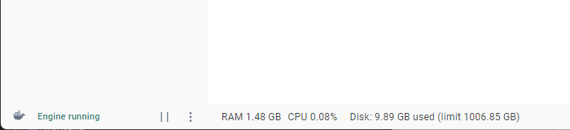
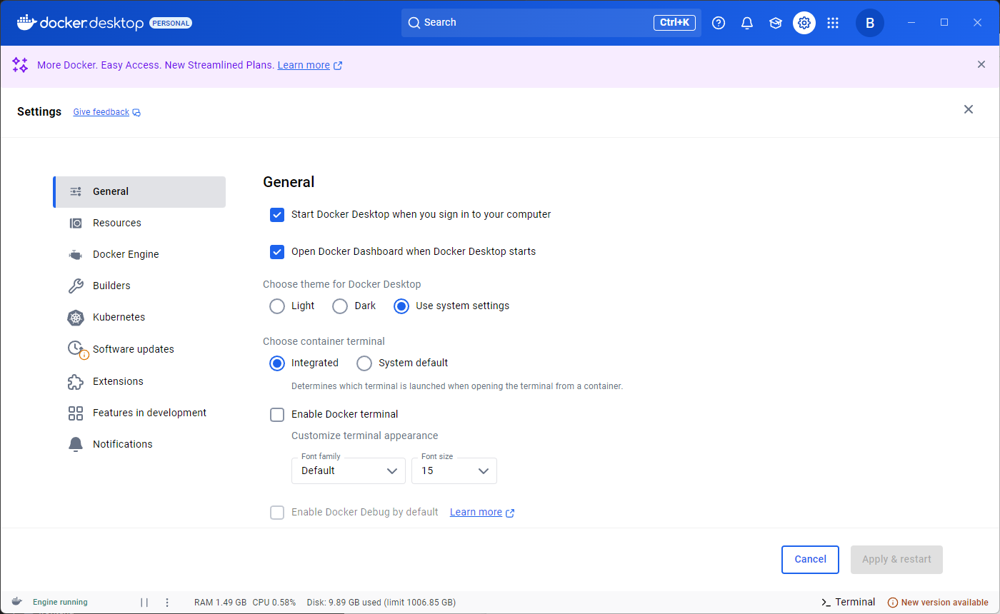
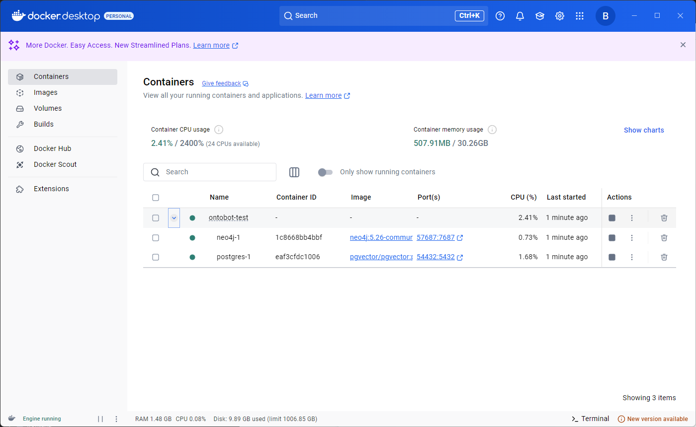
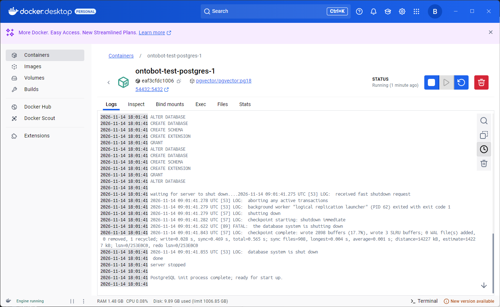
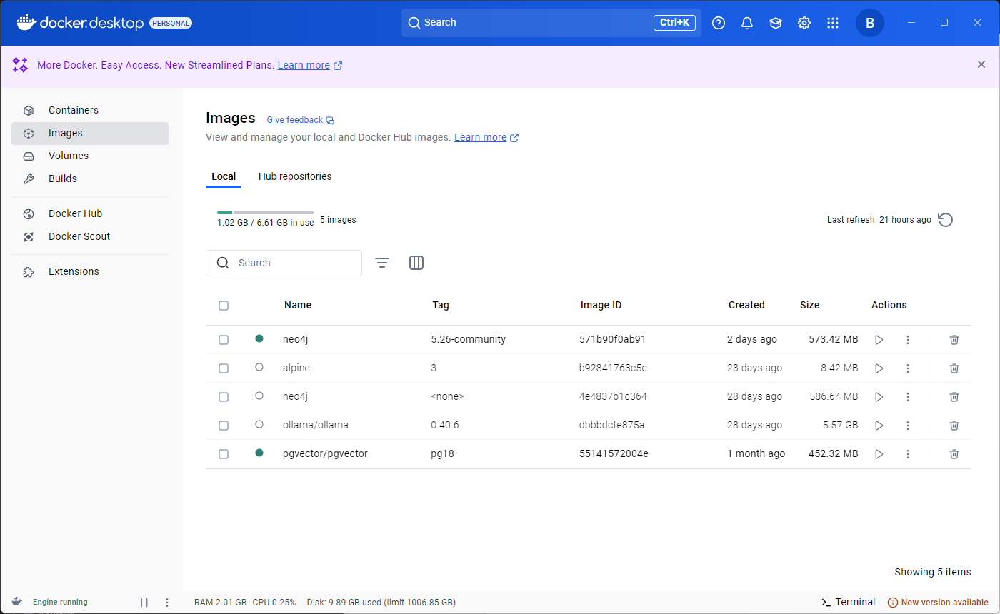
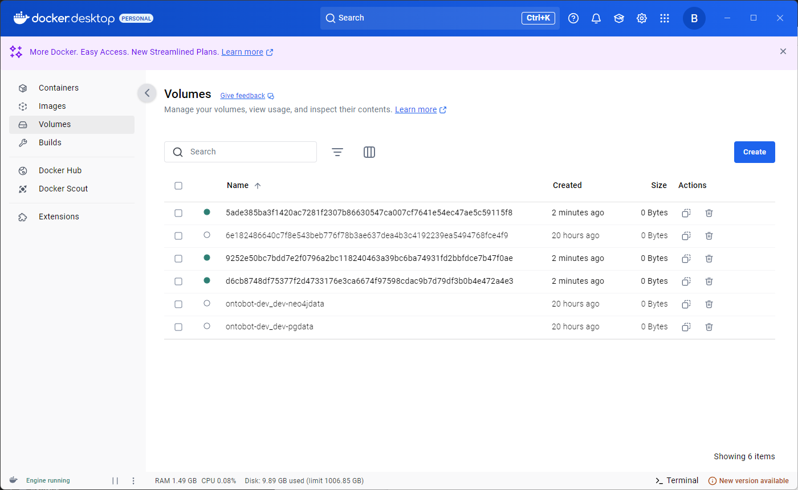

# 개발자 PC에서 실행·테스트하기 (Windows)

새 개발 PC 에서 OntoBot 을 띄우고, 화면으로 질문해 보고, 커밋 전 검사·테스트·평가를 돌리기까지의 순서다.
명령의 정본은 [scripts/task.py](../../scripts/task.py) 이고(이 문서는 그것을 부르는 순서만 적는다), 운영 설치는
[deploy/INSTALL.md](../../deploy/INSTALL.md), 이미 네이티브 PostgreSQL·Neo4j 를 깐 PC 의 내력은
[deploy/windows/README.md](../../deploy/windows/README.md) 에 있다.

모든 명령은 **저장소 루트**(PowerShell)에서 실행한다고 가정한다. 콘솔 출력이 깨지면 먼저
`$env:PYTHONUTF8 = '1'`.

---

## 1. 준비물

| 도구 | 버전·비고 |
| --- | --- |
| Docker Desktop | WSL2 백엔드. 개발 저장소(`dev-up`)·통합 테스트·평가 컨테이너를 띄운다. 처음이면 **부록 A** |
| uv | Python 3.12 를 받아 `backend/.venv` 등을 만든다(`requires-python = ">=3.12,<3.13"`) |
| Node.js 22 + npm | 프론트(`frontend/`)·개발 콘솔 화면 |
| Ollama | 호스트에 설치(11434) 또는 `compose.dev` 의 `ollama` 프로필. 채팅·평가에 필요 |
| git | 저장소 |

Ollama 모델은 [config/llm.yaml](../../config/llm.yaml) 에 적힌 것만 받는다(코드에 모델 ID 가 없다).

```powershell
ollama pull gemma4:e4b    # planner·answerer·interviewer·extractor
ollama pull bge-m3        # embedder(문서 검색)
```

## 2. 처음 한 번 — 의존성과 `.env`

```powershell
uv run --project backend python scripts/task.py sync     # backend·deployer·devconsole uv sync + frontend npm ci
Copy-Item deploy/env.example .env                         # .env 는 커밋하지 않는다
```

`.env` 에서 최소한 이것만 고친다.

| 키 | 값 |
| --- | --- |
| `ONTOBOT_DB_PASSWORD` | 아무 개발용 비밀번호(아래 `dev-up` 이 이 값으로 계정을 만든다) |
| `ONTOBOT_NEO4J_PASSWORD` | 아무 개발용 비밀번호(8자 이상 — Neo4j 규칙) |
| `ONTOBOT_NOTIFY_CONFIG_PATH` | `config/notify.dev.yaml` — Action 의 메일·SMS 를 실제로 보내지 않고 `logs/notify/*.jsonl` 에 남긴다 |

`ONTOBOT_TEST_NEO4J_*` 는 손대지 않아도 된다 — 통합 테스트·평가는 `task.py` 가 테스트 컨테이너 값을 환경변수로
넘긴다(`.env` 보다 앞선다).

## 3. 개발 저장소 띄우기

PostgreSQL(pgvector)과 Neo4j 를 컨테이너로 띄운다. 데이터는 이름 있는 볼륨에 남는다. Docker Desktop 이 켜져
있어야 한다(확인 방법·화면 설명은 부록 A).

**먼저 포트를 본다** — 네이티브 PostgreSQL·Neo4j 를 이미 깐 PC(서비스 `postgresql-x64-18`·`neo4j-ontobot-dev`)는
5432·7687 을 쥐고 있어 `dev-up` 이 `Ports are not available … 7687 … Only one usage of each socket address` 로 실패한다.

```powershell
Get-NetTCPConnection -State Listen -LocalPort 5432,7687 -ErrorAction SilentlyContinue | Select-Object LocalPort,@{n='Proc';e={(Get-Process -Id $_.OwningProcess).ProcessName}}
```

- 아무것도 안 나오면 아래 `dev-up` 을 그대로 한다.
- `postgres`·`prunsrv-amd64`(Neo4j 서비스)가 나오면 **네이티브를 그대로 쓰고 `dev-up` 을 건너뛴다**(`.env` 기본값이
  그 포트를 가리킨다 — 4절로). 실패한 `dev-up` 이 남긴 컨테이너는 `task.py dev-down` 으로 치운다.

```powershell
uv run --project backend python scripts/task.py dev-up      # PG 5432 · Neo4j 7687 (127.0.0.1 만)
```

- 개발 DB `ontobot_db` 와, 동기화 원천 시험용 `ontobot_source_dev` 가 함께 만들어진다. pgvector 는 초기화 스크립트가
  `extensions` 스키마에 만든다.
- 이미 네이티브 PostgreSQL·Neo4j 가 그 포트를 쓰면 둘 중 하나: 네이티브를 그대로 쓰고 `dev-up` 을 건너뛰거나,
  `.env` 에서 `ONTOBOT_DB_PORT`(예: 5433)·`ONTOBOT_DEV_NEO4J_PORT`(예: 7689)를 바꾸고 `ONTOBOT_NEO4J_URI` 도 그
  포트로 맞춘다.
- 호스트에 Ollama 가 없으면 `docker compose -f deploy/docker/compose.dev.yaml --env-file .env --profile ollama up -d`
  로 함께 띄우고, 그 컨테이너 안에서 모델을 받는다(`docker exec ontobot-dev-ollama-1 ollama pull gemma4:e4b`).
- 끄기는 `task.py dev-down`(데이터 유지). 데이터까지 지우려면
  `docker compose -f deploy/docker/compose.dev.yaml --env-file .env down -v`.

## 4. 스키마·샘플 데이터·계정

```powershell
uv run --project backend python scripts/task.py migrate
uv run --project backend python scripts/seed_domain_pack.py --pack sample --grant-read user --grant-edit user --documents user
uv run --project backend python scripts/graph_rebuild.py
```

- `seed_domain_pack.py` 는 샘플 온톨로지([domain-packs/sample/ontology.yaml](../../domain-packs/sample/ontology.yaml))를
  게시하고 `seed/*.csv`(합성 지역·조직·시설)를 객체로 넣는다. 여러 번 돌려도 버전이 늘지 않는다.
  `--grant-read`/`--grant-edit` 를 빼면 새 DB 에 아무 그룹도 권한이 없어 질문이 모두 `forbidden` 이 된다.
  `--documents user` 는 합성 문서를 `user` 그룹에 넣는다(임베딩은 **워커**가 한다).
- `graph_rebuild.py` 가 링크를 Neo4j 로 투영한다(탐색 질문에 필요). `--check` 는 대사만.

로그인 계정(비밀번호는 대화형으로 묻는다):

```powershell
cd backend
uv run python -m ontobot.security.cli create-user --username dev --display-name 개발자 --role admin --role modeler --role user --group user
cd ..
```

`--group` 의 그룹은 미리 있어야 한다(위 시드의 `--grant-read user` 가 `user` 그룹을 만든다 — 순서를 바꾸면
"그룹이 없습니다"로 멈춘다). 역할(`user`·`modeler`·`bot_builder`·`domain_expert`·`admin`)은 화면·기능을, 데이터 그룹(`--group`)은 볼 수 있는 객체를
정한다. 그룹 권한은 따로 `cli grant-type --group <그룹> --type <타입> [--edit]` 로도 준다.

## 5. 실행

터미널 세 개를 연다. 워커를 빼면 동기화·그래프 투영·문서 임베딩·Action 알림이 대기열에만 쌓인다.

```powershell
uv run --project backend python scripts/task.py dev-api     # API  http://localhost:8000
```

```powershell
uv run --project backend python scripts/task.py worker      # 작업 큐 처리
```

```powershell
uv run --project backend python scripts/task.py dev-web     # 화면 http://localhost:5173 (/api 를 :8000 으로 넘긴다)
```

확인:

| 주소 | 기대 |
| --- | --- |
| http://localhost:8000/healthz | `{"status":"ok"}` — 프로세스 생존 |
| http://localhost:8000/readyz | PG·Neo4j·LLM 상태. Neo4j 만 안 되면 `degraded`(200) |
| http://localhost:8000/docs | OpenAPI 화면 |
| http://localhost:5173 | 로그인 → 4절의 계정 |

### 손으로 해 볼 것(스모크)

1. **채팅** — 샘플 골든 질문([domain-packs/sample/golden.yaml](../../domain-packs/sample/golden.yaml))을 하나 골라
   묻는다. 답 문장에 인용과 등급(①②③)이 붙고, 트레이스 화면에 계획·조회 조건이 보이면 정상.
2. **문서 질문** — 워커가 임베딩을 끝낸 뒤(문서 화면에서 색인 상태 확인) 문서 내용을 묻는다. `[[d:N/M]]` 인용이 붙는다.
3. **탐색** — 링크를 건너는 질문. Neo4j 를 끄면(`docker stop ontobot-dev-neo4j-1`) `graph_unavailable` 로 실패해야
   한다(PG 로 몰래 대체하지 않는다).
4. **Action** — 미리보기 → 승인 → `logs/notify/email.jsonl` 에 한 줄이 생기는지.
5. **동기화** — 데이터 소스 화면에서 원천 `ontobot_source_dev` 를 등록하고 '지금 동기화'(워커 필요). 원천 DB 에 표를
   만들어 둬야 한다(샘플 CSV 를 넣는 방법은 [deploy/windows/README.md](../../deploy/windows/README.md) '개발용 원천 DB').

화면으로 한꺼번에 다루고 싶으면 개발 콘솔(127.0.0.1 전용, [ADR-0015](../adr/0015-dev-console.md))을 쓴다 —
검사·테스트·평가·개발 서버 켜기/끄기를 버튼으로 한다.

```powershell
uv run --project backend python scripts/task.py devconsole  # http://127.0.0.1:8200
```

## 6. 테스트

| 명령 | 무엇 | 필요한 것 |
| --- | --- | --- |
| `task.py lint` | ruff·format·mypy·import-linter(의존 규칙)·eslint·tsc | 없음 |
| `task.py test-unit` | backend·deployer·devconsole 단위 테스트 | 없음 |
| `task.py test-contract` | OpenAPI 스냅샷 | 없음 |
| `task.py test-int` | 통합 테스트(실제 PG·Neo4j) | Docker — 컨테이너가 없으면 띄운다 |
| `task.py test-down` | 테스트 컨테이너 지우기 | |

```powershell
uv run --project backend python scripts/task.py lint
uv run --project backend python scripts/task.py test-unit
uv run --project backend python scripts/task.py test-contract
uv run --project backend python scripts/task.py test-int
```

- 통합 테스트는 `deploy/docker/compose.test.yaml`(PG **55432**·Neo4j **57687**, 고정 테스트 값)을 쓴다. 개발 DB 를
  건드리지 않는다. 세션 시작 때 `ontobot_test` 의 public 스키마를 지우고 마이그레이션을 다시 건다.
- 55432 가 "forbidden by its access permissions" 로 안 뜨면 Windows 동적 예약 포트와 겹친 것이다:
  `[Environment]::SetEnvironmentVariable('ONTOBOT_TEST_PG_PORT', '54432', 'User')` 후 새 터미널.
- API 를 바꿨으면 `task.py openapi` 로 프론트 타입을 다시 만든다 — 빠뜨리면 `test-contract` 가 실패한다.

하나만 돌리기(`backend` 에서):

```powershell
cd backend
uv run pytest tests/unit/test_grounding.py -q
uv run pytest tests/integration/test_sync_graph.py -q -m integration   # 이때는 test-up 으로 컨테이너를 먼저 띄우고
                                                                         # task.py 의 TEST_ENV 값을 환경변수로 준다
cd ..
```

통합 테스트를 하나만 돌릴 때 필요한 환경변수(PowerShell):

```powershell
uv run --project backend python scripts/task.py test-up
$env:ONTOBOT_DB_HOST='127.0.0.1'; $env:ONTOBOT_DB_PORT='55432'; $env:ONTOBOT_DB_USER='ontobot'; $env:ONTOBOT_DB_PASSWORD='ontobot-test'
$env:ONTOBOT_TEST_NEO4J_URI='bolt://127.0.0.1:57687'; $env:ONTOBOT_TEST_NEO4J_USER='neo4j'; $env:ONTOBOT_TEST_NEO4J_PASSWORD='ontobot-test-graph'
```

## 7. 평가(TRD 13절)

평가는 테스트 컨테이너의 평가 전용 DB `ontobot_eval` 과 테스트 Neo4j 를 쓴다(`task.py` 의 `EVAL_ENV`). **개발 DB 로
돌리지 않는다** — 시드가 개발 데이터를 덮고 카세트 키가 CI 와 달라진다.

```powershell
uv run --project backend python scripts/task.py eval-prepare   # 마이그레이션·샘플 시드·문서·그래프 재구축
uv run --project backend python scripts/task.py eval-replay    # 녹화 응답으로 회귀(CI 와 같다, Ollama 불필요)
uv run --project backend python scripts/task.py eval           # 실제 모델로 게이트(Ollama 필요)
```

- 모델·프롬프트·추출 스키마·문서·청크를 바꿨다면 `task.py eval-record` 로 다시 녹화하고
  `domain-packs/sample/llm_cassette.json` 을 함께 커밋한다. 안 하면 CI 의 `eval-replay` 가 카세트 놓침으로 실패한다.
- 플래너 프롬프트를 바꿨다면 `scripts/spike_plan.py --models gemma4:e4b`, 워크숍 추출이면
  `scripts/spike_workshop.py --models gemma4:e4b` 로도 재고 ADR 에 남긴다.

## 8. 커밋 전 점검(CI 와 같은 순서)

[.github/workflows/ci.yml](../../.github/workflows/ci.yml) 이 하는 일을 PC 에서 먼저 돌린다.

```powershell
uv run --project backend python scripts/task.py lint
uv run --project backend python scripts/task.py test-unit
uv run --project backend python scripts/task.py test-contract
uv run --project backend python scripts/task.py build
uv run --project backend python scripts/task.py test-int
uv run --project backend python scripts/task.py eval-prepare
uv run --project backend python scripts/task.py eval-replay
uv run --project backend python scripts/task.py test-down
```

## 9. 자주 막히는 곳

| 증상 | 원인·조치 |
| --- | --- |
| 질문이 모두 `forbidden` | 데이터 그룹 권한이 없다. 시드에 `--grant-read user` 를 주거나 `cli grant-type`, 계정에 `--group user` |
| '지금 동기화'·문서 색인이 안 끝난다 | 워커를 안 띄웠다(`task.py worker`) |
| 탐색 질문이 `graph_unavailable` | Neo4j 가 꺼졌거나 투영 전. `graph_rebuild.py` |
| 채팅이 LLM 오류 | Ollama 미기동 또는 모델 미설치(`ollama list`). `/readyz` 로 확인 |
| `alembic` 이 ini 를 못 읽는다 | `alembic.ini` 에 한글이 들어갔다(ASCII 만, cp949 로 읽힌다) |
| 콘솔 한글이 깨진다 | `$env:PYTHONUTF8 = '1'` |
| `docker` 명령이 `error during connect` | Docker Desktop 이 꺼져 있다 — 부록 A-3 |
| `test-int` 에서 문서 테스트가 확장 없음으로 실패 | 오래된 테스트 컨테이너. `task.py test-down` 후 다시 |
| `test-contract` 실패 | API 를 바꾸고 `task.py openapi` 를 안 돌렸다 |
| CI `eval-replay` 만 실패 | 카세트 놓침 — `eval-record` 후 카세트 커밋 |

---

## 부록 A. Docker Desktop 처음 쓰는 사람을 위한 안내

개발자가 아니어도 따라 할 수 있게 적었다. 명령은 그대로 복사해 붙여 넣으면 된다.

### A-1. Docker 가 무엇이고 왜 필요한가

OntoBot 은 데이터를 **PostgreSQL**(표 형태의 데이터베이스)과 **Neo4j**(연결 관계를 담는 데이터베이스)에 저장한다.
이 둘을 PC 에 직접 설치하면 설정이 까다롭고 지우기도 어렵다. **Docker** 는 이런 프로그램을 PC 안의 작은 상자에
담아 켜고 끄는 도구이고, **Docker Desktop** 은 그 상자들을 화면으로 보고 다루는 Windows 프로그램이다.

자주 나오는 말:

| 말 | 쉽게 말하면 |
| --- | --- |
| 이미지(Image) | 프로그램 설치 파일 묶음. 한 번 내려받으면 PC 에 남는다 |
| 컨테이너(Container) | 이미지로 만든 **실제로 돌아가는 상자**. 켜고(Start) 끌(Stop) 수 있다 |
| 볼륨(Volume) | 컨테이너가 쓰는 **데이터 보관함**. 컨테이너를 지워도 남고, 볼륨을 지우면 데이터가 사라진다 |
| 포트(Port) | PC 안의 "창구 번호". 5432 번 창구는 PostgreSQL, 7687 번 창구는 Neo4j 처럼 정해져 있다. 한 창구는 한 프로그램만 쓸 수 있다 |
| compose | 여러 컨테이너를 한 묶음으로 같이 켜고 끄는 설정 파일. OntoBot 은 `ontobot-dev`(개발용)·`ontobot-test`(테스트용) 두 묶음이 있다 |

OntoBot 에서 Docker 를 쓰는 곳:

| 묶음 이름 | 언제 생기나 | 들어 있는 것 | 데이터 |
| --- | --- | --- | --- |
| `ontobot-dev` | `task.py dev-up` | 개발용 PostgreSQL·Neo4j | 볼륨에 남는다 |
| `ontobot-test` | `task.py test-int`·`eval-prepare` | 테스트·평가용 PostgreSQL·Neo4j | 남지 않는다(`test-down` 하면 사라짐) |

> 이 PC 처럼 PostgreSQL·Neo4j 를 이미 Windows 에 직접 설치해 둔 경우 `ontobot-dev` 는 쓰지 않아도 된다(3절).
> 그래도 **테스트와 평가에는 Docker Desktop 이 꼭 필요하다.**

### A-2. 설치

**1단계.** Windows 기능 **WSL2** 가 필요하다. PowerShell 을 **관리자 권한으로 실행**(시작 메뉴에서 PowerShell 을 오른쪽
클릭 → "관리자 권한으로 실행")하고 아래 명령을 입력한 뒤 PC 를 다시 시작한다. 이미 설치돼 있으면 그렇다고 알려 준다.

```powershell
wsl --install
```

**2단계.** 회사가 정한 경로(사내 소프트웨어 센터 등)에서 **Docker Desktop for Windows** 를 받아 설치한다. 설치 중
"Use WSL 2 instead of Hyper-V" 같은 항목이 보이면 **켠 채로** 둔다.

**3단계.** 설치가 끝나면 PC 를 다시 시작하라고 할 수 있다 — 다시 시작한다.

**4단계.** Docker Desktop 을 처음 열면 이용 약관 동의, 로그인 권유 화면이 나온다. 약관은 직접 읽고 동의한다.
**로그인은 하지 않아도 된다**(Skip / Continue without signing in).

> 회사 규모에 따라 Docker Desktop 은 유료 구독이 필요할 수 있다. 사용 승인은 담당 부서에 확인한다.

### A-3. 켜져 있는지 확인하기

Docker Desktop 은 **프로그램이 켜져 있어야** 컨테이너가 돈다. PC 를 켤 때마다 확인한다.

- 작업 표시줄 오른쪽 아래(시계 옆, 숨은 아이콘 `^` 안)에 **고래 모양 아이콘**이 있으면 켜진 것이다.
- Docker Desktop 창 **왼쪽 맨 아래**에 고래 아이콘과 함께 **"Engine running"** 이 보이면 쓸 준비가 된 것이다
  (아래 그림의 왼쪽 아래). "Starting…" 이면 1~2분 기다린다.



명령으로 확인하려면 PowerShell 에서:

```powershell
docker version
```

`Server:` 아래 버전이 나오면 정상이다. `error during connect` 나 `cannot find the file specified` 가 나오면
Docker Desktop 이 꺼져 있는 것이다 — 시작 메뉴에서 "Docker Desktop" 을 열고 왼쪽 아래가 "Engine running" 이 될 때까지 기다린다.

매번 켜기 귀찮으면: 창 오른쪽 위 **톱니바퀴(Settings) → General → "Start Docker Desktop when you sign in to your
computer"** 에 체크한다(아래 그림처럼 이미 체크돼 있으면 그대로 둔다). 바꿨을 때만 오른쪽 아래 **Apply & restart** 를
누르고, 아무것도 안 바꿨으면 오른쪽 위 **×** 로 닫는다.



### A-4. 화면 둘러보기

왼쪽 메뉴(Containers·Images·Volumes·Builds·Docker Hub·Docker Scout·Extensions) 가운데 **위의 세 곳만** 쓴다.
창 위쪽의 보라색 광고 띠("More Docker…")와 오른쪽 위 계정 단추는 OntoBot 작업과 상관없다.

**Containers(컨테이너)** — 가장 많이 보는 화면



- `ontobot-dev`, `ontobot-test` 처럼 **묶음 이름**이 한 줄로 보이고, 이름 왼쪽 꺾쇠(›)를 누르면 안의 컨테이너
  (`neo4j-1`, `postgres-1`)가 펼쳐진다.
- 켜졌는지는 이름 왼쪽 **점**으로 본다: **초록 점이면 켜짐**, 빈 동그라미면 꺼짐. (따로 'Status' 칸은 없다.)
- **Port(s)** 칸: `57687:7687`, `54432:5432` 처럼 이 PC 의 어느 창구(앞 숫자)를 쓰는지 보인다. 파란 글씨지만 누를 필요는 없다.
- 오른쪽 **Actions** 칸의 단추:

| 단추 | 하는 일 |
| --- | --- |
| ■ (Stop) — 켜져 있을 때 보인다 | 끄기 — 데이터는 그대로 |
| ▶ (Start) — 꺼져 있을 때 ■ 자리에 보인다 | 켜기 |
| ⋮ | 그 밖의 메뉴(다시 시작 등) |
| 🗑 (Delete) | 컨테이너 지우기 — 볼륨은 남는다. 묶음 줄에서 누르면 묶음 전체가 지워진다 |

**컨테이너 상세 — Logs(기록)**: 컨테이너 이름(예: `postgres-1`)을 누르면 아래 화면이 열린다. 첫 탭 **Logs** 에 그
프로그램이 남긴 기록이 시간 순서로 나온다. 문제가 생겨 개발자에게 물을 때 이 화면을 찍어 보내면 된다.
오른쪽 위 **STATUS** 에 `Running` 과 켜진 시각이 보이고, 옆의 파란 단추는 차례로 끄기(■)·켜기(▶)·다시 시작(↻),
빨간 단추는 지우기다. 위쪽 **Containers** 글씨를 누르면 목록으로 돌아간다.



Inspect·Bind mounts·Exec·Files·Stats 탭은 개발자용이다 — 특히 **Exec** 탭에서 명령을 치지 않는다(A-7).

**Images(이미지)** — 내려받은 설치 파일 목록. `pgvector/pgvector`(PostgreSQL), `neo4j`, `ollama/ollama` 등이 보인다.
이름 왼쪽 초록 점은 지금 그 이미지로 켜진 컨테이너가 있다는 뜻이다. 지워도 다음에 필요할 때 다시 내려받는다
(인터넷 연결 필요 — 시간이 걸린다).



**Volumes(볼륨)** — 데이터 보관함. `ontobot-dev_dev-pgdata`(개발 DB 데이터), `ontobot-dev_dev-neo4jdata`(그래프 데이터)처럼
이름이 붙은 것이 개발 데이터다. 긴 영문·숫자 이름(예: `5ade385b…`)은 테스트 컨테이너가 쓰다 남긴 임시 보관함이다.
⚠ **여기서 지우면 개발 데이터가 영구히 사라진다.** 지우라는 안내를 받았을 때만 지운다.



### A-5. OntoBot 작업과 Docker Desktop 화면의 관계

명령을 치면 Docker Desktop 화면이 이렇게 바뀐다. 명령 대신 화면 단추로 해도 같다(단, 처음 만드는 일은 명령으로).

| 명령 | Docker Desktop 에서 보이는 변화 |
| --- | --- |
| `task.py dev-up` | Containers 에 `ontobot-dev` 묶음이 생기고 Running |
| `task.py dev-down` | `ontobot-dev` 묶음이 사라짐(Volumes 의 데이터는 남음) |
| `task.py test-int`·`test-up`·`eval-prepare` | `ontobot-test` 묶음이 생기고 Running |
| `task.py test-down` | `ontobot-test` 묶음이 사라짐(테스트 데이터도 사라짐 — 정상) |

PC 를 오래 쓰지 않을 때는 Containers 화면에서 묶음 줄의 ■ 를 눌러 꺼 두면 메모리를 덜 쓴다. 다시 쓸 때 ▶ 를 누르거나
`dev-up` 을 다시 실행한다.

### A-6. 자주 만나는 문제

| 화면·메시지 | 뜻 | 할 일 |
| --- | --- | --- |
| `error during connect`, `The system cannot find the file specified` | Docker Desktop 이 꺼져 있다 | Docker Desktop 을 열고 "Engine running" 이 뜰 때까지 기다린 뒤 다시 실행 |
| `Ports are not available … Only one usage of each socket address` | 그 창구(포트)를 다른 프로그램이 이미 쓰고 있다 | 3절의 포트 확인. 이 PC 는 Windows 에 직접 설치한 DB 가 쓰고 있으므로 `dev-up` 을 쓰지 않는다 |
| `Ports are not available … forbidden by its access permissions` | Windows 가 그 포트를 막아 두었다 | 6절의 `ONTOBOT_TEST_PG_PORT` 설정 |
| 묶음이 Running 인데 한 컨테이너만 계속 `Restarting` | 그 프로그램이 켜지다 실패한다 | 컨테이너 이름 → Logs 화면을 찍어 개발자에게 전달 |
| "WSL update required", "WSL 2 installation is incomplete" | WSL 이 오래됐다 | 관리자 PowerShell 에서 `wsl --update` 후 Docker Desktop 다시 시작 |
| PC 가 느리고 디스크가 가득 찬다 | 오래된 이미지·컨테이너가 쌓였다 | 개발자와 상의 후 Images 에서 안 쓰는 것 지우기. Volumes 는 건드리지 않는다 |
| Docker Desktop 이 "Starting…" 에서 멈춤 | 엔진이 못 뜬다 | 고래 아이콘 오른쪽 클릭 → **Restart**. 그래도 안 되면 PC 다시 시작 |

### A-7. 하지 말아야 할 것

- **Volumes 를 함부로 지우지 않는다** — 개발 DB 데이터가 사라진다.
- 설정의 **"Reset to factory defaults"·"Clean / Purge data"(Troubleshoot 메뉴)** 는 모든 컨테이너·이미지·볼륨을
  지운다. 개발자 안내 없이 누르지 않는다.
- 컨테이너 상세 화면의 **Exec** 탭이나 창 오른쪽 아래 **Terminal** 에서 컨테이너 안 파일을 고치지 않는다 — 다시 만들면 사라지고, 무엇이 바뀌었는지 아무도 모르게 된다.
