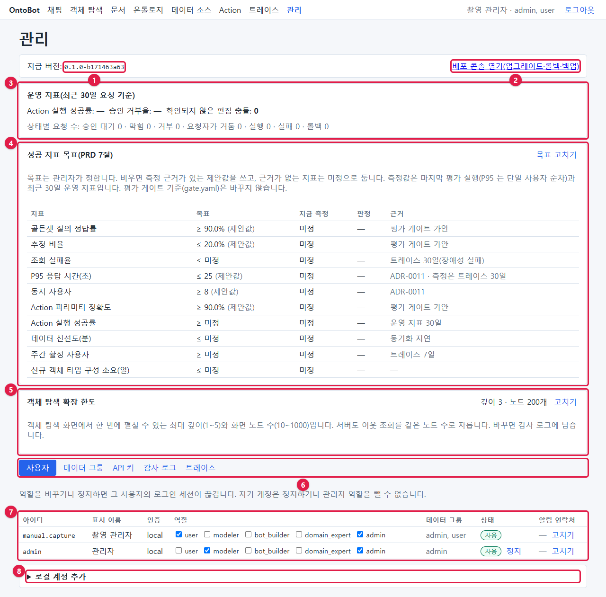
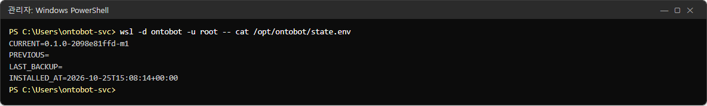

# 들어가며

이 책은 OntoBot 을 **설치하고, 매일 지켜보고, 사용자를 관리하고, 업그레이드하고, 문제가 생겼을 때 고치는 사람**을
위한 안내서입니다. 회사에서는 보통 "시스템 운영자", "서버 관리자", "OntoBot 관리자"라고 부르는 사람입니다.

개발을 해 본 적이 없어도 따라 할 수 있도록 썼습니다. 모든 화면은 **실제로 설치한 OntoBot 을 실제로 조작하면서**
찍었고, 모든 명령은 **실제로 실행한 결과**를 그대로 실었습니다. 화면에 나오는 숫자·날짜·오류 문구는 꾸민 것이
아닙니다.

## 이 책을 읽을 사람

| 읽는 사람 | 주로 볼 장 | 하는 일 |
| --- | --- | --- |
| 처음 맡은 운영자 | 1~6장, 17~18장, 25장 | 시스템을 이해하고, 화면에 들어가고, 매일 점검합니다 |
| 설치 담당자 | 4~5장, 29~31장 | 폐쇄망 서버에 처음 설치합니다 |
| OntoBot 관리자(admin) | 6~10장, 14장, 16장 | 계정·권한·감사 로그·트레이스·Action 롤백을 맡습니다 |
| 데이터 연결 담당자 | 11~13장, 15장 | 사내 DB·메일·SMS 를 연결합니다 |
| 배포 담당자 | 17~24장 | 업그레이드·롤백·백업을 배포 콘솔로 합니다 |
| 장애 대응 담당자 | 26~28장, 32장 | 로그를 보고 원인을 찾아 고칩니다 |

화면을 쓰는 방법(질문하기, 답 읽기, Action 요청하기 등)은 **사용자 매뉴얼**에 자세히 있습니다. 이 책은 운영자가
꼭 알아야 하는 만큼만 그 화면을 다시 보여 줍니다.

## 이 책의 짜임

| 부 | 장 | 내용 |
| --- | --- | --- |
| 제1부 이해하기 | 1~3장 | OntoBot 이 무엇이고 어떻게 생겼는지, 운영자가 알아야 할 낱말 |
| 제2부 설치하기 | 4~5장 | 설치 준비, 번들, 설치, 설치 확인 |
| 제3부 사람과 권한 | 6~10장 | 웹 화면 첫걸음, 계정, 읽기 권한, 감사 로그, 트레이스 |
| 제4부 데이터와 알림 | 11~16장 | 데이터 소스, 매핑·동기화, 그래프, Action, 메일·SMS, 편집 충돌 |
| 제5부 배포 콘솔 | 17~24장 | 로그인, 현황, 백업, 번들, 업그레이드, 롤백, 콘솔 갱신, 작업 기록 |
| 제6부 지키기 | 25~28장 | 정기 점검, 로그, 장애를 일부러 일으켜 보는 실습, 증상별 해결표 |
| 제7부 참고 | 29~33장 | 명령 모음, 설정 항목, 보안, 훈련 시나리오, 자주 묻는 질문 |
| 제8부 깊이 보기 | 34~42장 | 정상 동작 질문 모음, 역할별 화면, 온톨로지 확인, 동시 사용과 용량, 품질 평가, 서버 자원·AI 모델, 데이터베이스·관계 저장소, 화면·명령 문구 사전, 문의 처리 사례 |
| 부록 | 43~45장 | 점검표·양식, 용어집, 찾아보기 |

처음이라면 1장부터 순서대로 읽으세요. 장이 앞 장의 결과(만든 계정, 연결한 데이터 등)에 기대어 이어지도록
썼습니다. 이미 운영 중이라면 필요한 장만 골라 읽어도 됩니다.

## 사진 읽는 법

### 웹 화면 사진

- 화면 위에 **빨간 테두리**와 **빨간 동그라미 번호**(①②③…)가 있으면, 그 번호를 본문의 표나 순서와 짝지어
  읽습니다. 빨간 표시는 설명을 위해 사진에만 그린 것이고 실제 화면에는 없습니다.
- 사진은 대부분 가로 1280 화소 크기의 브라우저(마이크로소프트 엣지)로 찍었습니다. 모니터가 더 넓으면 화면
  양옆에 여백이 더 생길 뿐 내용은 같습니다.
- 화면 일부만 잘라 보여 줄 때도 있습니다. 그때는 본문에 "~부분만 잘라 보면"이라고 적었습니다.

### 명령 화면 사진

- 검은 창은 **관리자 권한으로 연 PowerShell** 입니다. 맨 윗줄 `PS C:\Users\ontobot-svc>` 뒤에 있는 글자가
  운영자가 입력하는 명령이고, 그 아래가 서버가 돌려준 결과입니다.
- `==>` 로 시작하는 하늘색 줄은 진행 단계, 붉은 줄은 오류나 경고입니다.
- 결과가 너무 길면 가운데를 줄이고 `… (n줄 생략)` 이라고 적었습니다.
- 비밀번호처럼 보이는 값은 `****` 로 가렸습니다. 가린 것 말고는 고치지 않았습니다.

## 촬영 환경 — 꼭 읽어 주세요

이 책의 사진은 다음 환경에서 찍었습니다. 운영 서버와 다른 점을 숨기지 않고 적어 둡니다.

| 항목 | 운영 서버(이 책이 안내하는 환경) | 이 책을 찍은 PC |
| --- | --- | --- |
| 운영체제 | Windows Server 2022 이상 | Windows 11 Pro |
| 리눅스 환경 | WSL2 배포판 `ontobot` | Docker Desktop 의 가상 머신 |
| 설치 폴더 | `/opt/ontobot` | `/mnt/docker-desktop-disk/ontobot-trial` |
| 설치 방법 | `install-host.ps1` → `ontobotctl install` | 같은 번들로 `ontobotctl install` 만 직접 실행 |
| 반입 폴더 | `C:\OntoBot-bundles` | 가상 머신 안의 같은 이름 폴더(사진 속 문구는 같음) |
| GPU | NVIDIA(권장) | NVIDIA GeForce RTX 5070 Ti |
| 버전 | 배포 담당자가 준 번들 | `0.1.0-2098e81ffd-m1`(전체 번들)과 `-m2`(업그레이드용 앱 번들) |

이 차이 때문에 생기는 일은 다음과 같습니다.

1. **명령 화면의 첫 줄**에는 운영 서버에서 입력할 명령(`wsl -d ontobot -u root -- …`)을 적었습니다. 촬영 PC 에서는
   같은 `ontobotctl`·`docker compose` 를 배포 콘솔 컨테이너 안에서 실행해 결과를 얻었습니다. 그래서 결과 안에
   `/mnt/docker-desktop-disk/ontobot-trial` 같은 경로가 보이면, 운영 서버에서는 `/opt/ontobot` 으로 읽으세요.
2. 최초 설치 스크립트(`install-host.ps1`)가 하는 일(윈도 기능 켜기, 배포판 만들기, 부팅 예약 작업, 방화벽)은
   촬영 PC 에서 실행할 수 없었습니다. 5장은 이 부분을 **스크립트가 실제로 출력하는 문구**를 원본에서 옮겨 설명하고,
   사진이 없다는 것을 밝혀 두었습니다.
3. 서버 안 프로그램이 찍는 시각은 세계 표준시(UTC)입니다. 화면(브라우저)은 한국 시각으로 바꿔 보여 줍니다. 그래서
   같은 일이 명령 화면에는 `16:12`, 웹 화면에는 `오전 1:12` 로 보일 수 있습니다(9시간 차이). 고장이 아닙니다.
4. 메일 서버와 SMS 발송 테이블은 회사마다 다릅니다. 15장은 **시험용 메일 수신 프로그램**과 **원천 DB 안에 만든
   발송 테이블**에 실제로 보내 보며 찍었습니다. OntoBot 쪽 설정과 화면은 운영과 똑같습니다.
5. **v1 웹 화면.** 앱 웹 화면이 나오는 장(6·7·9~16·34~36·38장)은 v1 시험 설치본에서 다시 찍었습니다. 같은 PC 에
   `-m1` 대신 MVP 전체 번들(`0.1.0-2098e81ffd`)을 설치하고 v1 앱 번들(`0.1.0-b171463a63`)로 업그레이드한 설치본입니다.
   그래서 관리 화면의 "지금 버전"이 `0.1.0-b171463a63` 으로 보입니다. **명령 화면 사진과 배포 콘솔(8100) 화면은 그대로**
   (`-m1`·`-m2` 번들로 찍은 예전 판)이라 버전 문자열이 본문 순서와 맞습니다. 데이터 그룹·API 키·해시 체인 검증·트레이스
   목록·문서 사진(8.1·7.13·9.10·10.2·11.7)은 사용자 매뉴얼 촬영 환경(`park.admin`)에서 찍었습니다. 사진 설명에 "예전 판"
   이라고 적힌 몇 장(트레이스 실패 종류 두 장, 감사 로그의 배포 기록, 42장 사례 7 등)은 다시 만들 수 없는 상황이라
   예전 화면을 남겼습니다.

## 이 책에 나오는 계정

촬영하면서 아래 계정을 실제로 만들었습니다(7장). 여러분의 회사에서는 실제 직원 계정으로 바꿔 읽으세요.

| 아이디 | 표시 이름 | 역할 | 이 책에서 맡은 일 |
| --- | --- | --- | --- |
| `admin` | 관리자 | admin, modeler | 설치할 때 만든 첫 관리자 |
| `manual.capture` | 촬영 관리자 | admin, user | 이 책을 찍은 운영자. 대부분의 화면은 이 계정입니다 |
| `kim.user` | 김사용 | user | 일반 사용자. 질문하고 Action 을 요청합니다 |
| `lee.modeler` | 이모델 | modeler, user (+domain_expert) | 온톨로지·데이터 소스 담당 |
| `park.admin` | 박관리 | admin, user | Action 승인자 |
| `choi.expert` | 최현업 | domain_expert | 현업 전문가 |
| `jung.builder` | 정빌더 | bot_builder | 챗봇 평가 담당. 8장의 권한 실습에 씁니다 |

> **알아 두기** 계정의 비밀번호는 이 책에 적지 않았습니다. 화면 사진에서도 점(•)으로 가려져 있습니다.

## 글자 표기

| 표기 | 뜻 | 예 |
| --- | --- | --- |
| **굵은 글씨** | 화면의 단추·메뉴·칸 이름 | **로그인** 단추, **관리** 메뉴 |
| `고정폭 글씨` | 입력하는 글자, 파일 이름, 명령 | `kim.user`, `app.env` |
| `<꺾쇠>` | 여러분의 값으로 바꿔 넣을 자리 | `http://<서버 주소>:8000` |
| → | 차례대로 누르기 | **관리** → **사용자** 탭 |

본문 사이에 다음 상자가 나옵니다.

> **알아 두기** 알고 있으면 좋은 사실이나 배경입니다.

> **주의** 실수하면 되돌리기 어렵거나 사용자에게 영향이 가는 일입니다. 꼭 읽으세요.

> **해 보기** 직접 따라 해 보며 익히는 연습입니다.

## 고치고 다시 만들기

화면이나 운영 절차가 바뀌면 이 책도 함께 고칩니다. 원본은 `docs/manual/ops/*.md` 이고 사진은
`docs/manual/ops/images/` 에 있습니다. 사진은 `docs/manual/tools/capture_ops.py` 로 다시 찍고,
`docs/manual/tools/build_manual.py --book ops` 로 Word·PDF 를 만듭니다. 자세한 순서는 저장소의
`docs/manual/operator-manual.md` 에 있습니다.
