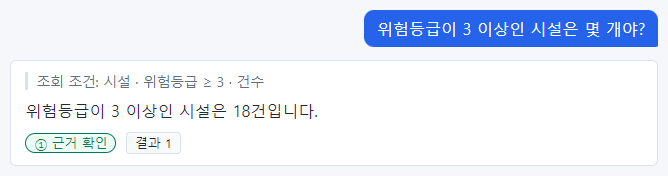
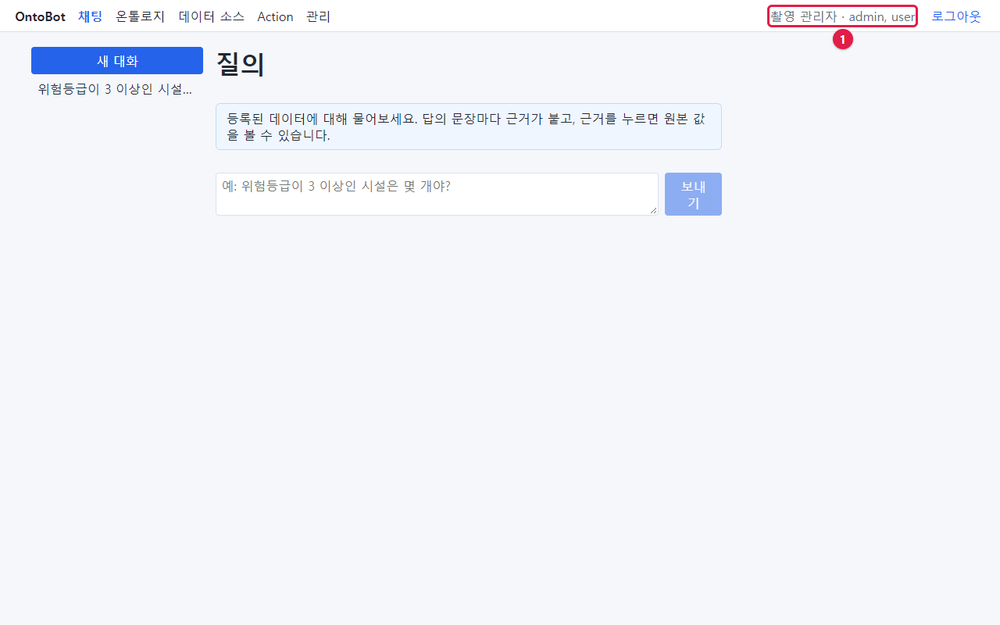
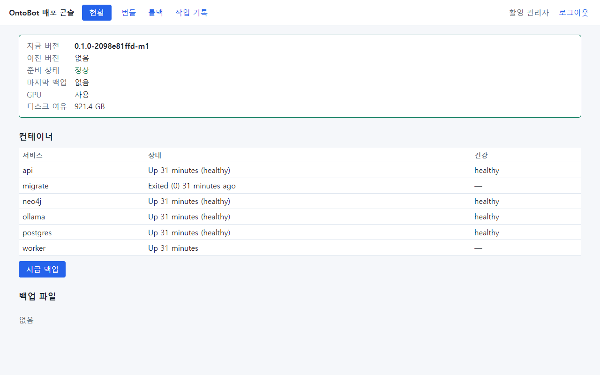

# 1장 OntoBot 과 운영자의 일

## 1.1 OntoBot 은 무엇인가요

OntoBot 은 회사의 업무 데이터(예: 시설 목록, 조직, 지역)에 대해 **사람 말로 물으면 데이터를 실제로 조회해서
답하는 챗봇**입니다. 예를 들어 사용자가 "위험등급이 3 이상인 시설은 몇 개야?"라고 물으면, OntoBot 은 질문을 조회
조건으로 바꾸고, 데이터베이스에서 세어, 그 결과로 답을 씁니다.

위 사진은 이 책의 시험 서버에서 실제로 물어본 결과입니다. 사진 속 요소의 뜻은 다음과 같습니다.

| 요소 | 뜻 | 운영자가 볼 점 |
| --- | --- | --- |
| 오른쪽 파란 말풍선 | 사용자가 한 질문 | — |
| **조회 조건: 시설 · 위험등급 ≥ 3 · 건수** | 질문을 어떻게 이해했는지(서버가 만든 문장) | 이해가 틀렸으면 트레이스(10장)를 봅니다 |
| **위험등급이 3 이상인 시설은 18건입니다.** | AI 가 쓴 답 | — |
| **① 근거 확인** | 답 문장이 실제 데이터와 글자 그대로 맞는지 서버가 확인한 등급 | ①이 정상. ②·③이 잦으면 원인을 찾습니다 |
| **결과 1** | 근거 단추. 누르면 근거가 된 원래 값이 나옵니다 | — |

## 1.2 다른 챗봇과 다른 세 가지

OntoBot 은 다음 세 가지 약속을 지키도록 만들어져 있습니다. 운영자가 장애를 판단할 때도 이 약속을 기준으로 합니다.

1. **지어내지 않습니다.** 답의 문장마다 실제 데이터에서 찾은 근거가 붙고, 서버가 근거와 글자 그대로 맞는지
   확인합니다. 맞지 않는 문장은 "일부 추정(②)"으로 표시하거나 아예 보여 주지 않습니다(③).
2. **실패를 숨기지 않습니다.** 데이터베이스가 멈추거나 AI 모델이 응답하지 않으면 "결과 없음"이 아니라
   **"조회 실패"** 라고 분명히 알립니다. 운영자는 사용자가 "조회 실패"를 보았다는 말을 들으면, 그것을
   장애 신호로 받아들이면 됩니다(27장에서 일부러 장애를 일으켜 그 모습을 확인합니다).
3. **바꾸는 일은 승인을 거칩니다.** "이 시설 위험등급을 3으로 바꿔줘" 같은 요청(Action)은 바로 실행되지 않고
   **미리보기 → 승인 → 실행** 순서를 밟습니다. 실행한 뒤에도 되돌릴(롤백) 수 있습니다. 원래 데이터가 있는 사내
   DB 는 절대 바꾸지 않고, OntoBot 안의 "편집 레이어"에만 씁니다.

## 1.3 운영 환경의 전제

| 전제 | 뜻 | 운영자에게 주는 영향 |
| --- | --- | --- |
| 폐쇄망 | 인터넷이 끊긴 사내망에서 돕니다 | 설치·업그레이드 파일을 USB 등으로 반입합니다 |
| 온프레미스 | 회사 서버 한 대에 설치합니다 | 서버의 전원·디스크·백업을 운영자가 챙깁니다 |
| Windows Server 2022 이상 | WSL2(윈도 안의 리눅스)를 씁니다 | 2019 이하에는 설치할 수 없습니다 |
| 컨테이너 | 프로그램 여섯 개가 각각 컨테이너로 돕니다 | 2장에서 하나하나 살펴봅니다 |
| AI 모델도 서버 안 | 외부 AI 서비스로 데이터를 보내지 않습니다 | GPU 가 있으면 빠릅니다 |
| 배포 콘솔 | 업그레이드·롤백·백업을 화면으로 합니다 | 명령을 거의 치지 않아도 됩니다 |

외부로 나가는 연결은 원칙적으로 없습니다. 예외는 **운영자가 직접 설정한 사내 메일 서버와 SMS 게이트웨이**
뿐입니다(15장).

## 1.4 화면은 두 개입니다

운영자가 쓰는 화면은 두 개이고, 주소(포트)가 다릅니다.

| 화면 | 주소 | 누가 쓰나 | 무엇을 하나 |
| --- | --- | --- | --- |
| OntoBot 웹 화면 | `http://<서버>:8000` | 모든 직원 | 질문, Action, 온톨로지, 데이터 소스, **관리**(계정·권한·감사 로그·트레이스) |
| 배포 콘솔 | `http://<서버>:8100` | 관리자 PC 만 | 현황 보기, 백업, 번들 가져오기, 업그레이드, 롤백 |

두 화면은 **같은 관리자 계정**으로 들어갑니다. 다만 배포 콘솔은 OntoBot 과 따로 돌아가는 별도 프로그램입니다.
그래서 업그레이드가 잘못돼 OntoBot 웹 화면이 뜨지 않아도 배포 콘솔에서 되돌릴 수 있습니다.

## 1.5 운영자가 하는 일 — 한눈에

| 언제 | 할 일 | 어디서 | 걸리는 시간 | 이 책 |
| --- | --- | --- | --- | --- |
| 설치할 때 한 번 | 서버 준비, 번들 반입, 설치, 설치 확인 | PowerShell, 브라우저 | 반나절 | 4~5장 |
| 설치 직후 | 계정 만들기, 읽기 권한, 데이터 소스 연결, 메일·SMS | 웹 화면, 설정 파일 | 1~2시간 | 6~15장 |
| 매일 | 현황 확인(준비 상태·컨테이너·백업), 동기화·발송 실패 확인 | 배포 콘솔, 웹 화면 | 5분 | 25장 |
| 매주 | 디스크, 감사 로그, 오래 기다리는 승인 요청 | 배포 콘솔, 웹 화면 | 15분 | 25장 |
| 매달 | 백업 되살리기 연습, 계정 정리, 권한 점검 | 웹 화면, 배포 콘솔 | 1시간 | 25장, 32장 |
| 새 버전이 나오면 | 번들 반입, 사전 점검, 업그레이드, 확인(필요하면 롤백) | 배포 콘솔 | 30분 | 20~23장 |
| 문제가 생기면 | 증상 확인, 로그·트레이스, 다시 시작, 개발팀 문의 | 배포 콘솔, PowerShell | 상황마다 | 26~28장 |

## 1.6 누가 무엇을 맡나 — 역할 나누기

OntoBot 운영에는 보통 여러 사람이 함께합니다. 한 사람이 여러 역할을 맡아도 됩니다.

| 역할 | 하는 일 | OntoBot 안의 역할 이름 |
| --- | --- | --- |
| 시스템 운영자 | 서버·설치·백업·업그레이드·장애 대응 | admin(배포 콘솔 로그인에 필요) |
| OntoBot 관리자 | 계정·권한·감사 로그·트레이스·Action 롤백 | admin |
| 모델러 | 온톨로지(데이터 설계도) 편집·게시, 데이터 소스·매핑 | modeler |
| 승인자 | Action 요청을 승인·거부 | Action 마다 정함(보통 admin) |
| 챗봇 빌더 | 평가 문항(골든셋) 관리·실행 | bot_builder |
| 현업 전문가 | 인터뷰 워크숍에서 업무를 설명 | domain_expert |
| 일반 사용자 | 질문, Action 요청 | user |
| 개발팀 | 번들 만들기·서명, 장애 원인 분석 | (계정 불필요) |

> **알아 두기** 원천 DB(사내 업무 DB)의 담당자, 메일 서버·SMS 게이트웨이의 담당자도 함께 일합니다. 11장과
> 15장에서 그분들께 무엇을 요청해야 하는지 적어 두었습니다.

## 1.7 장애 대응의 세 원칙

1. **먼저 본다, 그다음 고친다.** 배포 콘솔 **현황** 화면(18장)이 첫 번째 확인 장소입니다. 무엇이 멈췄는지 보고
   나서 그 부분만 다시 시작합니다.
2. **데이터베이스(PostgreSQL)는 함부로 건드리지 않는다.** 모든 기록의 원본입니다. 다시 시작도 꼭 필요할 때만
   합니다. 관계 저장소(Neo4j)는 언제든 다시 만들 수 있는 복사본이라 마음 놓고 다시 시작해도 됩니다.
3. **되돌릴 길을 먼저 확인한다.** 업그레이드 전에는 자동 백업이 있는지, 설정을 바꾸기 전에는 원래 값을 적어
   두었는지 확인합니다. 업그레이드 직후라면 배포 콘솔의 **롤백**(22장)이 가장 빠른 되돌리기입니다.

## 1.8 이 장의 정리

- OntoBot 은 데이터를 실제로 조회해 근거와 함께 답하는 챗봇이고, 실패는 실패라고 말합니다.
- 운영자는 **웹 화면(8000)** 과 **배포 콘솔(8100)** 두 화면을 씁니다.
- 매일 할 일은 5분이면 끝납니다. 대부분의 운영 작업은 화면으로 합니다.
- 다음 장에서는 서버 안이 어떻게 생겼는지 실제 명령으로 들여다봅니다.
