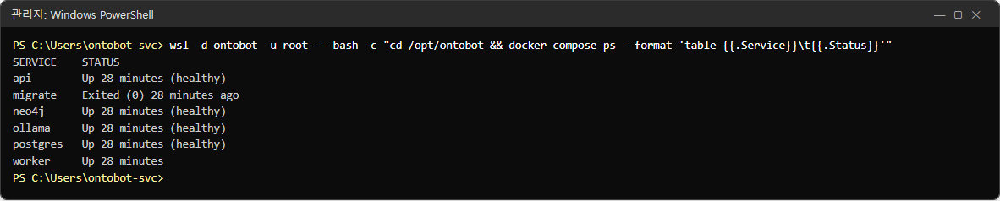
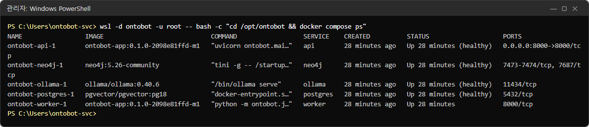
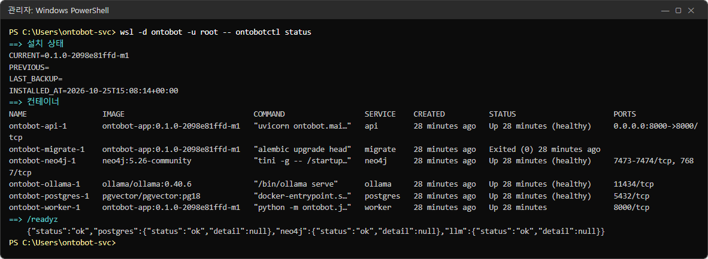
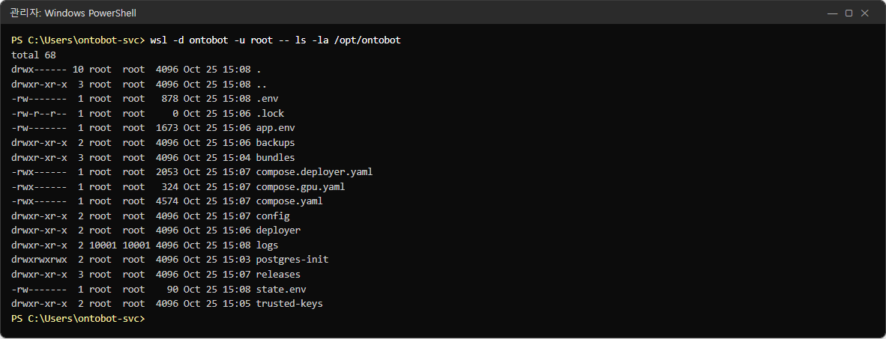
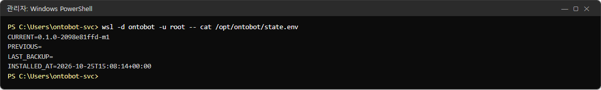
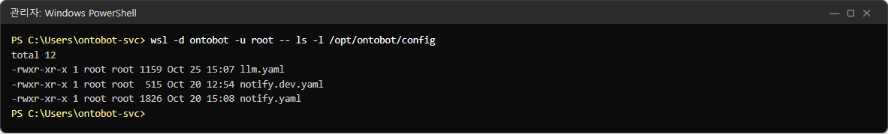
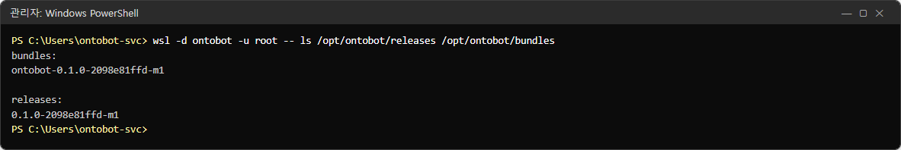
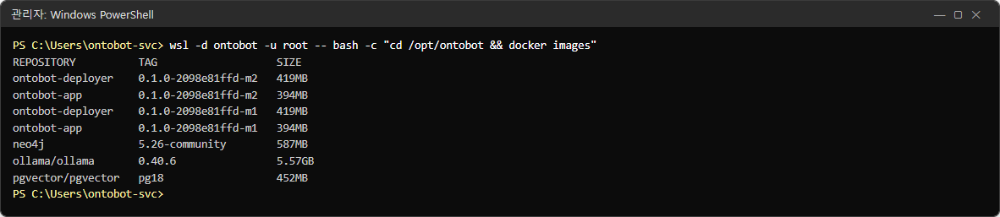
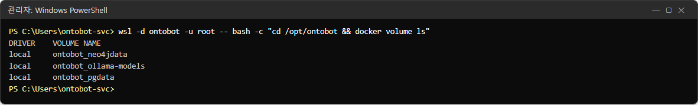
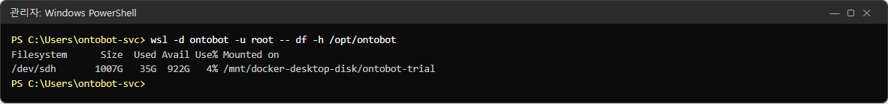

# 2장 시스템 구성 — 서버 안 들여다보기

운영자는 이 장의 내용을 몰라도 대부분의 일을 화면으로 할 수 있습니다. 하지만 장애가 났을 때 "무엇이 멈췄는지"를
알아보려면 서버 안의 모양을 한 번은 봐 두는 것이 좋습니다. 이 장에서는 실제 서버에서 명령을 실행해 보며 구성
요소를 하나씩 확인합니다.

## 2.1 한 장으로 보는 구성

```
 사용자 PC(브라우저) ──── 8000 ───┐            관리자 PC(브라우저) ──── 8100 ───┐
                                 │                                          │
 ┌─────────────── Windows Server 2022 ──────────────────────────────────────────────────┐
 │  예약 작업 OntoBot-Host(부팅 때 배포판을 깨우고 포트를 이어 줌)   방화벽(8000, 8100)    │
 │ ┌───────────── WSL2 배포판 "ontobot"(우분투 리눅스) ─────────────────────────────────┐ │
 │ │  Docker Engine                                                                     │ │
 │ │   ┌──────┐  ┌────────┐  ┌──────────┐  ┌───────┐  ┌────────┐      ┌──────────┐      │ │
 │ │   │ api  │  │ worker │  │ postgres │  │ neo4j │  │ ollama │      │ deployer │      │ │
 │ │   │ 8000 │  │        │  │ (원본)    │  │(복사본)│  │ (AI)   │      │  8100    │      │ │
 │ │   └──┬───┘  └───┬────┘  └────┬─────┘  └───┬───┘  └───┬────┘      └────┬─────┘      │ │
 │ │      └──────────┴────────────┴────────────┴──────────┘                │            │ │
 │ │                 컨테이너 네트워크(밖에서는 닿지 않음)          ontobotctl(절차)     │ │
 │ │   /opt/ontobot : .env  app.env  config/  backups/  bundles/  releases/  logs/       │ │
 │ └─────────────────────────────────────────────────────────────────────────────────────┘ │
 │  C:\OntoBot\backups(백업 복사본)   C:\OntoBot-bundles(반입 폴더)   C:\OntoBot\wsl(가상 디스크) │
 └──────────────────────────────────────────────────────────────────────────────────────────┘
```

서버(Windows Server) 한 대 안에 **WSL2**(윈도 안에서 돌아가는 리눅스)가 있고, 그 안의 **Docker**(컨테이너
실행기)가 OntoBot 을 이루는 프로그램들을 각각 "컨테이너"로 돌립니다.

## 2.2 컨테이너 여섯 개(와 잠깐 도는 하나)

먼저 지금 무엇이 돌고 있는지 봅니다. **관리자 권한 PowerShell** 을 열고 다음 명령을 입력합니다.

```powershell
wsl -d ontobot -u root -- bash -c "cd /opt/ontobot && docker compose ps --format 'table {{.Service}}\t{{.Status}}'"
```



| 서비스 | 하는 일 | 멈추면 생기는 일 | 다시 시작해도 되나 |
| --- | --- | --- | --- |
| `api` | 웹 화면과 API(포트 **8000**) | 아무도 접속할 수 없음 | 예(몇 초 끊김) |
| `worker` | 동기화, 그래프 반영, 알림 발송, 매일 정리, 평가 실행 | 화면은 되지만 동기화·발송이 멈추고 쌓임 | 예 |
| `postgres` | **모든 기록의 원본** 데이터베이스 | 로그인·질문 모두 실패 | 꼭 필요할 때만 |
| `neo4j` | 객체 사이 관계(링크)를 빠르게 찾는 보조 저장소 | 관계를 따라가는 질문만 실패 | 예 |
| `ollama` | 서버 안의 AI 모델(질문 해석·답 쓰기), GPU 사용 | 모든 질문이 "답변 모델 연결 불가" | 예(1~2분) |
| `deployer` | **배포 콘솔**(포트 **8100**) | 화면으로 배포를 못 함(앱은 정상) | 예 |
| `migrate` | 데이터베이스 구조를 최신으로 맞추고 **끝나는** 일회성 컨테이너 | — | — |

> **알아 두기** `migrate` 의 상태가 `Exited (0)` 인 것은 정상입니다. "할 일을 마치고 0(성공)으로 끝났다"는
> 뜻입니다. `Exited (1)` 처럼 0이 아닌 숫자면 실패한 것입니다.

> **알아 두기** `deployer` 는 위 목록에 보이지 않습니다. OntoBot 과 따로 관리되기 때문입니다(별도의
> `compose.deployer.yaml`). 업그레이드가 잘못돼 앱이 멈춰도 배포 콘솔은 살아 있어야 하기 때문에 일부러 떼어
> 놓았습니다.

같은 내용을 더 자세히 보려면 `--format` 없이 실행합니다.

```powershell
wsl -d ontobot -u root -- bash -c "cd /opt/ontobot && docker compose ps"
```



자세한 목록에는 컨테이너 이름(`ontobot-api-1`), 이미지(프로그램 묶음과 버전), 실행 명령, 만든 시각, 상태,
포트가 나옵니다. 포트 칸에서 `0.0.0.0:8000->8000/tcp` 처럼 **바깥과 이어진 것은 api 하나뿐**이라는 점을
확인하세요. postgres(5432)·neo4j(7687)·ollama(11434)는 컨테이너 네트워크 안에서만 닿습니다.

### 상태 칸 읽는 법

| 상태 글자 | 뜻 | 할 일 |
| --- | --- | --- |
| `Up 28 minutes (healthy)` | 28분째 돌고 있고, 건강 확인도 통과 | 없음 |
| `Up 28 minutes` | 돌고 있음(건강 확인이 없는 컨테이너 — worker) | 없음 |
| `Up 10 seconds (health: starting)` | 막 켜져서 건강 확인 중 | 1~2분 기다림 |
| `Up … (unhealthy)` | 돌고는 있지만 건강 확인 실패 | 27장 |
| `Exited (0) …` | 정상 종료(migrate 는 정상) | migrate 가 아니면 27장 |
| `Exited (1)`·`Exited (137)` 등 | 비정상 종료 | 27장 |
| `Restarting` | 자꾸 죽고 다시 켜지는 중 | 로그를 봅니다(26장) |

## 2.3 한 번에 보는 상태 — `ontobotctl status`

`ontobotctl` 은 설치·업그레이드·롤백·백업 절차를 담은 명령입니다. 배포 콘솔도 뒤에서 이 명령을 부릅니다.
`status` 는 설치 상태와 컨테이너와 준비 상태를 한 번에 보여 줍니다.

```powershell
wsl -d ontobot -u root -- ontobotctl status
```



결과는 세 덩어리입니다.

| 덩어리 | 내용 | 읽는 법 |
| --- | --- | --- |
| `==> 설치 상태` | `CURRENT`(지금 버전), `PREVIOUS`(이전 버전 — 업그레이드 직후에만), `LAST_BACKUP`(업그레이드 직전 백업), `INSTALLED_AT`(설치 시각) | 이전 버전이 비어 있으면 롤백할 대상이 없다는 뜻 |
| `==> 컨테이너` | 2.2 의 자세한 목록 | 모두 `Up`, migrate 는 `Exited (0)` |
| `==> /readyz` | 준비 상태 확인 결과 | `"status":"ok"` 면 정상 |

`/readyz` 줄은 다음처럼 생겼습니다.

```json
{"status":"ok","postgres":{"status":"ok","detail":null},"neo4j":{"status":"ok","detail":null},"llm":{"status":"ok","detail":null}}
```

| 맨 앞 status | 뜻 | 사용자 영향 |
| --- | --- | --- |
| `ok` | 데이터베이스·관계 저장소·AI 모델 모두 정상 | 없음 |
| `degraded` | 관계 저장소(Neo4j)만 안 됨 | 관계를 따라가는 질문만 실패 |
| `unavailable` | 데이터베이스나 AI 모델이 안 됨 | 질문 대부분 실패 |
| `unreachable` | api 컨테이너 자체에 닿지 못함 | 접속 불가 |

## 2.4 설치 폴더 `/opt/ontobot`

OntoBot 의 설정과 기록은 WSL 배포판 안의 `/opt/ontobot` 폴더에 모여 있습니다.

```powershell
wsl -d ontobot -u root -- ls -la /opt/ontobot
```



| 이름 | 무엇 | 누가 고치나 | 주의 |
| --- | --- | --- | --- |
| `.env` | 인프라 비밀값(DB·Neo4j 비밀번호, 포트, 이미지 버전) | `ontobotctl`(자동) | 사람이 비밀번호 줄을 고치지 않습니다. 권한 600 |
| `app.env` | 앱 설정(세션, SSO, 보존 기간, 원천 DB 접속, 메일 비밀값) | 운영자 | 고친 뒤 반영 명령(30장). 권한 600 |
| `state.env` | 설치 상태(지금·이전 버전, 마지막 백업) | `ontobotctl`(자동) | 고치지 않습니다 |
| `.lock` | 배포 작업이 겹치지 않게 잡는 잠금 파일 | 자동 | 지우지 않습니다 |
| `compose.yaml`, `compose.gpu.yaml` | 앱 컨테이너 구성 | 업그레이드가 바꿈 | 손으로 고치지 않습니다 |
| `compose.deployer.yaml` | 배포 콘솔 구성 | 업그레이드가 바꿈 | 손으로 고치지 않습니다 |
| `config/` | `llm.yaml`(AI 모델), `notify.yaml`(메일·SMS) | 운영자(notify), 개발팀(llm) | 15장, 30장 |
| `backups/` | 데이터베이스 백업 파일 | 자동 + 운영자 | 19장 |
| `bundles/` | 가져온 설치 꾸러미 | 배포 콘솔 | 20장 |
| `releases/` | 설치했던 버전의 구성 기록(롤백에 씀) | 자동 | 지우지 않습니다 |
| `deployer/` | 배포 콘솔의 작업 기록·점검 결과 | 자동 | 24장 |
| `logs/` | 앱 로그(JSON) | 자동 | 26장 |
| `postgres-init/` | 데이터베이스 첫 생성 스크립트 | 자동 | — |
| `trusted-keys/` | 번들 서명을 확인하는 공개키 | 설치 담당자 | 4장 |

> **알아 두기** 맨 앞의 `-rw-------`, `drwx------` 는 권한입니다. `.env`·`app.env`·`state.env` 가
> `-rw-------`(주인 root 만 읽고 쓰기)인지 가끔 확인하세요(31장).

### 설치 상태 파일

```powershell
wsl -d ontobot -u root -- cat /opt/ontobot/state.env
```



설치 직후에는 `PREVIOUS` 와 `LAST_BACKUP` 이 비어 있습니다. 업그레이드를 하면 `PREVIOUS` 에 이전 버전,
`LAST_BACKUP` 에 업그레이드 직전 백업 파일 경로가 들어갑니다(21장에서 실제로 바뀌는 모습을 봅니다).

### 설정 폴더

```powershell
wsl -d ontobot -u root -- ls -l /opt/ontobot/config
```



| 파일 | 내용 | 바꾸는 사람 |
| --- | --- | --- |
| `llm.yaml` | 역할별 AI 모델(질문 해석·답 쓰기) | **개발팀만**. 모델을 바꾸면 정확도가 달라지므로 평가를 다시 통과한 값으로만 바꿉니다 |
| `notify.yaml` | 메일·SMS 게이트웨이 | 운영자(15장) |
| `notify.dev.yaml` | 개발 PC 용 가짜 게이트웨이 견본 | 쓰지 않습니다(운영에 쓰면 안 됨) |

### 버전 기록과 번들

```powershell
wsl -d ontobot -u root -- ls /opt/ontobot/releases /opt/ontobot/bundles
```



- `bundles/` 에는 가져온 꾸러미(번들) 폴더가 있습니다. 처음에는 설치에 쓴 전체 번들 하나입니다.
- `releases/` 에는 설치했던 버전마다 구성 파일 묶음이 남습니다. 롤백할 때 이 기록으로 이전 버전을 다시 띄웁니다.

## 2.5 이미지와 볼륨

**이미지**는 프로그램과 그 실행 환경을 한 덩어리로 묶은 것이고, **볼륨**은 컨테이너가 지워져도 남는 데이터
저장 공간입니다.

```powershell
wsl -d ontobot -u root -- bash -c "cd /opt/ontobot && docker images"
```



| 이미지 | 크기(대략) | 무엇 |
| --- | --- | --- |
| `ontobot-app:<버전>` | 400MB | api·worker·migrate 가 함께 쓰는 OntoBot 프로그램 |
| `ontobot-deployer:<버전>` | 420MB | 배포 콘솔 |
| `pgvector/pgvector:pg18` | 450MB | PostgreSQL 18 |
| `neo4j:5.26-community` | 590MB | Neo4j |
| `ollama/ollama:0.40.6` | 5.6GB | AI 모델 실행기(GPU 라이브러리 포함) |

> **알아 두기** 사진에 같은 이름의 이미지가 버전 두 개(`-m1`, `-m2`)로 보입니다. 촬영 PC 에는 20장에서 쓸
> 업그레이드용 이미지가 미리 적재되어 있었기 때문입니다. 운영 서버에서도 업그레이드 뒤에는 이전 버전 이미지가
> 남아 있습니다. 롤백에 쓰므로 지우지 마세요.

```powershell
wsl -d ontobot -u root -- bash -c "cd /opt/ontobot && docker volume ls"
```



| 볼륨 | 담긴 것 | 백업 |
| --- | --- | --- |
| `ontobot_pgdata` | PostgreSQL 데이터(모든 기록의 원본) | **매일 자동 백업**(19장) |
| `ontobot_neo4jdata` | Neo4j 데이터(관계 복사본) | 하지 않음(언제든 다시 만듦 — 13장) |
| `ontobot_ollama-models` | AI 모델 파일(약 9.6GB) | 하지 않음(번들에 들어 있음) |

> **주의** `docker volume rm`, `docker system prune --volumes` 같은 명령은 데이터를 지웁니다. 개발팀이
> 지시하지 않는 한 절대 실행하지 마세요.

## 2.6 디스크 여유

```powershell
wsl -d ontobot -u root -- df -h /opt/ontobot
```



`Avail`(남은 크기)과 `Use%`(쓴 비율)를 봅니다. 업그레이드에는 번들 크기만큼의 여유가 더 필요하고, 사전
점검(20장)이 모자라면 막습니다. 배포 콘솔 **현황**의 **디스크 여유**도 같은 값입니다.

| 남은 크기 | 판단 |
| --- | --- |
| 수십 GB 이상 | 정상 |
| 20GB 미만 | 오래된 백업 정리 계획(19장), 서버 담당자와 증설 협의 |
| 5GB 미만 | 위험 — 백업·업그레이드가 실패할 수 있습니다. 바로 조치 |

## 2.7 Windows 쪽 폴더

WSL 밖, 윈도 쪽에도 OntoBot 이 쓰는 폴더가 있습니다(설치 스크립트가 만듭니다).

| 폴더 | 무엇 | 주의 |
| --- | --- | --- |
| `C:\OntoBot\backups\` | 매일 백업의 복사본 | 회사 백업 체계(백업 서버·테이프)가 이 폴더를 가져가게 합니다 |
| `C:\OntoBot\host\` | 부팅 스크립트 `start-ontobot.ps1` | 고치지 않습니다 |
| `C:\OntoBot\wsl\` | WSL 가상 디스크(`ext4.vhdx`) — **모든 데이터가 이 안에** | **절대 지우지 않습니다** |
| `C:\OntoBot-bundles\` | 반입 폴더. 새 번들을 여기 복사하면 배포 콘솔에 보입니다 | 20장 |

> **알아 두기** WSL 안의 파일을 윈도 탐색기로 보고 싶으면 주소창에 `\\wsl$\ontobot\opt\ontobot` 을
> 입력합니다. 다만 설정 파일은 탐색기에서 메모장으로 고치지 마세요. 줄 끝 문자와 권한이 바뀔 수 있습니다.
> 30장의 방법으로 고칩니다.

## 2.8 데이터가 흐르는 길

```
 사내 원천 DB ──(읽기만, 동기화)──▶ worker ──▶ PostgreSQL(원본) ──(투영)──▶ Neo4j(관계 복사본)
                                                  ▲   │
 사용자 질문 ──▶ api ──▶ ollama(질문 해석) ──▶ 조회 ─┘   └─▶ ollama(답 쓰기) ──▶ 근거 대조 ──▶ 화면
                                                  │
 Action 승인 ──▶ api ──▶ 편집 레이어(PostgreSQL) ──▶ 발송 목록 ──▶ worker ──▶ 사내 메일·SMS
```

| 흐름 | 요점 | 관련 장 |
| --- | --- | --- |
| 동기화 | 원천 DB 는 **읽기만** 합니다. 행 하나라도 변환에 실패하면 그 실행 전체가 실패합니다 | 12장 |
| 그래프 투영 | PostgreSQL 이 바뀌면 worker 가 Neo4j 에 따라 적습니다. Neo4j 는 언제든 처음부터 다시 만들 수 있습니다 | 13장 |
| 질문 | AI 는 조회 조건만 만들고, 조회는 서버가 합니다. 답 문장은 근거와 글자 그대로 대조합니다 | 10장 |
| Action | 원천 DB 는 바꾸지 않습니다. 메일·SMS 는 실행이 끝난 뒤 worker 가 보냅니다 | 14~15장 |

## 2.9 이 장의 정리

- 컨테이너는 api·worker·postgres·neo4j·ollama 다섯 개 + 배포 콘솔 하나이고, migrate 는 끝나는 것이 정상입니다.
- 바깥에서 닿는 포트는 8000(사용자)·8100(관리자)뿐입니다.
- 설정은 `/opt/ontobot`, 데이터는 볼륨에 있고, 백업하는 것은 PostgreSQL 뿐입니다.
- `ontobotctl status` 하나로 버전·컨테이너·준비 상태를 한 번에 봅니다.
