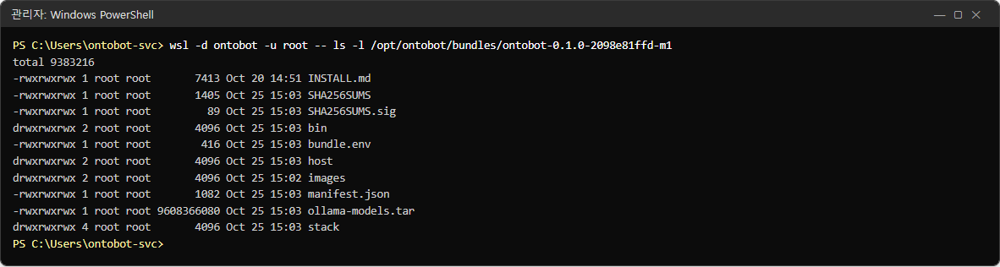
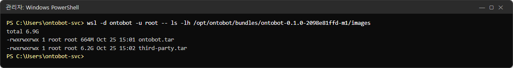
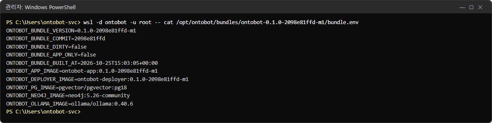
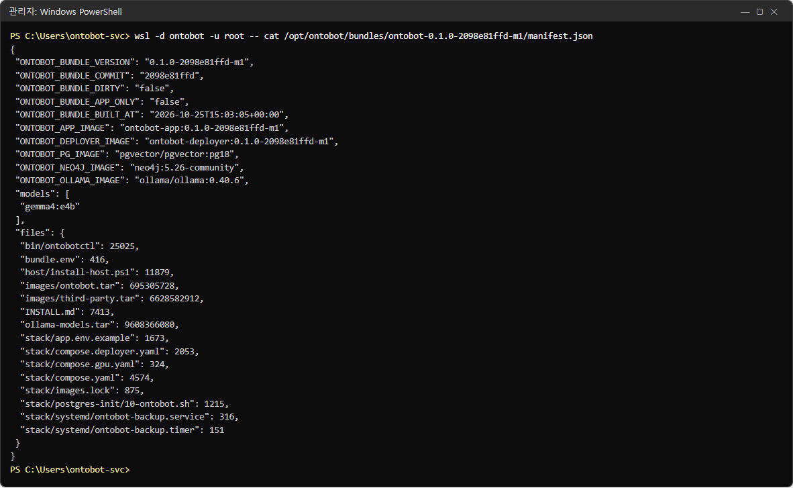
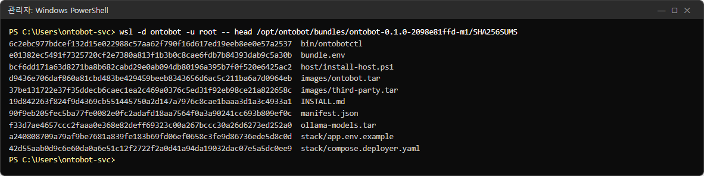
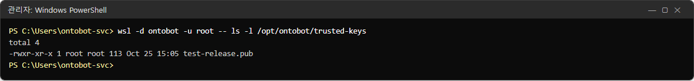
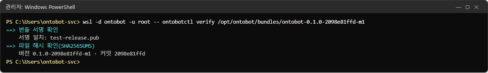
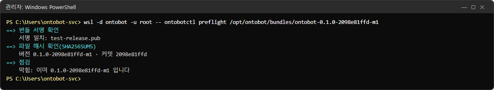

# 4장 설치 준비와 번들

OntoBot 설치는 두 단계입니다. **① 인터넷이 되는 PC 에서 개발팀이 설치 꾸러미(번들)를 만들고 서명**하고,
**② 운영자가 USB 등으로 폐쇄망 서버에 옮겨 설치**합니다. 이 장은 ②를 시작하기 전에 갖출 것과, 받은 번들이 무엇으로
이루어져 있고 진짜인지 어떻게 확인하는지를 다룹니다.

## 4.1 서버 요구 사항

| 항목 | 최소 / 권장 | 확인 방법 |
| --- | --- | --- |
| 운영체제 | **Windows Server 2022 이상**(빌드 20348 이상). 2019 이하는 WSL2 를 지원하지 않아 설치할 수 없습니다 | PowerShell 에서 `[Environment]::OSVersion.Version` |
| 메모리 | 16GB 이상(그중 12GB 를 WSL 에 줍니다) | 작업 관리자 → 성능 |
| 디스크 여유 | 60GB 이상(전체 번들 약 16GB + 이미지 적재 + 데이터 + 백업) | 탐색기 → 내 PC |
| GPU | NVIDIA 권장. 윈도에 WSL 용 NVIDIA 드라이버를 먼저 설치 | 장치 관리자 → 디스플레이 어댑터 |
| CPU 가상화 | BIOS 에서 가상화(VT-x/AMD-V) 켜짐 | 작업 관리자 → 성능 → CPU → "가상화: 사용" |
| 권한 | 설치하는 사람이 **관리자 권한 PowerShell** 을 쓸 수 있어야 함 | — |
| 계정 | 서비스 전용 로컬 계정(예: `ontobot-svc`)을 만들어 그 계정으로 설치 | 4.4 |
| 네트워크 | 사용자 PC → 서버 8000, 관리자 PC → 서버 8100 | 4.5 |

> **알아 두기** GPU 가 없어도 설치는 됩니다. 다만 AI 모델이 CPU 로 돌아 답 하나에 수십 초~수 분이 걸립니다.
> 배포 콘솔 **현황**의 GPU 칸이 "없음(CPU — 느림)"으로 나옵니다.

> **주의** 개발팀은 이 설치 방식을 Windows 11 개발 PC(Docker Desktop)에서만 시험했습니다. 운영과 같은
> Windows Server 에서 처음 설치할 때는 개발팀과 함께 "0단계 점검"(오프라인 WSL 설치, GPU, 재부팅 뒤 자동 시작,
> 다른 PC 에서 접속)을 먼저 해 보세요.

## 4.2 받을 것

배포 담당(보통 개발팀)에게 받는 것은 세 가지입니다.

| 준비물 | 예 | 크기 | 설명 |
| --- | --- | --- | --- |
| 전체 번들 폴더 | `ontobot-0.1.0-2098e81ffd-m1\` | 약 16GB | 프로그램·데이터베이스·AI 모델 전부. 최초 설치용 |
| 서명 공개키 | `ontobot-release.pub` | 1KB 미만 | 번들이 진짜인지 확인하는 열쇠. 서버에 등록 |
| 호스트 자산 폴더 | `ontobot-host-assets\` | 약 1GB | WSL 설치 파일, 우분투 이미지, Docker 설치 파일 |

호스트 자산 폴더에는 다음이 들어 있어야 합니다.

| 파일 | 무엇 | 없으면 |
| --- | --- | --- |
| `wsl*.msi` | WSL 2.x 설치 패키지 | WSL 이 이미 설치된 서버면 없어도 됨 |
| `*ubuntu*.tar*` | 우분투 24.04 WSL 이미지 | 배포판을 만들 수 없음 |
| `debs\*.deb` | Docker Engine·compose·NVIDIA Container Toolkit 설치 파일 | 설치가 멈추고 "의존 패키지 부족"을 알림 |

> **주의** 번들 폴더 안에는 **아무것도 쓰거나 고치지 마세요.** 파일 하나만 바뀌어도 서명 확인에서 "번들 파일이
> 손상되었거나 바뀌었습니다"로 막힙니다(20장에서 실제로 막히는 모습을 봅니다).

## 4.3 번들 들여다보기

번들 폴더의 모습은 다음과 같습니다. 아래 명령은 설치 뒤 서버 안에서 본 것이지만, 윈도 탐색기로 USB 를 열어도
같은 파일이 보입니다.

```powershell
wsl -d ontobot -u root -- ls -l /opt/ontobot/bundles/ontobot-0.1.0-2098e81ffd-m1
```



| 이름 | 무엇 |
| --- | --- |
| `INSTALL.md` | 설치 안내 원본(개발자용) |
| `SHA256SUMS` | 번들 안 모든 파일의 지문 목록 |
| `SHA256SUMS.sig` | 위 목록에 대한 서명 |
| `bin/` | `ontobotctl`(설치·업그레이드 절차 명령) |
| `bundle.env` | 이 번들의 버전·커밋·종류와 이미지 이름 |
| `host/` | `install-host.ps1`(윈도 쪽 설치 스크립트) |
| `images/` | 컨테이너 이미지 파일 |
| `manifest.json` | 번들 내용 목록(사람이 읽기 좋게) |
| `ollama-models.tar` | AI 모델 파일(약 9.6GB). 전체 번들에만 있습니다 |
| `stack/` | compose 파일, 설정 견본, 매일 백업 타이머 |

### 이미지 파일

```powershell
wsl -d ontobot -u root -- ls -lh /opt/ontobot/bundles/ontobot-0.1.0-2098e81ffd-m1/images
```



- `ontobot.tar`(약 660MB) — OntoBot 앱과 배포 콘솔 이미지.
- `third-party.tar`(약 6.2GB) — PostgreSQL·Neo4j·Ollama 이미지. 전체 번들에만 들어 있고, 업그레이드용 앱
  번들에는 없습니다.

### 번들 정보 `bundle.env`

```powershell
wsl -d ontobot -u root -- cat /opt/ontobot/bundles/ontobot-0.1.0-2098e81ffd-m1/bundle.env
```



| 항목 | 이 번들의 값 | 뜻 |
| --- | --- | --- |
| `ONTOBOT_BUNDLE_VERSION` | `0.1.0-2098e81ffd-m1` | 버전. 배포 콘솔·관리 화면에 보이는 이름 |
| `ONTOBOT_BUNDLE_COMMIT` | `2098e81ffd` | 개발팀 소스의 어느 시점으로 만들었는지 |
| `ONTOBOT_BUNDLE_DIRTY` | `false` | `true` 면 개발 중 번들 — 운영 서버가 거부 |
| `ONTOBOT_BUNDLE_APP_ONLY` | `false` | `true` 면 업그레이드용 앱 번들(처음 설치에 못 씀) |
| `ONTOBOT_BUNDLE_BUILT_AT` | `2026-10-25T15:03:05+00:00` | 만든 시각(UTC) |
| `ONTOBOT_APP_IMAGE` 등 | `ontobot-app:0.1.0-2098e81ffd-m1` … | 이 버전이 쓰는 이미지 이름 |

### 내용 목록 `manifest.json`

```powershell
wsl -d ontobot -u root -- cat /opt/ontobot/bundles/ontobot-0.1.0-2098e81ffd-m1/manifest.json
```



`bundle.env` 의 내용에 더해, 들어 있는 AI 모델(`gemma4:e4b`)과 파일마다의 크기(바이트)가 적혀 있습니다. 반입한
USB 의 파일 크기와 맞춰 보면 복사가 덜 된 파일을 찾을 수 있습니다.

### 지문 목록 `SHA256SUMS`

```powershell
wsl -d ontobot -u root -- head /opt/ontobot/bundles/ontobot-0.1.0-2098e81ffd-m1/SHA256SUMS
```



줄마다 "64글자 지문 + 파일 이름"입니다. 파일 내용이 한 글자만 달라져도 지문이 완전히 달라집니다. 그래서 설치·
업그레이드 때 모든 파일의 지문을 다시 계산해 이 목록과 맞춰 봅니다.

## 4.4 서명 — 번들이 진짜인지 확인하는 원리

지문 목록만으로는 "누군가 파일을 바꾸고 목록도 함께 고쳤다"는 경우를 막지 못합니다. 그래서 개발팀(배포 담당자)이
**개인키**로 지문 목록에 서명하고(`SHA256SUMS.sig`), 서버는 미리 등록해 둔 **공개키**로 그 서명을 확인합니다.

```
 개발팀(배포 담당자)                               서버(운영자)
 ┌───────────────┐   서명    ┌────────────────┐   확인   ┌───────────────────┐
 │ 개인키(.key)   │────────▶ │ SHA256SUMS.sig │ ◀──────── │ 공개키(.pub)        │
 │ 오프라인 보관   │          │ SHA256SUMS     │          │ /opt/ontobot/       │
 └───────────────┘          └────────────────┘          │   trusted-keys/     │
                                                         └───────────────────┘
```

| 열쇠 | 누가 갖나 | 잃어버리면 |
| --- | --- | --- |
| 개인키(`ontobot-release.key`) | 배포 담당자만, 인터넷이 없는 곳에 | 남이 가짜 번들에 서명할 수 있음 → 키를 바꾸고 서버에 새 공개키 등록 |
| 공개키(`ontobot-release.pub`) | 서버(공개돼도 괜찮음) | 다시 받으면 됨 |

서버에 등록된 공개키는 다음처럼 확인합니다.

```powershell
wsl -d ontobot -u root -- ls -l /opt/ontobot/trusted-keys
```



> **알아 두기** 촬영 서버의 공개키 이름은 `test-release.pub` 입니다. 운영 서버에는 배포 담당자가 준 이름
> (예: `ontobot-release.pub`)이 보입니다. 키를 바꿀 때를 대비해 공개키를 여러 개 둘 수 있습니다. 그중 하나와
> 맞으면 통과합니다.

### 번들 확인해 보기 — `ontobotctl verify`

설치하거나 업그레이드하기 전에, 바꾸지 않고 확인만 해 볼 수 있습니다.

```powershell
wsl -d ontobot -u root -- ontobotctl verify /opt/ontobot/bundles/ontobot-0.1.0-2098e81ffd-m1
```



| 줄 | 뜻 |
| --- | --- |
| `==> 번들 서명 확인` / `서명 일치: test-release.pub` | 등록된 공개키 중 이것과 서명이 맞았음 |
| `==> 파일 해시 확인(SHA256SUMS)` | 모든 파일의 지문을 다시 계산해 목록과 맞춰 봄(큰 번들은 몇 분 걸림) |
| `버전 0.1.0-2098e81ffd-m1 · 커밋 2098e81ffd` | 확인을 마친 번들의 버전 |

확인이 실패하면 붉은 `오류:` 줄이 나옵니다.

| 오류 문구 | 뜻 | 할 일 |
| --- | --- | --- |
| `번들이 아닙니다: … (SHA256SUMS·bundle.env 없음)` | 폴더를 잘못 골랐거나 복사가 덜 됨 | 경로 확인, 다시 복사 |
| `신뢰 공개키가 없습니다` | `trusted-keys` 에 공개키가 없음 | 공개키 등록 |
| `서명이 없는 번들입니다` | `SHA256SUMS.sig` 가 없음 | 개발팀에 문의 |
| `서명이 신뢰 공개키와 맞지 않습니다` | 다른 키로 서명했거나 위조 | **쓰지 말고** 개발팀에 문의 |
| `번들 파일이 손상되었거나 바뀌었습니다` | 파일 하나 이상의 지문이 다름 | 다시 복사. 계속되면 개발팀 |
| `목록에 없는 파일이 있습니다` | 번들 폴더에 누가 파일을 더 넣음 | 그 파일을 빼거나 다시 복사 |
| `커밋하지 않은 변경으로 만든 번들(.dirty)입니다` | 개발 중 번들 | 개발팀에 정식 번들 요청 |

### 사전 점검해 보기 — `ontobotctl preflight`

`preflight` 는 `verify` 에 더해 "지금 서버에 올릴 수 있는지"까지 봅니다(버전·디스크·GPU). 이미 설치된 버전을
점검하면 다음처럼 **막힘**이 나옵니다. 정상적인 반응입니다.

```powershell
wsl -d ontobot -u root -- ontobotctl preflight /opt/ontobot/bundles/ontobot-0.1.0-2098e81ffd-m1
```



`막힘: 이미 0.1.0-2098e81ffd-m1 입니다` — 같은 버전으로는 업그레이드할 수 없다는 뜻입니다. 배포 콘솔의 번들
화면도 같은 점검을 하며, 그 결과는 20장에서 자세히 봅니다.

## 4.5 네트워크와 방화벽 계획

설치 스크립트가 윈도 방화벽 규칙 두 개를 만듭니다. 회사 방화벽(네트워크 장비)에도 같은 규칙이 필요한지
네트워크 담당자와 미리 확인하세요.

| 규칙 | 포트 | 허용할 출발지 | 설치 스크립트 매개변수 |
| --- | --- | --- | --- |
| OntoBot API | TCP 8000 | 사용자 PC 전체(사내망) | `-ApiPort`(기본 8000) |
| OntoBot 배포 콘솔 | TCP 8100 | **관리자 PC 대역만** | `-DeployerPort`(기본 8100), `-AllowCidrs` |

> **주의** 8100(배포 콘솔)은 서버 전체를 바꿀 수 있는 강한 화면입니다. 관리자 PC 가 있는 대역(예:
> `10.10.0.0/24`)만 허용하세요. `-AllowCidrs` 를 비우면 "같은 서브넷"만 허용합니다.

데이터베이스(5432)·Neo4j(7687)·AI 모델(11434) 포트는 열지 않습니다. 컨테이너 안에서만 씁니다. 데이터 소스(11장)를
연결하려면 **서버 → 원천 DB** 방향의 포트(보통 5432)가 열려 있어야 하고, 메일·SMS(15장)를 쓰려면 **서버 → 사내
메일 서버(25 등)·SMS 게이트웨이** 방향이 열려 있어야 합니다.

## 4.6 설치 전 점검표

설치 날 아침, 아래를 하나씩 확인하세요. 43장에 인쇄용 양식이 있습니다.

| 번호 | 확인 | 확인함 |
| --- | --- | --- |
| 1 | 서버 OS 가 Windows Server 2022 이상이다 | ☐ |
| 2 | 메모리 16GB 이상, 디스크 여유 60GB 이상이다 | ☐ |
| 3 | (GPU 사용 시) 윈도에 NVIDIA 드라이버가 설치되어 있다 | ☐ |
| 4 | BIOS 가상화가 켜져 있다 | ☐ |
| 5 | 서비스 전용 계정이 있고, 그 계정의 비밀번호를 안다 | ☐ |
| 6 | 전체 번들 폴더·공개키·호스트 자산을 서버 디스크(예: `E:\`)에 복사했다 | ☐ |
| 7 | 복사한 번들 폴더 크기가 원본과 같다(`manifest.json` 의 크기와 대조) | ☐ |
| 8 | 첫 OntoBot 관리자 아이디와 비밀번호(12자 이상)를 정했다 | ☐ |
| 9 | 배포 콘솔에 접속할 관리자 PC 대역을 정했다 | ☐ |
| 10 | 회사 방화벽에 8000·8100 규칙을 요청했다 | ☐ |
| 11 | 샘플 데이터를 넣을지 정했다(처음 확인용으로 권장) | ☐ |
| 12 | 재부팅해도 되는 시간이다(WSL 기능을 켜면 재부팅이 필요할 수 있음) | ☐ |

## 4.7 이 장의 정리

- 번들은 서명(`SHA256SUMS.sig`)과 지문 목록(`SHA256SUMS`)으로 진짜인지 확인합니다. 번들 폴더에는 아무것도 쓰지
  않습니다.
- 서버에는 공개키만 둡니다. 개인키는 배포 담당자가 오프라인으로 보관합니다.
- `ontobotctl verify` 는 확인만, `preflight` 는 올릴 수 있는지까지 봅니다.
- 8100 은 관리자 대역에만 엽니다.
