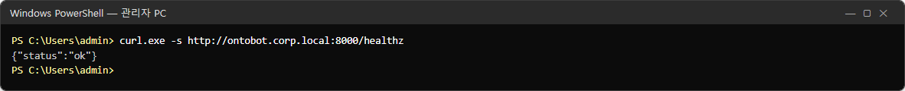
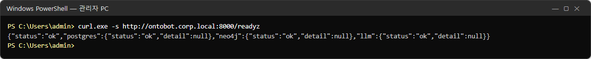
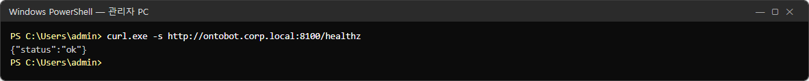
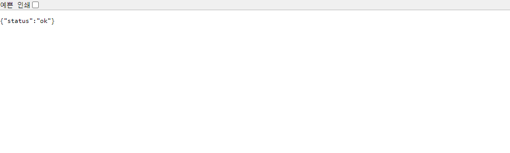
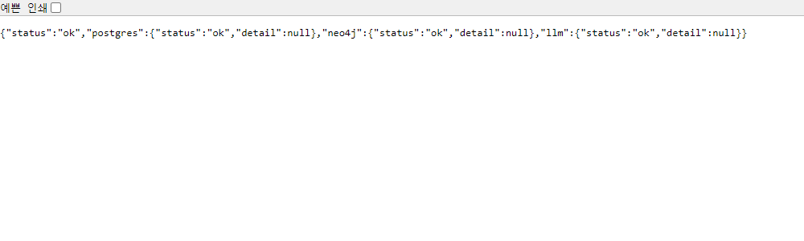
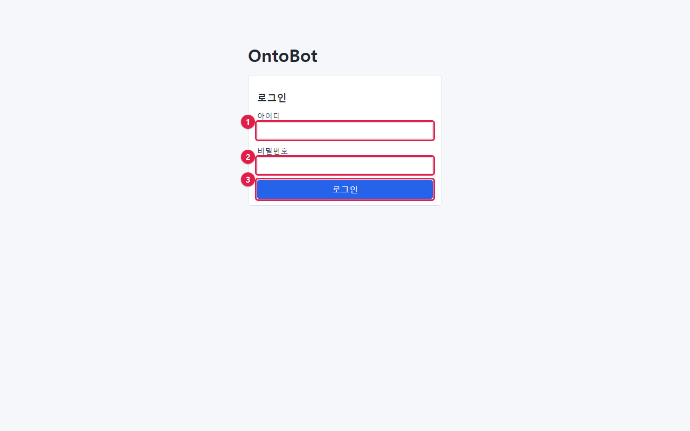
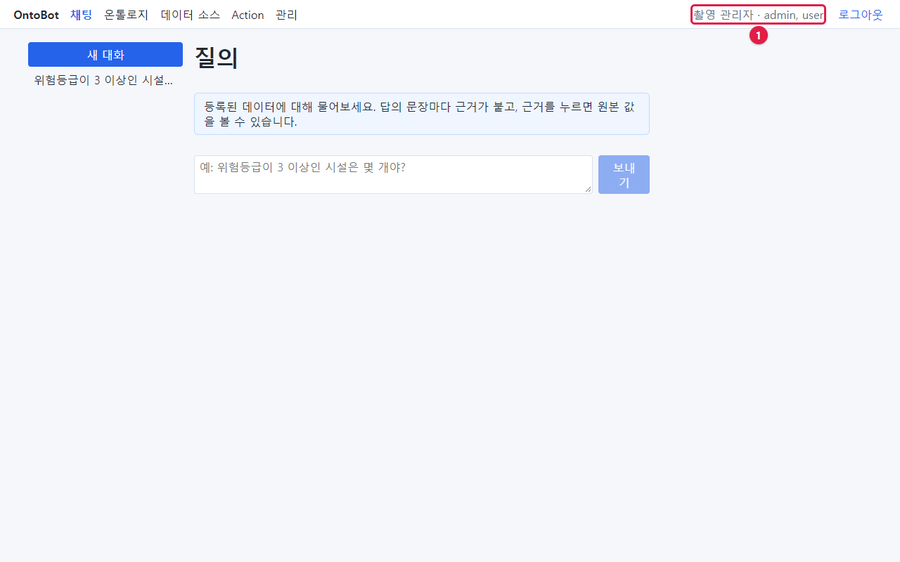
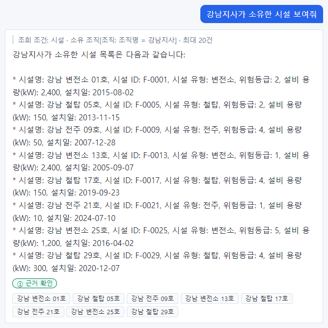
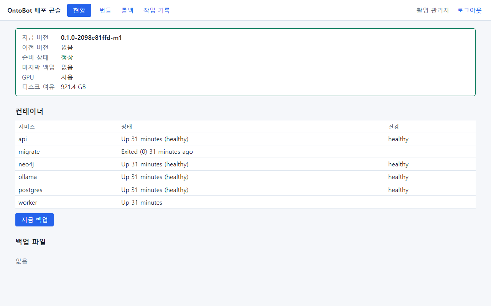

# 5장 설치하기와 설치 확인

이 장은 폐쇄망 서버에 OntoBot 을 처음 설치하는 순서와, 설치가 제대로 됐는지 확인하는 방법을 다룹니다. 최초
설치만 PowerShell 로 하고, 그 뒤의 업그레이드·롤백·백업은 모두 배포 콘솔 화면으로 합니다(17장~).

> **알아 두기 — 이 장의 사진** 최초 설치 스크립트(`install-host.ps1`)는 윈도 기능을 켜고, WSL 배포판을 만들고,
> 부팅 예약 작업과 방화벽 규칙을 만듭니다. 이 책을 찍은 PC(Windows 11, Docker Desktop)에서는 이 스크립트를 실행할 수
> 없었습니다. 그래서 5.1~5.4 는 스크립트가 **실제로 화면에 출력하는 문구**를 스크립트 원본에서 그대로 옮겨
> 설명합니다. 5.5 부터의 설치 확인은 실제 설치본에서 찍은 사진입니다.

## 5.1 설치 순서 한눈에

```
 [윈도]  관리자 PowerShell
   │
   ├─ 1. OS·관리자 확인, WSL·가상 머신 플랫폼 기능 켜기 ──(재부팅이 필요하면 멈춤 → 재부팅 → 같은 명령 다시)
   ├─ 2. WSL 패키지 설치, .wslconfig(메모리 12GB), 배포판 'ontobot' 만들기
   ├─ 3. 배포판 설정(systemd), Docker Engine·NVIDIA 도구 설치(오프라인), GPU 확인
   ├─ 4. 번들·공개키를 /opt/ontobot 으로 복사
   │      └─ [리눅스] ontobotctl install
   │            서명 확인 → 이미지·모델 적재 → 비밀값 생성 → DB·Neo4j·AI 기동 → 마이그레이션
   │            → (샘플 데이터) → 관리자 계정 → 앱·배포 콘솔 기동 → 매일 백업 타이머 → 준비 확인
   ├─ 5. 부팅 예약 작업 OntoBot-Host(윈도 계정 비밀번호를 물음)
   └─ 6. 방화벽 규칙(8000, 8100) → 완료
```

전체 시간은 서버 성능에 따라 다르지만 보통 30분~1시간입니다. 가장 오래 걸리는 것은 이미지·AI 모델 적재(약 16GB
를 풀기)입니다.

## 5.2 설치 명령 실행

1. 번들 폴더·공개키·호스트 자산을 서버 디스크에 복사합니다(예: `E:\`).
2. 서비스 전용 계정(예: `ontobot-svc`)으로 서버에 로그인합니다.
3. **시작** 단추를 마우스 오른쪽으로 누르고 **Windows PowerShell(관리자)** 을 고릅니다. 사용자 계정 컨트롤 창이
   나오면 **예**를 누릅니다. 창 제목에 "관리자"가 붙어 있어야 합니다.
4. 번들 폴더로 이동해 설치 스크립트를 실행합니다.

```powershell
cd E:\ontobot-0.1.0-2098e81ffd-m1
powershell -ExecutionPolicy Bypass -File .\host\install-host.ps1 `
    -HostAssets E:\ontobot-host-assets -TrustedKey E:\ontobot-release.pub `
    -AdminUsername admin -SeedSample -AllowCidrs 10.10.0.0/24
```

> **알아 두기** 줄 끝의 `` ` ``(백틱)은 "다음 줄에 이어진다"는 PowerShell 표시입니다. 한 줄로 이어 써도 됩니다.

### 매개변수

| 매개변수 | 반드시 | 뜻 | 예 |
| --- | --- | --- | --- |
| `-HostAssets` | 예 | 호스트 자산 폴더 | `E:\ontobot-host-assets` |
| `-TrustedKey` | 예 | 서명 공개키(쉼표로 여러 개) | `E:\ontobot-release.pub` |
| `-AdminUsername` | 권장 | 첫 OntoBot 관리자 아이디. 비밀번호를 묻습니다 | `admin` |
| `-SeedSample` | 선택 | 시험용 샘플 데이터(가짜 시설 30·조직 4·지역 5)를 넣습니다 | — |
| `-AllowCidrs` | 권장 | 배포 콘솔(8100)에 접속할 관리자 PC 대역. 비우면 같은 서브넷만 | `10.10.0.0/24` |
| `-MemoryGB` | 선택 | WSL 에 줄 메모리(기본 12) | `16` |
| `-Processors` | 선택 | WSL 에 줄 CPU 수(기본 제한 없음) | `8` |
| `-ApiPort` / `-DeployerPort` | 선택 | 포트(기본 8000 / 8100) | — |
| `-Root` | 선택 | 윈도 쪽 폴더(기본 `C:\OntoBot`) | — |
| `-DropDir` | 선택 | 반입 폴더(기본 `C:\OntoBot-bundles`) | — |

> **알아 두기** `-SeedSample` 은 처음 설치를 확인할 때 권합니다. 5.6 의 확인 질문("위험등급이 3 이상인 시설은
> 몇 개야?" → 18)이 이 샘플 데이터로 답합니다. 운영 데이터를 바로 연결할 계획이어도, 샘플 데이터는 나중에
> 데이터 소스를 연결하면서 실제 데이터로 바뀌므로 문제가 되지 않습니다.

## 5.3 설치 중 화면에 나오는 것

스크립트는 단계마다 하늘색 `==>` 줄을 찍습니다. 원본에 적힌 단계 문구는 다음과 같습니다.

| 순서 | 화면 문구 | 하는 일 | 걸리는 시간 |
| --- | --- | --- | --- |
| 1 | `==> WSL·가상 머신 플랫폼 기능` | 윈도 기능 두 개를 켭니다 | 1~3분 |
| — | `경고: 재부팅이 필요합니다. 재부팅한 뒤 같은 명령으로 다시 실행하세요.` | 기능을 처음 켠 경우 여기서 멈춥니다(종료 코드 3) | — |
| 2 | `==> WSL 패키지` | WSL 이 없으면 `wsl*.msi` 를 설치합니다 | 1분 |
| 3 | `==> .wslconfig(메모리 12GB)` | WSL 메모리 상한을 정합니다 | 즉시 |
| 4 | `==> 배포판 ontobot 가져오기` | 우분투 이미지로 리눅스 배포판을 만듭니다 | 1~2분 |
| 5 | `==> 배포판 설정(systemd)` | 배포판 안에서 서비스 관리(systemd)를 켭니다 | 1분 |
| 6 | `==> Docker Engine·compose·NVIDIA Container Toolkit(오프라인 .deb)` | Docker 를 설치하고 GPU 를 확인합니다. GPU 가 있으면 `GPU 사용` | 2~5분 |
| 7 | `==> 번들·신뢰 공개키 → /opt/ontobot` | 번들과 공개키를 배포판 안으로 복사합니다 | 5~10분 |
| 8 | `==> ontobotctl install` | 리눅스 쪽 설치(5.4) | 15~40분 |
| 9 | `==> 부팅 시 자동 기동(예약 작업 OntoBot-Host)` | 부팅 스크립트와 예약 작업을 만듭니다 | 즉시 |
| 10 | `==> 방화벽(api 8000 · 배포 콘솔 8100)` | 윈도 방화벽 규칙 두 개 | 즉시 |
| 11 | `==> 완료` | 접속 주소를 알려 줍니다 | — |

설치 중에 **세 번** 입력을 요청합니다.

| 언제 | 화면 문구 | 입력할 것 | 주의 |
| --- | --- | --- | --- |
| 처음 실행 | (WSL 기능을 켜야 하면) 재부팅 안내 | — | 재부팅한 뒤 같은 명령을 다시 실행 |
| 8단계 전 | `OntoBot 관리자 'admin' 비밀번호(12자 이상)` | 첫 관리자의 비밀번호 | 입력해도 화면에 보이지 않습니다. 12자 미만이면 계정 만들기에서 실패 |
| 9단계 | `부팅 예약 작업을 실행할 계정(… — 배포판 주인)의 비밀번호` | **지금 로그인한 윈도 계정**의 비밀번호 | 창이 따로 뜹니다 |

데이터베이스·Neo4j 비밀번호는 사람이 정하지 않습니다. 설치가 무작위로 만들어 `/opt/ontobot/.env` 에 저장합니다.

설치가 끝나면 마지막에 다음과 같은 안내가 나옵니다.

```
==> 완료
    OntoBot:      http://<서버 이름>:8000
    배포 콘솔:    http://<서버 이름>:8100  (관리자 대역에서만)
    반입 폴더:    C:\OntoBot-bundles   백업 복사본: C:\OntoBot\backups
```

끝에 `설치는 끝났지만 준비 확인을 통과하지 못했습니다 — 배포 콘솔의 현황을 보세요` 라는 경고가 나오면, 설치는
되었지만 무언가(대개 AI 모델 첫 적재가 늦어서)가 아직 준비되지 않은 것입니다. 몇 분 뒤 5.5 의 확인을 하세요.

## 5.4 리눅스 쪽 설치 — `ontobotctl install` 이 하는 일

8단계에서 `ontobotctl install` 이 출력하는 단계 문구(원본 그대로)와 뜻입니다.

| 화면 문구 | 하는 일 |
| --- | --- |
| `==> 번들 서명 확인` / `==> 파일 해시 확인(SHA256SUMS)` | 4장의 확인과 같습니다. 실패하면 여기서 멈춥니다 |
| `==> 설치 폴더 /opt/ontobot` | 폴더를 만들고 권한을 700 으로 |
| `==> .env 생성(비밀값 무작위, 600)` | 데이터베이스·Neo4j 비밀번호를 만들어 저장. GPU 가 없으면 `경고: GPU 없이 설치합니다` |
| `==> 이미지 적재 ontobot.tar` / `third-party.tar` | 컨테이너 이미지를 Docker 에 올립니다 |
| `==> 모델 적재(ollama-models)` | AI 모델 파일(약 9.6GB)을 볼륨에 풉니다 |
| `==> 설정 견본(config/) — 이미지에서 꺼낸다` | `llm.yaml`·`notify.yaml` 견본을 만듭니다 |
| `==> 저장소 기동(postgres·neo4j·ollama)` | 데이터베이스·관계 저장소·AI 모델을 켜고 건강해질 때까지 기다립니다 |
| `==> 마이그레이션` | 데이터베이스 표를 만듭니다 |
| `==> 샘플 도메인 팩(합성 데이터)·그래프 재구축` | `-SeedSample` 일 때만. 샘플 온톨로지 게시·시드 데이터·user·admin 역할 읽기 권한 |
| `==> 관리자 계정 admin` | 첫 관리자(역할 admin·modeler) |
| `==> 앱 기동(api·worker)` | OntoBot 을 켭니다 |
| `==> 배포 콘솔 기동` | 배포 콘솔을 켭니다 |
| `==> 매일 백업 타이머(ontobot-backup.timer)` | 매일 02:30 백업 예약 |
| `==> 준비 확인(/readyz, 최대 180초)` | 모두 준비될 때까지 기다립니다 |
| `==> 설치 완료` | 끝 |

> **알아 두기** 설치를 다시 실행하면 `오류: 이미 설치되어 있습니다(/opt/ontobot/state.env) — upgrade 를 쓰세요`
> 로 멈춥니다. 한 번 설치한 서버에 같은 명령을 다시 쳐도 기존 데이터를 덮어쓰지 않도록 막아 둔 것입니다.

## 5.5 설치 확인 ① — 살아 있는지

관리자 PC 의 PowerShell 에서 다음 세 주소를 확인합니다(`curl.exe` 는 Windows 10 이상에 기본으로 있습니다).
사진은 촬영 PC 에서 `localhost` 로 실행한 것이고, 운영에서는 서버 이름으로 바꿔 입력합니다.

```powershell
curl.exe -s http://<서버 이름>:8000/healthz
curl.exe -s http://<서버 이름>:8000/readyz
curl.exe -s http://<서버 이름>:8100/healthz
```







| 주소 | 정상 응답 | 뜻 |
| --- | --- | --- |
| `:8000/healthz` | `{"status":"ok"}` | OntoBot 프로그램이 응답한다 |
| `:8000/readyz` | `{"status":"ok",…}` | 데이터베이스·관계 저장소·AI 모델에도 닿는다 |
| `:8100/healthz` | `{"status":"ok"}` | 배포 콘솔이 응답한다 |

브라우저 주소창에 같은 주소를 넣어도 됩니다. 엣지는 JSON 을 그대로 보여 줍니다.






| 증상 | 뜻 | 할 일 |
| --- | --- | --- |
| 응답이 전혀 없음(연결할 수 없음) | 방화벽, 포트 전달, api 컨테이너 문제 | 서버 안에서 `ontobotctl status`(2.3). 27장 |
| `readyz` 가 `degraded` | Neo4j 만 안 됨 | 1~2분 뒤 다시. 계속되면 13장 |
| `readyz` 가 `unavailable` | DB 나 AI 모델이 안 됨 | AI 모델 첫 적재는 몇 분 걸릴 수 있음. 계속되면 27장 |

## 5.6 설치 확인 ② — 웹 화면과 질문

다른 PC 의 브라우저에서 `http://<서버 이름>:8000` 에 접속합니다. 로그인 화면이 나옵니다.



| 번호 | 칸 | 입력 |
| --- | --- | --- |
| ① | 아이디 | 설치 때 정한 관리자 아이디(예: `admin`) |
| ② | 비밀번호 | 설치 때 입력한 비밀번호 |
| ③ | 로그인 | 누릅니다 |

로그인하면 채팅(질의) 화면이 나오고, 오른쪽 위에 이름과 역할이 보입니다.



`-SeedSample` 로 설치했다면 다음 두 질문을 해 봅니다.

**질문 1** `위험등급이 3 이상인 시설은 몇 개야?`


- 답이 **18건**이고 등급이 **① 근거 확인**이면 데이터베이스·AI 모델·근거 대조가 모두 정상입니다.

**질문 2** `강남지사가 소유한 시설 보여줘`



- 시설 8개 목록과 **① 근거 확인**이 나오면 관계 저장소(Neo4j)도 정상입니다. 조회 조건 줄에
  `소유 조직[조직: 조직명 = 강남지사]` 처럼 관계를 따라간 표시가 보입니다.

> **알아 두기** AI 가 쓴 답 문장은 할 때마다 조금씩 다를 수 있습니다(문장 표현, 목록 모양). 확인할 것은
> **숫자(18), 목록의 개수(8), 등급(①)** 입니다.

> **알아 두기** 첫 질문은 AI 모델을 메모리에 올리느라 10~30초 걸릴 수 있습니다. 두 번째부터는 빨라집니다.

## 5.7 설치 확인 ③ — 배포 콘솔

관리자 PC 의 브라우저에서 `http://<서버 이름>:8100` 에 접속해 같은 관리자 계정으로 로그인합니다. **현황**이
다음처럼 보이면 정상입니다.



| 칸 | 정상 값 |
| --- | --- |
| 지금 버전 | 설치한 번들의 버전 |
| 이전 버전 | 없음(설치 직후) |
| 준비 상태 | **정상**(초록 글씨) |
| 마지막 백업 | 없음(첫 백업은 다음 날 02:30. 바로 하나 만들려면 **지금 백업** — 19장) |
| GPU | 사용(GPU 서버) |
| 컨테이너 | 모두 `Up …`, migrate 는 `Exited (0)` |

## 5.8 설치 확인 ④ — 재부팅

마지막으로 **서버를 한 번 재부팅**하고, 5~10분 뒤 5.5~5.7 을 다시 합니다. 윈도가 켜질 때 예약 작업
`OntoBot-Host` 가 WSL 배포판을 깨우고 포트 전달(8000·8100)을 다시 겁니다. 재부팅 뒤 접속이 안 되면 27장의
"재부팅 뒤 접속 안 됨"을 보세요.

## 5.9 설치 직후 할 일

설치가 확인되면 다음 순서로 준비하면 사용자가 바로 쓸 수 있습니다.

| 순서 | 할 일 | 누가 | 이 책 |
| --- | --- | --- | --- |
| 1 | 첫 백업 한 번(**지금 백업**) | 운영자 | 19장 |
| 2 | HTTPS 적용(권장), 접속 주소 설정 | 운영자 | 30~31장 |
| 3 | 사용자 계정 만들기와 역할 주기 | 관리자 | 7장 |
| 4 | 역할별 읽기 권한 | 관리자 | 8장 |
| 5 | 온톨로지 확인(샘플이 아니면 모델러가 게시) | 모델러 | 6장, 사용자 매뉴얼 |
| 6 | 데이터 소스 연결과 동기화 | 운영자 + 모델러 | 11~12장 |
| 7 | 메일·SMS(Action 알림을 쓸 때만) | 운영자 | 15장 |
| 8 | 알림 받을 사람의 연락처 | 관리자 | 7장 |
| 9 | 매일 점검 시작 | 운영자 | 25장 |

> **주의** 관리자(admin) 역할이라도 4번(읽기 권한)을 하지 않으면 데이터를 읽을 수 없습니다. 샘플 데이터로 설치하면
> user·admin 역할에는 읽기 권한이 이미 들어가 있지만, 다른 역할은 비어 있습니다(8장에서 직접 확인합니다).

## 5.10 설치가 실패했을 때

| 화면 문구 | 원인 | 할 일 |
| --- | --- | --- |
| `관리자 PowerShell 에서 실행하세요` | 일반 PowerShell 로 실행 | 5.2 의 3번대로 관리자 권한으로 |
| `Windows Server 2022(빌드 20348) 이상이 필요합니다` | OS 가 낮음 | 서버 OS 업그레이드 |
| `번들 폴더가 아닙니다` | 번들 폴더 밖에서 실행했거나 경로 오류 | `cd` 로 번들 폴더에 들어가서 실행 |
| `호스트 자산 '…' 이 하나여야 합니다(0개)` | 호스트 자산 파일이 없거나 두 개 이상 | 폴더 내용 확인 |
| `WSL 설치 실패` / `wsl --import 실패` | WSL 설치 파일·가상화 문제 | BIOS 가상화, 윈도 업데이트 상태 확인 |
| `의존 패키지 부족 — debs 폴더를 확인하세요` | Docker 설치 파일이 빠짐 | 개발팀에 `debs` 목록 재확인 |
| `GPU 를 찾지 못했습니다` (경고) | 드라이버·WSL GPU 미지원 | 설치는 계속됨. 드라이버 설치 뒤 개발팀과 확인 |
| `ontobotctl install 실패 — 위 출력을 보세요` | 리눅스 쪽 설치 실패 | 바로 위의 `오류:` 줄을 개발팀에 전달 |

실패한 뒤 다시 실행해도 됩니다. 이미 끝난 단계(기능 켜기, 배포판 만들기, Docker 설치)는 건너뜁니다. 단,
`ontobotctl install` 이 `state.env` 를 남길 만큼 진행된 뒤라면 "이미 설치되어 있습니다"로 멈추므로 개발팀과
상의하세요.

## 5.11 이 장의 정리

- 설치는 `install-host.ps1` 한 번. 재부팅이 필요하면 재부팅 뒤 같은 명령을 다시 실행합니다.
- 설치 확인은 네 가지: 살아 있음(`healthz`·`readyz`), 웹 화면 질문(18·①), 배포 콘솔 현황(정상), 재부팅.
- 설치 직후 첫 백업, 계정, 읽기 권한, 데이터 연결 순서로 준비합니다.
