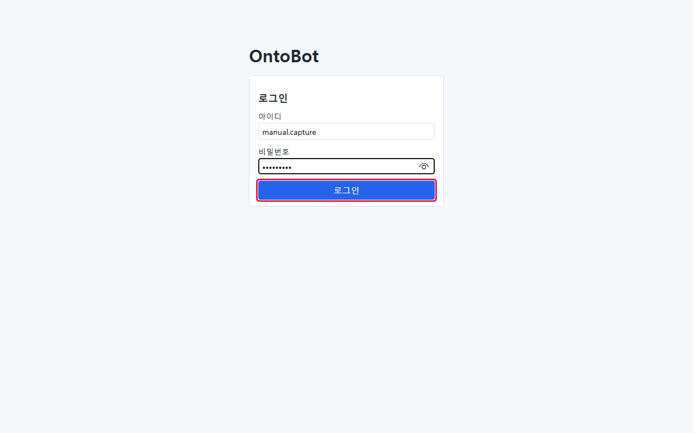
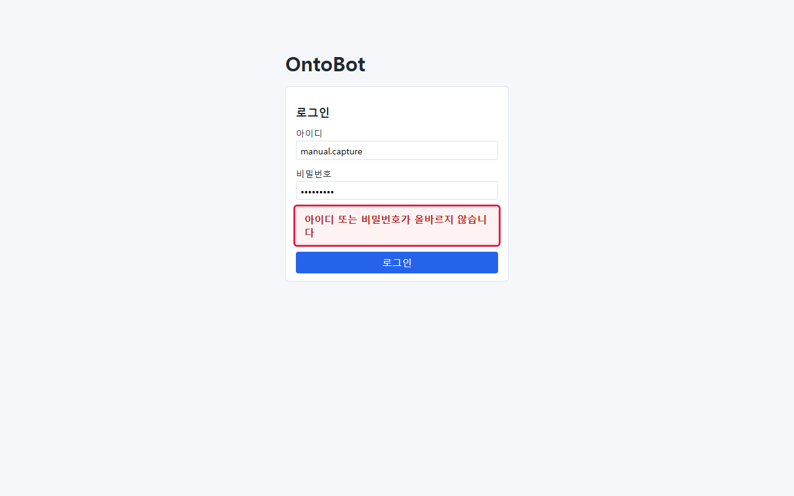
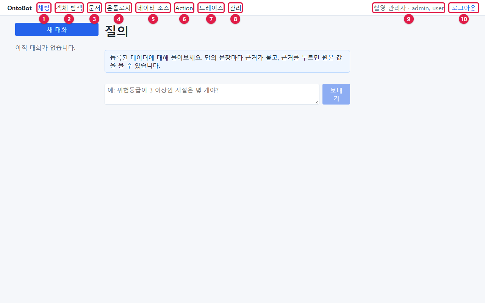
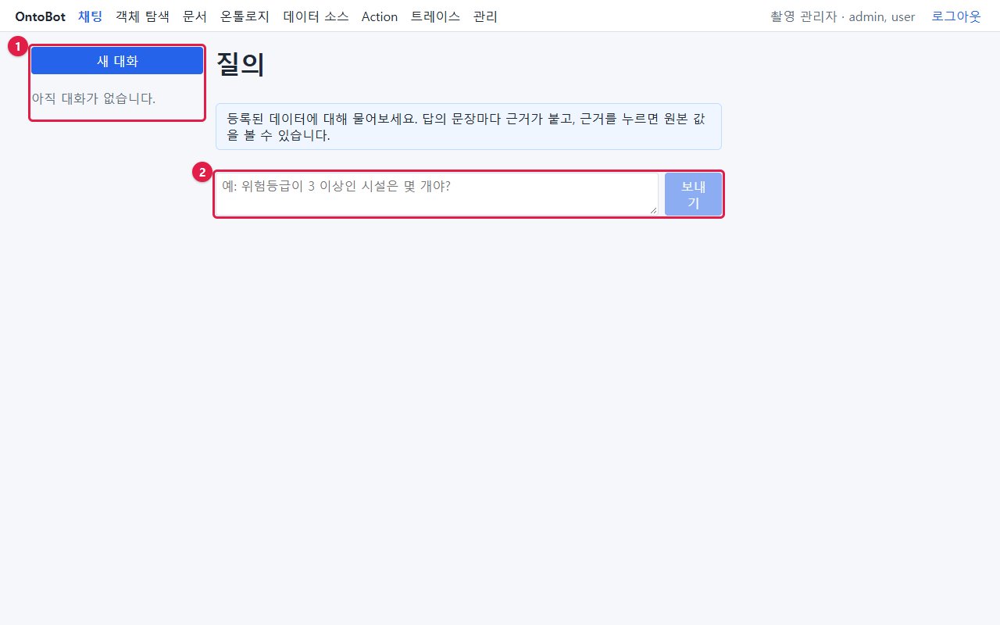
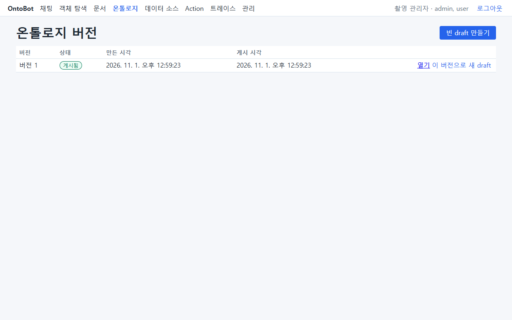
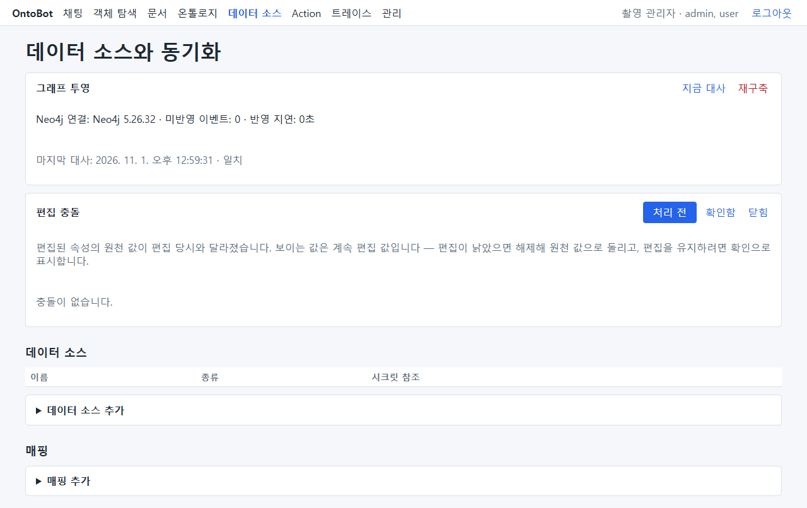
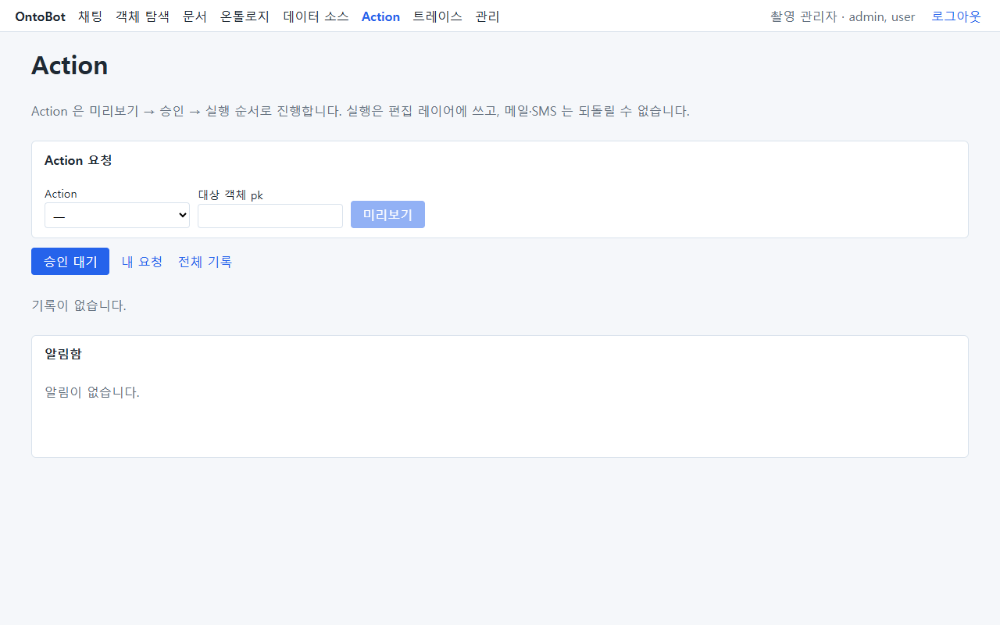
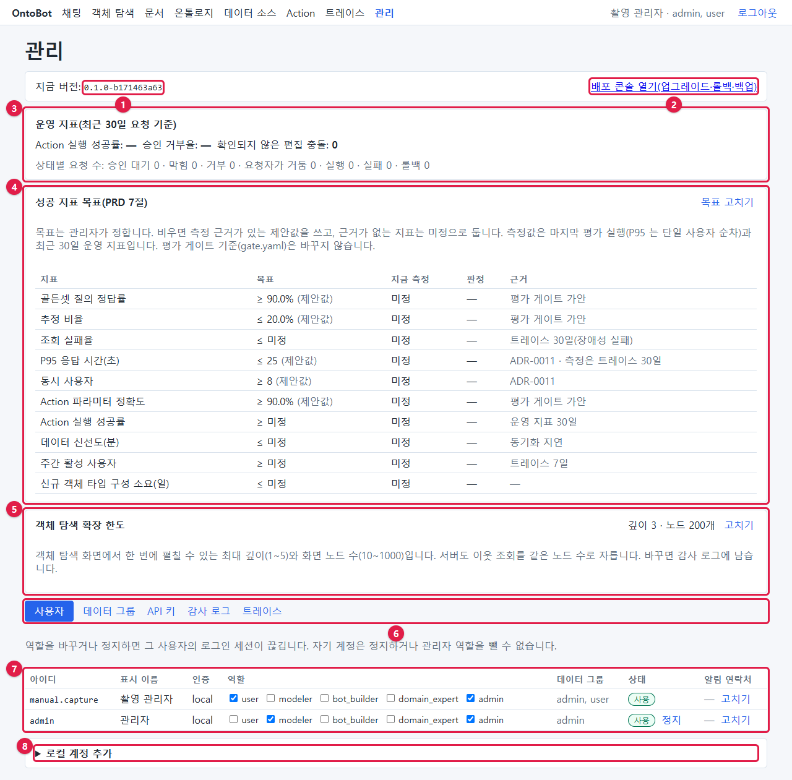
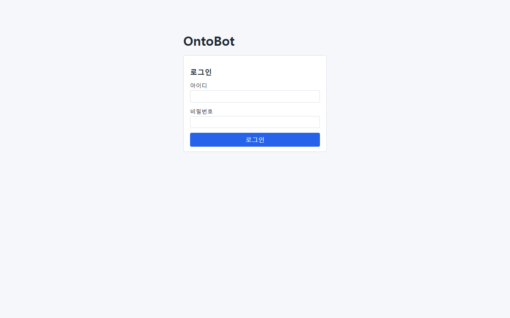

# 6장 웹 화면 첫걸음 — 관리자로 들어가 둘러보기

이 장에서는 관리자 계정으로 OntoBot 웹 화면에 들어가 메뉴를 하나씩 열어 봅니다. 화면마다 "운영자가 무엇을
보면 되는지"만 짚습니다. 각 화면을 쓰는 자세한 방법은 해당 장에서 다룹니다.

## 6.1 로그인

브라우저(엣지 또는 크롬) 주소창에 `http://<서버 이름>:8000` 을 입력하고 **Enter** 를 누릅니다.

1. **아이디** 칸에 관리자 아이디를 입력합니다.
2. **비밀번호** 칸에 비밀번호를 입력합니다. 입력한 글자는 점(•)으로 보입니다.
3. **로그인** 단추를 누르거나 비밀번호 칸에서 **Enter** 를 누릅니다.

### 비밀번호가 틀리면

빨간 상자에 **아이디 또는 비밀번호가 올바르지 않습니다** 가 나옵니다.

- 아이디가 없는지, 비밀번호가 틀렸는지, 계정이 정지됐는지를 **일부러 구분해 알려 주지 않습니다**. 남이 아이디를
  알아내지 못하게 하려는 것입니다. 운영자는 감사 로그(9장)의 `auth.login_failed` 로 어떤 아이디가 실패했는지
  확인할 수 있습니다.
- 같은 아이디로 5분 안에 다섯 번 틀리면 **로그인 실패가 이어져 잠시 막았습니다. 5분 뒤 다시 시도하세요** 가 나오고 5분 동안
  막힙니다(v1). 같은 PC(접속 주소)에서 여러 아이디로 서른 번 틀려도 그 PC 가 막힙니다 — 사내 프록시를 거치면 모든
  사용자가 프록시 주소 하나로 보이므로 주소 기준은 일부러 느슨하게 두었습니다. 막힌 시도는 감사 로그에 `auth.login_failed`(내용 `reason: locked`)로 남습니다. 잠금은 앱 프로세스
  안에만 있어서 앱을 다시 시작하면 풀립니다.
- 한글 자판 상태로 입력하지 않았는지, Caps Lock 이 켜져 있지 않은지 먼저 확인하세요.

> **알아 두기** 회사 통합 로그인(SSO)을 설정하면 이 화면에 SSO 로그인 단추가 하나 더 생깁니다(30장).

## 6.2 상단 막대

로그인하면 화면 맨 위에 막대가 생깁니다. 관리자 계정으로 보면 다음과 같습니다.

| 번호 | 메뉴 | 화면 | 운영자가 볼 것 | 이 책 |
| --- | --- | --- | --- | --- |
| ① | **채팅** | 질문하고 답을 보는 화면 | 설치·업그레이드 뒤 확인 질문 | 5장, 21장 |
| ② | **객체 탐색** | 객체 하나와 이웃(관계)을 그래프로 펼쳐 보기 | 그래프 투영이 맞는지 눈으로 | 13장 |
| ③ | **문서** | 문서 넣기·색인·객체 링크 | 색인 실패 | 11.7 |
| ④ | **온톨로지** | 데이터 설계도의 버전 목록 | 게시본이 있는지 | 6.4 |
| ⑤ | **데이터 소스** | 그래프 투영·편집 충돌·데이터 소스·매핑 | 동기화 실패, 그래프 상태, 편집 충돌 | 11~13장, 16장 |
| ⑥ | **Action** | 데이터 바꾸기 요청·승인·기록·알림함 | 발송 실패, 오래된 승인 대기 | 14~15장 |
| ⑦ | **트레이스** | 질문 한 건이 처리된 단계(관리자만) | 실패한 질문의 원인 | 10장 |
| ⑧ | **관리** | 계정·데이터 그룹·API 키·감사 로그(관리자만) | 거의 모든 관리 일 | 7~10장 |
| ⑨ | 이름 · 역할 | 지금 로그인한 사람 | 올바른 계정인지 | — |
| ⑩ | **로그아웃** | 로그인을 끝냄 | 공용 PC 에서는 꼭 | 6.8 |

역할에 따라 보이는 메뉴가 다릅니다.

| 메뉴 | 보이는 역할 |
| --- | --- |
| 채팅, 객체 탐색, 문서, 온톨로지, 데이터 소스, Action | 모두(단, 온톨로지·데이터 소스를 **고치는** 일은 modeler 만) |
| 인터뷰 | domain_expert, modeler |
| 평가 | bot_builder, modeler |
| 트레이스, 관리 | admin |

사진의 계정(`manual.capture`)은 admin·user 역할이라 인터뷰·평가 메뉴가 없습니다.

> **알아 두기** **Action** 메뉴 옆에 빨간 숫자가 붙으면 읽지 않은 알림이 있다는 뜻입니다(14장).

## 6.3 채팅 화면

| 번호 | 부분 | 설명 |
| --- | --- | --- |
| ① | 대화 목록과 **새 대화** | 이전 대화를 다시 엽니다. 대화는 보존 기간(기본 365일)이 지나면 정리됩니다 |
| ② | 입력 칸과 **보내기** | 질문을 입력하고 **Enter**(줄 바꿈은 **Shift+Enter**) |

운영자는 채팅을 주로 **확인용**으로 씁니다. 설치·업그레이드·장애 복구 뒤에는 항상 같은 확인 질문 두 개(5.6)를
해 보세요. 질문을 바꾸지 않아야 결과를 비교할 수 있습니다.

## 6.4 온톨로지 화면

온톨로지(데이터 설계도)의 버전 목록입니다. 운영자가 확인할 것은 하나입니다.

- **상태가 "게시됨"인 버전이 하나 있는가.** 게시본이 없으면 질문에 "게시된 온톨로지가 없어 조회할 수 없습니다"가
  나오고, 데이터 소스의 매핑도 만들 수 없습니다.

| 칸·단추 | 뜻 |
| --- | --- |
| 버전 | 버전 번호(게시할 때마다 1씩 늘어납니다) |
| 상태 | `draft`(편집 중) / `게시됨`(지금 쓰는 것) / `보관됨`(예전 게시본) |
| 만든 시각 / 게시 시각 | — |
| **열기** | 버전의 내용(객체 타입·속성·링크·Action) 보기 |
| **이 버전으로 새 draft** | 게시본을 복사해 고칠 초안을 만듦(모델러) |
| **빈 draft 만들기** | 빈 초안(모델러) |

온톨로지를 고치고 게시하는 일은 모델러의 일입니다. 사용자 매뉴얼 16~17장을 보세요. 15장에서 모델러가 메일·SMS 로
알리는 Action 을 추가해 게시하는 모습을 잠깐 봅니다.

## 6.5 데이터 소스 화면

위에서부터 네 부분입니다.

| 부분 | 운영자가 볼 것 | 이 책 |
| --- | --- | --- |
| **그래프 투영** | Neo4j 연결, 미반영 이벤트(0 근처), 반영 지연, 마지막 대사 "일치" | 13장 |
| **편집 충돌** | "충돌이 없습니다"가 정상. 있으면 처리 | 16장 |
| **데이터 소스** | 연결한 사내 DB 목록과 접속 시험 | 11장 |
| **매핑** | 매핑마다 최근 동기화 결과(성공·실패) | 12장 |

사진은 설치 직후라 데이터 소스와 매핑이 비어 있습니다. 샘플 데이터는 데이터 소스 없이 직접 넣었기 때문입니다.

## 6.6 Action 화면

| 부분 | 운영자가 볼 것 |
| --- | --- |
| **Action 요청** | 화면에서 직접 요청할 때(보통 사용자·승인자가 씀) |
| **승인 대기** 탭 | 내가 승인할 요청. 오래된 것이 없는지 |
| **내 요청** 탭 | 내가 한 요청 |
| **전체 기록** 탭 | 모든 실행 기록과 **발송** 결과(메일·SMS 실패 확인) |
| **알림함** | 앱 안 알림 |

## 6.7 관리 화면

**관리** 메뉴는 관리자(admin)에게만 보입니다.

| 번호 | 부분 | 설명 |
| --- | --- | --- |
| ① | 지금 버전 | 설치된 OntoBot 버전. 배포 콘솔의 "지금 버전"과 같아야 합니다 |
| ② | **배포 콘솔 열기(업그레이드·롤백·백업)** | 새 탭으로 배포 콘솔(8100)을 엽니다. 주소는 `app.env` 의 `ONTOBOT_DEPLOYER_URL` |
| ③ | 운영 지표 | 최근 30일 Action 실행 성공률·승인 거부율·확인되지 않은 편집 충돌(14장·16장) |
| ④ | 성공 지표 목표 | 관리자가 정하는 품질·운영 목표와 지금 측정값(38.9) |
| ⑤ | 객체 탐색 확장 한도 | 객체 탐색 화면에서 한 번에 펼칠 깊이·노드 수 |
| ⑥ | 탭 | **사용자 · 데이터 그룹 · API 키 · 감사 로그 · 트레이스** |
| ⑦ | 사용자 목록 | 역할·데이터 그룹·상태·알림 연락처(7장). 위의 안내 문장대로, 역할을 바꾸거나 정지하면 그 사람의 로그인이 끊깁니다 |
| ⑧ | **로컬 계정 추가** | 펼쳐서 새 계정을 만듭니다(7장) |

> **알아 두기** ②의 링크가 "배포 콘솔 주소가 설정되지 않았습니다(ONTOBOT_DEPLOYER_URL)"로 나오거나, 눌렀을 때
> 엉뚱한 주소(`localhost:8100`)로 가면 `app.env` 의 `ONTOBOT_DEPLOYER_URL` 을 실제 주소로 바꿉니다(30장).
> 설치 직후 기본값은 `http://localhost:8100` 이라 서버 밖 PC 에서는 열리지 않습니다.

## 6.8 로그아웃

오른쪽 위 **로그아웃** 을 누르면 로그인 화면으로 돌아갑니다.

- 로그인은 기본 **8시간** 유지됩니다(`ONTOBOT_SESSION_TTL_HOURS`). 그 뒤에는 다시 로그인해야 합니다.
- 관리자 계정은 권한이 크므로, 자리를 비울 때와 공용 PC 에서는 꼭 로그아웃하세요.

## 6.9 해 보기

> **해 보기** 관리자로 로그인해 상단 메뉴 다섯 개를 차례로 눌러 보세요. 각 화면에서 다음을 적어 봅니다.
>
> 1. 관리 화면의 **지금 버전**
> 2. 온톨로지 화면의 **게시된 버전 번호**
> 3. 데이터 소스 화면의 **미반영 이벤트** 수와 **마지막 대사** 결과
> 4. Action 화면의 **승인 대기** 건수
>
> 이 네 가지는 매일 점검(25장)에서도 보는 값입니다.
