# 7장 사용자 계정 관리

이 장에서는 시험 서버에 실제로 계정 다섯 개를 만들고, 역할을 바꾸고, 정지했다가 다시 살리고, 알림 연락처를
넣어 봅니다. 모든 일은 **관리 → 사용자** 탭에서 합니다.

## 7.1 역할 다섯 가지

한 사람에게 역할을 여러 개 줄 수 있습니다. 역할은 "무엇을 할 수 있는가"이고, "무엇을 읽을 수 있는가"는 8장의
읽기 권한이 따로 정합니다.

| 역할 | 화면 이름 | 할 수 있는 일 | 더 보이는 메뉴 |
| --- | --- | --- | --- |
| `user` | 일반 사용자 | 채팅으로 질문, Action 요청, 알림 받기 | — |
| `domain_expert` | 현업 전문가 | 인터뷰 워크숍에서 업무 설명 | 인터뷰 |
| `modeler` | 모델러 | 온톨로지 편집·게시, 데이터 소스·매핑·동기화, 워크숍 검토, 평가, 편집 충돌 처리 | 인터뷰, 평가 |
| `bot_builder` | 챗봇 빌더 | 평가 문항(골든셋) 관리·실행 | 평가 |
| `admin` | 관리자 | 계정·권한·감사 로그·트레이스, 그래프 재구축, 편집 충돌 처리, Action 롤백, **배포 콘솔 로그인** | 관리 |

Action 을 누가 요청하고 누가 승인하는지는 역할과 별도로 **Action 정의마다** 정합니다(모델러가 온톨로지에서 설정,
보통 승인은 admin).

> **알아 두기** `user` 역할이 없어도 채팅은 할 수 있습니다. 다만 무엇을 읽을 수 있는지는 8장의 읽기 권한에
> 달려 있습니다. 8장에서 `bot_builder` 역할만 가진 계정으로 실제로 확인합니다.

## 7.2 사용자 목록 읽기

**관리** 메뉴를 누르면 **사용자** 탭이 먼저 열립니다. 목록의 칸은 여섯 개입니다.

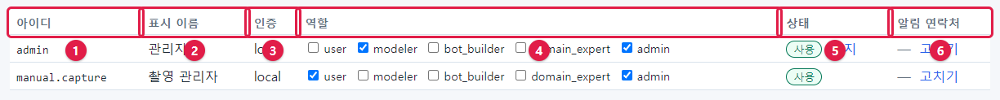

| 번호 | 칸 | 설명 |
| --- | --- | --- |
| ① | 아이디 | 로그인할 때 쓰는 이름. 한 번 만들면 바꿀 수 없습니다 |
| ② | 표시 이름 | 화면 오른쪽 위와 Action 기록에 보이는 이름 |
| ③ | 인증 | `local`(이 화면에서 만든 계정) 또는 `oidc`(회사 통합 로그인으로 들어온 계정) |
| ④ | 역할 | 역할 다섯 개의 체크 상자. 바꾸면 **역할 저장** 단추가 나타납니다 |
| ⑤ | 상태 | **사용**(초록) / **정지**(빨강), 옆의 **정지**·**다시 사용** 단추 |
| ⑥ | 알림 연락처 | 메일·휴대전화(가려서 보임)와 **고치기** |

## 7.3 계정 만들기

### 1단계 — 추가 칸 펼치기

목록 아래의 **▶ 로컬 계정 추가** 를 누릅니다.

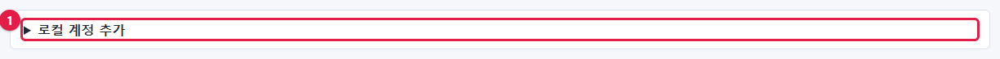

칸이 펼쳐집니다.

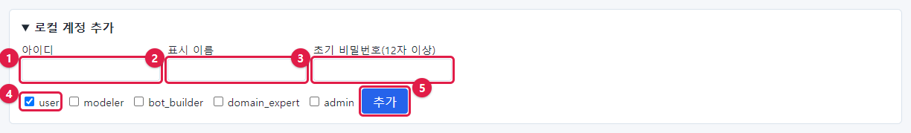

| 번호 | 칸 | 입력 | 규칙 |
| --- | --- | --- | --- |
| ① | 아이디 | 예: `kim.user` | 영문·숫자·점 권장. 이미 있는 아이디는 안 됨 |
| ② | 표시 이름 | 예: `김사용` | 한글 가능 |
| ③ | 초기 비밀번호(12자 이상) | 임시 비밀번호 | **12자 이상** |
| ④ | 역할 | 체크 | 처음에는 `user` 가 체크되어 있음 |
| ⑤ | **추가** | 누름 | — |

### 2단계 — 입력하고 추가

아이디·표시 이름·초기 비밀번호를 입력하고 역할을 고른 뒤 **추가** 를 누릅니다.

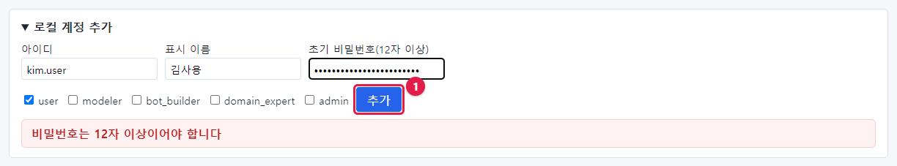

목록에 새 줄이 생깁니다.

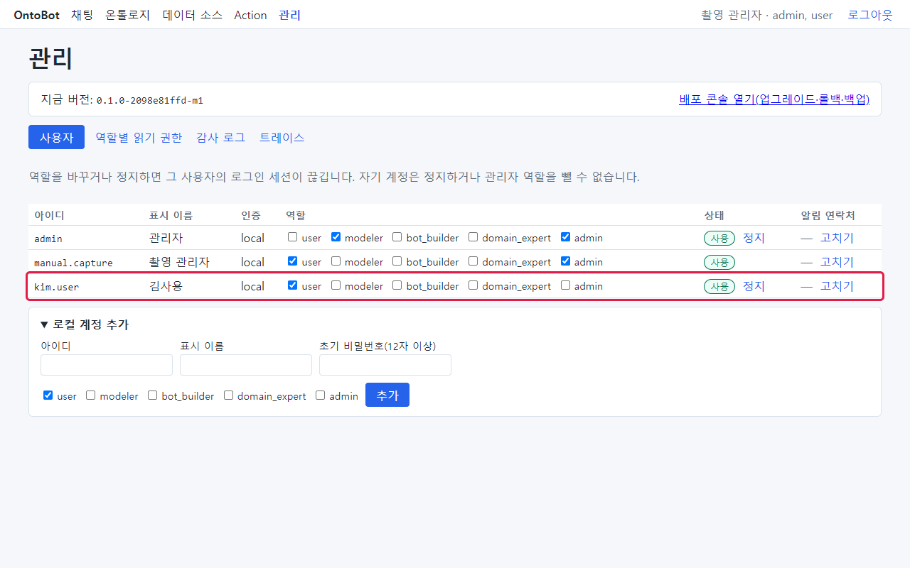

### 3단계 — 사용자에게 알리기

- 아이디와 초기 비밀번호를 **안전한 방법으로**(대면, 사내 보안 메신저 등) 전달합니다. 메일 본문에 비밀번호를
  적지 마세요.
- 접속 주소(`http://<서버>:8000`)와 사용자 매뉴얼을 함께 알려 줍니다.

> **알아 두기** 지금 판에는 사용자가 스스로 비밀번호를 바꾸는 화면이 없습니다. 비밀번호를 잊은 사용자에게는
> 관리자가 새 계정을 만들어 주거나(7.9) 개발팀에 요청해야 합니다. 그래서 처음 줄 때 사용자가 기억할 수 있는
> 비밀번호를 정하는 것이 좋습니다.

### 이 책에서 만든 계정

같은 방법으로 아래 계정을 차례로 만들었습니다.

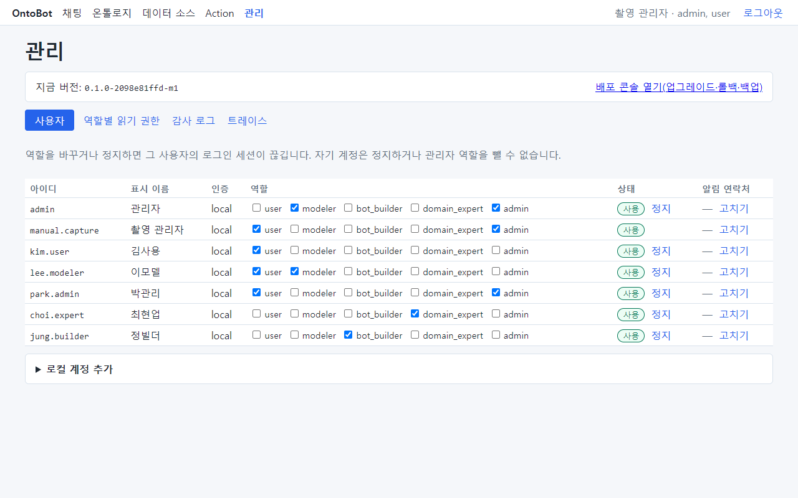

| 아이디 | 표시 이름 | 역할 |
| --- | --- | --- |
| `kim.user` | 김사용 | user |
| `lee.modeler` | 이모델 | modeler, user |
| `park.admin` | 박관리 | admin, user |
| `choi.expert` | 최현업 | domain_expert |
| `jung.builder` | 정빌더 | bot_builder |

## 7.4 계정을 만들 때 나오는 오류

### 비밀번호가 짧을 때

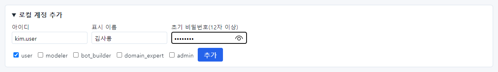

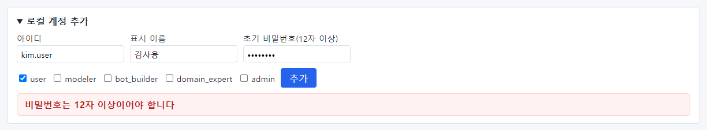

**비밀번호는 12자 이상이어야 합니다** 가 나오고 계정은 만들어지지 않습니다.

### 이미 있는 아이디일 때

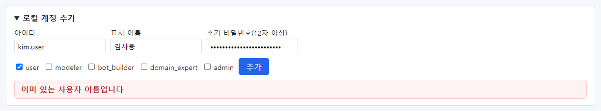

**이미 있는 사용자 이름입니다** 가 나옵니다. 정지된 계정의 아이디도 다시 쓸 수 없습니다. 퇴사한 사람과 같은
이름의 신입이 오면 `kim.user2` 처럼 다른 아이디를 씁니다.

## 7.5 새 계정으로 처음 로그인하면

새 계정(`kim.user`)으로 로그인한 화면입니다.

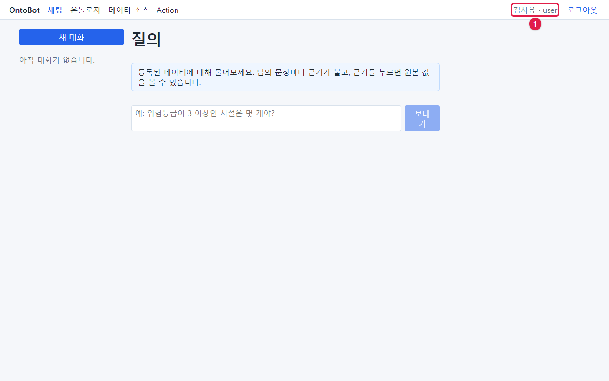

- 오른쪽 위에 **김사용 · user** 가 보입니다.
- 일반 사용자에게는 **관리** 메뉴가 없습니다.
- 대화 목록에 "아직 대화가 없습니다."가 보입니다.

일반 사용자가 주소창에 `/admin` 을 직접 입력해 관리 화면을 열면 어떻게 될까요?

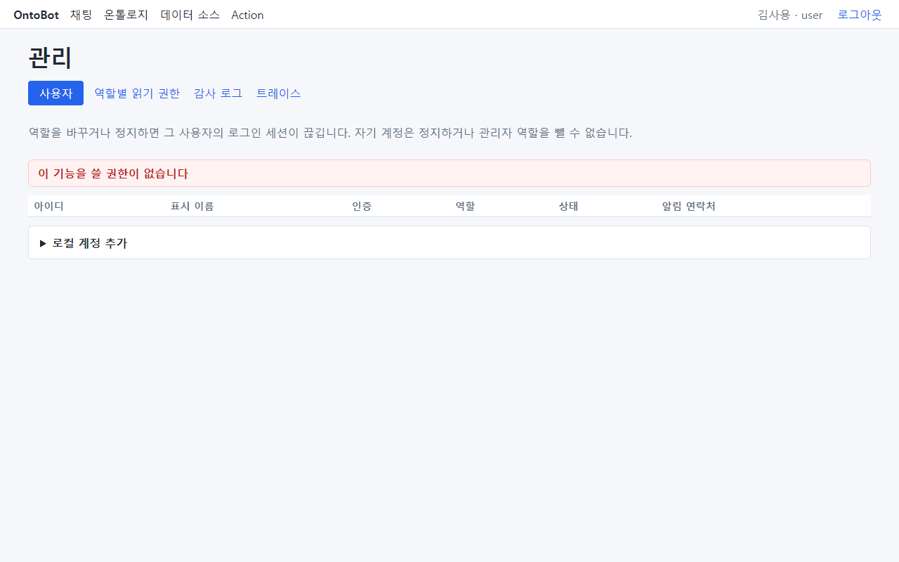

화면 틀은 보이지만 **이 기능을 쓸 권한이 없습니다** 가 나오고 목록은 비어 있습니다. 메뉴를 숨기는 것만이 아니라
서버가 요청 자체를 막습니다. 안심해도 됩니다.

## 7.6 역할 바꾸기

`lee.modeler` 에게 현업 전문가(domain_expert) 역할을 더해 봅니다.

1. 그 사람 줄에서 **domain_expert** 체크 상자를 누릅니다.
2. 줄 안에 **역할 저장** 단추가 나타납니다(①). 누릅니다.

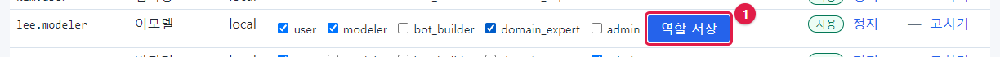

저장되면 단추가 사라집니다.

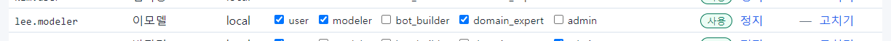

### 바꾸는 순간 그 사람의 로그인이 끊깁니다

역할을 바꿀 때 그 사람이 로그인해 있었다면, 다음 화면 이동 때 로그인 화면으로 돌아갑니다. 새 역할로 다시
로그인하게 하려는 것입니다.

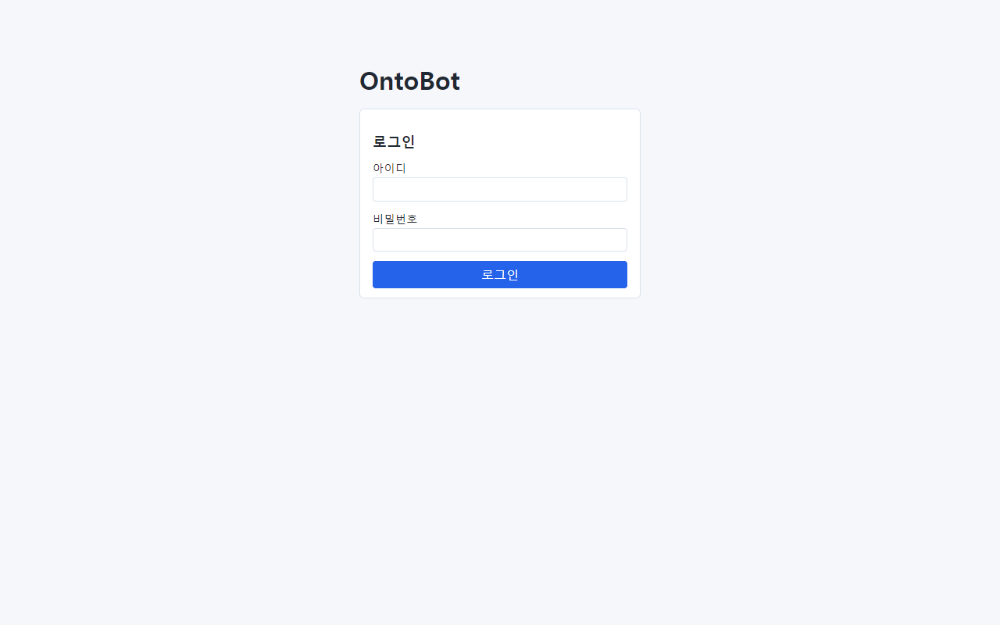

> **주의** 업무 중인 사람의 역할을 바꾸면 작성 중이던 내용이 사라질 수 있습니다. 미리 알리고 바꾸세요.

## 7.7 정지와 다시 사용

퇴사·휴직·장기 출장 등으로 잠시 또는 영구히 쓰지 못하게 할 때는 **정지**합니다. 계정을 지우는 기능은 없습니다
(감사 기록의 "누가"를 잃지 않으려는 것입니다).

1. 그 사람 줄의 **정지** 를 누릅니다.

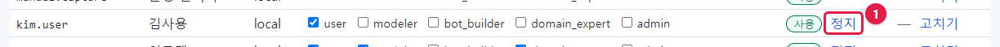

2. 상태가 **정지**(빨강)로 바뀌고, 단추는 **다시 사용** 으로 바뀝니다.

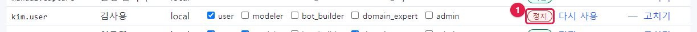

정지된 사람이 로그인하면 다음과 같습니다.

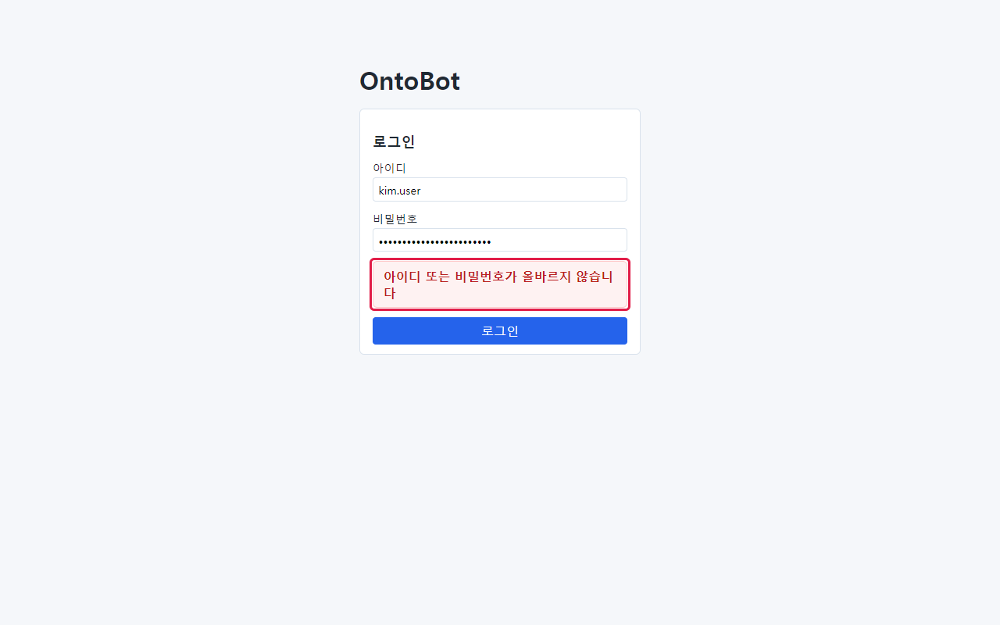

비밀번호가 틀렸을 때와 **똑같은 문구**(아이디 또는 비밀번호가 올바르지 않습니다)가 나옵니다. 정지 사실을 바깥에
알리지 않으려는 것입니다. 사용자가 "비밀번호가 맞는데 안 된다"고 하면 먼저 정지 여부를 확인하세요.

3. 다시 쓰게 하려면 **다시 사용** 을 누릅니다.

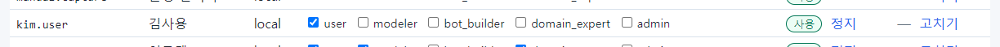

### 자기 계정은 정지할 수 없습니다

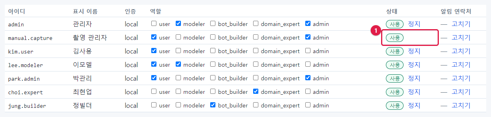

지금 로그인한 계정(사진에서는 `manual.capture`)의 줄에는 **정지** 단추가 없습니다(①). 자기 관리자 역할도 뺄 수
없습니다. 실수로 관리자가 아무도 없게 되는 것을 막기 위해서입니다. 관리자 계정을 정리할 때는 **다른 관리자**가
합니다. 그래서 관리자는 **최소 두 명** 두기를 권합니다.

## 7.8 알림 연락처

Action 알림을 메일·SMS 로 받을 사람에게만 필요합니다(15장). 앱 안 알림(알림함)은 연락처 없이 늘 됩니다.

1. 그 사람 줄의 **고치기** 를 누릅니다. 안내 문장과 두 칸이 나옵니다.

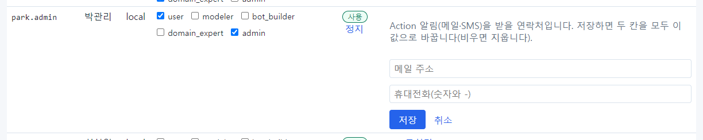

2. **메일 주소** 와 **휴대전화(숫자와 -)** 를 입력하고 **저장** 을 누릅니다.

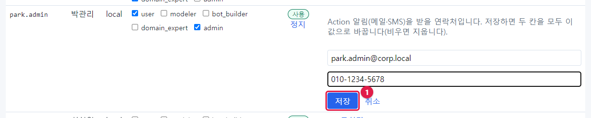

3. 목록에는 가려진 값으로만 보입니다.

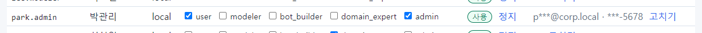

| 입력한 값 | 화면에 보이는 값 |
| --- | --- |
| `park.admin@corp.local` | `p***@corp.local` |
| `010-1234-5678` | `***-5678` |

> **주의** 저장하면 **두 칸 모두** 지금 입력한 값으로 바뀝니다. 메일만 바꾸려고 전화 칸을 비워 두면 전화번호가
> 지워집니다. 고칠 때는 두 칸을 모두 다시 입력하세요(목록에는 가려진 값만 있어 원래 값을 다시 볼 수 없습니다).

연락처는 화면·로그·감사 기록 어디에도 원래 값으로 나오지 않습니다. 원래 값은 데이터베이스와 백업 파일에만
있습니다(31장).

## 7.9 화면에 들어갈 수 없을 때 — 명령으로 계정 만들기

관리자 비밀번호를 잊었거나 관리자 계정이 모두 정지되어 화면에 들어갈 수 없으면, 서버에서 명령으로 새 관리자를
만듭니다. 관리자 PowerShell 에서:

```powershell
wsl -d ontobot -u root -- bash -c "cd /opt/ontobot && docker compose run --rm -it migrate python -m ontobot.security.cli create-user --username ops2 --display-name 운영자2 --role admin"
```

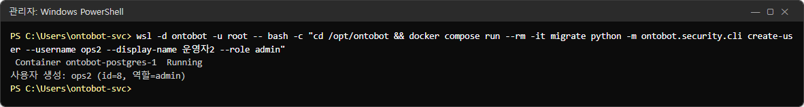

- 비밀번호를 두 번 묻습니다(입력해도 보이지 않습니다). 사진은 촬영 스크립트가 비밀번호를 환경변수로 넘겨서 묻는
  줄이 없습니다.
- `사용자 생성: ops2 (id=8, 역할=admin)` 이 나오면 성공입니다.
- 역할을 여러 개 주려면 `--role admin --role modeler` 처럼 반복합니다.

이 명령 도구에서 쓸 수 있는 일은 세 가지입니다.

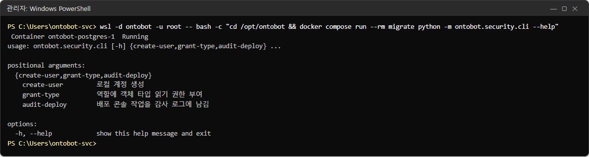

| 하위 명령 | 하는 일 |
| --- | --- |
| `create-user` | 로컬 계정 만들기 |
| `grant-type` | 역할에 객체 타입 읽기 권한 주기(8장) |
| `audit-deploy` | 배포 콘솔이 작업 결과를 감사 로그에 남길 때 씀(사람이 칠 일 없음) |

> **주의** 이 명령은 서버 관리자 권한이 있는 사람만 쓸 수 있고, 감사 로그에도 남습니다. 만든 뒤에는 화면에서
> 정지했던 원래 관리자를 다시 살리거나 정리하세요.

## 7.10 회사 통합 로그인(SSO)

회사에 OIDC 방식의 통합 로그인이 있으면 `app.env` 에 다음 네 줄을 채웁니다(30장에서 고치는 법).

| 설정 | 뜻 |
| --- | --- |
| `ONTOBOT_OIDC_ISSUER` | 통합 로그인 서버 주소(비우면 SSO 꺼짐) |
| `ONTOBOT_OIDC_CLIENT_ID` / `_CLIENT_SECRET` | 통합 로그인 담당자에게 받는 값 |
| `ONTOBOT_OIDC_REDIRECT_URI` | `http(s)://<OntoBot 주소>/api/v1/auth/callback` |
| `ONTOBOT_OIDC_DEFAULT_ROLES` | SSO 로 처음 들어온 사람이 받는 역할(기본 `["user"]`) |

- SSO 로 처음 들어온 사람은 사용자 목록에 인증 `oidc` 로 생깁니다. 역할은 관리자가 이 화면에서 바꿉니다.
- 아이디·비밀번호 로그인을 막으려면 `ONTOBOT_LOCAL_AUTH_ENABLED=false`.

> **주의** **배포 콘솔은 로컬 관리자 계정(아이디·비밀번호)으로만 로그인합니다.** SSO 만 쓰도록 바꾸더라도 배포
> 담당 관리자 계정 하나는 비밀번호와 함께 남겨 두세요. 남겨 두지 않으면 업그레이드·롤백을 화면으로 할 수 없습니다.

## 7.11 이 장을 마친 뒤의 목록

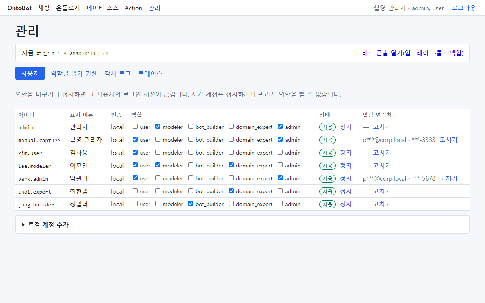

## 7.12 계정 관리 수칙

| 수칙 | 이유 |
| --- | --- |
| 관리자(admin)는 최소 두 명, 많아도 꼭 필요한 사람만 | 자기 잠금 방지, 권한 남용 방지 |
| 퇴사·이동자는 **당일** 정지 | 정지 즉시 로그인이 끊깁니다 |
| 공용 계정(여럿이 같이 쓰는 계정)을 만들지 않음 | 감사 로그의 "누가"가 무의미해집니다 |
| 역할은 업무에 필요한 만큼만 | 8장의 읽기 권한과 함께 최소 권한 |
| 분기마다 목록을 검토(43장 양식) | 쓰지 않는 계정 정지 |
| 계정 변경은 감사 로그로 확인(9장) | `security.user_created` 등 |

## 7.13 해 보기

> **해 보기**
>
> 1. 연습용 계정 `test.trainee`(표시 이름 "연습생", 역할 user)를 만드세요.
> 2. 다른 브라우저(또는 InPrivate 창)에서 그 계정으로 로그인해 오른쪽 위 이름을 확인하세요.
> 3. 관리자 화면에서 그 계정을 **정지**하고, 연습생 창에서 화면을 옮겨 보세요. 무슨 일이 일어나나요?
> 4. 감사 로그(9장)에서 `security.user_status_changed` 를 찾아보세요.
