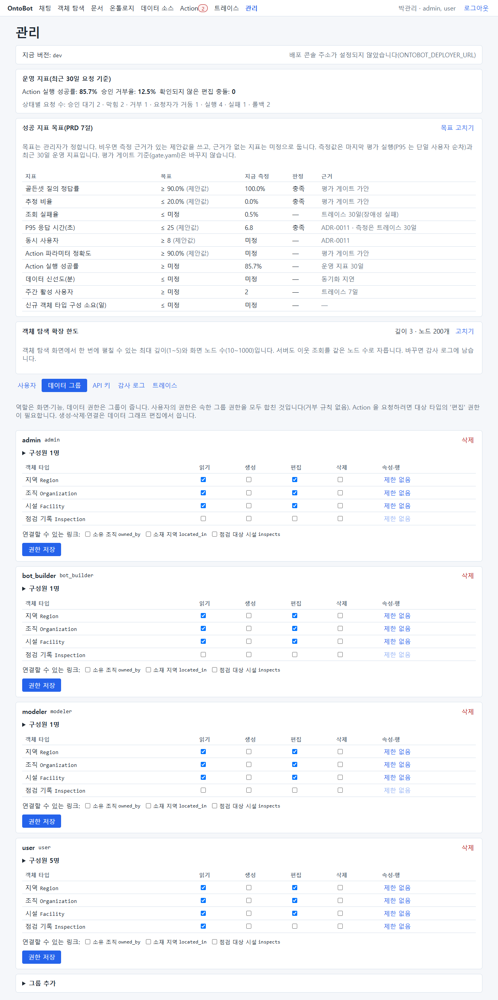
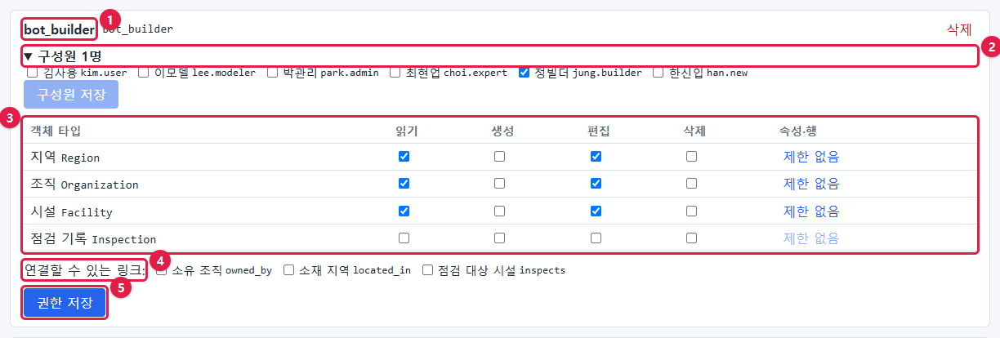
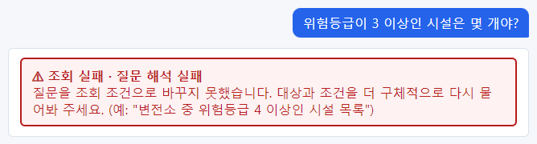
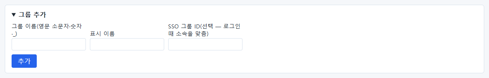
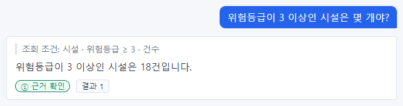

# 8장 데이터 그룹과 권한

역할(7장)이 "**어떤 화면·기능을 쓸 수 있는가**"라면, 데이터 그룹은 "**어떤 데이터를 읽고 바꿀 수 있는가**"입니다
(v1 — 예전 판의 "역할별 읽기 권한"을 대신합니다). 권한은 사람마다가 아니라 **그룹마다** 객체 타입(시설, 조직, 지역 등)
단위로 주고, 사용자는 속한 그룹들의 권한을 **모두 합친** 만큼 씁니다. 빼는 규칙(거부)은 없습니다.

> **알아 두기** 이 장의 데이터 그룹 사진은 v1 화면이라 시험 설치본(0.1.0-…-m1)이 아니라 **사용자 매뉴얼 촬영 환경**
> (개발 PC, 00장 "촬영 환경")에서 찍었습니다. 권한이 없을 때·있을 때의 답 사진(8.2·8.4)은 예전 설치본 화면이지만
> 동작은 같습니다.

## 8.1 데이터 그룹 탭

**관리** → **데이터 그룹** 탭을 엽니다. 그룹마다 카드가 하나씩 있습니다.



맨 위 안내: "역할은 화면·기능, 데이터 권한은 그룹이 줍니다. 사용자의 권한은 속한 그룹 권한을 모두 합친 것입니다
(거부 규칙 없음). Action 을 요청하려면 대상 타입의 '편집' 권한이 필요합니다."

카드 하나를 확대하면 다음과 같습니다(`bot_builder` 그룹).



| 번호 | 부분 | 설명 |
| --- | --- | --- |
| ① | 그룹 표시 이름과 이름 | 이름은 영문 소문자·숫자·`_`. SSO 그룹 ID 가 있으면 **SSO …** 표시 |
| ② | **구성원 n명** | 펼쳐서 사용자를 체크하고 **구성원 저장**. 저장은 체크한 사람들로 **바꿉니다** |
| ③ | 객체 타입 × **읽기·생성·편집·삭제** | 쓰기(생성·편집·삭제)를 켜면 읽기도 켜집니다. 행 끝 **제한 없음** 으로 속성·행 제한(8.6) |
| ④ | **연결할 수 있는 링크** | 링크를 만들고 끊는 권한(데이터 그래프 편집에서 씀) |
| ⑤ | **권한 저장** | ③·④를 저장 |

### 업그레이드하면

예전 판의 "역할별 읽기 권한"은 업그레이드할 때 **같은 이름의 그룹** 으로 옮겨집니다 — 그 역할을 가진 사람이 구성원,
읽던 타입은 읽기·편집. 그래서 업그레이드 직후 `user`·`admin` 같은 그룹이 보입니다. 그 뒤 조직에 맞게 그룹(예: 강남지사,
안전관리팀)을 새로 만들고 정리하세요.

## 8.2 권한이 없으면 어떻게 보이나

어느 그룹에서도 읽기를 받지 못한 사람(예: `bot_builder` 그룹만 있고 그 그룹에 권한이 없는 `jung.builder`)이 질문하면:



**조회 실패 · 질문 해석 실패**가 나옵니다. 읽을 수 있는 타입이 하나도 없으면 OntoBot 이 질문을 이해하는 데 쓰는
설계도에서도 그 타입들이 **아예 보이지 않습니다.** 그래서 "권한 없음"이 아니라 "해석 실패"로 나옵니다.

> **알아 두기** 사용자가 "어떤 질문을 해도 질문 해석 실패가 나온다"고 하면, 가장 먼저 그 사람이 **어느 데이터
> 그룹에 속했는지**(사용자 탭의 **데이터 그룹** 칸)와 그 그룹의 읽기 권한을 확인하세요.

## 8.3 그룹 만들고 권한 주기

1. 탭 위쪽 **그룹 추가** 를 펼쳐 그룹 이름(영문 소문자로 시작)과 표시 이름을 넣고 만듭니다. SSO 를 쓰면 **SSO 그룹
   ID** 도 넣습니다(8.5).



2. 새 카드에서 **구성원** 을 펼쳐 사람을 체크하고 **구성원 저장**.
3. 객체 타입마다 읽기(필요하면 편집 등)를 체크하고 **권한 저장**. 단추 옆에 **저장했습니다.** 가 나옵니다.

권한은 저장하는 즉시 적용됩니다. 사용자가 다시 로그인할 필요가 없습니다. 새 사용자는 **사용자 → 로컬 계정 추가** 에서
그룹을 함께 고를 수 있습니다(7장). 그룹 없이 만든 계정은 데이터를 하나도 보지 못합니다.



## 8.4 관계(링크)는 양쪽을 다 읽어야 합니다

시설만 읽을 수 있는 상태에서 "시설을 소유한 조직"을 따라가는 질문을 하면:


**조회 실패 · 권한 없음 — 조회 권한이 없는 정보입니다.** 질문에 나온 "강남지사"는 조직(`Organization`)인데 그 사람은
조직을 읽을 수 없기 때문입니다. **두 타입을 잇는 관계는 양쪽 타입을 모두 읽을 수 있어야** 쓸 수 있습니다. 조직
읽기를 주면 답이 나옵니다.


## 8.5 SSO 그룹과 맞추기

회사 통합 로그인(SSO)을 쓰면 그룹 소속을 SSO 의 그룹 정보로 맞출 수 있습니다. 기본은 꺼짐입니다.

1. `app.env` 에 `ONTOBOT_OIDC_GROUPS_CLAIM=groups`(ID 토큰에서 그룹 목록이 들어 있는 클레임 이름)를 넣고 앱을 다시
   띄웁니다(30장).
2. 그룹의 **SSO 그룹 ID** 칸에 클레임에 들어오는 값을 적습니다.

로그인할 때마다 SSO 그룹 ID 가 있는 그룹들의 소속을 클레임과 **정확히 같은 값** 으로만 맞춥니다(비슷한 이름·앞부분
일치는 쓰지 않음). SSO 그룹 ID 가 없는 그룹은 건드리지 않으므로, 화면에서 손으로 넣은 소속은 그대로입니다.

## 8.6 속성 숨김·행 제한

타입 행 끝의 **제한 없음/제한 있음** 을 누르면(읽기를 켠 타입만) 더 좁게 정할 수 있습니다.

| 칸 | 뜻 |
| --- | --- |
| 숨길 속성 | 체크한 속성은 이 그룹 구성원에게 없는 속성이 됩니다. 단 같은 사람이 속한 **다른 그룹이 보여 주면 보입니다**(모든 그룹이 숨겨야 숨겨짐). pk·제목 속성은 숨길 수 없음 |
| 읽기 행 정책 | 조건을 만족하는 객체만 보입니다. 예: `[{"property":"facility_type","op":"eq","value":"철탑"}]`. 비우면 제한 없음 |
| 쓰기 행 정책 | Action 을 요청할 수 있는 대상 객체를 제한(승인 때 다시 확인) |

조건이 틀리면 저장이 거부됩니다. 실행할 때 정책이 깨져 있으면(예: 정책이 쓰는 속성이 설계도에서 지워짐) 그 정책은
**아무 행도 보여 주지 않는 쪽** 으로 동작합니다 — 사용자가 "갑자기 아무것도 안 나온다"고 하면 행 정책을 확인하세요.
모델러가 행 정책이 쓰는 속성을 지우거나 자료형을 바꾸는 설계도는 게시 단계에서 막힙니다.

## 8.7 권한 정리 — 누가 무엇을 읽게 할까

| 원칙 | 설명 |
| --- | --- |
| 업무에 필요한 타입만 | 영업 부서가 인사 데이터를 읽을 필요는 없습니다 |
| admin 도 필요한 만큼만 | 관리자 역할은 계정·권한을 다룰 뿐, 데이터는 그룹에 속해야 봅니다 |
| 개인정보가 있는 타입은 신중히 | 연락처 같은 속성은 숨김(8.6)이나 그룹을 나눠 접근 자체를 줄입니다 |
| 관계를 쓰는 타입은 함께 | 시설 ↔ 조직처럼 함께 묻는 타입은 같이 줍니다 |
| Action 은 대상 타입의 **편집** | 시설의 위험등급을 바꾸는 Action 은 시설 **편집** 권한이 있어야 요청할 수 있습니다(읽기만으로는 요청 단추가 꺼짐) |
| 문서도 그룹 소속 | 문서는 그 데이터 그룹 구성원만 봅니다(11장). 관리자도 소속이 아니면 못 봅니다 |

## 8.8 온톨로지가 바뀌었을 때

모델러가 새 객체 타입을 추가해 게시하면, 그 타입은 **어느 그룹에도 권한이 없는 상태** 로 생깁니다. 새 타입이
생겼다는 연락을 받으면 필요한 그룹에 체크해 주세요. (동기화·평가를 돌리는 워커는 게시 뒤 다시 시작해야 새 타입을
압니다 — 24장 24.6.)

반대로 타입이 게시본에서 빠지면, 그 타입에 남아 있던 권한은 `(게시본에 없음)` 표시와 함께 보입니다. 필요 없으면
체크를 풀고 저장합니다.

## 8.9 명령으로 권한 주기

화면에 들어갈 수 없을 때는 명령으로도 줄 수 있습니다(한 번에 한 그룹·한 타입, 그룹이 없으면 만듭니다).

```powershell
wsl -d ontobot -u root -- bash -c "cd /opt/ontobot && docker compose run --rm migrate python -m ontobot.security.cli grant-type --group user --type Facility"
```

`--edit` 를 붙이면 편집도 줍니다. `--type` 에는 화면에 보이는 영문 이름(`Facility`, `Organization`, `Region`)을 씁니다.
사용자를 만들면서 그룹에 넣으려면 `create-user … --group user` 를 씁니다(29장).

> **알아 두기** 아래 사진은 예전 판의 `--role` 명령입니다. v1 에서는 `--group` 을 씁니다.


## 8.10 권한 변경 기록

그룹 추가·삭제는 `security.group_changed`, 구성원 변경은 `security.group_members_changed`, 권한 변경은
`security.permission_changed` 로 감사 로그에 남습니다. 무엇이 무엇으로 바뀌었는지(전후 값)도 함께 남습니다(9장).

## 8.11 해 보기

> **해 보기**
>
> 1. `field_team` 그룹을 만들고 `choi.expert` 를 구성원으로 넣은 뒤 **시설** 만 읽기를 주세요.
> 2. `choi.expert` 로 로그인해 "위험등급이 3 이상인 시설은 몇 개야?"와 "강남지사가 소유한 시설 보여줘"를 물어보세요.
>    두 답이 어떻게 다른가요? 왜 그런가요?
> 3. 시설 행의 **제한 없음** 을 눌러 읽기 행 정책에 철탑만 보이게 해 보고, 같은 질문의 숫자가 어떻게 바뀌는지 보세요.
> 4. 연습이 끝나면 그룹을 지우고, 감사 로그에서 변경 기록을 확인하세요.
