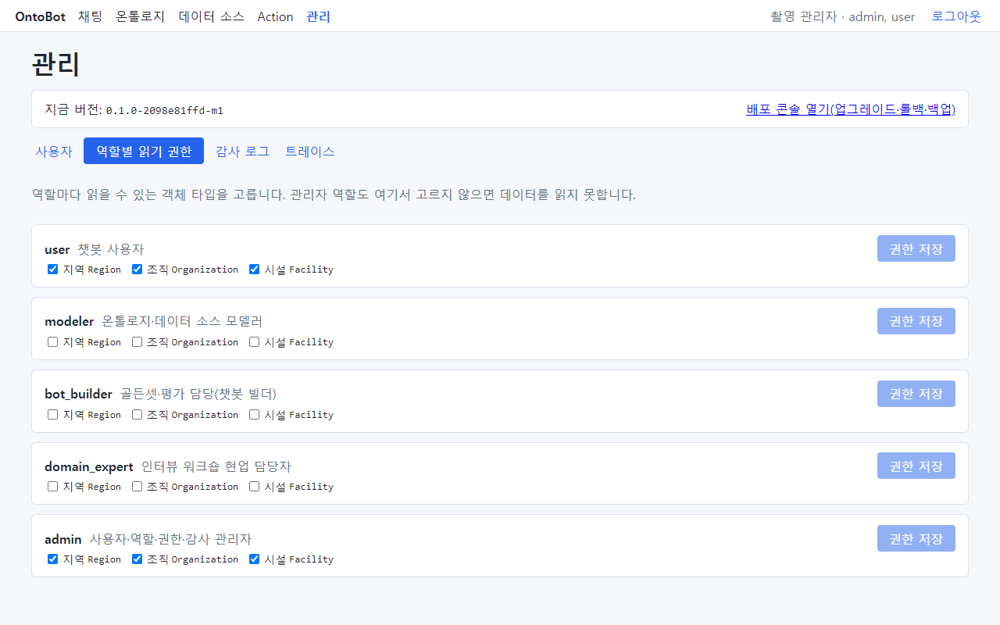
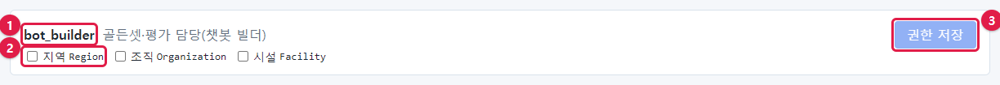
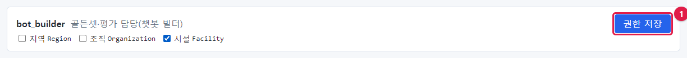
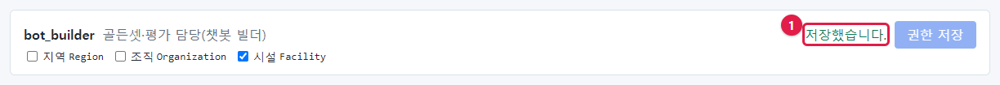
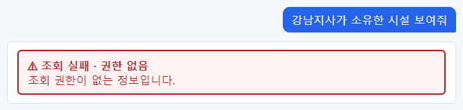
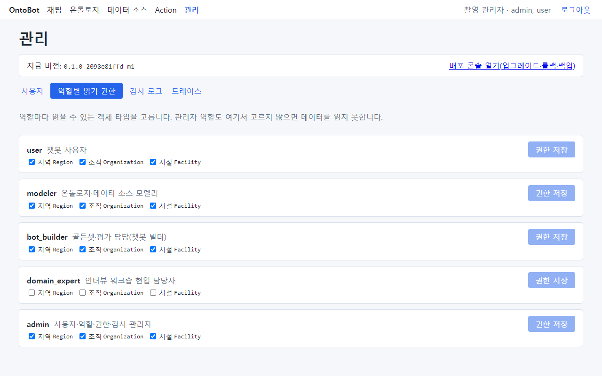
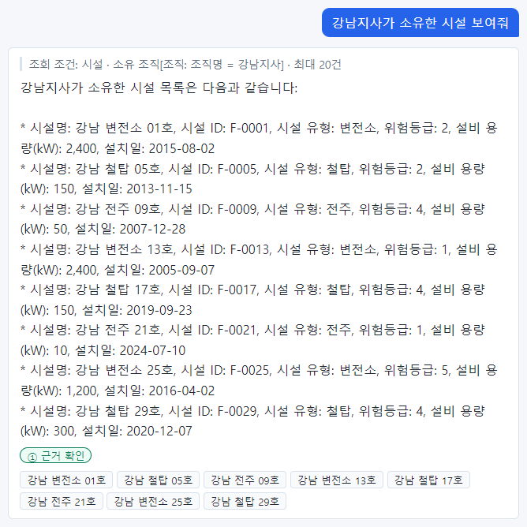
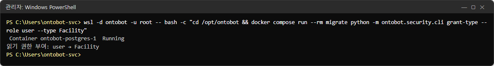

# 8장 역할별 읽기 권한

역할(7장)이 "무엇을 할 수 있는가"라면, 읽기 권한은 "**어떤 종류의 데이터를 읽을 수 있는가**"입니다. 읽기 권한은
사람마다가 아니라 **역할마다** 객체 타입(시설, 조직, 지역 등) 단위로 줍니다. 한 사람이 여러 역할을 가지면 그
역할들의 권한을 모두 합친 만큼 읽습니다.

이 장에서는 `bot_builder` 역할만 가진 `jung.builder` 로 권한이 없을 때와 있을 때를 실제로 비교합니다.

## 8.1 읽기 권한 탭

**관리** → **역할별 읽기 권한** 탭을 엽니다.



- 역할마다 상자가 하나씩 있고, 상자 안에 **게시된 온톨로지의 객체 타입**이 체크 상자로 나옵니다.
- 맨 위 안내 문장: "관리자 역할도 여기서 고르지 않으면 데이터를 읽지 못합니다."
- 사진은 `-SeedSample` 로 설치한 직후의 모습입니다. 설치가 **user** 와 **admin** 에만 세 타입을 모두 주었고,
  modeler·bot_builder·domain_expert 는 비어 있습니다.

한 상자를 확대하면 다음과 같습니다.



| 번호 | 부분 | 설명 |
| --- | --- | --- |
| ① | 역할 이름과 설명 | 예: `bot_builder` 골든셋·평가 담당(챗봇 빌더) |
| ② | 객체 타입 체크 상자 | 표시 이름과 영문 이름(`api_name`) |
| ③ | **권한 저장** | 체크를 바꾸면 눌러지게 됩니다 |

## 8.2 권한이 없으면 어떻게 보이나

`bot_builder` 역할만 가진 `jung.builder` 로 로그인해 질문합니다.


**조회 실패 · 질문 해석 실패**가 나옵니다. 읽을 수 있는 타입이 하나도 없으면 OntoBot 이 질문을 이해하는 데 쓰는
설계도에서도 그 타입들이 **아예 보이지 않습니다.** 그래서 "권한 없음"이 아니라 "해석 실패"로 나옵니다.

> **알아 두기** 사용자가 "어떤 질문을 해도 질문 해석 실패가 나온다"고 하면, 가장 먼저 그 사람의 역할에 읽기
> 권한이 있는지 확인하세요. 사용자에게 데이터의 존재 자체를 감추는 것이 의도된 동작입니다.

## 8.3 권한 주기

1. `bot_builder` 상자에서 **시설 Facility** 를 체크합니다. **권한 저장** 단추가 눌러지게 됩니다(①).



2. **권한 저장** 을 누릅니다. 단추 옆에 **저장했습니다.**(①)가 나옵니다.



3. `jung.builder` 가 같은 질문을 다시 합니다. 이번에는 답이 나옵니다.


> **알아 두기** 권한은 저장하는 즉시 적용됩니다. 사용자가 다시 로그인할 필요가 없습니다(역할을 바꿀 때와 다릅니다).

## 8.4 관계(링크)는 양쪽을 다 읽어야 합니다

이번에는 시설만 읽을 수 있는 상태에서 "시설을 소유한 조직"을 따라가는 질문을 합니다.



**조회 실패 · 권한 없음 — 조회 권한이 없는 정보입니다.** 질문에 나온 "강남지사"는 조직(`Organization`)인데,
`bot_builder` 는 조직을 읽을 수 없기 때문입니다. **두 타입을 잇는 관계는 양쪽 타입을 모두 읽을 수 있어야**
쓸 수 있습니다.

이번에는 `bot_builder` 와 `modeler` 에 세 타입을 모두 주었습니다.



같은 질문을 다시 하면 답이 나옵니다.



## 8.5 권한 정리 — 누가 무엇을 읽게 할까

| 원칙 | 설명 |
| --- | --- |
| 업무에 필요한 타입만 | 영업 부서가 인사 데이터를 읽을 필요는 없습니다 |
| admin 도 필요한 만큼만 | 관리자는 계정·권한을 다룰 뿐, 모든 데이터를 볼 필요는 없을 수 있습니다 |
| 개인정보가 있는 타입은 신중히 | 연락처 같은 속성은 화면에서 가려지지만, 타입 자체의 접근을 줄이는 것이 우선 |
| 관계를 쓰는 타입은 함께 | 시설 ↔ 조직처럼 함께 묻는 타입은 같이 줍니다 |
| Action 도 대상 타입을 읽어야 | 시설의 위험등급을 바꾸는 Action 은 시설을 읽을 수 있어야 요청할 수 있습니다 |

이 책의 시험 서버는 다음처럼 정했습니다(사진 8.4).

| 역할 | 지역 | 조직 | 시설 |
| --- | --- | --- | --- |
| user | ✓ | ✓ | ✓ |
| modeler | ✓ | ✓ | ✓ |
| bot_builder | ✓ | ✓ | ✓ |
| domain_expert | | | |
| admin | ✓ | ✓ | ✓ |

## 8.6 온톨로지가 바뀌었을 때

모델러가 새 객체 타입을 추가해 게시하면, 그 타입은 **어느 역할에도 권한이 없는 상태**로 생깁니다. 새 타입이
생겼다는 연락을 받으면 이 탭에서 필요한 역할에 체크해 주세요.

반대로 타입이 게시본에서 빠지면, 그 타입에 남아 있던 권한은 흐린 글씨로 `(게시본에 없음)` 표시와 함께 보입니다.
보이지 않으면 지울 수 없기 때문에 일부러 남겨 보여 줍니다. 필요 없으면 체크를 풀고 저장합니다.

## 8.7 명령으로 권한 주기

화면에 들어갈 수 없을 때는 명령으로도 줄 수 있습니다(한 번에 한 역할·한 타입).

```powershell
wsl -d ontobot -u root -- bash -c "cd /opt/ontobot && docker compose run --rm migrate python -m ontobot.security.cli grant-type --role user --type Facility"
```



`읽기 권한 부여: user → Facility` 가 나오면 성공입니다. 이미 있는 권한을 다시 주어도 오류 없이 끝납니다.
`--type` 에는 화면에 보이는 영문 이름(`Facility`, `Organization`, `Region`)을 씁니다.

## 8.8 권한 변경 기록

권한을 바꿀 때마다 감사 로그에 `security.permission_changed` 가 남습니다. 무엇이 무엇으로 바뀌었는지(전후 값)도
함께 남습니다(9장).

## 8.9 해 보기

> **해 보기**
>
> 1. `domain_expert` 역할에 **시설**만 읽기 권한을 주세요.
> 2. `choi.expert`(domain_expert 만 가짐)로 로그인해 "위험등급이 3 이상인 시설은 몇 개야?"와 "강남지사가 소유한
>    시설 보여줘"를 물어보세요. 두 답이 어떻게 다른가요? 왜 그런가요?
> 3. 연습이 끝나면 권한을 원래대로(비움) 되돌리고, 감사 로그에서 두 번의 변경을 확인하세요.
