# 9장 감사 로그

감사 로그는 **누가, 언제, 무엇을 했는지**의 기록입니다. 로그인, 계정·권한 변경, 데이터 소스·매핑 변경, 온톨로지
게시, Action 요청·승인·롤백, 배포(업그레이드·롤백·백업)처럼 중요한 일은 모두 여기에 남습니다.

감사 로그는 **지울 수도 고칠 수도 없게** 데이터베이스 수준에서 막혀 있습니다. 보존 기간 정리 작업도 감사 로그는
지우지 않습니다. 감사 로그를 들여다본 것 자체도 감사 로그에 남습니다.

이 장의 사진은 앞 장들(계정 만들기, 권한, 데이터 연결, Action, 배포)을 실제로 한 뒤에 찍었습니다. 그래서 여기 보이는
기록은 이 책에서 여러분이 따라 한 일의 실제 흔적입니다.

## 9.1 감사 로그 탭

**관리** → **감사 로그** 탭을 엽니다.

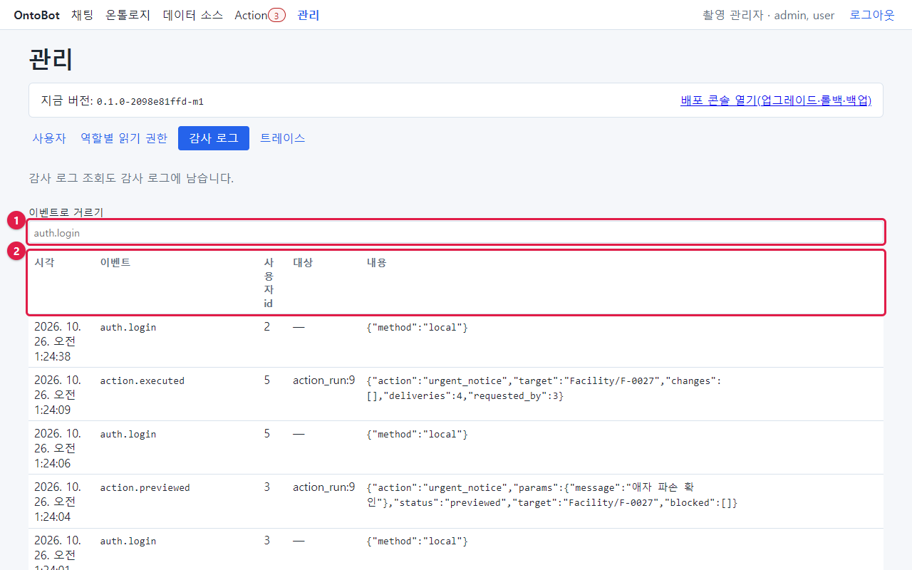

| 번호 | 부분 | 설명 |
| --- | --- | --- |
| ① | **이벤트로 거르기** | 이벤트 이름을 **정확히** 입력하면 그 이벤트만 보입니다(예: `auth.login`). 비우면 전부 |
| ② | 칸 이름 | 시각 · 이벤트 · 사용자 id · 대상 · 내용 |

| 칸 | 뜻 | 예 |
| --- | --- | --- |
| 시각 | 일이 일어난 때(브라우저 시간대) | 2026. 10. 26. 오전 1:24:38 |
| 이벤트 | 일의 종류(영문 점 표기) | `auth.login`, `action.executed` |
| 사용자 id | 한 사람의 번호. `—` 는 사람이 아닌 명령·시스템이 한 일 | 2 |
| 대상 | 바뀐 것 | `app_user:3`, `role:user`, `action_run:9`, `deployment` |
| 내용 | 자세한 내용(JSON). 개인정보는 가려짐 | `{"method":"local"}` |

최신 기록이 맨 위입니다. 한 번에 50줄씩 보이고, 더 있으면 맨 아래에 **더 보기** 단추가 생깁니다.

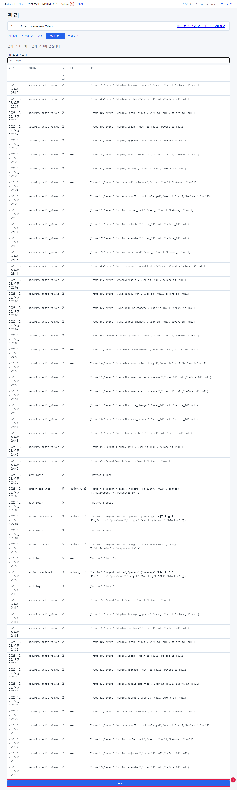

### 사용자 id 를 사람으로 바꾸기

감사 로그의 "사용자 id"는 번호입니다. 번호가 누구인지는 계정을 만들 때의 기록(`security.user_created`)에서 찾습니다.
대상 칸의 `app_user:3` 의 3이 그 사람의 번호입니다(9.3의 사진).

| 사용자 id | 아이디(이 책) |
| --- | --- |
| 1 | admin |
| 2 | manual.capture(촬영 관리자) |
| 3 | kim.user |
| 4 | lee.modeler |
| 5 | park.admin |
| 6 | choi.expert |
| 7 | jung.builder |

> **알아 두기** 거르기 칸에는 이벤트 이름 전체를 정확히 입력해야 합니다. `auth` 처럼 일부만 넣으면 아무것도
> 나오지 않습니다. 9.2 의 표에서 이름을 골라 복사해 넣으세요.

## 9.2 이벤트 이름 모음

| 묶음 | 이벤트 | 언제 남나 | 대상 칸 |
| --- | --- | --- | --- |
| 로그인 | `auth.login` | 로그인 성공 | — |
| | `auth.login_failed` | 로그인 실패(틀린 비밀번호·없는 아이디·정지 계정 모두). 다섯 번 틀려 막힌 뒤의 시도는 `reason: locked` | — |
| | `auth.logout` | 로그아웃 | — |
| 계정·권한 | `security.user_created` | 계정 만들기(화면 `via:admin`, 명령 `via:cli`) | `app_user:N` |
| | `security.role_changed` | 역할 변경 | `app_user:N` |
| | `security.user_status_changed` | 정지·다시 사용 | `app_user:N` |
| | `security.user_contacts_changed` | 알림 연락처 변경 | `app_user:N` |
| | `security.permission_changed` | 데이터 그룹의 타입·링크 권한 변경 | `group:이름` |
| | `security.group_changed` | 데이터 그룹 추가·삭제 | `group:이름` |
| | `security.group_members_changed` | 그룹 구성원 변경 | `group:이름` |
| | `security.audit_viewed` | 감사 로그를 봄 | — |
| | `security.trace_viewed` | 트레이스를 봄 | `trace:N` |
| 정리 | `ops.retention_purged` | 보존 기간이 지난 대화·트레이스를 정리함 | — |
| 온톨로지 | `ontology.draft_created` / `draft_imported` / `draft_edited` | 초안 만들기·가져오기·고치기 | `ontology_version:N` |
| | `ontology.version_published` | 게시 | `ontology_version:N` |
| 데이터 | `sync.source_changed` | 데이터 소스 추가·변경 | `data_source:N` |
| | `sync.mapping_changed` | 매핑 추가·변경 | `mapping:N` |
| | `sync.manual_run` | **지금 동기화**를 누름 | `mapping:N` |
| | `graph.rebuild` | 그래프 재구축 | — |
| Action | `action.previewed` | 미리보기(=요청) | `action_run:N` |
| | `action.executed` | 승인하고 실행 | `action_run:N` |
| | `action.rejected` | 거부 | `action_run:N` |
| | `action.failed` | 승인했지만 재검증에서 실패 | `action_run:N` |
| | `action.rolled_back` | 롤백 | `action_run:N` |
| 편집 | `objects.conflict_acknowledged` | 편집 충돌을 확인 처리 | `object_edit:N` |
| | `objects.edit_cleared` | 편집 해제 | `object_edit:N` |
| 배포 | `deploy.bundle_imported` | 번들 가져오기(사전 점검 결과 포함) | `deployment` |
| | `deploy.upgrade` | 업그레이드 | `deployment` |
| | `deploy.rollback` | 롤백 | `deployment` |
| | `deploy.backup` | 배포 콘솔의 **지금 백업** | `deployment` |
| | `deploy.deployer_update` | 배포 콘솔 갱신 | `deployment` |
| 인터뷰·평가 | `workshop.*`, `eval.*` | 인터뷰 워크숍, 평가(사용자 매뉴얼) | — |

> **알아 두기** 이벤트 목록에는 `deploy.login`·`deploy.login_failed` 도 있지만, **지금 판의 배포 콘솔은 로그인을
> 감사 로그에 남기지 않습니다**(9.7 의 사진에서 0건). 배포 콘솔에 누가 들어왔는지는 배포 작업 기록(24장)의 "실행"
> 칸과 `deploy.*` 기록으로 확인하세요.

## 9.3 로그인과 계정 기록 읽기

### 로그인 성공

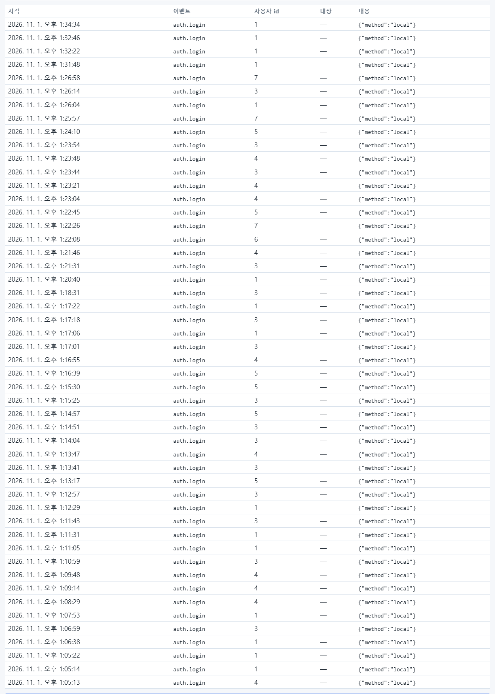

`auth.login` 은 로그인할 때마다 남습니다. 내용 `{"method":"local"}` 은 아이디·비밀번호 로그인이라는 뜻(SSO 면 `oidc`)입니다.

### 로그인 실패

거르기 칸에 `auth.login_failed` 를 입력합니다.

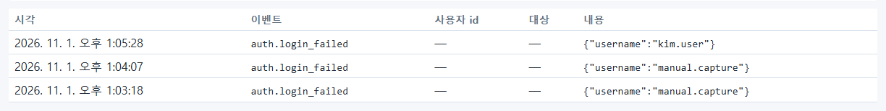

내용에 **시도한 아이디**가 남습니다. 6장에서 일부러 틀린 비밀번호를 넣은 `manual.capture` 와, 7장에서 정지한
상태로 로그인을 시도한 `kim.user` 입니다. 화면은 두 경우를 구분해 알려 주지 않았지만(6.1, 7.7), 감사 로그로는
"정지된 계정이 로그인을 시도했다"는 것을 알 수 있습니다.

> **알아 두기** 같은 아이디로 짧은 시간에 실패가 많이 쌓이면 비밀번호를 맞히려는 시도일 수 있습니다. 주간 점검
> (25장)에서 확인하세요.

### 계정 만들기

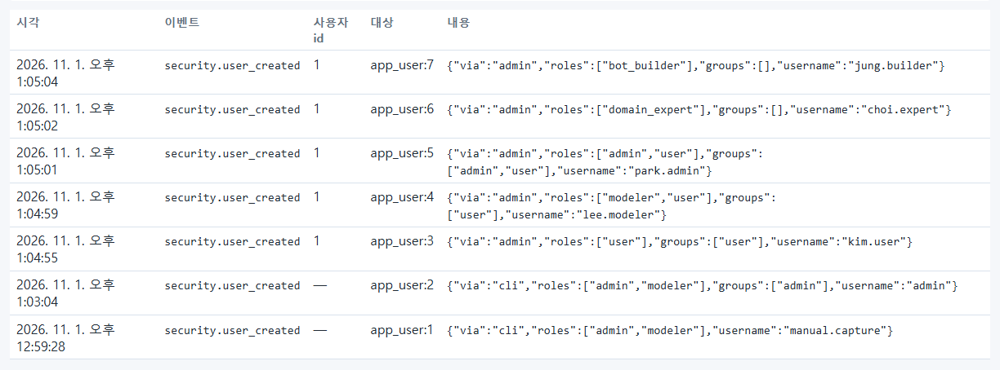

| 줄 | 읽는 법 |
| --- | --- |
| `app_user:1` · `via:cli` · `admin` | 설치 때 명령으로 만든 첫 관리자(사용자 id 칸이 `—`) |
| `app_user:2` · `via:cli` · `manual.capture` | 촬영 관리자(명령으로 만듦) |
| `app_user:3~7` · `via:admin` · 사용자 id 2 | 7장에서 촬영 관리자(2번)가 화면으로 만든 다섯 계정 |
| `app_user:8` · `via:cli` · `ops2` | 7.9 에서 명령으로 만든 비상 관리자 |

### 역할 변경

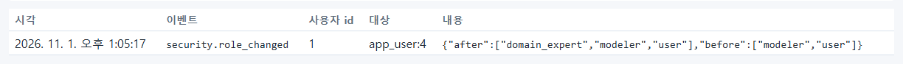

`before`(바꾸기 전)와 `after`(바꾼 뒤)가 함께 남습니다. 7.6 에서 `lee.modeler`(app_user:4)에게 domain_expert 를 더한
기록입니다.

### 정지·다시 사용

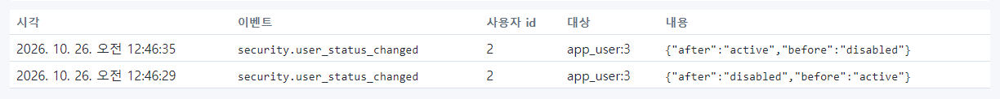

아래 줄이 정지(`active` → `disabled`), 위 줄이 다시 사용(`disabled` → `active`)입니다.

### 연락처 변경

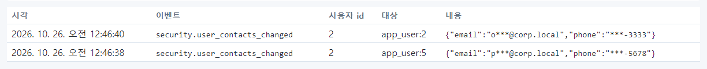

연락처는 감사 로그에도 **가려진 값**으로만 남습니다.

### 읽기 권한 변경

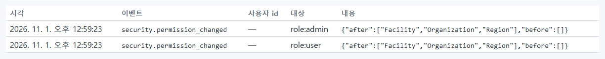

| 줄(아래부터) | 읽는 법 |
| --- | --- |
| `role:user`, `role:admin` · 사용자 id `—` | 설치 때 샘플 데이터와 함께 준 권한 |
| `role:bot_builder` · `[]` → `[Facility]` | 8.3 에서 시설만 준 것 |
| `role:bot_builder` · `[Facility]` → 세 타입 | 8.4 에서 모두 준 것 |
| `role:modeler` · `[]` → 세 타입 | 8.4 |
| `role:user` · `via:cli` · `can_read:true` | 8.7 의 명령으로 준 것(이미 있던 권한) |

## 9.4 데이터 기록 읽기

### 데이터 소스

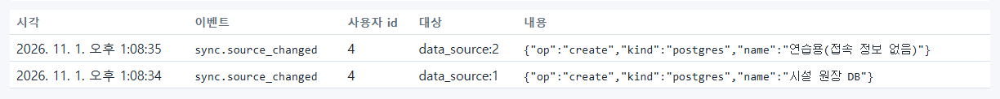

> **알아 두기 — 이 사진의 6줄** 촬영할 때 11장의 데이터 소스 등록을 세 번 다시 찍었습니다. 다시 찍기 전에
> 시험 서버의 데이터베이스에서 데이터 소스 행을 직접 지웠기 때문에, 화면의 데이터 소스 목록에는 마지막 두 개
> (`data_source:5`, `6`)만 남아 있습니다. 하지만 감사 로그에는 처음 만든 기록까지 **모두 남아 있습니다.** 데이터를
> 지워도 감사 기록은 지워지지 않는다는 것을 보여 주는 실제 예입니다. 운영 서버에서는 데이터베이스를 직접 고치지
> 마세요.

### 매핑과 지금 동기화

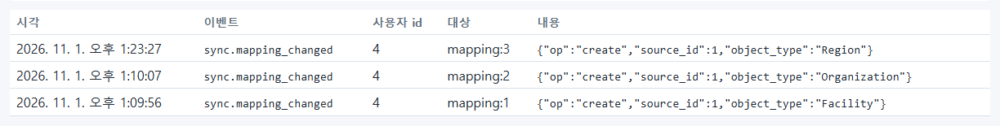

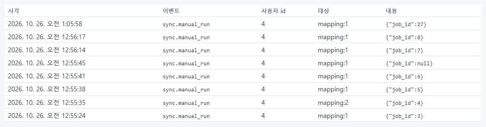

`sync.manual_run` 의 `job_id` 는 워커가 받은 작업 번호입니다. `job_id:null` 은 "이미 대기 중인 동기화가 있어 새
작업을 넣지 않았다"는 뜻입니다(12장).

### 그래프 재구축

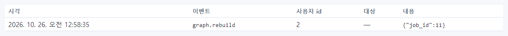

재구축은 관리자만 할 수 있고, 누가 언제 했는지 남습니다(13장).

### 온톨로지 게시

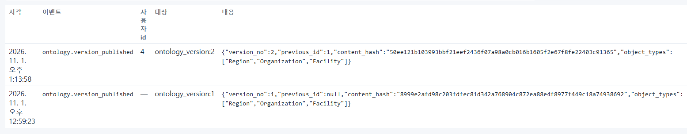

| 내용의 항목 | 뜻 |
| --- | --- |
| `version_no` | 게시한 버전 번호 |
| `previous_id` | 바로 전 게시본(처음이면 null) |
| `content_hash` | 게시본 내용의 지문. 같은 내용이면 같은 값 |
| `object_types` | 게시본의 객체 타입 목록 |

버전 1은 설치(샘플 데이터)가, 버전 2는 15장에서 `lee.modeler`(4번)가 메일·SMS Action 을 추가해 게시한 것입니다.

## 9.5 Action 기록 읽기

### 요청(미리보기)

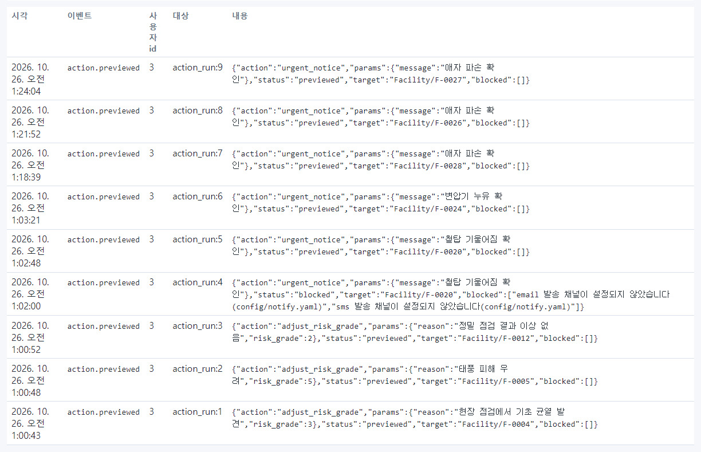

| 내용의 항목 | 뜻 |
| --- | --- |
| `action` | Action 이름(`adjust_risk_grade`, `urgent_notice`) |
| `target` | 대상 객체(`Facility/F-0004`) |
| `params` | 요청한 값(새 위험등급, 사유, 통보 내용) |
| `status` | `previewed`(승인 대기로 넘어감) 또는 `blocked`(막힘) |
| `blocked` | 막힌 이유. `action_run:4` 는 메일·SMS 채널을 설정하기 전에 요청해서 막힌 것(15장) |

### 실행

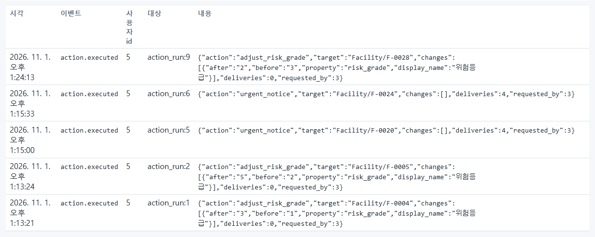

| 내용의 항목 | 뜻 |
| --- | --- |
| `changes` | 바뀐 값. `before`→`after` 와 속성 이름 |
| `deliveries` | 보낼 메일·SMS 수(앱 알림은 세지 않음) |
| `requested_by` | 요청한 사람의 사용자 id |
| 사용자 id 칸 | 승인한 사람(5 = park.admin) |

### 거부

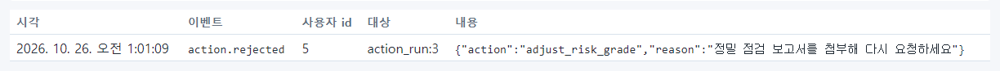

거부 사유가 내용에 함께 남습니다.

### 롤백

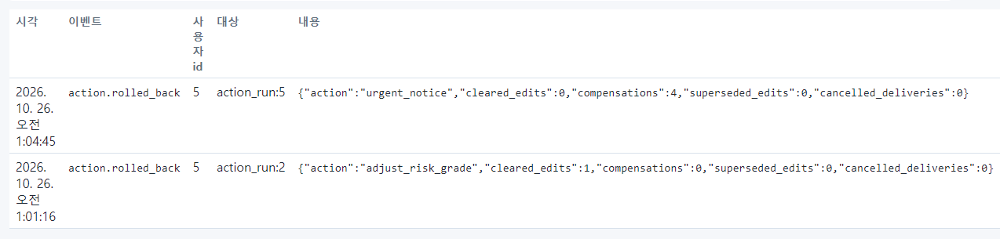

| 내용의 항목 | 뜻 |
| --- | --- |
| `cleared_edits` | 되돌린 편집 수 |
| `compensations` | 보낸 정정 문구 수(이미 나간 메일·SMS 수신자에게) |
| `cancelled_deliveries` | 아직 안 나가서 취소한 발송 수 |
| `superseded_edits` | 그 뒤 다른 Action 이 다시 바꿔서 되돌리지 않은 편집 수 |

### 편집 충돌 확인

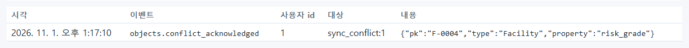

### 편집 해제

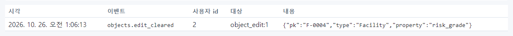

16장에서 편집 충돌을 해제한 기록입니다.

## 9.6 배포 기록 읽기

배포 콘솔에서 한 일은 작업이 끝날 때 감사 로그에도 남습니다.

### 번들 가져오기

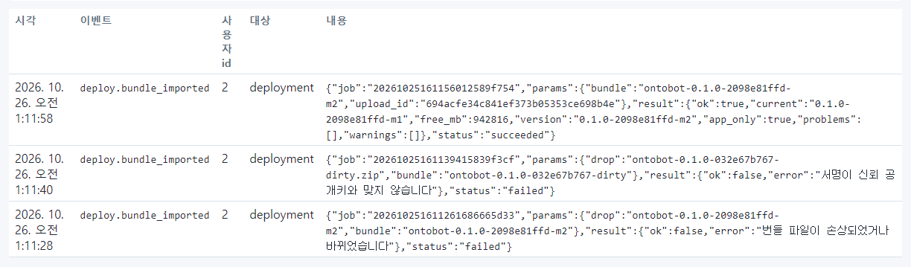

| 줄(아래부터) | 결과 | 이유 |
| --- | --- | --- |
| 1 | `failed` | `번들 파일이 손상되었거나 바뀌었습니다` — 20장에서 일부러 고친 번들 |
| 2 | `failed` | `서명이 신뢰 공개키와 맞지 않습니다` — 개발용 번들 |
| 3 | `succeeded` | 정상 번들. 사전 점검 결과(`problems:[]`)까지 함께 남음 |

### 업그레이드

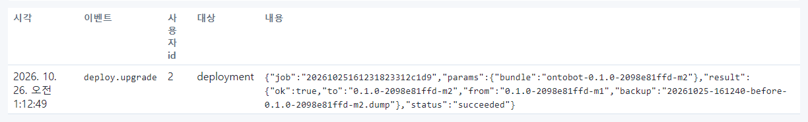

결과 요약(`from`·`to`·업그레이드 직전 `backup` 파일)이 함께 남습니다.

### 배포 콘솔 갱신

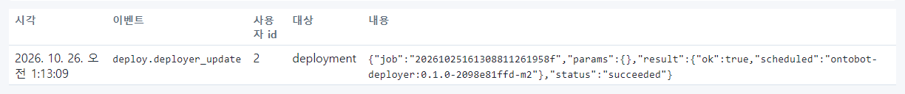

### 백업과 롤백

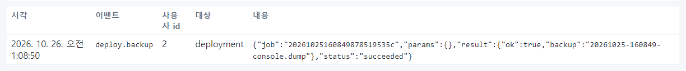

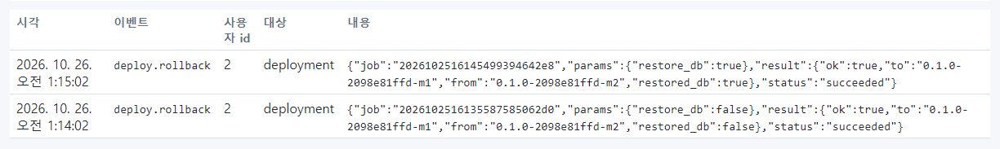

롤백 기록의 `restore_db` 가 `false` 면 프로그램만, `true` 면 DB 까지 되돌린 것입니다(22장).

> **알아 두기** DB 까지 되돌리는 롤백을 하면, 되돌린 시점 뒤의 감사 기록도 백업 시점으로 돌아갑니다(데이터베이스
> 전체를 되돌리므로). 다만 그 롤백 자체의 기록은 롤백이 끝난 뒤에 남기 때문에 사진처럼 보입니다. 장기 보존이
> 필요한 감사 기록은 정기 백업을 오래 보관해 지킵니다(31장).

### 배포 콘솔 로그인 — 남지 않음

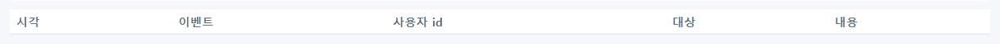

배포 콘솔에 여러 번 로그인했지만 `deploy.login` 은 0건입니다(9.2 의 알아 두기).

## 9.7 감사 로그를 본 기록

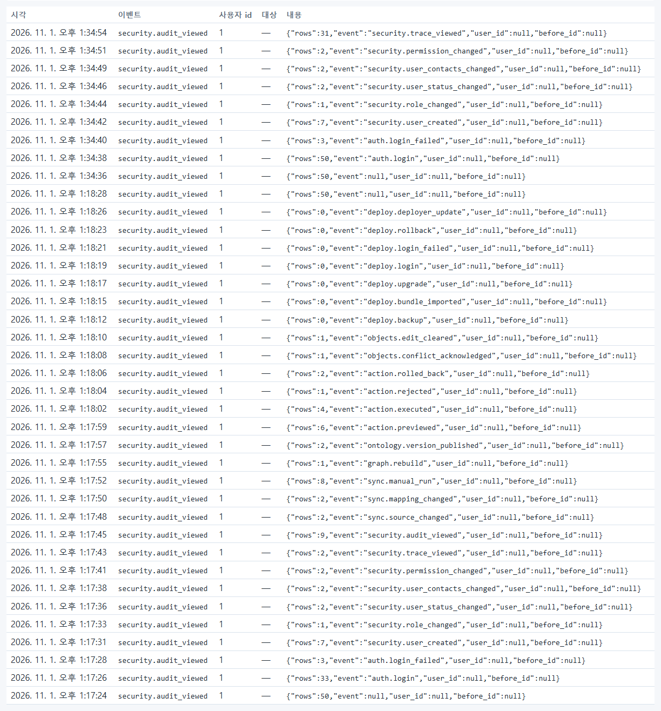

이 장의 사진을 찍으면서 거르기를 바꿀 때마다 한 줄씩 남았습니다. `rows` 는 그때 화면에 보인 줄 수, `event` 는
거른 이벤트 이름입니다. 위 사진에서 `deploy.login`·`deploy.login_failed` 를 거를 때 `rows:0` 인 것을 확인할 수
있습니다(9.2 의 알아 두기).

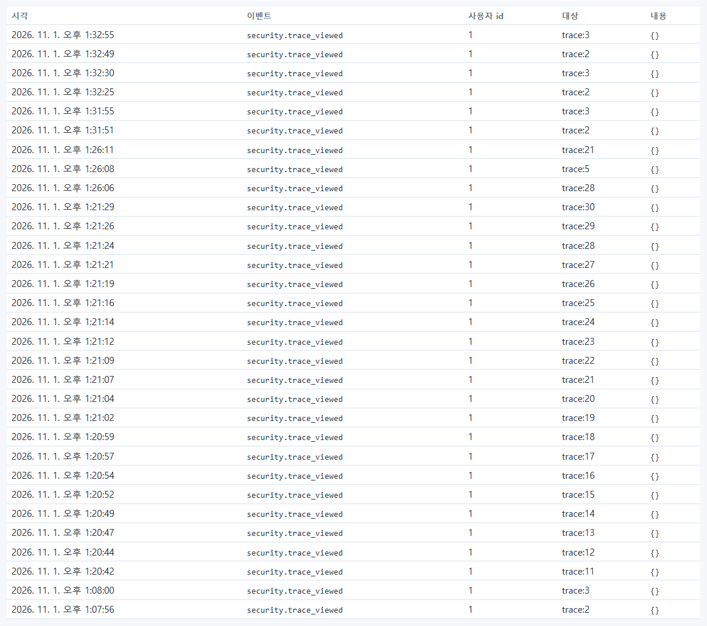

트레이스를 연 기록도 남습니다(10장). 트레이스에는 질문 내용이 들어 있으므로, 누가 어떤 질문의 처리 기록을
열었는지 나중에 확인할 수 있게 한 것입니다.

## 9.8 전체 목록

거르기를 비우면 모든 기록이 섞여서 보입니다.

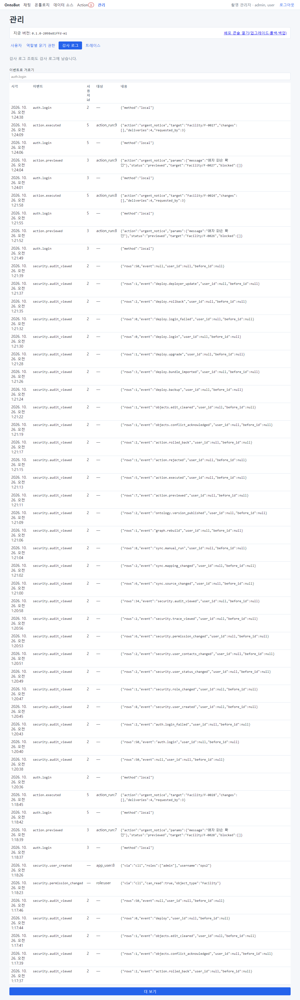

## 9.9 감사 로그 점검 요령

| 언제 | 무엇을 거르나 | 볼 것 |
| --- | --- | --- |
| 매주 | `auth.login_failed` | 같은 아이디의 반복 실패, 없는 아이디 시도 |
| 매주 | `security.role_changed`, `security.permission_changed` | 모르는 변경이 없는지 |
| 매주 | `security.user_created` | 요청서 없이 만든 계정이 없는지 |
| 배포 뒤 | `deploy.upgrade`, `deploy.rollback` | 결과가 `succeeded` 인지 |
| 사고 조사 | 시간대를 정하고 전체 | 그 시각 앞뒤의 일 |
| 분기 | `security.audit_viewed`, `security.trace_viewed` | 감사 로그·트레이스를 누가 자주 보는지 |

## 9.10 해시 체인 검증(v1)

감사 로그의 줄마다 순번(`seq`)과 앞 줄을 이어 계산한 해시가 붙습니다(DB 가 매깁니다). 누군가 DB 에서 줄을 고치거나
지우면 체인이 끊깁니다. 감사 로그 탭의 **해시 체인 검증** 을 누르면 결과가 옆에 나옵니다.

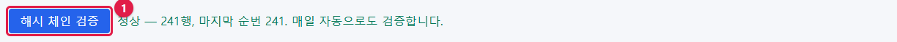

"정상 — N행, 마지막 순번 N. 매일 자동으로도 검증합니다." 가 정상입니다. 워커가 하루 한 번 자동으로 검증하고, 끊기면
앱 로그에 error "감사 체인…" 이 남습니다. 명령으로도 확인할 수 있습니다.

```powershell
wsl -d ontobot -u root -- bash -c "cd /opt/ontobot && docker compose run --rm migrate python -m ontobot.security.cli verify-audit"
```

> **주의** 체인이 끊겼으면 **고치려 하지 마세요.** 끊긴 순번을 기록하고 백업 사본(19장)의 감사 로그와 대조한 뒤 보안
> 담당자·개발팀에 알립니다. 감사 로그는 DB 트리거로 추가만 되므로, 끊김은 DB 를 직접 만진 흔적일 수 있습니다.

## 9.11 해 보기

> **해 보기**
>
> 1. 7장의 "해 보기"에서 만든 `test.trainee` 계정의 `security.user_created` 기록을 찾아 대상 칸의 번호를 적으세요.
> 2. 같은 번호로 `security.user_status_changed` 를 찾아 정지한 시각을 확인하세요.
> 3. 거르기를 비운 뒤 맨 위 줄이 무엇인지 보세요. 방금 감사 로그를 본 일 자체(`security.audit_viewed`)가 맨 위에
>    있나요?
