# 11장 데이터 소스 연결

OntoBot 은 사내 업무 DB(원천)의 데이터를 **읽어서 복사**해 옵니다. 원천 DB 에는 절대 쓰지 않습니다. 지금 판에서
연결할 수 있는 원천의 종류는 **PostgreSQL** 입니다.

데이터 소스를 연결하는 일은 세 사람이 나눠 합니다.

| 누가 | 하는 일 | 이 장 |
| --- | --- | --- |
| 원천 DB 담당자 | OntoBot 전용 **읽기 전용 계정**을 만들어 줌, 방화벽(서버 → 원천 DB) | 11.1 |
| 운영자 | 접속 정보(주소·계정·비밀번호)를 서버의 `app.env` 에 넣고 반영 | 11.2~11.3 |
| 모델러(또는 운영자) | 화면에서 데이터 소스를 등록하고 접속 시험, 매핑(12장) | 11.4~11.6 |

접속 비밀번호는 **화면이나 OntoBot 데이터베이스에 저장하지 않습니다.** 화면에는 "비밀번호가 어디 있는지"를
가리키는 **시크릿 참조**(예: `env:ONTOBOT_SRC_FAC`)만 적습니다.

## 11.1 원천 DB 담당자에게 요청할 것

원천 DB 담당자에게 다음을 요청합니다. 43장에 요청서 양식이 있습니다.

| 요청 | 예 | 이유 |
| --- | --- | --- |
| 접속 주소·포트 | `10.0.0.15`, `5432` | — |
| 데이터베이스 이름 | `facility_src` | — |
| **읽기 전용** 계정과 비밀번호 | `ontobot_reader` | OntoBot 은 읽기만 함. 만에 하나의 사고를 막음 |
| 읽을 표 목록 | `fac_master`, `org_master` | 필요한 표만 권한 |
| 서버 → 원천 DB 방화벽 | OntoBot 서버 IP → 10.0.0.15:5432 | — |
| 표 구조가 바뀔 때 미리 알림 | 열 이름 변경·삭제 | 12.7 의 이유 |

읽기 전용 계정은 원천 DB 담당자가 다음처럼 만듭니다. 아래는 시험 서버에서 실제로 실행한 결과입니다.

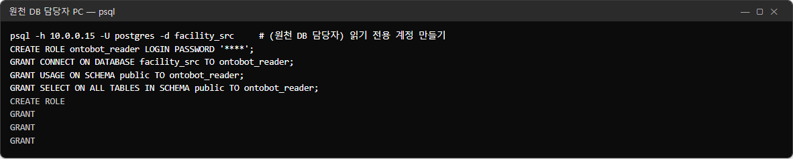

```sql
CREATE ROLE ontobot_reader LOGIN PASSWORD '<비밀번호>';
GRANT CONNECT ON DATABASE facility_src TO ontobot_reader;
GRANT USAGE ON SCHEMA public TO ontobot_reader;
GRANT SELECT ON ALL TABLES IN SCHEMA public TO ontobot_reader;
```

> **알아 두기** 시험 서버에는 따로 사내 DB 가 없어서, OntoBot 의 PostgreSQL 안에 `facility_src` 라는 데이터베이스를
> 만들어 원천 DB 로 썼습니다. 그래서 이 장의 접속 주소는 `postgres`(컨테이너 이름)입니다. 운영 서버에서는 원천 DB
> 담당자가 알려 준 주소(예: `10.0.0.15`)를 씁니다.

원천 표가 어떻게 생겼는지도 받아 두면 매핑(12장)할 때 편합니다.

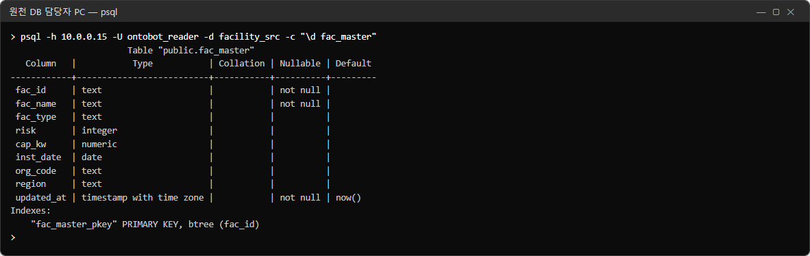

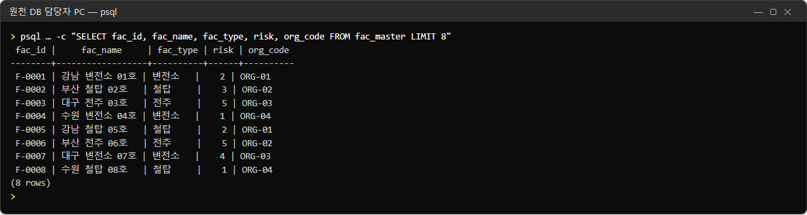

이 책의 원천 표는 열 이름이 OntoBot 의 속성 이름과 **일부러 다르게** 되어 있습니다(`fac_name` ↔ `name`,
`risk` ↔ `risk_grade` 등). 실제 회사 DB 도 대개 그렇습니다. 12장에서 이 열들을 속성에 짝지어 줍니다.

## 11.2 접속 정보를 `app.env` 에 넣기

원천 하나마다 **앞머리(PREFIX)** 를 하나 정합니다. 대문자·숫자·밑줄만 쓰고, `ONTOBOT_SRC_` 로 시작하게 정하면
알아보기 쉽습니다(예: 시설 원장 DB → `ONTOBOT_SRC_FAC`). 그 앞머리로 다섯 줄을 `app.env` 에 넣습니다.

| 줄 | 값 |
| --- | --- |
| `<앞머리>_HOST` | 원천 DB 주소 |
| `<앞머리>_PORT` | 포트(비우면 5432) |
| `<앞머리>_DB` | 데이터베이스 이름 |
| `<앞머리>_USER` | 읽기 전용 계정 |
| `<앞머리>_PASSWORD` | 그 비밀번호 |

### 먼저 지금 내용 확인

```powershell
wsl -d ontobot -u root -- grep -n SRC /opt/ontobot/app.env
```

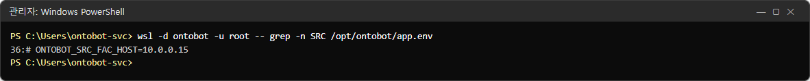

설치 직후에는 주석(맨 앞이 `#`) 예시 한 줄만 있습니다.

### 고치기

관리자 PowerShell 에서 편집기 nano 로 엽니다.

```powershell
wsl -d ontobot -u root -- nano /opt/ontobot/app.env
```

nano 사용법(처음이면 천천히):

| 하고 싶은 일 | 누르는 키 |
| --- | --- |
| 커서 옮기기 | 방향키 |
| 맨 끝으로 가기 | **Ctrl+End**(또는 Alt+/) |
| 글자 입력 | 그냥 입력. 붙여넣기는 마우스 오른쪽 클릭 |
| 저장 | **Ctrl+O** 그리고 **Enter** |
| 나가기 | **Ctrl+X** |
| 저장하지 않고 나가기 | **Ctrl+X** → **N** |

파일 맨 끝에 다음 여섯 줄을 덧붙입니다(첫 줄은 설명 주석).

```ini
# 시설 원장 DB(읽기 전용 계정) — 화면의 시크릿 참조 env:ONTOBOT_SRC_FAC
ONTOBOT_SRC_FAC_HOST=10.0.0.15
ONTOBOT_SRC_FAC_PORT=5432
ONTOBOT_SRC_FAC_DB=facility_src
ONTOBOT_SRC_FAC_USER=ontobot_reader
ONTOBOT_SRC_FAC_PASSWORD=<비밀번호>
```

> **주의** `=` 앞뒤에 빈칸을 넣지 마세요. 비밀번호에 `#`·빈칸이 있으면 원천 DB 담당자에게 다른 비밀번호를 요청하는
> 것이 안전합니다. 비밀번호를 따옴표로 감싸지 마세요(따옴표까지 비밀번호로 읽힐 수 있습니다).

### 넣은 뒤 확인

```powershell
wsl -d ontobot -u root -- grep -n SRC /opt/ontobot/app.env
```

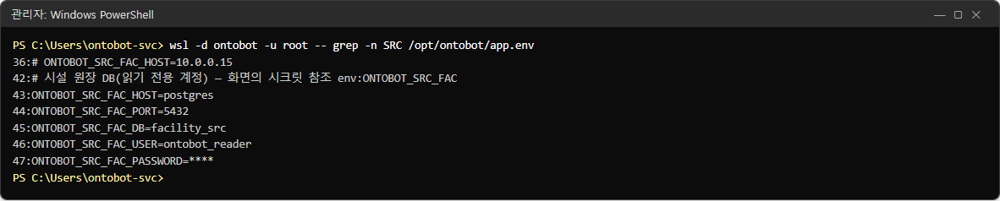

## 11.3 반영하기

`app.env` 를 바꾼 뒤에는 api·worker 컨테이너를 **새 설정으로 다시 만들어야** 합니다.

```powershell
wsl -d ontobot -u root -- bash -c "cd /opt/ontobot && docker compose up -d"
```

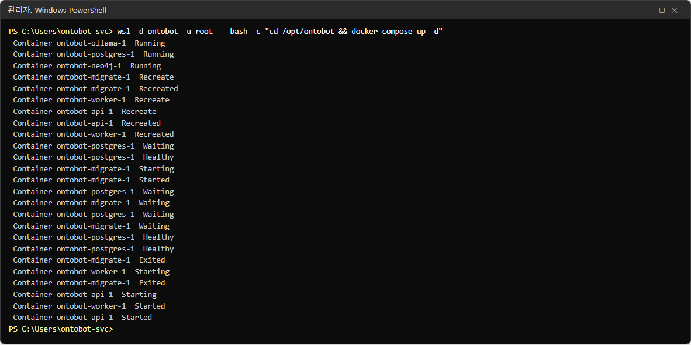

| 줄 | 뜻 |
| --- | --- |
| `Container ontobot-ollama-1 Running` 등 | 설정이 바뀌지 않은 컨테이너는 그대로 둠 |
| `Container ontobot-api-1 Recreate` → `Recreated` | `app.env` 를 쓰는 컨테이너를 새 설정으로 다시 만듦 |
| `ontobot-migrate-1 … Exited` | 데이터베이스 구조 확인(할 일 없으면 바로 끝남) |
| `ontobot-api-1 Started`, `ontobot-worker-1 Started` | 새 설정으로 켜짐 |

반영하는 동안 api 가 몇 초~수십 초 끊깁니다. 업무 시간이면 사용자에게 미리 알리세요. 잠시 뒤 상태를 확인합니다.

```powershell
wsl -d ontobot -u root -- bash -c "cd /opt/ontobot && docker compose ps --format 'table {{.Service}}\t{{.Status}}'"
```

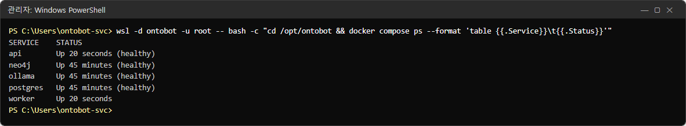

api·worker 만 `Up 20 seconds` 이고 나머지는 그대로입니다. api 에 `(healthy)` 가 붙으면 끝났습니다.

> **알아 두기** `docker compose restart api worker` 는 컨테이너를 껐다 켤 뿐 `app.env` 를 다시 읽지 않습니다.
> `app.env` 를 바꾼 뒤에는 꼭 `docker compose up -d` 를 쓰세요. 반대로 `config/` 폴더의 파일(notify.yaml 등)을
> 바꾼 뒤에는 `restart` 가 필요합니다(15장).

## 11.4 화면에서 데이터 소스 등록

데이터 소스 화면을 엽니다(모델러 또는 관리자). 처음에는 데이터 소스와 매핑이 비어 있습니다.

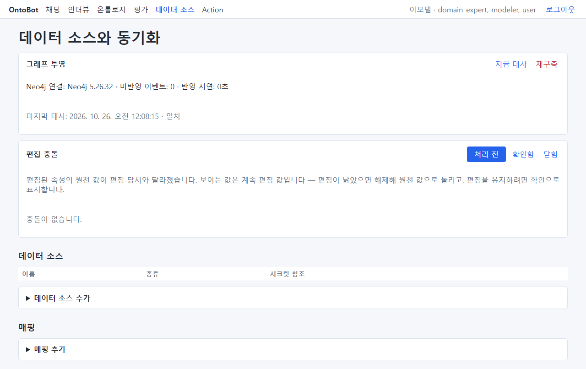

**▶ 데이터 소스 추가** 를 펼칩니다.

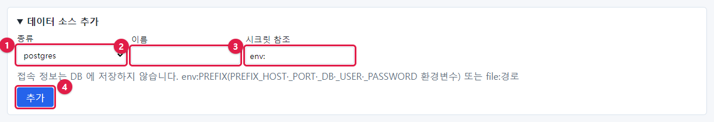

| 번호 | 칸 | 입력 |
| --- | --- | --- |
| ① | 종류 | `postgres`(지금은 이것뿐) |
| ② | 이름 | 사람이 알아보는 이름. 예: `시설 원장 DB` |
| ③ | 시크릿 참조 | `env:` 뒤에 11.2 의 앞머리. 예: `env:ONTOBOT_SRC_FAC` |
| ④ | **추가** | 누름 |

칸 아래 안내: "접속 정보는 DB 에 저장하지 않습니다. env:PREFIX(PREFIX_HOST·_PORT·_DB·_USER·_PASSWORD 환경변수) 또는
file:경로".

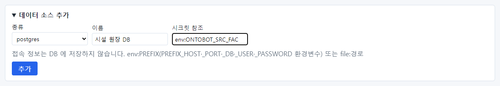

**추가** 를 누르면 목록에 생깁니다. 이 책에서는 연습을 위해 **접속 정보를 일부러 넣지 않은** 데이터 소스
(`env:ONTOBOT_SRC_NONE`)도 하나 더 만들었습니다.

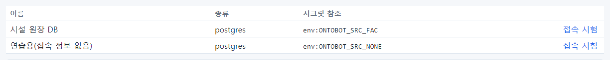

> **알아 두기** 시크릿 참조의 형식이 틀리면(`env:` 뒤가 소문자 등) 저장할 때 "secret_ref 는 'env:PREFIX'(대문자)
> 또는 'file:경로' 형식이어야 합니다"가 나옵니다. 형식만 보고 저장하므로, 실제로 접속되는지는 11.5 의 접속
> 시험으로 확인합니다.

### `file:` 참조

환경변수 대신 파일에 접속 정보를 두려면 `file:/opt/ontobot/secrets/fac.yaml` 처럼 적고, 그 파일에 다음처럼 씁니다.
파일은 컨테이너 안에서 보이는 경로여야 하므로, 이 방식은 개발팀과 상의해 쓰세요. 보통은 `env:` 로 충분합니다.

```yaml
host: 10.0.0.15
port: 5432
db: facility_src
user: ontobot_reader
password: <비밀번호>
```

## 11.5 접속 시험

목록에서 데이터 소스 줄 끝의 **접속 시험** 을 누릅니다.

### 성공

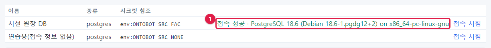

**접속 성공 · PostgreSQL 18.6 (…)** — 원천 DB 의 종류와 버전이 나옵니다.

### 접속 정보가 없을 때

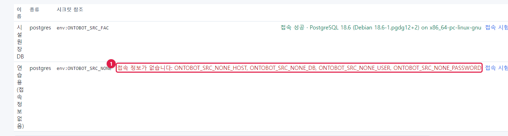

**접속 정보가 없습니다: ONTOBOT_SRC_NONE_HOST, …** — `app.env` 에 그 앞머리의 줄이 없거나, 넣고 나서 반영(11.3)을
하지 않은 경우입니다. 빠진 이름이 모두 나열되므로 그 이름대로 넣고 반영합니다.

### 비밀번호가 틀렸을 때

이 책에서는 `app.env` 의 비밀번호를 일부러 틀리게 바꾸고 반영한 뒤 접속 시험을 했습니다.

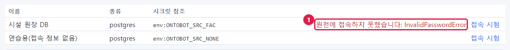

**원천에 접속하지 못했습니다: InvalidPasswordError** — 비밀번호가 틀렸습니다. 원천 DB 담당자에게 확인합니다.

### 접속 시험의 오류 정리

| 화면 문구 | 원인 | 할 일 |
| --- | --- | --- |
| `접속 정보가 없습니다: …` | `app.env` 에 줄이 없음, 반영 안 함, 앞머리 오타 | 11.2~11.3 |
| `원천에 접속하지 못했습니다: InvalidPasswordError` | 비밀번호 틀림 | 원천 DB 담당자 |
| `… InvalidAuthorizationSpecificationError` 등 | 계정이 없거나 접속 허용(pg_hba) 안 됨 | 원천 DB 담당자 |
| `… ConnectionRefusedError` / `TimeoutError` / `OSError` | 주소·포트 틀림, 방화벽 | 주소 확인, 네트워크 담당자 |
| `… InvalidCatalogNameError` | 데이터베이스 이름 틀림 | `_DB` 확인 |
| `시크릿 파일이 없습니다: …` | `file:` 경로에 파일이 없음 | 경로 확인 |

## 11.6 운영자가 기억할 것

- 비밀번호를 바꿀 일이 생기면(원천 DB 의 정기 비밀번호 변경 등) `app.env` 의 `_PASSWORD` 한 줄만 고치고 11.3 대로
  반영합니다. 화면의 데이터 소스는 고칠 필요가 없습니다.
- 원천 DB 주소가 바뀌면 `_HOST` 를 고치고 반영합니다.
- 데이터 소스를 화면에서 지우는 기능은 없습니다. 쓰지 않는 데이터 소스는 매핑을 만들지 않으면 아무 일도 하지
  않습니다.
- 데이터 소스 추가·변경은 감사 로그(`sync.source_changed`)에 남습니다.
- `app.env` 는 비밀값이 든 파일입니다. 복사해 메일로 보내거나 공유 폴더에 두지 마세요(31장).

## 11.7 문서 넣기와 색인(v1)

표로 된 데이터 말고 점검 기준·지침 같은 **문서** 도 넣어 두면, 채팅에서 문서 내용을 물을 때 그 문서의 조각을 근거로
답합니다. 위쪽 메뉴 **문서** 에서 모델러·관리자가 넣습니다(사용자 매뉴얼 18.8).

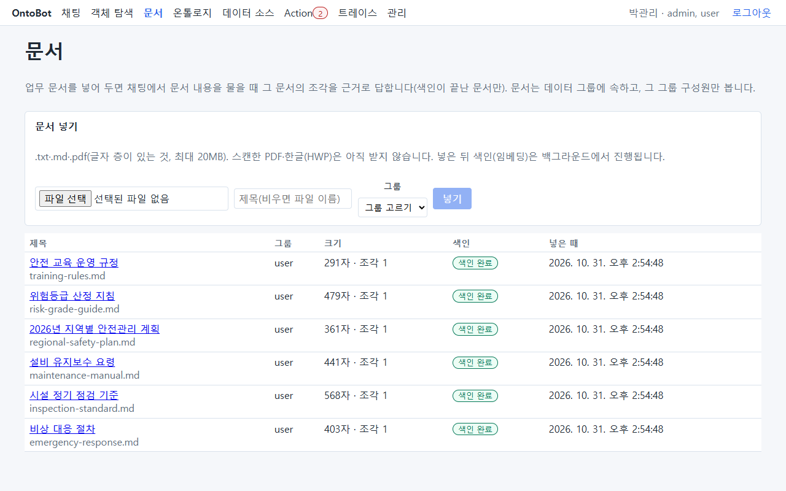

운영자가 알아 둘 것:

| 항목 | 내용 |
| --- | --- |
| 권한 | 문서는 **데이터 그룹** 에 속하고 그 구성원만 봅니다(관리자도 소속이 아니면 못 봄). 문서가 있는 그룹은 지울 수 없음 |
| 받는 파일 | `.txt`·`.md`·`.pdf`(글자 층이 있는 것), 최대 20MB. 스캔 PDF·암호 PDF·한글(HWP)은 받지 않음 |
| 색인 | 넣으면 조각으로 나누고, **worker** 가 AI 임베딩 모델(`llm.yaml` 의 `embedder`, 기본 `bge-m3`)로 색인합니다. 목록의 **색인** 칸이 "색인 중 0/3" → "색인 완료". worker 가 멈추면 색인이 진행되지 않음(27.3) |
| 저장 | 조각과 벡터는 PostgreSQL 에 있습니다(`extensions` 스키마의 pgvector). 따로 백업할 것이 없음 — DB 백업(19장)에 들어감 |
| 모델을 바꾸면 | 모델별로 따로 색인하므로 `embedder` 를 바꾸면 문서마다 **다시 색인** 을 눌러야 합니다(개발팀이 바꿈) |
| 막힘 | "임베딩 모델이 설정되지 않아 문서를 색인할 수 없습니다" — 업그레이드 뒤 `embedder` 역할을 옮기지 않음(21.5 ⑤) |

## 11.8 해 보기

> **해 보기**
>
> 1. 연습용 데이터 소스(`env:ONTOBOT_SRC_NONE`)의 **접속 시험** 을 눌러 어떤 이름이 빠졌다고 나오는지 적으세요.
> 2. `app.env` 에 그 다섯 줄을 시설 원장 DB 와 같은 값으로 넣고(앞머리만 `ONTOBOT_SRC_NONE`), 반영한 뒤 다시
>    접속 시험을 해 보세요.
> 3. 연습이 끝나면 그 다섯 줄을 지우고 다시 반영하세요.
