# 12장 매핑과 동기화

데이터 소스(11장)를 등록했으면, 원천 표의 **열**을 온톨로지의 **속성**에 짝지어 줍니다. 이것을 **매핑**이라고
합니다. 매핑을 만들면 OntoBot 이 그 표를 읽어 객체로 복사해 옵니다. 이것이 **동기화**입니다.

매핑을 만드는 일은 보통 모델러가 하지만, 운영자는 **동기화가 제대로 돌고 있는지**를 매일 확인하고, 실패하면
원인을 찾아야 합니다. 이 장에서는 매핑을 실제로 만들고, 동기화를 성공·실패시켜 보며 결과를 읽는 법을 익힙니다.

## 12.1 매핑 추가

데이터 소스 화면 맨 아래의 **▶ 매핑 추가** 를 펼칩니다. 게시된 온톨로지가 없으면 이 칸 대신 "게시된 온톨로지가
없습니다. 먼저 온톨로지를 게시하세요."가 나옵니다.

### 1단계 — 무엇을 어디서 가져올지

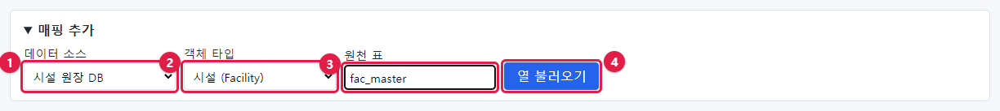

| 번호 | 칸 | 입력 |
| --- | --- | --- |
| ① | 데이터 소스 | `시설 원장 DB` |
| ② | 객체 타입 | `시설 (Facility)` — 이 표의 한 줄이 시설 객체 하나가 됨 |
| ③ | 원천 표 | `fac_master`(다른 스키마면 `schema.table`) |
| ④ | **열 불러오기** | 누르면 원천 표의 열 목록을 읽어 옴 |

### 2단계 — 속성마다 원천 열 고르기

**열 불러오기** 를 누르면 시설의 속성 목록이 나오고, 속성마다 원천 열을 고르는 칸이 생깁니다.

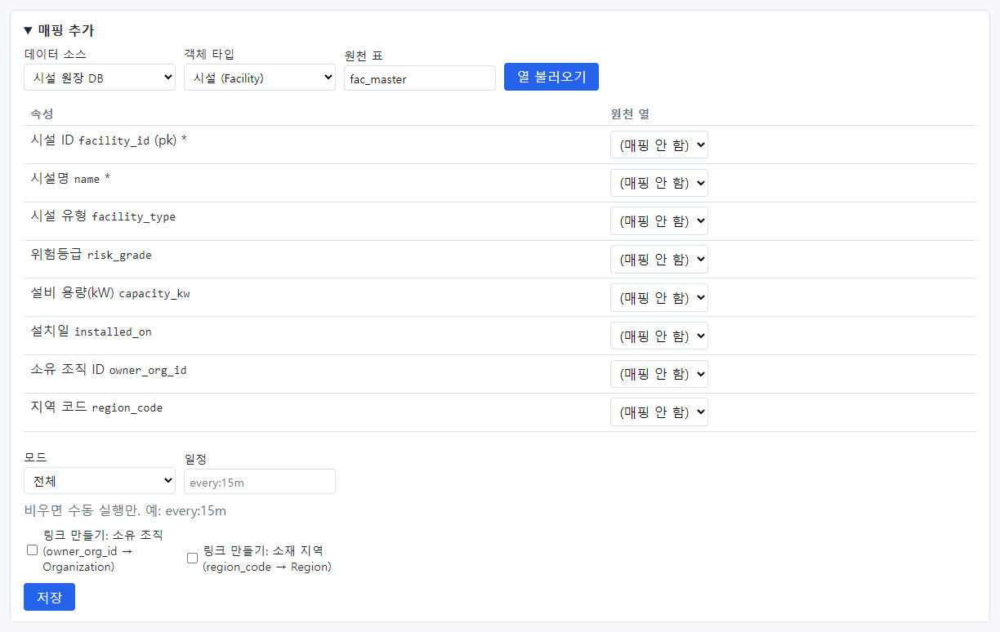

- 속성 이름 뒤의 `(pk)` 는 객체를 가리키는 값(필수), `*` 는 비어 있으면 안 되는 속성입니다.
- **이름이 정확히 같은 열만** 미리 골라 줍니다. 이 책의 원천 표는 이름이 모두 달라서 처음에는 모두
  "(매핑 안 함)"입니다. 비슷한 이름을 짐작해서 짝짓지 않습니다(틀린 짝을 막기 위해).

속성마다 알맞은 열을 고릅니다.

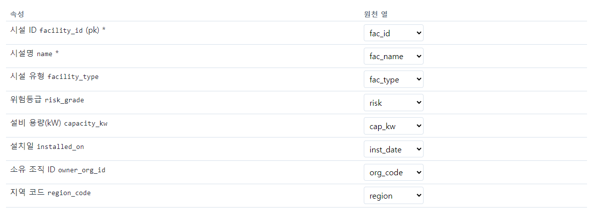

| 속성 | 원천 열 |
| --- | --- |
| 시설 ID `facility_id` (pk) | `fac_id` |
| 시설명 `name` | `fac_name` |
| 시설 유형 `facility_type` | `fac_type` |
| 위험등급 `risk_grade` | `risk` |
| 설비 용량(kW) `capacity_kw` | `cap_kw` |
| 설치일 `installed_on` | `inst_date` |
| 소유 조직 ID `owner_org_id` | `org_code` |
| 지역 코드 `region_code` | `region` |

### 3단계 — 모드·일정·링크

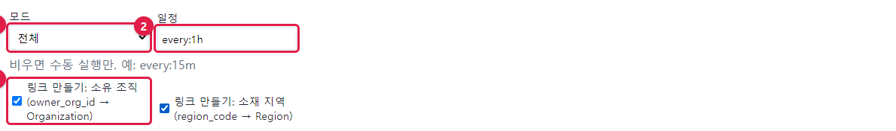

| 번호 | 칸 | 이 책의 선택 | 설명 |
| --- | --- | --- | --- |
| ① | 모드 | 전체 | 12.2 |
| ② | 일정 | `every:1h` | 1시간마다 자동. 비우면 **지금 동기화**를 눌러야만 돎 |
| ③ | 링크 만들기 | 둘 다 체크 | 소유 조직(`owner_org_id → Organization`), 소재 지역(`region_code → Region`) 관계를 만듦 |

일정 적는 법:

| 적는 값 | 뜻 |
| --- | --- |
| (비움) | 수동 실행만 |
| `every:15m` | 15분마다 |
| `every:1h` | 1시간마다 |
| `every:6h` | 6시간마다 |
| `every:24h` | 하루마다(`d` 는 쓸 수 없습니다 — 단위는 `s`·`m`·`h` 만) |

형식이 틀리면 저장할 때 "schedule 은 'every:<숫자><s|m|h>' 형식이어야 합니다(예: every:15m)"가 나옵니다.

> **알아 두기** 원천 DB 에 부담을 주지 않도록, 데이터가 자주 바뀌지 않는 표는 일정을 길게 잡습니다. 원천 DB
> 담당자와 상의해 업무 시간 부하를 피하세요.

### 4단계 — 저장

전체 모습을 확인하고 **저장** 을 누릅니다.

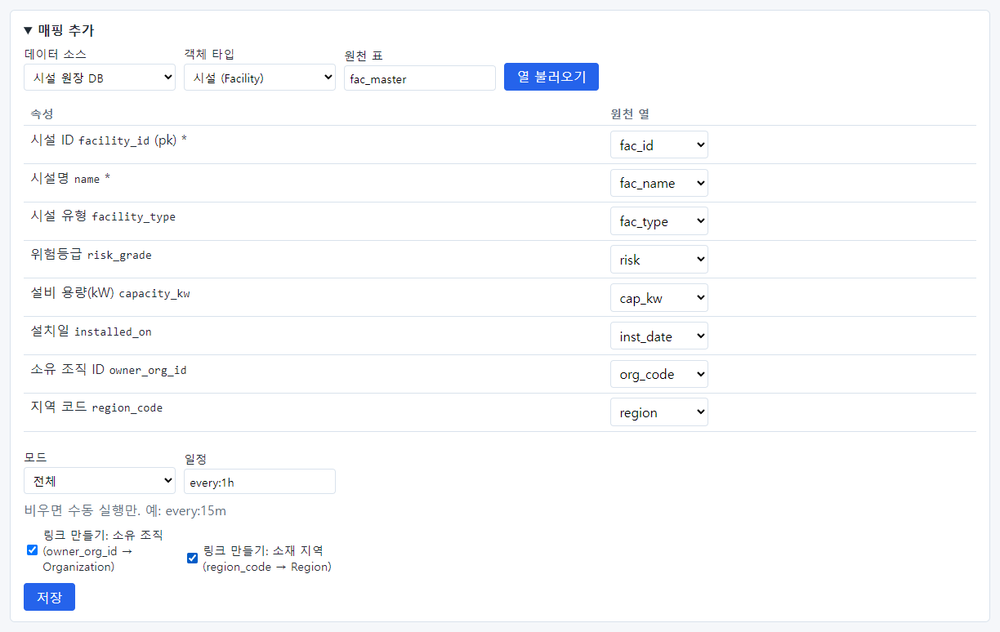

저장할 때 서버가 다시 검사합니다. 원천에 없는 열을 골랐거나, pk 를 매핑하지 않았거나, 링크에 필요한 속성을
매핑하지 않았으면 저장되지 않고 이유가 나옵니다.

## 12.2 전체 모드와 증분 모드

| | 전체 | 증분 |
| --- | --- | --- |
| 읽는 범위 | 매번 표 전체 | 워터마크 열 값이 지난번보다 커진 행만 |
| 원천에서 지워진 행 | OntoBot 에서도 **삭제 표시** | 알아채지 **못함** |
| 속도·부하 | 표가 크면 느리고 원천에 부담 | 빠름 |
| 알맞은 표 | 수만 행 이하, 삭제가 있는 표 | 큰 표, 삭제가 없는 표 |

모드를 **증분** 으로 바꾸면 **워터마크 열** 칸이 생깁니다.

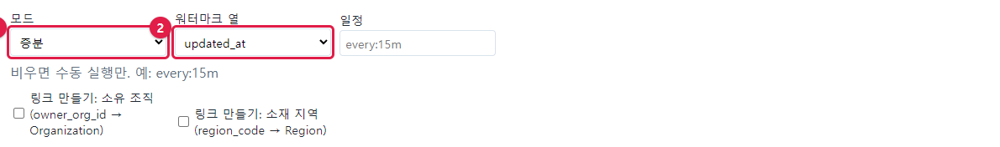

워터마크 열에는 행이 바뀔 때마다 커지는 값(보통 수정 시각 `updated_at`)을 고릅니다. 원천 담당자에게 "행을 고칠
때마다 이 열이 갱신되는지" 꼭 확인하세요. 갱신되지 않으면 바뀐 행을 놓칩니다.

이 책에서는 삭제를 보여 주기 위해 **전체** 모드로 저장했습니다.

### 증분 모드를 실제로 — 지역 표

증분 모드가 어떻게 움직이는지 보려고, 원천 DB 에 지역 표(`region_master`, 수정 시각 열 `updated_at` 있음)를 따로
만들고 지역(`Region`) 매핑을 **증분** 으로 만들어 보았습니다.

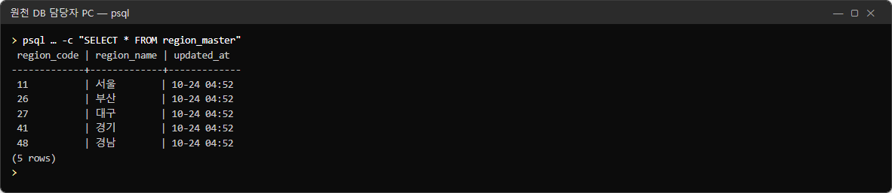

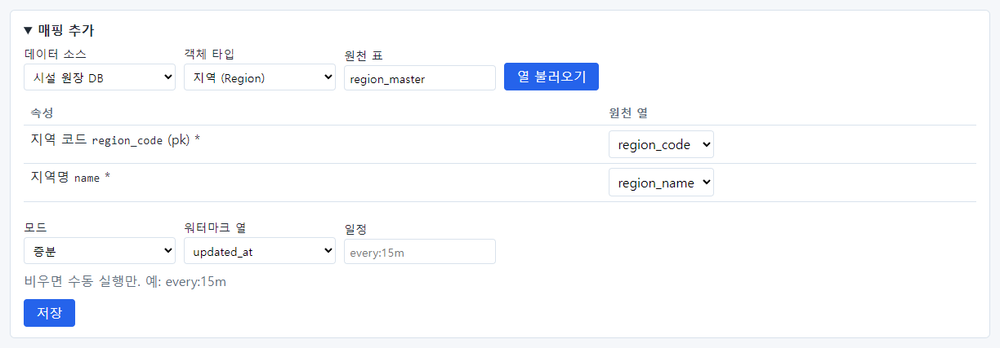

| 순서 | 원천에서 한 일 | 지금 동기화 결과(읽음/바뀜/삭제) | 읽는 법 |
| --- | --- | --- | --- |
| 1 | (처음) | `5 / 0 / 0` | 처음에는 전부 읽음. 값이 이미 같아 바뀜 0 |
| 2 | 아무것도 안 함 | `0 / 0 / 0` | 수정 시각이 지난번보다 큰 행이 없어 **하나도 읽지 않음** |
| 3 | 48 `경남` → `경상남도`(수정 시각 갱신) | `1 / 1 / 0` | 바뀐 한 행만 읽고 고침 |
| 4 | 41 `경기` 행을 **지움** | `0 / 0 / 0` | 지운 것을 **알아채지 못함** |

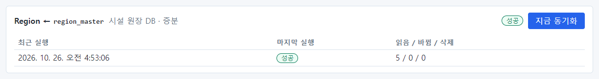

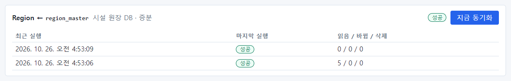

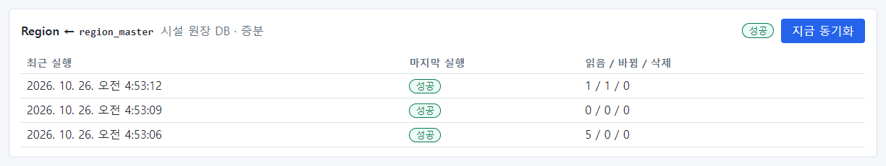

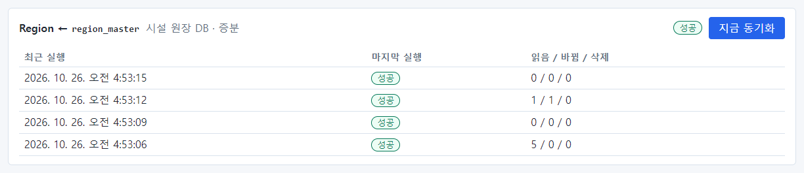

4번 뒤에 사용자가 지역 목록을 물으면, 원천에서 지운 `경기` 가 **여전히 나옵니다.**

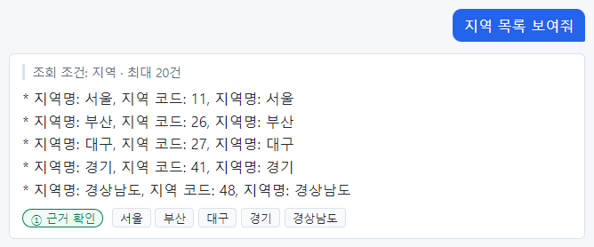

> **주의** 증분 모드는 원천에서 지운 행을 OntoBot 에서 지우지 못합니다. 원천에서 행을 지우는 일이 있는 표는 전체
> 모드를 쓰거나, 정기적으로(예: 주말) 전체 모드로 한 번 맞추도록 모델러와 정하세요.

연습 뒤 원천을 되돌리고 다시 동기화했습니다(`2 / 1 / 0` — 두 행을 읽었고, 이름을 되돌린 한 행만 바뀜. 다시 넣은
`경기` 는 OntoBot 의 값과 같아 바뀜에 세지 않음).

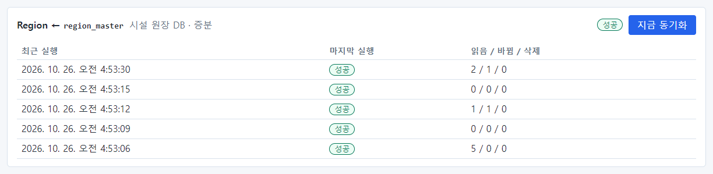

## 12.3 매핑 카드 읽기

저장하면 매핑 목록에 카드가 생깁니다.

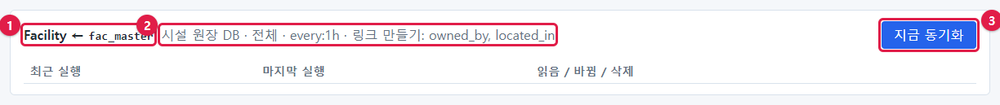

| 번호 | 부분 | 뜻 |
| --- | --- | --- |
| ① | `Facility ← fac_master` | 시설 객체를 fac_master 표에서 가져옴 |
| ② | `시설 원장 DB · 전체 · every:1h · 링크 만들기: owned_by, located_in` | 데이터 소스·모드·일정·만들 링크 |
| ③ | **지금 동기화** | 바로 한 번 실행 |

## 12.4 지금 동기화

**지금 동기화** 를 누르면 작업이 워커에게 넘어갑니다.

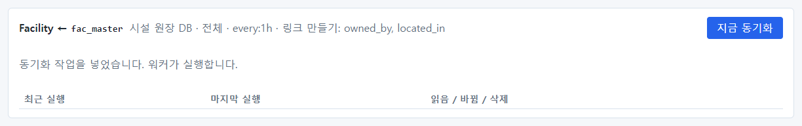

"동기화 작업을 넣었습니다. 워커가 실행합니다." — 실행은 화면이 아니라 worker 컨테이너가 합니다. 몇 초 뒤
(화면은 5초마다 새로 읽음) 결과가 나옵니다.

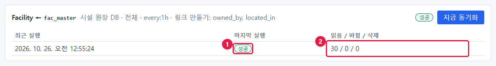

| 번호 | 칸 | 이 실행의 값 | 뜻 |
| --- | --- | --- | --- |
| ① | 마지막 실행 | **성공** | — |
| ② | 읽음 / 바뀜 / 삭제 | `30 / 0 / 0` | 원천에서 30행을 읽었고, 바뀐 객체 0, 삭제 표시 0 |

> **알아 두기** "바뀜 0"인 이유: 샘플 데이터로 설치하면서 같은 시설 30개가 이미 들어 있었고, 원천 표의 값도 똑같기
> 때문입니다. 동기화는 값이 실제로 달라진 객체만 고칩니다.

> **알아 두기** 이미 대기 중인 동기화가 있는데 또 누르면 "이미 대기 중인 동기화가 있습니다."가 나오고 새 작업을
> 넣지 않습니다(27장에서 워커를 멈춘 채 눌러 보는 사진이 있습니다).

같은 방법으로 조직(`Organization ← org_master`) 매핑도 만들었습니다.

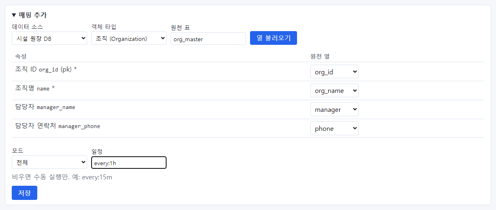

| 속성 | 원천 열 |
| --- | --- |
| 조직 ID `org_id` (pk) | `org_id` — 이름이 같아 미리 골라짐 |
| 조직명 `name` | `org_name` |
| 담당자 `manager_name` | `manager` |
| 담당자 연락처 `manager_phone` | `phone` |

두 매핑이 모두 성공한 모습입니다.

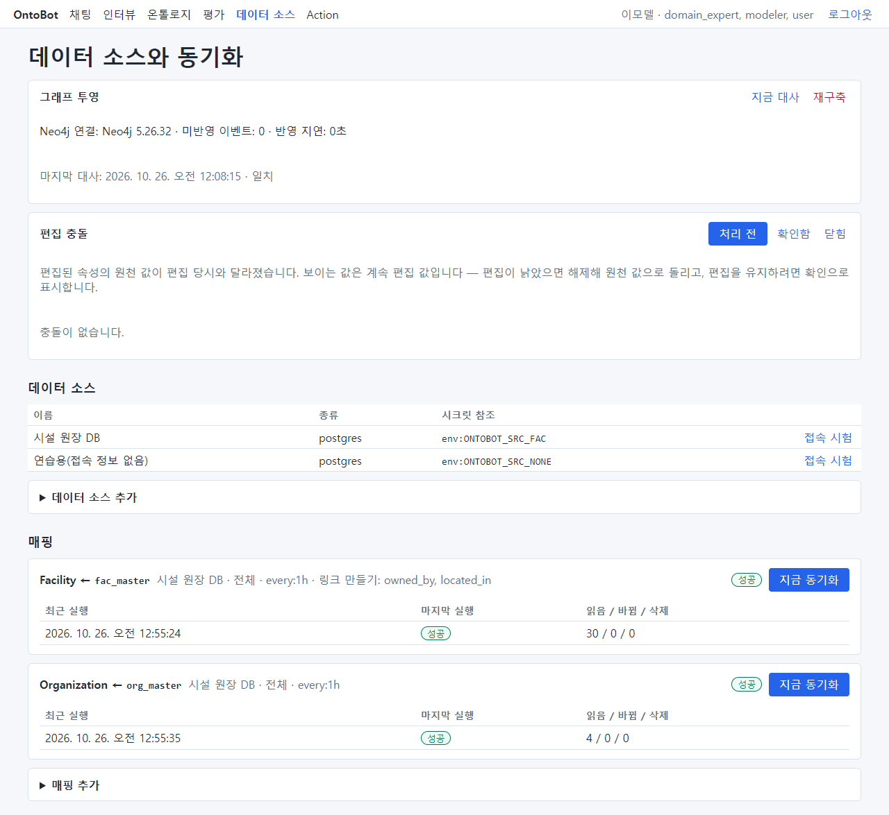

## 12.5 동기화가 실패하면 — 값을 변환할 수 없을 때

원천 데이터에 잘못된 값이 들어오면 어떻게 되는지 봅니다. 이 책에서는 원천 표의 설치일 열을 글자 열로 바꾸고,
시설 F-0002 의 설치일에 있을 수 없는 날짜 `2015-13-45` 를 넣은 뒤 동기화했습니다.

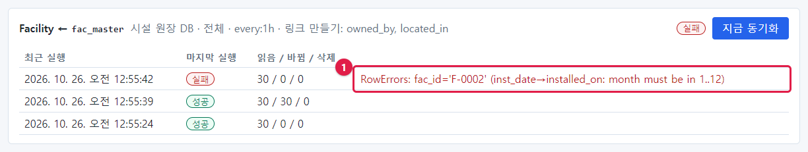

- 마지막 실행 **실패**, 읽음 30 / 바뀜 0 / 삭제 0.
- 오류: `RowErrors: fac_id='F-0002' (inst_date→installed_on: month must be in 1..12)`
  — 어느 행(`F-0002`)의 어느 열이 어느 속성으로 바뀌다가(`inst_date→installed_on`) 왜(월은 1~12) 실패했는지 나옵니다.

**행 하나라도 변환에 실패하면 그 실행 전체가 실패하고, 아무것도 바꾸지 않습니다**("바뀜 0"). 일부만 들어가
데이터가 어긋나는 것을 막기 위해서입니다. 화면의 데이터는 마지막 성공 때 그대로입니다.

원천 담당자가 값을 고친 뒤 다시 동기화하면 성공합니다.

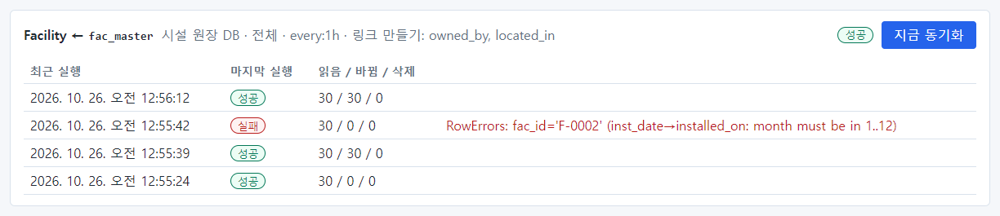

### 실패 메시지 읽는 법

| 메시지에 보이는 것 | 뜻 | 할 일 |
| --- | --- | --- |
| `RowErrors: fac_id='…' (…)` | 그 행의 값이 속성 자료형에 맞지 않음 | 원천 담당자에게 행과 열을 알려 고치게 함 |
| `빈 값을 허용하지 않습니다` | 비어 있으면 안 되는 속성(`*`)이 비었음 | 원천 값 채우기 또는 모델러와 속성 규칙 검토 |
| `허용되지 않는 값` 류 | 정해진 값 목록(예: 시설 유형)에 없는 값 | 원천 값 확인 또는 모델러가 목록 보강 |
| 접속 오류(11.5 표의 문구) | 원천 DB 에 닿지 못함 | 11.5 |
| 관계·표 없음 오류 | 원천 표가 사라지거나 이름이 바뀜 | 원천 담당자 |

## 12.6 원천에 행이 생기고 사라지면

원천 표에 시설 하나(`F-0031`)를 넣고 동기화한 뒤, 다시 지우고 동기화했습니다.


- 맨 위 줄이 가장 최근 실행입니다: `31 / 1 / 0` — 31행을 읽고 1개를 새로 넣음.

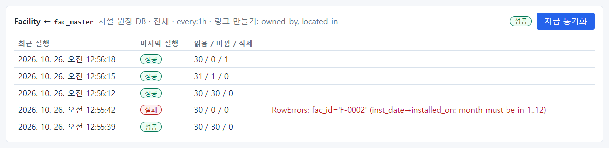

- `30 / 0 / 1` — 30행을 읽었고, 원천에서 사라진 1개를 OntoBot 에서 **삭제 표시**함(전체 모드라서).
- 삭제 표시한 객체는 질문의 답에 나오지 않습니다. 데이터베이스에서 완전히 지우지는 않습니다.

카드에는 최근 5번의 실행이 보입니다. 더 오래된 기록은 서버에서 다음처럼 볼 수 있습니다.

```powershell
wsl -d ontobot -u root -- bash -c "cd /opt/ontobot && docker compose exec -T postgres psql -U postgres -d ontobot_db -c \"SELECT id, mapping_id, status, rows_read, rows_upserted, rows_deleted, to_char(started_at AT TIME ZONE 'Asia/Seoul','MM-DD HH24:MI:SS') AS started FROM sync_run ORDER BY id DESC LIMIT 10;\""
```

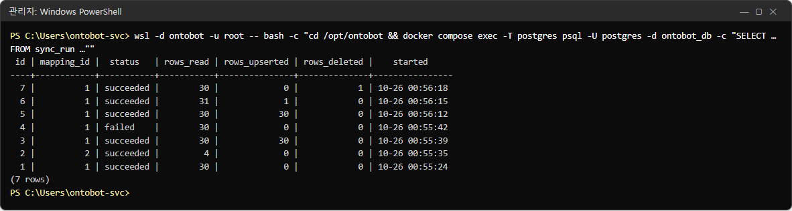

## 12.7 주의 — 원천 표의 열 이름이 바뀌면

이 책을 찍으면서 원천 표의 `risk` 열 이름을 `risk_level` 로 바꾸고 동기화해 보았습니다.

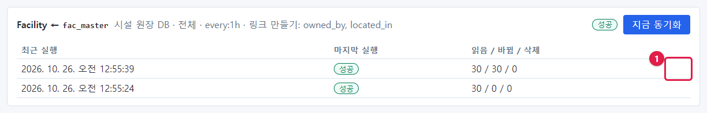

결과는 **성공**, `30 / 30 / 0` 이었습니다. 실패가 아닙니다. 매핑이 가리키는 열(`risk`)을 찾지 못하자, 30개 시설의
위험등급이 **비어 있는 값으로 바뀐 채** 성공으로 끝났습니다(위험등급은 비어 있어도 되는 속성이라 변환 오류가
나지 않았습니다). 열 이름을 되돌리고 다시 동기화하자 `30 / 30 / 0` 으로 원래 값이 돌아왔습니다(12.6 의 사진 아래쪽
줄들).

> **주의** 지금 판은 매핑을 **저장할 때만** 원천에 열이 있는지 검사하고, 동기화할 때는 검사하지 않습니다. 그래서
> 원천 표의 열 이름이 바뀌거나 열이 사라지면, 그 속성이 조용히 비어 버릴 수 있습니다. 다음을 지키세요.
>
> 1. 원천 DB 담당자에게 **표 구조를 바꾸기 전에 꼭 알려 달라**고 요청합니다(11.1).
> 2. 매일 점검(25장)에서 **"바뀜" 수가 갑자기 전체 행 수와 같아진 실행**이 있으면, 원천 표 구조가 바뀌지 않았는지
>    확인합니다.
> 3. 구조가 바뀌었으면 모델러가 매핑을 새로 맞춘 뒤 동기화합니다.
>
> 이 동작은 개발팀에 개선 과제로 전달되어 있습니다.

## 12.8 값의 출처 확인 — 근거 카드

동기화한 값이 어디서 왔는지는 사용자 화면의 근거 카드에서도 확인할 수 있습니다. `kim.user` 로 "강남 변전소 01호
정보 알려줘"를 묻고 근거 단추를 눌렀습니다.

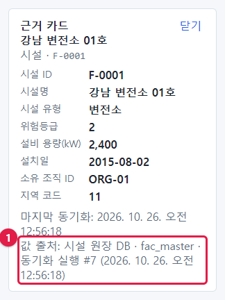

맨 아래 **값 출처: 시설 원장 DB · fac_master · 동기화 실행 #7 (…)** — 이 값이 어느 데이터 소스·표·동기화 실행에서
왔는지 보입니다. 사용자가 "이 값이 원천과 다르다"고 하면 이 실행 번호부터 확인합니다.

## 12.9 운영자의 동기화 점검

| 확인 | 정상 | 아니면 |
| --- | --- | --- |
| 매핑마다 마지막 실행 | **성공** | 12.5 의 표로 원인 |
| 마지막 실행 시각 | 일정 간격 안(예: 1시간마다면 1시간 이내) | worker 상태(18장), 27장 |
| 바뀜 수 | 평소와 비슷 | 갑자기 전체 행 수면 12.7 |
| 삭제 수 | 평소 0 근처 | 많으면 원천에서 대량 삭제가 있었는지 원천 담당자에게 |

## 12.10 해 보기

> **해 보기**
>
> 1. 시설 매핑의 **지금 동기화** 를 누르고, 결과가 나올 때까지 몇 초 걸리는지 재 보세요.
> 2. 결과의 "읽음" 수가 원천 표의 행 수와 같은지 원천 담당자에게 확인해 보세요.
> 3. 감사 로그에서 `sync.manual_run` 으로 방금 누른 기록을 찾아보세요.
