# 13장 그래프 투영 — 관계 저장소 지키기

"강남지사가 소유한 시설" 처럼 **관계를 따라가는 질문**은 Neo4j(관계 저장소)를 씁니다. Neo4j 는 PostgreSQL(원본)의
관계를 옮겨 적은 **복사본**입니다. 이 장에서는 그 복사 상태를 보는 법, 두 저장소를 맞춰 보는 대사, 처음부터 다시
만드는 재구축, 그리고 Neo4j 가 멈췄을 때의 모습을 실제로 확인합니다.

## 13.1 그래프 투영 칸

데이터 소스 화면 맨 위에 있습니다.

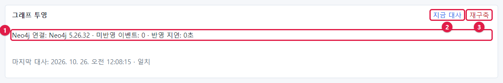

| 번호 | 부분 | 이 사진의 값 | 정상 |
| --- | --- | --- | --- |
| ① | 연결·미반영·지연 | `Neo4j 연결: Neo4j 5.26.32 · 미반영 이벤트: 0 · 반영 지연: 0초` | 연결됨, 미반영 0 근처, 지연 수 초 |
| ② | **지금 대사** | — | 두 저장소를 비교(누구나 누를 수 있음) |
| ③ | **재구축** | — | Neo4j 를 처음부터 다시 만듦(관리자만) |

그 아래 회색 줄 **마지막 대사: … · 일치** 는 가장 최근 대사의 시각과 결과입니다. 대사는 워커가 하루에 한 번
자동으로 하고, **지금 대사** 를 누르면 바로 합니다.

| 표시 | 뜻 | 할 일 |
| --- | --- | --- |
| 미반영 이벤트 0, 지연 0초 | 모든 변경이 Neo4j 에 반영됨 | 없음 |
| 미반영 이벤트가 잠깐 늘었다 줄어듦 | 동기화 직후 반영 중 | 기다림 |
| **반영 지연이 10분을 넘었습니다** 경고 | 워커가 밀려 있거나 멈춤 | 18장 현황에서 worker 상태, 27장 |
| **Neo4j 에 연결할 수 없습니다**(빨강) | Neo4j 가 멈춤 | 13.3 |
| 마지막 대사 **PostgreSQL 과 Neo4j 가 어긋난 항목 N건** | 두 저장소의 수가 다름 | 13.4 |
| **참조 대상 없음 N건** | 링크가 가리키는 객체가 원천에 없음(stub) | 원천 데이터 확인(오류 아님) |

## 13.2 지금 대사

**지금 대사** 를 누르고 몇 초 뒤 화면을 다시 읽으면 마지막 대사 시각이 바뀝니다.

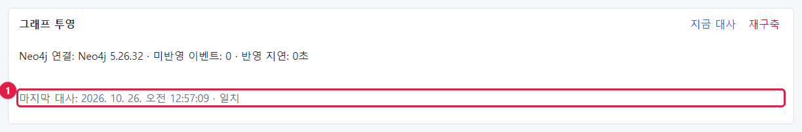

①의 회색 줄이 방금 시각과 **일치**로 바뀌었습니다. 대사는 객체 타입마다, 링크 타입마다 PostgreSQL 쪽 수와 Neo4j 쪽
수(그리고 내용의 지문)를 비교합니다. 같은 일을 명령으로 하면 자세한 결과를 볼 수 있습니다.

```powershell
wsl -d ontobot -u root -- bash -c "cd /opt/ontobot && docker compose run --rm -w /app migrate python scripts/graph_rebuild.py --check"
```

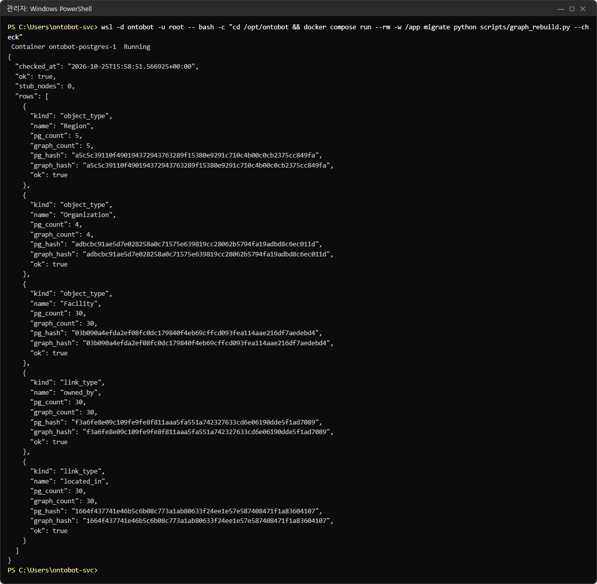

| 항목 | 뜻 |
| --- | --- |
| `"ok": true` | 전체 일치 |
| `"stub_nodes": 0` | 참조 대상 없는 자리표 노드 수 |
| `rows[]` | 타입마다 한 덩어리 |
| `kind` / `name` | `object_type`(객체) 또는 `link_type`(관계)와 그 이름 |
| `pg_count` / `graph_count` | PostgreSQL 쪽 수 / Neo4j 쪽 수 |
| `pg_hash` / `graph_hash` | 내용 지문. 수가 같아도 내용이 다르면 지문이 다름 |
| `ok` | 그 타입이 일치하는지 |

시험 서버의 결과: 지역 5, 조직 4, 시설 30, 소유 관계(`owned_by`) 30, 소재 관계(`located_in`) 30 — 모두 일치.

> **알아 두기** `--check` 는 비교만 합니다. 아무것도 바꾸지 않습니다. `--check` 없이 실행하면 재구축입니다(13.5).

## 13.3 Neo4j 가 멈추면

일부러 Neo4j 를 멈춰 봅니다.

```powershell
wsl -d ontobot -u root -- bash -c "cd /opt/ontobot && docker compose stop neo4j"
```

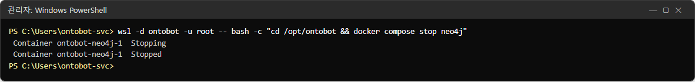

### 그래프 투영 칸

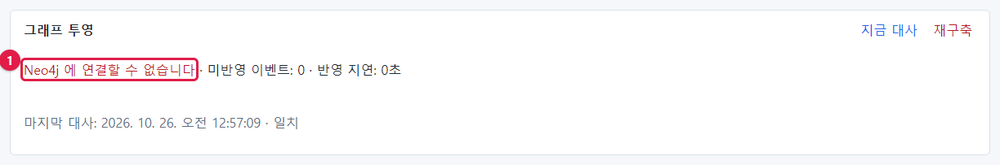

①에 빨간 글씨 **Neo4j 에 연결할 수 없습니다** 가 나옵니다.

### 사용자에게 보이는 것

관계 질문은 실패합니다.

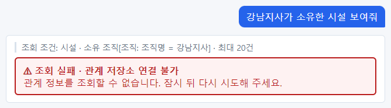

**조회 실패 · 관계 저장소 연결 불가 — 관계 정보를 조회할 수 없습니다. 잠시 뒤 다시 시도해 주세요.** 조회 조건 줄은
그대로 보입니다. OntoBot 은 Neo4j 대신 PostgreSQL 로 몰래 바꿔 조회하지 않고, 실패를 분명히 알립니다.

관계를 쓰지 않는 질문은 정상입니다.


### 준비 상태와 배포 콘솔

```powershell
curl.exe -s http://<서버>:8000/readyz
```

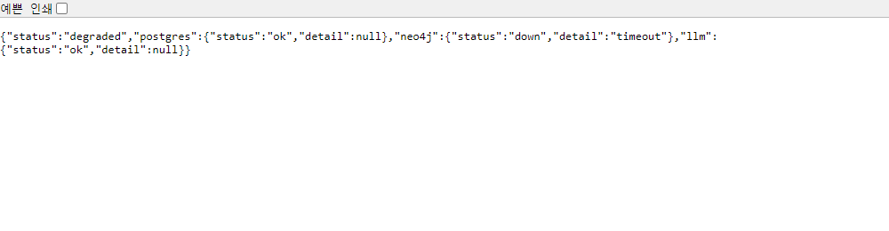

`"status":"degraded"`, `"neo4j":{"status":"down","detail":"timeout"}` — 일부 저하입니다. 배포 콘솔 **현황**에도 같은
내용이 보입니다(27장에서 찍은 사진).

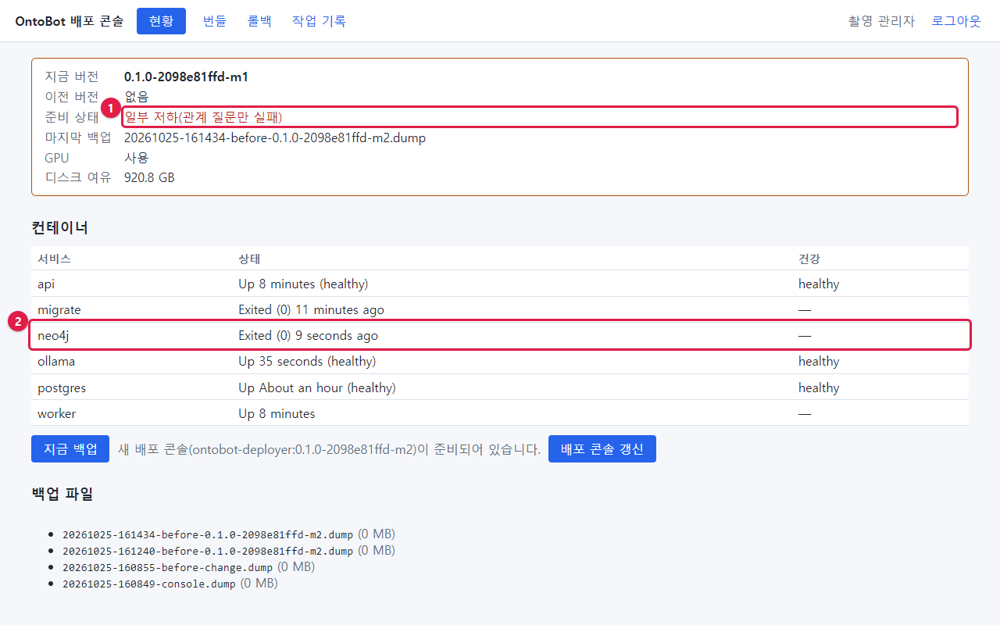

① 준비 상태 **일부 저하(관계 질문만 실패)**, ② neo4j `Exited (0)`.

> **알아 두기** Neo4j 만 멈춘 상태는 `degraded`(일부 저하)이지 `unavailable`(사용 불가)이 아닙니다. `/readyz` 도
> 200(정상 응답)으로 답합니다. 대부분의 질문은 계속 되기 때문입니다.

### 다시 켜기

```powershell
wsl -d ontobot -u root -- bash -c "cd /opt/ontobot && docker compose start neo4j"
```

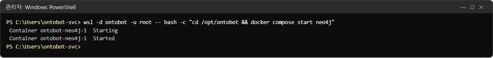

Neo4j 는 켜지는 데 30초~1분 걸립니다. 컨테이너 상태가 `(healthy)` 가 되면 **지금 대사** 를 눌러 확인합니다.

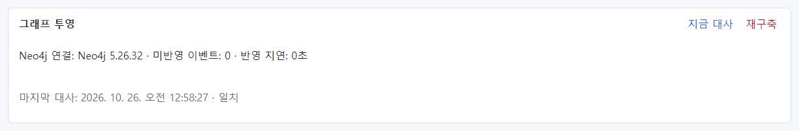

Neo4j 가 멈춘 동안 생긴 변경(동기화·Action)은 워커가 아웃박스에 모아 두었다가, Neo4j 가 돌아오면 차례로 반영합니다.
그래서 대개 다시 켜기만 하면 됩니다. 대사가 어긋남을 보고하면 13.5 의 재구축을 합니다.

## 13.4 대사가 어긋남을 보고하면

마지막 대사 줄이 **PostgreSQL 과 Neo4j 가 어긋난 항목 N건** 으로 나오고, 그 아래에 타입별로 `PostgreSQL 30 · Neo4j 28`
처럼 나오면 두 저장소가 다릅니다.

| 순서 | 할 일 |
| --- | --- |
| 1 | 미반영 이벤트가 0인지 봅니다. 0이 아니면 반영 중일 수 있으니 몇 분 기다렸다가 **지금 대사** |
| 2 | 계속 어긋나면 worker 가 살아 있는지 확인(18장) |
| 3 | 그래도 어긋나면 **재구축**(13.5) — 업무 시간 외 권장 |
| 4 | 재구축 뒤에도 어긋나면 대사 명령 결과(13.2)를 개발팀에 |

## 13.5 재구축

재구축은 Neo4j 를 **비우고** PostgreSQL 에서 처음부터 다시 만듭니다. PostgreSQL(원본)은 건드리지 않으므로 데이터가
사라지지 않습니다. 다만 다시 만드는 동안 관계 질문이 실패하거나 결과가 덜 나올 수 있습니다.

1. 그래프 투영 칸의 **재구축**(빨간 글씨)을 누릅니다. 관리자만 할 수 있습니다.
2. 확인 창이 뜹니다: **"Neo4j 를 비우고 PostgreSQL 에서 다시 투영합니다. 진행할까요?"** → **확인**.
3. 워커가 재구축 작업을 실행합니다. 이 책의 샘플 데이터(객체 39개, 관계 60개)는 몇 초 만에 끝나서, 누른 직후에도
   미반영 0으로 보였습니다.


4. 몇 초~몇 분 뒤 **지금 대사** 로 일치를 확인합니다.

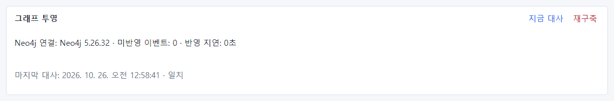

| 데이터 크기 | 재구축 시간(대략) |
| --- | --- |
| 수천 개 | 수 초 |
| 수십만 개 | 수 분 |
| 수백만 개 | 수십 분 — 반드시 업무 시간 외 |

명령으로도 할 수 있습니다(화면의 재구축과 같음).

```powershell
wsl -d ontobot -u root -- bash -c "cd /opt/ontobot && docker compose run --rm -w /app migrate python scripts/graph_rebuild.py"
```

재구축은 감사 로그(`graph.rebuild`)에 누가 했는지 남습니다.

## 13.6 운영자가 기억할 것

- Neo4j 는 **언제든 다시 만들 수 있는 복사본**입니다. 백업하지 않습니다. 멈추면 다시 켜고, 이상하면 재구축합니다.
- Neo4j 가 멈춰도 관계 질문만 실패합니다(일부 저하). 다른 질문과 화면은 정상입니다.
- 매일 점검에서 미반영 이벤트(0 근처)와 마지막 대사(일치)를 봅니다.
- Neo4j 메모리가 모자라면(큰 데이터) `.env` 의 `ONTOBOT_NEO4J_HEAP` 을 개발팀과 상의해 늘립니다(30장).

## 13.7 해 보기

> **해 보기**
>
> 1. 업무 시간 외에 `docker compose stop neo4j` 로 Neo4j 를 멈추고, 관계 질문과 관계 없는 질문을 하나씩 해 보세요.
> 2. 배포 콘솔 현황의 준비 상태가 무엇으로 바뀌는지 확인하세요.
> 3. `docker compose start neo4j` 로 다시 켜고, 1분 뒤 **지금 대사** 로 일치를 확인하세요.
