# 14장 Action 운영 — 승인·기록·롤백

**Action** 은 데이터를 바꾸는 요청입니다(예: "F-0004 시설의 위험등급을 3으로"). Action 은 바로 실행되지 않고
**미리보기 → 승인 → 실행** 을 거치며, 실행한 뒤에도 **롤백** 할 수 있습니다. 실행은 원천 DB 가 아니라 OntoBot 안의
**편집 레이어**에 씁니다.

사용자·승인자가 Action 을 쓰는 방법은 사용자 매뉴얼 9~13장에 자세히 있습니다. 이 장은 운영자(관리자)가 알아야 할
흐름과 기록 보는 법, 롤백을 다룹니다. 이 장의 사진은 `kim.user` 가 요청하고 `park.admin` 이 승인하는 과정을 실제로
진행하며 찍었습니다.

## 14.1 Action 의 한살이

```
 요청자(kim.user)                승인자(park.admin)                  워커
 ──────────────                 ─────────────────                  ────
 미리보기(=요청) ──▶ 승인 대기 ──▶ 승인하고 실행 ──▶ 실행됨 ──▶ 알림 발송(앱·메일·SMS)
        │                 │            │
        │                 └─▶ 거부 ──▶ 거부됨
        └─▶ 요청 거두기                └─▶ 재검증 실패 ──▶ 실패
                                실행됨 ──▶ 롤백 ──▶ 롤백됨(편집 해제, 정정 문구)
```

| 상태 | 뜻 |
| --- | --- |
| 승인 대기 | 미리보기를 만들어 요청됨 |
| 막힘 | 미리보기에서 실행할 수 없는 사유가 있음(사전 조건, 발송 채널 미설정 등) |
| 실행됨 | 승인과 동시에 실행됨 |
| 거부 | 승인자가 거부함(사유가 남음) |
| 실패 | 승인했지만 그 순간 다시 확인해 보니 조건이 맞지 않음 |
| 롤백됨 | 실행을 되돌림 |

> **알아 두기** "승인하고 실행"은 한 번에 일어납니다. 승인하는 순간 게시 버전·대상·사전 조건을 **다시 확인**하고,
> 맞지 않으면 실행하지 않고 **실패**로 기록합니다(오류가 아니라 기록입니다).

## 14.2 요청 — 화면에서

`kim.user` 가 Action 화면의 **Action 요청** 칸에서 요청합니다.

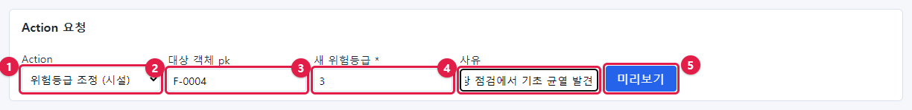

| 번호 | 칸 | 입력 |
| --- | --- | --- |
| ① | Action | `위험등급 조정 (시설)` |
| ② | 대상 객체 pk | `F-0004` |
| ③ | 새 위험등급 * | `3` |
| ④ | 사유 | `현장 점검에서 기초 균열 발견` |
| ⑤ | **미리보기** | 누름 |

미리보기를 만들면 곧바로 **승인 대기** 요청이 됩니다.

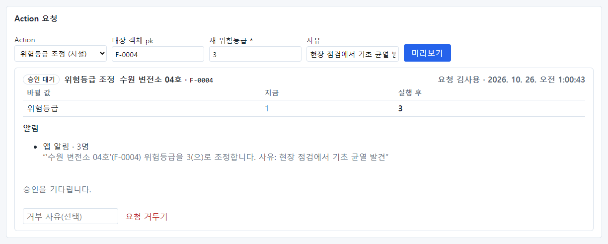

| 부분 | 내용 |
| --- | --- |
| 머리 | **승인 대기** · 위험등급 조정 · 수원 변전소 04호 · F-0004 · 요청 김사용 · 시각 |
| 바뀔 값 | 위험등급: 지금 `1` → 실행 후 `3` |
| 알림 | 앱 알림 · 3명 — 실제 문구가 미리 보임 |
| 아래 | "승인을 기다립니다." · 거부 사유 칸 · **요청 거두기**(요청자가 취소) |

## 14.3 요청 — 채팅에서

사용자는 채팅으로도 요청할 수 있습니다. "F-0012 시설 위험등급을 2로 바꿔줘. 사유는 정밀 점검 결과 이상 없음":

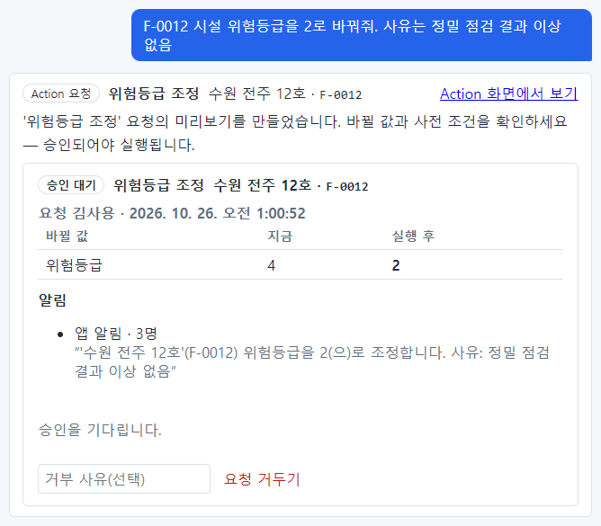

채팅은 **미리보기까지만** 만듭니다. 실행은 반드시 승인자가 Action 화면에서 합니다. 채팅에서 만든 요청도 Action
화면의 같은 목록에 나옵니다(기록에 `origin=chat`).

> **알아 두기** 채팅 요청에서 OntoBot 은 대상(시설 이름·pk)과 값이 **질문에 그대로 있는지** 확인합니다. 질문에 없는
> 시설을 AI 가 지어내 요청을 만들지 못하게 막아 둔 것입니다.

요청자의 **내 요청** 탭에는 세 요청이 승인 대기로 보입니다.

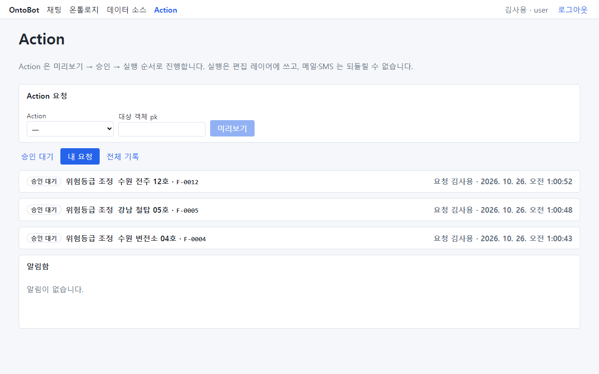

## 14.4 승인 — 승인자 화면

`park.admin` 의 Action 화면 **승인 대기** 탭입니다.

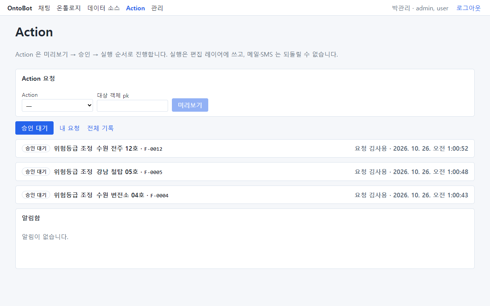

> **알아 두기** 승인 대기만 있을 때는 상단 **Action** 메뉴에 빨간 숫자가 붙지 않습니다(아래 사진). 빨간 숫자는
> **알림함**의 읽지 않은 알림 수이고, 알림은 실행된 뒤에 생깁니다. 승인자에게는 메일·SMS 알림을 걸어 두거나(15장)
> 정기적으로 승인 대기 탭을 보도록 안내하세요.

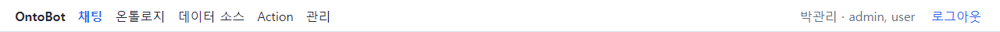

요청 줄을 누르면 펼쳐집니다.

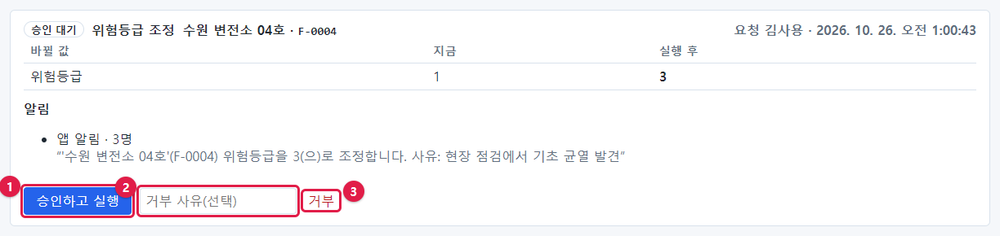

| 번호 | 단추·칸 | 하는 일 |
| --- | --- | --- |
| ① | **승인하고 실행** | 확인 창 → 승인과 실행이 한 번에 |
| ② | 거부 사유(선택) | 거부할 때 이유 |
| ③ | **거부** | 거부 |

이 책에서는 F-0004·F-0005 를 승인하고, F-0012 는 사유를 적어 거부했습니다.

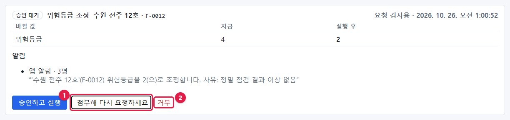

## 14.5 전체 기록

**전체 기록** 탭에서 모든 실행을 봅니다. 운영자가 가장 자주 보는 탭입니다.

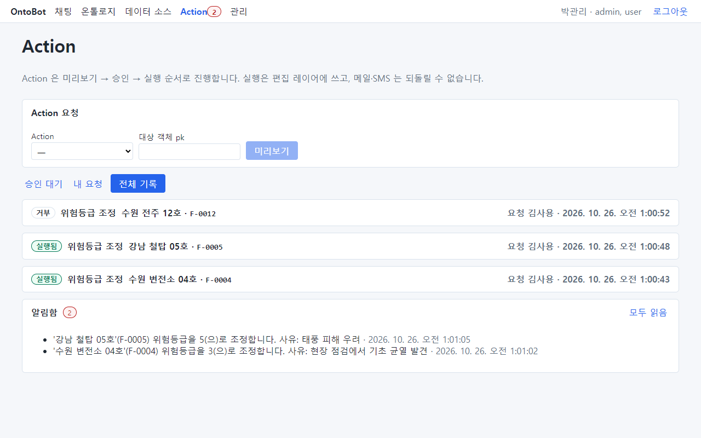

실행된 요청을 펼치면:

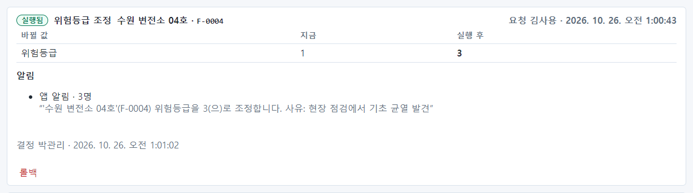

- 머리에 **실행됨**, 바뀐 값, 알림, **결정 박관리 · 시각**, 그리고 **롤백** 단추.

거부된 요청을 펼치면:

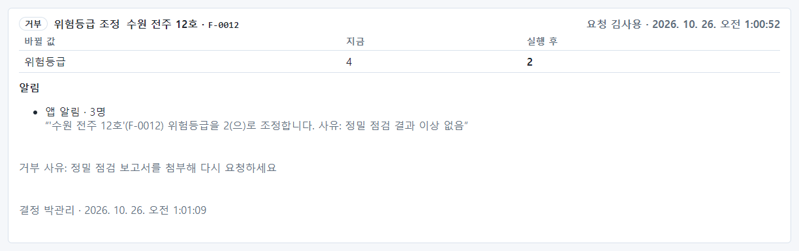

- **거부 사유: 정밀 점검 보고서를 첨부해 다시 요청하세요**, 결정한 사람과 시각.

실행 뒤 사용자가 같은 시설을 물으면 바뀐 값으로 답합니다.

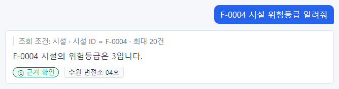

원천 DB 의 값(1)은 그대로이고, OntoBot 화면에는 편집 값(3)이 보입니다. 원천 값이 나중에 바뀌면 **편집 충돌**이
생깁니다(16장).

## 14.6 롤백

실행된 Action 을 되돌리려면 그 기록을 펼쳐 **롤백** 을 누릅니다. 롤백은 그 Action 의 승인 역할을 가진 사람이나
관리자가 할 수 있습니다.

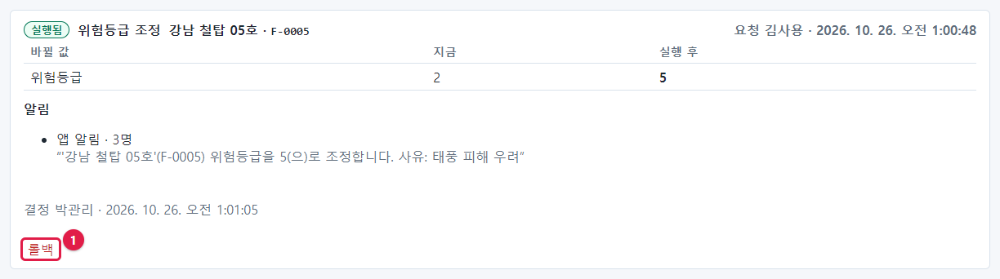

확인 창이 뜹니다: **"편집을 해제하고, 아직 안 나간 발송은 취소하며, 이미 나간 메일·SMS 수신자에게 정정 문구를
보냅니다. 진행할까요?"** → **확인**.

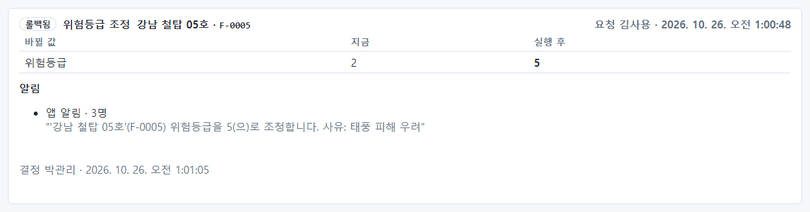

머리가 **롤백됨** 으로 바뀌고, 위험등급은 원래 값(2)으로 돌아갑니다.

| 롤백이 하는 일 | 설명 |
| --- | --- |
| 편집 해제 | 편집 레이어의 값을 지워 원천 값으로 돌아감 |
| 아직 안 나간 발송 취소 | 메일·SMS 가 아직 대기 중이면 보내지 않음 |
| 정정 문구 | 이미 보낸 메일·SMS·앱 알림 받은 사람에게 "취소되었습니다" 알림 |
| 되돌릴 수 없는 것 | 이미 보낸 메일·문자 자체 |

알림함에는 **정정** 표지가 붙은 알림이 생깁니다.

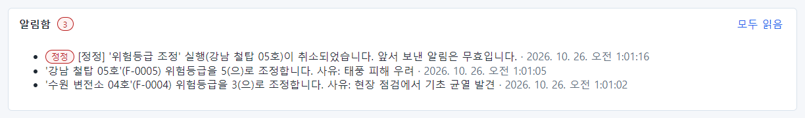

> **주의** 롤백한 뒤 그 객체를 다른 Action 이 다시 바꿨다면, 그 나중 편집은 지우지 않습니다(감사 로그의
> `superseded_edits`). 롤백은 "그 Action 이 바꾼 것"만 되돌립니다.

## 14.7 사전 조건과 승인 순간의 재검증

"점검 요청"(`request_inspection`) Action 은 **위험등급이 3 이상인 시설에만** 요청할 수 있게 정의되어 있습니다(사전 조건).

### 사전 조건이 맞지 않으면 — 막힘

위험등급이 2 인 F-0001 에 점검 요청을 미리보기하면:

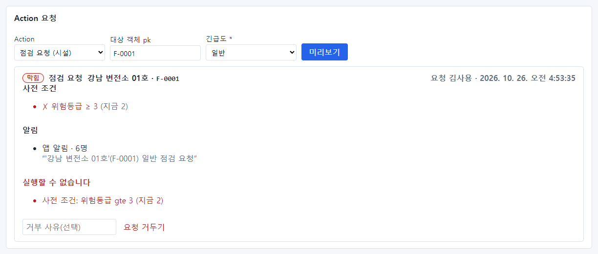

**막힘**, 사전 조건 `✗ 위험등급 ≥ 3 (지금 2)`, **실행할 수 없습니다 — 사전 조건: 위험등급 gte 3 (지금 2)**. 막힌 요청은
승인할 수 없습니다.

### 요청할 때는 맞았는데 승인할 때 틀어지면 — 실패

1. `kim.user` 가 위험등급 3 인 F-0028 에 점검 요청 → 사전 조건 `✓` → **승인 대기**.

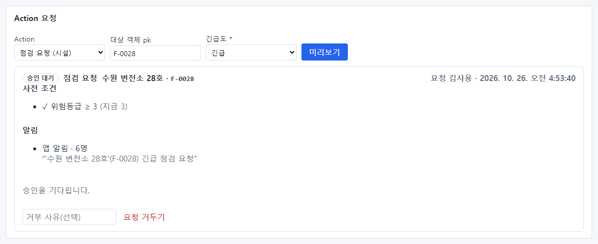

2. 같은 사람이 F-0028 의 위험등급을 2 로 낮추는 요청도 하고, 승인자가 그것을 **먼저** 승인했습니다.
3. 승인자가 점검 요청을 펼치면 요청 때의 확인 결과(`✓ … (지금 3)`)가 그대로 보입니다.

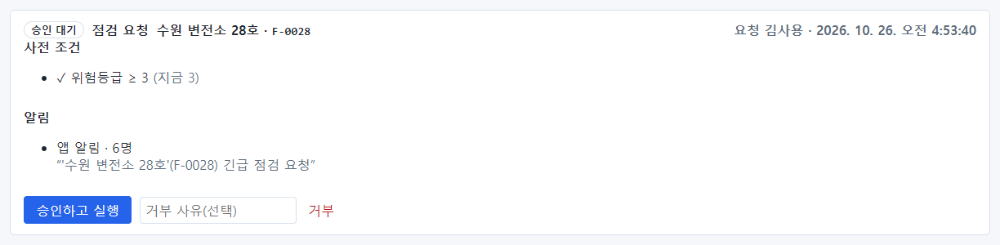

4. **승인하고 실행** 을 누르자, 서버가 그 순간 다시 확인해 실행하지 않고 **실패** 로 기록했습니다.

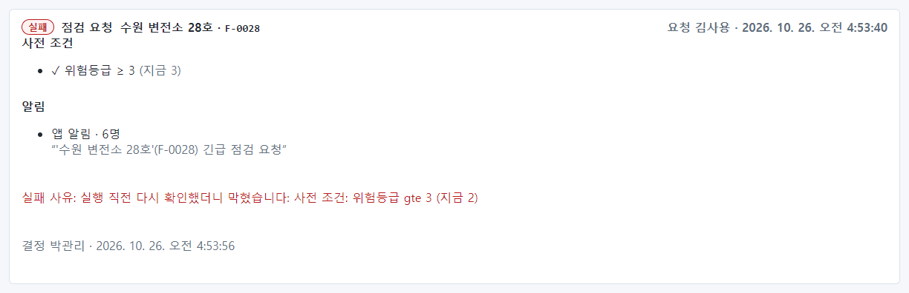

**실패 사유: 실행 직전 다시 확인했더니 막혔습니다: 사전 조건: 위험등급 gte 3 (지금 2).** 데이터는 바뀌지 않았고
알림도 나가지 않았습니다. 이것은 오류가 아니라 정상 동작입니다. 요청자에게 상황이 바뀌었음을 알리면 됩니다.

> **알아 두기** 연습 뒤 위험등급 조정은 롤백해 원래대로 되돌렸습니다.

## 14.8 운영자가 볼 것

| 확인 | 어디서 | 정상 | 아니면 |
| --- | --- | --- | --- |
| 오래된 승인 대기 | 승인 대기 탭(승인자 계정) 또는 전체 기록 | 하루 이상 묵은 요청 없음 | 승인자에게 알림 |
| 실패 기록 | 전체 기록 | 없음 | 펼쳐서 사유 확인(대개 사전 조건 변경) |
| 발송 실패 | 전체 기록 → 펼침 → 발송 | 모두 보냄 | 15장 |
| 막힘이 잦음 | 전체 기록 | 거의 없음 | 발송 채널·사전 조건 확인 |
| Action 변경 이력 | 감사 로그 `action.*` | — | 9장 |

## 14.9 Action 정의는 누가 바꾸나

Action 의 종류(위험등급 조정, 점검 요청, 긴급 정비 통보 등), 파라미터, 사전 조건, 승인 역할, 알림 문구·대상은
**모델러가 온톨로지에서** 정합니다(사용자 매뉴얼 17장). 운영자는 다음을 챙깁니다.

- 메일·SMS 로 알리는 Action 이 생기면 발송 채널(15장)과 받는 사람의 연락처(7장)를 준비합니다.
- 승인 역할이 admin 이면 승인할 관리자가 충분한지 확인합니다.

## 14.10 해 보기

> **해 보기**
>
> 1. `kim.user` 로 시설 하나의 위험등급 조정을 요청하세요.
> 2. 관리자 계정의 전체 기록에서 그 요청이 **승인 대기** 로 보이는지 확인하세요.
> 3. 승인한 뒤 채팅으로 그 시설의 위험등급을 물어 바뀐 값을 확인하세요.
> 4. 롤백한 뒤 다시 물어 원래 값으로 돌아왔는지 확인하고, 감사 로그의 `action.rolled_back` 을 찾아보세요.
