# 15장 메일·SMS 알림 설정

Action 이 실행되면 관련된 사람에게 알림을 보낼 수 있습니다. 알림 채널은 세 가지입니다.

| 채널 | 설정 | 비고 |
| --- | --- | --- |
| 앱 알림(알림함) | 필요 없음 — 늘 됨 | 14장 |
| 메일 | 운영자가 **사내 메일 서버(SMTP)** 를 설정 | 이 장 |
| SMS | 운영자가 **사내 SMS 게이트웨이**(HTTP 방식 또는 발송 테이블 방식)를 설정 | 이 장 |

설정하지 않은 채널을 쓰는 Action 은 미리보기에서 **막힘**이 됩니다. **보낸 척하지 않습니다.** 외부 인터넷 발송
서비스는 쓰지 않고, 사내 게이트웨이 주소만 적습니다(폐쇄망 원칙).

이 장에서는 실제로 다음을 차례로 했습니다.

1. 모델러가 메일·SMS 로 알리는 Action("긴급 정비 통보")을 게시한다.
2. 채널을 설정하기 전에 요청하면 **막힘**을 확인한다.
3. 운영자가 메일(SMTP)과 SMS(발송 테이블)를 설정하고 반영한다.
4. 승인·실행해서 메일과 SMS 가 실제로 **보내진** 것을 메일 서버와 발송 테이블에서 확인한다.
5. 메일 서버를 멈춘 채 실행해 **재시도 뒤 실패**를 확인한다.
6. 보낸 Action 을 롤백해 **정정 문구**가 나가는 것을 확인한다.

> **알아 두기** 촬영 PC 에는 사내 메일 서버가 없어서, OntoBot 서버 옆에 **시험용 메일 수신 프로그램**
> (`ontobot-mailsink`, 받은 메일을 화면에 찍기만 함)을 띄워 메일 서버로 썼습니다. SMS 는 원천 DB 안에 만든
> **발송 테이블**(`ums_send`)을 사내 UMS 처럼 썼습니다. OntoBot 쪽 설정과 화면은 운영과 똑같습니다.

## 15.1 준비물

| 준비물 | 누구에게 받나 | 예 |
| --- | --- | --- |
| 메일 서버 주소·포트 | 메일 담당자 | `mail.corp.local`, 25 |
| 보내는 주소 | 메일 담당자 | `ontobot@corp.local` |
| 메일 인증 계정(있으면) | 메일 담당자 | `ontobot` / 비밀번호 |
| STARTTLS 사용 여부 | 메일 담당자 | 예/아니오 |
| SMS 게이트웨이 방식 | SMS 담당자 | HTTP(URL) 또는 발송 테이블(DB) |
| (HTTP) 주소·토큰 | SMS 담당자 | `http://sms-gw.corp.local/api/send` |
| (테이블) DB 접속·표·열 이름 | SMS 담당자 | `ums.sms_queue`, `dest_no`, `msg_body` |
| 발신 번호 | SMS 담당자 | `0212345678` |
| 서버 → 메일 서버·SMS 게이트웨이 방화벽 | 네트워크 담당자 | — |
| 받는 사람의 메일·휴대전화 | 각 담당자 | 7.8 에서 입력 |

## 15.2 메일·SMS 로 알리는 Action (모델러의 일)

Action 정의에 메일·SMS 알림을 넣는 것은 모델러가 온톨로지에서 합니다. 이 책에서는 `lee.modeler` 가 새 draft 에
"긴급 정비 통보"(`urgent_notice`) Action 을 추가했습니다.

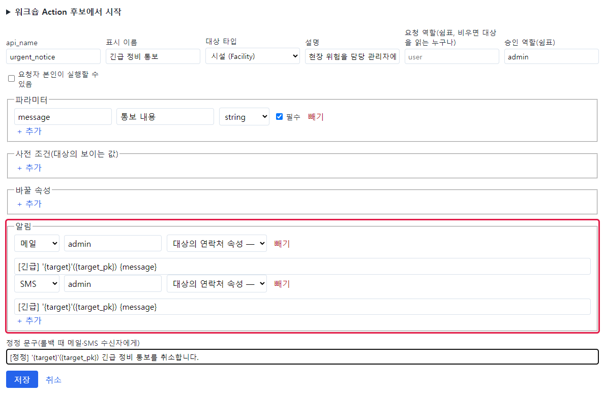

빨간 테두리 안이 **알림** 부분입니다.

| 줄 | 채널 | 받는 사람 | 문구 |
| --- | --- | --- | --- |
| 1 | 메일 | `admin` 역할 | `[긴급] '{target}'({target_pk}) {message}` |
| 2 | SMS | `admin` 역할 | 같음 |
| 정정 문구 | 롤백 때 메일·SMS 수신자에게 | — | `[정정] '{target}'({target_pk}) 긴급 정비 통보를 취소합니다.` |

문구의 `{target}`·`{target_pk}`·`{message}` 는 대상 이름·pk·파라미터 값으로 바뀝니다. 문구는 AI 가 쓰지 않습니다.

저장한 뒤 게시하면 버전 목록에 새 게시본(버전 2)이 생기고, 버전 1 은 보관됩니다.

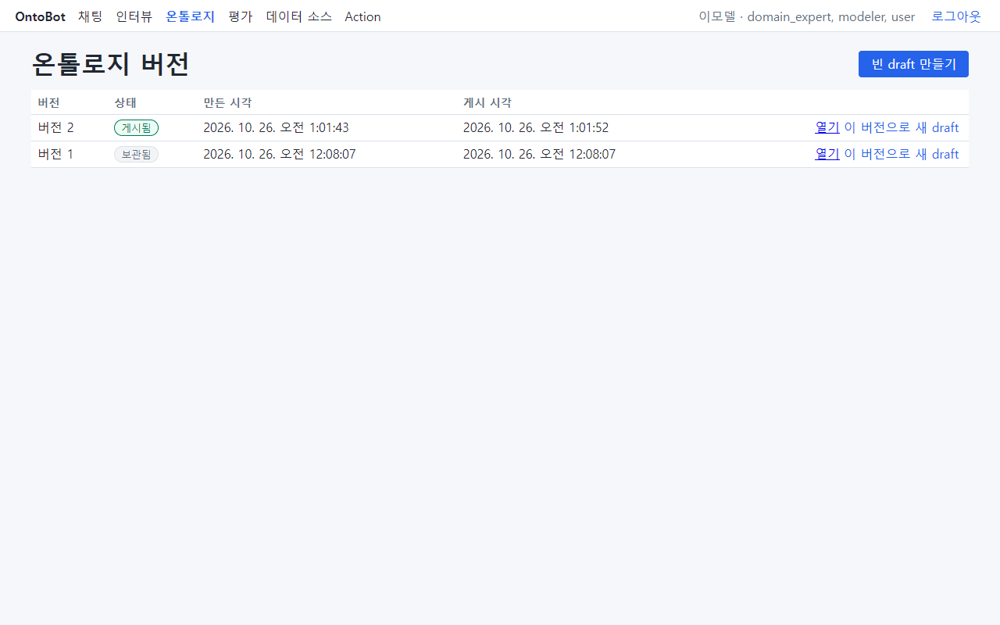

## 15.3 설정 전 — 막힘

채널을 설정하기 전에 `kim.user` 가 "긴급 정비 통보"를 요청하면:

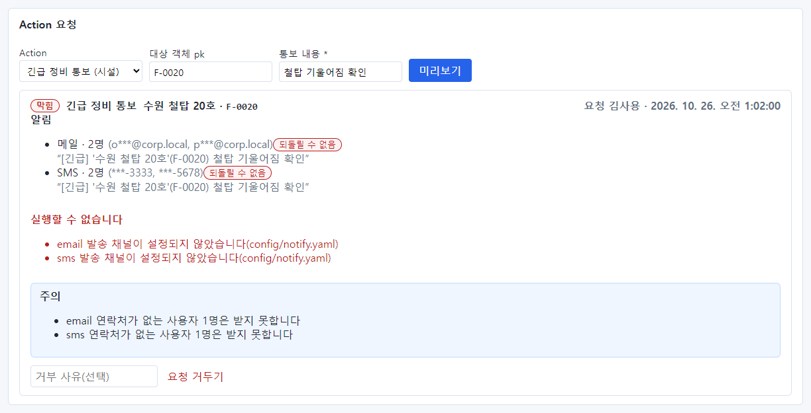

| 부분 | 내용 |
| --- | --- |
| 머리 | **막힘** |
| 알림 | 메일 · 2명(가려진 주소), SMS · 2명 — 받을 사람은 미리 계산됨 |
| **실행할 수 없습니다** | `email 발송 채널이 설정되지 않았습니다(config/notify.yaml)`, `sms 발송 채널이 …` |
| 주의 | `email 연락처가 없는 사용자 1명은 받지 못합니다` — admin 역할 3명 중 연락처가 없는 1명(`admin`) |

막힌 요청은 승인할 수 없습니다. 감사 로그에도 `status:"blocked"` 로 남습니다(9.5).

## 15.4 설정 파일 `notify.yaml`

설정은 `/opt/ontobot/config/notify.yaml` 입니다. 설치 직후에는 채널이 비어 있습니다(`channels: {}`).

```powershell
wsl -d ontobot -u root -- cat /opt/ontobot/config/notify.yaml
```

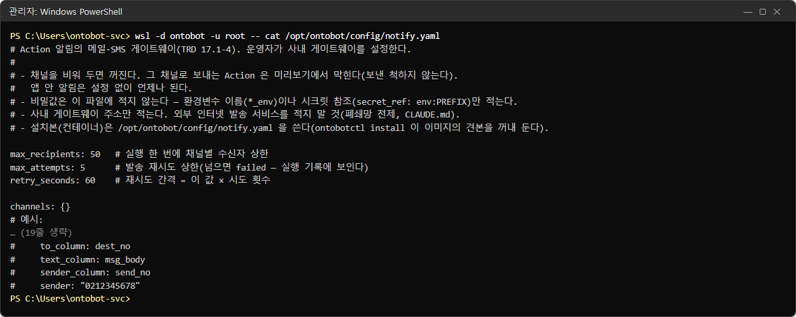

파일 위쪽의 주석에 규칙과 예시가 적혀 있습니다. 고칠 때는 nano 를 씁니다(11.2 의 사용법).

```powershell
wsl -d ontobot -u root -- nano /opt/ontobot/config/notify.yaml
```

### 공통 항목

| 항목 | 기본 | 뜻 |
| --- | --- | --- |
| `max_recipients` | 50 | 실행 한 번에 채널별 받는 사람 상한(넘으면 미리보기에서 막힘) |
| `max_attempts` | 5 | 보내기 실패 때 다시 시도하는 최대 횟수. 넘으면 **실패** |
| `retry_seconds` | 60 | 재시도 간격 = 이 값 × 시도 횟수(60초, 120초, 180초…) |

### 메일(SMTP)

```yaml
channels:
  email:
    adapter: smtp
    host: mail.corp.local
    port: 25
    starttls: false
    sender: ontobot@corp.local
    username_env: ONTOBOT_SMTP_USER       # 인증이 없으면 이 두 줄을 지운다
    password_env: ONTOBOT_SMTP_PASSWORD
```

| 항목 | 뜻 |
| --- | --- |
| `host`, `port` | 메일 서버 주소와 포트 |
| `starttls` | 암호화 연결(STARTTLS)을 쓰면 `true` |
| `sender` | 보내는 주소(From) |
| `username_env` / `password_env` | 인증 계정·비밀번호가 **들어 있는 환경변수 이름**. 값은 `app.env` 에 |
| `timeout_s` | (선택) 연결 제한 시간, 기본 10초 |

### SMS — HTTP 게이트웨이

```yaml
  sms:
    adapter: sms_http
    url: http://sms-gw.corp.local/api/send
    sender: "0212345678"
    token_env: ONTOBOT_SMS_TOKEN           # 있으면 Authorization: Bearer <값>
```

OntoBot 은 `url` 로 `{"to": 받는번호, "text": 문구, "sender": 발신번호}` 를 JSON 으로 POST 합니다. 게이트웨이가
300 미만 응답을 주면 보낸 것으로 봅니다. 게이트웨이의 형식이 다르면 개발팀과 상의하세요.

### SMS — 발송 테이블(UMS 류)

사내 UMS 가 "발송 테이블에 한 줄 넣으면 보내 주는" 방식이면 이것을 씁니다.

```yaml
  sms:
    adapter: sms_table
    secret_ref: env:ONTOBOT_UMS            # ONTOBOT_UMS_HOST·_PORT·_DB·_USER·_PASSWORD (app.env)
    table: ums.sms_queue
    to_column: dest_no
    text_column: msg_body
    sender_column: send_no
    sender: "0212345678"
```

| 항목 | 뜻 |
| --- | --- |
| `secret_ref` | 발송 테이블이 있는 DB 의 접속 정보(11장과 같은 방식) |
| `table` | 표 이름(`스키마.표`) |
| `to_column` / `text_column` / `sender_column` | 받는 번호·문구·발신 번호를 넣을 열 |

UMS 담당자에게 OntoBot 계정에 그 표의 **INSERT 권한만** 달라고 요청합니다.

### 이 책의 설정

시험 서버에는 다음과 같이 넣었습니다.

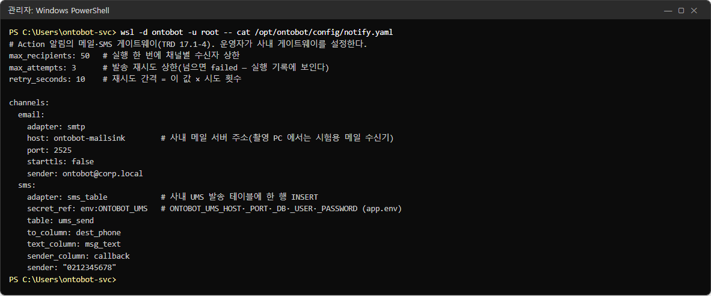

메일 서버 주소가 `ontobot-mailsink`(시험용 수신기), 포트 2525, 재시도는 촬영 시간을 줄이려고 3회·10초로 줄였습니다.
운영에서는 기본값(5회·60초)을 권합니다.

## 15.5 비밀값은 `app.env` 에

메일 비밀번호, SMS 토큰, 발송 테이블 DB 비밀번호는 `notify.yaml` 에 쓰지 않고 `app.env` 에 넣은 뒤, `notify.yaml`
에서는 **이름만** 가리킵니다. 이 책의 발송 테이블 접속 정보는 다음과 같습니다.

```powershell
wsl -d ontobot -u root -- grep -n UMS /opt/ontobot/app.env
```

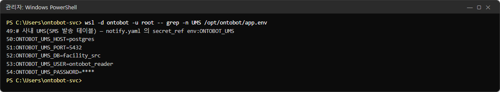

메일 인증이 있으면 같은 방식으로 `ONTOBOT_SMTP_USER=…`, `ONTOBOT_SMTP_PASSWORD=…` 를 넣습니다.

## 15.6 반영하기

`notify.yaml` 은 프로그램이 켜질 때 읽고, `app.env` 는 컨테이너를 만들 때 읽습니다. 둘 다 바꿨으면 둘 다 반영합니다.

```powershell
wsl -d ontobot -u root -- bash -c "cd /opt/ontobot && docker compose up -d && docker compose restart api worker"
```

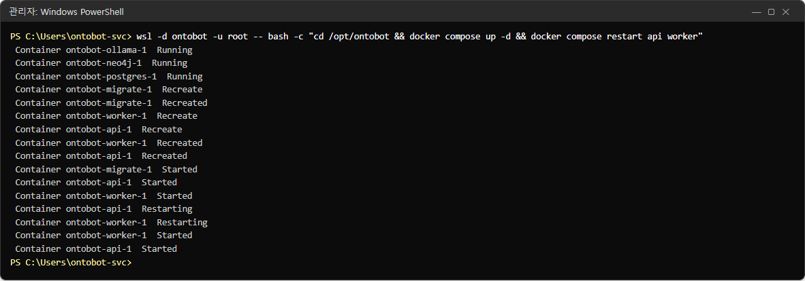

| 바꾼 것 | 반영 명령 |
| --- | --- |
| `app.env` 만 | `docker compose up -d` |
| `notify.yaml` 만 | `docker compose restart api worker` |
| 둘 다 | 위의 둘을 차례로(사진) |

## 15.7 보내기 — 실제 발송

설정 뒤 같은 요청을 다시 미리보기하면 막힘이 풀리고 **승인 대기**가 됩니다.

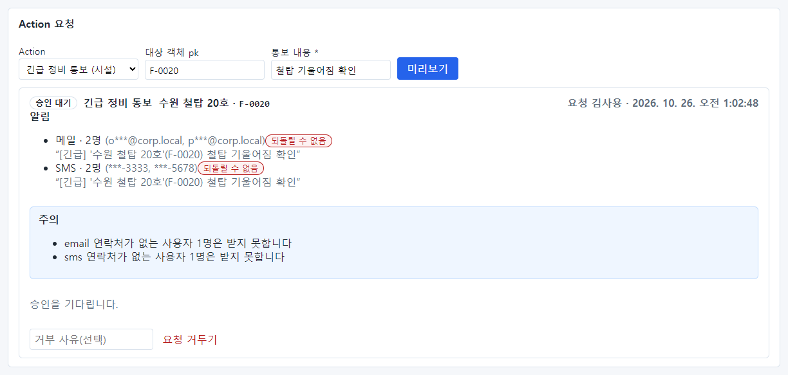

메일·SMS 줄 옆의 **되돌릴 수 없음** 표지는 "보낸 메일·문자는 회수할 수 없다"는 경고입니다.

승인자가 펼쳐 봅니다.

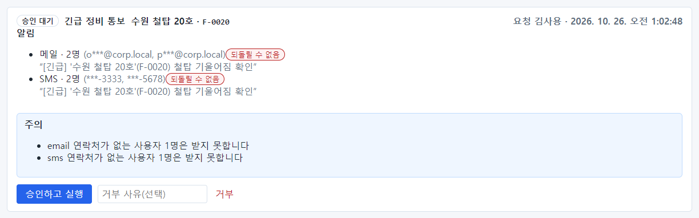

**승인하고 실행** 을 누르면 확인 창이 뜹니다: **"실행하면 편집 레이어에 쓰고 알림을 보냅니다. 메일·SMS 는 되돌릴 수
없습니다. 실행할까요?"** → **확인**.

실행이 끝나면 기록 아래에 **발송** 목록이 생깁니다. 발송은 실행이 커밋된 **뒤에** 워커가 합니다. 이 책에서는 몇 초
만에 모두 **보냄** 이 되었습니다.

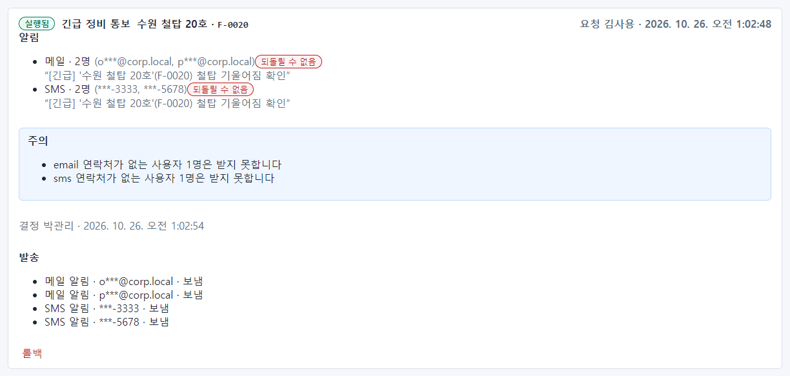

| 발송 줄 | 뜻 |
| --- | --- |
| `메일 알림 · o***@corp.local · 보냄` | 메일 한 통을 메일 서버에 넘김 |
| `SMS 알림 · ***-3333 · 보냄` | 발송 테이블에 한 줄 넣음 |

### 메일 서버에서 확인

메일 서버 쪽에서 실제로 받은 내용입니다(시험용 수신기의 기록).

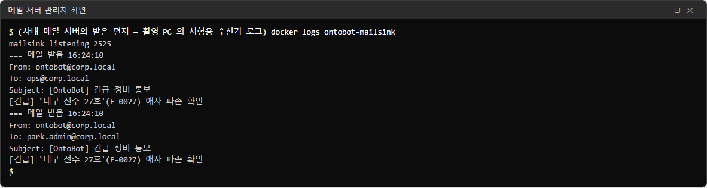

| 항목 | 값 |
| --- | --- |
| From | `ontobot@corp.local`(notify.yaml 의 sender) |
| To | 받는 사람의 원래 주소(화면에는 가려져 보였던 값) |
| Subject | `[OntoBot] 긴급 정비 통보`(Action 표시 이름) |
| 본문 | Action 정의의 문구에 값을 넣은 것 |

> **알아 두기** 사진의 시각(16:24)은 수신기가 세계 표준시로 찍은 것이고, 화면의 시각은 한국 시각(오전 1:24)입니다.

### 발송 테이블에서 확인

UMS 발송 테이블에 들어간 줄입니다.

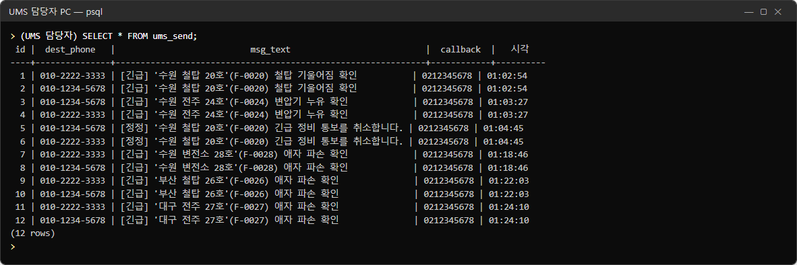

받는 번호(원래 값), 문구, 발신 번호(`0212345678`)가 들어갔습니다. 이 줄을 UMS 가 가져가 문자로 보냅니다.

같은 Action 을 한 번 더 실행했을 때의 발송 목록입니다.

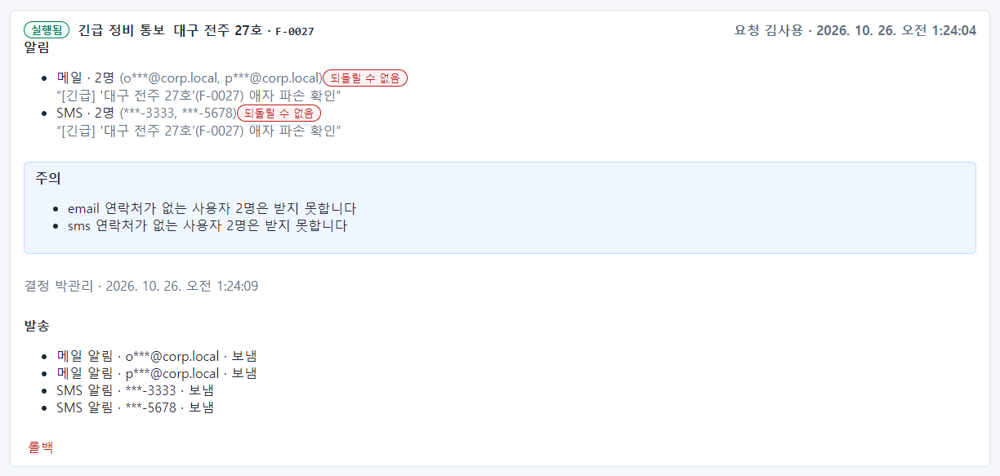

## 15.8 메일 서버가 멈추면 — 재시도와 실패

메일 서버(시험용 수신기)를 멈춘 채 새 요청을 승인·실행했습니다.

몇 초 뒤의 기록:

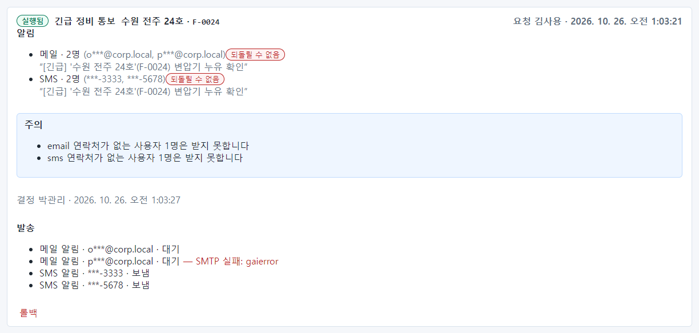

- 메일 두 통이 **대기** 이고, 하나에 `— SMTP 실패: gaierror` 가 붙었습니다. 한 번 실패해서 다시 시도를 기다리는 중입니다.
- SMS 두 통은 발송 테이블이 정상이라 **보냄**.

`max_attempts`(이 책은 3회)를 모두 실패하면:

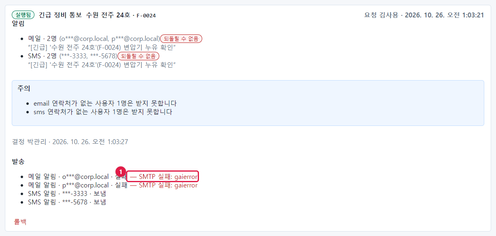

메일 두 통이 **실패 — SMTP 실패: gaierror**(①)가 됩니다.

| 오류 문구 | 뜻 | 할 일 |
| --- | --- | --- |
| `SMTP 실패: gaierror` | 메일 서버 이름을 찾지 못함(DNS) | `host` 확인, DNS |
| `SMTP 실패: ConnectionRefusedError` | 메일 서버가 받지 않음(포트·서비스 중지) | 포트, 메일 서버 상태 |
| `SMTP 실패: TimeoutError` | 연결 시간 초과(방화벽) | 네트워크 담당자 |
| `SMTP 실패: SMTPAuthenticationError` | 인증 실패 | `app.env` 의 계정·비밀번호 |
| `SMS 게이트웨이 연결 실패: …` | HTTP 게이트웨이에 닿지 못함 | `url`, 방화벽 |
| `SMS 게이트웨이 응답 4xx/5xx` | 게이트웨이가 거절 | 토큰, 요청 형식(SMS 담당자) |
| `SMS 발송 테이블 실패: …` | 발송 테이블 INSERT 실패 | 접속 정보, INSERT 권한, 열 이름 |

> **알아 두기** 발송이 실패해도 **Action 실행은 성공으로 남습니다.** 데이터는 바뀌었고 알림만 못 간 것입니다.
> 실패한 발송은 자동으로 다시 보내지 않습니다. 원인을 고친 뒤, 꼭 알려야 하는 내용이면 담당자가 직접 연락하세요.

> **알아 두기** 지금 판의 워커는 발송 성공·실패를 로그에 따로 남기지 않습니다. 발송 결과는 **Action 화면의 전체
> 기록 → 발송 목록**에서 확인합니다. 매일 점검(25장)에 넣어 두세요.

## 15.9 롤백과 정정 문구

메일·SMS 를 이미 보낸 Action(F-0020)을 롤백했습니다.

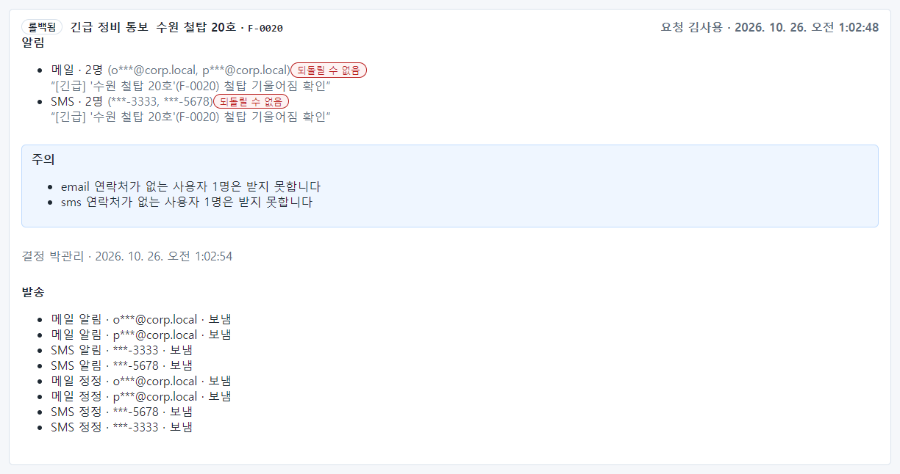

발송 목록에 **메일 정정**·**SMS 정정** 네 줄이 더 생기고 모두 **보냄** 입니다. 메일 서버에는 정정 메일이 도착합니다.

```
Subject: [OntoBot 정정] 긴급 정비 통보
[정정] '수원 철탑 20호'(F-0020) 긴급 정비 통보를 취소합니다.
```

| 롤백 때 발송 상태 | 처리 |
| --- | --- |
| 아직 **대기** | 취소(보내지 않음) |
| 이미 **보냄** | 같은 사람에게 정정 문구를 보냄 |
| **실패** | 받지 않았으므로 정정도 보내지 않음 |

## 15.10 운영 요령

| 요령 | 이유 |
| --- | --- |
| 처음 설정하면 시험용 Action 으로 운영자 자신에게 보내 본다 | 주소·포트·인증을 한 번에 확인 |
| 메일 서버 점검 일정을 메일 담당자에게 받아 둔다 | 점검 중 실행된 Action 의 발송이 실패함 |
| 받는 사람의 연락처를 최신으로 | 연락처 없는 사람은 받지 못함(미리보기의 "주의") |
| `max_attempts`·`retry_seconds` 는 기본값 권장 | 짧은 장애는 재시도로 넘김 |
| 외부(인터넷) 발송 서비스 주소를 적지 않는다 | 폐쇄망 원칙, 보안 |

## 15.11 해 보기

> **해 보기**
>
> 1. 운영자 계정의 알림 연락처에 자신의 사내 메일 주소를 넣으세요(7.8).
> 2. 메일 채널만 설정하고 반영한 뒤, 메일로 알리는 Action 을 시험 대상에 요청·승인하세요.
> 3. 메일함에서 받은 메일의 제목과 본문을 확인하고, Action 기록의 발송 목록이 **보냄** 인지 확인하세요.
