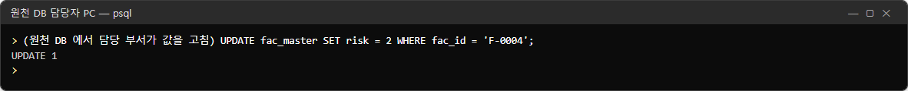
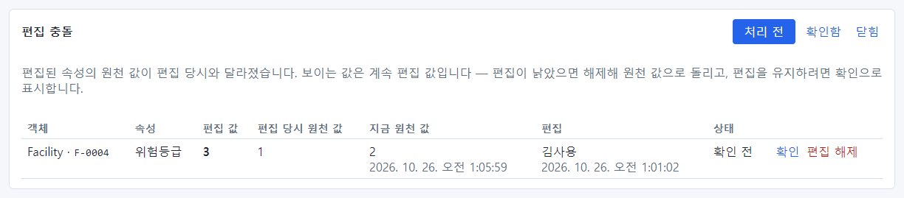
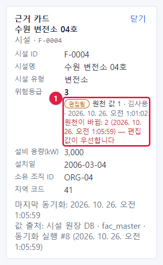
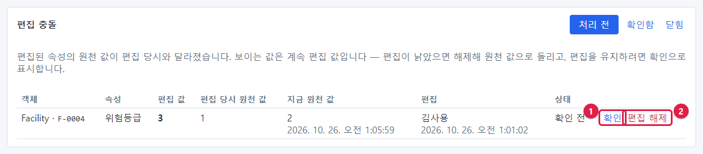
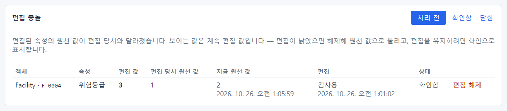
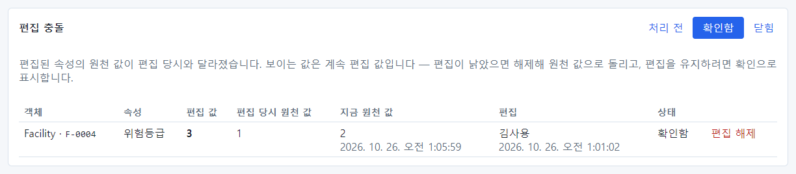
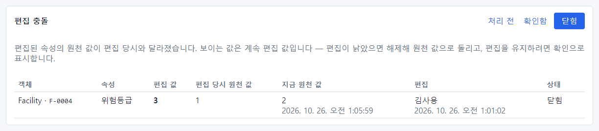
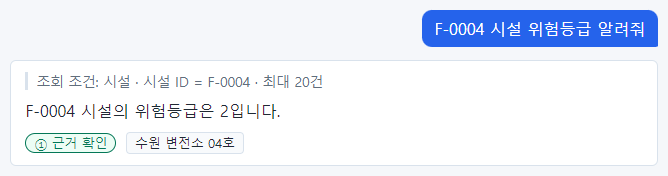

# 16장 편집 충돌

Action 으로 바꾼 값은 편집 레이어에 따로 보관되고, 화면에는 편집 값이 보입니다(14장). 그런데 그 뒤에 **원천 DB 의
값도 바뀌면** 어느 쪽이 맞는지 사람이 정해야 합니다. 이것이 **편집 충돌**입니다.

| 상황 | 예 |
| --- | --- |
| 편집 | 현장 점검 결과로 F-0004 의 위험등급을 Action 으로 1 → 3 |
| 그 뒤 원천 변경 | 담당 부서가 원천 DB 에서 F-0004 의 위험등급을 1 → 2 로 고침 |
| 충돌 | 편집 당시 원천 값(1)과 지금 원천 값(2)이 다름 |

충돌이 생겨도 화면에는 **계속 편집 값(3)** 이 보입니다. 동기화는 편집을 지우지 않고 충돌만 기록합니다. 처리는
모델러나 관리자가 데이터 소스 화면의 **편집 충돌** 칸에서 합니다.

## 16.1 충돌 만들어 보기

14장에서 F-0004 의 위험등급을 Action 으로 3 으로 바꿔 둔 상태입니다. 원천 DB 담당자가 원천 값을 2 로 고쳤습니다.

데이터 소스 화면에서 시설 매핑을 **지금 동기화** 하면 편집 충돌 칸에 한 줄이 생깁니다.

| 칸 | 값 | 뜻 |
| --- | --- | --- |
| 객체 | `Facility · F-0004` | 어떤 객체 |
| 속성 | 위험등급 | 어떤 속성 |
| 편집 값 | **3** | 지금 화면에 보이는 값(Action 으로 바꾼 값) |
| 편집 당시 원천 값 | 1 | Action 을 실행할 때의 원천 값 |
| 지금 원천 값 | 2 (시각) | 방금 동기화로 들어온 원천 값 |
| 편집 | 김사용 (시각) | 누가 요청한 편집인지 |
| 상태 | 확인 전 | — |

오른쪽 위의 **처리 전 · 확인함 · 닫힘** 은 목록을 거르는 단추입니다.

## 16.2 사용자에게는 어떻게 보이나

사용자가 물으면 편집 값(3)으로 답합니다.

근거 카드를 열면 충돌 사실이 보입니다.

①: **편집됨** 표지, 원천 값 1 · 김사용 · 시각, 그리고 빨간 글씨 **원천이 바뀜: 2 (시각) — 편집 값이 우선합니다.**
사용자도 값이 다툼 중이라는 것을 알 수 있습니다.

## 16.3 처리하기 — 두 가지 선택

| 번호 | 단추 | 뜻 | 화면에 보이는 값 | 언제 |
| --- | --- | --- | --- | --- |
| ① | **확인** | "편집이 맞다, 계속 쓴다"고 표시 | 편집 값(3) 그대로 | 현장 점검이 더 최신이고 원천이 아직 반영 못 함 |
| ② | **편집 해제** | 편집을 버리고 원천 값으로 | 원천 값(2) | 원천이 더 정확함, 편집이 낡음 |

### 확인

**확인** 을 누르면 상태가 **확인함** 으로 바뀌고, 처리 전 목록에서도 그 줄이 남아 상태만 바뀝니다.

**확인함** 단추로 거르면 확인한 충돌만 볼 수 있습니다.

확인한 뒤에도 **편집 해제** 단추는 남아 있습니다. 나중에 마음을 바꿀 수 있습니다.

### 편집 해제

**편집 해제** 를 누르면 확인 창이 뜹니다: **"편집을 해제하면 원천 값으로 돌아갑니다. 진행할까요?"** → **확인**.
상태가 **닫힘** 이 되고, **닫힘** 목록에서 볼 수 있습니다.

사용자가 다시 물으면 원천 값(2)으로 답합니다.

## 16.4 운영 요령

| 요령 | 설명 |
| --- | --- |
| 처리 전 충돌을 쌓아 두지 않는다 | 매일 점검(25장)에서 "충돌이 없습니다"를 확인 |
| 판단은 업무 담당자와 | 어느 값이 맞는지는 운영자가 아니라 업무 담당자(요청자, 원천 담당 부서)가 압니다 |
| 같은 속성의 충돌이 잦으면 | 그 속성을 원천에서 고치는 절차와 Action 으로 고치는 절차가 겹친다는 뜻 — 업무 절차를 정리하도록 알림 |
| 기록 | 확인·해제는 감사 로그(`objects.conflict_acknowledged`, `objects.edit_cleared`)에 남음 |

> **알아 두기** 편집 해제는 Action 롤백(14.6)과 다릅니다. 롤백은 Action 전체를 되돌리고 정정 문구를 보내지만,
> 편집 해제는 그 속성의 편집 값만 지우고 알림을 보내지 않습니다.

## 16.5 해 보기

> **해 보기**
>
> 1. Action 으로 시설 하나의 위험등급을 바꾸세요(14장).
> 2. 원천 DB 담당자에게 같은 시설의 위험등급을 다른 값으로 바꿔 달라고 요청하고, 동기화하세요.
> 3. 편집 충돌 칸에 줄이 생기는지, 근거 카드에 "원천이 바뀜"이 보이는지 확인하세요.
> 4. 업무 담당자와 상의해 확인 또는 편집 해제로 처리하세요.
