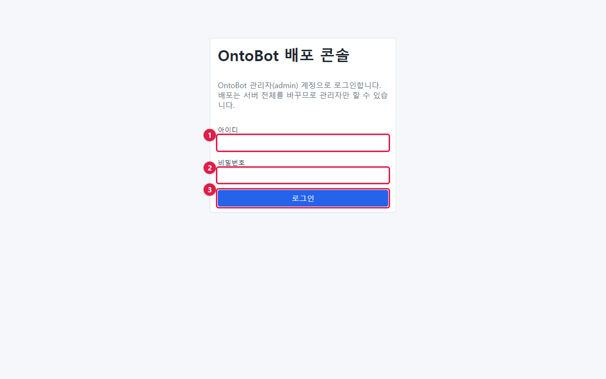
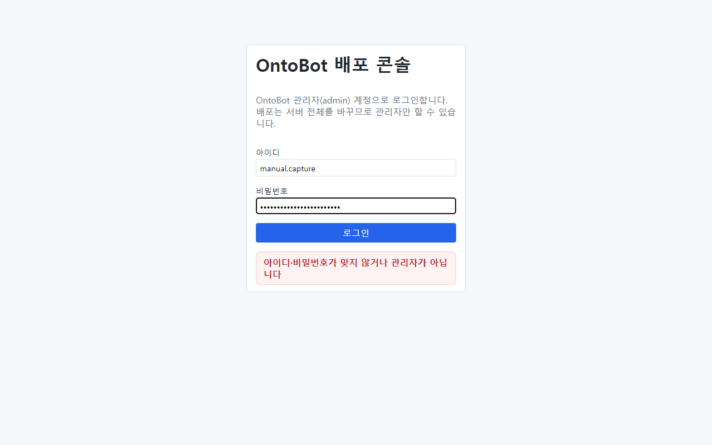
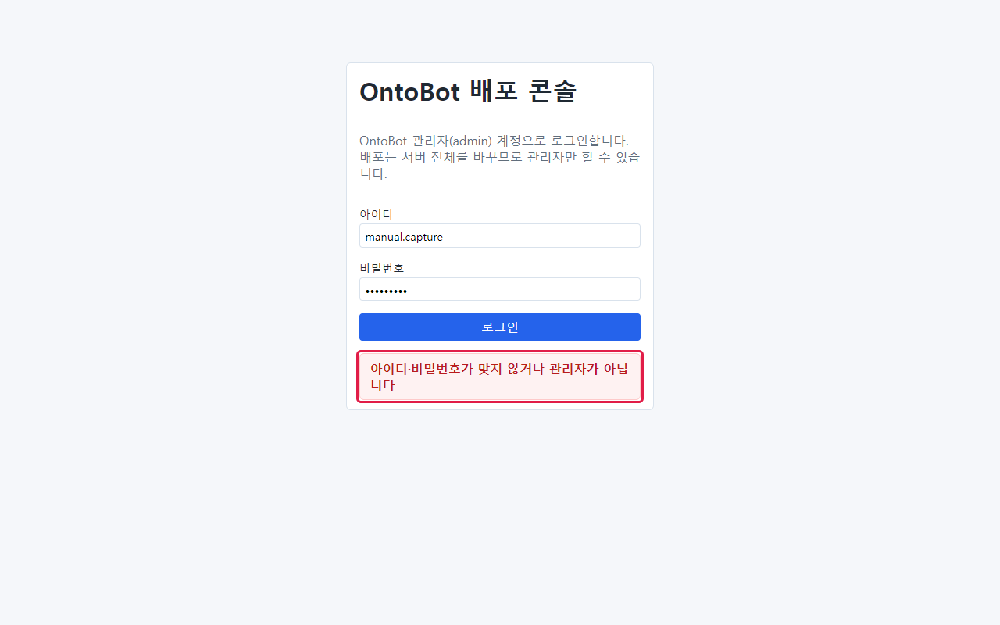
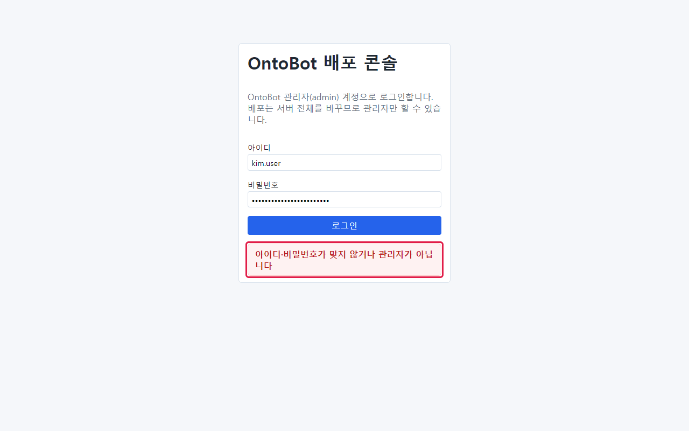
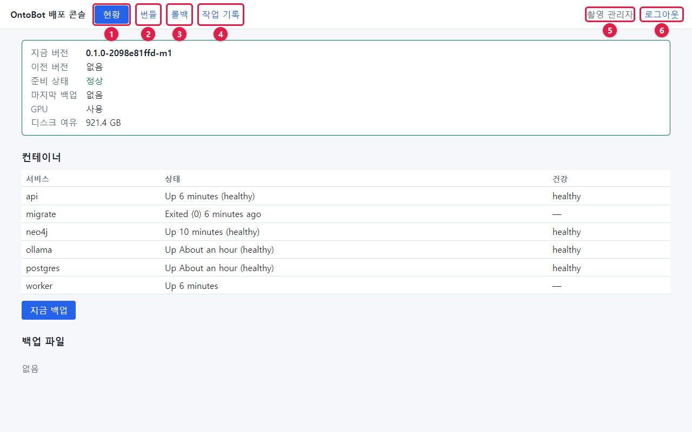
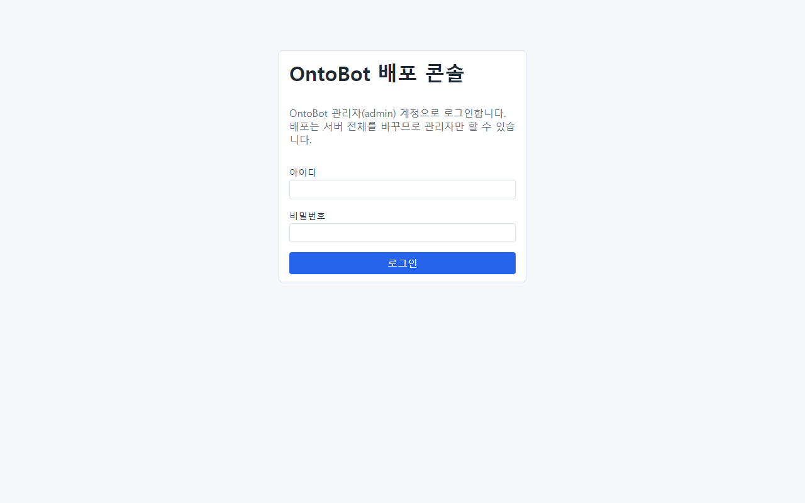

# 17장 배포 콘솔 들어가기

**배포 콘솔**은 업그레이드·롤백·백업을 하는 관리자 전용 화면입니다. 주소는 `http://<서버>:8100` 입니다. 이 장부터
24장까지 배포 콘솔의 화면을 하나씩 다룹니다.

배포 콘솔의 특징:

| 특징 | 이유 |
| --- | --- |
| OntoBot 과 **따로** 돈다(별도 컨테이너) | 업그레이드가 잘못돼 OntoBot 이 멈춰도 콘솔로 되돌릴 수 있게 |
| OntoBot **관리자(admin)** 계정으로만 로그인 | 서버 전체를 바꾸는 강한 권한이므로 |
| 절차를 직접 하지 않고 `ontobotctl` 을 부른다 | 화면과 명령이 같은 절차를 쓰게(콘솔이 안 되면 명령으로 똑같이 — 29장) |
| 관리자 PC 대역에서만 접속 | 방화벽과 `ONTOBOT_DEPLOYER_ALLOW_CIDRS`(4.5) |

## 17.1 들어가는 두 가지 길

### 주소를 직접 입력

관리자 PC 의 브라우저 주소창에 `http://<서버 이름>:8100` 을 입력합니다.

### OntoBot 관리 화면에서

OntoBot 웹 화면 **관리** → 위쪽의 **배포 콘솔 열기(업그레이드·롤백·백업)** 를 누르면 새 탭으로 열립니다.

배포 콘솔은 OntoBot 웹 화면과 로그인을 **따로** 합니다. 웹 화면에 로그인해 있어도 배포 콘솔에서는 다시 로그인합니다.

> **알아 두기** 이 링크의 주소는 `app.env` 의 `ONTOBOT_DEPLOYER_URL` 입니다. 기본값(`http://localhost:8100`)이면
> 서버 밖 PC 에서는 열리지 않습니다. 실제 주소로 바꿔 두세요(30장).

## 17.2 로그인

화면 위 안내: "OntoBot 관리자(admin) 계정으로 로그인합니다. 배포는 서버 전체를 바꾸므로 관리자만 할 수 있습니다."

| 번호 | 칸 | 입력 |
| --- | --- | --- |
| ① | 아이디 | OntoBot 관리자 아이디 |
| ② | 비밀번호 | 그 비밀번호 |
| ③ | **로그인** | 누름 |

### 로그인이 거절될 때

비밀번호가 틀렸을 때:

관리자가 아닌 계정(예: `kim.user`)으로 로그인할 때:

두 경우 모두 같은 문구 **아이디·비밀번호가 맞지 않거나 관리자가 아닙니다** 가 나옵니다(어느 쪽인지 알려 주지 않음).
정지된 계정도 같습니다.

같은 아이디로(또는 같은 PC 에서) 다섯 번 연속 실패하면 잠깁니다. 이 책에서 일부러 여섯 번 틀린 비밀번호를 넣어 보았습니다.

**로그인 실패가 이어져 잠시 막았습니다. 5분 뒤 다시 시도하세요** — 이때는 맞는 비밀번호도, 같은 PC 의 다른 관리자
계정도 5분 동안 막힙니다(이 책에서 다른 계정으로 바로 들어가려다 막혀 5분을 기다렸습니다).

| 문구 | 원인 | 할 일 |
| --- | --- | --- |
| `아이디·비밀번호가 맞지 않거나 관리자가 아닙니다` | 비밀번호 틀림, admin 역할 없음, 정지 | 관리 화면에서 계정·역할 확인 |
| `로그인 실패가 이어져 잠시 막았습니다. 5분 뒤 다시 시도하세요` | 같은 아이디나 같은 PC 에서 **5번** 연속 실패 | 5분 기다림 |
| `앱 DB 에 닿지 못해 로그인할 수 없습니다` | PostgreSQL 이 멈춤(계정을 확인할 수 없음) | 27장 — 이 경우 명령(29장)으로 |
| `허용되지 않은 주소입니다` | 관리자 대역 밖의 PC | 허용된 PC 에서 접속, 또는 `ONTOBOT_DEPLOYER_ALLOW_CIDRS` |
| 연결할 수 없음 | 배포 콘솔이 멈춤, 방화벽 | 27장 |

> **알아 두기** 배포 콘솔은 OntoBot 의 계정 정보를 데이터베이스에서 직접 읽어 확인합니다. 그래서 PostgreSQL 이 멈추면
> 배포 콘솔에도 **새로 로그인할 수 없습니다**(27장에서 실제 화면을 봅니다). 이미 로그인해 있었다면 계속 쓸 수 있습니다.
> 데이터베이스까지 멈춘 비상시에는 명령(`ontobotctl`)으로 합니다.

> **주의** SSO(통합 로그인)만 쓰도록 바꾸더라도, 배포 콘솔은 **로컬 관리자 계정(비밀번호)** 으로만 들어갈 수
> 있습니다. 배포 담당 관리자 계정 하나는 비밀번호를 남겨 두세요(7.10).

## 17.3 화면의 생김새

로그인하면 **현황** 탭이 열립니다.

| 번호 | 부분 | 하는 일 | 이 책 |
| --- | --- | --- | --- |
| ① | **현황** | 버전·준비 상태·컨테이너·백업 | 18장 |
| ② | **번들** | 새 버전 꾸러미 올리기·가져오기·사전 점검·업그레이드 | 20~21장 |
| ③ | **롤백** | 업그레이드 되돌리기 | 22장 |
| ④ | **작업 기록** | 콘솔이 한 일의 기록과 출력 | 24장 |
| ⑤ | 이름 | 로그인한 관리자의 표시 이름 | — |
| ⑥ | **로그아웃** | — | — |

작업(백업·업그레이드 등)이 진행 중이면 탭 옆에 **작업 진행 중** 표지가 붙습니다. 그동안에는 다른 작업 단추가 눌리지
않습니다. 배포 작업은 한 번에 하나만 합니다.

## 17.4 로그인 유지와 로그아웃

| 항목 | 값 |
| --- | --- |
| 로그인 유지 | 마지막 사용 뒤 **60분**(지금 판의 설치본에서는 바꿀 수 없습니다) |
| 배포 콘솔을 다시 시작하면 | 모든 로그인이 끊김(다시 로그인) — 배포 콘솔 갱신(23장) 때도 |
| 로그아웃 | 오른쪽 위 **로그아웃** |

> **주의** 배포 콘솔에 로그인한 채로 자리를 비우지 마세요. 업그레이드·롤백은 사용자 전체에 영향을 줍니다.

## 17.5 배포 콘솔에서 할 수 없는 것

배포 콘솔은 **설치된 OntoBot 을 바꾸는 일**만 합니다. 다음은 다른 곳에서 합니다.

| 하고 싶은 일 | 어디서 |
| --- | --- |
| 계정·권한 | OntoBot 웹 화면 → 관리(7~8장) |
| 설정 파일(`app.env`·`notify.yaml`) 고치기 | PowerShell(30장) |
| 컨테이너 하나만 다시 시작 | PowerShell(29장) |
| 최초 설치 | `install-host.ps1`(5장) |
| 백업에서 임의 시점으로 되살리기 | 개발팀과 함께(19.7) |

## 17.6 해 보기

> **해 보기**
>
> 1. 관리자 PC 에서 배포 콘솔에 로그인해 오른쪽 위 이름을 확인하세요.
> 2. 일반 사용자 계정으로 로그인을 시도해 어떤 문구가 나오는지 보세요.
> 3. OntoBot 관리 화면의 **배포 콘솔 열기** 링크가 실제 서버 주소로 열리는지 확인하세요.
