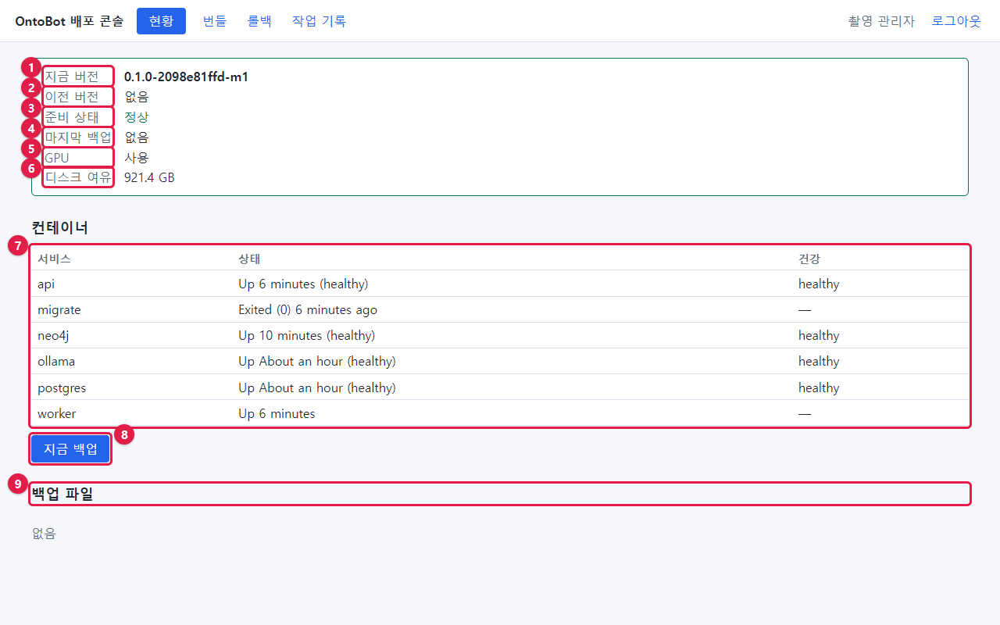
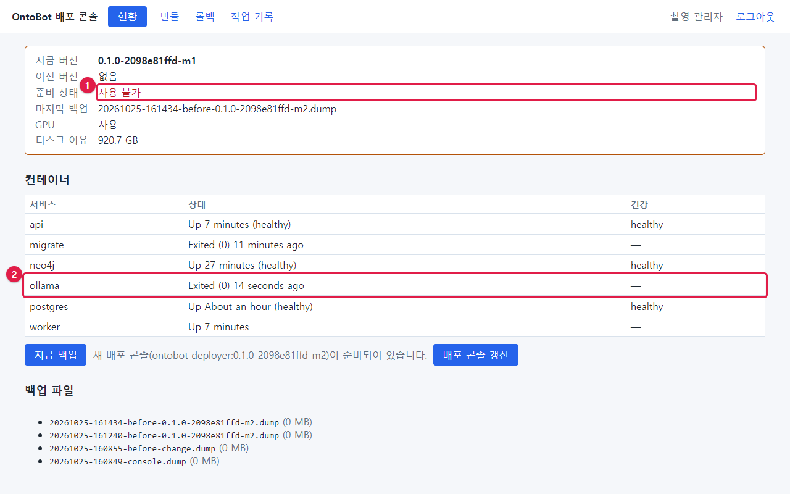
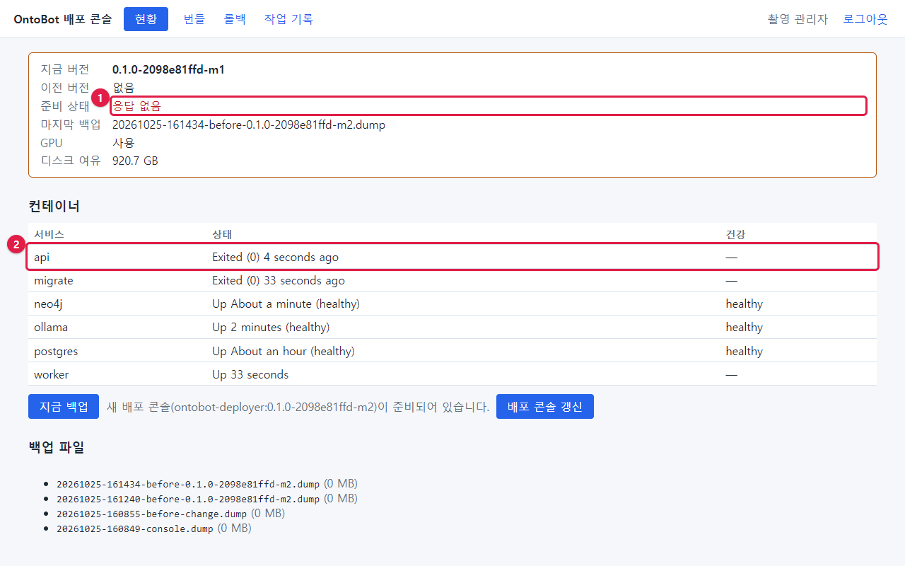
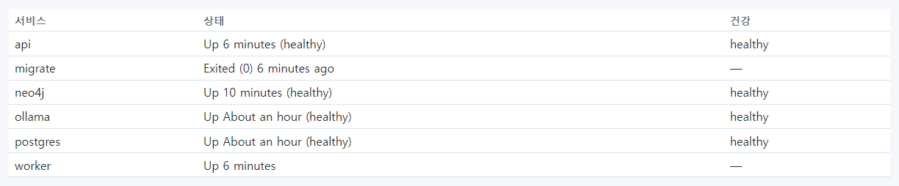
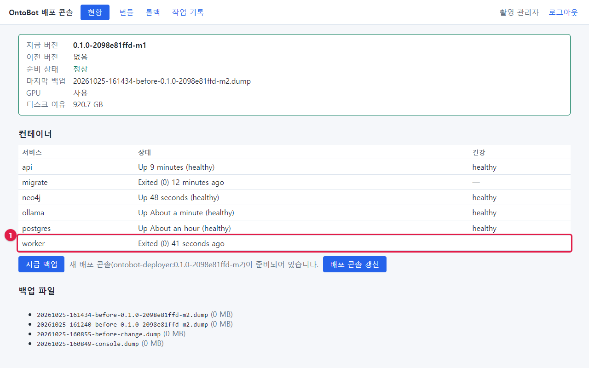
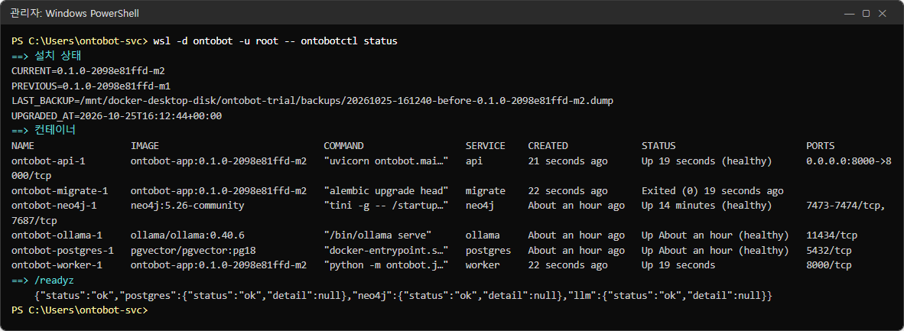

# 18장 현황 화면 읽기

배포 콘솔의 **현황** 탭은 운영자가 가장 자주 보는 화면입니다. 매일 아침 이 화면 하나로 "OntoBot 이 정상인가"를
판단합니다. 화면은 10초마다 저절로 새로 읽습니다.

## 18.1 화면의 부분



| 번호 | 칸 | 뜻 | 정상 |
| --- | --- | --- | --- |
| ① | 지금 버전 | 지금 설치된 버전 | 배포 계획과 같은 버전 |
| ② | 이전 버전 | 업그레이드 직후에만 보이는 바로 전 버전(롤백 대상) | 설치 직후·롤백 뒤에는 "없음" |
| ③ | 준비 상태 | `/readyz` 결과를 우리말로 | **정상**(초록) |
| ④ | 마지막 백업 | 업그레이드 직전 백업 파일 이름 | 업그레이드 뒤에는 그 백업 이름 |
| ⑤ | GPU | AI 모델이 GPU 를 쓰는지 | **사용** |
| ⑥ | 디스크 여유 | 설치 폴더가 있는 디스크의 남은 크기 | 수십 GB 이상 |
| ⑦ | 컨테이너 표 | 서비스마다 상태·건강 | 18.3 |
| ⑧ | **지금 백업** | 데이터베이스를 바로 백업 | 19장 |
| ⑨ | 백업 파일 | `backups/` 폴더의 백업 목록 | 19장 |

준비 상태가 정상이면 위쪽 칸의 테두리가 초록, 아니면 주황입니다.

> **알아 두기** ④ **마지막 백업** 은 "가장 최근 백업"이 아니라 **업그레이드 직전 백업**(롤백 때 쓰는 백업)입니다.
> 매일 자동 백업이나 **지금 백업** 으로 만든 백업은 ⑨ 목록에서 확인합니다.

## 18.2 준비 상태

| 표시 | 뜻 | 사용자 영향 | 할 일 |
| --- | --- | --- | --- |
| **정상** | 데이터베이스·관계 저장소·AI 모델 모두 닿음 | 없음 | — |
| **일부 저하(관계 질문만 실패)** | Neo4j 만 안 됨 | 관계를 따라가는 질문만 실패 | 13.3 |
| **사용 불가** | 데이터베이스나 AI 모델이 안 됨 | 질문 대부분 실패 | 27장 |
| **응답 없음** | api 컨테이너에 닿지 못함 | 접속 불가 | 27장 |

27장에서 일부러 장애를 일으켜 찍은 화면을 미리 보면 다음과 같습니다.





## 18.3 컨테이너 표



| 칸 | 뜻 |
| --- | --- |
| 서비스 | api·migrate·neo4j·ollama·postgres·worker |
| 상태 | `Up 6 minutes (healthy)` 처럼 Docker 가 알려 주는 상태 |
| 건강 | 건강 확인 결과(`healthy`). 건강 확인이 없는 것(migrate·worker)은 `—` |

정상인 모습:

| 서비스 | 정상 상태 |
| --- | --- |
| api | `Up … (healthy)` |
| migrate | `Exited (0) …` — 할 일을 마치고 끝난 것. **정상** |
| neo4j | `Up … (healthy)` |
| ollama | `Up … (healthy)` |
| postgres | `Up … (healthy)` |
| worker | `Up …` |

> **주의 — worker 를 꼭 따로 보세요.** 지금 판의 현황 화면은 상태가 `Exited (0)` 인 줄을 빨간색으로 칠하지 않습니다
> (migrate 의 정상 종료와 구별하지 않습니다). 그리고 worker 가 멈춰도 **준비 상태는 "정상"** 으로 나옵니다(준비 확인은
> 데이터베이스·관계 저장소·AI 모델만 봅니다). 그래서 worker 가 멈춘 것은 이 표의 글자를 읽어야만 알 수 있습니다.
>
> 
>
> worker 가 멈추면 동기화·그래프 반영·알림 발송이 쌓이기만 합니다. 매일 점검에서 **worker 가 `Up` 인지** 반드시
> 확인하세요. api·postgres 등 다른 서비스도 `Exited (0)` 이면 멈춘 것입니다(migrate 만 예외).

## 18.4 GPU 와 디스크

| 칸 | 값 | 뜻 | 할 일 |
| --- | --- | --- | --- |
| GPU | **사용** | Docker 에 NVIDIA 런타임이 있음 | — |
| GPU | **없음(CPU — 느림)** | GPU 를 쓰지 못함 | 드라이버·WSL GPU 지원 확인, 개발팀 |
| 디스크 여유 | `920.7 GB` | 설치 폴더 디스크의 남은 크기 | 2.6 의 기준 |

GPU 가 실제로 일하는지는 명령으로 확인할 수 있습니다(29장).

## 18.5 같은 내용을 명령으로

배포 콘솔이 화면에 보여 주는 내용은 `ontobotctl status --json` 의 결과입니다. 콘솔이 안 될 때는 명령으로 봅니다
(2.3 의 `ontobotctl status` 가 사람이 읽기 좋은 형태).

```powershell
wsl -d ontobot -u root -- ontobotctl status
```



## 18.6 현황 화면 매일 점검 순서

1. **준비 상태** 가 **정상** 인가?
2. 컨테이너 표에서 **worker 가 `Up`** 인가? 다른 서비스도 `Up`(migrate 만 `Exited (0)`)인가?
3. **GPU** 가 **사용** 인가?
4. **디스크 여유** 가 충분한가?
5. **백업 파일** 목록 맨 위가 오늘 새벽 날짜인가?(19장)
6. **새 배포 콘솔이 준비되어 있습니다** 안내가 있으면 23장.

하나라도 아니면 27~28장으로 갑니다. 이 순서는 25장의 일일 점검표에도 있습니다.

## 18.7 해 보기

> **해 보기**
>
> 1. 현황 화면을 열고 18.6 의 여섯 가지를 확인해 적어 보세요.
> 2. 화면을 열어 둔 채 10초 기다리면 컨테이너 표의 "Up … minutes"가 바뀌는지 보세요(저절로 새로 읽는지 확인).
