# 19장 백업

OntoBot 에서 백업하는 것은 **PostgreSQL(모든 기록의 원본)** 하나뿐입니다. Neo4j(관계 복사본)와 AI 모델은 다시
만들 수 있으므로 백업하지 않습니다.

| 백업 | 언제 | 파일 이름 예 | 지우는 규칙 |
| --- | --- | --- | --- |
| 매일 자동 | 매일 02:30(최대 10분 늦게 시작) | `20261026-023512-daily.dump` | 최근 14개만 남김 |
| 업그레이드 직전 자동 | 업그레이드를 시작할 때 | `20261025-161240-before-0.1.0-2098e81ffd-m2.dump` | 롤백에 쓰므로 정리에서 **빼 둠** |
| 화면에서 | 배포 콘솔 **지금 백업** | `20261025-160849-console.dump` | 14개 규칙에 포함 |
| 명령으로 | `ontobotctl backup --label 이름` | `20261025-160855-before-change.dump` | 14개 규칙에 포함 |

백업 파일은 서버의 `/opt/ontobot/backups/` 에 생기고, 설치 때 정한 윈도 폴더(`C:\OntoBot\backups`)에도 복사됩니다.

## 19.1 처음 상태

설치 직후에는 백업 폴더가 비어 있습니다.

```powershell
wsl -d ontobot -u root -- ls -l /opt/ontobot/backups
```

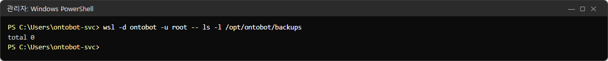

첫 자동 백업은 설치한 다음 날 02:30 입니다. **설치가 끝나면 바로 한 번 백업해 두세요**(19.2).

## 19.2 지금 백업 — 화면에서

배포 콘솔 **현황** 아래의 **지금 백업** 을 누릅니다. 확인 창 없이 바로 시작하고, **작업 기록** 화면으로 바뀝니다.


| 부분 | 내용 |
| --- | --- |
| 머리 | **백업 성공** · 실행 manual.capture · 시작·끝 시각 |
| 단계 | `DB 백업 → backups/20261025-160849-console.dump` |
| 출력 | 콘솔이 실행한 명령(`ontobotctl --json --non-interactive backup --label console`)과 그 결과 |

이 책의 데이터는 작아서 1초 만에 끝났습니다(파일 크기 156K). 데이터가 많으면 몇 분 걸립니다.

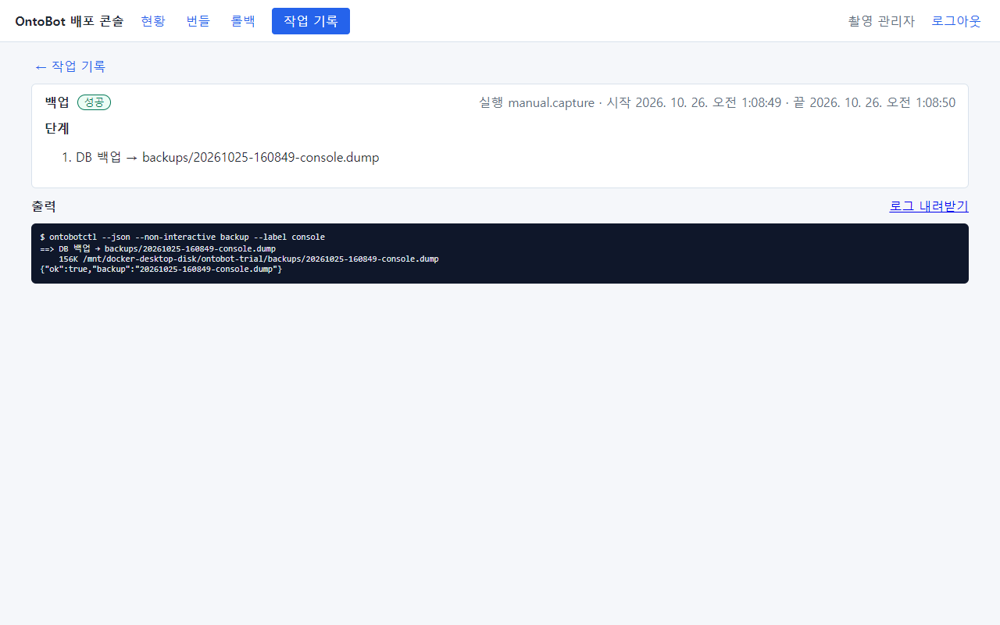

**현황** 으로 돌아가면 백업 파일 목록에 생깁니다.

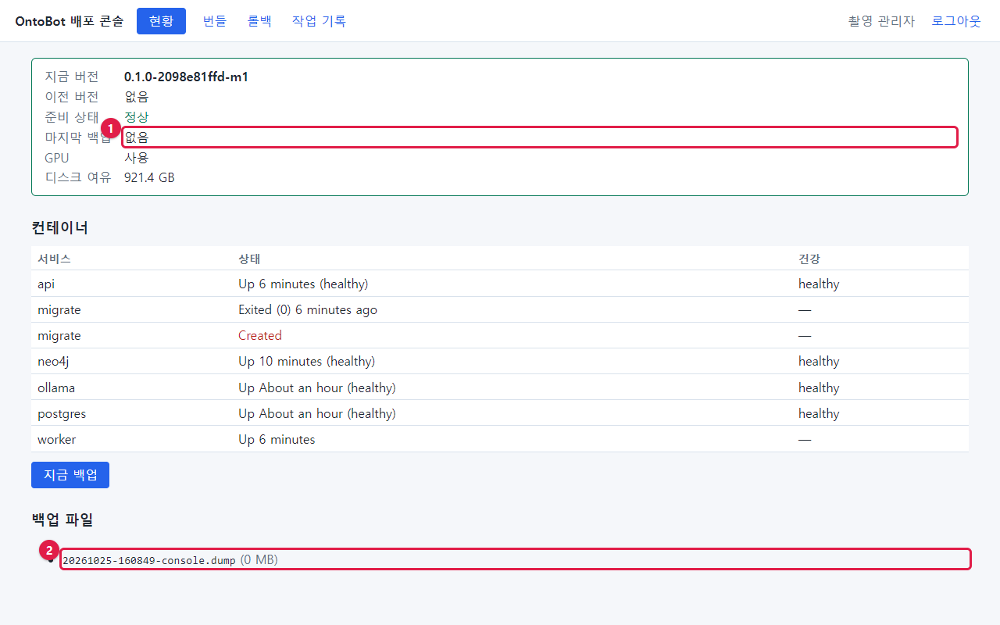

| 번호 | 부분 | 설명 |
| --- | --- | --- |
| ① | 마지막 백업 | 여전히 "없음" — 이 칸은 **업그레이드 직전 백업**만 보여 줍니다(18.1) |
| ② | 백업 파일 | 방금 만든 `…-console.dump`. 크기가 1MB 미만이면 `(0 MB)` 로 보입니다 |

> **알아 두기** 사진의 컨테이너 표에 `migrate · Created`(빨간 글씨)가 한 줄 더 보입니다. 백업 작업이 끝나며 결과를
> 감사 로그에 남기려고 **잠깐 띄운 일회성 컨테이너**입니다. 몇 초 뒤 사라집니다. 업그레이드·롤백 직후에도 잠깐
> 보일 수 있습니다.

## 19.3 명령으로 백업

설정을 바꾸기 전처럼 "지금 이 순간"을 남기고 싶을 때, 이름표(`--label`)를 붙여 명령으로 백업할 수 있습니다.

```powershell
wsl -d ontobot -u root -- ontobotctl backup --label before-change
```

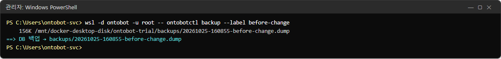

이름표에는 영문·숫자·`.`·`_`·`-` 만 씁니다(다른 글자는 `_` 로 바뀝니다).

```powershell
wsl -d ontobot -u root -- ls -lh /opt/ontobot/backups
```

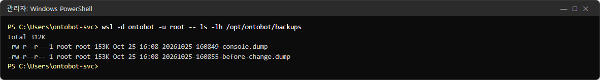

현황 화면에도 두 개가 보입니다.

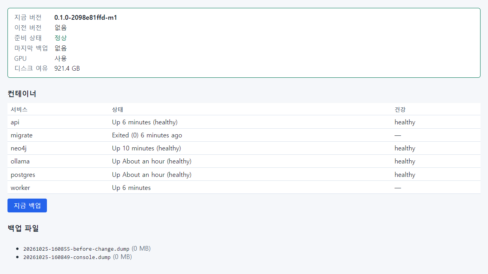

## 19.4 백업 파일이 성한지 확인

백업 파일이 망가지지 않았는지, 안에 무엇이 들었는지 목록만 읽어 볼 수 있습니다(데이터베이스는 바꾸지 않습니다).

```powershell
wsl -d ontobot -u root -- bash -c "cd /opt/ontobot && docker compose exec -T postgres pg_restore -l /backups/<파일 이름> | head -20"
```

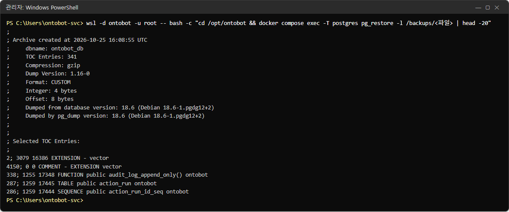

| 줄 | 뜻 |
| --- | --- |
| `Archive created at …` | 백업한 시각(UTC) |
| `dbname: ontobot_db` | 백업한 데이터베이스 |
| `TOC Entries: 341` | 담긴 항목 수(표·인덱스·함수 등) |
| `Format: CUSTOM`, `Compression: gzip` | 압축된 PostgreSQL 전용 형식 |
| `Dumped from database version: 18.6` | 만든 PostgreSQL 버전 |
| 아래 목록 | 확장(vector), 감사 로그 보호 함수, 표(action_run …) |

목록이 이렇게 나오면 파일은 읽을 수 있는 상태입니다. 오류가 나면 그 백업은 쓸 수 없으니 새로 백업하세요.

### 한 걸음 더 — 별도 데이터베이스에 실제로 풀어 보기

목차를 읽는 것보다 확실한 확인은, 백업을 **운영 데이터베이스와 다른 이름의 데이터베이스**에 실제로 풀어 보고 건수를
세어 보는 것입니다. 운영 데이터베이스(`ontobot_db`)는 건드리지 않습니다. 시험 서버에서 실제로 한 순서입니다.

1. 지금 백업을 하나 만듭니다.

```powershell
wsl -d ontobot -u root -- ontobotctl backup --label restore-check
```

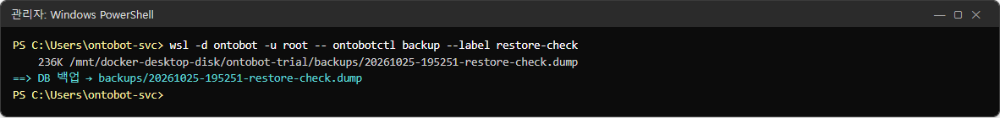

2. 빈 데이터베이스 `restore_check` 를 만듭니다.

```powershell
wsl -d ontobot -u root -- bash -c "cd /opt/ontobot && docker compose exec -T postgres createdb -U postgres restore_check"
```

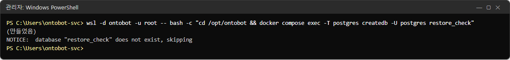

> **알아 두기** 사진의 `NOTICE: database "restore_check" does not exist, skipping` 은 촬영 스크립트가 만들기 전에 같은
> 이름이 남아 있으면 지우도록 한 줄(`dropdb --if-exists`)의 안내입니다. 무시해도 됩니다.

3. 백업을 그 데이터베이스에 풉니다(파일 이름은 1번의 결과).

```powershell
wsl -d ontobot -u root -- bash -c "cd /opt/ontobot && docker compose exec -T postgres pg_restore -U postgres --no-owner -d restore_check /backups/<파일 이름>"
```

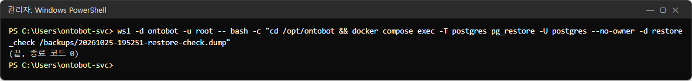

종료 코드 0 이면 오류 없이 풀렸습니다.

4. 풀어 낸 데이터베이스와 운영 데이터베이스의 건수를 비교합니다.

```powershell
wsl -d ontobot -u root -- bash -c "cd /opt/ontobot && docker compose exec -T postgres psql -U postgres -d restore_check -c \"SELECT (SELECT count(*) FROM object) AS 객체, (SELECT count(*) FROM app_user) AS 계정, (SELECT count(*) FROM action_run) AS action, (SELECT count(*) FROM audit_log) AS 감사, to_char((SELECT max(ts) FROM audit_log) AT TIME ZONE 'Asia/Seoul', 'MM-DD HH24:MI') AS 마지막_감사;\""
```

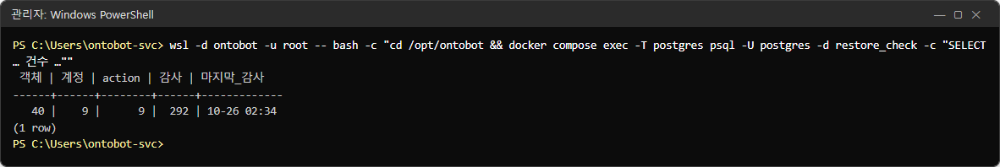

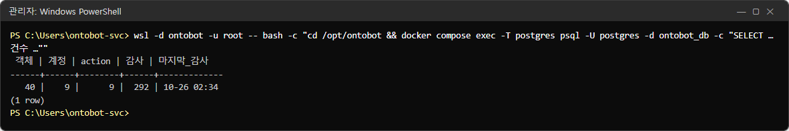

객체 40 · 계정 9 · Action 9 · 감사 292 · 마지막 감사 시각까지 똑같습니다. 백업이 온전히 되살아난다는 증거입니다.

5. 확인용 데이터베이스를 지웁니다.

```powershell
wsl -d ontobot -u root -- bash -c "cd /opt/ontobot && docker compose exec -T postgres dropdb -U postgres restore_check"
```

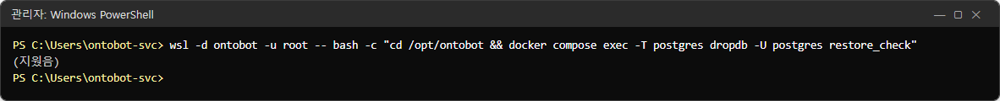

> **주의** 3번과 5번의 데이터베이스 이름을 반드시 `restore_check` 로 쓰세요. 운영 데이터베이스 이름(`ontobot_db`)을 잘못
> 넣으면 운영 데이터를 덮거나 지웁니다. 확인용 데이터베이스는 디스크를 차지하고 개인정보가 들어 있으니 확인이 끝나면
> 바로 지웁니다. 분기 점검(25.4)에 넣어 두세요.

## 19.5 보관 개수와 윈도 복사

백업 설정은 `/opt/ontobot/.env` 에 있습니다.

```powershell
wsl -d ontobot -u root -- grep BACKUP /opt/ontobot/.env
```

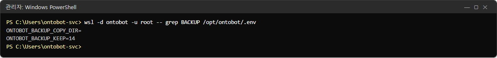

| 설정 | 운영 서버 기본 | 뜻 |
| --- | --- | --- |
| `ONTOBOT_BACKUP_KEEP` | 14 | 남길 백업 개수. 새 백업을 만들 때 오래된 것부터 지움(업그레이드 직전 백업은 빼고) |
| `ONTOBOT_BACKUP_COPY_DIR` | `/mnt/c/OntoBot/backups` | 백업할 때마다 복사해 둘 윈도 폴더(`C:\OntoBot\backups`) |

> **알아 두기** 사진의 `ONTOBOT_BACKUP_COPY_DIR=` 가 비어 있는 것은 촬영 PC 가 설치 스크립트(`install-host.ps1`)를
> 거치지 않았기 때문입니다. 운영 서버에서는 설치 스크립트가 `/mnt/c/OntoBot/backups` 로 채웁니다. 비어 있으면 윈도
> 쪽 복사본이 생기지 않으니 확인하세요.

> **주의** **회사 백업 체계(백업 서버·테이프)가 `C:\OntoBot\backups` 를 가져가도록** 서버 담당자에게 요청하세요.
> 서버 디스크가 고장 나면 서버 안의 백업도 함께 잃습니다. 서버 밖에 사본이 있어야 진짜 백업입니다.

보관 개수를 바꾸려면 `.env` 의 `ONTOBOT_BACKUP_KEEP` 만 고칩니다(nano, 11.2 의 사용법). 다음 백업부터 적용됩니다.
비밀번호 줄은 절대 건드리지 마세요.

## 19.6 매일 자동 백업

매일 백업은 WSL 배포판 안의 타이머(`ontobot-backup.timer`)가 합니다. 타이머가 살아 있는지 확인하려면:

```powershell
wsl -d ontobot -u root -- systemctl list-timers ontobot-backup.timer
```

| 결과 칸 | 정상 |
| --- | --- |
| NEXT | 다음 02:30 근처 |
| LAST | 지난 02:30 근처 |
| UNIT | `ontobot-backup.timer` |

> **알아 두기** 촬영 PC 는 WSL 배포판이 아니라 Docker Desktop 에 설치해서 이 타이머가 없습니다(설치가 "배포 콘솔
> 컨테이너 안에서는 건너뛴다"고 되어 있습니다). 그래서 이 명령의 사진은 싣지 않았습니다. 운영 서버에서 처음 설치한
> 다음 날 아침, 백업 파일 목록에 `-daily.dump` 가 생겼는지 꼭 확인하세요.

| 매일 백업이 안 생겼을 때 | 확인 |
| --- | --- |
| 서버가 02:30 에 꺼져 있었음 | 타이머는 켜진 뒤 놓친 백업을 한 번 합니다(`Persistent=true`) |
| 타이머가 없음 | `systemctl enable --now ontobot-backup.timer`(개발팀과) |
| 백업이 실패함 | `wsl -d ontobot -u root -- journalctl -u ontobot-backup.service --since yesterday` |
| 디스크 부족 | 2.6 |

## 19.7 백업에서 되살리기

백업에서 되살리는 일은 **그 백업 이후의 모든 기록(대화·Action·감사 로그·계정 변경)을 잃는** 일입니다. 그래서 두
가지 경우로 나눕니다.

| 상황 | 방법 |
| --- | --- |
| **업그레이드 직후**, 새 버전에 문제가 있어 업그레이드 직전으로 | 배포 콘솔 **롤백 → DB 까지 복원**(22장) — 화면으로, 안전장치(`RESTORE` 입력) 포함 |
| 그 밖(데이터를 잘못 지움, 서버 교체 등) | **개발팀과 함께** — 어느 백업으로, 무엇을 잃는지 확인한 뒤 |

22장에서 실제로 DB 까지 복원하는 롤백을 해 보고, 업그레이드 뒤에 만든 계정이 사라지는 것까지 확인합니다.

> **주의** 백업 파일에는 개인정보 원본(연락처 등)과 감사 기록이 그대로 들어 있습니다. 화면·로그에서는 가려져도
> 백업에는 가려지지 않습니다. 백업 폴더와 복사본의 접근을 관리자로 제한하세요(31장).

## 19.8 백업 점검 요령

| 언제 | 할 일 |
| --- | --- |
| 매일 | 현황의 백업 파일 목록 맨 위가 오늘 새벽 `-daily` 인지 |
| 매주 | `C:\OntoBot\backups` 에 같은 파일이 있는지, 회사 백업 체계가 가져갔는지 |
| 매달 | 백업 파일 하나를 골라 19.4 로 목차 읽기 |
| 분기 | 개발팀과 시험 서버에서 실제로 되살려 보기(32장 훈련) |
| 업그레이드·큰 설정 변경 전 | **지금 백업** 또는 `ontobotctl backup --label …` |

## 19.9 해 보기

> **해 보기**
>
> 1. 배포 콘솔에서 **지금 백업** 을 누르고, 작업 화면의 단계에 나온 파일 이름을 적으세요.
> 2. 19.4 의 명령으로 그 파일의 목차를 읽어 `TOC Entries` 수를 적으세요.
> 3. `C:\OntoBot\backups` 폴더(윈도 탐색기)에도 같은 파일이 있는지 확인하세요.
