# 20장 번들 가져오기와 사전 점검

새 버전이 나오면 개발팀(배포 담당)이 **업그레이드용 앱 번들**(zip 파일, 수백 MB)을 줍니다. 운영자는 이 번들을 배포
콘솔에 넣고, 콘솔이 자동으로 하는 **사전 점검**이 **통과**하는지 확인한 뒤 업그레이드(21장)합니다.

이 장에서는 실제로 다음 네 번들을 넣어 보았습니다.

| 번들 | 넣은 방법 | 사전 점검 결과 | 이유 |
| --- | --- | --- | --- |
| 지금 설치된 `-m1` | (이미 있음) | **막힘** | 같은 버전 |
| 일부러 파일 하나를 고친 `-m2` | 반입 폴더 | **실패** | 파일이 바뀜 |
| 개발용 `-dirty` | 반입 폴더 | **실패** | 서명이 맞지 않음 |
| 정상 `-m2` | 화면에서 올리기 | **통과** | — |

## 20.1 번들 탭

배포 콘솔의 **번들** 탭입니다. 처음에는 설치에 쓴 번들 하나만 있습니다.

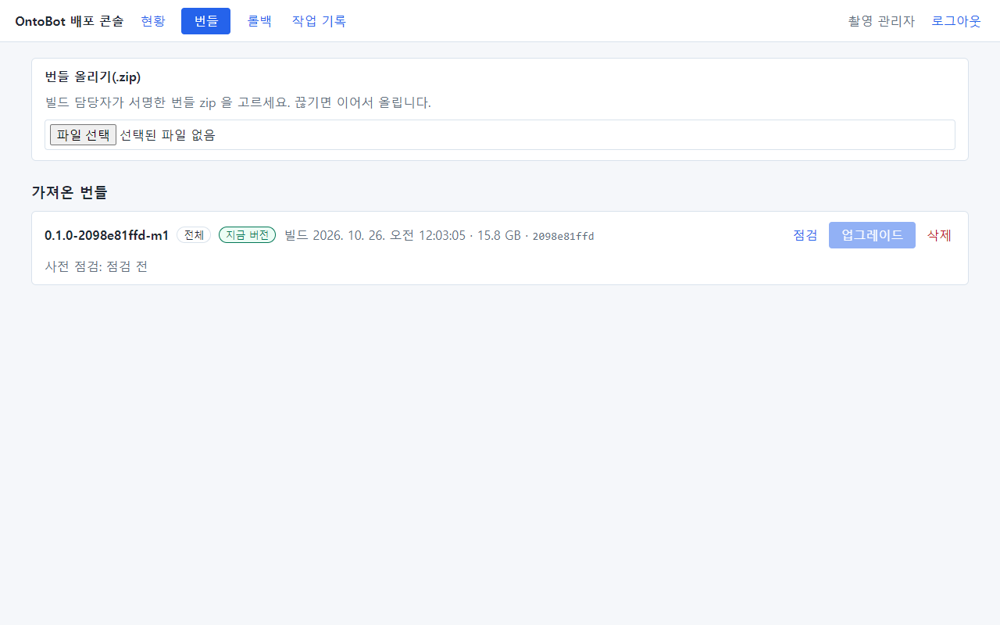

| 부분 | 설명 |
| --- | --- |
| **번들 올리기(.zip)** | 관리자 PC 에 있는 zip 파일을 올림(20.4) |
| **반입 폴더** | 서버의 `C:\OntoBot-bundles` 에 복사해 둔 번들(있을 때만 보임, 20.3) |
| **가져온 번들** | 콘솔이 가져와 점검할 수 있는 번들 목록 |

### 번들 카드

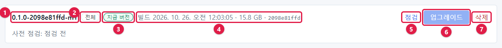

| 번호 | 부분 | 설명 |
| --- | --- | --- |
| ① | 버전 | `0.1.0-2098e81ffd-m1` |
| ② | 종류 | **전체**(최초 설치용) 또는 **앱만**(업그레이드용). 빨간 **개발용(.dirty)** 표지가 붙을 수도 있음 |
| ③ | **지금 버전** | 지금 설치된 버전에만 붙음 |
| ④ | 빌드 시각 · 크기 · 커밋 | 언제 만든, 얼마나 큰, 어느 소스로 만든 번들인지 |
| ⑤ | **점검** | 사전 점검을 다시 실행 |
| ⑥ | **업그레이드** | 사전 점검을 **통과**한 번들만 눌림(21장) |
| ⑦ | **삭제** | 콘솔이 가져온 번들 파일을 지움(설치된 버전에는 영향 없음) |

카드 아래 줄에 **사전 점검: 점검 전 / 통과 / 막힘** 과 이유가 나옵니다.

## 20.2 사전 점검이란

사전 점검은 **아무것도 바꾸지 않고** 다음을 확인합니다.

| 순서 | 확인 | 실패하면 |
| --- | --- | --- |
| 1 | 서명이 등록된 공개키와 맞는가 | 실패 — `서명이 신뢰 공개키와 맞지 않습니다` |
| 2 | 모든 파일의 지문이 목록과 같은가, 목록에 없는 파일이 없는가 | 실패 — `번들 파일이 손상되었거나 바뀌었습니다` |
| 3 | 개발용(`-dirty`) 번들이 아닌가 | 실패 |
| 4 | 지금 버전과 같지 않은가 | 막힘 — `이미 … 입니다` |
| 5 | 앱 번들로 처음 설치하려는 것은 아닌가 | 막힘 |
| 6 | 디스크 여유가 번들 크기 + 1GB 보다 큰가 | 막힘 — `디스크 여유 …MB < 필요 …MB` |
| 7 | GPU 가 있는가 | **주의**(막지는 않음) |
| 8 | 직전 버전으로 다시 올리는 것은 아닌가 | **주의** — 롤백이 더 알맞을 수 있음 |

번들을 가져오면 사전 점검이 **자동으로** 실행됩니다. 카드의 **점검** 으로 언제든 다시 할 수 있습니다.

### 같은 버전을 점검하면

지금 버전(`-m1`) 카드의 **점검** 을 눌렀습니다. 화면이 **작업 기록** 으로 바뀌고 진행이 보입니다.

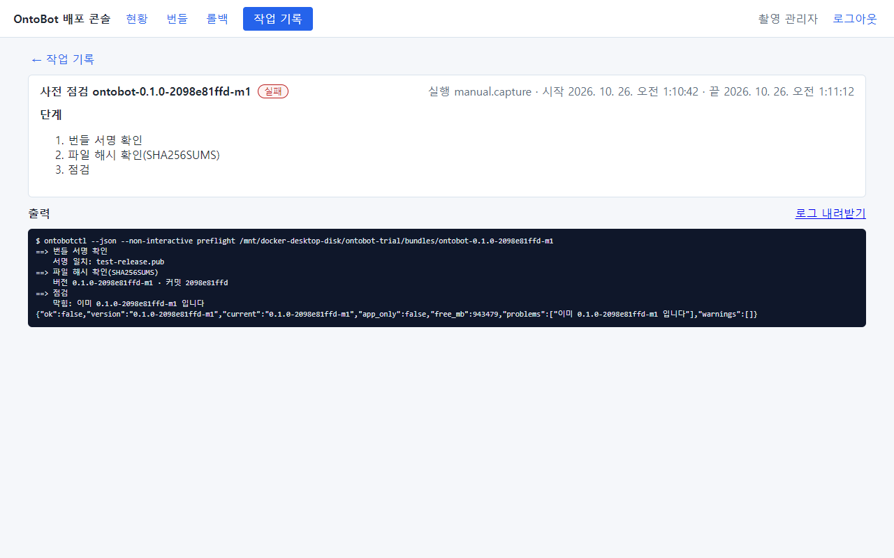

- 단계: 번들 서명 확인 → 파일 해시 확인 → 점검. 큰 번들(15.8GB)이라 지문 확인에 30초가 걸렸습니다.
- 출력 끝: `막힘: 이미 0.1.0-2098e81ffd-m1 입니다`, 마지막 줄 JSON 의 `"problems":["이미 … 입니다"]`.
- 작업 표지가 **실패**인 것은 "점검을 통과하지 못했다"는 뜻입니다. 서버에 문제가 생긴 것이 아닙니다.

번들 탭으로 돌아가면 카드에 결과가 남습니다.

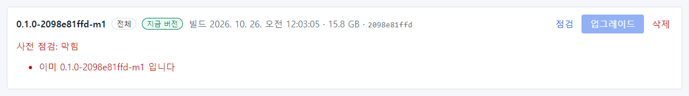

## 20.3 반입 폴더로 가져오기

번들 zip(또는 폴더)을 서버의 `C:\OntoBot-bundles` 에 복사하면 번들 탭에 **반입 폴더** 칸이 생깁니다. USB 를 서버에
꽂고 탐색기로 복사하면 됩니다.

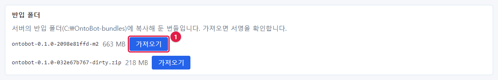

이 책에서는 연습을 위해 두 개를 넣었습니다.

- `ontobot-0.1.0-2098e81ffd-m2` — 정상 번들을 복사한 뒤 **`stack/compose.yaml` 끝에 한 줄을 덧붙인** 것(누군가 번들을
  고친 상황 흉내)
- `ontobot-0.1.0-032e67b767-dirty.zip` — 개발 중에 만든 번들

줄 끝의 **가져오기**(①)를 누릅니다.

### 파일이 바뀐 번들

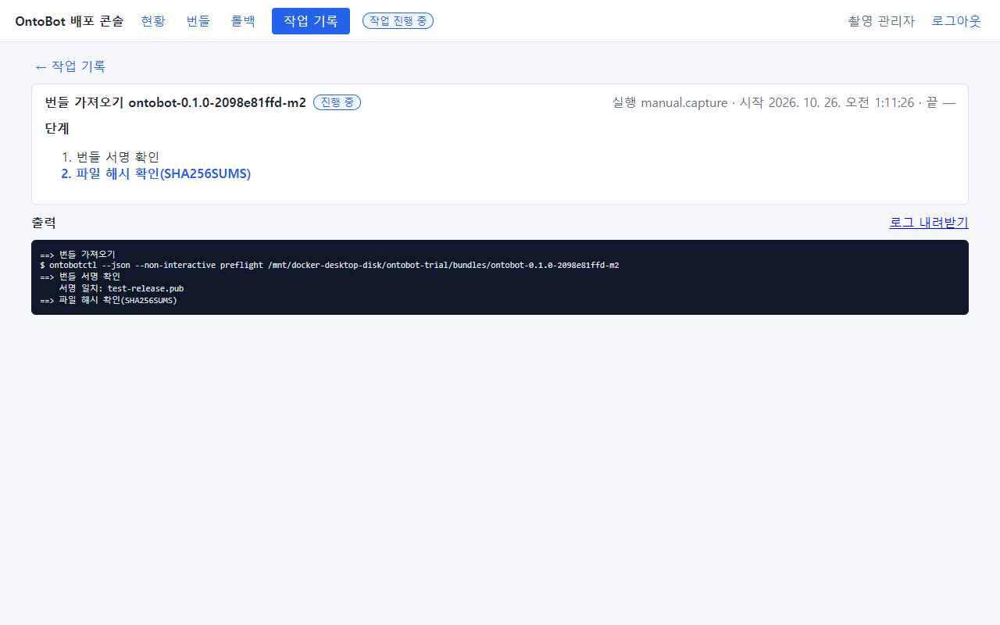

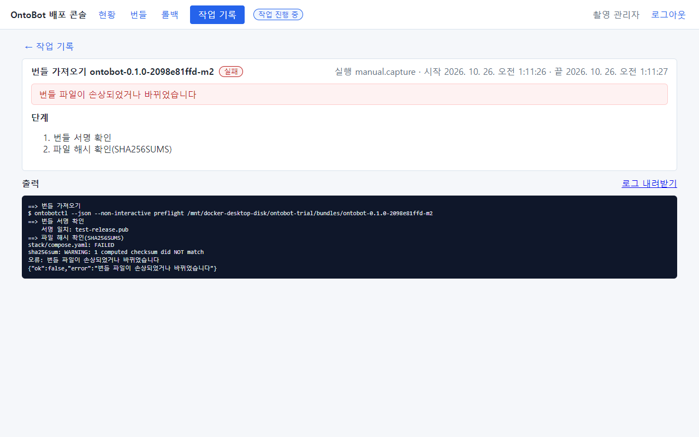

| 출력 줄 | 뜻 |
| --- | --- |
| `서명 일치: test-release.pub` | 서명 자체는 맞음(지문 목록은 진짜) |
| `stack/compose.yaml: FAILED` | 이 파일의 지문이 목록과 다름 |
| `sha256sum: WARNING: 1 computed checksum did NOT match` | 1개 파일이 다름 |
| `오류: 번들 파일이 손상되었거나 바뀌었습니다` | 결론 |

카드에도 **사전 점검: 막힘 — 번들 파일이 손상되었거나 바뀌었습니다** 가 남습니다.

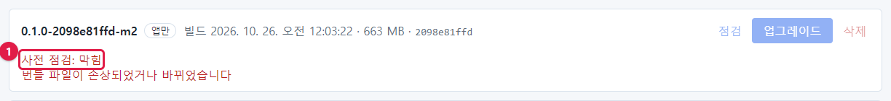

> **주의** 이런 번들은 **절대 쓰지 마세요.** 복사 중 손상이면 다시 복사하고, 계속되면 개발팀에 새 번들을 요청합니다.
> 누가 번들을 고쳤을 가능성도 있으니 보안 담당에게 알리세요.

카드의 **삭제** 를 누르면 확인 창("이 번들 파일을 지울까요? (설치된 버전에는 영향이 없습니다)")이 뜨고, **확인** 하면
콘솔이 가져온 사본이 지워집니다.

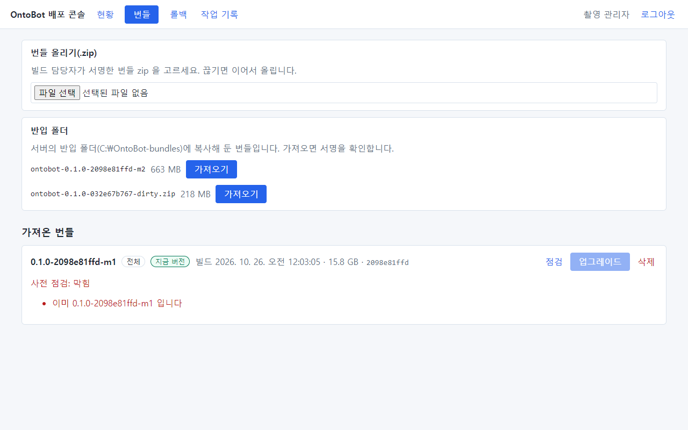

> **알아 두기** 삭제해도 **반입 폴더의 원본**(`C:\OntoBot-bundles` 의 파일)은 그대로 남습니다(위 사진의 반입 폴더 칸).
> 쓸 수 없는 번들은 탐색기에서 직접 지우세요.

### 개발용 번들

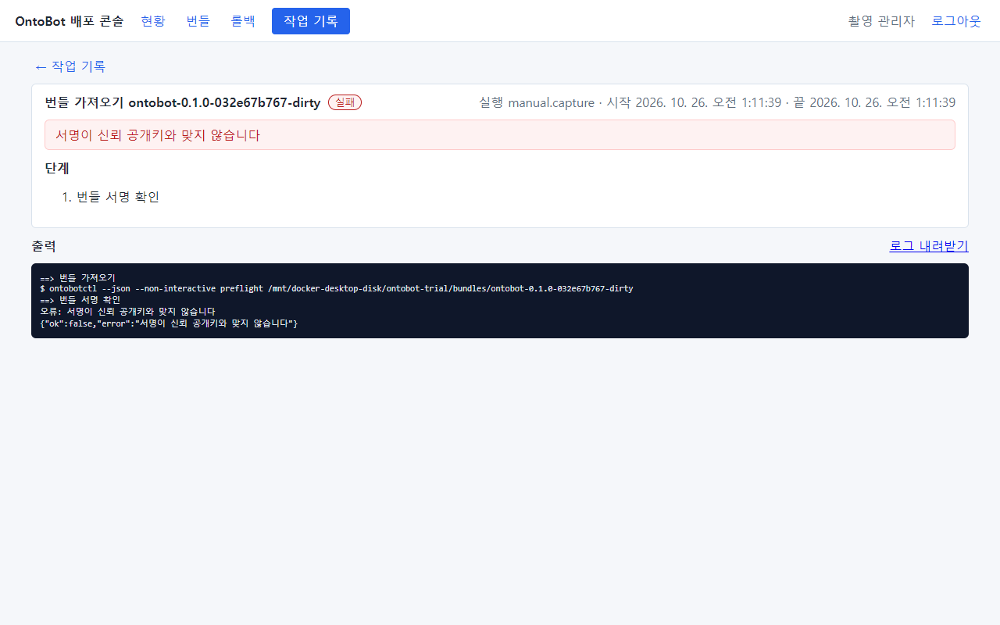

`오류: 서명이 신뢰 공개키와 맞지 않습니다` — 첫 단계(서명 확인)에서 멈췄습니다. 개발용 번들은 운영용 키로 서명되지
않았기 때문입니다. 서명이 맞더라도 개발용(`-dirty`) 표시가 있으면 따로 막힙니다.

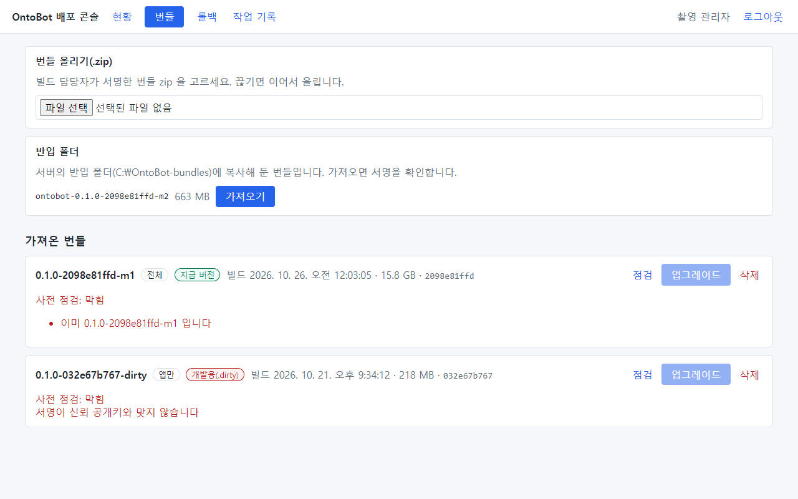

카드에 빨간 **개발용(.dirty)** 표지가 붙습니다.

## 20.4 화면에서 올리기

관리자 PC 에 받은 zip 을 바로 올릴 수도 있습니다.

1. **번들 올리기(.zip)** 칸의 **파일 선택** 을 누릅니다(①).

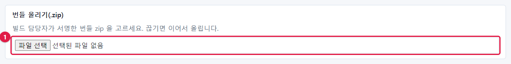

2. zip 파일을 고르면 바로 올리기 시작합니다. 진행률이 보입니다.

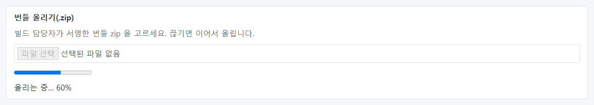

3. 다 올라가면 가져오기·사전 점검 작업이 이어집니다.

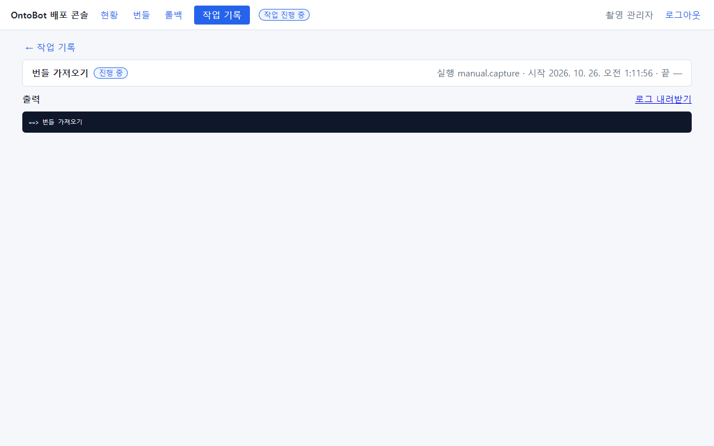

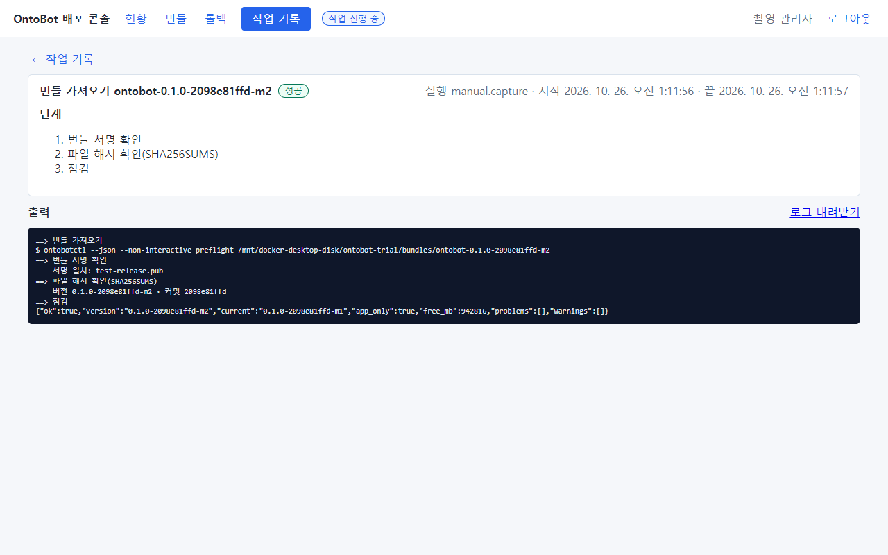

출력 끝의 JSON: `"ok":true, "version":"0.1.0-2098e81ffd-m2", "current":"0.1.0-2098e81ffd-m1", "app_only":true,
"problems":[], "warnings":[]` — 막는 문제도 주의도 없습니다.

> **알아 두기** 올리기는 16MB 조각으로 나눠 보냅니다. 중간에 끊기면 같은 파일을 다시 고르면 **이어서** 올립니다.

## 20.5 업그레이드할 수 있는 상태

번들 탭에 새 카드가 생기고 테두리가 초록이며 **사전 점검: 통과** 입니다.

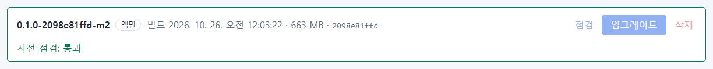

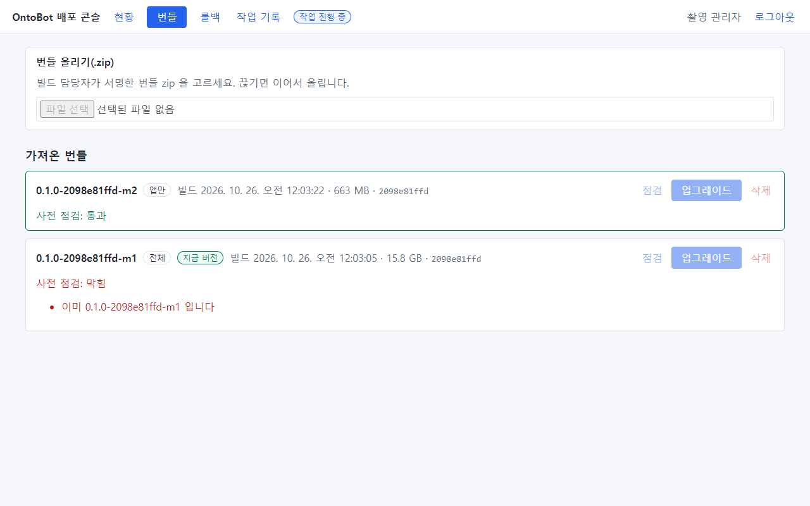

> **알아 두기** 위 사진에서 단추들이 흐린 것은 상단에 **작업 진행 중** 표지가 있기 때문입니다(가져오기 작업이 끝나며
> 감사 기록을 남기는 중). 몇 초 뒤 **업그레이드** 단추가 눌리게 됩니다.

새 번들의 정보는 서버에서도 볼 수 있습니다.

```powershell
wsl -d ontobot -u root -- cat /opt/ontobot/bundles/ontobot-0.1.0-2098e81ffd-m2/bundle.env
```

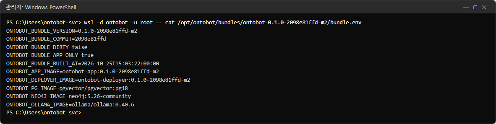

`ONTOBOT_BUNDLE_APP_ONLY=true`(앱만), 앱·배포 콘솔 이미지가 `-m2` 이고, PostgreSQL·Neo4j·Ollama 이미지는 그대로입니다.

```powershell
wsl -d ontobot -u root -- ontobotctl preflight /opt/ontobot/bundles/ontobot-0.1.0-2098e81ffd-m2
```

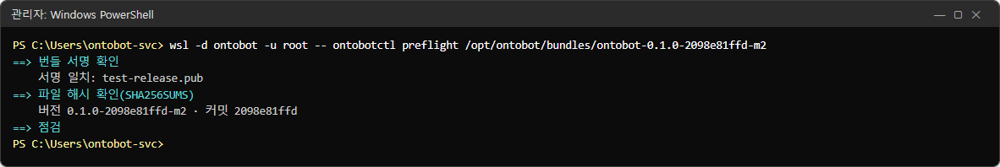

`==> 점검` 아래에 `막힘:`·`주의:` 줄이 하나도 없으면 통과입니다.

```powershell
wsl -d ontobot -u root -- ls /opt/ontobot/bundles
```

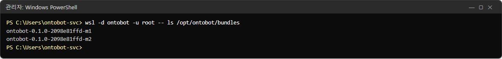

## 20.6 사전 점검 결과 정리

| 결과 | 문구 | 할 일 |
| --- | --- | --- |
| 통과 | (막힘·주의 없음) | 21장 업그레이드 |
| 통과 + 주의 | `GPU(nvidia 런타임)가 없습니다` | 업그레이드는 됨. GPU 문제는 따로 해결 |
| 통과 + 주의 | `직전 버전 … 로 다시 올립니다(롤백이 더 알맞을 수 있습니다)` | 정말 다시 올릴지, 롤백(22장)이 맞는지 판단 |
| 막힘 | `이미 … 입니다` | 같은 버전 — 할 일 없음 |
| 막힘 | `디스크 여유 …MB < 필요 …MB` | 오래된 번들 **삭제**, 오래된 백업 정리, 디스크 증설 |
| 막힘 | `앱만 담긴 번들로는 처음 설치할 수 없습니다` | 전체 번들로 설치 |
| 실패 | `서명이 신뢰 공개키와 맞지 않습니다` | 쓰지 말고 개발팀 |
| 실패 | `서명이 없는 번들입니다` | 쓰지 말고 개발팀 |
| 실패 | `번들 파일이 손상되었거나 바뀌었습니다` | 다시 복사, 계속되면 개발팀·보안 담당 |
| 실패 | `목록에 없는 파일이 있습니다` | 번들 폴더에 들어간 파일을 빼거나 다시 복사 |
| 실패 | `커밋하지 않은 변경으로 만든 번들(.dirty)입니다` | 정식 번들 요청 |
| 오류 | `zip 파일이 아닙니다`, `안전하지 않은 항목` | 받은 파일 확인, 개발팀 |

## 20.7 번들 정리

번들은 크기가 큽니다(앱 번들 수백 MB, 전체 번들 16GB). 디스크를 아끼려면 다음을 지웁니다.

| 지워도 되는 것 | 남겨야 하는 것 |
| --- | --- |
| 실패·막힘 번들 | **지금 버전** 번들 |
| 오래전 버전의 앱 번들 | 업그레이드 직후라면 **이전 버전**(롤백 때 쓰는 것은 `releases/` 기록과 이미지지만, 안전하게 다음 업그레이드까지 둠) |
| 반입 폴더의 원본(가져온 뒤) | — |

> **주의** 처음 설치에 쓴 **전체 번들**은 서버를 다시 설치해야 할 때 필요합니다. 서버에서 지우더라도 원본(USB·배포
> 담당자 보관본)이 있는지 먼저 확인하세요.

## 20.8 해 보기

> **해 보기**
>
> 1. 지금 버전 카드의 **점검** 을 눌러 결과가 "막힘 — 이미 … 입니다"인지 확인하세요.
> 2. 개발팀에게 받은 새 앱 번들 zip 을 **번들 올리기** 로 올리고, 사전 점검이 **통과** 인지 확인하세요.
> 3. 작업 기록에서 방금 가져오기 작업을 열어 출력 마지막 줄의 `problems`·`warnings` 를 읽어 보세요.
