# 21장 업그레이드

사전 점검을 **통과**한 번들(20장)로 OntoBot 을 새 버전으로 올립니다. 이 장의 사진은 시험 서버를 `0.1.0-2098e81ffd-m1`
에서 `0.1.0-2098e81ffd-m2` 로 실제로 업그레이드하며 찍었습니다.

## 21.1 업그레이드 전 준비

| 순서 | 할 일 | 이유 |
| --- | --- | --- |
| 1 | 개발팀의 **변경 안내**(릴리스 노트)를 읽는다 | 무엇이 바뀌고, 업그레이드 뒤 확인할 것이 무엇인지 |
| 2 | 사용자에게 **미리 알린다**(예: "오늘 18:00~18:30 접속 불가") | 업그레이드 중 몇 분간 접속이 끊김 |
| 3 | 진행 중인 일이 없는지: Action 승인 대기, 큰 동기화 | 끊기면 다시 해야 함 |
| 4 | 배포 콘솔 **현황** 이 **정상** 인지 | 문제가 있는 상태에서 올리지 않음 |
| 5 | 디스크 여유 확인 | 사전 점검이 보지만 미리 |
| 6 | (권장) **지금 백업** | 업그레이드가 직전 백업을 자동으로 하지만, 한 번 더 남겨 두면 안심 |

> **알아 두기** 업그레이드는 시작할 때 **자동으로 DB 백업**을 합니다(`…-before-<새 버전>.dump`). 이 백업이 22장의
> "DB 까지 복원" 롤백에 쓰입니다.

## 21.2 업그레이드 시작

1. **번들** 탭에서 통과한 번들 카드의 **업그레이드** 를 누릅니다. 카드 안에 확인 칸이 펼쳐집니다.

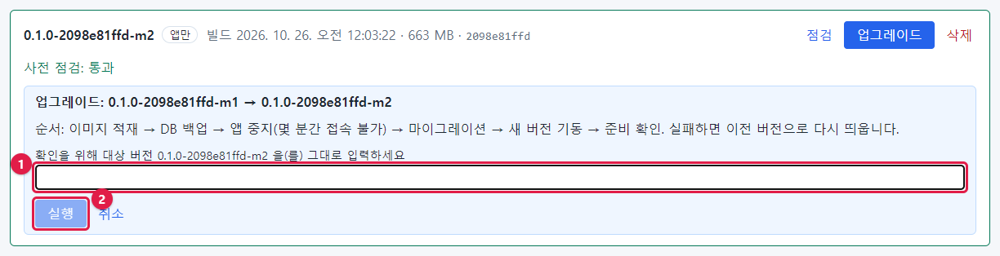

| 부분 | 내용 |
| --- | --- |
| 제목 | **업그레이드: 0.1.0-2098e81ffd-m1 → 0.1.0-2098e81ffd-m2** |
| 순서 안내 | 이미지 적재 → DB 백업 → 앱 중지(몇 분간 접속 불가) → 마이그레이션 → 새 버전 기동 → 준비 확인. 실패하면 이전 버전으로 다시 띄웁니다 |
| ① | 확인 칸 — **대상 버전을 그대로** 입력 |
| ② | **실행** — 입력이 정확히 같을 때만 눌림 |

2. 확인 칸에 대상 버전을 입력합니다. 한 글자라도 다르면 **실행** 이 눌리지 않습니다.

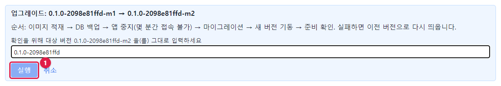

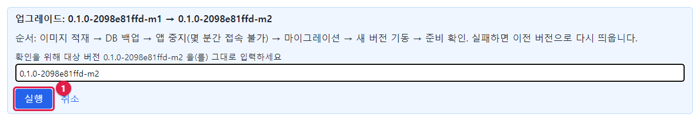

> **알아 두기** 버전을 직접 입력하게 한 것은 엉뚱한 번들의 단추를 실수로 누르는 일을 막기 위해서입니다. 복사·붙여넣기
> 보다 카드의 버전을 보며 입력하기를 권합니다.

3. **실행** 을 누르면 **작업 기록** 화면으로 바뀌고 진행이 실시간으로 보입니다.

## 21.3 진행 지켜보기

단계 목록의 **파란 굵은 글씨**가 지금 하는 단계이고, 아래 **출력** 에 명령의 출력이 1초마다 이어 붙습니다.

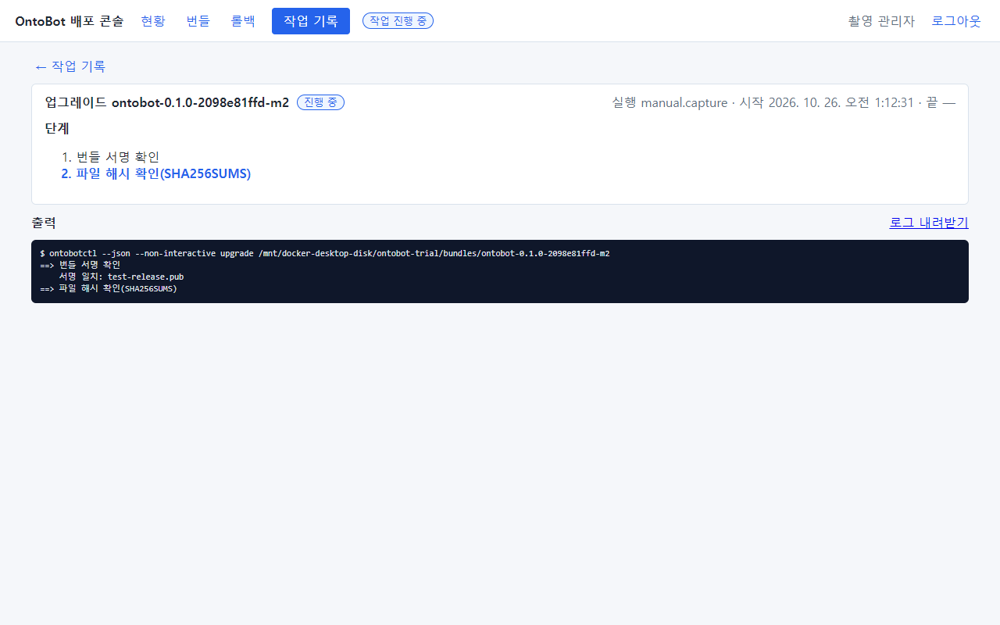

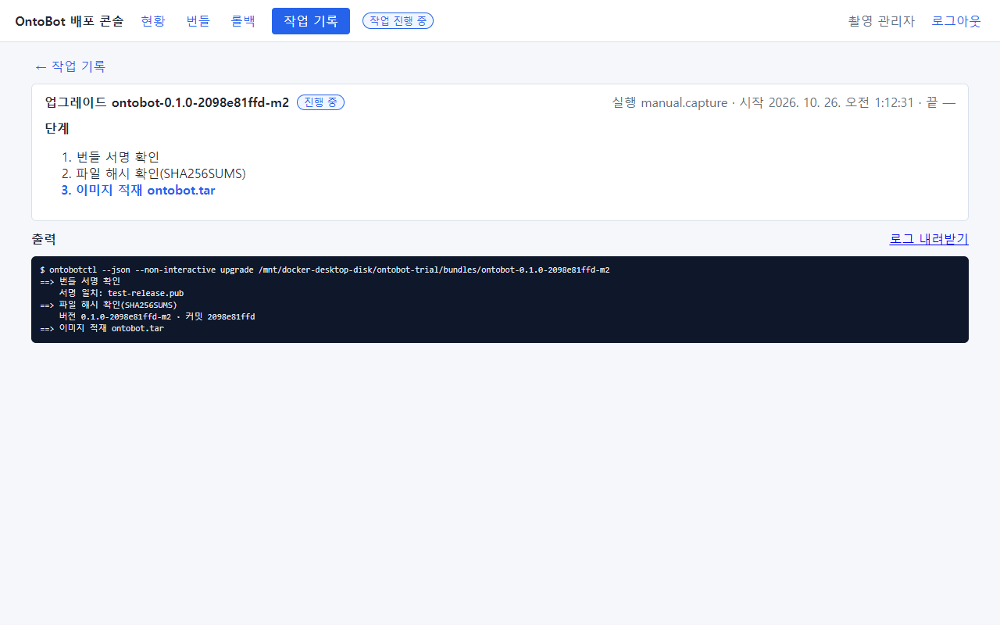

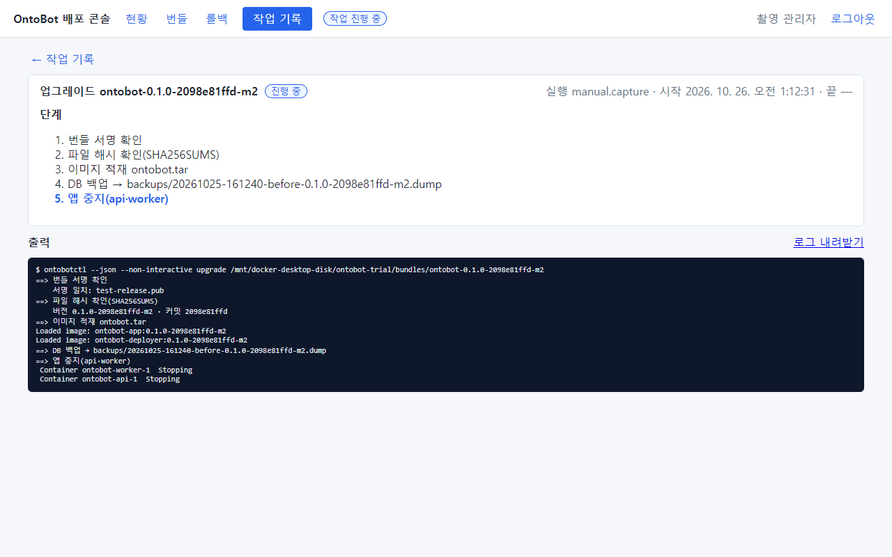

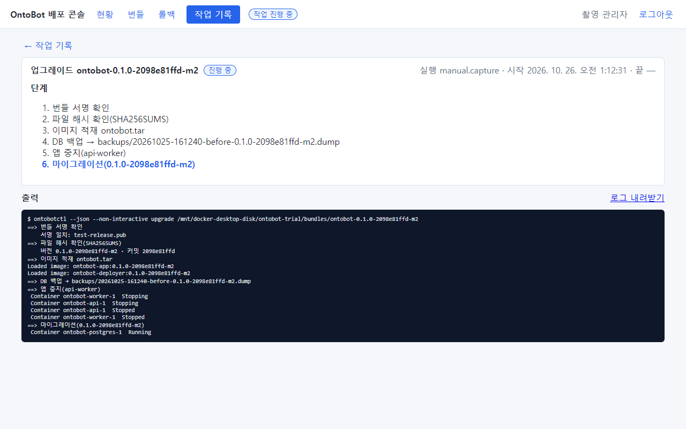

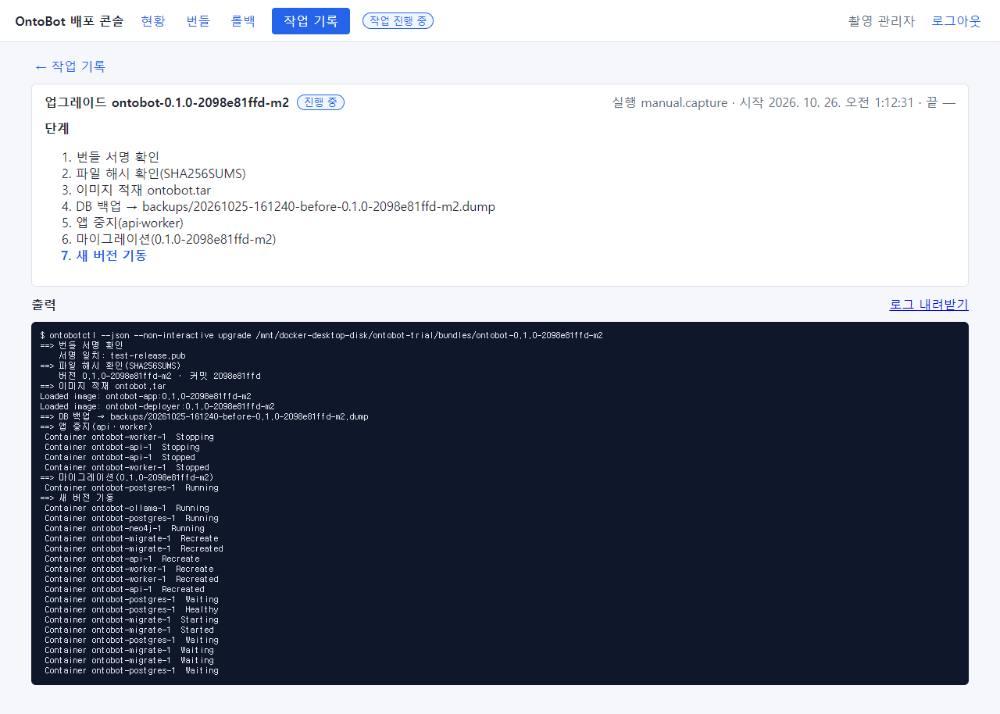

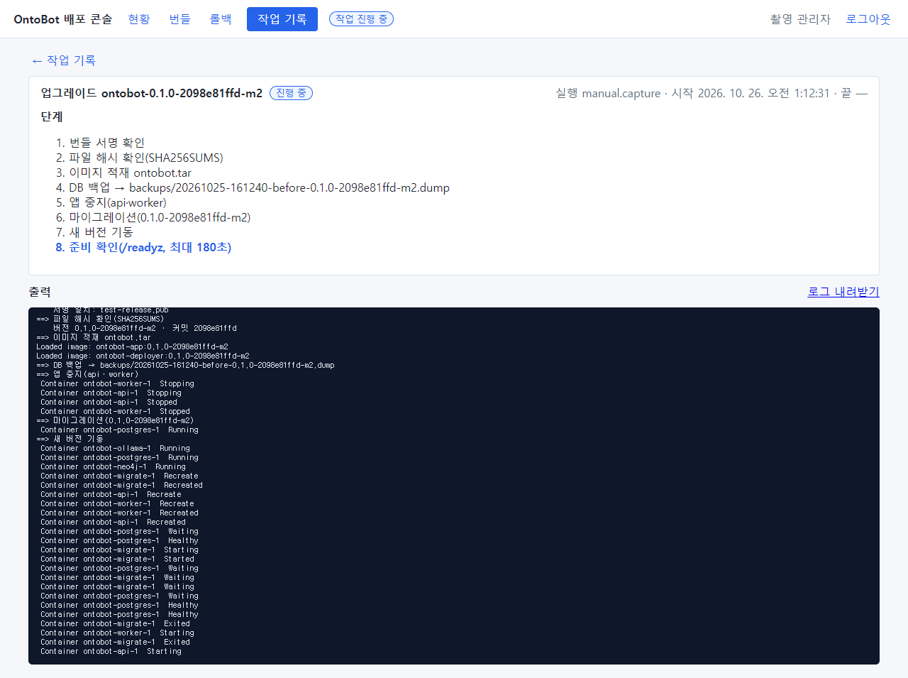

| 단계 | 화면 문구 | 하는 일 | 사용자 영향 |
| --- | --- | --- | --- |
| 1 | 번들 서명 확인 | 다시 한 번 서명 확인 | 없음 |
| 2 | 파일 해시 확인(SHA256SUMS) | 다시 한 번 파일 지문 확인 | 없음 |
| 3 | 이미지 적재 ontobot.tar | 새 앱·배포 콘솔 이미지를 올림(`Loaded image: …`) | 없음(서비스는 도는 중) |
| 4 | DB 백업 → backups/…-before-….dump | 업그레이드 직전 백업 | 없음 |
| 5 | 앱 중지(api·worker) | 이 순간부터 **접속 불가** | 접속 끊김 |
| 6 | 마이그레이션(새 버전) | 데이터베이스 구조를 새 버전에 맞춤 | 끊김 |
| 7 | 새 버전 기동 | api·worker 를 새 이미지로 다시 만듦 | 끊김 |
| 8 | 준비 확인(/readyz, 최대 180초) | 새 버전이 데이터베이스·관계 저장소·AI 모델에 닿는지 | 곧 접속됨 |
| 9 | 업그레이드 완료: m1 → m2 | 끝 | 정상 |

시험 서버에서는 시작(오전 1:12:31)부터 끝(1:12:48)까지 **17초**, 접속이 끊긴 시간(5~8단계)은 10초 남짓이었습니다.
운영 서버는 데이터 크기와 마이그레이션 내용에 따라 몇 분 걸릴 수 있습니다.

> **주의** 진행 중에 브라우저를 닫거나 배포 콘솔을 다시 시작하지 마세요. 브라우저를 닫는 것만으로는 작업이 멈추지
> 않지만(서버에서 계속 진행), 결과를 보려면 작업 기록을 다시 열어야 합니다. 같은 시간에 다른 관리자가 다른 배포
> 작업을 시작할 수도 없습니다(상단 **작업 진행 중**).

## 21.4 결과

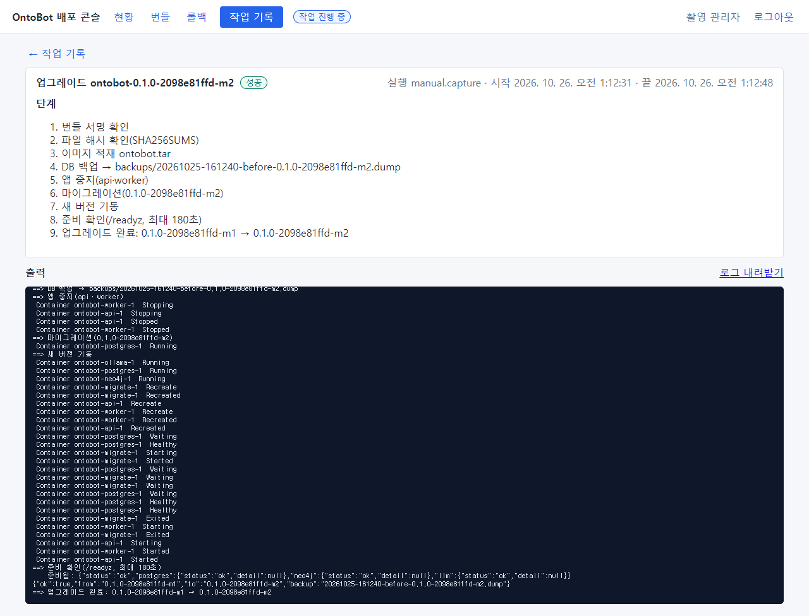

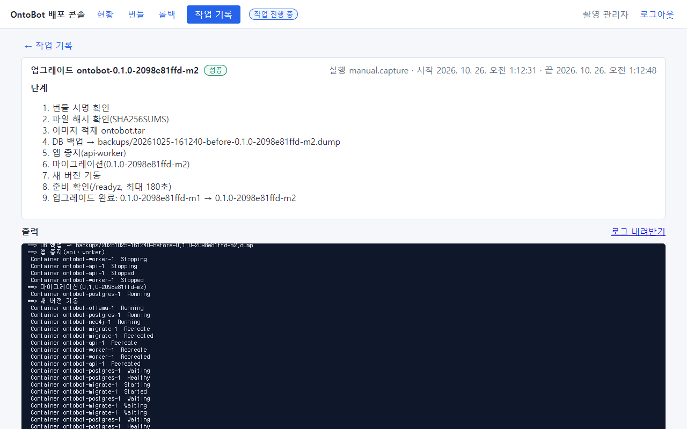

| 결과 표지 | 뜻 | 할 일 |
| --- | --- | --- |
| **성공** | 새 버전이 뜨고 준비 확인 통과 | 21.5 의 확인 |
| **끝났으나 준비 확인 실패** | 새 버전은 떴지만 180초 안에 준비되지 않음 | 현황을 보고, 1~2분 뒤에도 이상하면 22장 롤백 |
| **실패** | 도중에 실패. 마이그레이션 실패면 **이전 버전으로 다시 띄움** | 출력(로그 내려받기)을 개발팀에. 현황 확인 |

출력 끝에는 결과 JSON 이 있습니다.

```json
{"ok":true,"from":"0.1.0-2098e81ffd-m1","to":"0.1.0-2098e81ffd-m2","backup":"20261025-161240-before-0.1.0-2098e81ffd-m2.dump"}
```

### 멈춰 있던 서비스는 업그레이드가 다시 켭니다

AI 모델(ollama)을 일부러 멈춘 채 업그레이드해 보았습니다. "준비 확인 실패"가 될 것으로 예상했지만, 결과는 **성공**
이었습니다.


출력의 "새 버전 기동" 부분에 `Container ontobot-ollama-1 Starting` → `Started` 가 보입니다. 업그레이드의 새 버전 기동
단계는 모든 서비스를 설정대로 맞추므로, 멈춰 있던 서비스도 다시 켭니다. 그래서 장애 중이던 서비스가 업그레이드 뒤
갑자기 살아날 수 있습니다. 장애 원인을 조사하던 중이라면 업그레이드를 미루세요.

### 업그레이드 중에 다른 작업을 하면

업그레이드·롤백·설치는 잠금 파일(`.lock`)로 한 번에 하나만 돌게 되어 있습니다. 배포 콘솔에서는 **작업 진행 중** 이면
다른 단추가 눌리지 않습니다. 그런데 이 책에서 업그레이드가 도는 중에 명령으로 `ontobotctl backup` 을 실행해 보니,
**막히지 않고 백업이 실행되었습니다.**

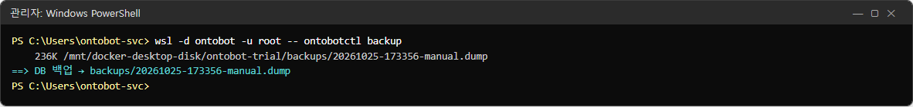

> **주의** 지금 판의 `ontobotctl backup` 은 잠금을 쓰지 않습니다. 업그레이드 중(특히 마이그레이션 단계)의 백업은
> 일관된 시점이 아닐 수 있으므로, 업그레이드·롤백이 도는 동안에는 명령으로 백업하지 마세요. 배포 콘솔 화면에서는
> 진행 중 작업이 있으면 **지금 백업** 이 눌리지 않아 안전합니다. 이 동작은 개발팀에 개선 과제로 전달했습니다.

## 21.5 업그레이드 뒤 확인

### ① 배포 콘솔 현황

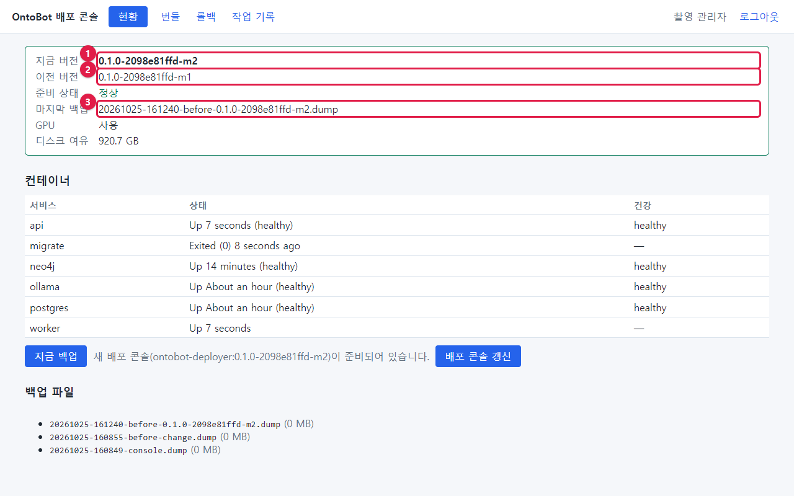

| 번호 | 칸 | 업그레이드 뒤 값 |
| --- | --- | --- |
| ① | 지금 버전 | `0.1.0-2098e81ffd-m2` |
| ② | 이전 버전 | `0.1.0-2098e81ffd-m1` — **롤백 대상** |
| ③ | 마지막 백업 | `…-before-0.1.0-2098e81ffd-m2.dump` — DB 까지 롤백할 때 쓰는 백업 |

컨테이너 표의 api·worker 가 `Up 7 seconds` 처럼 방금 켜진 것을 볼 수 있습니다. 아래에 **새 배포 콘솔이 준비되어
있습니다** 안내와 **배포 콘솔 갱신** 단추가 생겼습니다. 이 번들에 새 배포 콘솔도 들어 있었기 때문입니다(23장).

### ② OntoBot 관리 화면

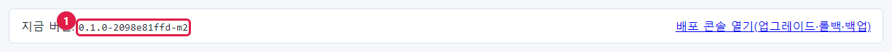

관리 화면의 **지금 버전** 도 새 버전으로 바뀌었습니다.

### ③ 확인 질문

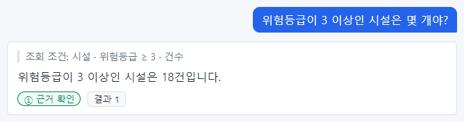

5장과 같은 확인 질문을 해서 **같은 답(18건, ①)** 이 나오는지 봅니다. 관계 질문(강남지사가 소유한 시설)도 함께 해 봅니다.

### ④ 명령으로

```powershell
wsl -d ontobot -u root -- ontobotctl status
```

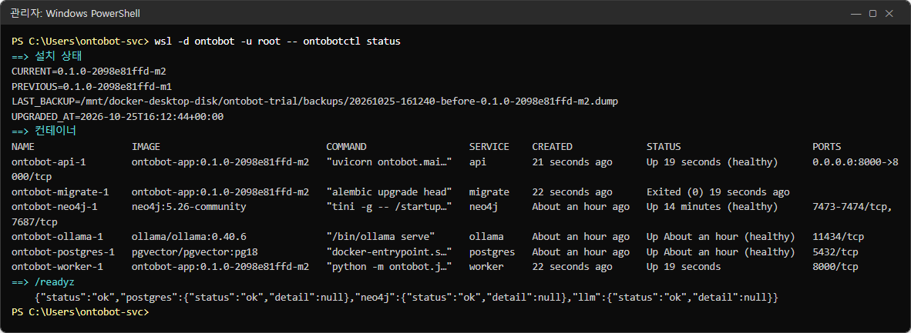

```powershell
wsl -d ontobot -u root -- cat /opt/ontobot/state.env
```

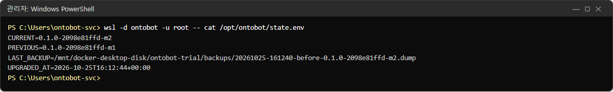

`CURRENT`(새 버전), `PREVIOUS`(이전 버전), `LAST_BACKUP`(직전 백업 경로), `UPGRADED_AT`(업그레이드 시각)이 기록됐습니다.

### ⑤ 새 AI 역할·모델 안내(v1)

업그레이드는 설치의 설정 파일(`/opt/ontobot/config/`)을 **덮지 않습니다.** 새 판이 AI 역할을 더했으면(예: v1 으로 처음
올릴 때의 문서 검색용 `embedder`) 사전 점검·작업 기록에 **"설정에 없는 역할: embedder …"** 가 보이고, 같은 폴더에
새 판의 설정이 `llm.yaml.new` 로 놓입니다.

1. `llm.yaml.new` 에서 그 역할 줄을 `llm.yaml` 의 `roles:` 아래에 옮겨 적습니다(30.5).
2. `docker compose up -d` 로 앱을 다시 띄웁니다.

그 전까지는 문서 넣기가 "임베딩 모델이 설정되지 않아…"로 막힙니다. **"Ollama 에 없는 모델"** 이 보이면 개발팀에 모델을
담은 번들(`--with-models`)을 요청하세요.

### ⑥ 개발팀의 변경 안내에 적힌 확인 항목

릴리스 노트에 "업그레이드 뒤 이 화면을 확인하라"는 항목이 있으면 함께 확인합니다.

## 21.6 업그레이드 확인표

| 번호 | 확인 | 결과 |
| --- | --- | --- |
| 1 | 작업 결과가 **성공** | ☐ |
| 2 | 현황: 지금 버전 = 새 버전, 준비 상태 **정상**, 모든 컨테이너 `Up`(migrate 는 `Exited (0)`) | ☐ |
| 3 | 관리 화면의 지금 버전 = 새 버전 | ☐ |
| 4 | 확인 질문 두 개의 답이 업그레이드 전과 같음 | ☐ |
| 5 | 데이터 소스 화면: 매핑의 다음 동기화가 성공 | ☐ |
| 6 | Action 화면: 승인·발송이 정상(시험 Action 이 있으면) | ☐ |
| 7 | 감사 로그에 `deploy.upgrade`(`succeeded`) | ☐ |
| 8 | 사용자에게 완료를 알림 | ☐ |

하나라도 이상하면 22장(롤백)을 봅니다. **업그레이드 직후가 롤백하기 가장 쉬운 때**입니다.

## 21.7 배포 콘솔이 안 될 때 — 명령으로 업그레이드

배포 콘솔이 뜨지 않는 비상시에는 같은 절차를 명령으로 합니다(배포 콘솔이 부르는 것과 똑같은 명령입니다).

```powershell
# 번들을 반입 폴더에서 WSL 안으로 복사(폴더 번들이면)
wsl -d ontobot -u root -- cp -a /mnt/c/OntoBot-bundles/<번들 폴더> /opt/ontobot/bundles/
# 사전 점검
wsl -d ontobot -u root -- ontobotctl preflight /opt/ontobot/bundles/<번들 폴더>
# 업그레이드
wsl -d ontobot -u root -- ontobotctl upgrade /opt/ontobot/bundles/<번들 폴더>
```

zip 번들이면 먼저 윈도에서 압축을 풀어 폴더로 만든 뒤 복사합니다. 명령의 종료 코드는 0(성공)·1(실패)·2(준비 확인
실패)입니다.

## 21.8 해 보기

> **해 보기** (시험 서버에서)
>
> 1. 20장에서 통과한 번들로 업그레이드하세요. 5단계(앱 중지)부터 9단계까지 걸린 시간을 재 보세요.
> 2. 21.6 의 확인표를 모두 채워 보세요.
> 3. 작업 기록의 **로그 내려받기** 로 출력을 파일로 받아 두세요(24장).
