# 22장 롤백 — 업그레이드 되돌리기

업그레이드 뒤에 문제가 생기면 **롤백**으로 이전 버전으로 돌아갑니다. 롤백은 두 가지입니다.

| 종류 | 되돌리는 것 | 데이터 | 언제 |
| --- | --- | --- | --- |
| **프로그램만 되돌리기**(기본) | 앱·구성 파일을 이전 버전으로 | **그대로** | 대부분의 경우 |
| **DB 까지 업그레이드 직전 백업으로 복원** | 위 + 데이터베이스를 업그레이드 직전 백업으로 | 업그레이드 **뒤에 생긴 모든 기록이 사라짐** | 프로그램만 되돌려서는 안 될 때(새 버전이 데이터를 망가뜨림 등) |

> **알아 두기** 롤백은 **업그레이드 직후에만** 됩니다. 배포 콘솔은 바로 전 버전 하나만 기억하고, 롤백하고 나면 그
> 기억을 지웁니다(롤백을 두 번 연달아 할 수 없습니다).

이 장의 사진은 시험 서버에서 두 롤백을 모두 실제로 해 보며 찍었습니다.

## 22.1 롤백할지 판단하기

| 증상(업그레이드 직후) | 판단 |
| --- | --- |
| 준비 상태가 계속 "사용 불가"·"응답 없음" | 1~2분 기다린 뒤에도 같으면 **프로그램만 롤백** |
| 확인 질문의 답이 업그레이드 전과 크게 다름(숫자가 틀림) | 개발팀에 바로 연락, 지시에 따라 **프로그램만 롤백** |
| 새 화면·기능에 오류가 남 | 개발팀과 상의 — 다음 버전으로 고칠지, 롤백할지 |
| 프로그램만 롤백했는데 이전 버전이 데이터베이스 오류로 안 뜸 | **DB 까지 복원** 을 개발팀과 상의 |
| 새 버전이 데이터를 잘못 바꿨음(개발팀 판단) | **DB 까지 복원** |

> **주의** DB 까지 복원은 되돌릴 수 없습니다. 업그레이드 뒤에 쌓인 대화·Action·감사 기록·계정 변경이 모두 사라집니다.
> 반드시 개발팀·업무 담당자와 상의하고, 가능하면 복원 직전에 **지금 백업**(19장)을 하나 더 남기세요.

## 22.2 롤백 탭

업그레이드 직후 **롤백** 탭을 열면:

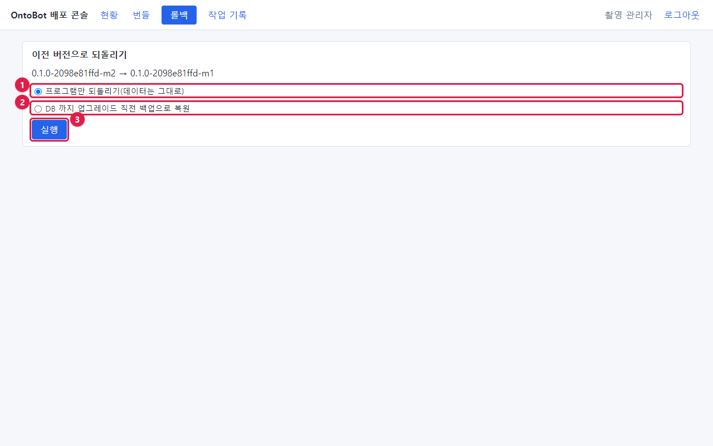

| 부분 | 내용 |
| --- | --- |
| 제목 | **이전 버전으로 되돌리기** |
| 방향 | `0.1.0-2098e81ffd-m2 → 0.1.0-2098e81ffd-m1`(지금 → 이전) |
| ① | ◉ **프로그램만 되돌리기(데이터는 그대로)** — 처음에 골라져 있음 |
| ② | ○ **DB 까지 업그레이드 직전 백업으로 복원** |
| ③ | **실행** |

업그레이드를 한 적이 없거나 이미 롤백했으면:

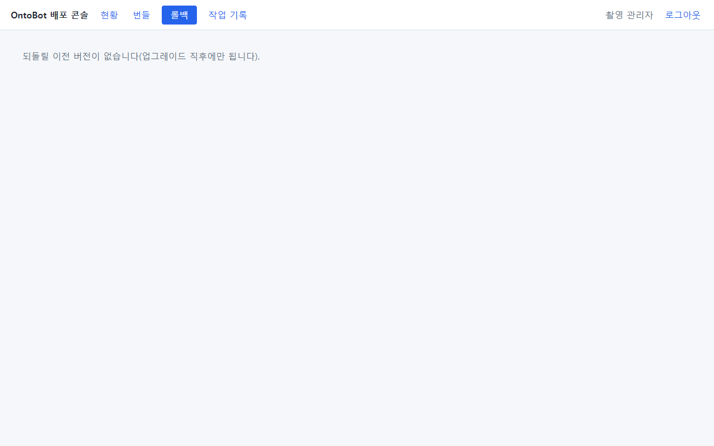

**되돌릴 이전 버전이 없습니다(업그레이드 직후에만 됩니다).** 정상입니다.

## 22.3 프로그램만 되돌리기

①이 골라진 채로 **실행** 을 누릅니다(확인 창 없음). 작업 기록 화면으로 바뀝니다.

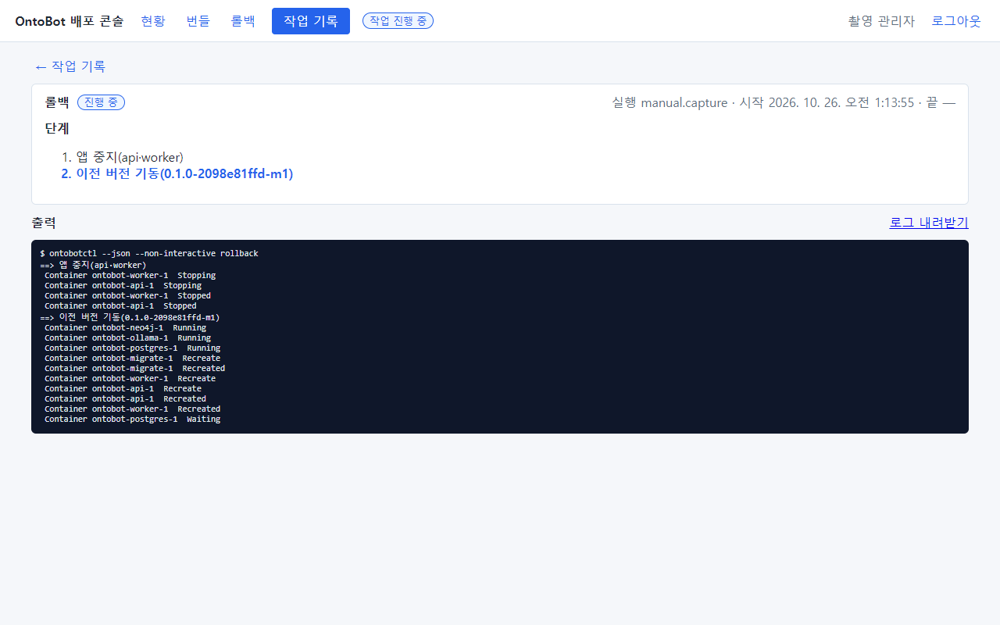

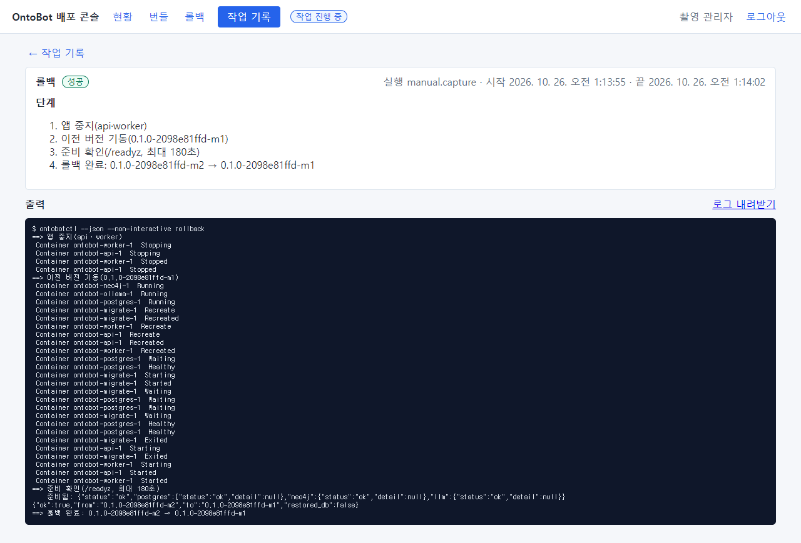

| 단계 | 하는 일 |
| --- | --- |
| 1. 앱 중지(api·worker) | 접속이 끊김 |
| 2. 이전 버전 기동(0.1.0-2098e81ffd-m1) | `releases/` 의 이전 버전 기록으로 compose 파일·이미지 이름을 되돌리고 다시 띄움 |
| 3. 준비 확인(/readyz, 최대 180초) | — |
| 4. 롤백 완료: m2 → m1 | 끝 |

시험 서버에서는 7초(1:13:55~1:14:02) 걸렸습니다. 결과 JSON 의 `"restored_db":false` 가 "데이터는 그대로"라는 뜻입니다.

현황:

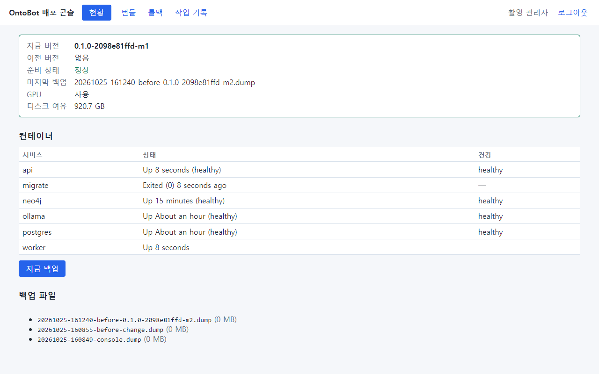

- 지금 버전 `-m1`, 이전 버전 **없음**.
- 마지막 백업 칸은 그대로 업그레이드 직전 백업 이름을 보여 줍니다.

```powershell
wsl -d ontobot -u root -- cat /opt/ontobot/state.env
```

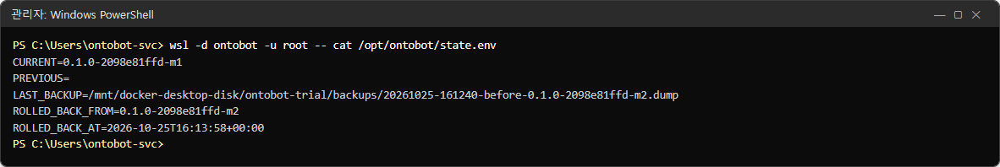

`PREVIOUS=` 가 비고, `ROLLED_BACK_FROM`(어디서 되돌렸는지)과 `ROLLED_BACK_AT`(언제)이 남습니다.

> **알아 두기** 새 버전이 업그레이드 때 데이터베이스 구조를 바꿨다면(마이그레이션), 프로그램만 되돌린 이전 버전이 바뀐
> 구조에서 제대로 돌지 않을 수 있습니다. 개발팀의 릴리스 노트에 "이 버전은 DB 구조를 바꿉니다"가 있으면, 롤백 방법을
> 미리 개발팀에 물어 두세요.

## 22.4 다시 올리기

롤백한 뒤 문제가 해결되어 같은 버전으로 다시 올릴 때는, 번들 탭에서 그 번들을 **점검** 하고 **업그레이드** 하면
됩니다(21장과 같음). 시험 서버에서도 다시 올렸습니다.

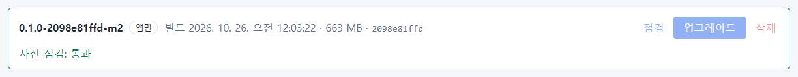

## 22.5 DB 까지 복원 — 실제로 해 보기

DB 까지 복원이 무엇을 되돌리는지 보이려고, 시험 서버에서 다음 순서로 진행했습니다.

1. `-m2` 로 다시 업그레이드했습니다(업그레이드 직전 백업 `…-165511-before-0.1.0-2098e81ffd-m2.dump` 이 새로 생김).
2. 업그레이드 **뒤에** 관리 화면에서 `temp.after`(업그레이드 뒤 계정)를 하나 만들었습니다.

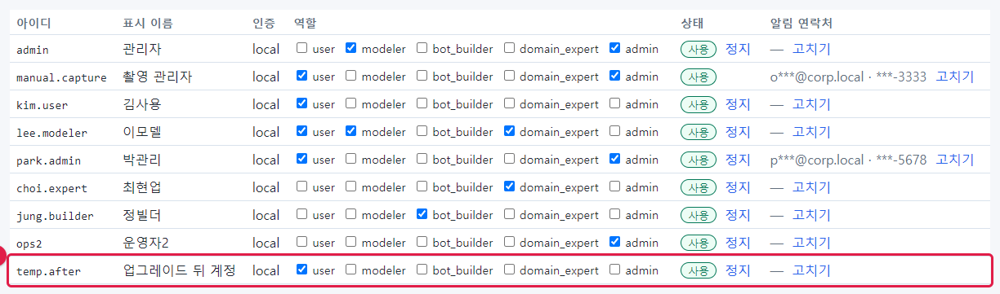

3. **롤백** 탭에서 ② **DB 까지 업그레이드 직전 백업으로 복원** 을 골랐습니다. 빨간 경고 상자가 펼쳐집니다.

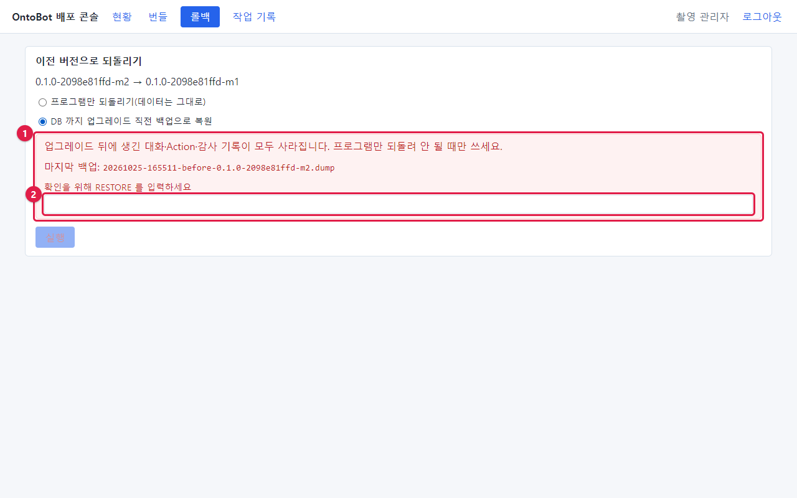

| 번호 | 내용 |
| --- | --- |
| ① | **업그레이드 뒤에 생긴 대화·Action·감사 기록이 모두 사라집니다. 프로그램만 되돌려 안 될 때만 쓰세요.** 그리고 복원에 쓸 **마지막 백업** 파일 이름 |
| ② | **확인을 위해 RESTORE 를 입력하세요** 칸 |

4. `RESTORE` 를 **대문자로 정확히** 입력해야 **실행** 이 눌립니다. 소문자로 쓰면 눌리지 않습니다.

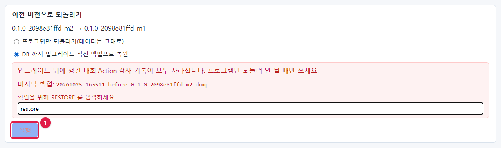

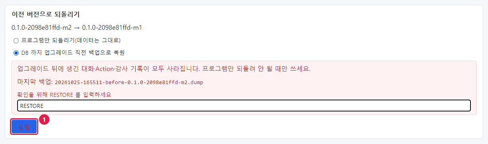

5. **실행**.

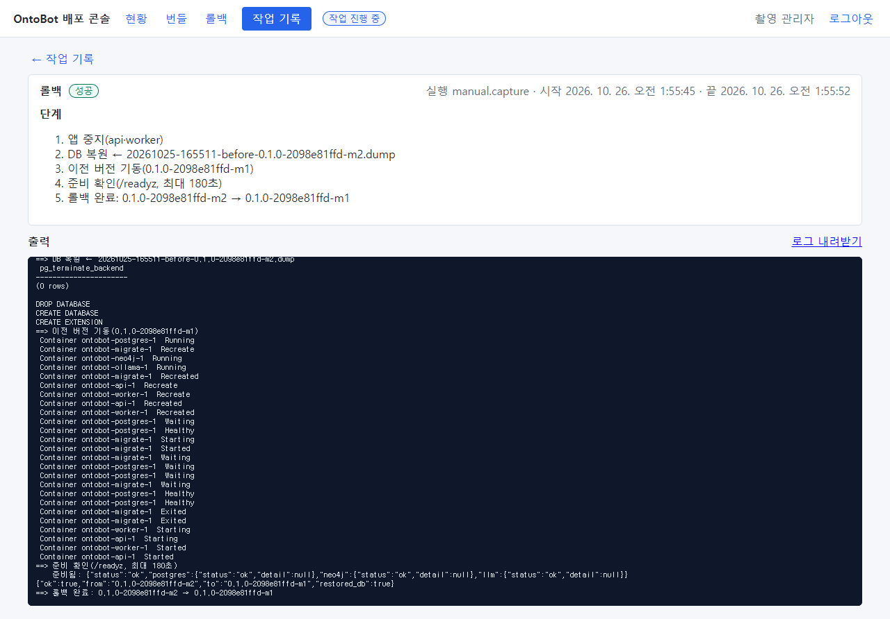

| 단계 | 하는 일 |
| --- | --- |
| 1. 앱 중지(api·worker) | — |
| 2. DB 복원 ← …-before-…dump | 데이터베이스를 지우고 새로 만든 뒤 백업을 붓습니다(`DROP DATABASE`·`CREATE DATABASE`·`CREATE EXTENSION`) |
| 3. 이전 버전 기동 | — |
| 4. 준비 확인 | — |
| 5. 롤백 완료 | 결과 JSON `"restored_db":true` |

6. 사용자 목록을 다시 보면 `temp.after` 가 **없습니다.** 업그레이드 직전 백업에는 그 계정이 없었기 때문입니다.

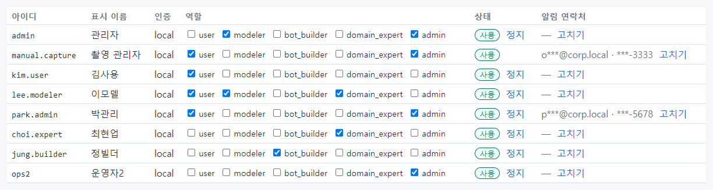

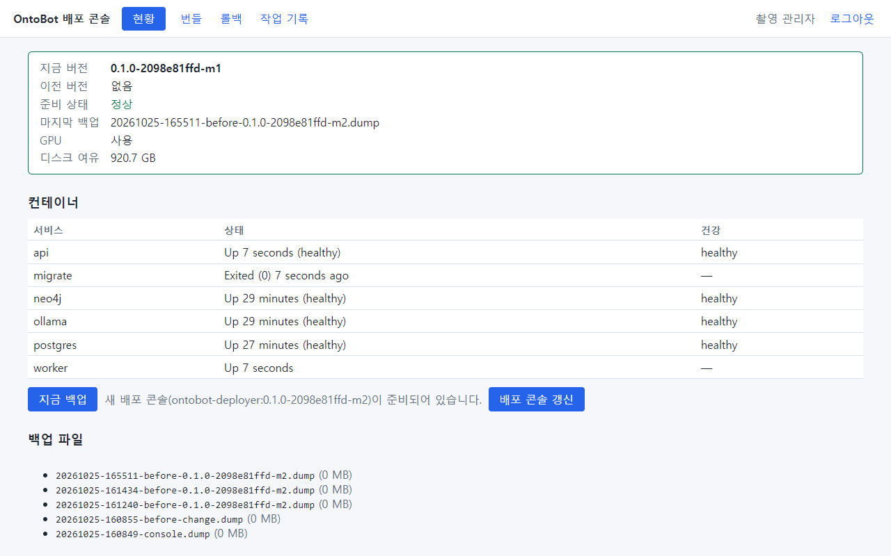

```powershell
wsl -d ontobot -u root -- cat /opt/ontobot/state.env
```

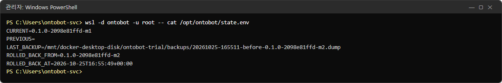

> **알아 두기** 복원 뒤 현황에 **새 배포 콘솔이 준비되어 있습니다** 안내가 다시 보일 수 있습니다. 업그레이드할 때마다
> 번들에 든 배포 콘솔 이미지를 "다음 콘솔"로 적어 두기 때문입니다. 이미 그 버전의 콘솔로 갱신했다면(23장) 눌러도 같은
> 콘솔로 다시 시작할 뿐 해가 없습니다.

## 22.6 롤백 뒤 확인

| 번호 | 확인 |
| --- | --- |
| 1 | 작업 결과 **성공**, 현황의 지금 버전 = 이전 버전, 준비 상태 **정상** |
| 2 | 관리 화면의 지금 버전도 이전 버전 |
| 3 | 확인 질문 두 개(5.6)의 답이 정상 |
| 4 | (DB 까지 복원했다면) 업그레이드 뒤에 바뀐 계정·권한·데이터 소스 설정을 다시 해야 하는지 확인 |
| 5 | (DB 까지 복원했다면) 매핑마다 **지금 동기화** 로 원천의 최신 데이터를 다시 가져옴 |
| 6 | 감사 로그 `deploy.rollback` 확인 |
| 7 | 사용자에게 알림(DB 까지 복원했다면 "○시 이후의 대화·요청이 사라졌습니다") |

## 22.7 명령으로 롤백

배포 콘솔이 안 되면:

```powershell
wsl -d ontobot -u root -- ontobotctl rollback                  # 프로그램만
wsl -d ontobot -u root -- ontobotctl rollback --restore-db     # DB 까지 — "계속하려면 RESTORE 를 입력:" 을 묻습니다
```

## 22.8 해 보기

> **해 보기** (시험 서버에서)
>
> 1. 업그레이드한 뒤 **프로그램만 되돌리기** 를 하고, 현황의 이전 버전 칸이 "없음"이 되는지 확인하세요.
> 2. 다시 업그레이드하고, 연습 계정을 하나 만든 뒤 **DB 까지 복원** 을 해서 그 계정이 사라지는지 확인하세요.
> 3. 감사 로그에서 두 번의 `deploy.rollback` 기록의 `restore_db` 값을 비교하세요.
