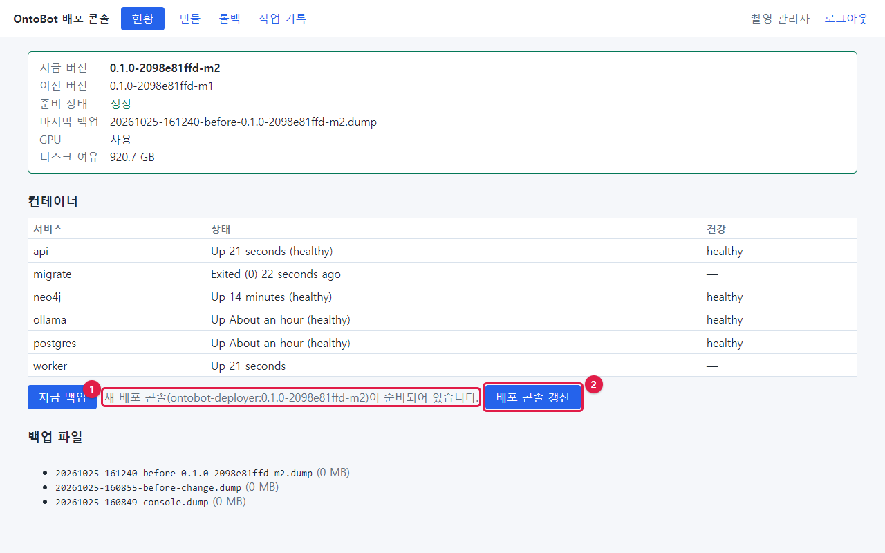
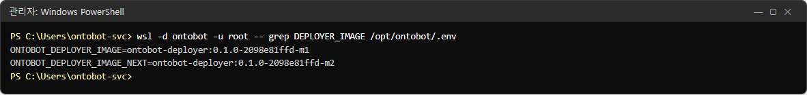
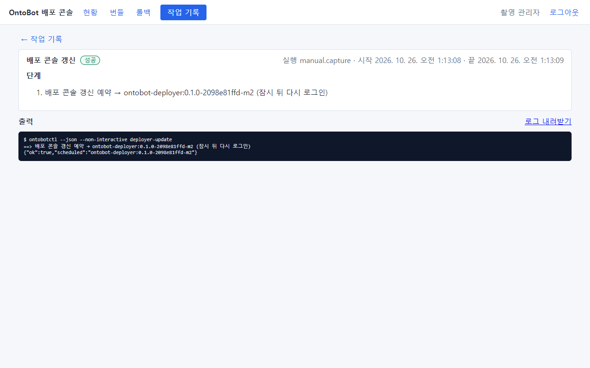
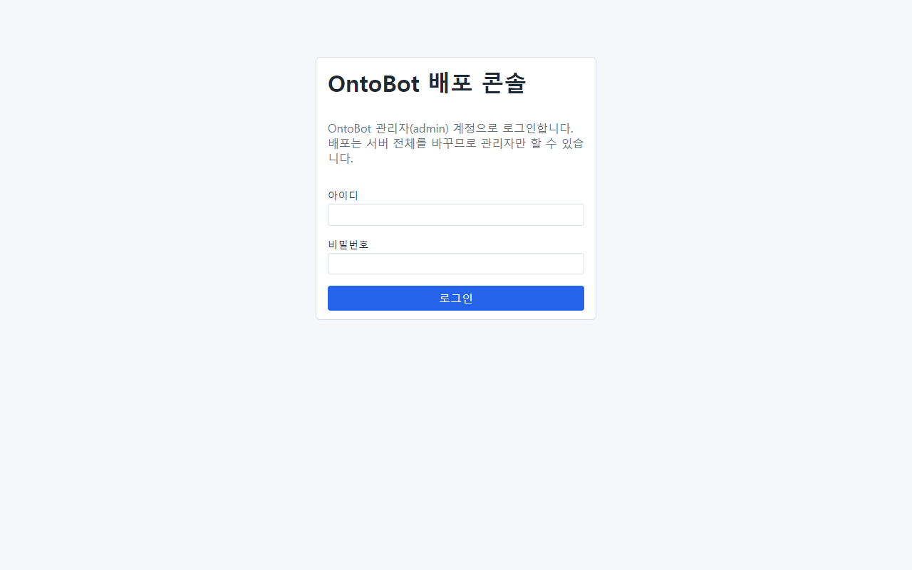
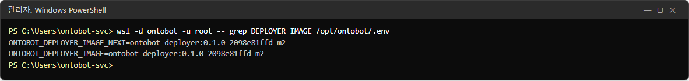
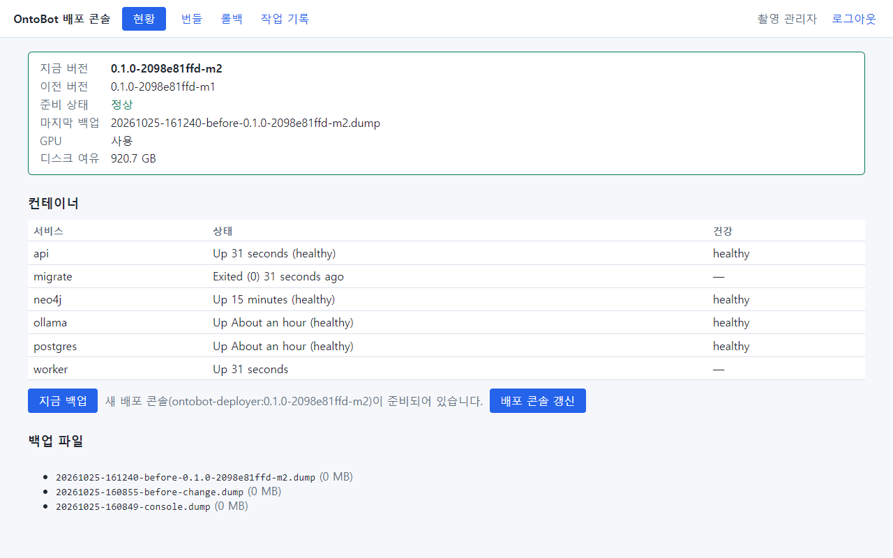
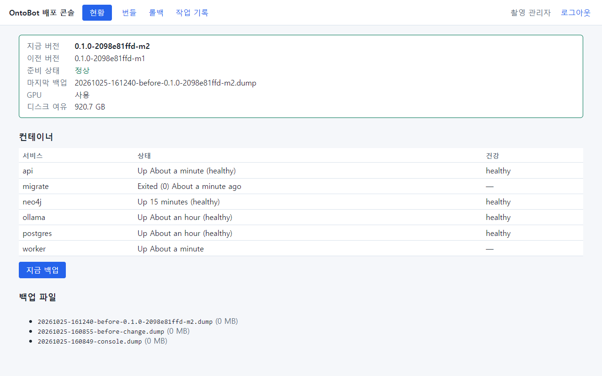
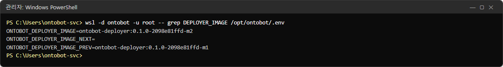
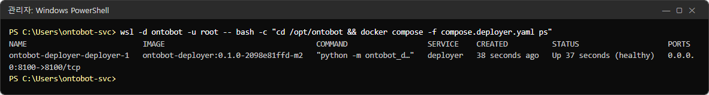

# 23장 배포 콘솔 갱신

업그레이드 번들에는 OntoBot 앱뿐 아니라 **새 배포 콘솔**도 들어 있을 수 있습니다. 그런데 업그레이드는 배포 콘솔
자신을 바꾸지 않습니다. 배포 콘솔은 자기가 일하는 도중에 자기를 바꿀 수 없기 때문입니다. 그래서 업그레이드가 끝나면
현황에 안내가 나오고, 운영자가 **배포 콘솔 갱신** 을 따로 누릅니다.

## 23.1 안내가 나오면

업그레이드 뒤 **현황** 에 다음이 보입니다.



| 번호 | 부분 |
| --- | --- |
| ① | **새 배포 콘솔(ontobot-deployer:0.1.0-2098e81ffd-m2)이 준비되어 있습니다.** |
| ② | **배포 콘솔 갱신** 단추 |

서버의 설정에는 지금 콘솔 이미지(`ONTOBOT_DEPLOYER_IMAGE`)와 다음 콘솔 이미지(`ONTOBOT_DEPLOYER_IMAGE_NEXT`)가 함께
적혀 있습니다.

```powershell
wsl -d ontobot -u root -- grep DEPLOYER_IMAGE /opt/ontobot/.env
```



## 23.2 갱신하기

1. 진행 중인 배포 작업이 없는지 확인합니다(상단 **작업 진행 중** 이 없어야 함).
2. **배포 콘솔 갱신** 을 누릅니다. 확인 창: **"배포 콘솔이 잠시 다시 시작됩니다(다시 로그인). 진행할까요?"** → **확인**.
3. 작업 기록 화면이 나오고 곧 **성공** 이 됩니다.



| 출력 | 뜻 |
| --- | --- |
| `==> 배포 콘솔 갱신 예약 → ontobot-deployer:0.1.0-2098e81ffd-m2 (잠시 뒤 다시 로그인)` | 일회성 컨테이너에게 "콘솔을 새 이미지로 바꿔라"고 맡김 |
| `{"ok":true,"scheduled":"…"}` | 예약 성공 |

4. 몇 초 뒤 배포 콘솔이 다시 시작되면서 **로그인이 끊깁니다.** 새로 고침(F5)하면 로그인 화면이 나옵니다.



5. 다시 로그인합니다.

## 23.3 갱신 직후의 현황

로그인하자마자 현황을 보면 안내가 **아직 남아 있을 수 있습니다.** 이때 설정을 보면 `…_IMAGE` 는 이미 새 이미지인데 `…_NEXT` 도 아직 남아 있습니다.





새 콘솔이 **건강 확인을 통과**한 뒤에야 "다음 콘솔" 표시를 지우기 때문입니다(30초~1분). 잠시 뒤 다시 보면 안내가
사라집니다.



```powershell
wsl -d ontobot -u root -- grep DEPLOYER_IMAGE /opt/ontobot/.env
```



| 설정 | 갱신 뒤 값 | 뜻 |
| --- | --- | --- |
| `ONTOBOT_DEPLOYER_IMAGE` | `…-m2` | 지금 콘솔 |
| `ONTOBOT_DEPLOYER_IMAGE_NEXT` | (빈 값) | 기다리는 콘솔 없음 |
| `ONTOBOT_DEPLOYER_IMAGE_PREV` | `…-m1` | 바로 전 콘솔(문제가 생기면 되돌릴 대상) |

```powershell
wsl -d ontobot -u root -- bash -c "cd /opt/ontobot && docker compose -f compose.deployer.yaml ps"
```



배포 콘솔 컨테이너가 새 이미지(`ontobot-deployer:0.1.0-2098e81ffd-m2`)로 `Up … (healthy)` 입니다.

## 23.4 새 콘솔이 뜨지 않으면

갱신을 맡은 일회성 컨테이너는 새 콘솔이 약 1분 안에 건강해지지 않으면 **이전 콘솔로 자동으로 되돌립니다.** 그래서
갱신이 실패해도 배포 콘솔을 잃지 않습니다.

| 증상 | 할 일 |
| --- | --- |
| 1~2분 뒤에도 `http://<서버>:8100` 이 열리지 않음 | 2분 더 기다림(자동 되돌리기 시간) |
| 그래도 안 열림 | 명령으로 콘솔 상태 확인: `wsl -d ontobot -u root -- bash -c "cd /opt/ontobot && docker compose -f compose.deployer.yaml ps"` |
| 컨테이너가 없거나 멈춤 | `wsl -d ontobot -u root -- bash -c "cd /opt/ontobot && docker compose -f compose.deployer.yaml up -d"` |
| 다시 열렸는데 안내가 그대로 | 새 콘솔이 실패해 이전 콘솔로 돌아온 것 — 개발팀에 문의 |

> **알아 두기** 배포 콘솔이 멈춰도 OntoBot 자체(8000)는 영향을 받지 않습니다. 콘솔이 없는 동안의 배포 작업은 명령
> (`ontobotctl`)으로 할 수 있습니다(29장).

## 23.5 언제 갱신하나

| 상황 | 권장 |
| --- | --- |
| 업그레이드 직후, 확인이 끝난 뒤 | 갱신 |
| 업그레이드가 의심스러워 롤백할지도 모를 때 | 롤백 여부를 정한 뒤 갱신(롤백은 지금 콘솔로도 됨) |
| 갱신 안내를 계속 미뤄도 되나 | 됩니다. 다만 새 콘솔에 고친 점이 있을 수 있으니 릴리스 노트를 보고 정함 |

## 23.6 해 보기

> **해 보기** (시험 서버에서)
>
> 1. 업그레이드 뒤 나타난 **배포 콘솔 갱신** 을 누르고, 다시 로그인할 때까지 걸린 시간을 재 보세요.
> 2. 1분 뒤 현황의 안내가 사라졌는지, 23.3 의 명령으로 `…_NEXT` 가 비었는지 확인하세요.
