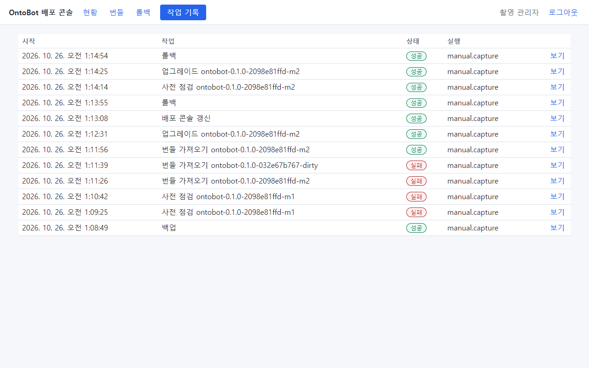
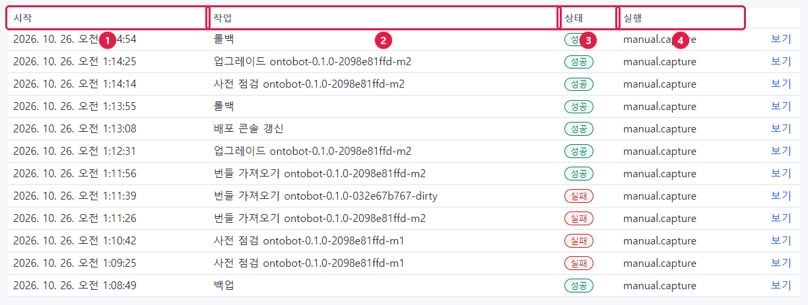
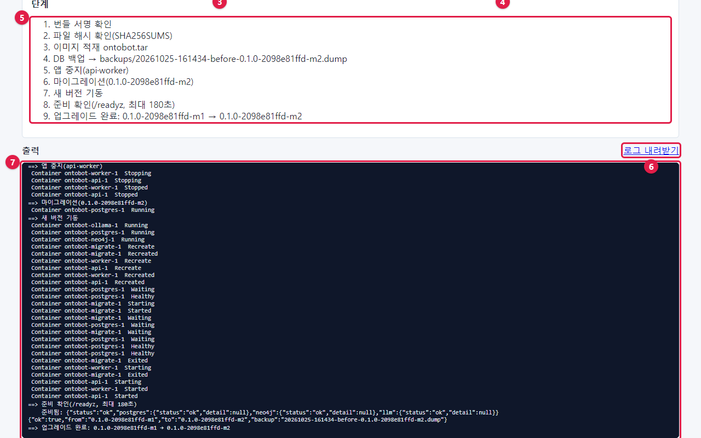
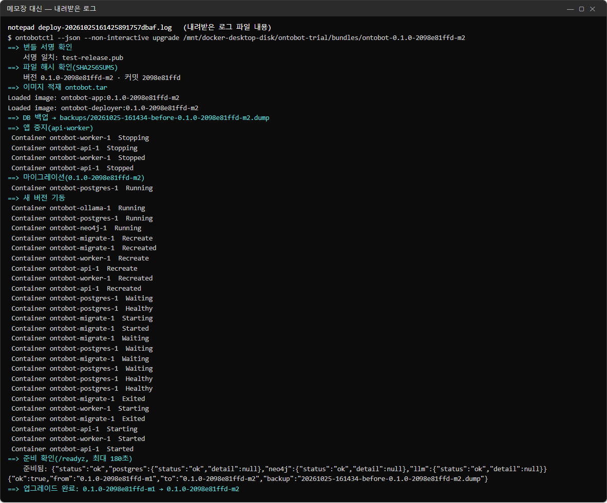
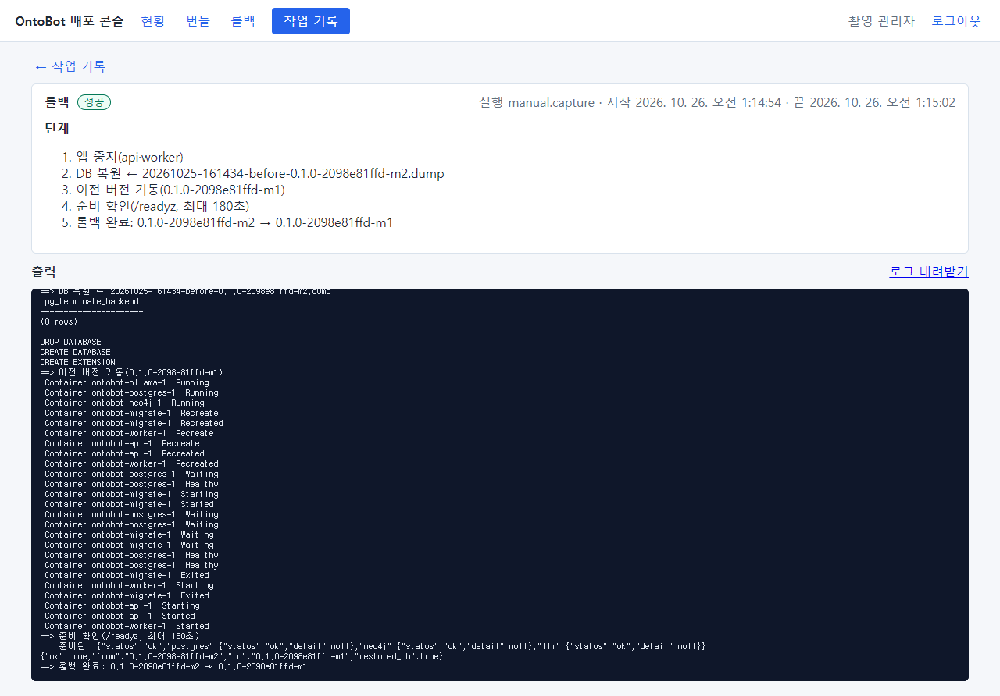
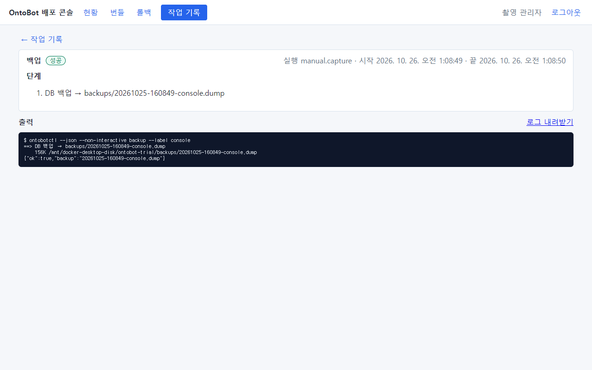
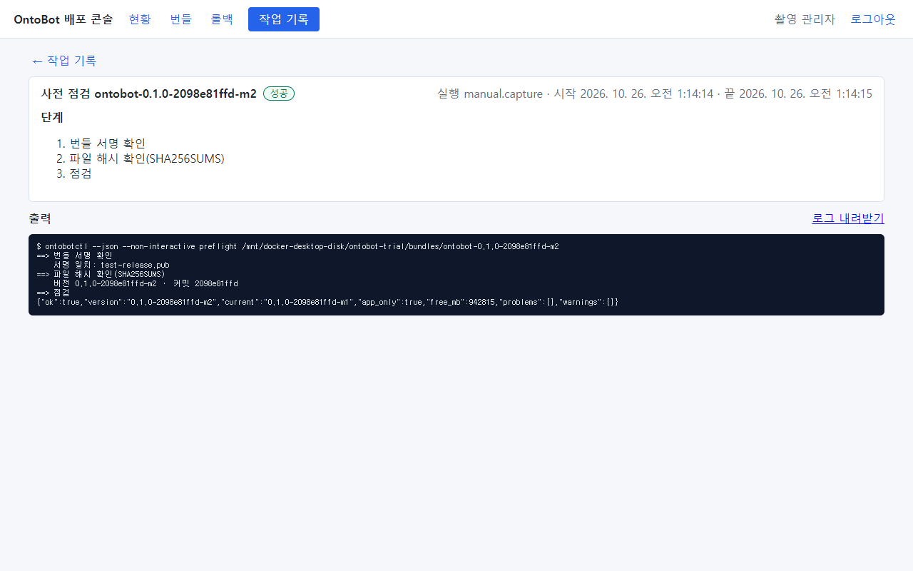
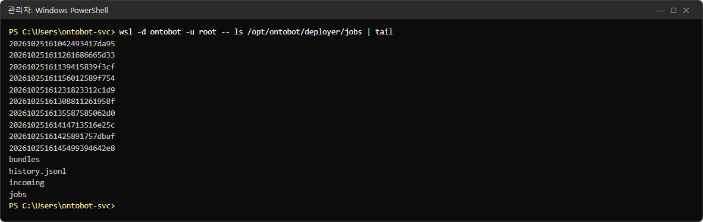

# 24장 작업 기록

배포 콘솔이 한 일(번들 가져오기, 사전 점검, 업그레이드, 롤백, 백업, 배포 콘솔 갱신)은 모두 **작업 기록**에 남습니다.
누가, 언제, 무엇을 했고, 결과가 어땠는지, 그리고 그때 나온 출력 전부가 남습니다. 문제가 생기면 개발팀에 보내는
가장 중요한 자료입니다.

## 24.1 작업 목록

**작업 기록** 탭을 엽니다.



이 목록은 이 책의 20~22장에서 실제로 한 일들입니다(아래가 먼저, 위가 나중).



| 번호 | 칸 | 설명 |
| --- | --- | --- |
| ① | 시작 | 작업을 시작한 시각 |
| ② | 작업 | 종류와 대상 번들. `번들 가져오기 …`, `사전 점검 …`, `업그레이드 …`, `롤백`, `백업`, `배포 콘솔 갱신` |
| ③ | 상태 | 진행 중 / 성공 / 실패 / 끝났으나 준비 확인 실패 / 확인 필요 |
| ④ | 실행 | 작업한 관리자 아이디 |
| — | **보기** | 작업 하나를 자세히 |

| 상태 | 뜻 |
| --- | --- |
| **진행 중** | 지금 돌고 있음 |
| **성공** | 끝까지 성공 |
| **실패** | 도중에 실패(사전 점검이 막힌 경우도 "실패"로 보임) |
| **끝났으나 준비 확인 실패** | 업그레이드·롤백은 끝났지만 180초 안에 준비 확인을 통과하지 못함 |
| **확인 필요** | 배포 콘솔이 작업 도중 다시 시작되어 결과를 모름 — 현황 화면에서 실제 상태 확인 |

> **알아 두기** 목록의 **사전 점검 … 실패** 두 줄은 지금 버전(`-m1`)을 점검해서 "이미 같은 버전"으로 막힌 것입니다
> (20.2). 서버에 문제가 있었던 것이 아닙니다. 작업 기록에서는 "막힘"도 "실패"로 표시됩니다.

## 24.2 작업 하나 보기

목록에서 **보기** 를 누르면 작업 화면이 열립니다. 업그레이드 작업을 열어 보았습니다.



| 번호 | 부분 | 설명 |
| --- | --- | --- |
| ① | **← 작업 기록** | 목록으로 돌아감 |
| ② | 작업 이름 | `업그레이드 ontobot-0.1.0-2098e81ffd-m2` |
| ③ | 상태 표지 | **성공** |
| ④ | 실행·시작·끝 | 누가, 언제 시작해 언제 끝냈는지 |
| ⑤ | 단계 | 출력의 `==>` 줄을 모은 단계 목록. 진행 중이면 마지막 단계가 파란 굵은 글씨 |
| ⑥ | **로그 내려받기** | 출력 전체를 파일로 받음 |
| ⑦ | 출력 | 배포 콘솔이 부른 `ontobotctl` 의 출력 전부(진행 중에는 1초마다 이어 붙음) |

실패한 작업이면 상태 표지 아래에 빨간 상자로 **실패 사유**가 한 줄 나옵니다(20장의 사진).

## 24.3 로그 내려받기

**로그 내려받기** 를 누르면 브라우저가 `deploy-<작업 번호>.log` 파일을 내려받습니다. 메모장으로 열면 출력 전체가
들어 있습니다.



| 줄 | 뜻 |
| --- | --- |
| `$ ontobotctl --json --non-interactive upgrade …` | 콘솔이 실행한 명령 |
| `==> …` | 단계 |
| `Loaded image: …` | 이미지 적재 |
| `Container … Stopping/Recreate/Started` | 컨테이너가 바뀐 과정 |
| `준비됨: {"status":"ok",…}` | 준비 확인 결과 |
| `{"ok":true,…}` | 결과 요약(JSON) |
| `==> 업그레이드 완료: … → …` | 끝 |

> **알아 두기** 개발팀에 문제를 알릴 때는 이 파일을 그대로 첨부하세요. 비밀번호 같은 비밀값은 출력에 나오지 않도록
> 만들어져 있습니다.

## 24.4 다른 작업들

### 롤백



### 백업



### 사전 점검



## 24.5 작업 기록은 어디에 남나

작업 기록은 서버의 `/opt/ontobot/deployer/` 에 파일로 남습니다.

```powershell
wsl -d ontobot -u root -- ls /opt/ontobot/deployer/jobs | tail
```



| 이름 | 무엇 |
| --- | --- |
| `jobs/<작업 번호>/` | 작업마다 폴더 하나(작업 정보와 출력) |
| `history.jsonl` | 작업 요약을 한 줄씩 쌓은 파일(26장) |
| `bundles/` | 번들마다 사전 점검 결과 |
| `incoming/` | 올리는 중인 zip 조각 |

작업 번호는 `20261025161425891757dbaf` 처럼 시작 시각(UTC)으로 시작합니다.

> **알아 두기** 작업 기록과 별도로, 끝난 작업은 OntoBot 의 감사 로그에도 `deploy.*` 로 남습니다(9.6). 감사 로그는 지울
> 수 없고, 작업 기록 폴더는 서버 파일이라 디스크가 고장 나면 잃을 수 있습니다. 중요한 업그레이드의 로그는 내려받아
> 변경 관리 문서에 붙여 두세요.

## 24.6 작업 기록 읽기 요령

| 상황 | 볼 곳 |
| --- | --- |
| 업그레이드가 실패 | 빨간 실패 사유 → 출력에서 `오류:`·`경고:` 줄 → 그 바로 위 단계 |
| 업그레이드가 느렸음 | 단계별로 출력 줄이 찍힌 흐름(이미지 적재·마이그레이션이 오래 걸림) |
| 누가 롤백했나 | 목록의 실행 칸, 감사 로그 `deploy.rollback` |
| "확인 필요" 상태 | 현황 화면의 지금 버전·준비 상태로 실제 결과 판단 → 필요하면 개발팀 |

## 24.7 해 보기

> **해 보기**
>
> 1. 작업 기록에서 가장 최근 업그레이드 작업을 열어 시작과 끝 시각의 차이를 계산하세요.
> 2. **로그 내려받기** 로 파일을 받아 메모장으로 열고, 마지막 JSON 줄의 `backup` 값을 찾으세요.
> 3. 그 백업 파일이 현황의 백업 파일 목록에 있는지 확인하세요.
