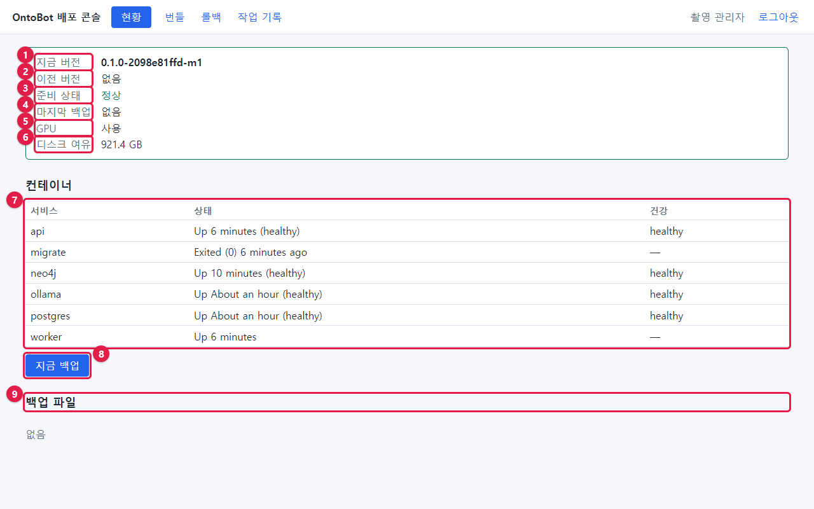
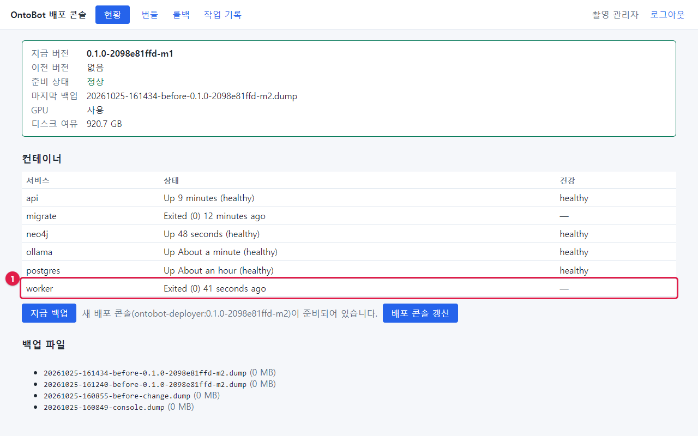
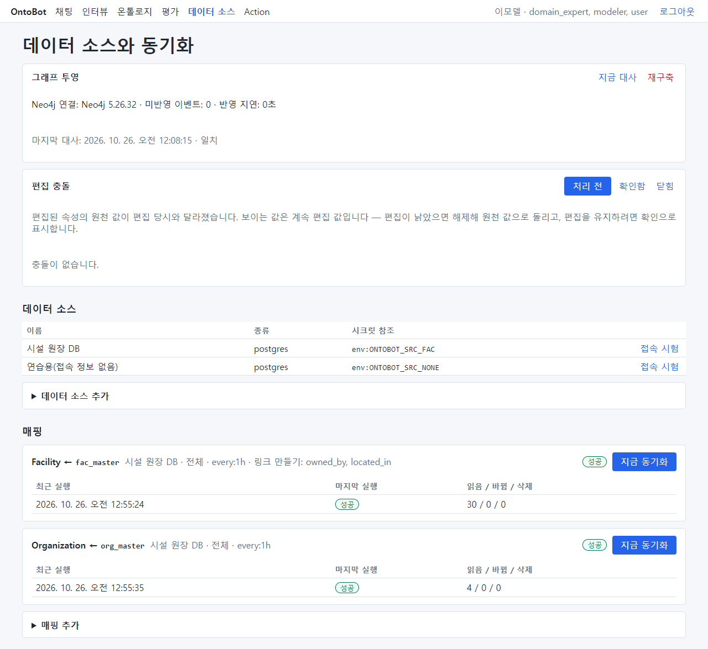
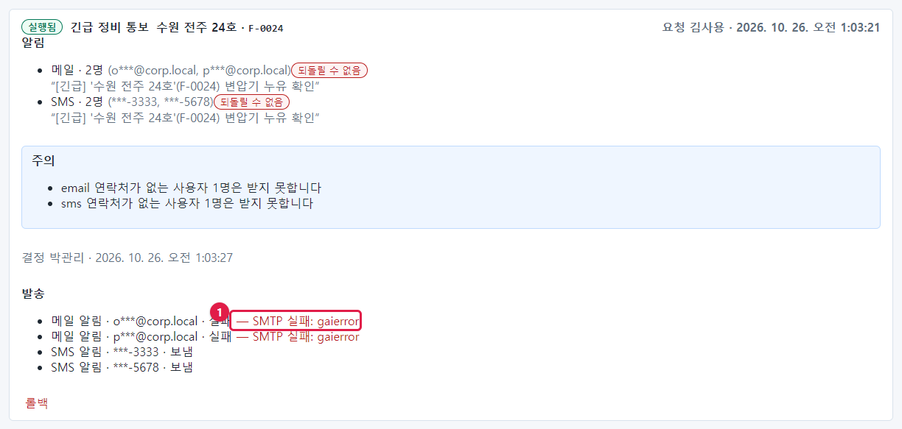
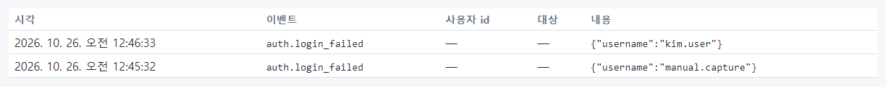

# 25장 정기 점검

이 장은 매일·매주·매달·분기마다 무엇을 어디서 어떻게 보는지 정리한 것입니다. 사진은 앞 장에서 찍은 실제 화면을
다시 실었습니다. 43장에 인쇄해 쓸 수 있는 점검표가 있습니다.

## 25.1 매일 점검(5분)

출근하면 아래 순서로 봅니다. 모두 정상이면 5분이면 끝납니다.

### ① 배포 콘솔 현황 — 준비 상태

| 확인 | 정상 | 아니면 |
| --- | --- | --- |
| 준비 상태 | **정상** | 27장 |
| GPU | **사용** | 18.4 |
| 디스크 여유 | 수십 GB 이상 | 2.6 |

### ② 배포 콘솔 현황 — 컨테이너

| 확인 | 정상 | 아니면 |
| --- | --- | --- |
| api·neo4j·ollama·postgres | `Up … (healthy)` | 27장 |
| **worker** | `Up …` — `Exited` 면 멈춘 것(준비 상태는 정상으로 보이니 꼭 따로 봄) | 27.3 |
| migrate | `Exited (0)` | `Exited (1)` 이면 개발팀 |

### ③ 배포 콘솔 현황 — 백업

| 확인 | 정상 | 아니면 |
| --- | --- | --- |
| 백업 파일 목록 맨 위 | 오늘 새벽 `…-daily.dump` | 19.6 |

### ④ OntoBot 데이터 소스 화면

| 확인 | 정상 | 아니면 |
| --- | --- | --- |
| 그래프 투영 | Neo4j 연결, 미반영 0 근처, 마지막 대사 **일치** | 13장 |
| 편집 충돌 | **충돌이 없습니다.** | 16장 |
| 매핑마다 마지막 실행 | **성공**, 시각이 일정 간격 안 | 12.5 |
| 바뀜 수 | 평소와 비슷(갑자기 전체 행 수와 같으면 주의) | 12.7 |

### ⑤ OntoBot Action 화면 — 전체 기록

| 확인 | 정상 | 아니면 |
| --- | --- | --- |
| 발송 | **실패** 없음 | 15.8 |
| 실패 기록 | 없음 | 14.7 |

### ⑥ 확인 질문(선택, 1분)

같은 질문 두 개(5.6)를 해서 답이 평소와 같은지 봅니다. 샘플 데이터가 아닌 운영 데이터라면, 답이 잘 변하지 않는
질문 두 개를 정해 두고 매일 같은 질문을 합니다.

## 25.2 매주 점검(15분)

| 번호 | 확인 | 어디서 | 이 책 |
| --- | --- | --- | --- |
| 1 | 로그인 실패 반복 | 감사 로그 `auth.login_failed` | 9.3 |
| 2 | 모르는 계정·역할·권한 변경 | 감사 로그 `security.user_created`·`role_changed`·`permission_changed` | 9.3 |
| 3 | 배포 작업 결과 | 감사 로그 `deploy.*`, 배포 콘솔 작업 기록 | 9.6, 24장 |
| 4 | 오래된 승인 대기 | Action 화면(승인자 계정) | 14.8 |
| 5 | 백업 복사본 | `C:\OntoBot\backups`, 회사 백업 체계 | 19.5 |
| 6 | 디스크 추세 | 현황의 디스크 여유를 지난주와 비교 | 2.6 |
| 7 | 앱 로그의 오류 | `docker compose logs --since 168h api \| grep '"level": "ERROR"'` | 26장 |
| 8 | 트레이스의 실패 비율 | 최근 트레이스 목록에서 `failed` 가 늘었는지 | 10.2 |

## 25.3 매달 점검(1시간)

| 번호 | 확인 | 어떻게 |
| --- | --- | --- |
| 1 | 계정 정리 | 사용자 목록을 인사 명단과 맞춰 퇴사·이동자 정지(7장) |
| 2 | 관리자 수 | admin 역할이 2명 이상, 꼭 필요한 사람만 |
| 3 | 읽기 권한 | 역할별 읽기 권한이 업무와 맞는지(8장) |
| 4 | 백업 파일 성한지 | 백업 하나의 목차 읽기(19.4) |
| 5 | 번들 정리 | 오래된·실패 번들 삭제(20.7) |
| 6 | 그래프 대사 | **지금 대사** 또는 대사 명령(13.2) |
| 7 | 보존 기간 정리 | 감사 로그 `ops.retention_purged` 가 매일 남는지 |
| 8 | 비밀번호 파일 권한 | `ls -l /opt/ontobot/.env /opt/ontobot/app.env` 가 `-rw-------`(31장) |

## 25.4 분기 점검·훈련

| 번호 | 할 일 | 이 책 |
| --- | --- | --- |
| 1 | 시험 서버에서 백업 되살리기 연습(개발팀과) | 32장 |
| 2 | 장애 훈련(Neo4j·AI 모델 멈춤과 복구) | 27장, 32장 |
| 3 | 배포 콘솔이 안 되는 상황에서 명령으로 상태 보기 | 29장 |
| 4 | 공개키·서명 키 상태 확인(배포 담당자와) | 4.4, 31장 |
| 5 | 이 매뉴얼의 절차가 현재 버전과 맞는지 검토 | — |

## 25.5 자동으로 도는 일

운영자가 하지 않아도 서버가 알아서 하는 일입니다. 매일 점검에서 "이 일이 제대로 됐는지"를 봅니다.

| 일 | 누가 | 언제 | 확인 |
| --- | --- | --- | --- |
| 매핑 동기화 | worker | 매핑의 일정(예: 1시간마다) | 매핑 카드의 최근 실행 |
| 그래프 반영 | worker | 계속 | 미반영 이벤트 0 근처 |
| 그래프 대사 | worker | 하루 한 번 | 마지막 대사 시각·일치 |
| 보존 기간 정리 | worker | 하루 한 번 | 감사 로그 `ops.retention_purged` |
| 알림 발송·재시도 | worker | 계속 | Action 기록의 발송 |
| DB 백업 | WSL 타이머 | 매일 02:30 | 백업 파일 목록 |

> **알아 두기** 위의 일 대부분을 **worker** 가 합니다. worker 가 멈추면 이 일들이 모두 멈추고 쌓입니다. 그래서 매일
> 점검의 ②에서 worker 를 꼭 따로 보는 것입니다.

## 25.6 점검 기록 남기기

점검 결과는 43장의 양식에 날짜·점검자·결과·조치를 적어 남깁니다. 문제가 반복되면 기록을 보고 원인을 찾을 수 있고,
감사(내부 감사·보안 점검) 때 운영 증적이 됩니다.

## 25.7 해 보기

> **해 보기** 이번 주 월요일부터 금요일까지 매일 25.1 의 ①~⑥을 하고 43장 일일 점검표에 적어 보세요. 금요일에는
> 25.2 의 주간 점검도 해 보세요.
