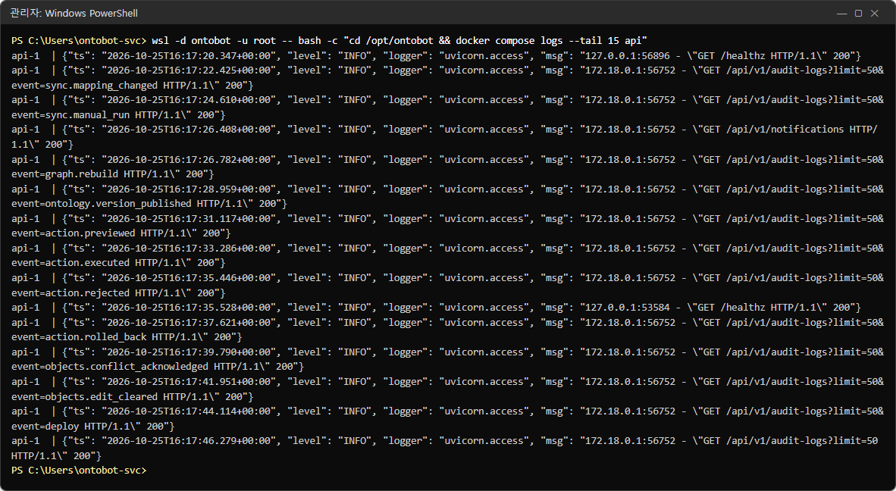
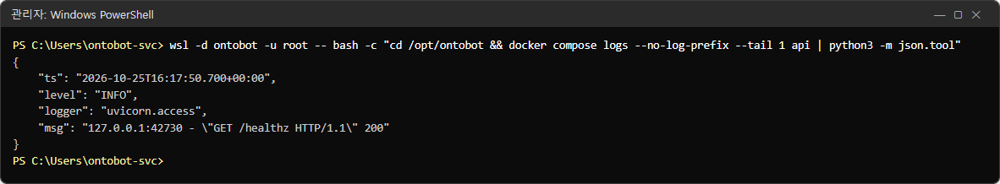
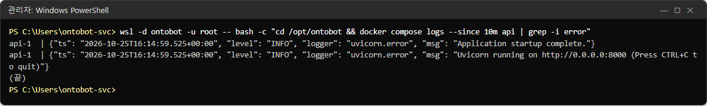
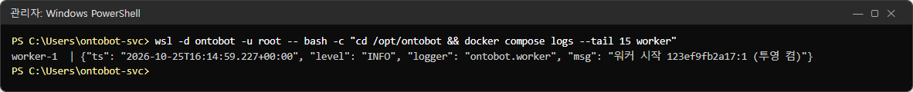
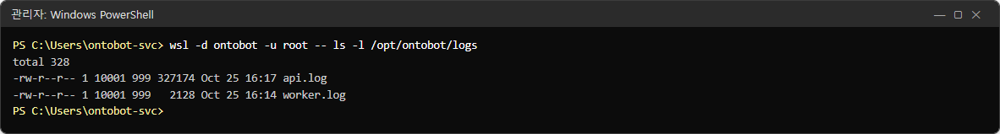
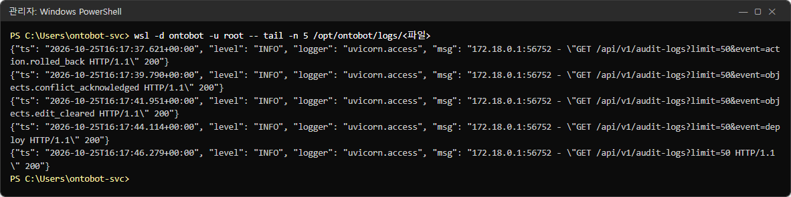
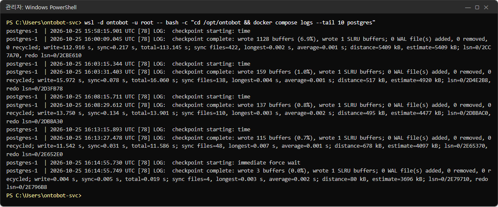
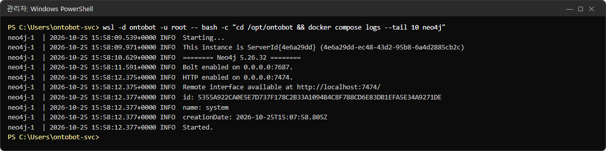
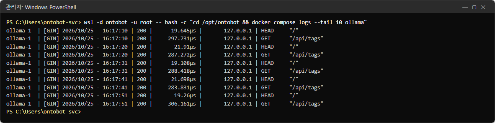
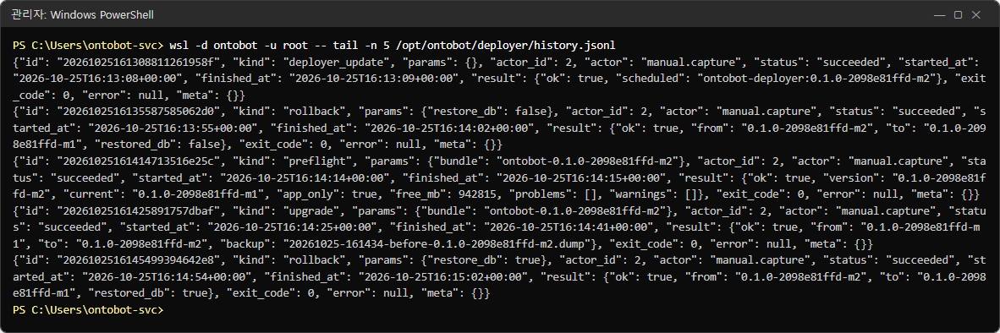

# 26장 로그 보기

문제가 생기면 화면(배포 콘솔 현황, 데이터 소스, Action 기록, 트레이스)을 먼저 보고, 그래도 원인을 모르면 **로그**를
봅니다. 이 장에서는 컨테이너마다 로그를 보는 명령과 읽는 법을 실제 출력으로 익힙니다.

## 26.1 로그가 남는 곳

| 로그 | 보는 방법 | 내용 |
| --- | --- | --- |
| api | `docker compose logs api`, `/opt/ontobot/logs/api.log` | 웹 요청, 오류(JSON 한 줄씩) |
| worker | `docker compose logs worker`, `/opt/ontobot/logs/worker.log` | 동기화·투영·정리 작업 |
| postgres | `docker compose logs postgres` | 데이터베이스 |
| neo4j | `docker compose logs neo4j` | 관계 저장소 |
| ollama | `docker compose logs ollama` | AI 모델 요청 |
| 배포 콘솔 작업 | 배포 콘솔 작업 기록(24장), `/opt/ontobot/deployer/history.jsonl` | 업그레이드·롤백·백업 |

명령은 모두 관리자 PowerShell 에서 다음 모양입니다.

```powershell
wsl -d ontobot -u root -- bash -c "cd /opt/ontobot && docker compose logs <옵션> <서비스>"
```

| 옵션 | 뜻 | 예 |
| --- | --- | --- |
| `--tail N` | 마지막 N줄만 | `--tail 200` |
| `--since 기간` | 그 기간 안의 로그만 | `--since 10m`, `--since 2h`, `--since 2026-10-26T09:00:00` |
| `--no-log-prefix` | 줄 앞의 `api-1 |` 를 뺌 | — |
| `-f` | 계속 따라 보기(끝내려면 Ctrl+C) | `-f --tail 20` |
| `-t` | 줄마다 시각 붙이기 | — |

## 26.2 api 로그

```powershell
wsl -d ontobot -u root -- bash -c "cd /opt/ontobot && docker compose logs --tail 15 api"
```



줄마다 하나의 기록이고 JSON 형식입니다.

| 항목 | 뜻 | 예 |
| --- | --- | --- |
| `ts` | 시각(UTC — 한국 시각보다 9시간 이름) | `2026-10-25T16:17:20.347+00:00` |
| `level` | 무게 | `INFO`, `WARNING`, `ERROR` |
| `logger` | 어느 부분이 남겼나 | `uvicorn.access`(웹 요청), `ontobot.*`(앱) |
| `msg` | 내용 | `"GET /api/v1/audit-logs?… HTTP/1.1" 200` |

웹 요청 줄의 끝 숫자는 응답 코드입니다.

| 코드 | 뜻 |
| --- | --- |
| 200·201·204 | 성공 |
| 401 | 로그인 필요(세션 만료) |
| 403 | 권한 없음 또는 허용되지 않은 출처 |
| 404 | 없는 주소·자원 |
| 409·422 | 요청 내용이 맞지 않음(중복, 잘못된 값) |
| 500 | 서버 오류 — 개발팀에 알릴 일 |
| 503 | 일시적으로 쓸 수 없음(데이터베이스 등) |

> **알아 두기** 사진에 보이는 `GET /healthz … 200` 은 Docker 의 건강 확인이 몇 초마다 부르는 것입니다. 정상입니다.

줄 하나를 보기 좋게 펼치려면:

```powershell
wsl -d ontobot -u root -- bash -c "cd /opt/ontobot && docker compose logs --no-log-prefix --tail 1 api | python3 -m json.tool"
```



## 26.3 오류만 골라 보기

```powershell
wsl -d ontobot -u root -- bash -c "cd /opt/ontobot && docker compose logs --since 10m api | grep -i error"
```



> **주의** 위처럼 `error` 라는 글자로만 거르면, 이름에 error 가 들어간 정상 기록(`"logger": "uvicorn.error"` 의 시작
> 안내)까지 걸립니다. 진짜 오류만 보려면 무게(level)로 거르세요.

```powershell
wsl -d ontobot -u root -- bash -c "cd /opt/ontobot && docker compose logs --since 24h api worker | grep -E '\"level\": \"(ERROR|WARNING)\"'"
```

## 26.4 worker 로그

```powershell
wsl -d ontobot -u root -- bash -c "cd /opt/ontobot && docker compose logs --tail 15 worker"
```



`워커 시작 123ef9fb2a17:1 (투영 켬)` — worker 가 막 켜졌고 그래프 투영도 맡는다는 뜻입니다. worker 는 일이 없으면
조용합니다. 줄이 적은 것은 정상입니다.

> **알아 두기** 지금 판의 worker 는 메일·SMS 발송 결과를 로그에 따로 남기지 않습니다. 발송 결과는 Action 화면의 기록에서
> 봅니다(15.8). 동기화 결과도 데이터 소스 화면의 매핑 카드가 정본입니다.

## 26.5 로그 파일

api·worker 는 같은 내용을 파일로도 남깁니다.

```powershell
wsl -d ontobot -u root -- ls -l /opt/ontobot/logs
```



```powershell
wsl -d ontobot -u root -- tail -n 5 /opt/ontobot/logs/api.log
```



> **알아 두기** 로그 파일은 20MB 가 되면 새 파일로 넘어가고(`api.log.1`, `api.log.2` …) 10개까지만 보관합니다
> (`ONTOBOT_LOG_MAX_BYTES`·`ONTOBOT_LOG_BACKUPS`). 그래서 끝없이 커지지는 않습니다. 개인정보는 로그에 쓰기 전에
> 가려지도록 만들어져 있습니다.

## 26.6 저장소·AI 모델 로그

### PostgreSQL

```powershell
wsl -d ontobot -u root -- bash -c "cd /opt/ontobot && docker compose logs --tail 10 postgres"
```



`checkpoint starting/complete` 는 데이터베이스가 주기적으로 디스크에 정리해 쓰는 정상 기록입니다. 볼 것은 `ERROR`·
`FATAL`·`PANIC` 이 들어간 줄입니다.

### Neo4j

```powershell
wsl -d ontobot -u root -- bash -c "cd /opt/ontobot && docker compose logs --tail 10 neo4j"
```



마지막이 `Started.` 면 정상으로 켜진 것입니다. `ERROR`, `OutOfMemoryError` 가 보이면 개발팀(메모리 설정, 30장).

### Ollama(AI 모델)

```powershell
wsl -d ontobot -u root -- bash -c "cd /opt/ontobot && docker compose logs --tail 10 ollama"
```



`[GIN] … | 200 | … | HEAD "/"`, `GET "/api/tags"` 는 건강 확인과 준비 확인이 부르는 것입니다. 질문을 처리하면
`POST "/api/chat"` 줄이 생깁니다. `500` 이나 `out of memory` 가 보이면 GPU 메모리 문제일 수 있습니다(29장의 GPU 확인).

## 26.7 배포 작업 요약

```powershell
wsl -d ontobot -u root -- tail -n 5 /opt/ontobot/deployer/history.jsonl
```



작업 하나가 한 줄입니다. `kind`(종류), `actor`(누가), `status`, `started_at`·`finished_at`, `result`(결과 요약),
`exit_code`(0 성공·1 실패·2 준비 확인 실패)가 들어 있습니다.

## 26.8 개발팀에 로그를 보낼 때

| 순서 | 할 일 |
| --- | --- |
| 1 | 문제가 난 시각을 정확히 적습니다(한국 시각, 그리고 UTC 로도) |
| 2 | 그 시각 앞뒤 10분의 로그를 파일로 저장합니다(아래 명령) |
| 3 | 관련 화면(현황·트레이스 번호·작업 기록)을 함께 보냅니다 |

```powershell
wsl -d ontobot -u root -- bash -c "cd /opt/ontobot && docker compose logs --since 2026-10-26T00:00:00 --until 2026-10-26T00:20:00 api worker" > C:\Temp\ontobot-logs.txt
```

> **알아 두기** `--since`·`--until` 의 시각은 UTC 로 적습니다(한국 시각 오전 9시 = UTC 0시).

## 26.9 해 보기

> **해 보기**
>
> 1. `-f --tail 20` 으로 api 로그를 따라 보면서, 다른 창에서 채팅 질문을 하나 해 보세요. 어떤 줄들이 생기나요?
>    (Ctrl+C 로 끝냅니다.)
> 2. 최근 24시간의 `ERROR`·`WARNING` 줄이 몇 개인지 세어 보세요.
