# 27장 장애 대응 실습 — 일부러 멈춰 보기

장애는 미리 겪어 본 사람이 빨리 고칩니다. 이 장에서는 시험 서버에서 구성 요소를 **하나씩 일부러 멈추고**, 그때
사용자 화면·배포 콘솔·준비 상태가 어떻게 보이는지, 어떻게 되살리는지를 실제로 확인했습니다. 운영 서버에서 장애가
나면 이 장의 사진과 같은 모습을 찾아 같은 방법으로 고치면 됩니다.

> **주의** 이 장의 실습은 **시험 서버**나 **업무 시간 외**에만 하세요. 멈추는 동안 사용자가 영향을 받습니다.

## 27.0 장애 대응 순서

```
 1. 증상 듣기(누가·언제·무슨 화면)  →  2. 배포 콘솔 현황 보기  →  3. 멈춘 것 찾기
        →  4. 그것만 다시 시작  →  5. 확인 질문·현황으로 회복 확인  →  6. 기록·보고
```

| 현황에서 보이는 것 | 바로 갈 절 |
| --- | --- |
| 준비 상태 **사용 불가**, ollama `Exited` | 27.1 |
| 준비 상태 **일부 저하** | 27.2 |
| 준비 상태 **정상** 인데 worker `Exited` | 27.3 |
| 준비 상태 **응답 없음**, api `Exited` | 27.4 |
| 준비 상태 **사용 불가**, postgres `Exited` / 배포 콘솔 로그인 안 됨 | 27.5 |
| 배포 콘솔 자체가 안 열림 | 27.6 |
| 웹은 뜨는데 로그인에 "허용되지 않은 출처" | 27.7 |

## 27.1 AI 모델(ollama)이 멈추면

```powershell
wsl -d ontobot -u root -- bash -c "cd /opt/ontobot && docker compose stop ollama"
```

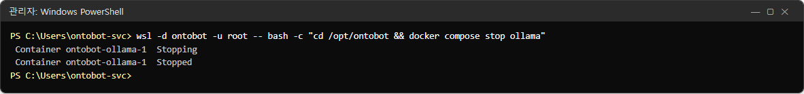

### 사용자 화면

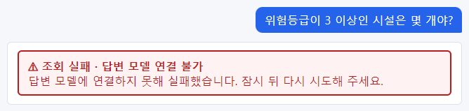

모든 질문이 **조회 실패 · 답변 모델 연결 불가 — 답변 모델에 연결하지 못해 실패했습니다.** 질문을 조회 조건으로
바꾸는 일(계획)부터 AI 가 하므로, 조회 조건 줄도 나오지 않습니다.

### 준비 상태와 현황

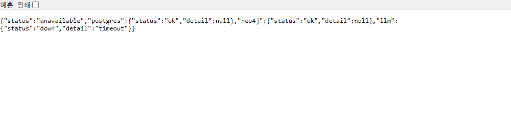

`"status":"unavailable"`, `"llm":{"status":"down","detail":"timeout"}`.

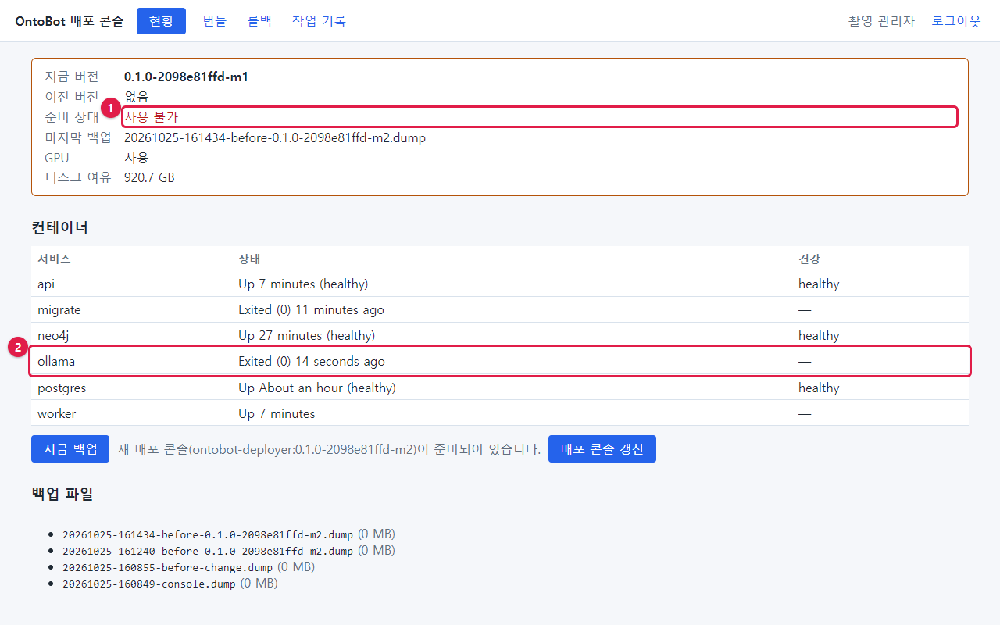

① 준비 상태 **사용 불가**, ② ollama `Exited (0)`.

### 되살리기

```powershell
wsl -d ontobot -u root -- bash -c "cd /opt/ontobot && docker compose start ollama"
```

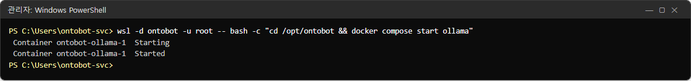

ollama 는 켜지고 건강해지는 데 30초~1분, 첫 질문에서 모델을 메모리에 올리느라 10~30초가 더 걸립니다. 현황이 **정상**
이 되면 확인 질문을 합니다.

| ollama 가 다시 켜지지 않을 때 | 확인 |
| --- | --- |
| `Restarting` 을 반복 | `docker compose logs --tail 50 ollama` 에서 GPU·메모리 오류 |
| GPU 오류 | 윈도의 NVIDIA 드라이버, `nvidia-smi`(29.4) |
| 디스크 부족 | 2.6 |

## 27.2 관계 저장소(Neo4j)가 멈추면

13.3 에서 자세히 다뤘습니다. 요약하면:

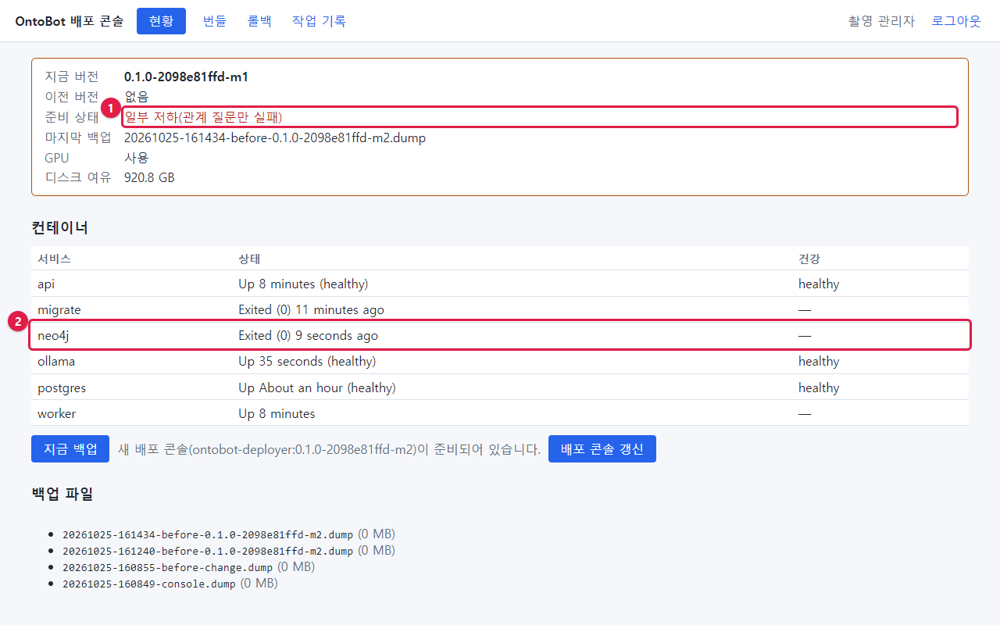

| 항목 | 모습 |
| --- | --- |
| 준비 상태 | **일부 저하(관계 질문만 실패)** |
| 사용자 | 관계 질문만 "관계 저장소 연결 불가", 나머지는 정상 |
| 되살리기 | `docker compose start neo4j` → 1분 → 데이터 소스 화면 **지금 대사** |

## 27.3 워커(worker)가 멈추면

worker 는 사용자 화면 뒤에서 일하므로, 멈춰도 **바로 티가 나지 않습니다.** 그래서 가장 놓치기 쉬운 장애입니다.

```powershell
wsl -d ontobot -u root -- bash -c "cd /opt/ontobot && docker compose stop worker"
```

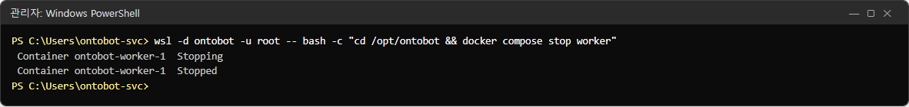

### 데이터 소스 화면

**지금 동기화** 를 누르면 평소처럼 "동기화 작업을 넣었습니다. 워커가 실행합니다." 가 나옵니다.

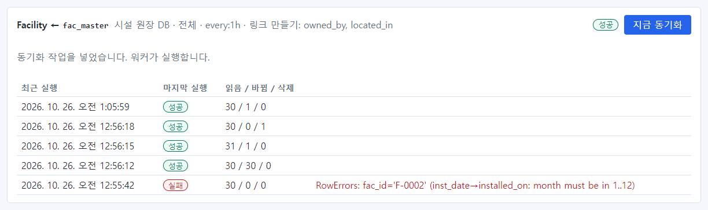

한 번 더 누르면 "이미 대기 중인 동기화가 있습니다." — 작업이 줄 서 있지만 실행되지 않고 있다는 단서입니다.

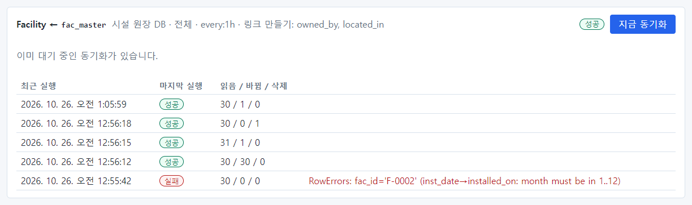

30초가 지나도 최근 실행에 새 줄이 생기지 않습니다(맨 위가 여전히 오전 1:05:59).

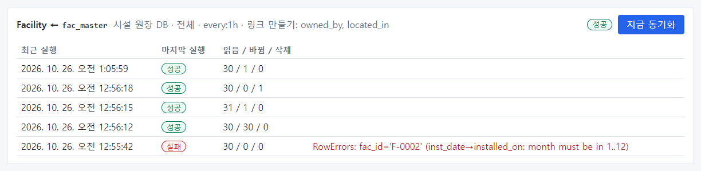

### 현황

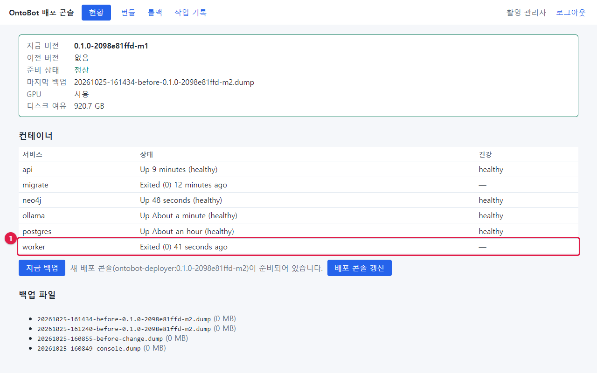

**준비 상태는 정상**이고, ① worker 줄만 `Exited (0)` 입니다. 빨간색으로 칠해지지도 않습니다(18.3). 표의 글자를 읽어야
압니다.

| worker 가 멈추면 생기는 일 |
| --- |
| 동기화가 돌지 않음(수동·일정 모두) — 답이 예전 데이터 |
| 그래프 반영이 멈춤 — 미반영 이벤트가 쌓이고 10분 뒤 "반영 지연" 경고 |
| 메일·SMS 가 나가지 않음 — 발송이 **대기** 로 남음 |
| 보존 기간 정리, 매일 그래프 대사가 안 됨 |

### 되살리기

```powershell
wsl -d ontobot -u root -- bash -c "cd /opt/ontobot && docker compose start worker"
```

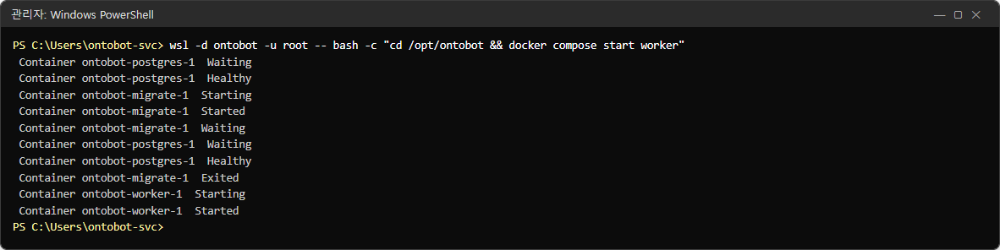

worker 는 켜지자마자 쌓인 일을 처리합니다. 줄 서 있던 동기화가 바로 실행되었습니다(맨 위 오전 1:27:31).

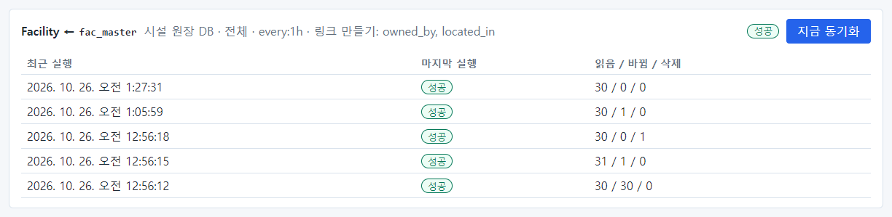

## 27.4 api 가 멈추면

```powershell
wsl -d ontobot -u root -- bash -c "cd /opt/ontobot && docker compose stop api"
```

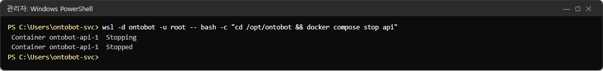

### 사용자 화면


브라우저가 **이 페이지에 연결할 수 없습니다 — 연결을 거부했습니다(ERR_CONNECTION_REFUSED)** 를 보여 줍니다. OntoBot
화면 자체가 뜨지 않습니다.

### 현황

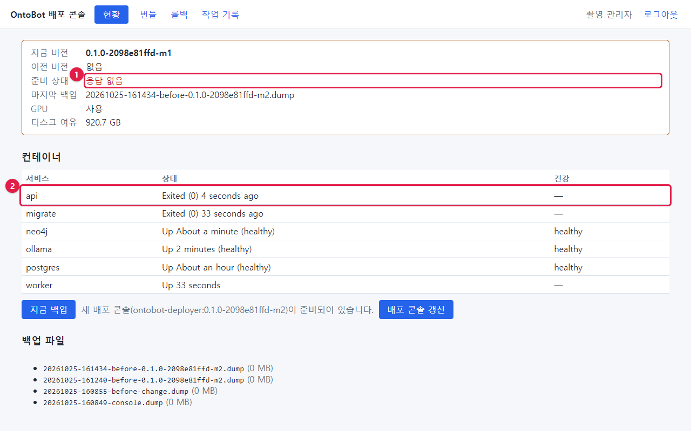

① 준비 상태 **응답 없음**, ② api `Exited (0)`. 배포 콘솔은 OntoBot 과 따로 돌기 때문에 이때도 열립니다.

### 되살리기

```powershell
wsl -d ontobot -u root -- bash -c "cd /opt/ontobot && docker compose start api"
```

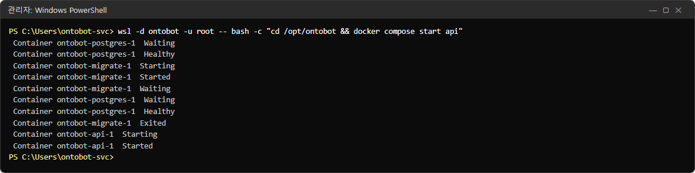

api 는 10~20초면 `(healthy)` 가 됩니다.

| 사용자가 접속 못 하는데 api 가 `Up` 일 때 | 확인 |
| --- | --- |
| 서버 안에서는 되는데 다른 PC 에서 안 됨 | 방화벽, 포트 전달(재부팅 뒤라면 27.8) |
| 로그인에서만 막힘 | 27.7, 6.1 |

## 27.5 데이터베이스(PostgreSQL)가 멈추면

PostgreSQL 은 모든 기록의 원본입니다. 멈추면 거의 모든 기능이 멈춥니다. **꼭 필요할 때만** 다시 시작하세요.

```powershell
wsl -d ontobot -u root -- bash -c "cd /opt/ontobot && docker compose stop postgres"
```

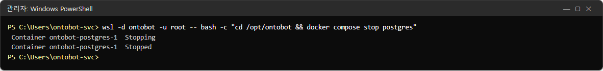

### 이미 로그인해 있던 배포 콘솔

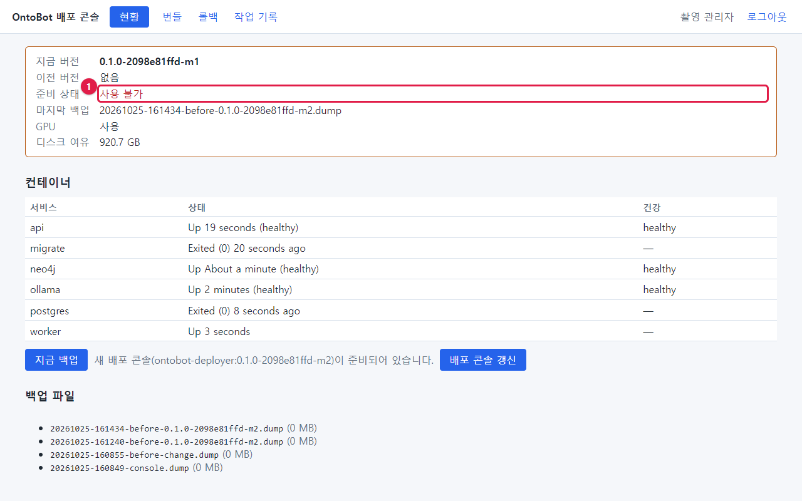

① 준비 상태 **사용 불가**, postgres `Exited (0)`.

### 새로 로그인하려 하면

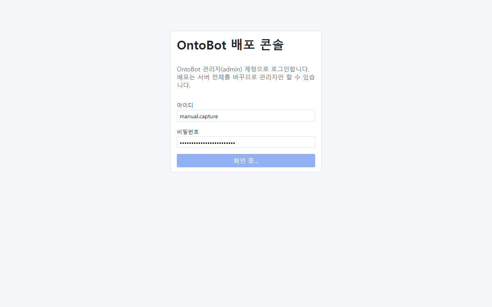

배포 콘솔은 로그인할 때 OntoBot 데이터베이스에서 계정을 확인합니다. 데이터베이스가 멈췄으므로 **확인 중…** 에서
한참 기다리다 실패합니다("앱 DB 에 닿지 못해 로그인할 수 없습니다"). OntoBot 웹 화면의 로그인도 같습니다.

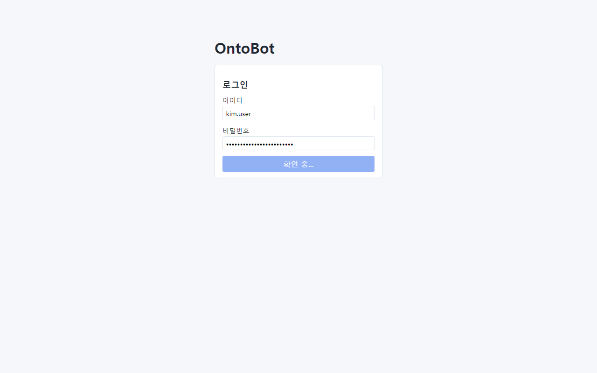

> **알아 두기** 이때는 배포 콘솔에 새로 들어갈 수 없으므로 **명령**으로 상태를 보고 되살립니다. 그래서 운영자는
> 29장의 명령을 미리 익혀 두어야 합니다.

### 되살리기

```powershell
wsl -d ontobot -u root -- bash -c "cd /opt/ontobot && docker compose start postgres"
```

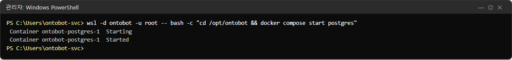

PostgreSQL 이 `(healthy)` 가 되면 api·worker 는 저절로 다시 연결합니다. 준비 상태가 **ok** 로 돌아왔습니다.

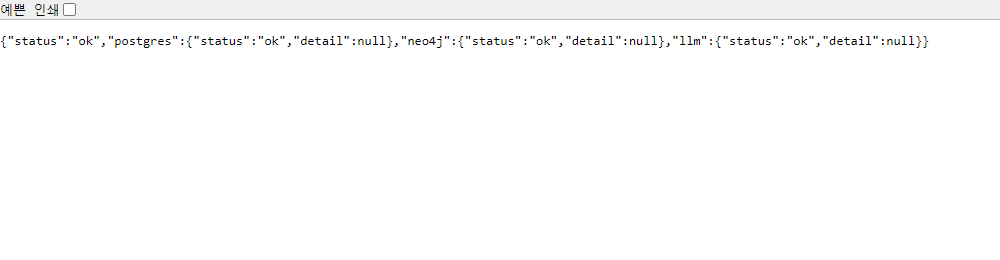

| PostgreSQL 이 다시 켜지지 않을 때 | 할 일 |
| --- | --- |
| `docker compose logs --tail 100 postgres` 에 `PANIC`·`could not` | **혼자 고치지 말고** 개발팀에 바로 연락 |
| 디스크 부족 | 디스크 확보 후 다시 시작 |

> **주의** PostgreSQL 데이터 볼륨(`ontobot_pgdata`)을 지우거나, 데이터 폴더를 손으로 고치지 마세요. 되살릴 수 없는
> 손상이 생길 수 있습니다. 최후의 수단은 백업에서 되살리는 것이며 개발팀과 함께 합니다(19.7).

## 27.6 배포 콘솔이 멈추면

```powershell
wsl -d ontobot -u root -- docker stop ontobot-deployer-deployer-1
```

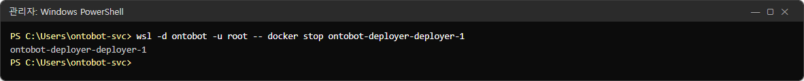

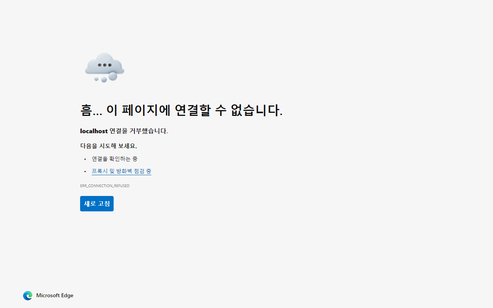

배포 콘솔(8100)이 열리지 않습니다. **OntoBot(8000)은 정상**입니다. 사용자에게는 영향이 없습니다.

```powershell
wsl -d ontobot -u root -- docker start ontobot-deployer-deployer-1
```

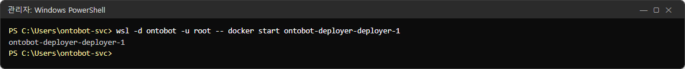

컨테이너가 아예 없어졌으면 다음으로 다시 만듭니다.

```powershell
wsl -d ontobot -u root -- bash -c "cd /opt/ontobot && docker compose -f compose.deployer.yaml up -d"
```

## 27.7 "허용되지 않은 출처의 요청입니다"

OntoBot 은 설정한 접속 주소(`ONTOBOT_ALLOWED_ORIGINS`)로 들어온 요청만 받습니다. 다른 주소로 접속해 로그인하면:

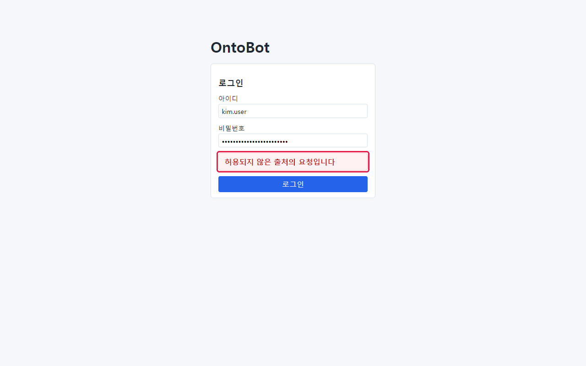

이 사진은 허용 주소가 `http://localhost:8000` 인 시험 서버에 `http://127.0.0.1:8000` 으로 접속해 로그인한 것입니다.
화면은 뜨지만 로그인이 **허용되지 않은 출처의 요청입니다** 로 거절됩니다.

| 원인 | 할 일 |
| --- | --- |
| 사용자가 다른 주소(IP, 다른 이름)로 접속 | 공지한 주소로 접속하도록 안내 |
| 서버 이름·주소가 바뀜, HTTPS 로 바꿈 | `app.env` 의 `ONTOBOT_ALLOWED_ORIGINS` 에 실제 주소를 넣고 반영(30장) |

`ONTOBOT_ALLOWED_ORIGINS` 에는 여러 주소를 넣을 수 있습니다. 예: `["https://ontobot.corp.local","http://ontobot.corp.local:8000"]`.

## 27.8 재부팅 뒤 접속이 안 될 때

윈도 서버를 재부팅하면 예약 작업 `OntoBot-Host` 가 WSL 배포판을 깨우고 8000·8100 포트를 다시 이어 줍니다. 이 작업이
실패하면 서버 안에서는 되는데 다른 PC 에서는 접속이 안 됩니다.

| 순서 | 확인 | 명령·위치 |
| --- | --- | --- |
| 1 | 배포판이 켜져 있는가 | `wsl -l -v` → `ontobot` 이 `Running` |
| 2 | 컨테이너가 떴는가 | `wsl -d ontobot -u root -- ontobotctl status` |
| 3 | 예약 작업 결과 | 작업 스케줄러 → `OntoBot-Host` → 마지막 실행 결과 |
| 4 | 포트 전달 | `netsh interface portproxy show v4tov4` 에 8000·8100 이 있는가 |
| 5 | 수동 실행 | 작업 스케줄러에서 `OntoBot-Host` 를 마우스 오른쪽 → **실행** |

> **알아 두기** 촬영 PC 에는 이 예약 작업이 없어(00장 "촬영 환경") 사진이 없습니다. 처음 설치한 날 반드시 한 번
> 재부팅해 확인하세요(5.8).

## 27.9 한꺼번에 다시 시작

무엇이 문제인지 모르겠고 업무 시간 외라면, OntoBot 전체를 차례로 다시 시작할 수 있습니다.

```powershell
wsl -d ontobot -u root -- bash -c "cd /opt/ontobot && docker compose restart"
```

PostgreSQL 까지 다시 시작하므로 1~2분 동안 모든 기능이 멈춥니다. 그래도 안 되면 WSL 배포판을 다시 시작합니다.

```powershell
wsl --terminate ontobot
schtasks /run /tn OntoBot-Host
```

> **주의** `wsl --shutdown` 은 서버의 모든 WSL 배포판을 끕니다. 같은 서버에 다른 WSL 업무가 있다면 쓰지 마세요.

## 27.10 장애 기록

장애가 끝나면 43장의 장애 보고 양식에 다음을 남깁니다.

| 항목 | 예 |
| --- | --- |
| 발생·인지·복구 시각 | 09:12 / 09:20 / 09:31 |
| 증상 | 모든 질문이 "답변 모델 연결 불가" |
| 원인 | ollama 컨테이너 종료(GPU 드라이버 갱신 뒤) |
| 조치 | `docker compose start ollama` |
| 영향 | 19분, 사용자 약 30명 |
| 재발 방지 | 드라이버 갱신 전 OntoBot 공지, 갱신 뒤 현황 확인 |

## 27.11 해 보기

> **해 보기** (시험 서버에서, 업무 시간 외)
>
> 1. worker 를 멈추고 데이터 소스 화면에서 **지금 동기화** 를 두 번 눌러 보세요. 무엇이 다른가요?
> 2. 현황에서 worker 줄을 찾아 상태를 읽고, 준비 상태가 무엇인지 확인하세요.
> 3. worker 를 다시 켜고 동기화가 실행되는지 확인하세요.
