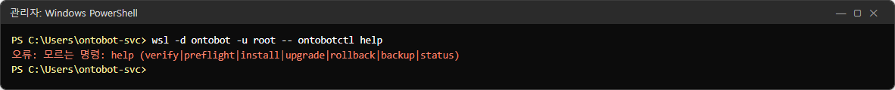
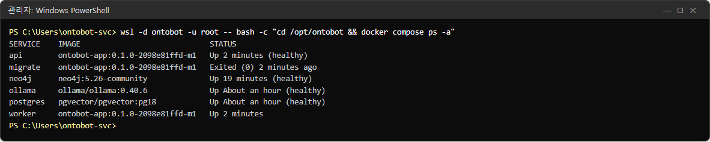
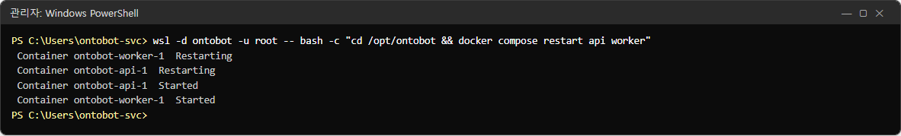
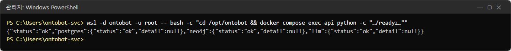
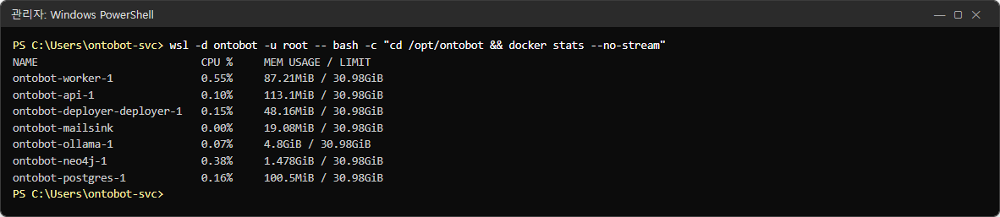
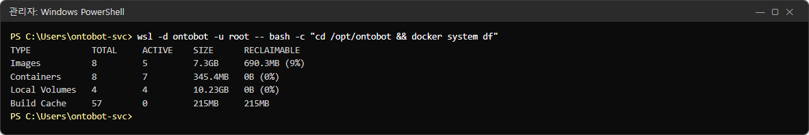
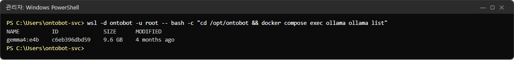
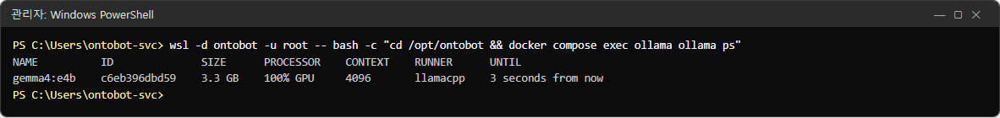
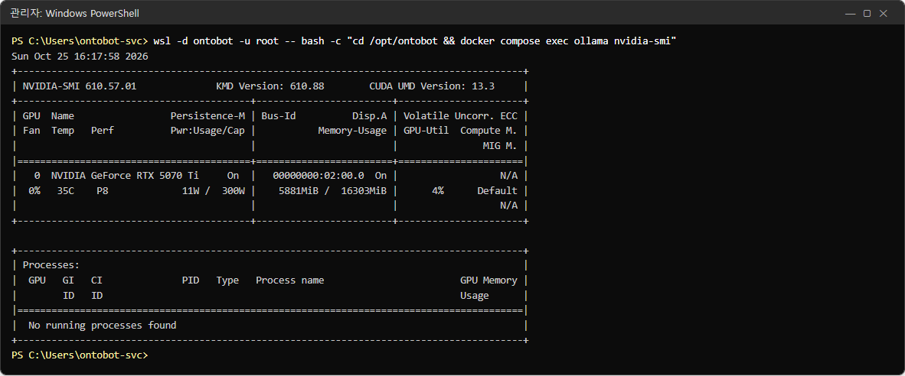

# 29장 명령 모음

이 장은 운영자가 쓰는 명령을 목적별로 모았습니다. 모두 **관리자 권한 PowerShell** 에서 입력합니다. 사진은 시험
서버에서 실제로 실행한 결과입니다.

## 29.1 명령의 모양

OntoBot 의 명령은 대부분 세 가지 모양 중 하나입니다.

| 모양 | 예 | 쓰임 |
| --- | --- | --- |
| `wsl -d ontobot -u root -- <명령>` | `wsl -d ontobot -u root -- ontobotctl status` | WSL 배포판 안에서 root 로 명령 하나 |
| `wsl -d ontobot -u root -- bash -c "cd /opt/ontobot && <명령>"` | `… && docker compose ps` | 설치 폴더에서 compose 명령 |
| `wsl -d ontobot -u root -- nano <파일>` | `… nano /opt/ontobot/app.env` | 설정 파일 고치기 |

> **알아 두기** 긴 명령을 매번 치기 번거로우면, PowerShell 에서 `wsl -d ontobot -u root` 만 입력해 배포판 안으로
> 들어간 뒤(프롬프트가 `root@…#` 로 바뀜) `cd /opt/ontobot` 하고 `docker compose ps` 처럼 짧게 칠 수 있습니다.
> 나올 때는 `exit`.

## 29.2 `ontobotctl` — 설치·업그레이드·롤백·백업

`ontobotctl` 은 배포 절차의 정본입니다. 배포 콘솔도 이 명령을 부릅니다. 모르는 명령을 주면 쓸 수 있는 명령을
알려 줍니다.

```powershell
wsl -d ontobot -u root -- ontobotctl help
```



| 명령 | 하는 일 | 바꾸나 | 이 책 |
| --- | --- | --- | --- |
| `ontobotctl status` | 설치 상태·컨테이너·준비 상태 | 아니요 | 2.3 |
| `ontobotctl status --json` | 같은 내용을 JSON 한 줄로(배포 콘솔이 씀) | 아니요 | 18.5 |
| `ontobotctl verify <번들>` | 서명·파일 지문만 확인 | 아니요 | 4.4 |
| `ontobotctl preflight <번들>` | 확인 + 버전·디스크·GPU 점검 | 아니요 | 20장 |
| `ontobotctl backup [--label 이름]` | DB 백업 | 백업 파일 생성 | 19.3 |
| `ontobotctl upgrade <번들>` | 업그레이드 | **예** | 21장 |
| `ontobotctl rollback` | 프로그램만 롤백 | **예** | 22장 |
| `ontobotctl rollback --restore-db` | DB 까지 롤백(RESTORE 를 물음) | **예, 데이터 손실** | 22장 |
| `ontobotctl install <번들> …` | 최초 설치(설치 스크립트가 부름) | **예** | 5장 |
| `ontobotctl deployer-update` | 배포 콘솔 갱신 예약 | 예 | 23장 |

공통 선택 사항: `--json`(마지막 줄에 결과 JSON), `--non-interactive`(묻지 않음 — 배포 콘솔용). 종료 코드는
0(성공)·1(실패)·2(끝났으나 준비 확인 실패)입니다.

> **알아 두기** 업그레이드·롤백·설치는 한 번에 하나만 됩니다. 배포 콘솔에서 작업 중일 때 이 명령들을 치면 `오류: 다른
> 배포 작업이 진행 중입니다` 로 멈춥니다. 단, `backup` 은 잠금을 쓰지 않아 업그레이드 중에도 실행되어 버립니다(21.4).
> 업그레이드 중에는 명령 백업을 하지 마세요.

## 29.3 `docker compose` — 컨테이너 다루기

### 상태 보기

```powershell
wsl -d ontobot -u root -- bash -c "cd /opt/ontobot && docker compose ps -a"
```



`-a` 를 붙이면 끝난 컨테이너(migrate)도 보입니다. 이미지 칸으로 지금 버전을 확인할 수 있습니다.

### 다시 시작·멈춤·시작

```powershell
wsl -d ontobot -u root -- bash -c "cd /opt/ontobot && docker compose restart api worker"
```



| 명령 | 하는 일 | 쓰는 때 |
| --- | --- | --- |
| `docker compose restart <서비스…>` | 껐다 켬 | `config/` 파일을 바꾼 뒤, 일시적 이상 |
| `docker compose stop <서비스>` | 멈춤 | 장애 실습, 점검 |
| `docker compose start <서비스>` | 멈춘 것을 켬 | 27장 |
| `docker compose up -d` | 설정대로 맞춤(바뀐 것만 다시 만듦) | `app.env` 를 바꾼 뒤 |
| `docker compose logs …` | 로그 | 26장 |

서비스 이름: `api`, `worker`, `postgres`, `neo4j`, `ollama`. 배포 콘솔은 `docker compose -f compose.deployer.yaml …`.

> **주의** `docker compose down` 은 컨테이너를 지웁니다(데이터 볼륨은 남지만). `docker compose down -v`,
> `docker volume rm`, `docker system prune` 은 **데이터를 지울 수 있으니 쓰지 마세요.** 개발팀이 지시할 때만.

### 준비 상태를 서버 안에서

```powershell
wsl -d ontobot -u root -- bash -c "cd /opt/ontobot && docker compose exec -T api python -c \"import urllib.request as u;print(u.urlopen('http://127.0.0.1:8000/readyz').read().decode())\""
```



서버 밖(관리자 PC)에서는 `curl.exe -s http://<서버>:8000/readyz` 가 같습니다(5.5).

## 29.4 자원 보기

여기서는 명령만 간단히 모았습니다. 출력 읽는 법과 평소·바쁠 때의 비교는 39장, 데이터베이스·관계 저장소 질의는 40장에
있습니다.

### CPU·메모리

```powershell
wsl -d ontobot -u root -- bash -c "cd /opt/ontobot && docker stats --no-stream"
```



| 컨테이너 | 평소 메모리(시험 서버) |
| --- | --- |
| ollama | 수 GB(모델을 올렸을 때) |
| neo4j | 1~2GB |
| postgres·api·worker | 수십~수백 MB |
| deployer | 수십 MB |

> **알아 두기** 사진의 `ontobot-mailsink` 는 15장에서 쓴 시험용 메일 수신기입니다. 운영 서버에는 없습니다.
> `LIMIT`(30.98GiB)은 촬영 PC 의 WSL 메모리 상한입니다. 운영 서버는 설치 때 정한 값(기본 12GB)이 보입니다.

### 디스크 사용

```powershell
wsl -d ontobot -u root -- bash -c "cd /opt/ontobot && docker system df"
```



| 줄 | 뜻 |
| --- | --- |
| Images | 이미지 크기(이전 버전 이미지 포함). RECLAIMABLE 은 쓰이지 않는 이미지 |
| Containers | 컨테이너 자체의 크기 |
| Local Volumes | 데이터 볼륨(데이터베이스·관계 저장소·AI 모델) |
| Build Cache | 빌드 캐시(운영 서버에는 거의 없음) |

> **주의** RECLAIMABLE 이 있다고 바로 지우지 마세요. 이전 버전 이미지는 롤백에 씁니다.

### AI 모델과 GPU

```powershell
wsl -d ontobot -u root -- bash -c "cd /opt/ontobot && docker compose exec ollama ollama list"
```



`gemma4:e4b`(9.6GB) — `config/llm.yaml` 에 적힌 모델이 있어야 합니다.

```powershell
wsl -d ontobot -u root -- bash -c "cd /opt/ontobot && docker compose exec ollama ollama ps"
```



| 칸 | 값 | 뜻 |
| --- | --- | --- |
| PROCESSOR | `100% GPU` | GPU 로 돌고 있음(CPU 가 섞이면 느림) |
| UNTIL | `3 seconds from now` | 쓰지 않으면 곧 메모리에서 내려감(다음 질문 때 다시 올림) |

목록이 비어 있으면 지금 메모리에 올라간 모델이 없는 것입니다(정상 — 질문하면 올라감).

```powershell
wsl -d ontobot -u root -- bash -c "cd /opt/ontobot && docker compose exec ollama nvidia-smi"
```



GPU 이름, 메모리 사용(`5881MiB / 16303MiB`), 온도가 보이면 컨테이너 안에서 GPU 를 쓸 수 있는 것입니다. 명령이
없다고 나오거나 오류가 나면 GPU 를 쓰지 못하고 있습니다(현황의 GPU 칸과 함께 확인, 개발팀).

## 29.5 계정·권한 명령

| 명령 | 하는 일 | 이 책 |
| --- | --- | --- |
| `… docker compose run --rm -it migrate python -m ontobot.security.cli create-user --username <아이디> --display-name <이름> --role admin` | 로컬 계정 만들기(비밀번호를 물음) | 7.9 |
| `… docker compose run --rm migrate python -m ontobot.security.cli grant-type --group <그룹> --type <타입> [--edit]` | 읽기 권한 주기 | 8.7 |

## 29.6 그래프 명령

| 명령 | 하는 일 |
| --- | --- |
| `… docker compose run --rm -w /app migrate python scripts/graph_rebuild.py --check` | 대사(비교만) |
| `… docker compose run --rm -w /app migrate python scripts/graph_rebuild.py` | 재구축 |

## 29.7 파일 보기·고치기

| 명령 | 하는 일 |
| --- | --- |
| `wsl -d ontobot -u root -- cat /opt/ontobot/state.env` | 설치 상태 |
| `wsl -d ontobot -u root -- grep -n <글자> /opt/ontobot/app.env` | 설정에서 찾기 |
| `wsl -d ontobot -u root -- nano /opt/ontobot/app.env` | 앱 설정 고치기 |
| `wsl -d ontobot -u root -- nano /opt/ontobot/config/notify.yaml` | 메일·SMS 설정 |
| `wsl -d ontobot -u root -- ls -lh /opt/ontobot/backups` | 백업 목록 |
| `wsl -d ontobot -u root -- cp /opt/ontobot/app.env /opt/ontobot/app.env.bak` | 고치기 전 사본(권장) |

> **알아 두기** 설정 파일을 고치기 전에 위의 `cp` 로 사본을 만들어 두면, 잘못 고쳤을 때
> `cp /opt/ontobot/app.env.bak /opt/ontobot/app.env` 로 되돌릴 수 있습니다. 사본에도 비밀값이 있으니 다 쓰면 지우세요.

## 29.8 WSL·윈도 명령

| 명령 | 하는 일 |
| --- | --- |
| `wsl -l -v` | 배포판 목록과 상태(`ontobot` 이 `Running`) |
| `wsl --terminate ontobot` | 배포판만 끄기(OntoBot 전체가 멈춤) |
| `schtasks /run /tn OntoBot-Host` | 부팅 예약 작업 수동 실행(배포판 깨우기·포트 전달) |
| `netsh interface portproxy show v4tov4` | 포트 전달 확인(8000·8100) |
| `Get-NetFirewallRule -DisplayName "OntoBot*"` | 방화벽 규칙 확인 |

## 29.9 한 장 요약(자주 쓰는 순)

```powershell
# 상태
wsl -d ontobot -u root -- ontobotctl status
# 컨테이너 상태
wsl -d ontobot -u root -- bash -c "cd /opt/ontobot && docker compose ps -a"
# 하나 다시 켜기(예: ollama)
wsl -d ontobot -u root -- bash -c "cd /opt/ontobot && docker compose start ollama"
# 설정(app.env) 반영
wsl -d ontobot -u root -- bash -c "cd /opt/ontobot && docker compose up -d"
# notify.yaml 반영
wsl -d ontobot -u root -- bash -c "cd /opt/ontobot && docker compose restart api worker"
# 로그
wsl -d ontobot -u root -- bash -c "cd /opt/ontobot && docker compose logs --tail 200 api worker"
# 백업
wsl -d ontobot -u root -- ontobotctl backup --label manual
# 배포 콘솔 다시 켜기
wsl -d ontobot -u root -- bash -c "cd /opt/ontobot && docker compose -f compose.deployer.yaml up -d"
```
