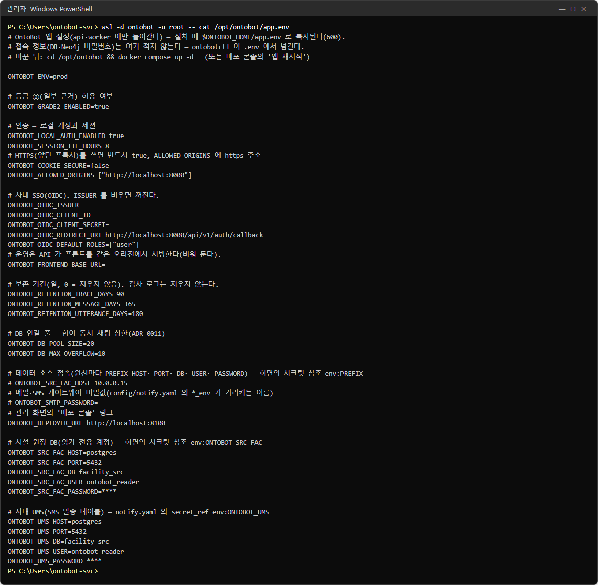
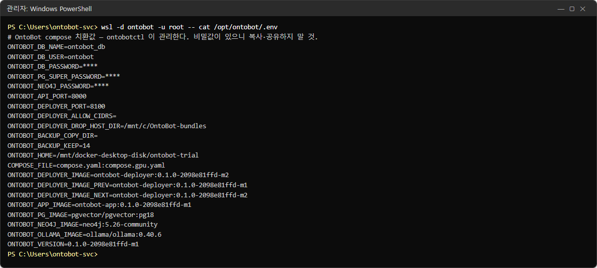
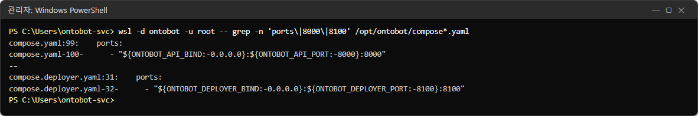
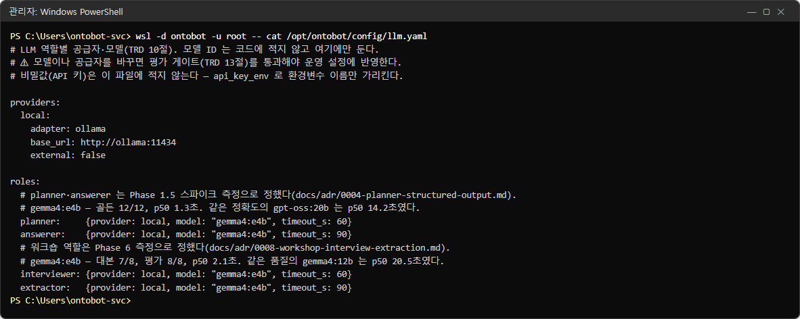
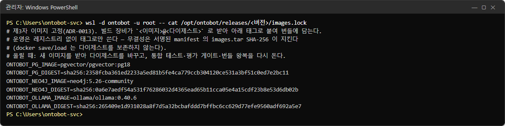
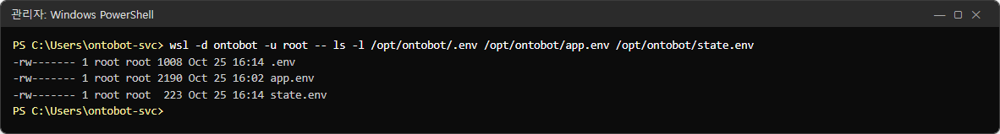

# 30장 설정 항목

OntoBot 의 설정 파일은 네 개입니다. 이 장은 각 파일의 실제 내용과 항목마다의 뜻·기본값·바꾸는 법을 정리합니다.

| 파일 | 내용 | 누가 고치나 | 반영 |
| --- | --- | --- | --- |
| `/opt/ontobot/app.env` | 앱 설정(인증·세션·보존 기간·원천 DB·메일 비밀값 등) | 운영자 | `docker compose up -d` |
| `/opt/ontobot/.env` | 인프라 설정(비밀번호·포트·이미지·백업) | `ontobotctl`(자동) + 운영자 일부 | 30.3 |
| `/opt/ontobot/config/notify.yaml` | 메일·SMS 게이트웨이 | 운영자 | `docker compose restart api worker` |
| `/opt/ontobot/config/llm.yaml` | AI 모델 | **개발팀만** | `docker compose restart api worker` |

## 30.1 고치는 순서(모든 설정 파일 공통)

1. 사본을 만듭니다: `wsl -d ontobot -u root -- cp /opt/ontobot/app.env /opt/ontobot/app.env.bak`
2. nano 로 엽니다: `wsl -d ontobot -u root -- nano /opt/ontobot/app.env`(11.2 의 사용법)
3. 고치고 **Ctrl+O**, **Enter**, **Ctrl+X**.
4. 고친 줄을 확인합니다: `wsl -d ontobot -u root -- grep -n <항목> /opt/ontobot/app.env`
5. 반영합니다(위 표).
6. 현황·확인 질문으로 정상인지 봅니다. 이상하면 사본으로 되돌리고 다시 반영합니다.
7. 사본을 지웁니다(비밀값이 들어 있음).

> **주의** 윈도 메모장으로 `\\wsl$\…` 경로의 설정 파일을 열어 고치지 마세요. 줄 끝 문자(CRLF)가 섞이면 값 끝에
> 보이지 않는 글자가 붙어 접속이 실패하거나, 파일 권한이 바뀔 수 있습니다.

## 30.2 `app.env` — 앱 설정

시험 서버의 실제 내용입니다(비밀번호는 가림).

```powershell
wsl -d ontobot -u root -- cat /opt/ontobot/app.env
```



> **알아 두기** 파일 맨 위의 주석에 "또는 배포 콘솔의 '앱 재시작'"이라는 말이 있지만, **지금 판의 배포 콘솔에는 앱
> 재시작 단추가 없습니다.** 반영은 이 장의 명령으로 하세요.

### 운영 환경

| 항목 | 기본값 | 뜻 |
| --- | --- | --- |
| `ONTOBOT_ENV` | `prod` | 운영 표시. 바꾸지 않습니다 |

### 답의 등급

| 항목 | 기본값 | 뜻 |
| --- | --- | --- |
| `ONTOBOT_GRADE2_ENABLED` | `true` | 일부 문장만 근거가 확인된 답(등급 ②)을 "일부 추정" 표시와 함께 보일지. `false` 면 ②도 ③처럼 본문을 숨김 |

### 인증과 세션

| 항목 | 기본값 | 뜻 | 바꿀 때 |
| --- | --- | --- | --- |
| `ONTOBOT_LOCAL_AUTH_ENABLED` | `true` | 아이디·비밀번호 로그인 허용 | SSO 만 쓰려면 `false`(배포 콘솔은 계속 로컬 관리자 필요 — 7.10) |
| `ONTOBOT_SESSION_TTL_HOURS` | `8` | 로그인 유지 시간 | 보안 정책에 맞춤 |
| `ONTOBOT_COOKIE_SECURE` | `false` | 로그인 쿠키를 HTTPS 에서만 보냄 | HTTPS 를 쓰면 **반드시** `true`(31장) |
| `ONTOBOT_ALLOWED_ORIGINS` | `["http://localhost:8000"]` | 받아 줄 접속 주소 목록(JSON 배열) | **실제 접속 주소로 꼭 바꿈**. 다르면 "허용되지 않은 출처"(27.7) |

> **주의** 설치 직후의 `ONTOBOT_ALLOWED_ORIGINS` 는 `http://localhost:8000` 뿐입니다. 사용자가 `http://<서버 이름>:8000`
> 으로 접속하면 로그인이 거절됩니다. 설치 직후 실제 주소(예: `["http://ontobot.corp.local:8000"]`)로 바꾸고 반영하세요.
> 이름과 IP 를 함께 쓰려면 둘 다 넣습니다.

### 회사 통합 로그인(SSO, OIDC)

| 항목 | 기본값 | 뜻 |
| --- | --- | --- |
| `ONTOBOT_OIDC_ISSUER` | (빈 값) | 통합 로그인 서버 주소. 비우면 SSO 꺼짐 |
| `ONTOBOT_OIDC_CLIENT_ID` | (빈 값) | 통합 로그인에 등록한 OntoBot 의 ID |
| `ONTOBOT_OIDC_CLIENT_SECRET` | (빈 값) | 비밀값(공개 클라이언트면 비움) |
| `ONTOBOT_OIDC_REDIRECT_URI` | `http://localhost:8000/api/v1/auth/callback` | 로그인 뒤 돌아올 주소 — 실제 주소로 |
| `ONTOBOT_OIDC_DEFAULT_ROLES` | `["user"]` | 처음 들어온 사람에게 줄 역할 |
| `ONTOBOT_OIDC_GROUPS_CLAIM` | (빈 값) | v1. ID 토큰의 그룹 클레임 이름(예: `groups`). 넣으면 로그인 때 데이터 그룹 소속을 정확히 맞춤(8.5). 비우면 꺼짐 |
| `ONTOBOT_FRONTEND_BASE_URL` | (빈 값) | 운영에서는 비워 둠(같은 주소에서 화면 제공) |

### 화면 기능(v1)

| 항목 | 기본값 | 뜻 |
| --- | --- | --- |
| `ONTOBOT_CLOSED_NETWORK` | `true` | 폐쇄망 설치. `true` 면 외부 서버를 부르는 화면 기능(워크숍 음성 입력)이 아래 설정과 상관없이 꺼짐 |
| `ONTOBOT_VOICE_INPUT` | `false` | 워크숍 음성 입력(브라우저 음성 인식 — 음성이 브라우저 공급자 서버로 감). `ONTOBOT_CLOSED_NETWORK=false` 일 때만 켜짐 |

### 보존 기간

| 항목 | 기본값 | 뜻 |
| --- | --- | --- |
| `ONTOBOT_RETENTION_TRACE_DAYS` | `90` | 트레이스(질문 처리 기록) 보관 일수. 0 = 지우지 않음 |
| `ONTOBOT_RETENTION_MESSAGE_DAYS` | `365` | 대화 보관 일수 |
| `ONTOBOT_RETENTION_UTTERANCE_DAYS` | `180` | 인터뷰 발언 보관 일수 |

감사 로그는 보존 기간과 상관없이 **지우지 않습니다.** 정리는 worker 가 하루 한 번 하고, 감사 로그에
`ops.retention_purged` 로 남깁니다. 회사의 기록 보존 규정에 맞춰 정하세요.

### 데이터베이스 연결 수

| 항목 | 기본값 | 뜻 |
| --- | --- | --- |
| `ONTOBOT_DB_POOL_SIZE` | `20` | 기본 연결 수 |
| `ONTOBOT_DB_MAX_OVERFLOW` | `10` | 몰릴 때 더 여는 연결 수 |

질문 하나는 답이 끝날 때까지 연결 하나를 쥡니다. 그래서 **두 값의 합(기본 30)이 동시에 처리할 수 있는 질문 수의
한도**입니다. 그 이상 몰리면 기다립니다. 개발팀의 부하 측정(개발 PC, GPU 1장)에서는 동시 8명일 때 응답의 95%가 23초
안, 16명부터 분당 약 40건에서 포화, 24명까지 실패가 없었습니다. 늘리기 전에 개발팀과 상의하세요(AI 모델이 먼저
병목입니다).

### 데이터 소스·메일 비밀값

| 항목 | 뜻 | 이 책 |
| --- | --- | --- |
| `ONTOBOT_SRC_<앞머리>_HOST`·`_PORT`·`_DB`·`_USER`·`_PASSWORD` | 원천 DB 접속 정보 | 11.2 |
| `ONTOBOT_UMS_…` 등 | SMS 발송 테이블 DB 접속 정보(notify.yaml 의 `secret_ref`) | 15.5 |
| `ONTOBOT_SMTP_USER`·`ONTOBOT_SMTP_PASSWORD` 등 | 메일 인증(notify.yaml 의 `*_env` 가 가리키는 이름) | 15.4 |

### 배포 콘솔 링크

| 항목 | 기본값 | 뜻 |
| --- | --- | --- |
| `ONTOBOT_DEPLOYER_URL` | `http://localhost:8100` | 관리 화면의 "배포 콘솔 열기" 링크 — **실제 주소로** |

### 그 밖(파일에 없지만 쓸 수 있는 항목)

| 항목 | 기본값 | 뜻 |
| --- | --- | --- |
| `ONTOBOT_LOG_LEVEL` | `INFO` | 로그 자세함(`DEBUG` 는 개발팀이 요청할 때만) |
| `ONTOBOT_LOG_MAX_BYTES` / `ONTOBOT_LOG_BACKUPS` | 20MB / 10 | 로그 파일 크기·보관 개수 |
| `ONTOBOT_DB_POOL_TIMEOUT_S` | 30 | 연결을 기다리는 최대 초 |

## 30.3 `.env` — 인프라 설정

```powershell
wsl -d ontobot -u root -- cat /opt/ontobot/.env
```



| 항목 | 뜻 | 사람이 바꾸나 |
| --- | --- | --- |
| `ONTOBOT_DB_NAME`·`_USER` | 데이터베이스 이름·계정 | 아니요 |
| `ONTOBOT_DB_PASSWORD`·`ONTOBOT_PG_SUPER_PASSWORD`·`ONTOBOT_NEO4J_PASSWORD` | 설치 때 무작위로 만든 비밀번호 | **절대 아니요** |
| `ONTOBOT_API_PORT` / `ONTOBOT_DEPLOYER_PORT` | 포트(8000/8100) | 개발팀과 상의 |
| `ONTOBOT_API_BIND` / `ONTOBOT_DEPLOYER_BIND` | 받을 주소(기본 `0.0.0.0` = 모든 주소) | 프록시를 앞에 둘 때 `127.0.0.1`(31장) |
| `ONTOBOT_DEPLOYER_ALLOW_CIDRS` | 배포 콘솔 허용 대역(쉼표). 비면 제한 없음(방화벽에 맡김) | 예 |
| `ONTOBOT_DEPLOYER_DROP_HOST_DIR` | 반입 폴더(WSL 경로 — `C:\OntoBot-bundles`) | 아니요 |
| `ONTOBOT_DEPLOYER_COOKIE_SECURE` | 배포 콘솔 쿠키 HTTPS 전용(파일에 없으면 `false`) | HTTPS 뒤에 두면 `true` |
| `ONTOBOT_BACKUP_COPY_DIR` | 백업 복사 폴더(`/mnt/c/OntoBot/backups`) | 예 |
| `ONTOBOT_BACKUP_KEEP` | 백업 보관 개수(14) | 예 |
| `ONTOBOT_NEO4J_HEAP` / `ONTOBOT_NEO4J_PAGECACHE` | Neo4j 메모리(파일에 없으면 1g/1g) | 개발팀과 상의 |
| `ONTOBOT_HOME` | 설치 폴더 | 아니요 |
| `COMPOSE_FILE` | 쓰는 compose 파일(GPU 면 `compose.yaml:compose.gpu.yaml`) | 아니요 |
| `ONTOBOT_*_IMAGE`, `ONTOBOT_VERSION` | 지금 버전의 이미지 이름 | 아니요(업그레이드가 바꿈) |
| `ONTOBOT_DEPLOYER_IMAGE`·`_NEXT`·`_PREV` | 배포 콘솔 이미지 | 아니요(23장) |

`.env` 를 바꾼 뒤의 반영:

| 바꾼 항목 | 반영 명령 |
| --- | --- |
| 앱 쪽(포트·BIND·Neo4j 메모리) | `docker compose up -d` |
| 배포 콘솔 쪽(ALLOW_CIDRS·COOKIE_SECURE·DEPLOYER_PORT·BIND) | `docker compose -f compose.deployer.yaml up -d`(콘솔이 다시 시작 — 다시 로그인) |
| 백업 쪽(KEEP·COPY_DIR) | 다음 백업부터 저절로 |

> **주의** `.env` 를 잘못 고쳐 데이터베이스 비밀번호가 바뀌면 OntoBot 이 데이터베이스에 접속하지 못합니다. 비밀번호
> 줄은 건드리지 말고, 고치기 전에 꼭 사본을 만드세요.

## 30.4 포트 설정 확인

```powershell
wsl -d ontobot -u root -- grep -n 'ports:' -A1 /opt/ontobot/compose.yaml /opt/ontobot/compose.deployer.yaml
```



`"${ONTOBOT_API_BIND:-0.0.0.0}:${ONTOBOT_API_PORT:-8000}:8000"` — `.env` 의 BIND·PORT 값으로 바깥 포트를 정합니다.
compose 파일은 업그레이드 때마다 새로 바뀌므로 손으로 고치지 않고, `.env` 의 값만 바꿉니다.

## 30.5 `llm.yaml` — AI 모델(개발팀만)

```powershell
wsl -d ontobot -u root -- cat /opt/ontobot/config/llm.yaml
```



| 부분 | 내용 |
| --- | --- |
| `providers.local` | `adapter: ollama`, `base_url: http://ollama:11434`, `external: false`(서버 안 모델) |
| `roles` | `planner`(질문 해석)·`answerer`(답 쓰기)·`interviewer`·`extractor`(인터뷰 워크숍) — 모두 `gemma4:e4b`. v1 은 문서 검색용 `embedder`(`bge-m3`)가 더해짐(사진은 예전 판) |
| `timeout_s` | 역할마다 AI 응답을 기다리는 최대 초(60·90) |

> **주의** 모델을 바꾸면 질문 해석의 정확도가 달라집니다. 개발팀이 평가(골든셋)를 다시 통과시킨 설정으로만 바꿉니다.
> 운영자가 임의로 바꾸지 마세요. 외부 AI 공급자(`external: true`)를 쓰면 개인정보가 가역 토큰으로 바뀌어 나가지만,
> 폐쇄망 원칙상 회사의 승인이 필요합니다.
>
> 업그레이드는 이 파일을 덮지 않습니다. 새 판이 역할을 더하면 `llm.yaml.new` 를 보고 그 줄만 옮겨 적습니다(21.5 ⑤).
> `embedder` 모델을 바꾸면 모든 문서를 다시 색인해야 합니다(11.7).

## 30.6 `notify.yaml` — 메일·SMS

15.4 에 항목별 설명과 실제 설정이 있습니다.

## 30.7 고정된 제3자 이미지

```powershell
wsl -d ontobot -u root -- cat /opt/ontobot/releases/<버전>/images.lock
```



PostgreSQL·Neo4j·Ollama 이미지의 이름과 다이제스트(지문)가 버전마다 고정되어 있습니다. 운영자가 바꾸는 파일이 아니라,
"이 버전이 어떤 제3자 이미지를 쓰는지" 확인할 때 봅니다.

## 30.8 파일 권한

```powershell
wsl -d ontobot -u root -- ls -l /opt/ontobot/.env /opt/ontobot/app.env /opt/ontobot/state.env
```



세 파일 모두 `-rw-------`(root 만 읽고 쓰기)여야 합니다. 다르면 `chmod 600 <파일>` 로 되돌립니다(31장).

## 30.9 설치 직후 꼭 바꿀 설정

| 번호 | 파일 | 항목 | 바꿀 값 |
| --- | --- | --- | --- |
| 1 | `app.env` | `ONTOBOT_ALLOWED_ORIGINS` | 실제 접속 주소 |
| 2 | `app.env` | `ONTOBOT_DEPLOYER_URL` | `http://<서버>:8100` |
| 3 | `app.env` | (HTTPS 면) `ONTOBOT_COOKIE_SECURE` | `true` |
| 4 | `app.env` | (SSO 면) `ONTOBOT_OIDC_*` | 통합 로그인 담당자 값 |
| 5 | `.env` | `ONTOBOT_DEPLOYER_ALLOW_CIDRS` | 관리자 대역(설치 매개변수로 넣었으면 확인만) |
| 6 | `.env` | `ONTOBOT_BACKUP_COPY_DIR` | `/mnt/c/OntoBot/backups`(비어 있으면) |

## 30.10 해 보기

> **해 보기** (시험 서버에서)
>
> 1. `app.env` 의 사본을 만들고 `ONTOBOT_SESSION_TTL_HOURS` 를 1로 바꾼 뒤 반영하세요.
> 2. 다시 로그인하고 1시간 뒤 로그인이 풀리는지 확인하세요.
> 3. 사본으로 되돌리고 반영한 뒤 사본을 지우세요.
