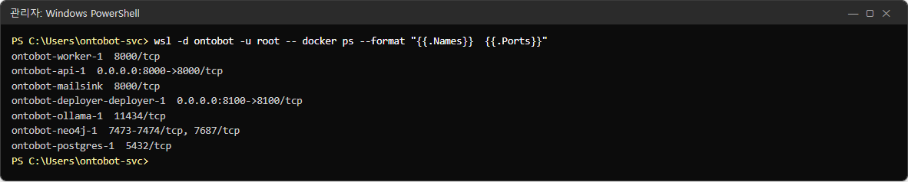
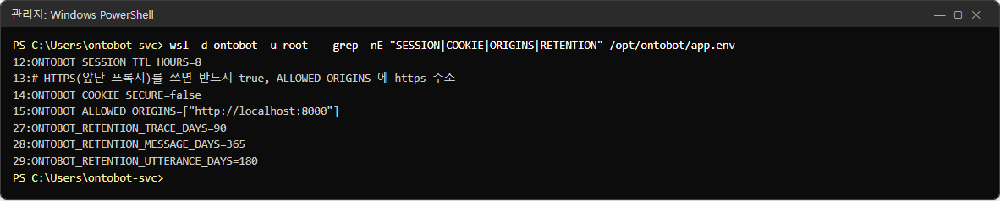
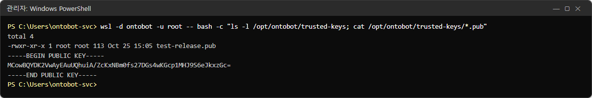
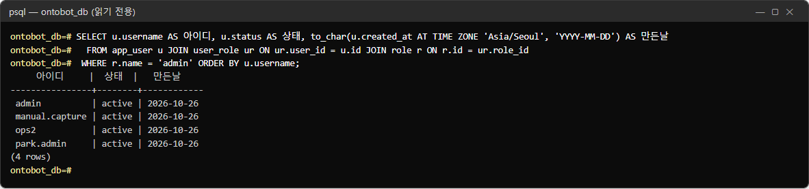
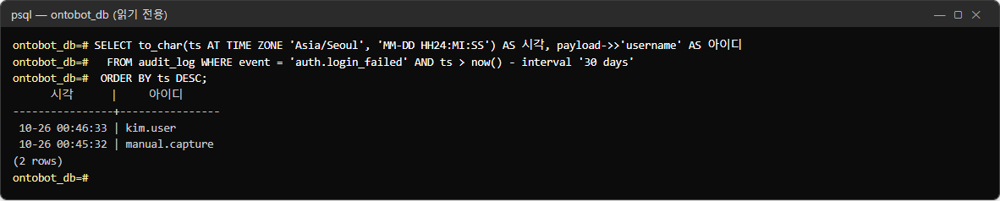
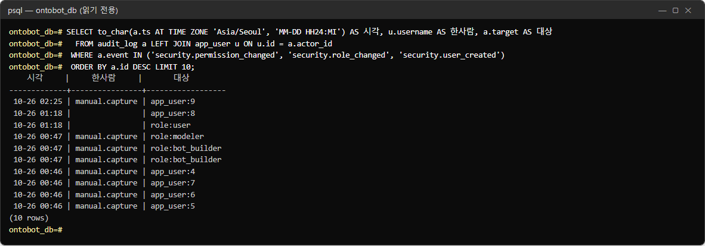
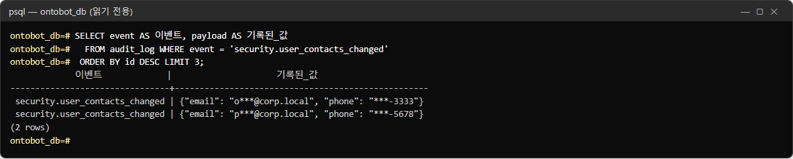
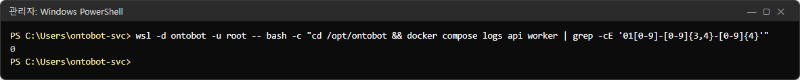

# 31장 보안 수칙

OntoBot 은 회사 데이터를 다루고, 데이터를 바꾸는 Action 과 서버 전체를 바꾸는 배포 콘솔을 갖고 있습니다. 이 장은
운영자가 지켜야 할 보안 수칙을 항목별로 정리합니다.

## 31.1 접속 경로

| 수칙 | 방법 | 확인 |
| --- | --- | --- |
| 바깥에 여는 포트는 8000·8100 둘뿐 | 설치 스크립트가 만든 방화벽 규칙만 | `Get-NetFirewallRule -DisplayName "OntoBot*"` |
| 8100(배포 콘솔)은 관리자 대역만 | 방화벽 `-AllowCidrs`, `.env` 의 `ONTOBOT_DEPLOYER_ALLOW_CIDRS` | 관리자 대역 밖 PC 에서 "허용되지 않은 주소입니다" |
| 데이터베이스·Neo4j·AI 모델 포트는 열지 않음 | 컨테이너 네트워크 안에서만 | `docker compose ps` 의 포트 칸(2.2) |
| 외부 인터넷으로 나가는 연결 없음 | 메일·SMS 는 사내 주소만 | `notify.yaml` 검토(15장) |

## 31.2 HTTPS

사내 표준에 따라 앞단 역방향 프록시(예: IIS ARR, 사내 L7 장비)에서 HTTPS 를 처리하고 OntoBot 으로 넘기는 방식을
권합니다.

| 설정 | 값 |
| --- | --- |
| `app.env` `ONTOBOT_COOKIE_SECURE` | `true` |
| `app.env` `ONTOBOT_ALLOWED_ORIGINS` | `["https://ontobot.corp.local"]`(프록시의 주소) |
| `app.env` `ONTOBOT_OIDC_REDIRECT_URI` | `https://ontobot.corp.local/api/v1/auth/callback`(SSO 를 쓰면) |
| `.env` `ONTOBOT_DEPLOYER_COOKIE_SECURE` | `true`(배포 콘솔도 프록시 뒤에 두면) |
| `.env` `ONTOBOT_API_BIND` | `127.0.0.1`(프록시가 같은 서버에 있어 직접 접속을 막을 때) |

> **주의** `ONTOBOT_COOKIE_SECURE=true` 로 바꾸고 HTTP 로 접속하면 로그인이 유지되지 않습니다(쿠키가 보내지지 않음).
> HTTPS 구성이 끝난 뒤에 바꾸세요.

## 31.3 계정과 권한

| 수칙 | 이유 | 이 책 |
| --- | --- | --- |
| 공용 계정 금지 | 감사 기록의 "누가"를 지킴 | 7.12 |
| 관리자는 2명 이상, 꼭 필요한 사람만 | 자기 잠금 방지, 남용 방지 | 7.7 |
| 퇴사·이동자는 당일 정지 | 정지 즉시 로그인이 끊김 | 7.7 |
| 초기 비밀번호는 안전한 경로로 | 메일·메신저 평문 금지 | 7.3 |
| 읽기 권한은 업무에 필요한 만큼 | 최소 권한 | 8.5 |
| 배포 담당 로컬 관리자 계정 하나 유지 | SSO 장애에도 배포 콘솔 사용 | 7.10 |
| 분기마다 계정·권한 검토 | 43장 양식 | 25.3 |

## 31.4 비밀값

| 비밀값 | 있는 곳 | 수칙 |
| --- | --- | --- |
| DB·Neo4j 비밀번호 | `/opt/ontobot/.env` | 사람이 알 필요 없음, 바꾸지 않음 |
| 원천 DB·메일·SMS 비밀번호 | `/opt/ontobot/app.env` | 화면·DB·`notify.yaml` 에 쓰지 않음 |
| 번들 서명 개인키 | 배포 담당자(오프라인) | **서버에 두지 않음** |
| OntoBot 계정 비밀번호 | DB 에 해시로만 | 운영자도 원래 값을 알 수 없음 |

- `.env`·`app.env`·`state.env` 는 `-rw-------`(30.8)이어야 합니다.
- 설정 파일을 메일에 첨부하거나 공유 폴더·메신저에 올리지 마세요.
- 개발팀에 설정을 보여 줄 때는 비밀번호 줄을 가린 `grep` 결과만 보냅니다.

## 31.5 번들과 서명

| 수칙 | 이유 |
| --- | --- |
| 서명 확인을 끄지 않음(`ONTOBOT_ALLOW_UNSIGNED`·`ONTOBOT_ALLOW_DIRTY` 를 운영 `.env` 에 넣지 않음) | 위조·개발 중 번들 차단 |
| 사전 점검 실패 번들은 쓰지 않음 | 20.3 |
| 번들 폴더에 아무것도 쓰지 않음 | 서명 밖 파일이 되어 막힘 |
| 반입 USB 는 회사 보안 절차(검사) 후 사용 | 폐쇄망 반입 규정 |
| 공개키 교체는 배포 담당자와 함께(새 키를 먼저 추가 → 새 번들 확인 → 옛 키 제거) | 키 교체 중 업그레이드 중단 방지 |

## 31.6 개인정보

| 장소 | 보이는 모양 |
| --- | --- |
| 화면(사용자 목록·Action 미리보기) | 가려짐(`p***@corp.local`, `***-5678`) |
| 감사 로그·앱 로그·트레이스 | 가려짐 |
| 메일 서버·SMS 발송 테이블 | 원래 값(보내야 하므로) |
| **데이터베이스와 백업 파일** | **원래 값** |

따라서:

- 백업 폴더(`/opt/ontobot/backups`, `C:\OntoBot\backups`)와 회사 백업 매체의 접근을 관리자로 제한합니다.
- 백업 파일을 개발팀에 보낼 일이 생기면 보안 담당과 먼저 상의합니다.
- 트레이스 열람도 감사 로그에 남습니다. 필요한 경우에만 엽니다.

## 31.7 감사와 기록 보존

| 수칙 | 방법 |
| --- | --- |
| 감사 로그는 지울 수 없음 | DB 트리거로 막혀 있음 — 보존 기간 정리도 지우지 않음 |
| 장기 보존 의무가 있으면 | 백업을 의무 기간만큼 보관(감사 로그가 백업에 들어 있음) |
| 배포 작업 증적 | 작업 기록의 로그 내려받기를 변경 관리 문서에 첨부(24.3) |
| 정기 검토 | 주간 감사 로그 점검(25.2) |

## 31.8 서버

| 수칙 | 방법 |
| --- | --- |
| 서비스 전용 계정 | 설치·예약 작업을 그 계정으로(WSL 배포판이 그 계정 소유) |
| 서버 원격 접속 제한 | 회사 서버 보안 기준 |
| 윈도 업데이트 | 업데이트 뒤 재부팅하고 현황 확인(5.8, 27.8) |
| GPU 드라이버 갱신 | 갱신 전 공지, 갱신 뒤 현황의 GPU·준비 상태 확인 |
| `C:\OntoBot\wsl` 보호 | 백신 검사 예외·삭제 금지 정책(데이터 디스크) |

## 31.9 보안 점검표(분기)

| 번호 | 확인 | 결과 |
| --- | --- | --- |
| 1 | 방화벽 규칙이 8000·8100 뿐이고 8100 은 관리자 대역만 | ☐ |
| 2 | HTTPS 사용 시 `COOKIE_SECURE=true` | ☐ |
| 3 | 관리자 계정 목록 검토(2명 이상, 불필요한 사람 없음) | ☐ |
| 4 | 퇴사·이동자 계정이 정지됨 | ☐ |
| 5 | 역할별 읽기 권한이 업무와 맞음 | ☐ |
| 6 | `.env`·`app.env` 권한 `-rw-------` | ☐ |
| 7 | `app.env`·`notify.yaml` 에 사내 주소만 | ☐ |
| 8 | 운영 `.env` 에 `ALLOW_UNSIGNED`·`ALLOW_DIRTY` 없음 | ☐ |
| 9 | 백업 폴더 접근 권한이 관리자로 제한 | ☐ |
| 10 | 감사 로그에 낯선 권한 변경·로그인 없음 | ☐ |

## 31.10 점검표를 실제로 확인하는 법

31.9 의 항목 가운데 서버에서 확인할 수 있는 것을 시험 서버에서 실제로 해 보았습니다. 모두 읽기만 하는 명령이며,
DB 질의는 40.1 의 읽기 전용 접속으로 칩니다.

### 열린 포트(점검표 1)

```powershell
wsl -d ontobot -u root -- docker ps --format "{{.Names}}  {{.Ports}}"
```



| 표시 | 뜻 |
| --- | --- |
| `0.0.0.0:8000->8000/tcp` | **밖에서 들어올 수 있는** 포트(api) |
| `0.0.0.0:8100->8100/tcp` | 밖에서 들어올 수 있는 포트(배포 콘솔) |
| `5432/tcp`, `7687/tcp`, `11434/tcp` 처럼 화살표가 없음 | 컨테이너 네트워크 안에서만 쓰는 포트 — 밖에서 닿지 않음 |

화살표(`->`)가 붙은 줄이 8000·8100 둘뿐이어야 합니다. 사진의 `ontobot-mailsink` 는 이 책을 찍으려고 띄운 시험용 메일
수신기라 운영 서버에는 없습니다. Windows 방화벽은 이 두 포트 가운데 8100 을 관리자 대역만 허용하도록 다시 좁힙니다
(31.1의 `Get-NetFirewallRule` 로 확인).

### 세션·쿠키·출처·보존 설정(점검표 2)

```powershell
wsl -d ontobot -u root -- grep -nE "SESSION|COOKIE|ORIGINS|RETENTION" /opt/ontobot/app.env
```



| 설정 | 사진 | 운영 권장 |
| --- | --- | --- |
| `ONTOBOT_SESSION_TTL_HOURS` | 8 | 로그인 유지 시간. 근무 시간 하루 |
| `ONTOBOT_COOKIE_SECURE` | false | **HTTPS 를 쓰면 반드시 true**(31.2). 사진은 HTTP 시험 서버 |
| `ONTOBOT_ALLOWED_ORIGINS` | `["http://localhost:8000"]` | 사용자가 실제로 여는 주소(https 주소)만 |
| `ONTOBOT_RETENTION_TRACE_DAYS` | 90 | 트레이스 보존 일수 |
| `ONTOBOT_RETENTION_MESSAGE_DAYS` | 365 | 대화 보존 일수 |
| `ONTOBOT_RETENTION_UTTERANCE_DAYS` | 180 | 인터뷰 발언 보존 일수 |

`ALLOWED_ORIGINS` 에 없는 주소로 화면을 열면 "허용되지 않은 출처의 요청입니다"가 나옵니다(27.7). 주소를 바꾸면 이 값도
함께 바꿉니다.

### 신뢰하는 서명 키(점검표 8)

```powershell
wsl -d ontobot -u root -- bash -c "ls -l /opt/ontobot/trusted-keys; cat /opt/ontobot/trusted-keys/*.pub"
```



번들의 서명은 이 폴더의 **공개키**로 확인합니다(20장). 공개키는 비밀이 아니어서 화면에 보여도 됩니다. 확인할 것은
**파일 개수와 이름**입니다. 개발팀에게 받은 키 말고 다른 파일이 있으면 누군가 자기 번들을 통과시키려고 넣은 것일 수
있으니 바로 보고합니다. 사진의 `test-release.pub` 는 시험용 키이며, 운영 서버에는 개발팀이 준 운영 키가 있어야 합니다.

### 관리자 계정 목록(점검표 3)

```sql
SELECT u.username AS 아이디, u.status AS 상태, to_char(u.created_at AT TIME ZONE 'Asia/Seoul', 'YYYY-MM-DD') AS 만든날
  FROM app_user u JOIN user_role ur ON ur.user_id = u.id JOIN role r ON r.id = ur.role_id
 WHERE r.name = 'admin' ORDER BY u.username;
```



admin 은 계정·권한·Action 롤백·배포 콘솔까지 모두 할 수 있는 역할입니다. 목록의 사람마다 "지금도 이 일을 맡고 있는가"를
확인하고, 아니면 7장에서 역할을 빼거나 정지합니다. 최소 2명(한 명이 휴가일 때를 위해), 많아도 꼭 필요한 사람만 둡니다.

### 로그인 실패(점검표 10)

```sql
SELECT to_char(ts AT TIME ZONE 'Asia/Seoul', 'MM-DD HH24:MI:SS') AS 시각, payload->>'username' AS 아이디
  FROM audit_log WHERE event = 'auth.login_failed' AND ts > now() - interval '30 days'
 ORDER BY ts DESC;
```



사진의 두 건은 6장·7장 촬영 때 일부러 틀린 비밀번호를 넣은 것입니다. 다음과 같으면 조사합니다.

| 모습 | 의심 |
| --- | --- |
| 한 아이디에 짧은 시간 수십 건 | 비밀번호 맞히기 시도 |
| 없는 아이디(`admin1`, `test` 등)가 여러 개 | 아이디 찾기 시도 |
| 퇴근 뒤·주말에 몰림 | 업무 밖 접근 |

> **알아 두기** 배포 콘솔(8100)의 로그인 실패는 이 감사 로그에 남지 않습니다. 배포 콘솔은 같은 PC 에서 여러 번 틀리면
> 잠시 잠그는 것으로 막습니다(17장). 콘솔 로그인 기록이 필요하면 개발팀에 요청하세요.

### 권한 변경 이력(점검표 5·10)

```sql
SELECT to_char(a.ts AT TIME ZONE 'Asia/Seoul', 'MM-DD HH24:MI') AS 시각, u.username AS 한사람, a.target AS 대상
  FROM audit_log a LEFT JOIN app_user u ON u.id = a.actor_id
 WHERE a.event IN ('security.permission_changed', 'security.role_changed', 'security.user_created')
 ORDER BY a.id DESC LIMIT 10;
```



| 칸 | 뜻 |
| --- | --- |
| 한사람 | 화면에서 바꾼 사람 |
| 대상 | `role:<역할>`(역할의 읽기 권한을 바꿈), `app_user:<번호>`(계정을 만들거나 역할을 바꿈) |
| 한사람이 비어 있음 | 화면이 아니라 서버 명령(`security.cli`)으로 바꾼 것 — 사진의 01:18 두 줄은 7.9·8.7 의 명령 실습 |

한사람이 빈 줄은 서버에 들어갈 수 있는 사람이 한 일입니다. 계획에 없던 것이면 그 시각에 서버에 접속한 사람을
확인합니다.

### 개인정보가 기록에 남지 않는지(점검표 7, 31.6)

감사 로그에는 개인정보가 가려진 채로 남습니다.

```sql
SELECT event AS 이벤트, payload AS 기록된_값
  FROM audit_log WHERE event = 'security.user_contacts_changed'
 ORDER BY id DESC LIMIT 3;
```



메일은 `o***@corp.local`, 전화번호는 `***-3333` 처럼 앞부분이 가려져 있습니다. 원래 값이 그대로 보이는 줄이 있으면
결함이니 개발팀에 알립니다.

프로그램 로그에 전화번호 모양의 글자가 있는지도 셀 수 있습니다.

```powershell
wsl -d ontobot -u root -- bash -c "cd /opt/ontobot && docker compose logs api worker | grep -cE '01[0-9]-[0-9]{3,4}-[0-9]{4}'"
```



`0` 이 정상입니다. 시험 서버에서는 연락처를 묻는 질문(34.21)과 문자 발송(15장)을 했는데도 로그에는 한 건도 남지
않았습니다. 0 이 아니면 해당 줄을 `grep -E` 로 찾아(숫자 `-c` 를 빼고) 어느 기록인지 개발팀에 알립니다.

Neo4j 에 속성 값이 들어가지 않는 것은 40.11 의 `keys` 질의로 확인합니다.
