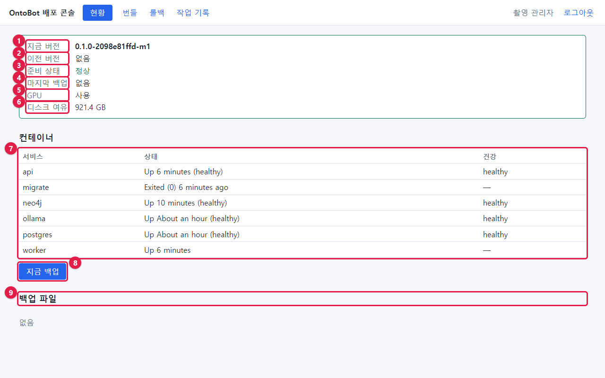
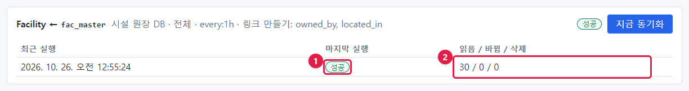
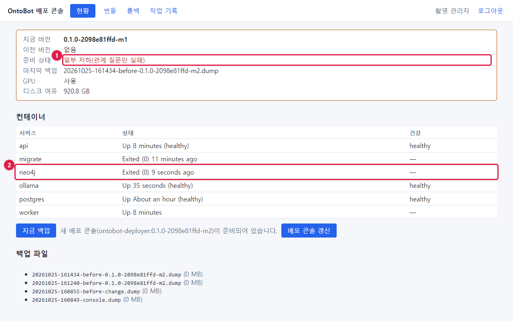
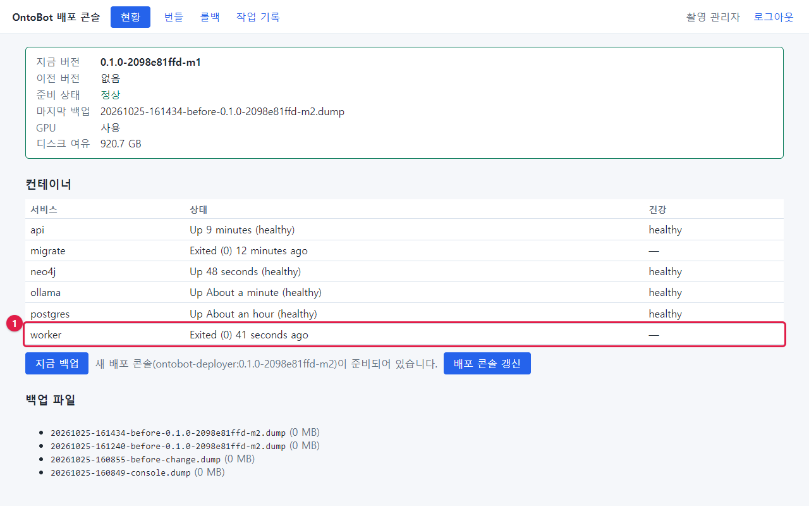
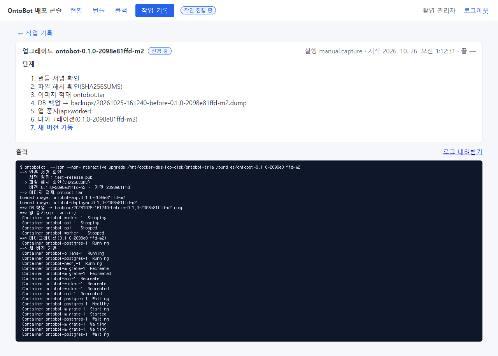
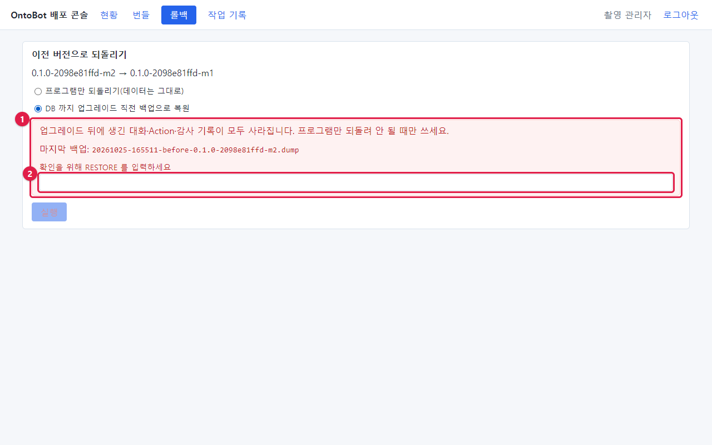

# 32장 훈련 시나리오

이 장은 운영 팀이 시험 서버에서 함께 해 볼 수 있는 훈련 여섯 가지입니다. 각 훈련은 이 책의 실제 화면을 따라가도록
짰습니다. 분기에 한두 개씩 돌아가며 해 보세요. 훈련이 끝나면 43장의 훈련 기록 양식에 결과를 남깁니다.

## 훈련 1 — 첫 출근 운영자(1시간)

**목표:** 새로 맡은 운영자가 혼자서 매일 점검과 기본 관리를 할 수 있다.

| 순서 | 할 일 | 볼 화면 | 이 책 |
| --- | --- | --- | --- |
| 1 | 웹 화면과 배포 콘솔에 로그인 | 로그인 화면 두 개 | 6.1, 17.2 |
| 2 | 현황 화면의 여섯 가지 확인 | 현황 | 18.6 |
| 3 | 확인 질문 두 개 | 채팅 | 5.6 |
| 4 | 연습 계정 만들기·정지·다시 사용 | 관리 → 사용자 | 7장 |
| 5 | 감사 로그에서 방금 한 일 찾기 | 감사 로그 | 9장 |
| 6 | 지금 백업 | 현황 → 지금 백업 | 19.2 |

**완료 기준:** 6단계를 도움 없이 하고, 각 단계의 결과를 43장 일일 점검표에 적는다.

## 훈련 2 — 새 부서 연결(2시간)

**목표:** 새 원천 DB 를 연결하고 동기화한다.

| 순서 | 할 일 | 이 책 |
| --- | --- | --- |
| 1 | 원천 DB 담당자에게 읽기 전용 계정 요청(43장 양식) | 11.1 |
| 2 | `app.env` 에 다섯 줄 넣고 반영 | 11.2~11.3 |
| 3 | 데이터 소스 등록, 접속 시험 성공 | 11.4~11.5 |
| 4 | 매핑 만들기(모델러와) | 12.1 |
| 5 | 지금 동기화 → 성공, 건수 확인 | 12.4 |
| 6 | 원천 값 하나를 고치게 하고 다시 동기화 → 바뀜 1 | 12.6 |

**완료 기준:** 매핑 카드에 성공이 두 번 이상, 근거 카드에 "값 출처"가 새 데이터 소스로 보인다.

## 훈련 3 — 관계 저장소 장애(30분)

**목표:** Neo4j 장애를 알아보고 복구한다.

| 순서 | 할 일 | 기대 결과 | 이 책 |
| --- | --- | --- | --- |
| 1 | (진행자) `docker compose stop neo4j` | — | 13.3 |
| 2 | (참가자) 사용자 신고 "관계 질문이 안 돼요"를 받음 | — | — |
| 3 | 현황 확인 | **일부 저하**, neo4j `Exited` | 27.2 |
| 4 | 관계 질문·관계 없는 질문 확인 | 관계 질문만 실패 | 13.3 |
| 5 | `docker compose start neo4j`, 1분 대기 | neo4j `(healthy)` | 13.3 |
| 6 | 데이터 소스 화면 **지금 대사** | 일치 | 13.2 |

**완료 기준:** 신고부터 복구 확인까지 10분 안.

## 훈련 4 — 조용한 장애: worker(30분)

**목표:** 화면에 바로 드러나지 않는 worker 멈춤을 찾아낸다.

| 순서 | 할 일 | 기대 결과 | 이 책 |
| --- | --- | --- | --- |
| 1 | (진행자) `docker compose stop worker` | — | 27.3 |
| 2 | (진행자) 원천 값 하나 변경 | — | — |
| 3 | (참가자) 신고 "고쳤는데 OntoBot 에 반영이 안 돼요" | — | — |
| 4 | 현황 확인 | 준비 상태 **정상**, worker `Exited` | 18.3 |
| 5 | 데이터 소스 **지금 동기화** 두 번 | "이미 대기 중인 동기화가 있습니다" | 27.3 |
| 6 | `docker compose start worker` | 대기하던 동기화가 실행됨 | 27.3 |
| 7 | 바뀐 값을 채팅으로 확인 | 새 값 | — |

**완료 기준:** 참가자가 준비 상태만 보고 "정상"이라고 끝내지 않고 worker 줄을 찾아낸다.

## 훈련 5 — 업그레이드와 롤백(1시간)

**목표:** 새 번들로 업그레이드하고, 문제를 가정해 롤백한다.

| 순서 | 할 일 | 이 책 |
| --- | --- | --- |
| 1 | 사용자 공지 문안 작성(43장) | 21.1 |
| 2 | 번들 올리기 → 사전 점검 통과 | 20.4 |
| 3 | 업그레이드, 단계마다 시각 기록 | 21.3 |
| 4 | 업그레이드 확인표(21.6) | 21.6 |
| 5 | (진행자) "새 버전에 문제가 있다" 선언 | — |
| 6 | 프로그램만 롤백 → 확인 | 22.3 |
| 7 | 작업 기록의 로그 내려받기 → 보고서에 첨부 | 24.3 |

**완료 기준:** 롤백 뒤 현황의 지금 버전이 원래 버전, 확인 질문 정상, 보고서에 로그 첨부.

## 훈련 6 — 데이터베이스 복구(개발팀과, 2시간)

**목표:** 최악의 경우(데이터 손상)에 백업으로 되살리는 절차를 안다.

| 순서 | 할 일 | 이 책 |
| --- | --- | --- |
| 1 | 지금 백업, 파일 이름 기록 | 19.2 |
| 2 | 업그레이드 → 업그레이드 뒤 연습 계정 생성 | 22.5 |
| 3 | DB 까지 복원 롤백(RESTORE 입력) | 22.5 |
| 4 | 연습 계정이 사라졌는지 확인 | 22.5 |
| 5 | 무엇이 사라졌고 무엇을 다시 해야 하는지 목록 작성 | 22.6 |
| 6 | 개발팀과 "업그레이드와 무관한 시점"의 백업으로 되살리는 절차 검토 | 19.7 |

**완료 기준:** DB 복원이 무엇을 잃는지 참가자 모두가 설명할 수 있다.

## 훈련 진행 요령

| 요령 | 설명 |
| --- | --- |
| 진행자와 참가자를 나눔 | 진행자가 장애를 만들고, 참가자는 모르는 상태에서 찾음 |
| 시각을 기록 | 신고 → 원인 파악 → 복구 → 확인의 각 시각 |
| 이 책을 펴 놓고 | 책의 절차가 실제와 다르면 기록해 고침 |
| 끝나고 되돌리기 | 시험 서버를 다음 훈련을 위해 정상으로 |
| 운영 서버에서 하지 않음 | 훈련 3·4 라도 업무 시간 외, 가능하면 시험 서버 |
