# 34장 정상 동작 질문 모음 — 답과 트레이스

사용자가 "답이 이상해요"라고 할 때, 운영자는 **정상일 때의 모습**을 알고 있어야 비교할 수 있습니다. 이 장은 시험
서버에서 `kim.user` 로 질문 20개를 실제로 하고, 그 답과 트레이스를 나란히 실은 것입니다. 질문은 개발팀의 평가 문항
(골든셋)에서 골랐고, 마지막 두 개는 운영자가 자주 받는 유형을 더했습니다.

이 장을 쓰는 법:

1. 업그레이드 뒤(21장), 장애 복구 뒤(27장)에 몇 개를 골라 다시 물어보고 이 장의 모습과 비교합니다.
2. 사용자 신고를 받으면 비슷한 질문을 찾아 "조회 조건 줄"과 "트레이스의 계획"을 비교합니다.
3. 새 운영자 교육 자료로 씁니다.

> **알아 두기** 답 문장은 AI 가 쓰므로 표현(문장 모양, 목록 꼴)은 할 때마다 조금씩 다를 수 있습니다. 비교할 것은
> **조회 조건 줄, 숫자, 목록의 개수, 등급, 상태**입니다. 이 장을 찍기 전에 앞 장들의 실습으로 F-0004 의 위험등급이
> 1에서 2로 바뀌어 있었습니다(16장). 그래서 평균 같은 일부 값이 처음 설치 때와 다릅니다.

## 34.1 한눈에 보기

| 번 | 질문 | 상태·등급 | 걸린 시간 | 볼 점 |
| --- | --- | --- | --- | --- |
| 1 | 위험등급이 3 이상인 시설은 몇 개야? | ok · ① | 1.5초 | 세기(건수) |
| 2 | 변전소 목록 보여줘 | ok · ① | 12.2초 | 긴 목록 — 답 쓰기가 오래 걸림 |
| 3 | 위험등급이 가장 높은 시설 5개 알려줘 | ok · ② | 3.1초 | 정렬·개수 제한, 일부 추정 |
| 4 | 시설 유형별 개수 알려줘 | ok · ① | 2.0초 | 묶어 세기 |
| 5 | F-0007 시설의 설비 용량은? | ok · ① | 2.0초 | pk 로 한 건 |
| 6 | 2015년 이전에 설치된 철탑은? | ok · ① | 3.1초 | 날짜 조건 |
| 7 | 조직 목록 보여줘 | ok · ① | 3.1초 | 다른 객체 타입 |
| 8 | 지역 코드가 11인 지역 이름은? | ok · ① | 2.0초 | 코드 조건 |
| 9 | 안녕하세요 | not_query | 1.2초 | 데이터 질문이 아님 |
| 10 | 용량이 1000kW 넘는 변전소의 평균 위험등급은? | ok · ① | 2.1초 | 평균(서버가 반올림) |
| 11 | 위험등급이 9인 시설 보여줘 | empty | 1.2초 | 결과 0건 |
| 12 | 서울 지역 시설 목록 보여줘 | ok · ① | 10.6초 | 관계(소재 지역) |
| 13 | 강남지사가 소유한 시설 목록 보여줘 | ok · ① | 10.7초 | 관계(소유 조직), 프로그램이 고친 계획 |
| 14 | 서울에 있는 변전소는? | ok · ① | 4.5초 | 조건 + 관계 |
| 15 | 그 중 위험등급이 4 이상인 것만 | ok · ① | 2.0초 | 이어서 묻기(앞 결과 안에서) |
| 16 | 그 시설들의 설비 용량 합계는? | ok · ① | 1.5초 | **맥락을 놓친 예** |
| 17 | 시설별 담당 점검원 이름은? | ok · ③ | 11.1초 | 근거 부족 — 본문 숨김 |
| 18 | 작년 정전 횟수가 가장 많은 지역은? | failed · plan_invalid | 1.5초 | 표현할 수 없는 질문 |
| 19 | F-9999 시설 위험등급을 3으로 바꿔줘 | action_preview | 2.0초 | 없는 대상 — 요청을 만들지 않음 |
| 20 | 수원지사 담당자 연락처 알려줘 | ok · ① | 2.0초 | 조직의 속성 |

"걸린 시간"은 질문을 보낸 때부터 답이 끝날 때까지입니다(시험 서버, GPU 1장, 혼자 쓸 때).

## 34.2 세기 — "위험등급이 3 이상인 시설은 몇 개야?"

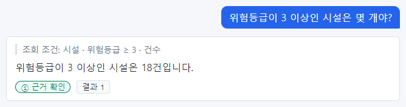

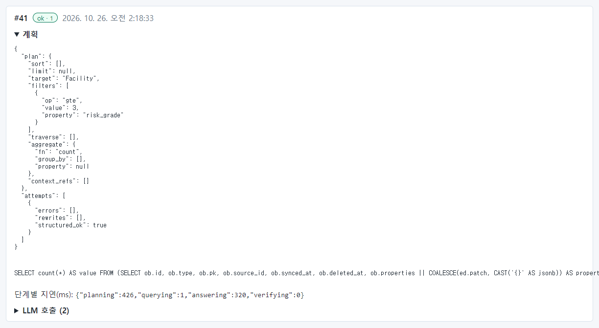

| 볼 곳 | 정상 모습 |
| --- | --- |
| 조회 조건 줄 | `시설 · 위험등급 ≥ 3 · 건수` |
| 답 | 18건, ① |
| 계획 | `target: Facility`, `filters: risk_grade gte 3`, `aggregate: count` |
| 확인 질문으로 쓰기 | 설치·업그레이드 확인에 쓰는 첫 질문(5.6) |

## 34.3 목록 — "변전소 목록 보여줘"

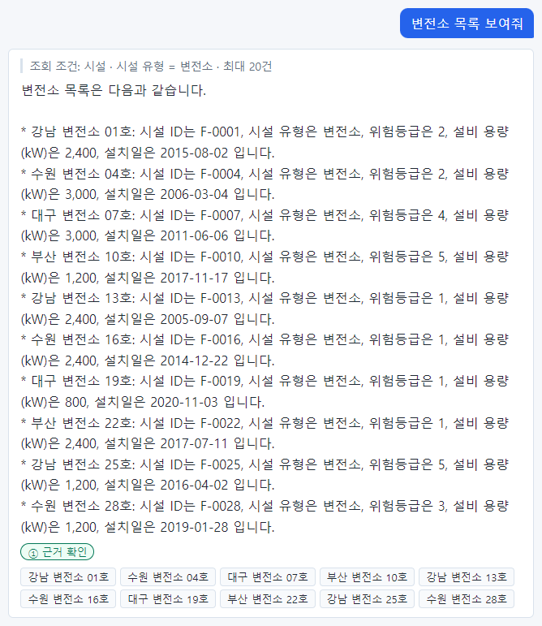

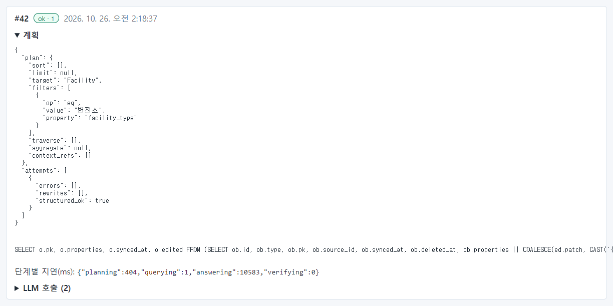

| 볼 곳 | 정상 모습 |
| --- | --- |
| 조회 조건 줄 | `시설 · 시설 유형 = 변전소 · 최대 20건` — 목록은 기본 20건까지 |
| 답 | 변전소 10개, 근거 단추 10개 |
| 시간 | 12초 — 답 문장이 길어 answering 이 오래 걸림. 목록 질문이 느린 것은 정상 |

## 34.4 정렬과 개수 — "위험등급이 가장 높은 시설 5개 알려줘"

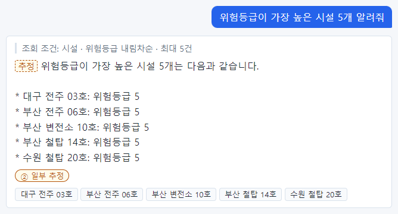

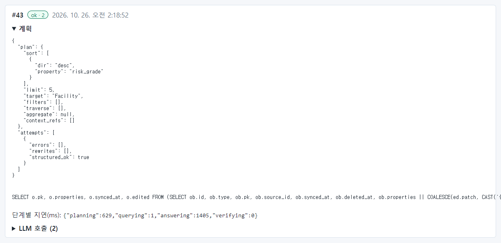

| 볼 곳 | 모습 |
| --- | --- |
| 조회 조건 줄 | `시설 · 위험등급 내림차순 · 최대 5건` |
| 계획 | `sort: risk_grade desc`, `limit: 5` |
| 등급 | **② 일부 추정** — 첫 문장 앞에 **추정** 표지. "가장 높은 시설 5개는 다음과 같습니다" 같은 문장은 값 하나와 글자 그대로 대조할 수 없어 추정으로 표시됨 |

> **알아 두기** 위험등급 5인 시설이 5개보다 많으면 어느 5개가 나올지는 정해져 있지 않습니다. 사용자가 "왜 이
> 시설이 빠졌냐"고 하면 조건을 더 붙여 묻도록 안내합니다.

## 34.5 묶어 세기 — "시설 유형별 개수 알려줘"

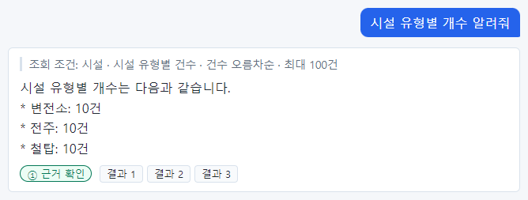

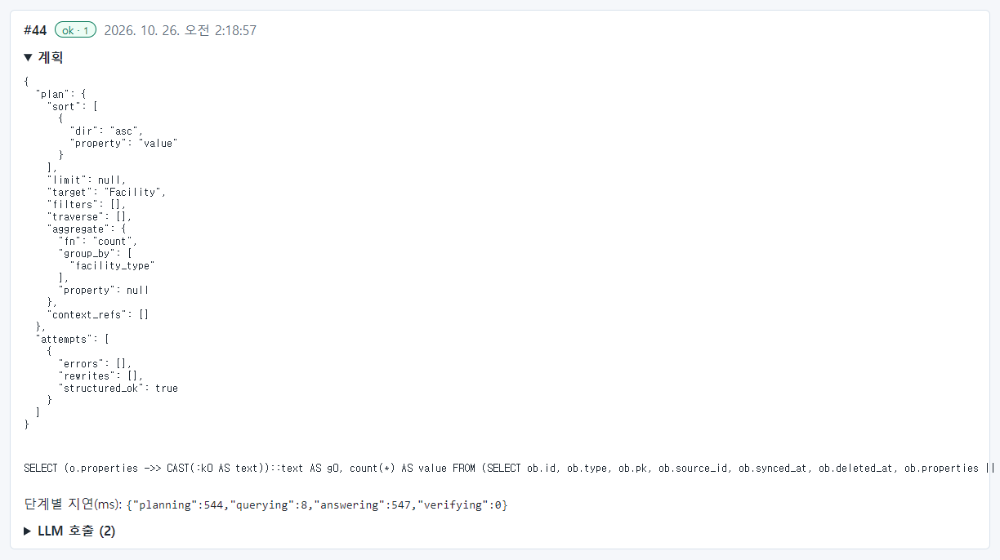

| 볼 곳 | 정상 모습 |
| --- | --- |
| 조회 조건 줄 | `시설 · 시설 유형별 건수 · 건수 오름차순 · 최대 100건` |
| 답 | 변전소 10, 전주 10, 철탑 10 |
| 계획 | `aggregate: count, group_by: facility_type` |

## 34.6 한 건 — "F-0007 시설의 설비 용량은?"

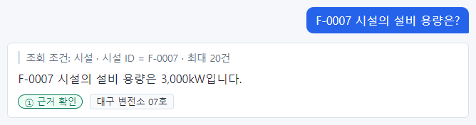

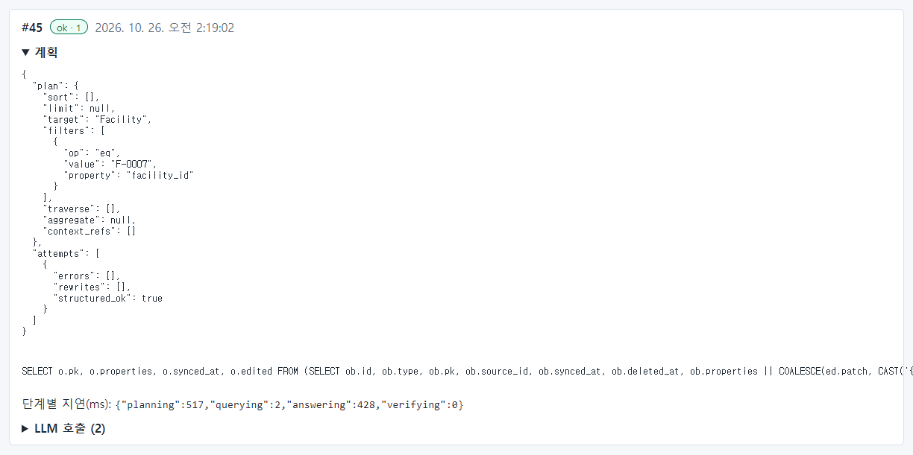

| 볼 곳 | 정상 모습 |
| --- | --- |
| 조회 조건 줄 | `시설 · 시설 ID = F-0007 · 최대 20건` |
| 답 | 3,000kW(천 단위 쉼표) |
| 근거 단추 | `대구 변전소 07호` — 누르면 근거 카드 |

## 34.7 날짜 조건 — "2015년 이전에 설치된 철탑은?"

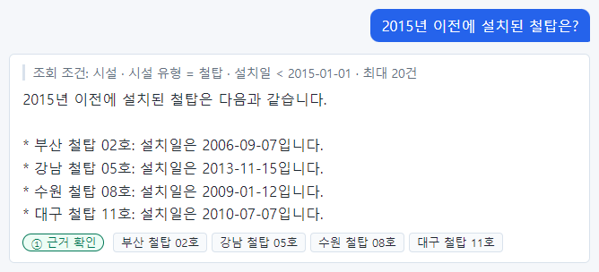

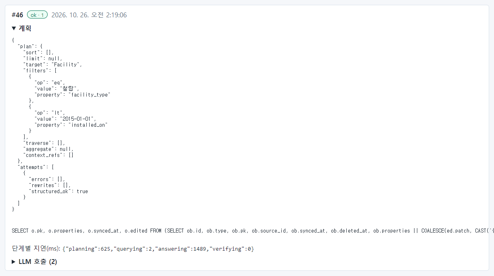

| 볼 곳 | 정상 모습 |
| --- | --- |
| 조회 조건 줄 | `시설 · 시설 유형 = 철탑 · 설치일 < 2015-01-01 · 최대 20건` |
| 답 | 철탑 4개(2006·2013·2009·2010년) |

## 34.8 다른 타입 — "조직 목록 보여줘"

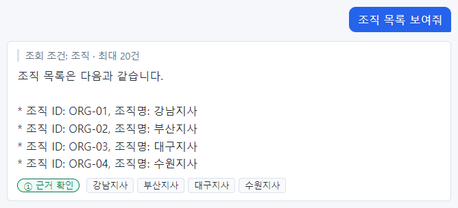

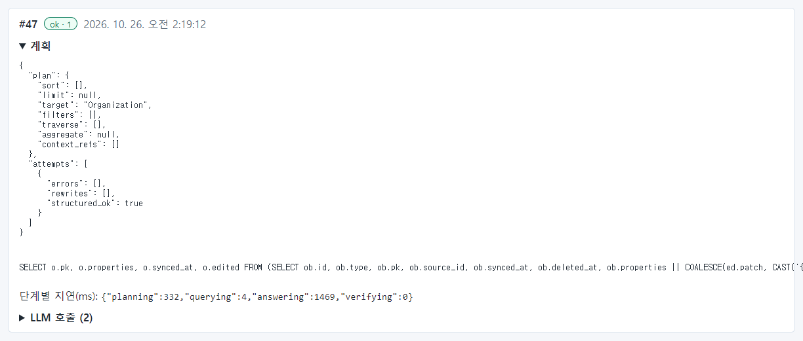

조직(`Organization`)을 읽을 권한이 없는 역할이면 이 질문이 실패합니다(8장). 권한 문제를 확인할 때 쓰기 좋은 질문입니다.

## 34.9 코드 조건 — "지역 코드가 11인 지역 이름은?"

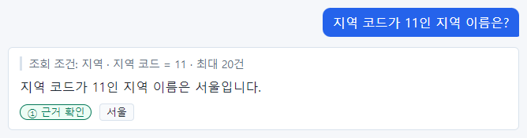

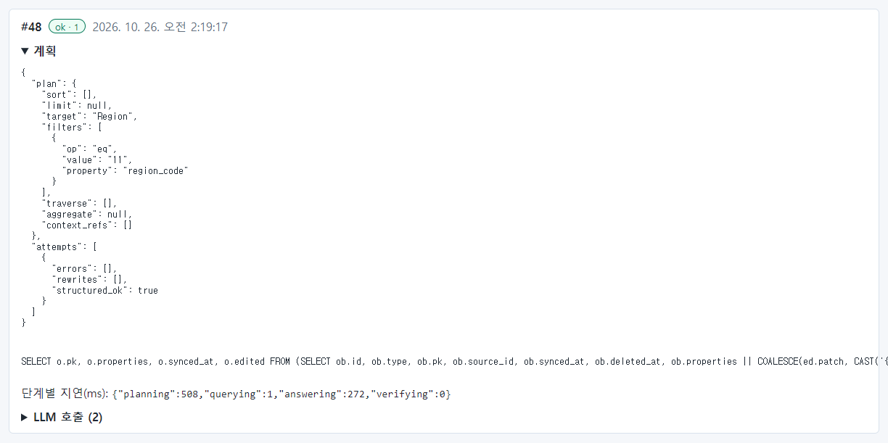

## 34.10 데이터 질문이 아님 — "안녕하세요"

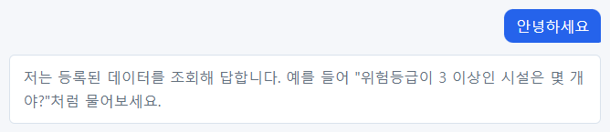

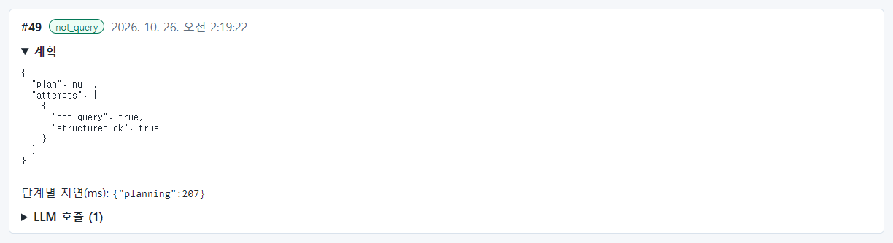

| 볼 곳 | 정상 모습 |
| --- | --- |
| 답 | 고정 안내 문장(AI 가 쓰지 않음). 조회 조건 줄·등급 없음 |
| 트레이스 | `not_query`, `plan: null`, LLM 호출 1번(질문 해석만) |

## 34.11 평균 — "용량이 1000kW 넘는 변전소의 평균 위험등급은?"

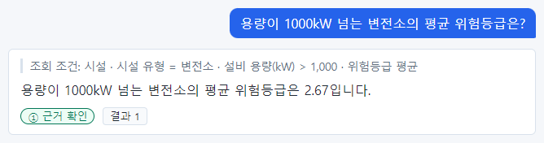

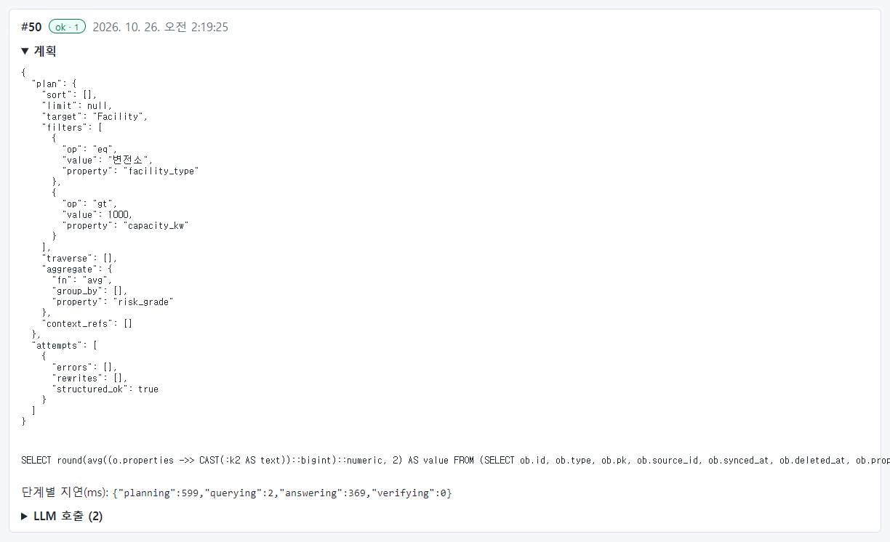

| 볼 곳 | 모습 |
| --- | --- |
| 조회 조건 줄 | `시설 · 시설 유형 = 변전소 · 설비 용량(kW) > 1,000 · 위험등급 평균` |
| 계획 | 조건 두 개 + `aggregate: avg` |
| 조회문 | `round(avg(…), 2)` — **평균은 서버가 소수 둘째 자리로 반올림**(AI 가 계산하지 않음) |
| 값 | 2.67. 처음 설치 때는 2.56 이었으나 16장 실습으로 F-0004(3,000kW 변전소)의 위험등급이 바뀌어 달라짐 |

## 34.12 결과 0건 — "위험등급이 9인 시설 보여줘"

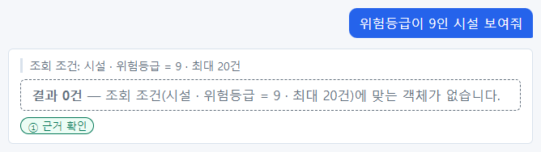

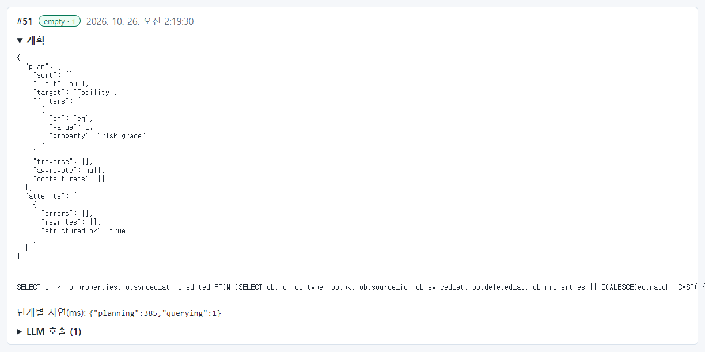

| 볼 곳 | 정상 모습 |
| --- | --- |
| 답 | **결과 0건** 상자 — 조건에 맞는 객체가 없음 |
| 상태 | `empty` — 실패(failed)와 다름. 조회는 성공했고 결과가 없었을 뿐 |

> **알아 두기** OntoBot 은 "조회 실패"를 "결과 0건"처럼 보이게 하지 않습니다(1.2). 사용자가 "결과가 없다고 나온다"고
> 하면 이 둘 중 무엇인지 먼저 확인하세요.

## 34.13 관계(소재 지역) — "서울 지역 시설 목록 보여줘"

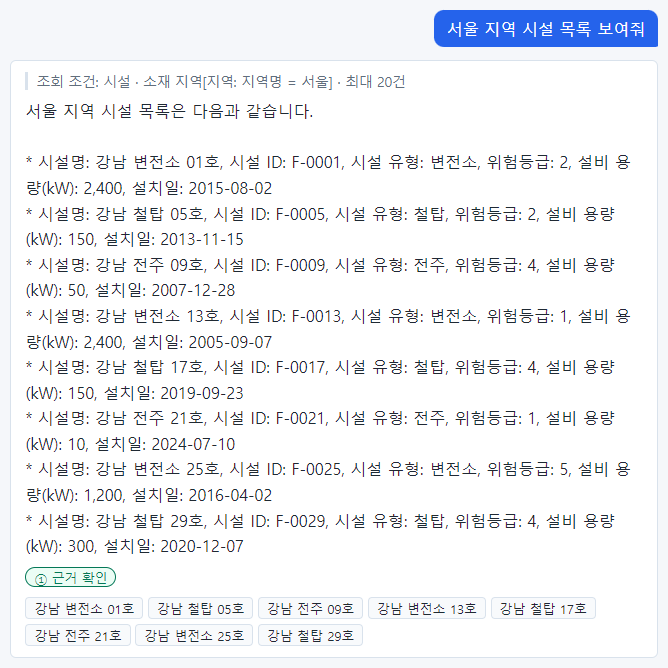

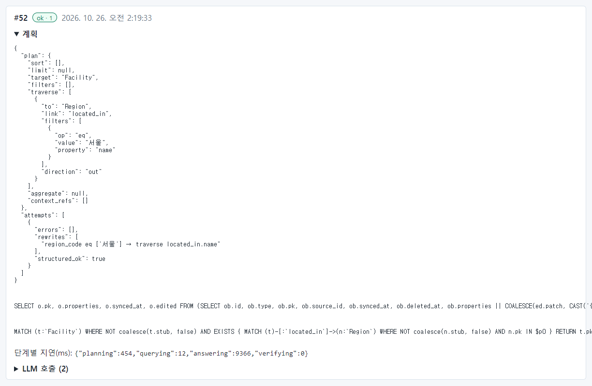

| 볼 곳 | 정상 모습 |
| --- | --- |
| 조회 조건 줄 | `시설 · 소재 지역[지역: 지역명 = 서울] · 최대 20건` — 대괄호가 관계를 따라간 표시 |
| 트레이스 | `traverse: located_in → Region, name eq 서울` 과 Neo4j 조회문(`MATCH …`) |
| `attempts.rewrites` | `region_code eq ['서울'] → traverse located_in.name` — "지역 코드 = 서울"을 서버가 관계 조건으로 고침(34.14 참고) |
| 단계별 지연 | planning 0.45초, querying 0.012초, answering 9.4초(8개 목록) |
| Neo4j 가 멈추면 | 이 질문이 "관계 저장소 연결 불가"로 실패(13.3) |

## 34.14 관계(소유 조직) — "강남지사가 소유한 시설 목록 보여줘"

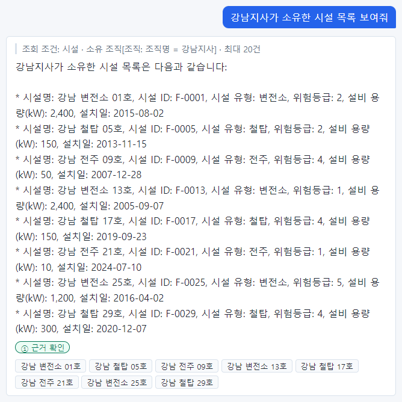

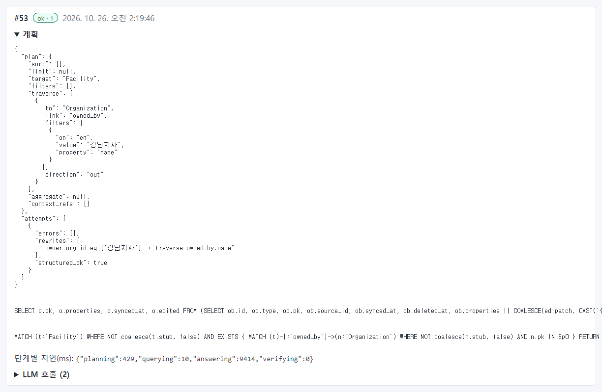

| 볼 곳 | 모습 |
| --- | --- |
| 계획 | `traverse: owned_by → Organization, name eq 강남지사` |
| `attempts.rewrites` | `owner_org_id eq ['강남지사'] → traverse owned_by.name` — AI 가 "소유 조직 ID = 강남지사"로 잘못 세운 계획을, 서버가 **값이 조직 이름과 정확히 같은 것을 확인하고** 관계 조건으로 고친 기록 |
| 조회문 | PostgreSQL(SQL)과 Neo4j(MATCH) 두 줄 |
| 단계별 지연 | answering 9.4초 — 8개 목록의 답 문장 |

## 34.15 조건 + 관계 — "서울에 있는 변전소는?"

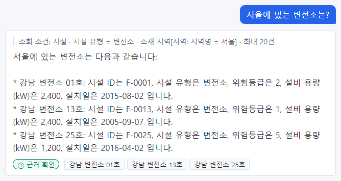

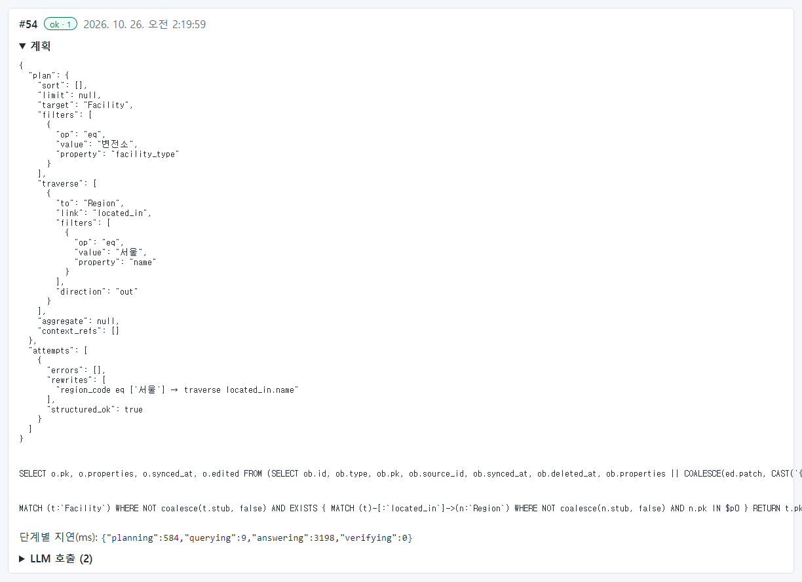

## 34.16 이어서 묻기 — "그 중 위험등급이 4 이상인 것만"

바로 앞 질문(서울에 있는 변전소 3개)과 같은 대화에서 물었습니다.

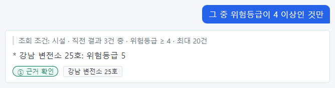

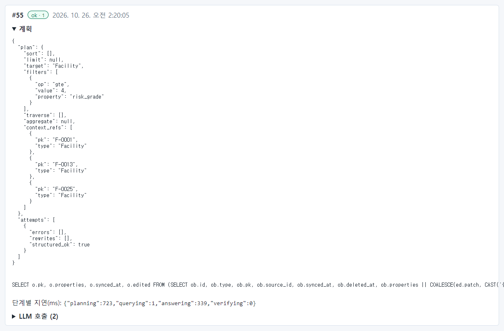

| 볼 곳 | 정상 모습 |
| --- | --- |
| 조회 조건 줄 | `시설 · 직전 결과 3건 중 · 위험등급 ≥ 4 · 최대 20건` |
| 계획 | `context_refs` 에 앞 결과 세 개(F-0001, F-0013, F-0025) |
| 답 | 강남 변전소 25호(위험등급 5) 하나 |

## 34.17 맥락을 놓친 예 — "그 시설들의 설비 용량 합계는?"

앞 질문(1개 결과)에 이어 물었지만, 답은 **모든 시설의 합계(22,600kW)** 였습니다.

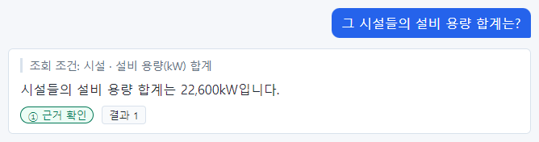

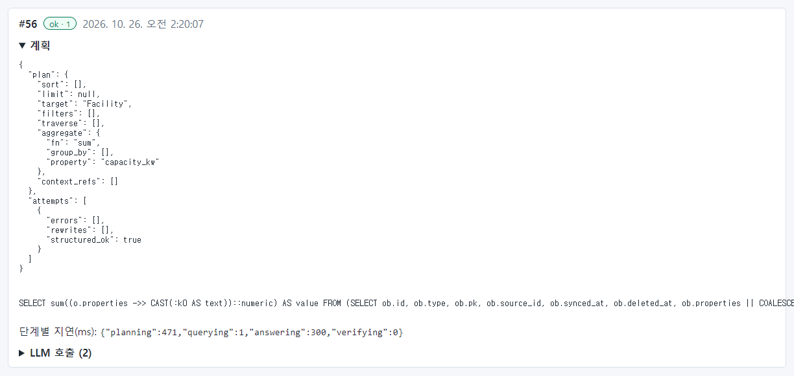

| 볼 곳 | 모습 |
| --- | --- |
| 조회 조건 줄 | `시설 · 설비 용량(kW) 합계` — "직전 결과 N건 중"이 **없음** |
| 계획 | `context_refs: []` — 앞 결과를 쓰지 않음 |
| 등급 | ① — 계산 자체는 근거와 맞으므로 등급은 정상 |

이것이 이 장에서 가장 중요한 예입니다. **등급 ①은 "답이 조회 결과와 맞다"는 뜻이지 "질문을 바르게 이해했다"는
뜻이 아닙니다.** 질문을 바르게 이해했는지는 **조회 조건 줄**로 판단합니다. 사용자에게도 "답 위의 조회 조건 줄을
먼저 보라"고 안내하세요. 이런 사례가 반복되면 트레이스 번호를 모아 개발팀에 전달합니다.

## 34.18 근거 부족 — "시설별 담당 점검원 이름은?"

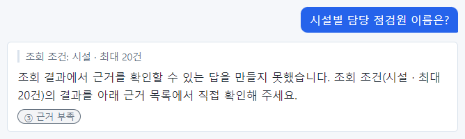

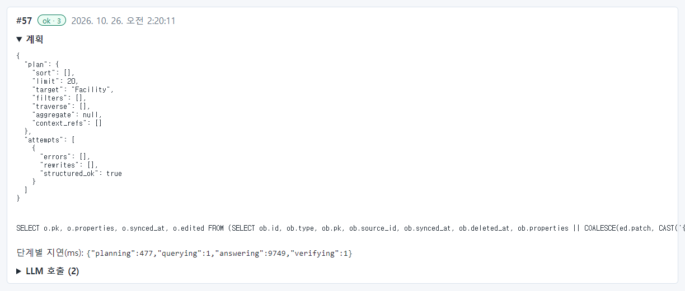

| 볼 곳 | 모습 |
| --- | --- |
| 계획 | 조건 없이 시설 20건(점검원이라는 속성이 없어 뺌) |
| 답 | **③ 근거 부족** — "근거를 확인할 수 있는 답을 만들지 못했습니다" 안내만 보이고 AI 문장은 숨김 |
| 트레이스 표지 | `ok · 3` |

AI 가 지어낸 이름을 보여 주지 않고 본문을 숨긴 것입니다. 시설에는 점검원 속성이 없으므로, 필요하면 모델러에게
온톨로지 보강을 요청합니다.

## 34.19 표현할 수 없는 질문 — "작년 정전 횟수가 가장 많은 지역은?"

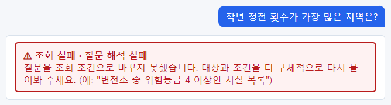

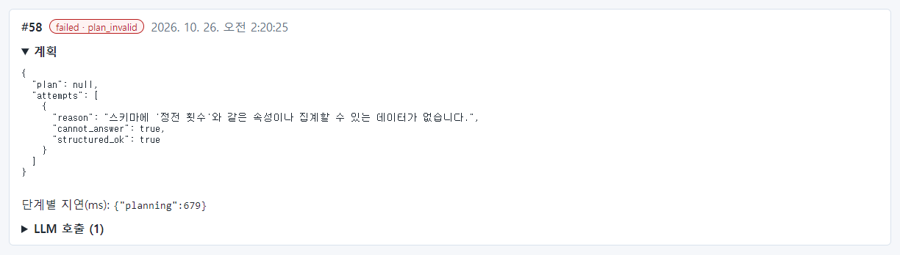

`reason: "스키마에 '정전 횟수'와 같은 속성이나 집계할 수 있는 데이터가 없습니다."` — 없는 데이터를 지어내지 않고
실패를 알립니다(10.4).

## 34.20 없는 대상에 대한 Action — "F-9999 시설 위험등급을 3으로 바꿔줘"

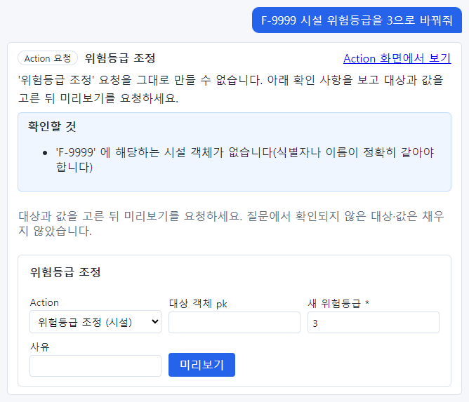

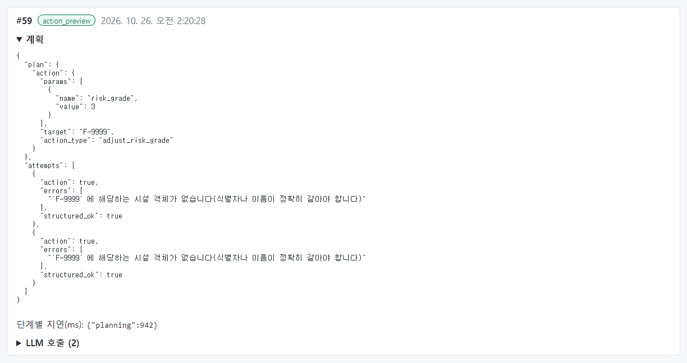

| 볼 곳 | 모습 |
| --- | --- |
| 답 | "'위험등급 조정' 요청을 그대로 만들 수 없습니다" + **확인할 것: 'F-9999' 에 해당하는 시설 객체가 없습니다** + 빈 요청 칸 |
| 트레이스 | `action_preview`, 시도 두 번 모두 같은 오류 — **Action 기록은 만들어지지 않음** |

채팅으로 없는 대상의 Action 을 요청해도 미리보기(요청)가 생기지 않습니다. 승인 대기 목록이 지어낸 요청으로 채워지는
일이 없습니다(14.3).

## 34.21 조직의 속성 — "수원지사 담당자 연락처 알려줘"

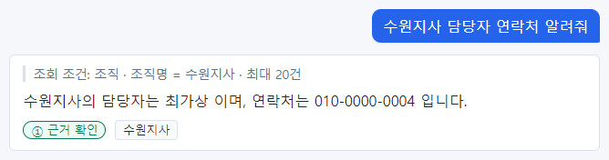

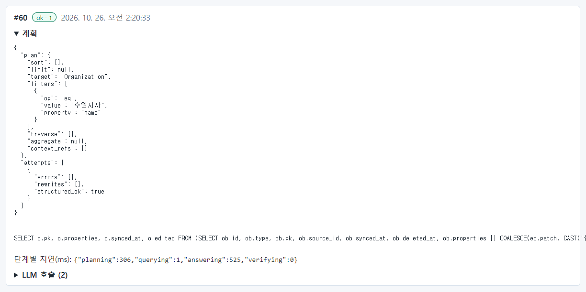

| 볼 곳 | 모습 |
| --- | --- |
| 답 | 담당자 이름과 연락처(샘플의 합성 데이터) |
| 개인정보 | 읽기 권한이 있는 사용자에게는 답에 그대로 보임. 감사 로그·앱 로그·트레이스의 질문·프롬프트에서는 가려짐 |

> **알아 두기** 연락처 같은 개인정보가 있는 타입은 읽기 권한을 신중히 주세요(8.5). 화면에 가리는 것보다 읽을 수 있는
> 사람을 줄이는 것이 먼저입니다.

## 34.22 근거 카드 — 값이 어디서 왔는지

답의 인용 번호(①②… 옆의 작은 표시)를 누르면 오른쪽에 **근거 카드** 가 열립니다. 사용자가 "이 숫자 맞아요?"라고
물을 때 운영자가 가장 먼저 여는 곳입니다. 위 질문들에서 인용을 눌러 연 카드를 모았습니다.

### 한 건의 카드 — 5번 "F-0007 시설의 설비 용량은?"

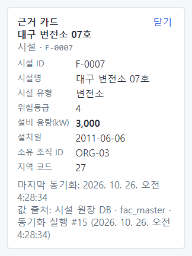

| 부분 | 값 | 뜻 |
| --- | --- | --- |
| 제목 | 대구 변전소 07호 | 객체의 제목 속성 |
| 타입 · pk | 시설 · `F-0007` | 어느 타입의 어느 객체인지 |
| 속성 목록 | 시설 ID ~ 지역 코드 | **이 사용자가 읽을 수 있는** 속성만 나옴(8장) |
| 굵은 값 | 설비 용량(kW) **3,000** | 답 문장이 인용한 값 |
| 마지막 동기화 | 2026. 10. 26. 오전 4:28:34 | 이 객체를 원천에서 마지막으로 가져온 때 |
| 값 출처 | 시설 원장 DB · `fac_master` · 동기화 실행 #15 | 데이터 소스 이름 · 원천 표 · 동기화 실행 번호(12장) |

사용자가 "원장에는 다른 값이 있다"고 하면 **마지막 동기화** 시각과 원천 값을 비교합니다. 그 뒤에 원천이 바뀌었다면
다음 동기화를 기다리거나 수동 동기화(12장)를 돌립니다. 편집 레이어로 바뀐 값이면 카드에 편집 표시가 붙습니다(16장).

### 목록의 한 항목 — 13번 "강남지사가 소유한 시설 목록 보여줘"

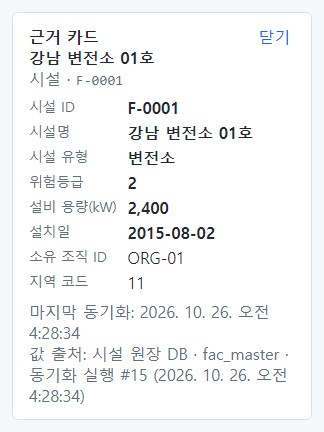

목록 답의 인용은 목록 항목 하나하나를 가리킵니다. 이 카드는 `F-0001` 강남 변전소 01호로, 굵은 값은 시설명·시설
유형·위험등급·설비 용량·설치일 등 답 문장이 인용한 값들입니다. "소유 조직 ID"가 `ORG-01` 로 보여 관계 조건(강남지사
소유)이 맞았는지도 카드에서 바로 확인됩니다.

### 다른 타입 — 8번 "지역 코드가 11인 지역 이름은?"

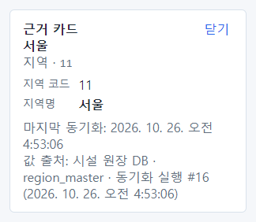

지역(Region) 타입의 카드입니다. 값 출처의 원천 표가 `region_master`, 동기화 실행이 #16 으로 시설과 다릅니다.
타입마다 동기화가 따로 돌기 때문입니다(11장). 한 타입만 값이 옛것이라면 그 타입의 동기화 기록을 봅니다.

### 조직의 연락처 — 20번 "수원지사 담당자 연락처 알려줘"

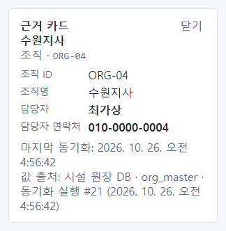

담당자·담당자 연락처가 굵게 보입니다. 이 속성들은 개인정보(PII)로 표시된 속성입니다. 읽기 권한이 있는 사용자에게는
카드에 원값이 보이지만, 감사 로그·트레이스·로그에는 마스킹되어 남습니다(9장, 31장). 시험 데이터의 연락처는 합성 값입니다.

### 카드가 없는 인용 — 1번 세기, 10번 평균

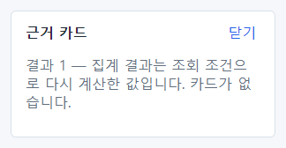

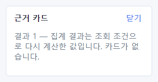

건수·평균 같은 **집계** 인용을 누르면 "결과 1 — 집계 결과는 조회 조건으로 다시 계산한 값입니다. 카드가 없습니다."가
나옵니다. 집계 값은 한 객체에 들어 있는 값이 아니기 때문입니다. 이때 근거는 답 위의 **조회 조건 줄**입니다. 사용자가
숫자를 의심하면 조회 조건 줄을 읽어 주고, 조건이 질문과 같은지 확인합니다(같지 않으면 트레이스의 계획을 봄, 10장).

| 카드 모습 | 운영자가 확인할 것 |
| --- | --- |
| 굵은 값이 답의 숫자와 같음 | 정상. 값이 틀렸다면 원천 데이터 문제 |
| 마지막 동기화가 오래됨 | 동기화 일정·실패(12장, 24장) |
| 속성이 몇 개만 보임 | 그 사용자의 읽기 권한(8장) — 정상일 수 있음 |
| "카드가 없습니다" | 집계. 조회 조건 줄로 확인 |
| 편집 표시가 있음 | Action 으로 바뀐 값(14장·16장) |

## 34.23 운영자의 비교 요령

| 비교 대상 | 같아야 하는 것 | 달라도 되는 것 |
| --- | --- | --- |
| 업그레이드 전 ↔ 뒤 | 조회 조건 줄, 숫자, 개수, 상태, 등급 | 문장 표현, 걸린 시간(조금) |
| 사용자 신고 ↔ 이 장 | 조회 조건 줄의 모양(조건이 빠졌는지) | 대상 이름·값 |
| 장애 중 ↔ 정상 | — | 장애 중에는 상태가 failed |

조회 조건 줄이 달라졌다면(조건 누락, 엉뚱한 타입) 트레이스의 계획을 보고 개발팀에 알립니다.
