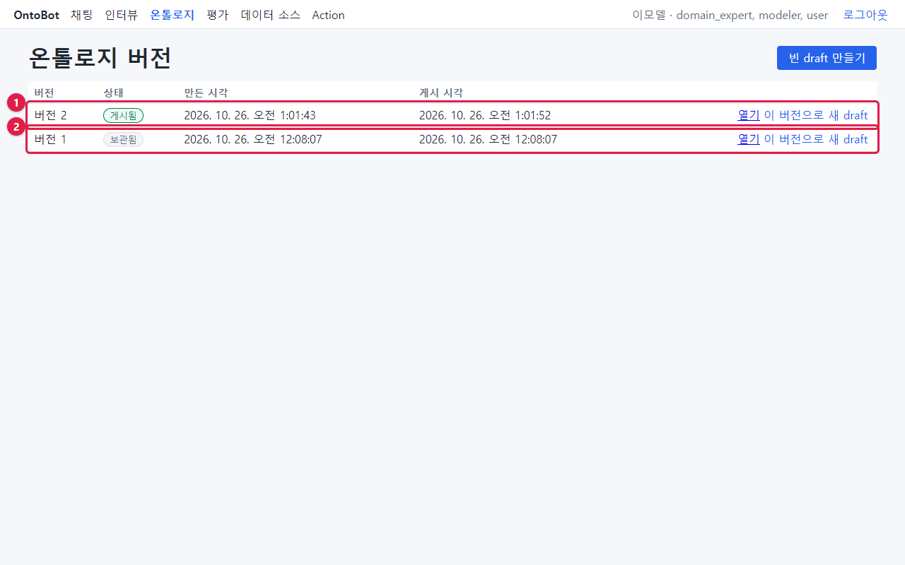
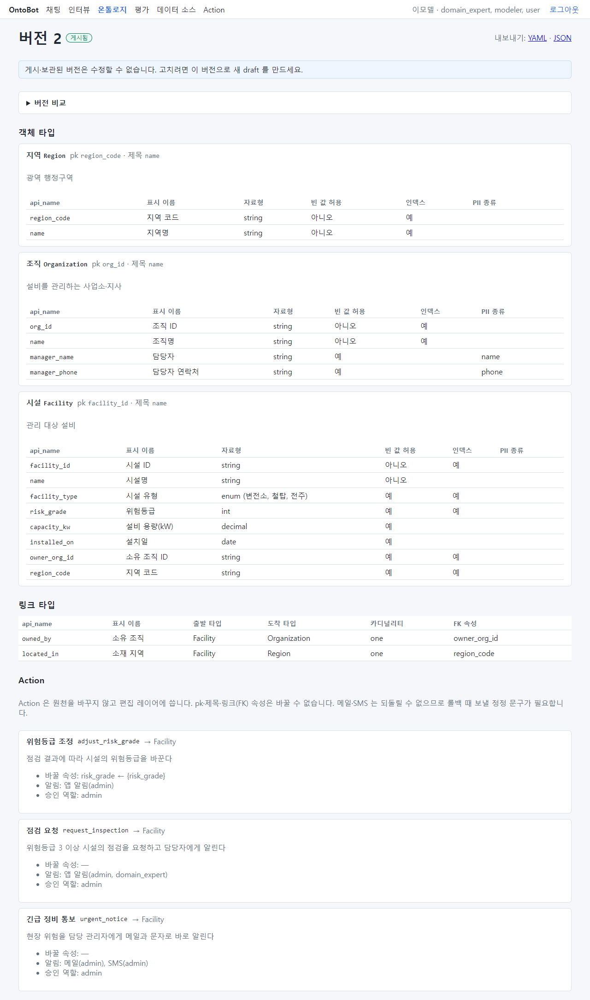
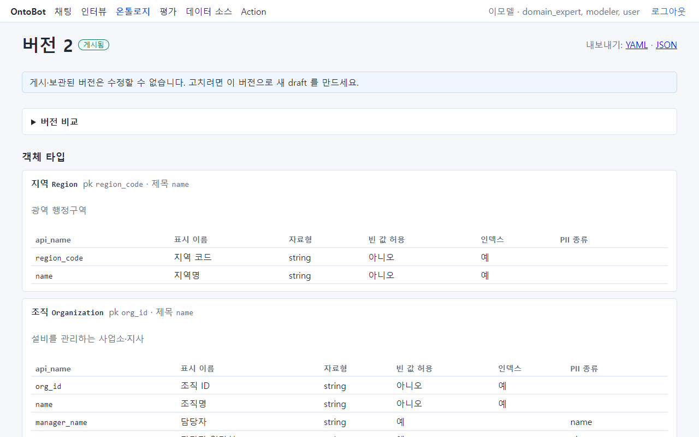
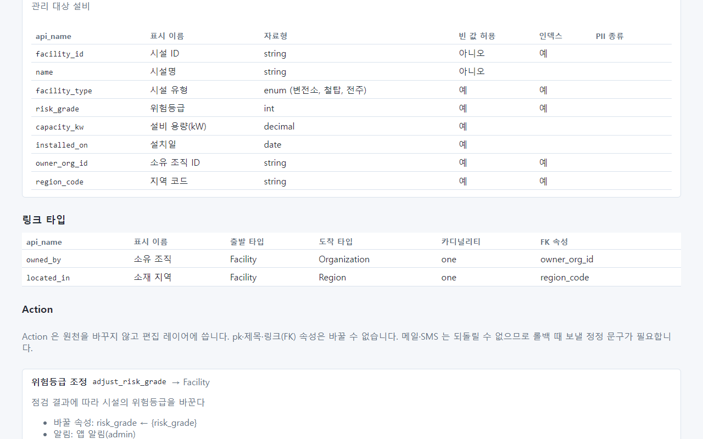
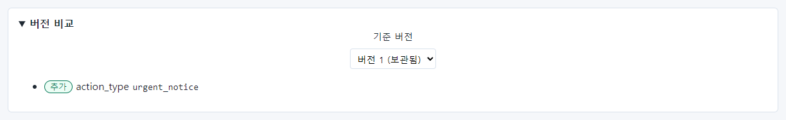
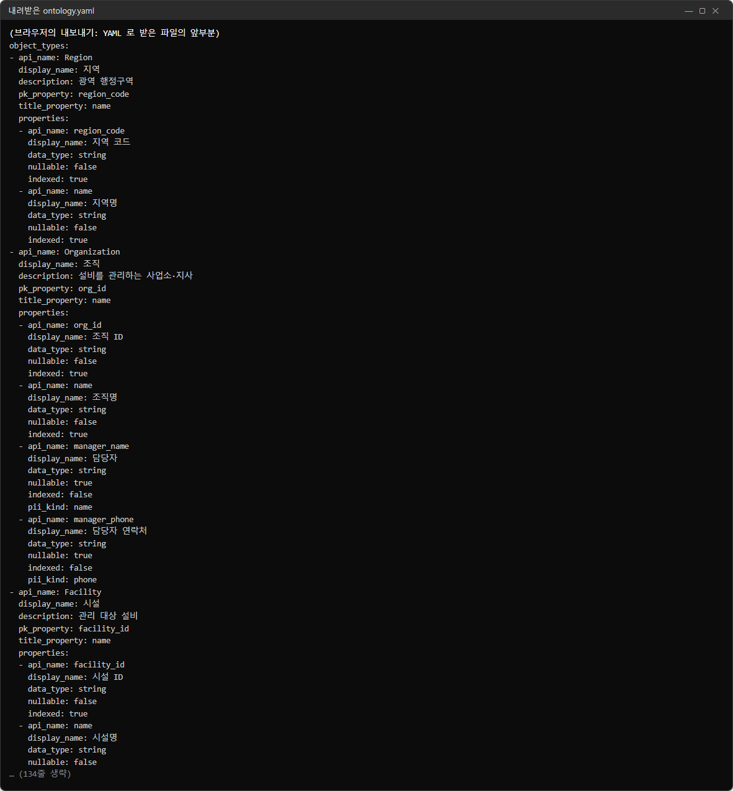
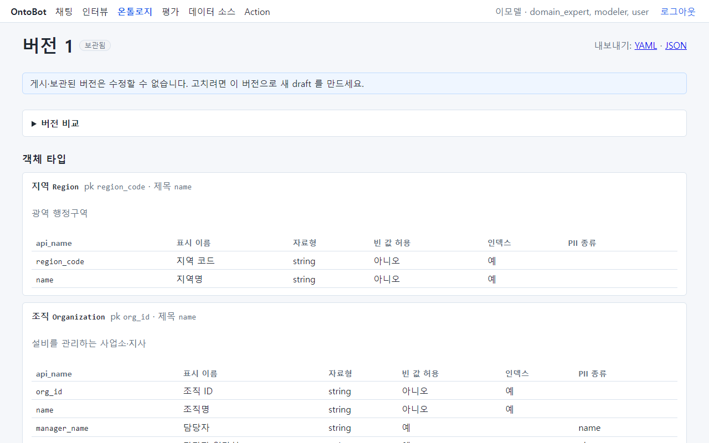

# 36장 온톨로지 확인 — 운영자가 볼 것

온톨로지를 고치고 게시하는 것은 모델러의 일입니다(사용자 매뉴얼 16~17장). 하지만 운영자는 다음을 확인할 수 있어야
합니다.

- 지금 **어느 버전이 게시되어 있는지**, 언제 누가 게시했는지
- 게시가 바뀌었을 때 **무엇이 달라졌는지**(새 객체 타입이면 읽기 권한, 새 메일·SMS Action 이면 발송 채널·연락처)
- 업그레이드·복원 뒤 게시본이 그대로인지

이 장은 모델러 계정(`lee.modeler`)으로 온톨로지 화면을 열어 본 모습입니다.

## 36.1 버전 목록

| 번호 | 줄 | 뜻 |
| --- | --- | --- |
| ① | 버전 2 · **게시됨** | 지금 쓰는 설계도(15장에서 모델러가 메일·SMS Action 을 추가해 게시) |
| ② | 버전 1 · **보관됨** | 예전 게시본(설치 때 샘플로 게시) |

게시 기록은 감사 로그 `ontology.version_published` 로도 확인합니다(9.4).

## 36.2 게시본 열기

**열기** 를 누르면 버전의 내용이 보입니다.

| 부분 | 내용 |
| --- | --- |
| 제목 | **버전 2** · 게시됨 |
| 내보내기 | YAML · JSON 파일로 받기 |
| 안내 | "게시·보관된 버전은 수정할 수 없습니다. 고치려면 이 버전으로 새 draft 를 만드세요." |
| **▶ 버전 비교** | 다른 버전과 무엇이 다른지(36.3) |
| 객체 타입 | 타입마다 pk·제목 속성과 속성 표(api_name·표시 이름·자료형·빈 값 허용·인덱스·**PII 종류**) |

전체 모습(길어서 축소됨):

### 객체 타입과 속성

운영자가 볼 칸:

| 칸 | 볼 점 |
| --- | --- |
| PII 종류 | `name`·`phone` 처럼 개인정보로 표시된 속성. 로그·트레이스에서 가려지는 대상. 이런 속성이 있는 타입은 읽기 권한을 신중히 |
| 빈 값 허용 | "아니오"인 속성이 원천에서 비면 동기화가 실패(12.5) |
| 자료형 | `int`·`date`·`decimal`·`enum(…)` — 원천 값이 맞지 않으면 동기화 실패 |

### 링크 타입

| 칸 | 뜻 |
| --- | --- |
| 출발·도착 타입 | 시설 → 조직, 시설 → 지역 |
| FK 속성 | 관계를 만드는 속성(`owner_org_id`, `region_code`) — 매핑에서 "링크 만들기"로 켬(12.1) |

두 타입을 잇는 관계는 양쪽 타입을 모두 읽을 수 있어야 씁니다(8.4).

### Action

Action 마다 바꿀 속성, 알림 채널과 받는 역할, 승인 역할이 보입니다. **메일·SMS 알림이 있는 Action 이 새로 생기면**
발송 채널(15장)과 받는 사람의 연락처(7.8)를 준비해야 합니다.

## 36.3 버전 비교

게시본에서 **▶ 버전 비교** 를 펼치면, 바로 전 버전을 기준으로 달라진 점이 나옵니다.

`추가 · action_type urgent_notice` — 버전 2 는 버전 1 에 "긴급 정비 통보" Action 하나를 더한 것입니다. **기준 버전**
칸에서 다른 버전을 고를 수도 있습니다.

| 비교 결과 | 운영자 할 일 |
| --- | --- |
| `object_type` 추가 | 새 타입의 읽기 권한(8.6), 데이터 연결(11~12장) |
| `property` 추가·변경 | 매핑에 새 열 짝짓기(모델러), 동기화 확인 |
| `link_type` 추가 | 매핑의 "링크 만들기", 그래프 대사 |
| `action_type` 추가(메일·SMS) | 발송 채널·연락처 |
| 타입 삭제 | 그 타입에 남은 읽기 권한 정리(8.6) |

## 36.4 내보내기 — 설계도 사본

**내보내기: YAML** 을 누르면 게시본 전체가 파일로 내려받아집니다. 변경 관리 문서에 붙이거나 개발팀에 보낼 때 씁니다.

`object_types` → 타입마다 `api_name`·`display_name`·`pk_property`·`properties`(속성마다 `data_type`·`nullable`·
`indexed`·`pii_kind`) 순서입니다.

## 36.5 보관된 버전

보관된 버전도 열어 볼 수 있습니다(수정 불가). 예전 게시본으로 돌아가고 싶으면 모델러가 보관본에서 **이 버전으로 새
draft** 를 만들어 다시 게시합니다. 운영자가 직접 하지 않습니다.

## 36.6 업그레이드·복원 뒤 확인

| 확인 | 정상 |
| --- | --- |
| 게시된 버전 번호 | 업그레이드 전과 같음(업그레이드는 온톨로지를 바꾸지 않음) |
| DB 까지 복원한 뒤 | 업그레이드 직전 백업 시점의 게시본 — 그 뒤의 게시는 사라짐(22.5) |
