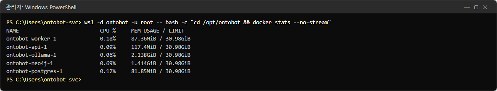
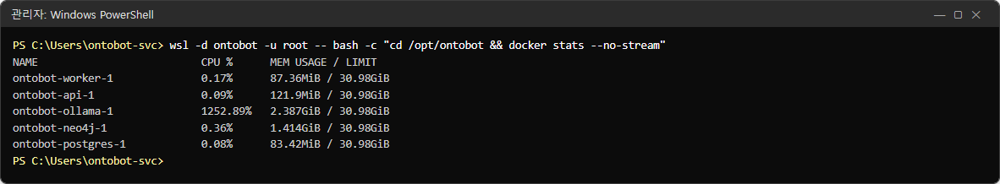
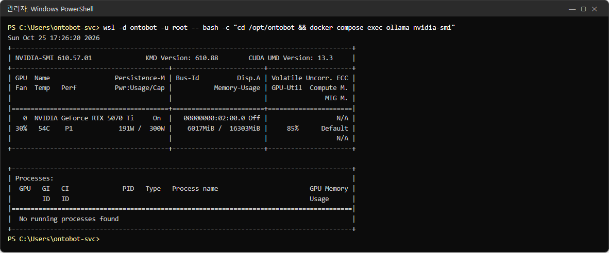
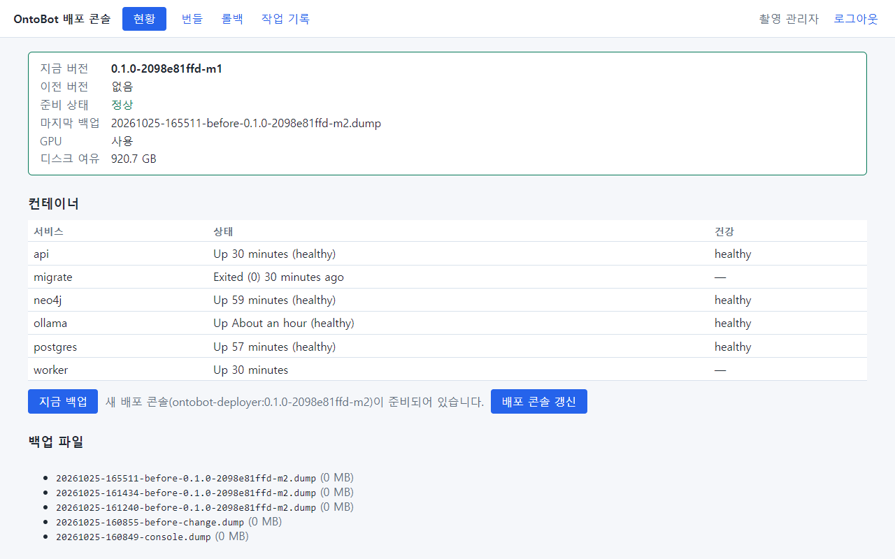
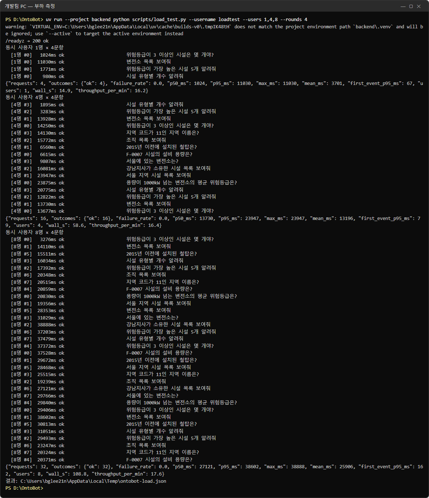
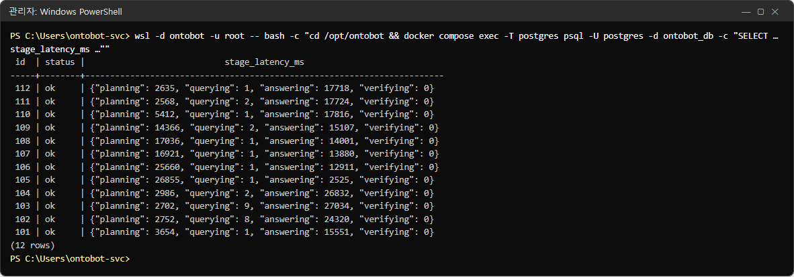

# 37장 동시 사용과 용량

"몇 명까지 동시에 쓸 수 있나요?", "왜 점심시간 직후에 느려지나요?" 같은 질문에 답하려면 OntoBot 이 부하를 받을 때
어떻게 움직이는지 알아야 합니다. 이 장은 시험 서버에 개발팀의 부하 측정 도구로 **실제로 동시 사용자 1·4·8명의
질문을 보내며** 찍은 결과입니다.

> **알아 두기** 수치는 시험 PC(GPU 1장 — NVIDIA RTX 5070 Ti 16GB) 기준입니다. 운영 서버의 GPU 가 다르면 수치도
> 다릅니다. 운영 서버에서 같은 측정을 하려면 개발팀과 함께, 업무 시간 외에 하세요(실제 AI 모델이 일하므로 그동안
> 사용자 응답이 느려집니다).

## 37.1 무엇이 병목인가

질문 하나는 다음 순서로 처리되고(10장), 대부분의 시간은 **AI 모델**이 씁니다.

| 단계 | 하는 곳 | 혼자 쓸 때(34장) |
| --- | --- | --- |
| planning(질문 해석) | ollama(GPU) | 0.2~1초 |
| querying(조회) | PostgreSQL·Neo4j | 0.001~0.01초 |
| answering(답 쓰기) | ollama(GPU) | 0.3~10초(답이 길수록) |
| verifying(근거 대조) | api | 0초대 |

GPU 하나는 질문을 사실상 **차례로** 처리합니다. 그래서 여러 사람이 동시에 물으면 각자의 기다리는 시간이 늘어납니다.
데이터베이스·api 는 거의 일하지 않습니다.

## 37.2 측정 전 — 쉬고 있을 때

```powershell
wsl -d ontobot -u root -- bash -c "cd /opt/ontobot && docker stats --no-stream"
```



ollama 는 CPU 0.06%, 메모리 2.1GB(모델이 올라가 있음)입니다.

## 37.3 측정 방법

부하 측정은 개발팀 도구(`scripts/load_test.py`)로 합니다. 가상 사용자마다 따로 로그인해, 골든셋의 정상 질문을
차례로 보냅니다. 이 책에서는 측정 전용 계정 `loadtest`(user 역할)를 관리 화면에서 만들어 썼습니다.

```powershell
$env:ONTOBOT_LOAD_PASSWORD = "<loadtest 비밀번호>"
uv run --project backend python scripts/load_test.py --username loadtest --users 1,4,8 --rounds 4
```

| 선택 | 뜻 |
| --- | --- |
| `--users 1,4,8` | 동시 사용자 단계 |
| `--rounds 4` | 사용자 한 명이 보내는 질문 수 |
| `--base-url` | 측정할 주소(기본 `http://localhost:8000`) |
| `--out` | 결과 JSON 을 저장할 곳 |

## 37.4 측정 중의 서버

8명이 동시에 질문하는 동안의 자원입니다.





| 항목 | 쉴 때 | 부하 중 | 읽는 법 |
| --- | --- | --- | --- |
| ollama CPU | 0.06% | 1252%(여러 코어) | 모델 실행 준비·토큰 처리 |
| GPU 사용률 | 4% | **85%** | GPU 가 거의 쉬지 않음 — 병목 |
| GPU 메모리 | 5.9GB | 6.0GB | 모델 크기만큼, 동시 사용자로 거의 늘지 않음 |
| GPU 전력 | 11W | 191W | — |
| api·worker·postgres CPU | 0.1% 안팎 | 0.1% 안팎 | 거의 일하지 않음 |

부하 중에도 배포 콘솔 현황은 **정상**이었습니다.



## 37.5 결과



| 동시 사용자 | 질문 수 | 실패 | 가운데값(p50) | 95번째(p95) | 가장 느림 | 분당 처리 |
| --- | --- | --- | --- | --- | --- | --- |
| 1명 | 4 | 0 | 1.0초 | 11.0초 | 11.0초 | 16.2건 |
| 4명 | 16 | 0 | 13.7초 | 23.9초 | 23.9초 | 16.4건 |
| 8명 | 32 | 0 | 27.1초 | 38.6초 | 38.9초 | 17.6건 |

> **알아 두기** 결과의 첫 줄 `warning: VIRTUAL_ENV=… does not match …` 은 측정 도구를 실행한 개발 PC 의 파이썬 환경
> 안내입니다. 측정과는 관계없습니다.

읽는 법:

- **분당 처리량은 사용자 수와 상관없이 약 16~18건**으로 거의 같습니다. GPU 하나가 1분에 처리할 수 있는 양이 정해져
  있다는 뜻입니다.
- 동시 사용자가 늘면 처리량은 그대로이고 **각자 기다리는 시간이 늘어납니다**(8명이면 가운데값 27초).
- 실패(`failed`)는 하나도 없었습니다. 느려질 뿐 실패하지는 않았습니다.
- "변전소 목록"처럼 답이 긴 질문은 혼자 물어도 11초가 걸립니다.

## 37.6 트레이스로 본 기다림

부하 중의 트레이스에서 단계별 시간을 보면 기다림이 어디서 생기는지 알 수 있습니다.

```powershell
wsl -d ontobot -u root -- bash -c "cd /opt/ontobot && docker compose exec -T postgres psql -U postgres -d ontobot_db -c \"SELECT t.id, t.status, t.stage_latency_ms FROM trace t JOIN app_user u ON u.id=t.user_id WHERE u.username='loadtest' ORDER BY t.id DESC LIMIT 12;\""
```



혼자 쓸 때 0.5초 안팎이던 planning 이 부하 중에는 2.5~26.9초, answering 이 12~27초로 늘었습니다. querying(조회)은
여전히 0.001~0.009초입니다. **기다림은 전부 AI 모델 앞에서 생깁니다.**

## 37.7 운영에 쓰는 법

| 상황 | 판단 |
| --- | --- |
| 동시 질문이 GPU 처리량(이 시험 PC 는 분당 약 17건)보다 적다 | 대부분 10초 안팎 |
| 점심 직후·회의 전처럼 몰리는 때 | 수십 초 — 사용자에게 "몰릴 때는 느릴 수 있다"고 안내 |
| 평가(골든셋) 실행·인터뷰 워크숍을 업무 시간에 함 | 같은 GPU 를 나눠 써 채팅이 느려짐 — 업무 시간 외로 |
| 사용자가 크게 늘 예정 | 더 좋은 GPU, GPU 추가 등 개발팀과 상의 |

데이터베이스 연결 수(`ONTOBOT_DB_POOL_SIZE` + `ONTOBOT_DB_MAX_OVERFLOW`, 기본 30)는 동시에 처리 중인 질문 수의
한도입니다(30.2). 위 결과처럼 AI 모델이 먼저 병목이 되므로, 연결 수를 늘린다고 빨라지지 않습니다.

> **알아 두기** 개발팀이 개발 PC 에서 따로 잰 기록(TRD 13.2)도 비슷합니다: 동시 8명일 때 응답 95%가 23초 안, 16명부터
> 분당 약 40건에서 포화, 24명까지 실패 없음. 측정할 때마다 장비·질문 구성에 따라 수치가 다르므로, 운영 서버에서는
> 운영 장비로 직접 재는 것이 정확합니다.

## 37.8 해 보기

> **해 보기** (시험 서버에서, 개발팀과)
>
> 1. 측정 전용 계정을 만들고 37.3 의 명령으로 1·4명 측정을 해 보세요.
> 2. 측정 중에 37.4 의 명령으로 GPU 사용률을 보세요.
> 3. 결과의 `throughput_per_min` 을 적어 두고, GPU 를 바꾸거나 업그레이드한 뒤 다시 재서 비교하세요.
