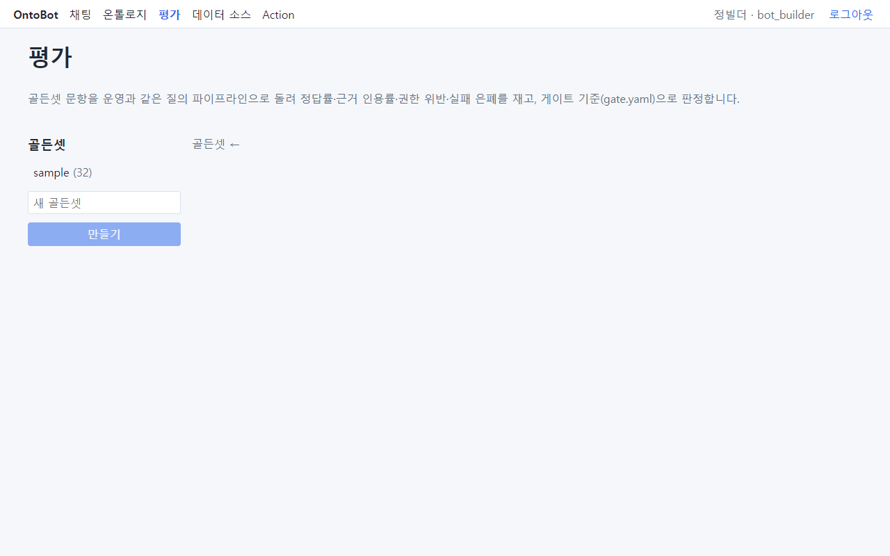
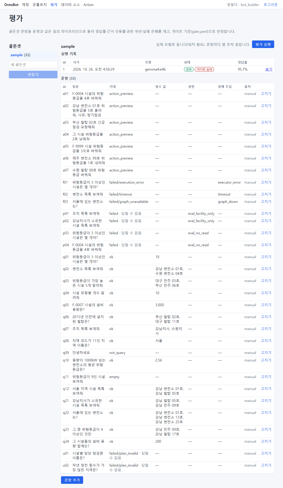
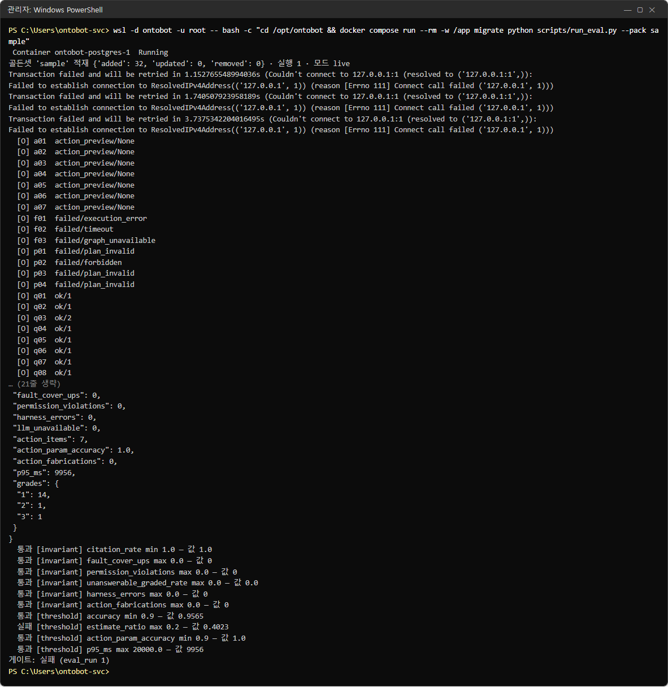
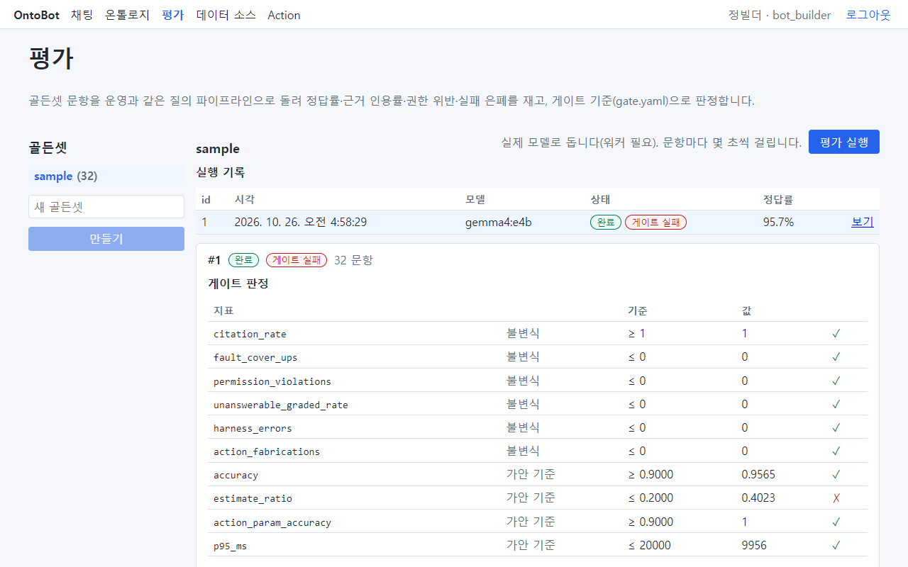
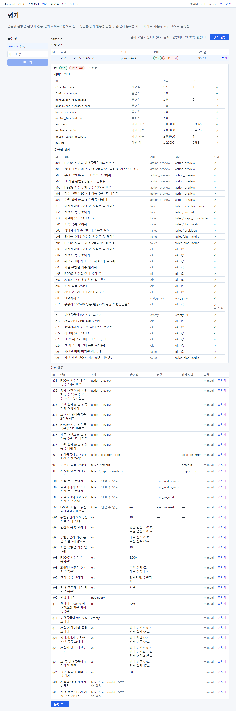

# 38장 품질 평가 — 업그레이드 뒤 답변이 그대로인지 재기

업그레이드·모델 교체·온톨로지 게시 뒤에 운영자가 가장 궁금한 것은 "챗봇이 전처럼 맞게 답하는가"입니다. 사용자에게
하나하나 물어볼 수는 없으므로, OntoBot 은 **골든셋**(정답을 미리 적어 둔 질문 모음)을 운영과 **같은 질의 파이프라인**으로
돌려 점수를 매기는 **평가** 기능을 갖고 있습니다. 이 장은 운영자가 평가를 돌리고 결과를 읽는 법을 설명합니다.
골든셋 문항을 고치고 늘리는 일은 챗봇 빌더(bot_builder)·모델러가 맡습니다(사용자 매뉴얼의 평가 장).

| 언제 | 왜 |
| --- | --- |
| 업그레이드 직후(21장) | 새 버전이 같은 질문에 같은 답을 내는지 |
| 모델을 바꾼 뒤(30장 `llm.yaml`) | 모델이 바뀌면 계획·답변이 달라질 수 있음 |
| 새 온톨로지를 게시한 뒤(36장) | 속성·링크 이름이 바뀌면 예전 질문이 실패할 수 있음 |
| 분기 점검 | 데이터가 쌓이며 생긴 변화를 일찍 발견 |

> **알아 두기** 평가는 실제 모델(Ollama)을 부릅니다. 문항마다 몇 초씩, 32문항이면 몇 분이 걸리고 그동안 GPU 를
> 씁니다. 사용자가 많은 시간에는 피하세요(37장).

## 38.1 평가 화면 열기

평가 화면은 **admin·modeler·bot_builder** 역할에 보입니다(35장). 상단 메뉴 **평가** 를 누릅니다.



| 부분 | 뜻 |
| --- | --- |
| 설명 문구 | "골든셋 문항을 운영과 같은 질의 파이프라인으로 돌려 정답률·근거 인용률·권한 위반·실패 은폐를 재고, 게이트 기준(gate.yaml)으로 판정합니다." |
| **골든셋** 목록 | 등록된 골든셋과 문항 수. 예: `sample (32)` |
| **새 골든셋** + **만들기** | 빈 골든셋 만들기(빌더의 일) |
| `골든셋 ←` | 왼쪽에서 하나를 고르라는 안내 |

왼쪽에서 **sample** 을 누르면 문항과 실행 기록이 나옵니다.



문항 표의 칸은 다음과 같습니다.

| 칸 | 뜻 | 예 |
| --- | --- | --- |
| id | 문항 번호. 앞 글자가 묶음 | `a` Action, `f` 장애 주입, `p` 권한, `q` 일반 질의, `u` 답할 수 없음 |
| 질문 | 사용자가 하는 말 그대로 | `위험등급이 3 이상인 시설은 몇 개야?` |
| 기대 | 나와야 할 상태 | `ok`, `empty`, `not_query`, `failed/timeout`, `action_preview`, `failed · 답할 수 없음` |
| 필수 값 | 답에 꼭 들어가야 하는 값 | `18`, `강남 변전소 01호, 수원 변전소 04호` |
| 권한 | 이 문항을 어떤 권한으로 묻는지 | `eval_facility_only`(시설만 읽음), `eval_no_read`(아무것도 못 읽음) |
| 장애 주입 | 일부러 일으킬 고장 | `executor_error`, `timeout`, `graph_down` |
| 출처 | 문항을 누가 넣었는지 | `manual`(손으로), 인터뷰에서 온 것은 다른 표시 |
| **고치기** | 문항 수정(빌더의 일) | |

> **알아 두기** 기대가 `failed` 인 문항은 "실패해야 맞는" 문항입니다. 예를 들어 f02 는 조회에 일부러 시간 초과를
> 걸고, **실패를 숨기지 않고 `failed/timeout` 으로 보여 주는지**를 봅니다. 운영자 눈에는 이상해 보여도 정상입니다.

## 38.2 화면에서 평가 돌리기

1. 워커가 떠 있는지 확인합니다(18장 현황의 `worker` 가 `Up`). 평가는 워커가 돌립니다.
2. 오른쪽 위 **평가 실행** 을 누릅니다. 옆 문구: "실제 모델로 돕니다(워커 필요). 문항마다 몇 초씩 걸립니다."
3. **실행 기록** 에 새 줄이 생기고 상태가 `대기` → `실행 중` → `완료` 로 바뀝니다. 몇 분 걸립니다.
4. 끝나면 줄의 **보기** 를 누릅니다.

| 실행 기록 칸 | 뜻 |
| --- | --- |
| id | 실행 번호 |
| 시각 | 시작 시각 |
| 모델 | 이 실행에 쓴 planner 모델. 예: `gemma4:e4b` |
| 상태 | `완료` + 게이트 결과(`게이트 통과` 초록 / `게이트 실패` 빨강) |
| 정답률 | 답할 수 있는 문항 중 맞힌 비율 |

> **주의** 상태가 계속 `대기` 면 워커가 멈춘 것입니다. 24장 작업 기록과 26장 워커 로그를 보세요.

## 38.3 명령으로 평가 돌리기

화면 대신 서버에서 직접 돌릴 수도 있습니다. 결과는 화면의 실행 기록에도 똑같이 남습니다. 업그레이드 작업 계획서
(43.8)에 이 명령을 넣어 두면 작업 끝에 바로 확인할 수 있습니다.

```powershell
wsl -d ontobot -u root -- bash -c "cd /opt/ontobot && docker compose run --rm -w /app migrate python scripts/run_eval.py --pack sample"
```



출력은 위에서부터 이렇게 읽습니다.

| 출력 | 뜻 |
| --- | --- |
| `골든셋 'sample' 적재 {'added': 32, 'updated': 0, 'removed': 0} · 실행 1 · 모드 live` | 도메인 팩의 문항 32개를 골든셋에 맞추고, 실행 1번을 실제 모델(`live`)로 시작 |
| `Transaction failed and will be retried … Couldn't connect to 127.0.0.1:1` 여러 줄 | **f03 문항의 장애 주입입니다.** 그래프 DB 주소를 일부러 없는 곳(포트 1)으로 바꿔 Neo4j 가 죽은 상황을 만든 것이라 오류가 아닙니다 |
| `[O] a01  action_preview/None` | 문항별 결과. `[O]` 맞음, `[X]` 틀림. 뒤는 상태/등급 또는 실패 이유 |
| `[O] q03  ok/2` | 조회 성공, 등급 ②(일부 근거) |
| JSON 묶음(`"p95_ms": 9956`, `"grades": {...}`) | 지표 전체(38.5) |
| `통과 [invariant] citation_rate min 1.0 — 값 1.0` | 게이트 판정 한 줄씩 |
| `게이트: 실패 (eval_run 1)` | 마지막 판정. `통과` 면 끝 |

> **알아 두기** 이 명령은 일회용 `migrate` 컨테이너 안에서 돌기 때문에 워커가 필요 없습니다. 대신 운영 DB 에 기록을
> 남기므로, 화면의 실행 기록에도 같은 번호로 보입니다.

## 38.4 결과 보기 — 게이트 판정

실행 기록에서 **보기** 를 누르면 그 아래에 판정이 펼쳐집니다.



게이트 판정 표는 지표·종류·기준·값·결과(✓/✗) 다섯 칸입니다. 종류가 둘입니다.

| 종류 | 뜻 | 어기면 |
| --- | --- | --- |
| **불변식** | 절대 어기면 안 되는 규칙. 기준이 `≥ 1` 이나 `≤ 0` 처럼 극단값 | **품질 문제가 아니라 결함**입니다. 즉시 개발팀에 보고하고, 업그레이드 직후라면 롤백(22장)을 검토합니다 |
| **가안 기준** | 품질 목표. 측정을 쌓아 가며 정하는 값 | 바로 롤백할 일은 아닙니다. 지난 실행과 비교해 **나빠졌는지**를 봅니다 |

## 38.5 지표 하나씩

| 지표 | 종류·기준 | 뜻 | 운영자가 읽는 법 |
| --- | --- | --- | --- |
| `citation_rate` | 불변식 ≥ 1 | 화면에 보인 답(①·②)의 사실 문장이 모두 대조를 통과한 인용을 가졌는가 | 1 이 아니면 근거 없는 문장이 보였다는 뜻 — 결함 |
| `fault_cover_ups` | 불변식 ≤ 0 | 장애를 주입한 문항이 `failed` 가 아니라 정상처럼 보인 수 | 0 이 아니면 장애가 숨겨진 것 — 결함 |
| `permission_violations` | 불변식 ≤ 0 | 읽을 수 없는 타입·값이 답이나 근거에 나온 수 | 0 이 아니면 권한이 새는 것 — 결함, 보안 사고로 취급(31장) |
| `unanswerable_graded_rate` | 불변식 ≤ 0 | 답할 수 없는 문항을 ①·② 로 답한 비율 | 0 이 아니면 지어낸 답을 믿을 만하다고 보인 것 — 결함 |
| `harness_errors` | 불변식 ≤ 0 | 평가 장치 자체의 예외 | 0 이 아니면 이번 결과 전체를 믿을 수 없음 — 다시 돌림 |
| `action_fabrications` | 불변식 ≤ 0 | 없는 대상·질문에 없는 값으로 Action 미리보기를 만든 수 | 0 이 아니면 결함(14장) |
| `accuracy` | 가안 ≥ 0.9 | 답할 수 있는 문항의 정답률 | 지난번보다 떨어졌으면 어느 문항인지 38.6 에서 찾음 |
| `estimate_ratio` | 가안 ≤ 0.2 | 답한(`ok`) 사실 문장 중 대조를 통과하지 못한 문장의 비율 | 높으면 ②·③ 답이 많다는 뜻. 답은 맞아도 근거 표시가 약함 |
| `action_param_accuracy` | 가안 ≥ 0.9 | Action 문항에서 대상·값을 맞게 채운 비율 | Action 문항이 없는 골든셋에는 나오지 않음 |
| `p95_ms` | 가안 ≤ 20000 | 문항 응답 시간의 95 백분위(밀리초) | 지난번보다 크게 늘었으면 GPU·모델 상태 확인(37장) |

## 38.6 문항별 결과

판정 표 아래에는 **문항별 결과** 가, 그 아래에는 문항 표가 이어집니다.



문항별 결과 표의 칸은 id·질문·기대·결과·정답입니다. 결과는 `상태 · 등급` 또는 `failed/이유` 로 나옵니다.

이 책을 찍을 때 돌린 실행 #1 의 결과를 그대로 읽어 보겠습니다.

| 묶음 | 결과 | 읽기 |
| --- | --- | --- |
| a01~a07 Action | 7개 모두 `action_preview` ✓ | 없는 시설(F-9999, 제주 변전소 99호)·값 없는 요청(a07)도 맞게 처리 |
| f01~f03 장애 주입 | `failed/execution_error`·`failed/timeout`·`failed/graph_unavailable` ✓ | 장애를 숨기지 않음 |
| p01~p04 권한 | p02 는 `failed/forbidden`, 나머지는 `failed/plan_invalid` ✓ | 권한 밖 질문이 실패로 끝남 |
| q01~q24 일반 | 대부분 `ok · ①` ✓, q03 은 `ok · ②` ✓, q11 은 `empty · ①` ✓ | 정상 |
| q10 평균 | `ok · ①` 이지만 **✗**, 아래에 `— 2.56` | 답은 나왔지만 필수 값 2.56 이 답에 없었음 |
| u01 담당 점검원 | 기대 `failed`, 결과 `ok · ③` **✗** | 온톨로지에 없는 정보를 물었는데 ③(근거 없음)으로 답함. ③ 이라 불변식은 어기지 않음 |
| u02 정전 횟수 | `failed/plan_invalid` ✓ | 표현할 수 없는 질문을 실패로 끝냄 |

그래서 `accuracy` 는 23문항 중 22문항(0.9565)으로 기준을 넘었고, 불변식은 모두 지켰습니다. 게이트가 실패한 이유는
`estimate_ratio` 0.4023 하나입니다. 답한 문장 열 개 중 네 개꼴로 인용 대조를 통과하지 못했다는 뜻으로, u01 의 ③ 답과
②·③ 을 만든 문장들이 이 값을 올렸습니다. 34장 질문 모음에서 같은 질문(34.11 평균, 34.18 근거 부족)의 실제 화면을
볼 수 있습니다.

> **알아 두기** `estimate_ratio` 는 TRD 에서 아직 **가안**인 기준입니다(gate.yaml 의 주석: "측정 뒤 확정한다").
> 이 값 하나로 게이트가 실패했다면 업그레이드를 되돌릴 일은 아니고, 지난 실행의 값과 비교해 개발팀에 알립니다.

## 38.7 결과에 따라 할 일

| 결과 | 할 일 |
| --- | --- |
| 게이트 통과 | 업그레이드 작업 계획서에 실행 번호와 "통과"를 적고 끝 |
| 불변식 하나라도 ✗ | 작업 중지. 실행 번호·문항 id 를 장애 보고서(43.9)에 적어 개발팀에 보냄. 업그레이드 직후면 롤백 검토(22장) |
| 가안 기준만 ✗, 지난번과 같은 값 | 알려진 상태. 기록만 함 |
| 가안 기준만 ✗, 지난번보다 나빠짐 | 나빠진 문항을 문항별 결과에서 찾아, 그 질문을 채팅에서 직접 물어 트레이스(10장)를 확보 |
| `harness_errors` > 0 | 평가 장치 오류. 워커·DB 상태를 확인하고 다시 돌림 |
| 실행이 `대기` 에서 안 움직임 | 워커 확인(18장·24장) |
| 많은 문항이 `failed/llm_unavailable` | Ollama 가 멈춤(27.1 과 같은 증상) |

## 38.8 평가 기록을 비교하는 요령

실행 기록은 지워지지 않고 쌓입니다. 업그레이드 전후를 비교하려면:

1. **업그레이드 전에** 한 번 돌려 기준 실행을 만듭니다(작업 계획서에 번호 기록).
2. 업그레이드 뒤 다시 돌립니다.
3. 두 실행의 **보기** 를 차례로 열어 지표 값과 ✗ 문항을 비교합니다.

| 비교할 것 | 바뀌면 의심할 것 |
| --- | --- |
| ✗ 문항 목록 | 새로 ✗ 가 된 문항 = 이번 변경의 영향 |
| `p95_ms` | 이미지 교체 뒤 모델이 GPU 대신 CPU 로 돈다(30장 `COMPOSE_FILE` 의 GPU 설정) |
| 모델 칸 | `llm.yaml` 이 바뀌었는지 |
| 문항 수 | 도메인 팩이 바뀌어 골든셋이 달라짐(적재 줄의 `added`/`removed`) |

## 38.9 성공 지표 목표(v1)

정답률·P95 응답 시간·동시 사용자 같은 목표 수치(PRD 7절)는 OntoBot **관리 화면 → 성공 지표 목표** 에서 관리자가 정합니다
(사용자 매뉴얼 21장). 비우면 측정 근거가 있는 제안값을 쓰고, 근거가 없는 지표는 미정입니다. 표의 **지금 측정** 은 마지막
평가 실행과 최근 30일 트레이스에서 셉니다. 운영 장비에서 부하를 다시 재면(37장) 그 결과로 P95·동시 사용자 목표를
고치세요. 평가 게이트 기준(`gate.yaml`)은 이 표로 바뀌지 않습니다.

## 38.10 해 보기

> **해 보기** (시험 서버에서)
>
> 1. **평가** 화면에서 sample 골든셋을 열고, 기대가 `failed` 인 문항이 몇 개인지 세어 보세요. 각각 무엇을 확인하는
>    문항인지 38.1 의 표로 설명해 보세요.
> 2. 38.3 의 명령으로 평가를 돌리고, 출력의 `Couldn't connect to 127.0.0.1:1` 줄이 어느 문항 때문인지 찾아보세요.
> 3. 같은 실행을 화면의 **보기** 로 열어 명령 출력의 판정과 같은지 확인하세요.
> 4. 문항별 결과에서 ✗ 인 문항의 질문을 채팅에 그대로 물어 보고, 트레이스 번호를 적어 두세요(10장).
