# 39장 서버 자원과 AI 모델 들여다보기

"요즘 답이 느려요", "서버 디스크가 괜찮나요?" 같은 질문에 답하려면 서버 안을 숫자로 볼 줄 알아야 합니다. 이 장은
운영자가 **읽기만 하는** 명령으로 CPU·메모리·디스크·GPU·AI 모델 상태를 보는 법을, 시험 서버에서 실제로 실행한 출력과
함께 설명합니다. 여기 나오는 명령은 아무것도 바꾸지 않으므로 업무 시간에 쳐도 됩니다.

| 알고 싶은 것 | 볼 곳 | 절 |
| --- | --- | --- |
| 서비스가 다 떠 있나 | `docker compose ps` | 39.1 |
| 서버 전체 여유 | CPU 수·부하·메모리 | 39.2 |
| 어느 서비스가 자원을 쓰나 | `docker stats` | 39.3 |
| 디스크가 넉넉한가 | `df`·`du`·`docker system df` | 39.4 |
| 이미지·볼륨은 무엇이 있나 | `docker images`·볼륨 크기 | 39.5 |
| GPU 가 일하고 있나 | `nvidia-smi` | 39.6 |
| AI 모델이 올라와 있나 | `ollama list`·`ollama ps` | 39.7 |
| 앱이 살아 있고 준비됐나 | `/healthz`·`/readyz` | 39.8 |
| 서비스가 몰래 재시작했나 | 재시작 횟수 | 39.9 |

> **알아 두기** 사진 속 시각은 컨테이너가 쓰는 세계 표준시(UTC)로 나오는 것이 있습니다. 한국 시각은 9시간을
> 더합니다(예: `20:11 UTC` = 다음 날 오전 5:11).

## 39.1 서비스 목록

```powershell
wsl -d ontobot -u root -- bash -c "cd /opt/ontobot && docker compose ps"
```

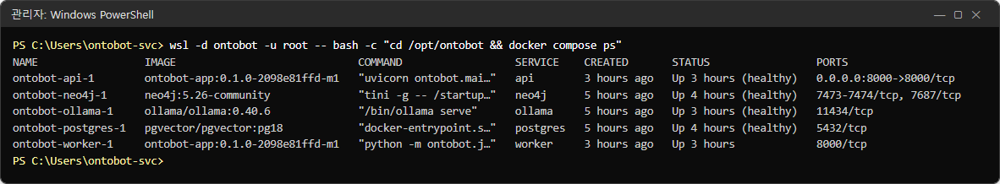

| 칸 | 뜻 | 정상 |
| --- | --- | --- |
| NAME | 컨테이너 이름 | `ontobot-<서비스>-1` |
| IMAGE | 돌고 있는 이미지와 버전 | api·worker 가 **같은** `ontobot-app:<버전>` |
| SERVICE | 서비스 이름(명령에 쓰는 이름) | api, neo4j, ollama, postgres, worker |
| STATUS | 상태 | `Up … (healthy)`. worker 는 건강 확인이 없어 `Up …` 만 |
| PORTS | 열린 포트 | api 만 `0.0.0.0:8000->8000` 으로 밖에 열림 |

> **주의** api 와 worker 의 IMAGE 버전이 다르면 업그레이드가 반쯤 된 상태입니다(21장). 이 목록에 배포 콘솔은 없습니다
> — 배포 콘솔은 따로 `compose.deployer.yaml` 로 돕니다(23.3).

## 39.2 서버 전체 — CPU 수, 부하, 메모리

```powershell
wsl -d ontobot -u root -- bash -c "nproc; cat /proc/loadavg; grep -E 'MemTotal|MemAvailable|SwapTotal' /proc/meminfo"
```

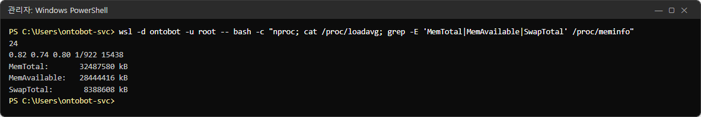

| 줄 | 값(사진) | 뜻 |
| --- | --- | --- |
| `nproc` | 24 | WSL 이 쓸 수 있는 CPU 수 |
| `/proc/loadavg` 앞 세 숫자 | 0.82 0.74 0.80 | 1분·5분·15분 평균 부하. **CPU 수보다 작으면** 여유 |
| `MemTotal` | 32487580 kB(약 31GB) | WSL 에 준 메모리 |
| `MemAvailable` | 28444416 kB(약 27GB) | 지금 더 쓸 수 있는 메모리 |
| `SwapTotal` | 8388608 kB(8GB) | 메모리가 모자랄 때 디스크로 넘기는 공간 |

| 판단 | 기준 |
| --- | --- |
| 여유 | 15분 부하 < CPU 수의 절반, `MemAvailable` 이 전체의 20% 이상 |
| 지켜볼 것 | 15분 부하가 CPU 수에 가까움, `MemAvailable` 10~20% |
| 조치 | `MemAvailable` 10% 미만이 계속됨 → WSL 메모리 한도(`.wslconfig`)를 늘리거나 사용 시간 분산(37장) |

> **알아 두기** WSL 은 Windows 의 메모리 일부만 씁니다. 서버에 64GB 가 있어도 여기 보이는 값이 OntoBot 이 쓸 수 있는
> 전부입니다. 한도는 설치 때 `install-host.ps1` 이 정한 `.wslconfig`(기본 12GB, 5장)에 있습니다. 사진의 31GB 는 이 책을
> 찍은 PC 의 Docker Desktop 가상 머신 값이라 운영 서버와 다릅니다.

## 39.3 서비스별 자원 — `docker stats`

```powershell
wsl -d ontobot -u root -- docker stats --no-stream
```

`--no-stream` 을 빼면 화면이 계속 갱신됩니다(Ctrl+C 로 끝냄). 한 번만 보려면 붙입니다.

### 쉬고 있을 때


| 칸 | 뜻 |
| --- | --- |
| CPU % | CPU 한 개를 100% 로 센 사용률. 24개면 최대 2400% |
| MEM USAGE / LIMIT | 쓰는 메모리 / 쓸 수 있는 한도(한도가 없으면 WSL 전체) |
| NET I/O | 컨테이너가 주고받은 데이터 누계 |
| BLOCK I/O | 디스크 읽기/쓰기 누계 |
| PIDS | 컨테이너 안 프로세스·스레드 수 |

쉬고 있을 때 서비스별 메모리는 대략 다음과 같았습니다. 내 서버의 값을 처음에 한 번 적어 두면, 나중에 "평소와
다른지" 비교할 수 있습니다.

| 서비스 | 쉴 때 메모리(사진) | 메모 |
| --- | --- | --- |
| neo4j | 1.44GiB | 자바 프로그램이라 처음부터 크게 잡음. 정상 |
| ollama | 162MiB | 모델이 메모리에 없을 때(39.7) |
| api | 119MiB | |
| postgres | 102MiB | 데이터가 늘면 조금씩 커짐 |
| worker | 87MiB | |
| deployer | 81MiB | 배포 콘솔 |

### 질문에 답하는 동안

`kim.user` 가 "변전소 목록 보여줘"를 묻는 동안 같은 명령을 쳤습니다.

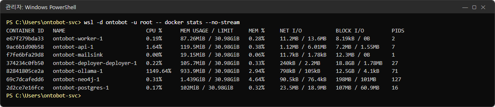

| 서비스 | 쉴 때 → 답하는 동안 | 읽기 |
| --- | --- | --- |
| ollama CPU | 0.00% → **1149.64%** | 모델이 답을 만드는 순간 CPU 여러 개를 함께 씀(GPU 로 돌아도 토큰을 다루는 일은 CPU 가 함) |
| ollama 메모리 | 162MiB → 934MiB | 모델을 GPU 에 올리며 늘어남 |
| ollama PIDS | 17 → 71 | 일하는 스레드가 늘어남 |
| api CPU | 0.13% → 1.64% | api 는 거의 일하지 않음 — 기다릴 뿐 |

답이 느리다는 신고가 오면 이 표처럼 **ollama 만 바쁜지** 봅니다. ollama 가 바쁘고 다른 것은 조용하면 AI 모델 쪽
대기이고(37장), postgres 가 계속 높으면 조회 쪽 문제입니다(40장).

## 39.4 디스크

### 디스크 전체

```powershell
wsl -d ontobot -u root -- df -h /opt/ontobot /var/lib/docker
```

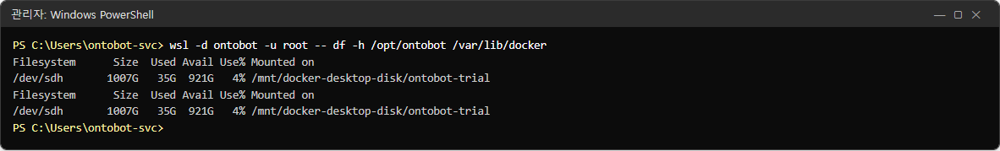

| 칸 | 뜻 |
| --- | --- |
| Size / Used / Avail | 크기 / 쓴 양 / 남은 양 |
| Use% | 사용률 |
| Mounted on | 어느 폴더에 붙은 디스크인지 |

`/opt/ontobot`(설치 폴더·백업)과 `/var/lib/docker`(이미지·DB 볼륨)를 함께 봅니다. 사진은 이 책을 찍은 PC 라 두 경로가
같은 디스크에 있습니다(00장 "촬영 환경"). 운영 서버에서는 WSL 가상 디스크 하나에 함께 있는 것이 보통입니다.

| Use% | 할 일 |
| --- | --- |
| 70% 미만 | 정상 |
| 70~85% | 오래된 백업·번들 정리 계획(39.4 아래, 19장) |
| 85% 이상 | 즉시 정리. PostgreSQL 은 디스크가 차면 멈춥니다(27.5) |

### 설치 폴더 안에서 큰 것

```powershell
wsl -d ontobot -u root -- du -sh /opt/ontobot/backups /opt/ontobot/bundles /opt/ontobot/releases /opt/ontobot/logs
```

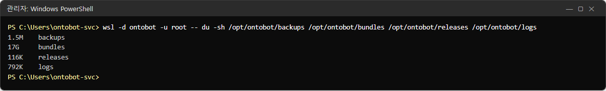

| 폴더 | 사진 | 무엇 | 정리 |
| --- | --- | --- | --- |
| `backups` | 1.5M | DB 백업(19장) | 보존 개수 설정에 따라 자동 정리. 시험 데이터라 작음 — 운영에서는 데이터 크기만큼 |
| `bundles` | **17G** | 가져온 번들 사본(20장) | 가장 큼. 전체 번들은 이미지를 다 담아 큼. 롤백할 일이 없는 옛 번들은 지워도 됨 |
| `releases` | 116K | 버전별 설정 사본 | 작음. 지우지 않음(롤백에 씀) |
| `logs` | 792K | 파일 로그(26장) | |

> **주의** `bundles` 의 옛 번들을 지우기 전에 **지금 버전과 바로 전 버전**(롤백 대상, 22장)은 남기세요. 반입 폴더
> (`C:\OntoBot-bundles`)에 원본이 있으면 다시 가져올 수 있습니다.

### Docker 가 쓰는 공간

```powershell
wsl -d ontobot -u root -- docker system df
```

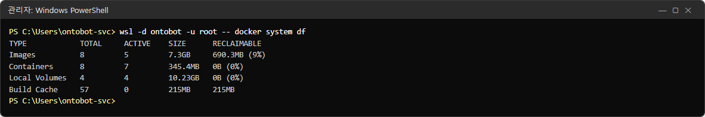

| 줄 | 사진 | 뜻 |
| --- | --- | --- |
| Images | 8개, 7.3GB, 회수 가능 690MB | 이미지. 회수 가능 = 어떤 컨테이너도 쓰지 않는 이미지 |
| Containers | 8개, 345MB | 컨테이너가 쓴 층 |
| Local Volumes | 4개, 10.23GB | **데이터**(DB·모델). 회수 가능 0 이 정상 |
| Build Cache | 215MB | 이미지를 만들 때의 찌꺼기. 운영 서버에는 보통 없음 |

> **경고** 디스크를 비우려고 `docker system prune` 이나 `docker volume prune` 을 치지 마세요. 볼륨을 지우면 DB 가
> 사라집니다. 정리는 번들 폴더와 옛 이미지에서만, 개발팀과 상의해서 합니다.

## 39.5 이미지와 볼륨

### 볼륨 — 데이터가 사는 곳

```powershell
wsl -d ontobot -u root -- docker system df -v
```

출력이 길어 볼륨 부분만 실었습니다.

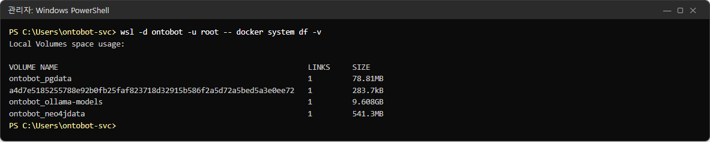

| 볼륨 | 사진 | 담긴 것 | 잃으면 |
| --- | --- | --- | --- |
| `ontobot_pgdata` | 78.81MB | PostgreSQL — **기록의 원본** | 백업에서 복원(19장) |
| `ontobot_neo4jdata` | 541.3MB | 관계 저장소 | PostgreSQL 에서 다시 만들 수 있음(13장) |
| `ontobot_ollama-models` | 9.608GB | AI 모델 파일 | 번들에서 다시 넣음 |
| 긴 이름(해시) | 283.7kB | 이름 없는 볼륨(이미지가 만든 임시 공간) | 영향 없음 |

### 이미지 — 프로그램

```powershell
wsl -d ontobot -u root -- docker images
```

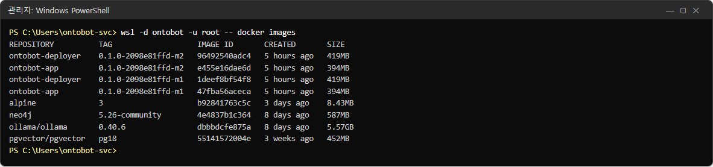

| 이미지 | 사진의 태그 | 메모 |
| --- | --- | --- |
| `ontobot-app` | `…-m2`, `…-m1` | 지금 버전과 이전 버전. 이전 것은 롤백에 씀 |
| `ontobot-deployer` | `…-m2`, `…-m1` | 배포 콘솔. 마찬가지 |
| `neo4j` | `5.26-community` | 제3자 이미지 — 버전은 `images.lock` 에 고정(30장) |
| `ollama/ollama` | `0.40.6` | |
| `pgvector/pgvector` | `pg18` | PostgreSQL 18 |
| `alpine` | `3` | OntoBot 이 쓰지 않는 이미지. 이 책을 찍은 PC 에서 다른 시험에 받은 것이라 운영 서버에는 없습니다 |

이름이 `<none>` 인 이미지(댕글링)가 있는지도 봅니다.

```powershell
wsl -d ontobot -u root -- docker images --filter dangling=true
```

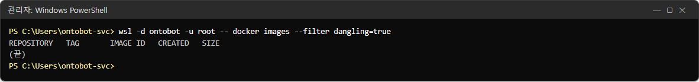

머리줄만 나오고 목록이 없으면 정상입니다. 있으면 업그레이드에서 남은 찌꺼기이므로 개발팀과 상의해 지웁니다.

## 39.6 GPU — `nvidia-smi`

```powershell
wsl -d ontobot -u root -- bash -c "cd /opt/ontobot && docker compose exec ollama nvidia-smi"
```

ollama 컨테이너 안에서 실행하면 "ollama 가 GPU 를 볼 수 있는지"까지 함께 확인됩니다. 명령이 실패하면 GPU 설정
(`compose.gpu.yaml`)이 빠졌거나 드라이버 문제입니다(27장·30장).

### 쉬고 있을 때

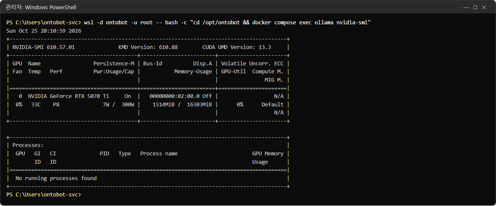

### 답을 쓰는 동안

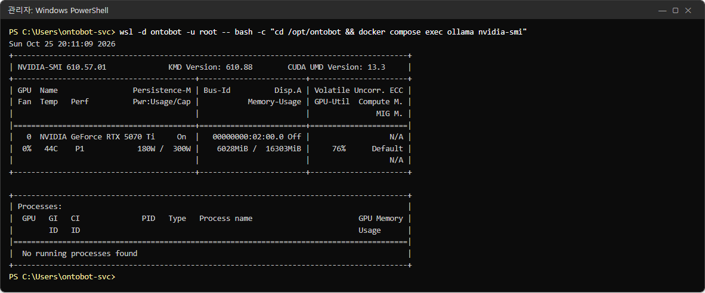

두 사진을 비교하며 읽습니다.

| 칸 | 쉴 때 | 답하는 동안 | 뜻 |
| --- | --- | --- | --- |
| Name | NVIDIA GeForce RTX 5070 Ti | 같음 | GPU 이름 |
| Temp | 33C | 44C | 온도. 80C 를 넘는 일이 잦으면 냉각 점검 |
| Perf | P8 | **P1** | 성능 단계. P8 = 쉼, P0~P2 = 일함 |
| Pwr:Usage/Cap | 7W / 300W | **180W** / 300W | 전력 |
| Memory-Usage | 1514MiB / 16303MiB | **6028MiB** / 16303MiB | GPU 메모리. 모델이 올라오면 늘어남 |
| GPU-Util | 0% | **76%** | GPU 사용률 |
| Processes | No running processes found | 같음 | 컨테이너 안에서는 다른 프로세스가 보이지 않음 — 정상 |

> **알아 두기** "No running processes found" 는 고장이 아닙니다. 컨테이너는 자기 밖의 프로세스 목록을 볼 수 없어서
> 그렇습니다. GPU 가 일하는지는 **GPU-Util·Memory-Usage·Perf** 로 판단합니다.

### 한 줄로 보기

정기 점검에서 숫자만 적으려면 다음처럼 칸을 골라 봅니다.

```powershell
wsl -d ontobot -u root -- bash -c "cd /opt/ontobot && docker compose exec ollama nvidia-smi --query-gpu=name,temperature.gpu,utilization.gpu,memory.used,memory.total --format=csv"
```

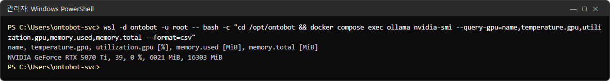

사진은 답이 끝난 직후라 GPU 사용률은 0% 지만 메모리(6021MiB)는 아직 차 있습니다. 모델이 몇 분 동안 GPU 에 머물기
때문입니다(39.7).

## 39.7 AI 모델 — `ollama`

### 설치된 모델

```powershell
wsl -d ontobot -u root -- bash -c "cd /opt/ontobot && docker compose exec ollama ollama list"
```

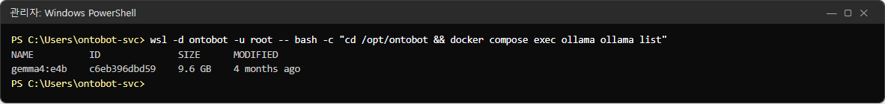

`config/llm.yaml` 에 적힌 모델(기본 `gemma4:e4b`)이 이 목록에 있어야 합니다(30장). 없으면 planner·answerer 호출이 모두
실패하고 질문이 `llm_unavailable` 로 끝납니다(10.6).

### 모델 정보

```powershell
wsl -d ontobot -u root -- bash -c "cd /opt/ontobot && docker compose exec ollama ollama show gemma4:e4b"
```

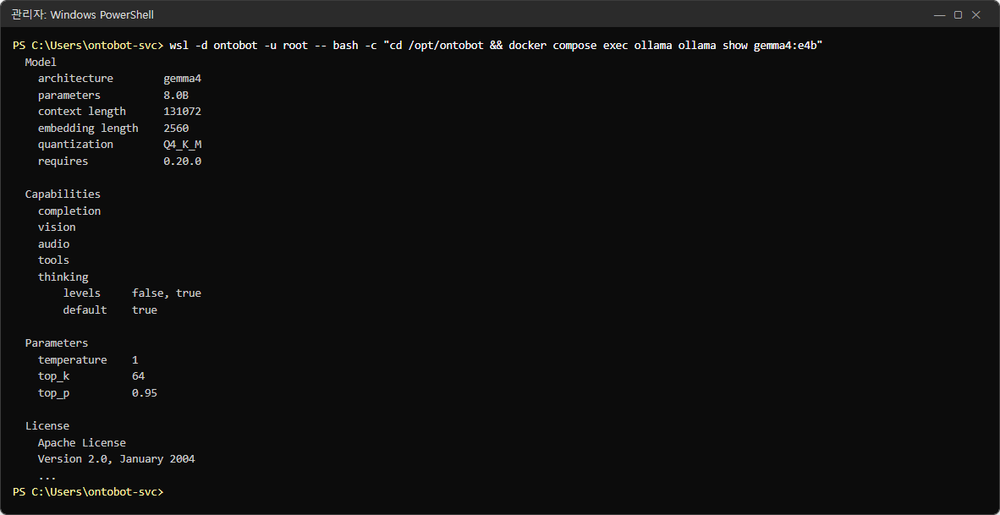

| 줄 | 값 | 뜻 |
| --- | --- | --- |
| parameters | 8.0B | 모델 크기(매개변수 80억 개) |
| context length | 131072 | 모델이 한 번에 볼 수 있는 최대 길이. OntoBot 은 이보다 훨씬 짧게 씀 |
| quantization | Q4_K_M | 압축 방식. 파일·메모리를 줄인 형태 |
| Capabilities | completion, vision, audio, tools, thinking | 모델이 할 수 있는 일. OntoBot 은 글 생성(completion)만 씀 |
| License | Apache License 2.0 | 사용 허가 |

### 지금 메모리에 올라온 모델

```powershell
wsl -d ontobot -u root -- bash -c "cd /opt/ontobot && docker compose exec ollama ollama ps"
```

한동안 질문이 없을 때:

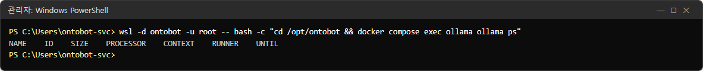

질문에 답하는 동안:

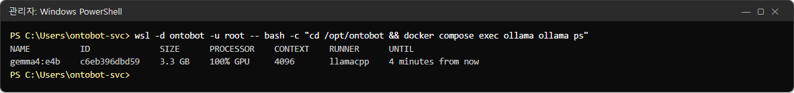

| 칸 | 값(사진) | 뜻 |
| --- | --- | --- |
| NAME | gemma4:e4b | 올라온 모델 |
| SIZE | 3.3 GB | 메모리에서 차지하는 크기 |
| PROCESSOR | **100% GPU** | 전부 GPU 에서 돎. `100% CPU` 나 `48%/52% CPU/GPU` 면 느려짐 |
| CONTEXT | 4096 | 이번에 잡은 대화 길이 |
| UNTIL | 4 minutes from now | 이 시간 동안 질문이 없으면 메모리에서 내림 |

목록이 비어 있는 것은 정상입니다. 질문이 없으면 모델은 몇 분 뒤 메모리에서 내려가고, 다음 질문 때 다시 올라옵니다.
그래서 **아침 첫 질문은 몇 초 더 걸립니다**(모델을 올리는 시간). 사용자가 "첫 질문만 느려요"라고 하면 이것입니다.

| `PROCESSOR` 값 | 원인 | 할 일 |
| --- | --- | --- |
| `100% GPU` | 정상 | — |
| `100% CPU` | GPU 를 못 봄 | 39.6 의 `nvidia-smi` 확인, `COMPOSE_FILE` 에 `compose.gpu.yaml` 이 있는지(30장) |
| CPU/GPU 나뉨 | GPU 메모리가 모자라 일부만 올림 | 같은 GPU 를 쓰는 다른 프로그램 확인. 더 큰 모델로 바꾼 뒤라면 재측정(ADR-0004) |

## 39.8 앱 상태 — `/healthz` 와 `/readyz`

api 컨테이너 안에서 자기 자신에게 물어봅니다(서버에 curl 이 없어도 됩니다).

```powershell
wsl -d ontobot -u root -- bash -c "cd /opt/ontobot && docker compose exec api python -c \"import urllib.request as u; print(u.urlopen('http://localhost:8000/healthz').read().decode())\""
```

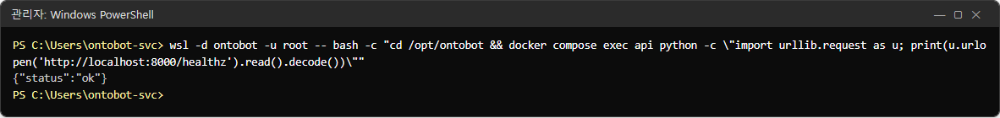

`{"status":"ok"}` 하나만 나옵니다. **프로그램이 응답하는지만** 봅니다.

`healthz` 를 `readyz` 로 바꾸면 준비 확인입니다.

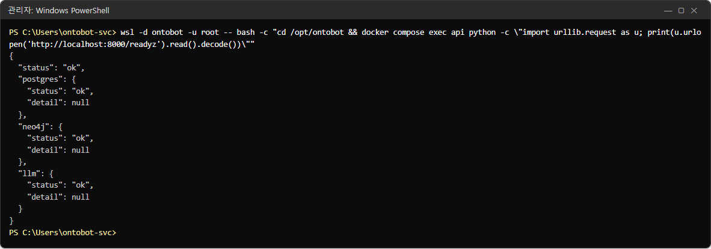

사진은 읽기 쉽게 줄을 나눠 실었습니다(실제 출력은 한 줄입니다).

| 항목 | 뜻 | 실패하면 |
| --- | --- | --- |
| `status` | 전체 판정 | `ok`, `degraded`(Neo4j 만 안 됨, 200), 실패(503) |
| `postgres` | DB 연결 | 27.5 |
| `neo4j` | 관계 저장소 연결 | 27.2 — 관계 질문만 실패 |
| `llm` | AI 모델 서버 연결 | 27.1 |
| `detail` | 실패 이유 | 정상이면 `null` |

> **주의** 서비스 자동 재시작 판단에는 `/healthz` 만 씁니다. `/readyz` 를 쓰면 DB 가 잠깐 끊긴 것만으로 멀쩡한 api 를
> 죽이게 됩니다(30장).

## 39.9 몰래 재시작했는지

컨테이너가 스스로 죽었다 살아나면 화면에서는 티가 잘 나지 않습니다. 재시작 횟수와 시작 시각을 봅니다.

```powershell
wsl -d ontobot -u root -- docker inspect -f "{{.Name}} 재시작={{.RestartCount}} 시작={{.State.StartedAt}}" $(docker ps -q)
```

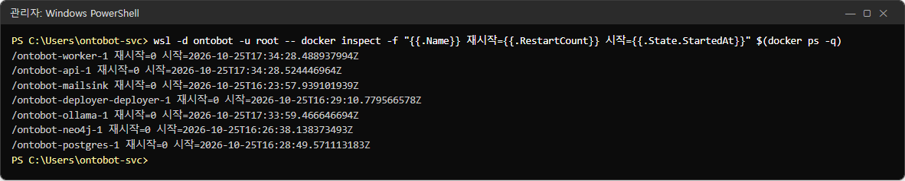

| 볼 것 | 정상 | 이상 |
| --- | --- | --- |
| `재시작=` | 0 | 1 이상이면 그 컨테이너가 죽었다 살아난 것 — 26장 로그로 원인 확인 |
| `시작=` | 마지막 업그레이드·재부팅 시각 | 아무 작업도 안 했는데 최근이면 재시작이 있었던 것 |

사진에서 api·worker·ollama 의 시작 시각(17:33~17:34 UTC)이 postgres·neo4j(16:26~16:28 UTC)보다 늦은 것은 그 사이에
업그레이드(21장)와 장애 실습(27장)을 했기 때문입니다.

## 39.10 컨테이너 로그의 크기 — 확인할 점

컨테이너 로그(`docker compose logs` 로 보는 것, 26장)가 어떻게 저장되는지 봅니다.

```powershell
wsl -d ontobot -u root -- docker inspect -f "{{.Name}} {{.HostConfig.LogConfig.Type}} {{.HostConfig.LogConfig.Config}}" $(docker ps -q)
```

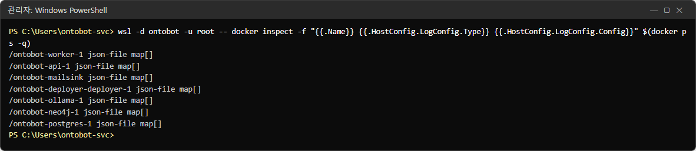

모든 컨테이너가 `json-file` 에 설정이 `map[]`(비어 있음)입니다. **크기 제한이 없다**는 뜻입니다. 질문이 많은 서버에서는
api·worker 로그가 몇 달에 걸쳐 커질 수 있습니다. 이 책을 쓰는 시점의 설치본은 로그 크기 제한을 설정하지 않으므로,
월간 점검(25.3)에 39.4 의 디스크 확인을 꼭 넣고, 디스크가 늘어나는 속도가 빠르면 개발팀에 로그 제한 설정을
요청하세요.

## 39.11 한 장으로 — 자원 점검 순서

| 순서 | 명령 | 볼 것 |
| --- | --- | --- |
| 1 | `docker compose ps` | 모두 `Up`, healthy |
| 2 | `docker stats --no-stream` | 평소와 비교해 튀는 서비스 |
| 3 | `df -h` | Use% 70% 미만 |
| 4 | `nvidia-smi`(ollama 안) | 명령이 되는지, 온도 |
| 5 | `ollama ps` | 답하는 동안 `100% GPU` |
| 6 | `/readyz` | 모두 `ok` |
| 7 | 재시작 횟수 | 모두 0 |

## 39.12 해 보기

> **해 보기** (시험 서버에서)
>
> 1. 39.3 의 `docker stats --no-stream` 을 쉬는 시간에 쳐서 서비스별 메모리를 적어 두세요. 이것이 내 서버의 "평소"입니다.
> 2. 다른 사람에게 질문을 하나 해 달라고 하고, 그동안 `ollama ps` 와 `nvidia-smi` 를 쳐서 `PROCESSOR` 와 `GPU-Util` 을 확인하세요.
> 3. 5분 뒤 `ollama ps` 를 다시 쳐서 모델이 내려갔는지 보세요. 그다음 첫 질문이 얼마나 걸리는지 재 보세요.
> 4. `du -sh` 로 `bundles` 폴더 크기를 보고, 남겨야 할 번들(지금·바로 전 버전)이 무엇인지 적어 보세요.
