# 40장 데이터베이스와 관계 저장소 들여다보기 — 읽기 전용으로

화면에 나오지 않는 것을 확인해야 할 때가 있습니다. "동기화가 몇 시에 마지막으로 돌았나", "알림이 몇 건 실패했나",
"지금 연결이 몇 개인가" 같은 것입니다. 이 장은 PostgreSQL(기록의 원본)과 Neo4j(관계 저장소)에 **읽기 전용으로**
들어가 이런 것을 보는 질의를 모았습니다. 모든 질의는 시험 서버에서 실제로 실행한 결과입니다.

> **경고** 데이터베이스를 직접 고치지 마세요. 감사 로그는 고칠 수 없게 막혀 있고(9장), 나머지 표도 화면·Action 을
> 거치지 않고 바꾸면 기록이 남지 않아 문제가 생겨도 원인을 찾을 수 없습니다. 이 장의 접속 방법은 **읽기 전용**이라
> 실수로 바꾸는 명령을 쳐도 거절됩니다(40.2).

| 알고 싶은 것 | 절 |
| --- | --- |
| 읽기 전용으로 들어가기 | 40.1~40.2 |
| DB 크기와 표 크기 | 40.3 |
| 객체·링크가 몇 개인가, 게시 버전 | 40.4 |
| 동기화 기록 | 40.5 |
| 작업 큐·그래프 투영 대기 | 40.6 |
| 알림·Action·편집 | 40.7 |
| 계정·세션·감사 이벤트 | 40.8 |
| 질문 처리 통계 | 40.9 |
| 지금 연결·오래 걸리는 트랜잭션 | 40.10 |
| Neo4j 들여다보기 | 40.11 |
| PostgreSQL ↔ Neo4j 대사 | 40.12 |

## 40.1 PostgreSQL 에 들어가기

```powershell
wsl -d ontobot -u root -- bash -c "cd /opt/ontobot && docker compose exec -e PGOPTIONS='-c default_transaction_read_only=on' postgres psql -U postgres -d ontobot_db"
```

| 부분 | 뜻 |
| --- | --- |
| `docker compose exec … postgres` | postgres 컨테이너 안에서 실행 |
| `-e PGOPTIONS='-c default_transaction_read_only=on'` | **이 접속은 읽기만** 하도록 설정 |
| `psql -U postgres -d ontobot_db` | DB 프로그램을 관리자 계정으로, OntoBot DB 에 접속 |

들어가면 프롬프트가 `ontobot_db=#` 로 바뀝니다. `\conninfo` 를 치면 접속 정보가 나옵니다.

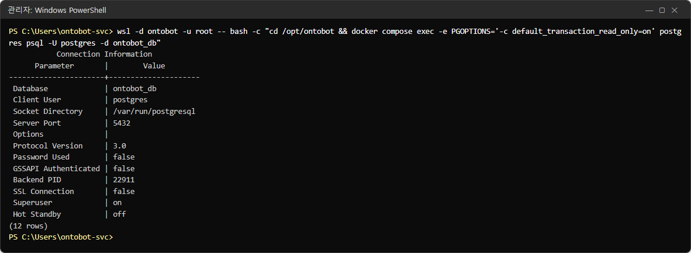

| 줄 | 값 | 뜻 |
| --- | --- | --- |
| Database | ontobot_db | 접속한 DB |
| Client User | postgres | 관리자 계정 |
| Socket Directory | /var/run/postgresql | 컨테이너 안에서 직접 접속(네트워크를 거치지 않음) |
| Password Used | false | 컨테이너 안이라 비밀번호 없이 들어감 |
| Superuser | on | 모든 표를 볼 수 있음 — 그래서 읽기 전용 설정이 중요 |

나갈 때는 `\q` 를 칩니다. 이 장의 사진은 들어간 뒤 질의를 친 모습입니다(창 제목 `psql — ontobot_db (읽기 전용)`).

> **알아 두기** 질의는 여러 줄로 나눠 쳐도 됩니다. **세미콜론(`;`)으로 끝나야** 실행됩니다. 결과가 길면 화면이 멈추고
> `:` 가 보이는데, `q` 를 누르면 빠져나옵니다.

## 40.2 정말 읽기 전용인지 확인

```sql
SHOW default_transaction_read_only;
```

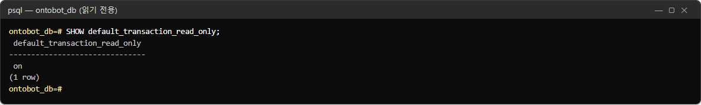

`on` 이면 읽기 전용입니다. 시험 삼아 아무것도 바꾸지 않는 수정 명령을 쳐 봅니다.

```sql
UPDATE app_user SET display_name = display_name WHERE false;
```

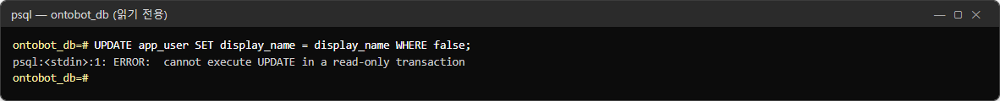

`ERROR: cannot execute UPDATE in a read-only transaction` — 거절됐습니다. 이 상태에서는 안심하고 질의를 칠 수 있습니다.
`off` 가 나오면 40.1 의 `PGOPTIONS` 를 빠뜨린 것이니 `\q` 로 나와 다시 들어갑니다.

## 40.3 DB 크기와 표 크기

```sql
SELECT version_num AS 스키마_버전 FROM alembic_version;
SELECT pg_size_pretty(pg_database_size('ontobot_db')) AS DB_크기;
```

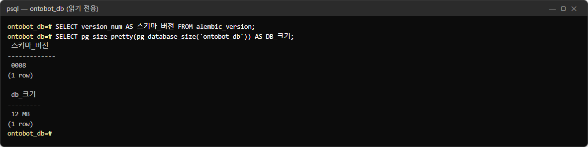

| 값 | 뜻 |
| --- | --- |
| 스키마_버전 `0008` | DB 구조 버전(마이그레이션 번호). 업그레이드 뒤 바뀔 수 있음. 롤백 때 이 값이 중요(22장) |
| DB_크기 `12 MB` | DB 전체 크기. 백업 파일 크기를 짐작하는 데 씀 |

어느 표가 큰지:

```sql
SELECT relname AS 표, n_live_tup AS 행수, pg_size_pretty(pg_total_relation_size(relid)) AS 크기
  FROM pg_stat_user_tables ORDER BY pg_total_relation_size(relid) DESC LIMIT 15;
```

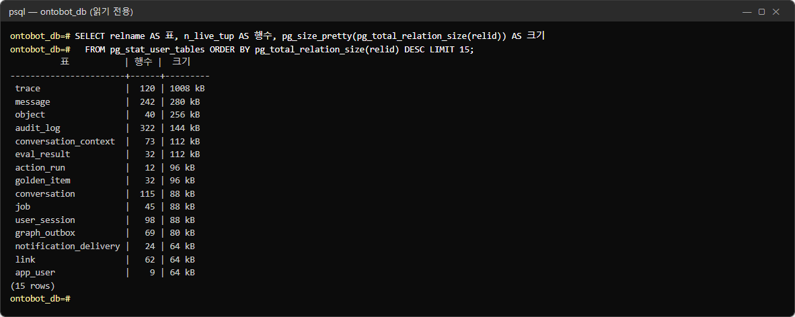

| 표 | 무엇 | 커지는 까닭 |
| --- | --- | --- |
| `trace` | 질문 처리 기록(10장) | 질문마다 한 줄. 보존 기간(기본 90일)이 지나면 정리됨 |
| `message` | 대화 메시지 | 질문·답마다 한 줄 |
| `object` | 원천에서 가져온 객체 | 원천 데이터 크기만큼 |
| `audit_log` | 감사 로그 | 지워지지 않음(9장) — 오래 쓰면 가장 커질 수 있음 |
| `conversation_context` | 이어서 묻기의 맥락 | |
| `user_session` | 로그인 세션 | |

> **알아 두기** `행수`(n_live_tup)는 통계로 추정한 값이라 정확한 개수와 조금 다를 수 있습니다. 정확한 수가 필요하면
> `SELECT count(*) FROM 표이름;` 을 씁니다.

## 40.4 객체·링크·게시 버전

타입별 객체 수:

```sql
SELECT type AS 타입, count(*) FILTER (WHERE deleted_at IS NULL) AS 살아있음,
       count(*) FILTER (WHERE deleted_at IS NOT NULL) AS 삭제표시,
       to_char(max(synced_at) AT TIME ZONE 'Asia/Seoul', 'MM-DD HH24:MI') AS 마지막_동기화
  FROM object GROUP BY type ORDER BY type;
```

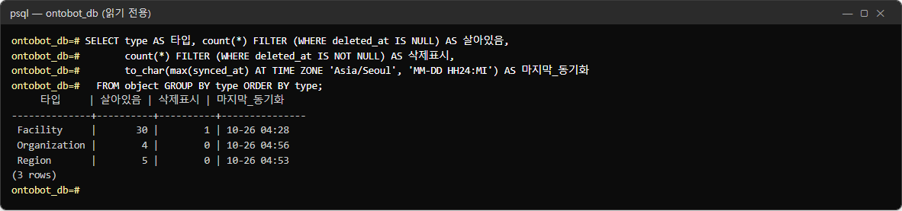

| 칸 | 뜻 |
| --- | --- |
| 살아있음 | 지금 챗봇이 조회할 수 있는 객체 |
| 삭제표시 | 원천에서 사라져 **삭제 표시**된 객체(지우지 않고 표시만 함, 12장) |
| 마지막_동기화 | 그 타입에서 마지막으로 값을 가져온 시각 |

사진에서 Facility 의 삭제표시 1건은 12장 실습에서 원천의 행 하나를 지운 결과입니다. 원천 담당자가 "30건"이라고 하면
살아있음 30 과 맞춰 봅니다.

링크 수:

```sql
SELECT link_type AS 링크, count(*) FILTER (WHERE deleted_at IS NULL) AS 살아있음,
       count(*) FILTER (WHERE deleted_at IS NOT NULL) AS 삭제표시
  FROM link GROUP BY link_type;
```

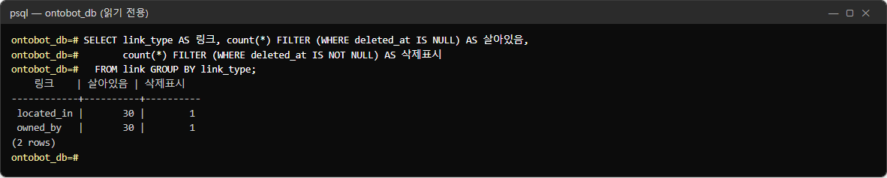

시설마다 소재 지역(`located_in`)과 소유 조직(`owned_by`)이 하나씩이라 둘 다 30 입니다. 이 수는 40.11 의 Neo4j 관계 수와
같아야 합니다.

온톨로지 버전:

```sql
SELECT version_no AS 버전, status AS 상태,
       to_char(published_at AT TIME ZONE 'Asia/Seoul', 'YYYY-MM-DD HH24:MI') AS 게시
  FROM ontology_version ORDER BY version_no;
```

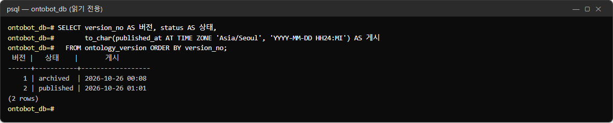

`published` 는 언제나 **하나뿐**입니다. 옛 게시본은 `archived`, 편집 중인 것은 `draft` 입니다(36장).

## 40.5 동기화 기록

```sql
SELECT r.id, s.name AS 데이터소스, m.object_type AS 타입, r.status AS 상태,
       r.rows_read AS 읽음, r.rows_upserted AS 반영, r.rows_deleted AS 삭제,
       to_char(r.started_at AT TIME ZONE 'Asia/Seoul', 'MM-DD HH24:MI') AS 시작,
       round(extract(epoch FROM r.finished_at - r.started_at)::numeric, 1) AS 초
  FROM sync_run r JOIN mapping m ON m.id = r.mapping_id JOIN data_source s ON s.id = m.source_id
 ORDER BY r.id DESC LIMIT 12;
```

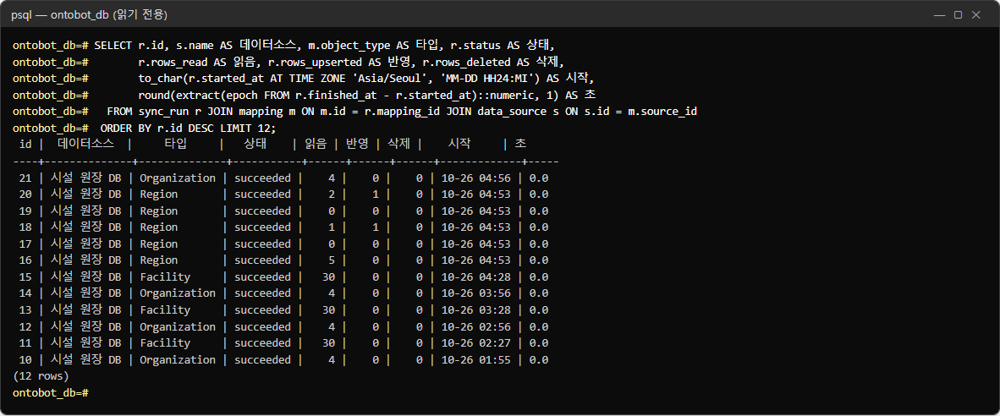

| 칸 | 뜻 | 사진에서 |
| --- | --- | --- |
| 상태 | `succeeded`·`failed`·`running` | 모두 성공 |
| 읽음 | 원천에서 읽은 행 | Facility 30, Organization 4 |
| 반영 | 실제로 **바뀐** 행 | 대부분 0 — 값이 그대로면 쓰지 않음(정상) |
| 삭제 | 새로 삭제 표시한 행 | |
| 시작 | 시작 시각 | Organization 이 매시 56분에 돎(일정) |
| 초 | 걸린 시간 | 시험 데이터라 0초 |

읽음은 있는데 반영이 0 인 것은 고장이 아닙니다. 원천 값이 지난번과 같으면 쓰지 않습니다. Region 이 04:53 에 여러 번 있는
것은 12장 증분 동기화 실습 때문입니다(읽음 0·1·2 — 바뀐 행만 읽음).

실패한 동기화만:

```sql
SELECT r.id, m.object_type AS 타입, left(r.error, 70) AS 오류
  FROM sync_run r JOIN mapping m ON m.id = r.mapping_id
 WHERE r.status = 'failed' ORDER BY r.id DESC LIMIT 5;
```

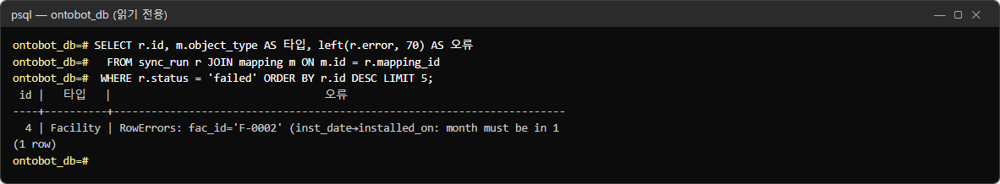

4번 실행은 12장 실습에서 원천의 날짜를 일부러 잘못 넣은 것입니다. 오류는 `RowErrors: fac_id='F-0002' (inst_date→installed_on:
month must be in 1…` — 어느 행(F-0002)의 어느 칸(inst_date)이 무엇 때문에 틀렸는지 적혀 있습니다. 행 하나라도 틀리면
실행 전체가 실패합니다(12장).

## 40.6 작업 큐와 그래프 투영

작업 종류별 상태:

```sql
SELECT kind AS 종류, status AS 상태, count(*) AS 건수, max(attempts) AS 최대시도
  FROM job GROUP BY kind, status ORDER BY kind, status;
```

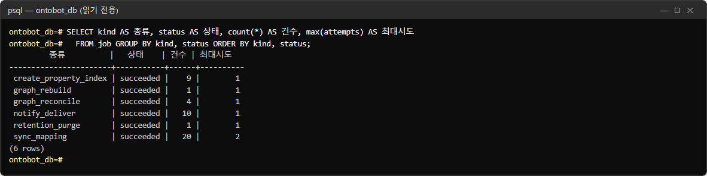

| 종류 | 무엇 |
| --- | --- |
| `sync_mapping` | 동기화 실행(일정·수동) |
| `create_property_index` | 속성 인덱스 만들기(게시 뒤) |
| `graph_rebuild` / `graph_reconcile` | 관계 저장소 재구축 / 대사(13장) |
| `notify_deliver` | 메일·SMS 보내기(15장) |
| `retention_purge` | 보존 기간 지난 기록 정리(25.5) |

`최대시도` 가 2 인 것은 한 번 실패한 뒤 다시 시도해 성공했다는 뜻입니다(sync_mapping — 12장의 실패 실습).

끝나지 않은 작업만:

```sql
SELECT id, kind AS 종류, status AS 상태, attempts AS 시도,
       to_char(run_after AT TIME ZONE 'Asia/Seoul', 'MM-DD HH24:MI') AS 실행예정, left(error, 50) AS 오류
  FROM job WHERE status NOT IN ('succeeded') ORDER BY id DESC LIMIT 10;
```

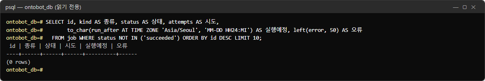

`(0 rows)` 가 정상입니다. 여기에 `queued` 가 여러 줄 쌓여 있고 실행예정 시각이 지났다면 **워커가 멈춘** 것입니다
(27.3). `failed` 가 있으면 오류 칸을 보고 24장 작업 기록에서 자세히 봅니다.

그래프 투영 대기:

```sql
SELECT count(*) FILTER (WHERE processed_at IS NULL) AS 투영_대기,
       count(*) AS 전체,
       to_char(max(processed_at) AT TIME ZONE 'Asia/Seoul', 'MM-DD HH24:MI:SS') AS 마지막_투영
  FROM graph_outbox;
```

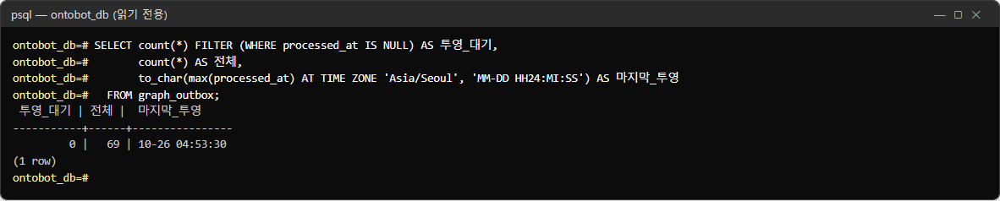

동기화가 링크를 바꾸면 `graph_outbox` 에 쌓이고, 워커가 Neo4j 에 반영합니다(13장). **투영_대기가 0** 이면 다 반영된
것입니다. 0 이 아닌 채로 오래 머물면 Neo4j 가 멈췄거나 워커가 멈춘 것입니다.

## 40.7 알림·Action·편집

알림 발송 상태:

```sql
SELECT channel AS 채널, status AS 상태, count(*) AS 건수, max(attempts) AS 최대시도
  FROM notification_delivery GROUP BY channel, status ORDER BY channel, status;
```

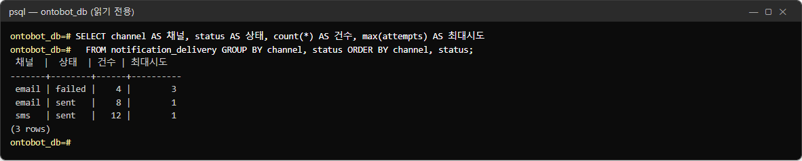

| 상태 | 뜻 |
| --- | --- |
| `sent` | 보냄 |
| `pending` | 보낼 차례를 기다림(또는 다시 시도 대기) |
| `failed` | 정해진 횟수만큼 시도했지만 실패 |

사진의 email `failed` 4건(최대시도 3)은 15장 실습 초기, 메일 서버 이름을 찾지 못하던(`SMTP 실패: gaierror`) 때의 발송입니다. 받는 사람 주소는
개인정보라 이 질의에 넣지 않았습니다. 실패 원인은 15장 화면에서 마스킹된 형태로 봅니다.

Action 실행 현황:

```sql
SELECT action_type AS Action, status AS 상태, origin AS 출처, count(*) AS 건수
  FROM action_run GROUP BY action_type, status, origin ORDER BY action_type, status;
```

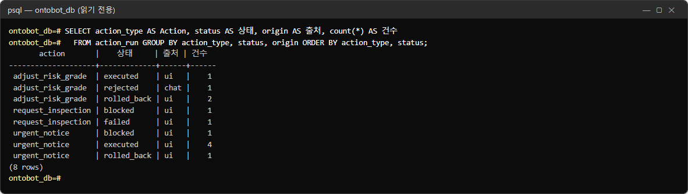

| 상태 | 뜻 |
| --- | --- |
| `executed` | 승인되어 실행됨 |
| `rejected` | 거부됨 |
| `rolled_back` | 실행 뒤 롤백됨(14장) |
| `blocked` | 미리보기에서 막힘(예: 알림 채널이 꺼져 있음) |
| `failed` | 승인 순간의 재검증에서 실패(14.7) |

출처 `chat` 은 채팅에서 만든 요청, `ui` 는 Action 화면에서 만든 요청입니다.

지금 살아 있는 편집:

```sql
SELECT type AS 타입, pk, property AS 속성, value AS 편집값, base_source_value AS 원천값,
       to_char(edited_at AT TIME ZONE 'Asia/Seoul', 'MM-DD HH24:MI') AS 편집
  FROM object_edit WHERE cleared_at IS NULL ORDER BY edited_at DESC LIMIT 10;
```

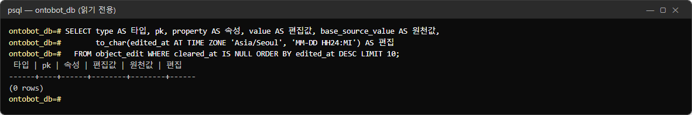

Action 으로 바꾼 값은 편집 레이어에 남아 원천 값을 덮습니다(16장). 사진은 16장 실습에서 편집을 모두 해제한 뒤라
`(0 rows)` 입니다. 줄이 있으면 "원천값"과 지금 원천의 값을 비교해, 편집이 낡았는지 판단합니다.

## 40.8 계정·세션·감사 이벤트

계정과 역할:

```sql
SELECT u.username AS 아이디, u.status AS 상태, string_agg(r.name, ',' ORDER BY r.name) AS 역할
  FROM app_user u LEFT JOIN user_role ur ON ur.user_id = u.id LEFT JOIN role r ON r.id = ur.role_id
 GROUP BY u.username, u.status ORDER BY u.username;
```

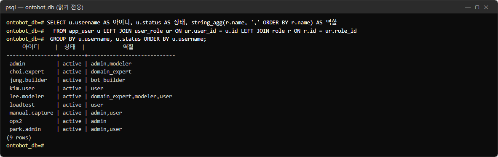

7장 관리 화면의 사용자 목록과 같은 내용입니다. 분기 계정 검토(43장 양식)를 할 때 이 결과를 붙여 두면 편합니다.
비밀번호는 해시로만 저장되며, 이 질의는 그 칸을 읽지 않습니다.

지금 유효한 로그인 세션:

```sql
SELECT u.username AS 아이디, s.auth_method AS 방식, count(*) AS 세션수,
       to_char(max(s.expires_at) AT TIME ZONE 'Asia/Seoul', 'MM-DD HH24:MI') AS 만료
  FROM user_session s JOIN app_user u ON u.id = s.user_id
 WHERE s.revoked_at IS NULL AND s.expires_at > now() GROUP BY u.username, s.auth_method ORDER BY 1;
```

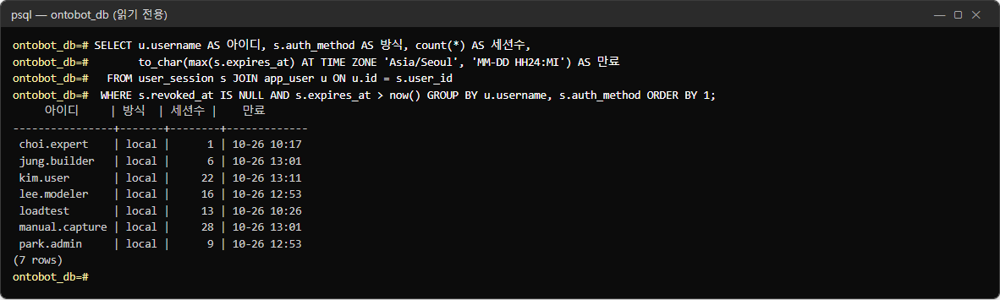

| 칸 | 뜻 |
| --- | --- |
| 방식 | `local`(로컬 계정) 또는 `oidc`(사내 SSO) |
| 세션수 | 로그아웃하지 않고 창을 닫은 횟수만큼 쌓임 |
| 만료 | 가장 늦게 끝나는 세션의 만료 시각 |

사진에서 세션 수가 많은 것은 촬영 도구가 로그아웃하지 않고 여러 번 로그인했기 때문입니다. 세션은 만료 시각이 지나면
저절로 무효가 됩니다. 계정을 정지하면 그 사람의 세션이 모두 폐기됩니다(7장) — 정지 뒤 이 질의에서 그 아이디가
사라졌는지로 확인할 수 있습니다.

최근 7일 감사 이벤트:

```sql
SELECT event AS 이벤트, count(*) AS 건수
  FROM audit_log WHERE ts > now() - interval '7 days'
 GROUP BY event ORDER BY count(*) DESC LIMIT 20;
```

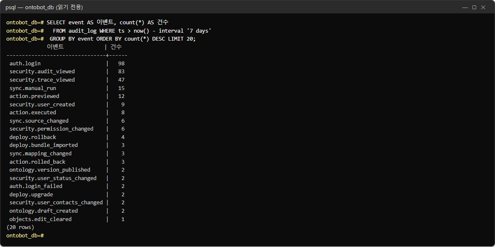

평소의 분포를 알아 두면 이상한 날이 눈에 띕니다. 예를 들어 `auth.login_failed` 가 갑자기 많으면 비밀번호를 맞히려는
시도일 수 있습니다(31장). `security.permission_changed`·`security.user_created` 가 계획에 없던 날 있으면 9장 화면에서 누가
했는지 봅니다.

## 40.9 질문 처리 통계

상태와 실패 이유별:

```sql
SELECT status AS 상태, coalesce(failure_reason, '-') AS 실패이유, count(*) AS 건수
  FROM trace GROUP BY status, failure_reason ORDER BY count(*) DESC;
```

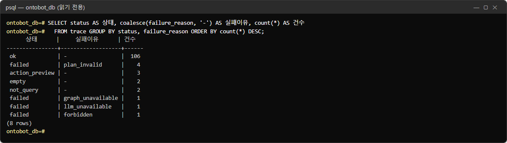

10.7 의 실패 이유 표와 함께 읽습니다. `plan_invalid` 가 많으면 사용자가 온톨로지 밖의 것을 자주 묻는 것이므로 모델러와
온톨로지 보강을 상의합니다. `llm_unavailable`·`graph_unavailable` 은 장애가 있었던 횟수입니다.

답한 질문의 등급 분포:

```sql
SELECT coalesce(grade::text, '-') AS 등급, count(*) AS 건수,
       round(100.0 * count(*) / sum(count(*)) OVER (), 1) AS 비율
  FROM trace WHERE status = 'ok' GROUP BY grade ORDER BY grade;
```

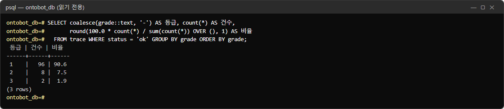

| 등급 | 사진 | 뜻 |
| --- | --- | --- |
| 1 | 90.6% | 모든 사실 문장에 근거가 맞음 |
| 2 | 7.5% | 일부 추정 |
| 3 | 1.9% | 근거 부족 — 본문이 숨겨짐 |

②·③ 의 비율이 업그레이드 뒤 크게 늘었다면 38장 평가를 돌려 비교합니다.

시간대별 질문 수와 지연:

```sql
SELECT to_char(created_at AT TIME ZONE 'Asia/Seoul', 'MM-DD HH24') AS 시간대, count(*) AS 질문,
       round(avg((stage_latency_ms->>'planning')::int)) AS 계획_ms,
       round(avg((stage_latency_ms->>'answering')::int)) AS 답변_ms
  FROM trace GROUP BY 1 ORDER BY 1 DESC LIMIT 10;
```

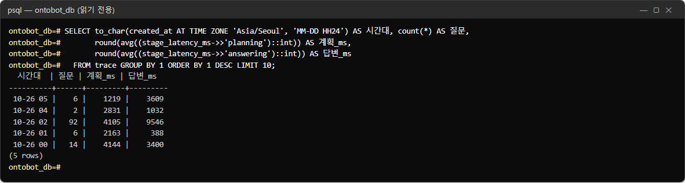

사진에서 `10-26 02` 시간대에 질문이 92건으로 몰리고 계획·답변 시간이 길어진 것은 37장의 동시 사용 측정(여러 명이 함께
질문) 때문입니다. 평소보다 지연이 크게 늘어난 시간대가 있으면 그때 사용자가 몰렸는지(질문 수), 모델 상태(39.7)를
함께 봅니다.

## 40.10 지금 연결과 오래 걸리는 트랜잭션

```sql
SELECT coalesce(nullif(application_name, ''), '(이름 없음)') AS 프로그램, usename AS 계정,
       state AS 상태, count(*) AS 연결
  FROM pg_stat_activity WHERE datname = 'ontobot_db'
 GROUP BY 1, 2, 3 ORDER BY 4 DESC;
```

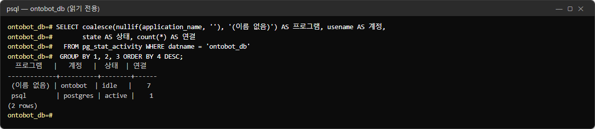

| 줄 | 뜻 |
| --- | --- |
| `ontobot · idle · 7` | api·worker 가 미리 열어 둔 연결(연결 풀). 쉬는 중 |
| `postgres · active · 1` | 지금 이 질의를 치는 운영자 자신 |

채팅 한 건은 답이 끝날 때까지 연결 하나를 씁니다. `ontobot` 의 `active` 가 연결 풀 크기(`ONTOBOT_DB_POOL_SIZE` +
`MAX_OVERFLOW`, 30장)에 닿아 있으면 더 들어온 질문은 기다립니다(37장).

오래 열려 있는 트랜잭션:

```sql
SELECT pid, usename AS 계정, state AS 상태, now() - xact_start AS 트랜잭션_경과, left(query, 40) AS 질의
  FROM pg_stat_activity WHERE datname = 'ontobot_db' AND xact_start IS NOT NULL
 ORDER BY xact_start LIMIT 5;
```

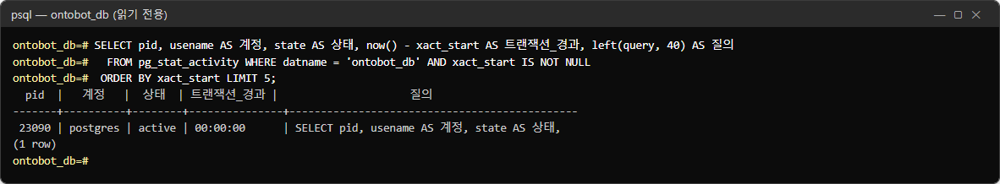

자기 자신의 질의 한 줄(경과 0초)만 나오면 정상입니다. `idle in transaction` 상태로 몇 분 넘게 열린 연결이 있으면
백업·인덱스 작업을 막을 수 있으니, pid 와 질의를 적어 개발팀에 알립니다. 운영자가 그 연결을 끊지는 않습니다.

## 40.11 Neo4j 들여다보기

```powershell
wsl -d ontobot -u root -- bash -c "cd /opt/ontobot && docker compose exec neo4j cypher-shell -u neo4j"
```

비밀번호를 물으면 `/opt/ontobot/.env` 의 `ONTOBOT_NEO4J_PASSWORD` 를 넣습니다(화면에 보이지 않음). 프롬프트가 `neo4j@neo4j>` 로
바뀝니다. 나갈 때는 `:exit`.

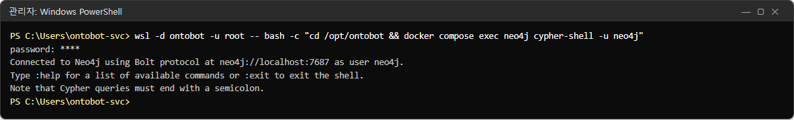

> **알아 두기** Neo4j 는 언제든 PostgreSQL 에서 다시 만들 수 있는 **투영**입니다(13장). 그래도 여기서 고치는 명령
> (`CREATE`·`DELETE`·`SET`)은 치지 마세요. 고칠 일이 있으면 재구축(13장)을 씁니다. 아래 질의는 모두 `MATCH … RETURN`
> (읽기)뿐입니다.

라벨(타입)별 노드 수:

```cypher
MATCH (n) RETURN labels(n)[0] AS label, count(*) AS nodes, sum(CASE WHEN n.stub THEN 1 ELSE 0 END) AS stubs ORDER BY label;
```

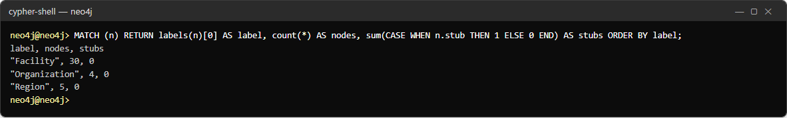

노드 수는 40.4 의 **살아있음** 과 같아야 합니다(Facility 30, Organization 4, Region 5). `stubs` 는 링크의 끝 객체가
아직 없어 임시로 만든 노드 수로, 0 이 정상입니다(13장).

관계 종류별 수:

```cypher
MATCH ()-[r]->() RETURN type(r) AS rel, count(*) AS n ORDER BY rel;
```

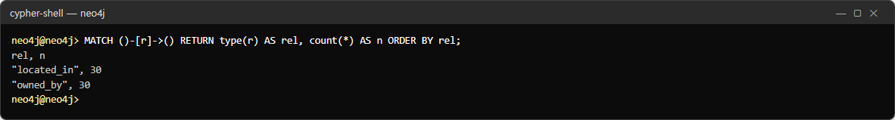

40.4 의 링크 수(살아있음)와 같아야 합니다.

노드에 무엇이 저장되는가:

```cypher
MATCH (n) UNWIND keys(n) AS k RETURN labels(n)[0] AS label, collect(DISTINCT k) AS keys ORDER BY label;
```

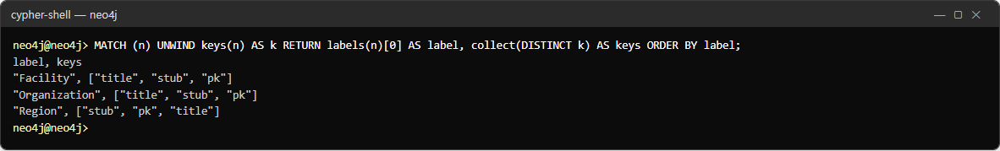

모든 노드에 `pk`·`title`·`stub` 세 가지만 있습니다. 위험등급·연락처 같은 **속성 값은 Neo4j 에 넣지 않습니다**
(개인정보를 관계 저장소에 퍼뜨리지 않기 위해, 13장). 보안 점검 때 이 질의로 확인할 수 있습니다.

관계 몇 개를 직접 보기:

```cypher
MATCH (f:Facility)-[r]->(o) RETURN f.pk, f.title, type(r), o.pk, o.title ORDER BY f.pk LIMIT 8;
```

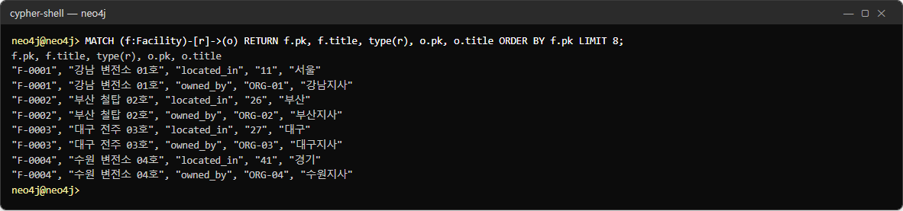

"F-0001 강남 변전소 01호 —located_in→ 11 서울", "—owned_by→ ORG-01 강남지사"처럼 읽습니다. 사용자가 "관계 질문의 답이
이상하다"고 하면 이 질의로 그 시설의 관계를 직접 봅니다.

관계가 하나도 없는 노드:

```cypher
MATCH (n) WHERE NOT (n)--() RETURN labels(n)[0] AS label, count(*) AS isolated;
```

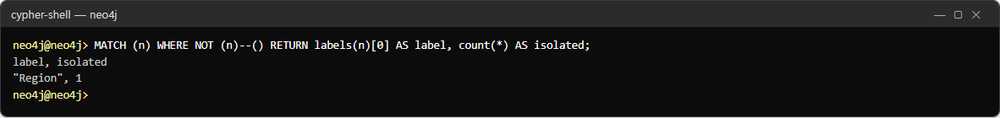

Region 1개가 어떤 시설과도 이어져 있지 않습니다. 그 지역에 시설이 없어서이며 고장이 아닙니다. 시설 쪽 노드가 이렇게
나오면 원천의 FK 값(소유 조직·지역 코드)이 비었는지 봅니다(12장).

## 40.12 PostgreSQL ↔ Neo4j 대사

위의 수 비교를 프로그램이 한 번에 해 줍니다. 13장의 **대사** 와 같은 일을 명령으로 합니다.

```powershell
wsl -d ontobot -u root -- bash -c "cd /opt/ontobot && docker compose run --rm migrate python scripts/graph_rebuild.py --check"
```

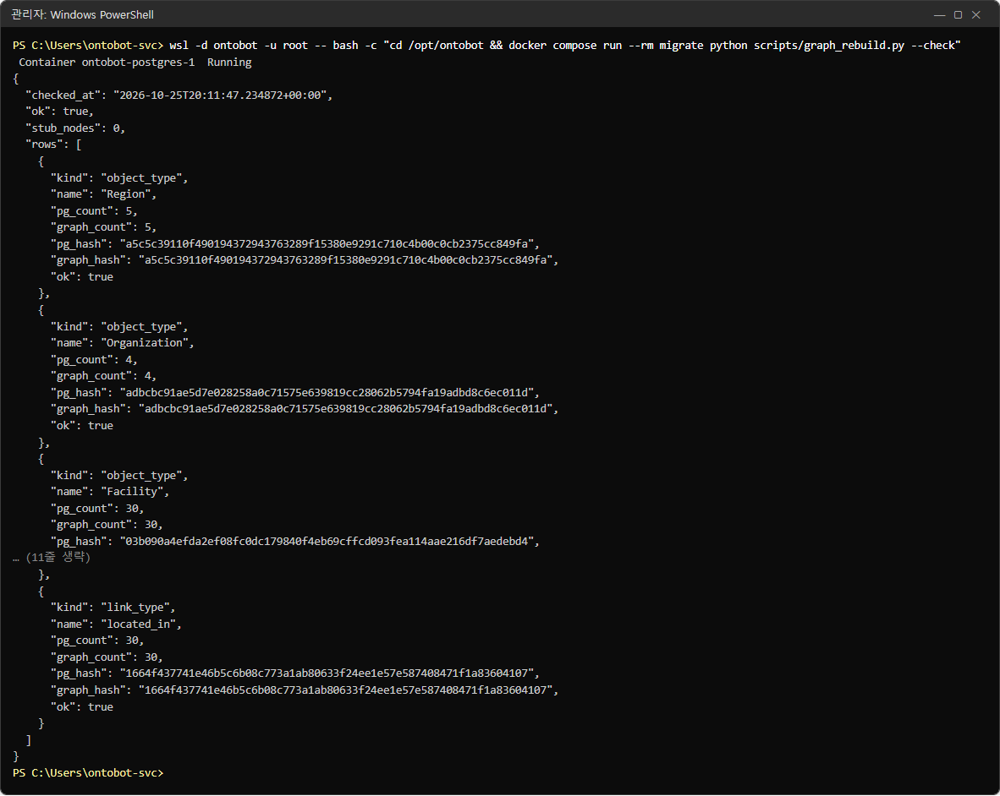

| 항목 | 뜻 |
| --- | --- |
| `"ok": true` | 전체 일치 |
| `"stub_nodes": 0` | 임시 노드 없음 |
| `rows[].kind` | `object_type`(노드) 또는 `link_type`(관계) |
| `pg_count` / `graph_count` | 양쪽 개수 |
| `pg_hash` / `graph_hash` | 양쪽 내용의 지문. **같으면 내용까지 같음** |

`--check` 는 비교만 하고 아무것도 바꾸지 않습니다. `"ok": false` 면 13장의 재구축을 합니다.

## 40.13 자주 쓰는 질의 요약

| 언제 | 질의(절) | 정상 |
| --- | --- | --- |
| 매일 | 끝나지 않은 작업(40.6) | 0 rows |
| 매일 | 투영 대기(40.6) | 0 |
| 매주 | 실패한 동기화(40.5) | 새 줄 없음 |
| 매주 | 알림 failed(40.7) | 늘지 않음 |
| 매달 | 표 크기(40.3) | 지난달과 비교해 급증 없음 |
| 매달 | 감사 이벤트(40.8) | 계획에 없는 권한 변경 없음 |
| 업그레이드 뒤 | 스키마 버전(40.3), 대사(40.12) | 릴리스 노트의 버전, ok |
| 신고를 받으면 | 질문 통계(40.9), 연결(40.10) | |

## 40.14 해 보기

> **해 보기** (시험 서버에서)
>
> 1. 40.1 의 방법으로 들어가 40.2 의 두 명령을 쳐서 정말 읽기 전용인지 확인하세요.
> 2. 40.4 의 타입별 객체 수와 40.11 의 라벨별 노드 수를 나란히 적고 같은지 비교하세요.
> 3. 데이터 소스 화면(11장)에서 수동 동기화를 한 번 돌린 뒤 40.5 의 질의로 새 줄이 생겼는지, 반영이 몇 건인지 보세요.
> 4. 40.9 의 실패 이유 통계에서 가장 많은 실패 이유를 찾아 10.7 의 표에서 할 일을 찾아보세요.
