# 42장 사용자 문의 처리 사례

운영자에게 오는 문의는 대개 몇 가지 유형으로 되풀이됩니다. 이 장은 실제로 받을 법한 문의 12가지를, 이 책에서 찍은
화면으로 처음부터 끝까지 처리해 보는 사례집입니다. 각 사례는 **문의 → 확인 순서 → 원인 → 조치 → 답변 예** 로
되어 있습니다.

## 사례 1 — "어제까지 되던 로그인이 안 돼요"

**문의** 김사용(`kim.user`): "비밀번호를 맞게 넣었는데 '아이디 또는 비밀번호가 올바르지 않습니다'가 나와요."

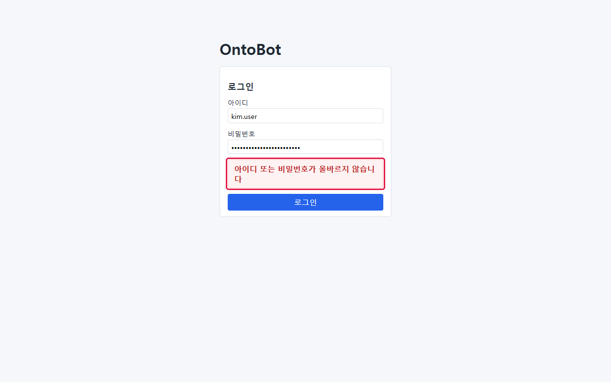

**확인 순서**

1. 관리 → 사용자에서 `kim.user` 의 상태를 봅니다.

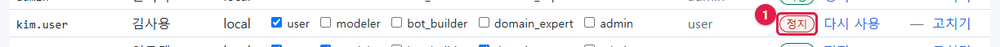

2. 감사 로그에서 `security.user_status_changed` 로 누가 언제 정지했는지 봅니다.

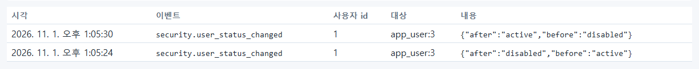

3. `auth.login_failed` 로 실패 시도를 확인합니다.

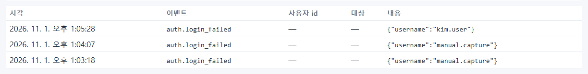

**원인** 계정이 정지되어 있었습니다(사용자 id 2 관리자가 정지).

**조치** 정지 사유를 확인하고, 다시 써도 되면 **다시 사용**.

**답변 예** "계정이 ○○ 사유로 정지되어 있었습니다. 지금 다시 사용하도록 바꿨으니 로그인해 보세요."

## 사례 2 — "질문하면 무조건 '질문 해석 실패'가 나와요"

**문의** 정빌더(`jung.builder`): "어떤 질문을 해도 해석 실패예요."

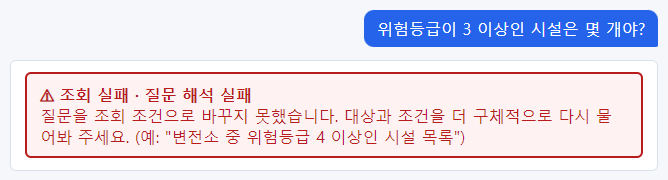

**확인 순서**

1. 사용자 목록에서 **데이터 그룹** 칸 확인 → `bot_builder` 그룹만 있음.
2. 데이터 그룹 탭에서 `bot_builder` 카드 확인 → 읽기가 하나도 체크되지 않음.

**원인** 속한 그룹에 읽기 권한이 없어, 설계도에서 데이터가 아예 보이지 않음(8.2).

**조치** 업무에 필요한 타입의 읽기를 체크하고 **권한 저장**(재로그인 불필요). 또는 이미 권한이 있는 그룹에 그 사람을
구성원으로 넣습니다.

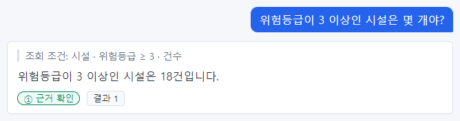

**답변 예** "평가 담당 그룹에 데이터 읽기 권한이 빠져 있었습니다. 시설·조직·지역을 읽을 수 있게 했으니 다시 물어보세요."

## 사례 3 — "관계 질문만 실패해요"

**문의** "강남지사가 소유한 시설을 물으면 '관계 저장소 연결 불가'가 나와요. 다른 질문은 돼요."

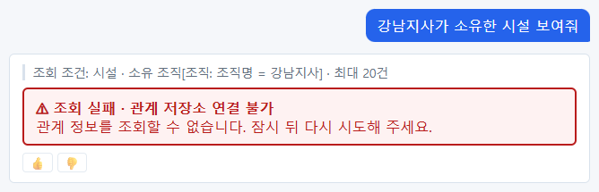

**확인 순서**

1. 배포 콘솔 현황 → 준비 상태 **일부 저하**, neo4j `Exited`.

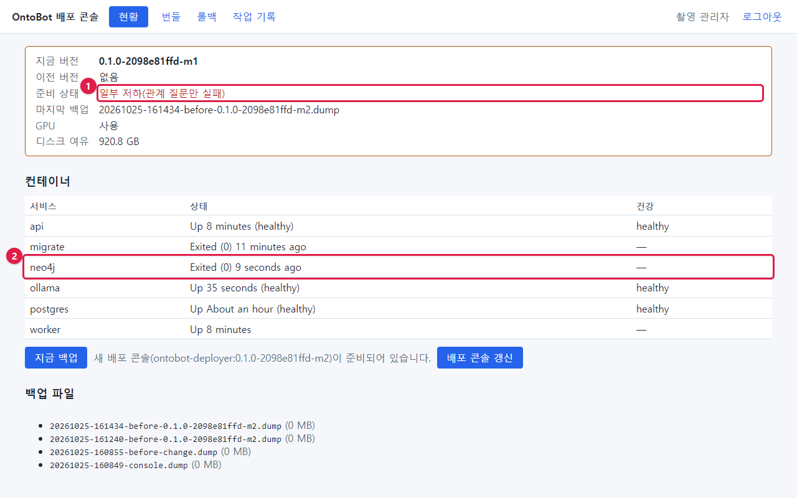

**원인** Neo4j 컨테이너가 멈춤.

**조치** `docker compose start neo4j` → 1분 → 데이터 소스 화면 **지금 대사** → 일치(13.3).

**답변 예** "관계 정보 저장소가 잠시 멈췄습니다. 다시 켰으니 같은 질문을 해 보세요."

## 사례 4 — "모든 질문이 실패해요"

**문의** 여러 사람이 동시에 "답변 모델에 연결하지 못해 실패했습니다"를 알려 옴.

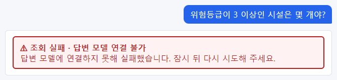

**확인 순서** 현황 → **사용 불가**, ollama `Exited`.

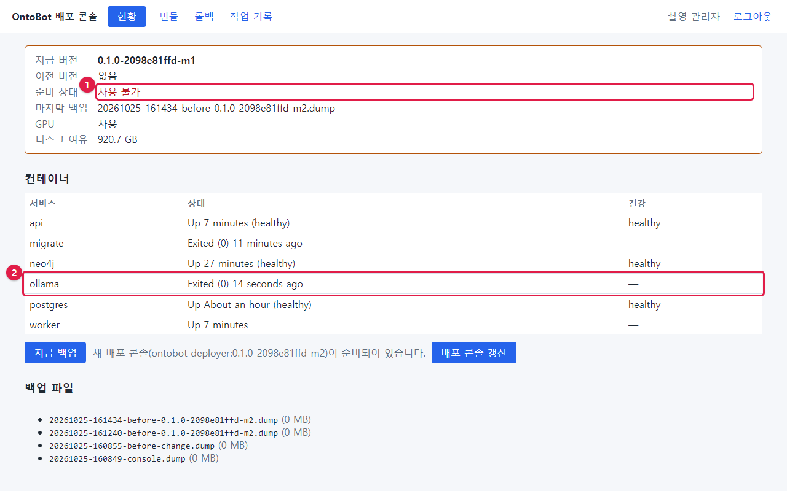

**원인** AI 모델 컨테이너가 멈춤.

**조치** `docker compose start ollama` → 1~2분 → 확인 질문(27.1). 원인(GPU 드라이버 갱신 등)을 장애 보고서에 기록.

**답변 예**(공지) "○시 ○분부터 ○분까지 AI 모델 장애로 질문이 실패했습니다. 지금은 복구되었습니다."

## 사례 5 — "원천에서 고친 값이 OntoBot 에 안 나와요"

**문의** 원천 담당자: "오전에 시설 위험등급을 고쳤는데 OntoBot 은 아직 예전 값이에요."

**확인 순서**

1. 데이터 소스 화면 → 시설 매핑의 마지막 실행 시각과 결과.
2. 실행이 일정대로 돌지 않았으면 현황에서 worker 확인.

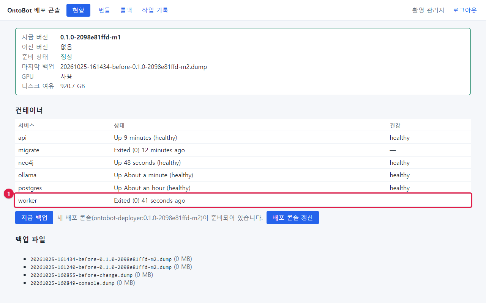

3. 데이터 소스 화면에서 **지금 동기화** → "이미 대기 중인 동기화가 있습니다".

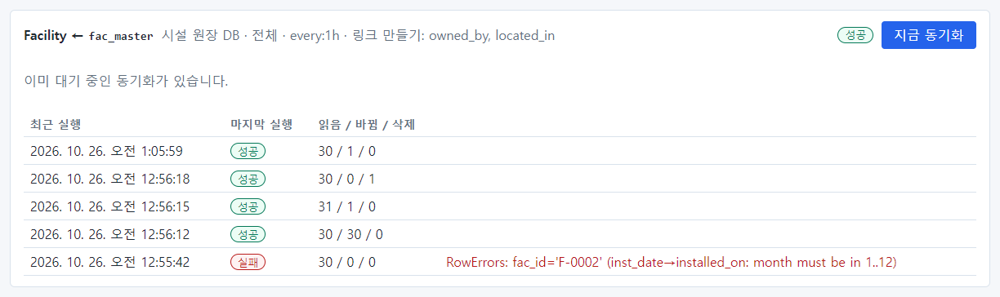

**원인** worker 가 멈춰 동기화가 돌지 않음(준비 상태는 정상으로 보였음).

**조치** `docker compose start worker` → 대기하던 동기화 실행 확인(27.3).

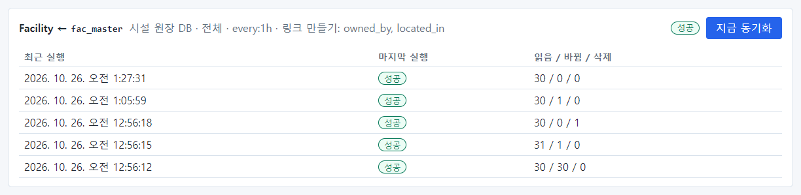

**또 다른 원인** 그 값이 Action 으로 편집된 값이면, 원천이 바뀌어도 편집 값이 우선합니다 → 편집 충돌 칸 확인(16장).

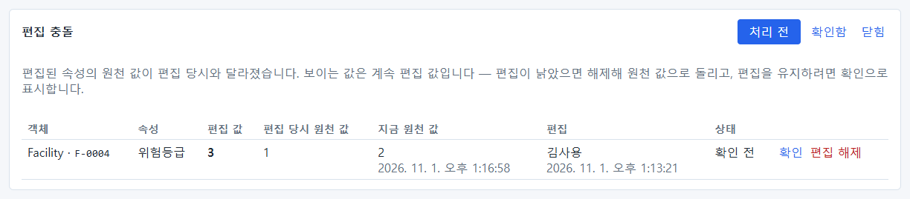

## 사례 6 — "동기화가 실패했다고 나와요"

**문의** 모델러: "시설 매핑이 빨간 실패예요."

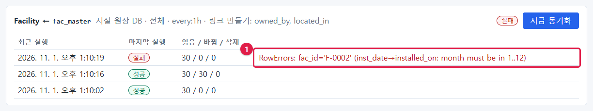

**확인** 오류 `RowErrors: fac_id='F-0002' (inst_date→installed_on: month must be in 1..12)` — F-0002 의 설치일 값이 날짜가 아님.

**조치** 원천 담당자에게 행(`F-0002`)과 열(`inst_date`)을 알려 고치게 함 → 다시 동기화(12.5).

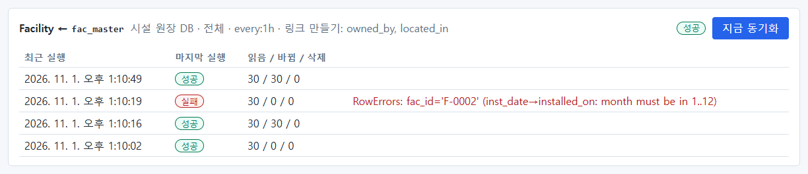

**답변 예** "원천의 F-0002 설치일이 '2015-13-45'로 들어가 있어 동기화 전체가 멈췄습니다. 값을 고쳐 주시면 다시 돌리겠습니다."

## 사례 7 — "답의 숫자가 이상해요"

**문의** "서울 변전소들 용량 합계를 물었더니 22,600kW 래요. 그렇게 많지 않을 텐데요."

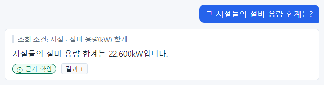

**확인 순서**

1. 답 위의 **조회 조건 줄**: `시설 · 설비 용량(kW) 합계` — "직전 결과 중"이 없음.
2. 트레이스 번호를 찾아(10.2) 계획 확인: `context_refs: []`.

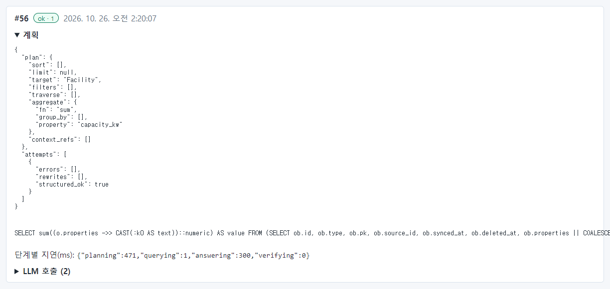

**원인** 이어서 묻기에서 앞 결과를 놓쳐 전체 시설을 합함. 사진은 예전 판 촬영에서 실제로 일어난 것입니다 — 같은
질문이 맞게 이어진 모습은 34.17 과 비교하세요.

**조치** 사용자에게 "서울에 있는 변전소의 설비 용량 합계는?"처럼 조건을 다 넣어 다시 묻도록 안내. 트레이스 번호를
개발팀에 전달.

**답변 예** "앞 질문의 결과를 이어받지 못하고 전체 시설을 합한 답이었습니다. 답 위의 '조회 조건' 줄을 보면 확인할 수
있습니다. 조건을 모두 넣어 다시 물어봐 주세요."

## 사례 8 — "Action 을 요청하려는데 막혔다고 나와요"

**문의** "긴급 정비 통보를 요청했더니 '실행할 수 없습니다'가 나와요."

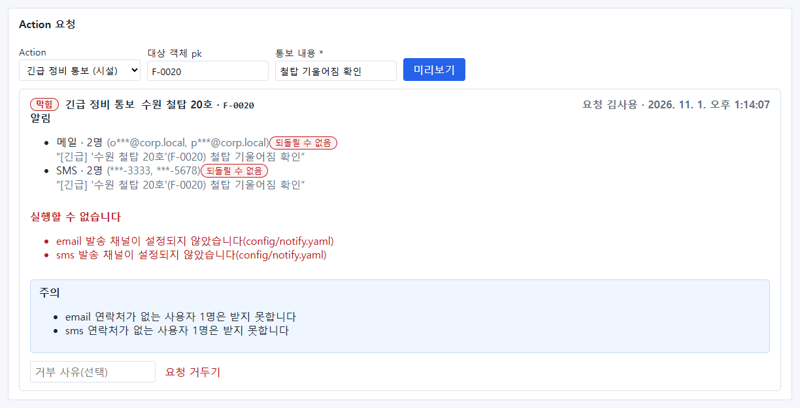

**확인** "email 발송 채널이 설정되지 않았습니다(config/notify.yaml)".

**조치** 메일·SMS 채널을 설정하고 반영(15.4~15.6), 받는 사람 연락처 입력(7.8).

**답변 예** "메일·문자 발송 설정이 아직 없어서 막혔습니다. 설정을 마쳤으니 다시 요청해 주세요."

## 사례 9 — "승인했는데 문자가 안 왔대요"

**문의** 승인자: "긴급 정비 통보를 승인했는데 담당자가 메일을 못 받았대요."

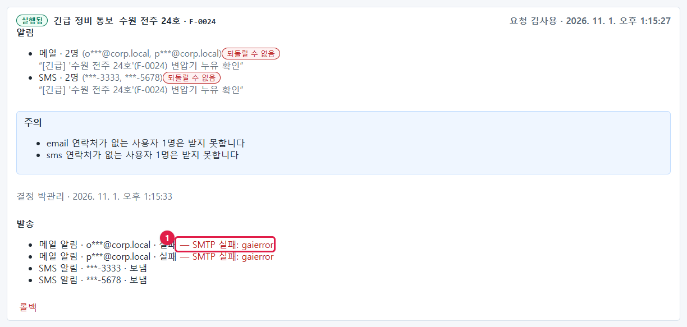

**확인** Action 전체 기록 → 펼침 → 발송: 메일 두 통 **실패 — SMTP 실패: gaierror**(SMS 는 보냄).

**원인** 메일 서버 이름을 찾지 못함(메일 서버 점검·DNS).

**조치** 메일 담당자와 원인 해결. 실패한 발송은 자동으로 다시 보내지 않으므로, 꼭 알려야 하면 담당자에게 직접 연락
(15.8).

## 사례 10 — "배포 콘솔에 로그인이 안 돼요"

**문의** 새로 온 운영자: "배포 콘솔에 제 계정으로 못 들어가요."

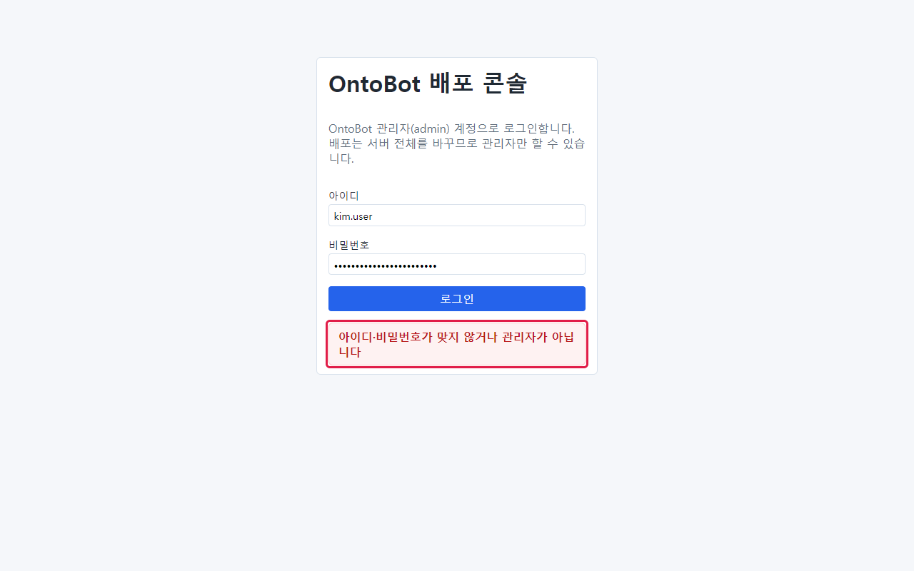

**확인** 그 계정에 admin 역할이 있는지, SSO 계정(oidc)이 아닌 로컬 계정인지.

**조치** 관리자 역할을 주거나(필요한 사람만), 배포 담당 로컬 관리자 계정으로 로그인하도록 안내(17.2).

## 사례 11 — "업그레이드 뒤 화면이 이상해요"

**문의** 업그레이드 직후 여러 사용자가 오류를 알려 옴.

**확인 순서**

1. 작업 기록에서 업그레이드 결과(성공·준비 확인 실패·실패).
2. 현황의 준비 상태·컨테이너.
3. 확인 질문(5.6).

**조치** 개발팀과 상의해 **프로그램만 롤백**(22.3). 롤백 뒤 확인 질문.

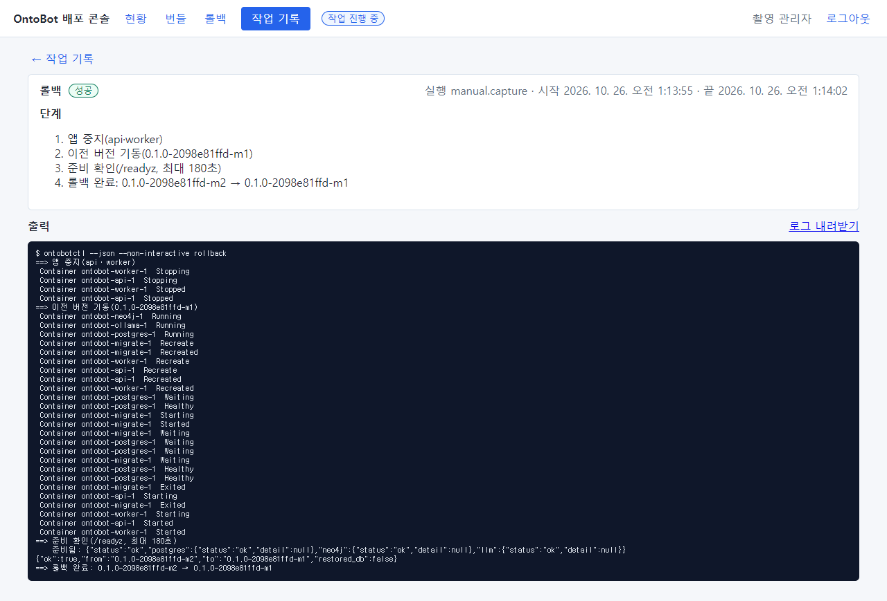

**답변 예**(공지) "오늘 적용한 새 버전에 문제가 있어 이전 버전으로 되돌렸습니다. 데이터는 그대로입니다."

## 사례 12 — "누가 권한을 바꿨는지 알고 싶어요"

**문의** 보안 담당: "지난주에 modeler 역할의 읽기 권한이 바뀌었는데 누가 했나요?"

**확인** 감사 로그 → `security.permission_changed` → 대상 `role:modeler` 줄.

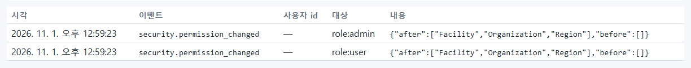

`2026. 10. 26. 오전 12:47:26 · 사용자 id 2 · role:modeler · before [] → after [Facility, Organization, Region]`. 사용자 id 2 는
계정 만들기 기록으로 누구인지 찾습니다(9.1).

**답변 예** "10월 26일 0시 47분에 관리자(manual.capture)가 모델러 역할에 시설·조직·지역 읽기 권한을 주었습니다."

## 문의 처리 요령

| 요령 | 이유 |
| --- | --- |
| 아이디·시각·화면(캡처)·질문 그대로를 먼저 받는다 | 감사 로그·트레이스를 찾으려면 필요 |
| 현황부터 본다 | 대부분의 장애는 현황에서 드러남 |
| 화면의 문구를 41장에서 찾는다 | 원인과 할 일이 정리되어 있음 |
| 답변에 원인과 조치를 짧게 | 같은 문의가 줄어듦 |
| 반복되면 기록·개발팀 전달 | 제품 개선 근거 |
