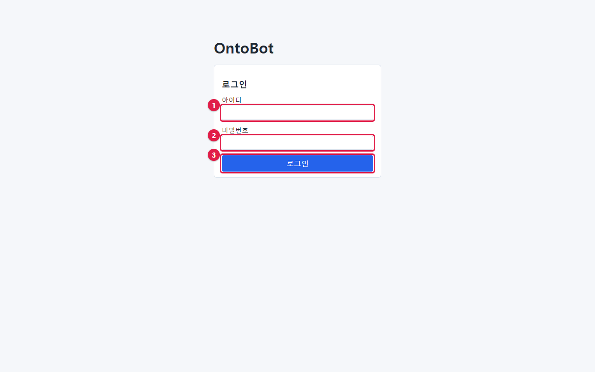
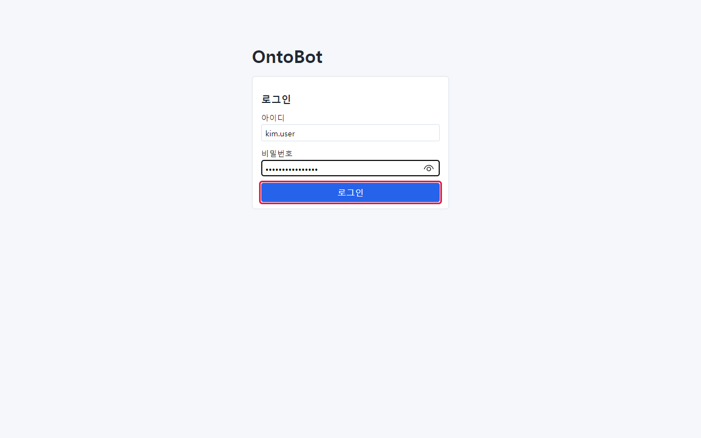
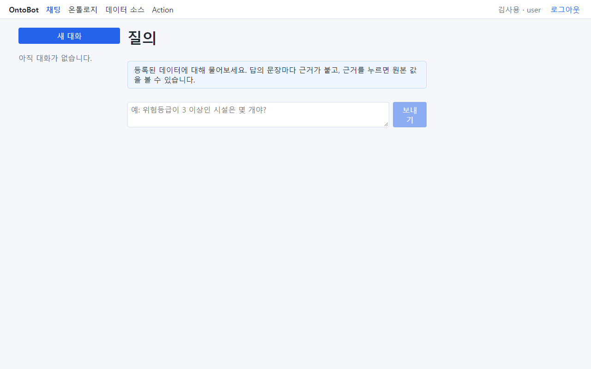
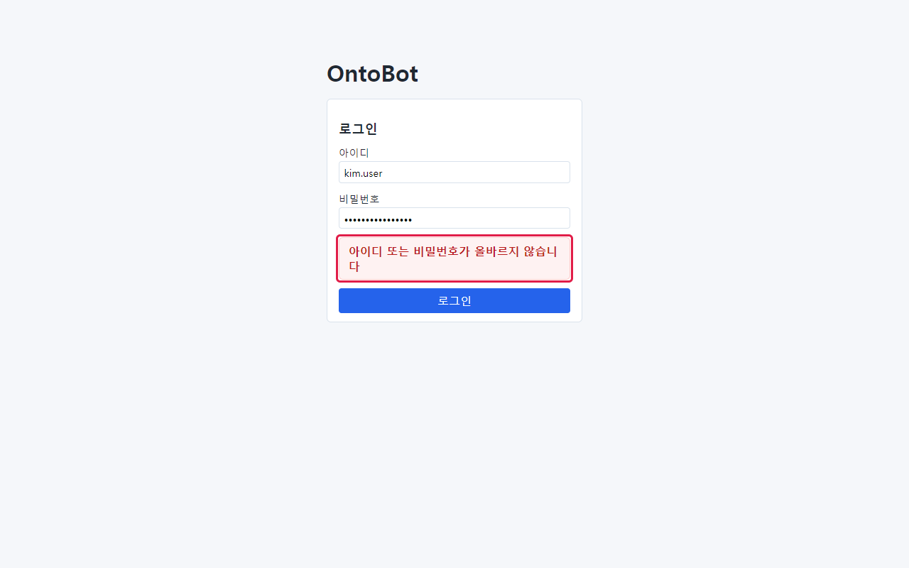
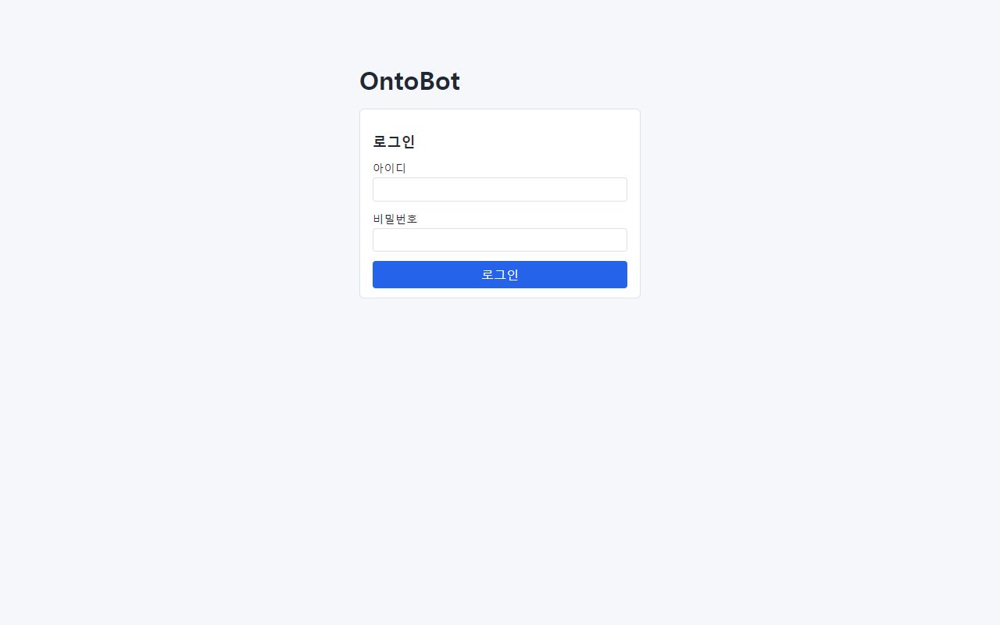
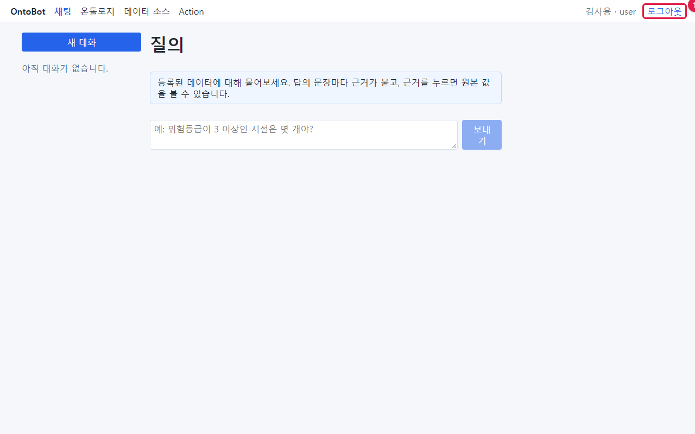

# 2장 접속과 로그인

## 2.1 준비물

OntoBot 을 쓰려면 다음 세 가지가 필요합니다. 셋 다 관리자에게 받습니다.

| 준비물 | 예 | 설명 |
| --- | --- | --- |
| 접속 주소 | `http://ontobot.corp.local:8000` | 인터넷 브라우저 주소창에 입력할 주소 |
| 아이디 | `kim.user` | 로그인할 때 쓰는 이름. 보통 영문 |
| 처음 비밀번호 | (관리자가 따로 알려 줌) | 12자 이상 |

회사에서 통합 로그인(SSO, 한 번 로그인으로 여러 사내 시스템을 쓰는 방식)을 쓰면 아이디·비밀번호 대신 회사
계정으로 들어갑니다. 이때는 2.4절을 보세요.

> **알아 두기** 브라우저는 크롬(Chrome)이나 엣지(Edge)를 권합니다. 이 책의 화면은 엣지로 찍었습니다. 인터넷
> 익스플로러는 쓸 수 없습니다.

## 2.2 로그인하기

1. 브라우저를 엽니다.
2. 주소창에 관리자에게 받은 주소를 입력하고 **Enter** 를 누릅니다.
3. 아래와 같은 로그인 화면이 나옵니다.

화면 가운데 상자에 칸이 두 개, 단추가 하나 있습니다.

| 번호 | 이름 | 하는 일 |
| --- | --- | --- |
| ① | **아이디** 칸 | 관리자에게 받은 아이디를 입력합니다 |
| ② | **비밀번호** 칸 | 비밀번호를 입력합니다. 입력한 글자는 점(•)으로 가려져 보입니다 |
| ③ | **로그인** 단추 | 누르면 아이디와 비밀번호를 확인합니다 |

4. **아이디** 칸을 마우스로 누르고 아이디를 입력합니다. 예: `kim.user`
5. **비밀번호** 칸을 누르고 비밀번호를 입력합니다.
6. **로그인** 단추를 누르거나, 비밀번호 칸에서 **Enter** 를 누릅니다.

7. 로그인되면 **질의(채팅)** 화면이 처음으로 나옵니다.

화면 맨 위 막대 오른쪽에 **김사용 · user** 처럼 내 이름과 역할이 보이면 제대로 로그인된 것입니다.

> **해 보기** 로그인한 뒤 오른쪽 위에 보이는 내 이름과 역할을 확인해 보세요. 역할 이름이 무엇인지 적어 두면
> 3장에서 내가 쓸 수 있는 메뉴를 알아볼 때 편합니다.

## 2.3 로그인이 안 될 때

### 아이디나 비밀번호가 틀렸을 때

아이디나 비밀번호가 틀리면 빨간 상자에 **아이디 또는 비밀번호가 올바르지 않습니다** 라고 나옵니다.

- 어느 쪽이 틀렸는지는 일부러 알려 주지 않습니다(남이 아이디를 알아내지 못하게 하려는 것입니다).
- 다음을 차례로 확인하세요.
  - 키보드의 **Caps Lock** 이 켜져 있지 않은지(대문자로 입력되는지).
  - 한/영 전환이 **한글**로 되어 있지 않은지. 아이디가 `ㅏㅑㅡ.ㅕㄴㄷㄱ` 처럼 한글로 입력될 수 있습니다.
  - 아이디 앞뒤에 빈칸(스페이스)을 넣지 않았는지.
- 그래도 안 되면 관리자에게 문의하세요. 여러 번 틀리면 잠시 로그인이 막힐 수 있습니다.

> **주의** 비밀번호는 화면에서 직접 바꿀 수 없습니다. 잊었거나 바꾸고 싶으면 관리자에게 요청하세요. 관리자도
> 여러분의 비밀번호를 알 수 없고, 새 비밀번호를 정해 줄 수만 있습니다.

### 계정이 정지되었을 때

관리자가 계정을 정지하면 비밀번호가 맞아도 로그인되지 않습니다. 부서 이동이나 퇴사 처리로 정지되는 경우가
많습니다. 관리자에게 문의하세요(관리자 화면은 「21장」).

### 로그인 없이 다른 화면 주소로 들어가면

로그인하지 않은 상태에서 채팅 화면 주소(예: `…/chat`)로 바로 들어가면, 자동으로 로그인 화면으로 돌아갑니다.
로그인하면 원래 가려던 화면으로 갑니다.

## 2.4 회사 통합 로그인(SSO)

회사에서 통합 로그인을 설정했다면 로그인 화면에 **SSO 로 로그인** 단추가 보입니다(이 책의 예제 환경에는
설정하지 않아 보이지 않습니다).

1. **SSO 로 로그인** 을 누릅니다.
2. 회사의 로그인 화면으로 이동합니다. 평소 사내 시스템에 들어가듯 로그인합니다.
3. 로그인이 끝나면 OntoBot 의 채팅 화면으로 돌아옵니다.

SSO 로그인이 실패하면 로그인 화면에 **SSO 로그인에 실패했습니다. 다시 시도하거나 관리자에게 문의하세요.**
가 나옵니다.

## 2.5 로그인 유지 시간

- 로그인은 일정 시간(기본 8시간) 동안 유지됩니다. 브라우저를 닫았다 열어도 그 시간 안이면 다시 로그인하지
  않아도 됩니다.
- 시간이 지나면 다음에 화면을 누를 때 로그인 화면으로 돌아갑니다. 쓰던 대화는 그대로 남아 있습니다.
- 관리자가 내 역할을 바꾸거나 계정을 정지하면, 그 즉시 로그인이 끊깁니다. 다시 로그인하면 바뀐 역할로
  보입니다.

## 2.6 로그아웃

일을 마쳤으면 오른쪽 위 **로그아웃** 을 누릅니다.

로그아웃하면 로그인 화면으로 돌아갑니다.

> **주의** 여러 사람이 함께 쓰는 PC(공용 PC)에서는 반드시 로그아웃하세요. 로그아웃하지 않으면 다음 사람이
> 여러분의 이름으로 질문하거나 데이터 변경을 요청할 수 있고, 그 기록은 모두 여러분의 이름으로 남습니다.

## 2.7 이 장의 핵심

> **요령**
>
> - 주소·아이디·처음 비밀번호는 관리자에게 받습니다.
> - 로그인되면 오른쪽 위에 내 이름과 역할이 보입니다.
> - 틀렸다고 나오면 Caps Lock 과 한/영 전환부터 확인합니다.
> - 비밀번호 변경과 계정 문제는 관리자에게 요청합니다.
> - 공용 PC 에서는 반드시 로그아웃합니다.
