# 3장 화면 둘러보기

## 3.1 맨 위 막대(메뉴)

어느 화면에 있든 맨 위에는 같은 막대가 있습니다. 왼쪽은 **메뉴**, 오른쪽은 **내 정보**입니다. 아래는 관리자
박관리로 로그인한 화면입니다.

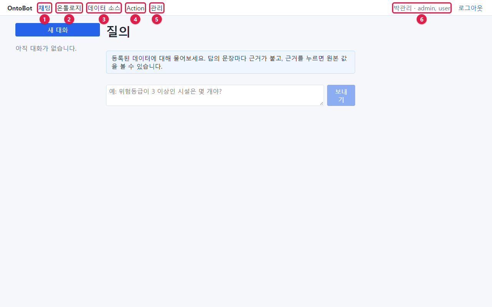

| 번호 | 메뉴 | 하는 일 | 설명하는 장 |
| --- | --- | --- | --- |
| ① | **채팅** | 데이터에 대해 질문하고, 데이터 변경을 요청합니다 | 4~10장 |
| ② | **온톨로지** | 데이터 설계도를 보고 고칩니다 | 16~17장 |
| ③ | **데이터 소스** | 회사 시스템과 연결하고 데이터를 가져옵니다 | 18~19장 |
| ④ | **Action** | 데이터 변경 요청을 보고 승인합니다. 알림함도 여기 있습니다 | 11~13장 |
| ⑤ | **관리** | 사용자·권한·기록을 관리합니다(관리자만) | 21장 |
| ⑥ | 내 이름 · 역할 | 지금 로그인한 사람과 역할 | 이 장 |

지금 보고 있는 메뉴는 파란 글씨로 표시됩니다(그림에서는 **채팅**). 가장 오른쪽 **로그아웃** 은 「2장」에서
설명했습니다.

## 3.2 역할에 따라 메뉴가 다르다

메뉴는 내 역할에 따라 다르게 보입니다. 다섯 사람이 각각 로그인했을 때의 맨 위 막대입니다.

**챗봇 사용자(김사용, `user`)**

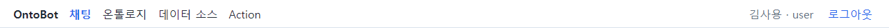

**현업 전문가(최현업, `domain_expert`)** — **인터뷰** 메뉴가 있습니다.

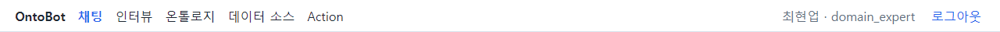

**모델러(이모델, `modeler, user`)** — **인터뷰** 와 **평가** 메뉴가 있습니다.

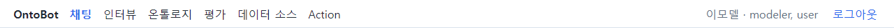

**챗봇 빌더(정빌더, `bot_builder, user`)** — **평가** 메뉴가 있습니다.

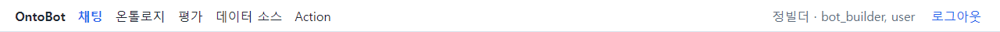

**관리자(박관리, `admin, user`)** — **관리** 메뉴가 있습니다.

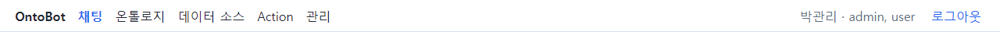

정리하면 다음과 같습니다.

| 메뉴 | user | domain_expert | modeler | bot_builder | admin |
| --- | --- | --- | --- | --- | --- |
| 채팅 | ○ | ○ | ○ | ○ | ○ |
| 인터뷰 | | ○ | ○ | | |
| 온톨로지 | 보임(내용 없음) | 보임(내용 없음) | ○ | 보임(내용 없음) | ○(보기만) |
| 평가 | | | ○ | ○ | |
| 데이터 소스 | 보임(내용 없음) | 보임(내용 없음) | ○ | 보임(내용 없음) | ○(보기·일부 처리) |
| Action | ○ | ○ | ○ | ○ | ○ |
| 관리 | | | | | ○ |

> **알아 두기** 지금 판에서는 **온톨로지**·**데이터 소스** 메뉴가 모든 사람에게 보입니다. 하지만 모델러·관리자가
> 아니면 눌러도 내용이 나오지 않거나 "불러오는 중…"만 보입니다. 고장이 아니라 권한이 없어서입니다.

일반 사용자가 온톨로지 메뉴를 누르면 이렇게 보입니다.

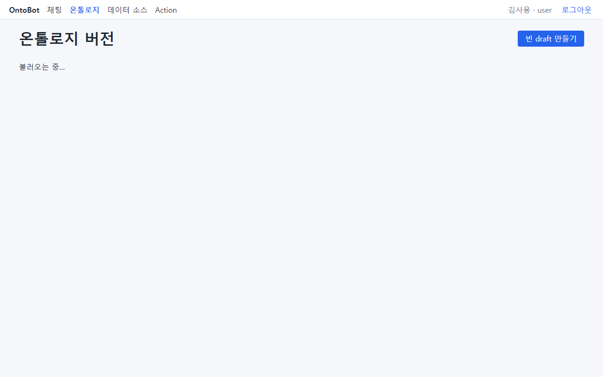

데이터 소스 메뉴도 틀만 보이고 목록은 비어 있습니다.

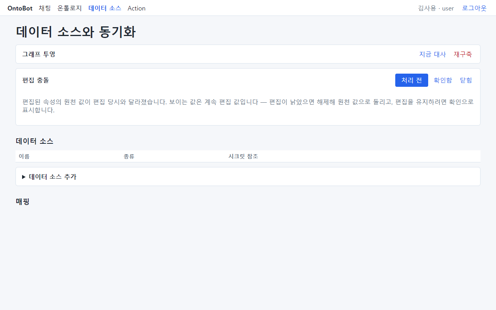

메뉴에 없는 화면의 주소를 직접 입력해 들어가도, 틀만 보이고 내용은 비어 있습니다. 아래는 일반 사용자가 평가
화면과 관리 화면 주소로 들어갔을 때입니다. 사용자 목록이나 골든셋이 하나도 보이지 않습니다. 서버가 권한이
없는 사람에게는 내용을 보내지 않기 때문입니다.

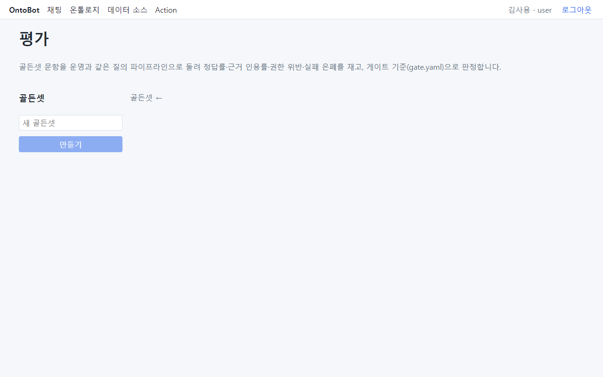

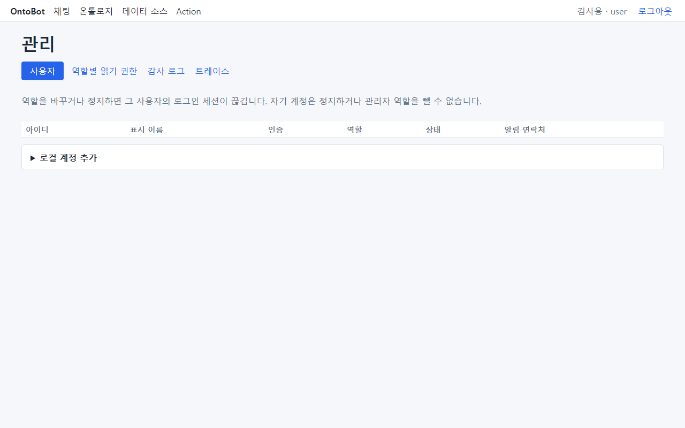

## 3.3 채팅 화면의 네 부분

로그인하면 처음 나오는 **채팅** 화면은 네 부분으로 되어 있습니다.

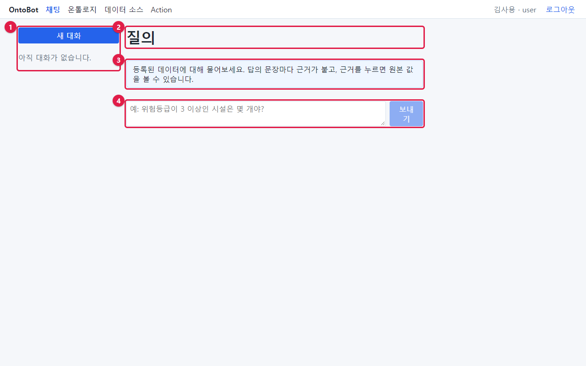

| 번호 | 부분 | 하는 일 |
| --- | --- | --- |
| ① | 대화 목록 | **새 대화** 단추와 지난 대화 목록. 처음에는 "아직 대화가 없습니다."가 보입니다 |
| ② | 제목 | 화면 이름 **질의** |
| ③ | 안내 | 대화가 없을 때만 보이는 안내 문구 |
| ④ | 입력 칸과 **보내기** | 질문을 쓰고 보내는 곳 |

답에서 근거를 누르면 화면 오른쪽에 **근거 카드**가 열립니다(「5장」). 그래서 채팅 화면은 가로로 넓을수록
보기 편합니다.

## 3.4 창이 좁을 때

창이 좁으면(가로 약 1000픽셀 미만) 대화 목록이 위로, 입력 칸이 아래로 옮겨져 한 줄로 쌓입니다. 노트북에서
창을 반만 쓸 때 이렇게 보입니다.

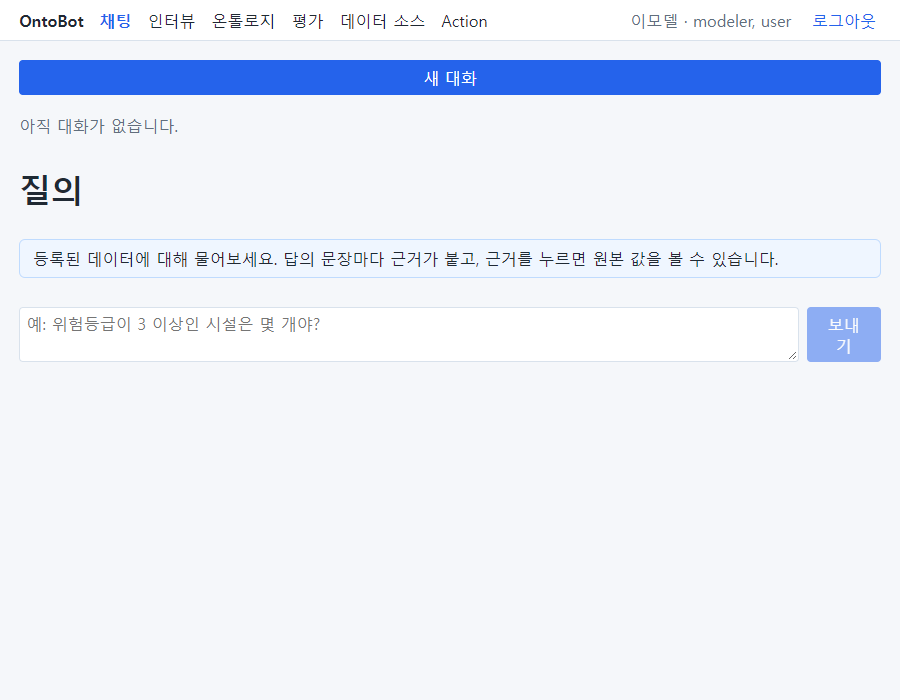

기능은 같습니다. 근거 카드는 답 아래쪽에 열립니다. 표가 많은 화면(온톨로지, 데이터 소스)은 넓은 창에서
쓰기를 권합니다. 다른 화면도 좁은 창에서 이렇게 보입니다.

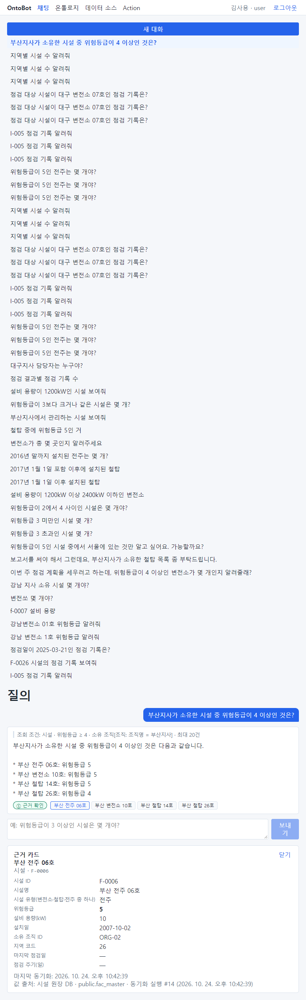

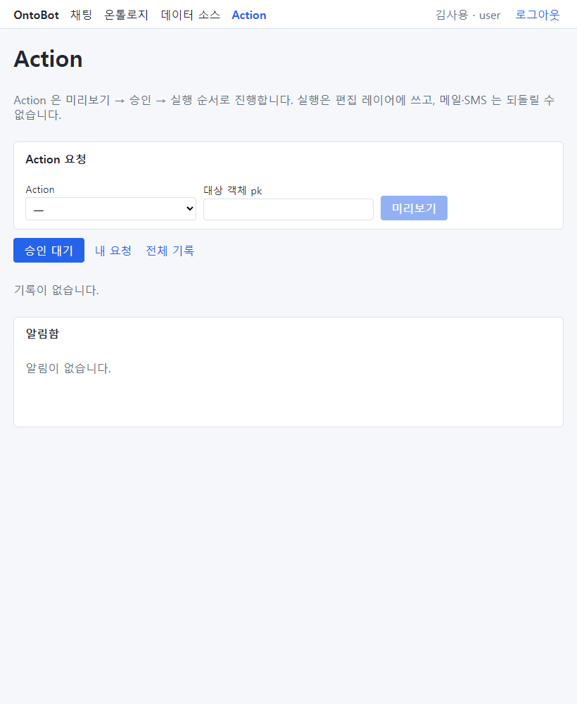

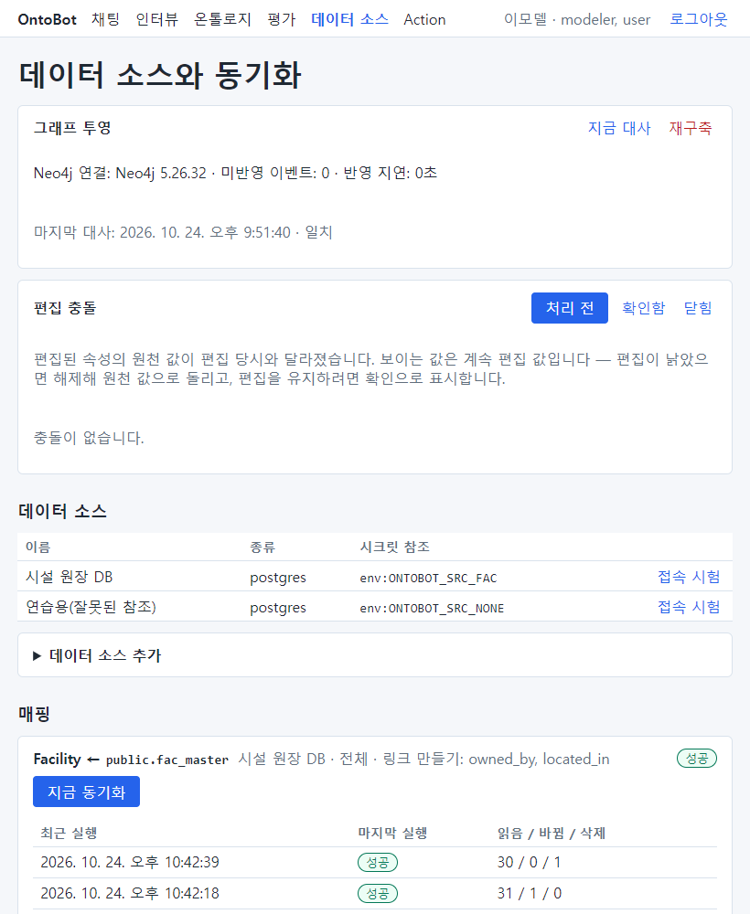

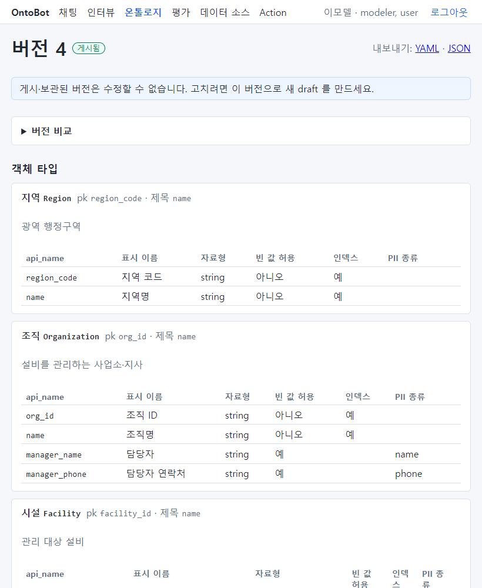

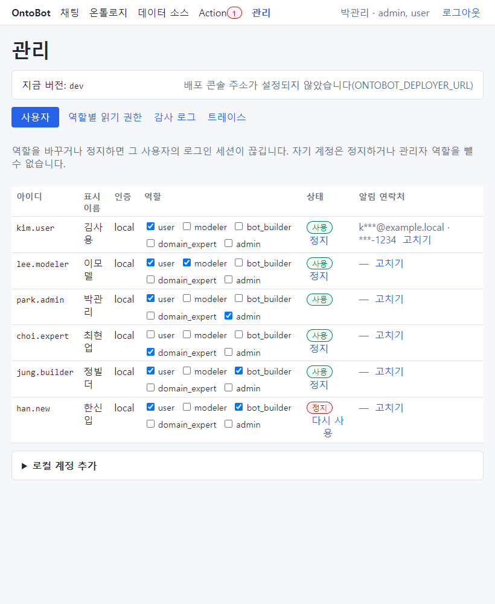

> **해 보기** 브라우저 창의 오른쪽 끝을 마우스로 끌어 창을 좁혔다 넓혀 보세요. 화면이 어떻게 바뀌는지
> 보면, 나중에 좁은 화면에서도 당황하지 않습니다.

## 3.5 화면의 공통 모양

OntoBot 의 화면들은 다음 모양을 함께 씁니다. 한 번 익혀 두면 어느 화면이든 쉽게 읽힙니다.

| 모양 | 생김새 | 뜻 |
| --- | --- | --- |
| 파란 단추 | 파란 바탕에 흰 글씨 | 그 화면의 주된 일(보내기, 미리보기, 저장, 게시) |
| 파란 글씨 단추 | 바탕 없이 파란 글씨 | 보조 일(열기, 수정, 고치기, 탭 바꾸기) |
| 빨간 글씨 단추 | 바탕 없이 빨간 글씨 | 지우거나 되돌리는 일(삭제, 거부, 롤백, 요청 거두기) — 대부분 확인 창이 한 번 더 뜸 |
| 흐린 단추 | 연한 색 | 지금은 누를 수 없음(입력이 비었거나, 앞 단계가 끝나지 않음) |
| ▶ 로 시작하는 줄 | `▶ 데이터 소스 추가` | 눌러서 펼치는 칸. 펼치면 ▼ 로 바뀜 |
| 둥근 배지 | `게시됨` `승인 대기` `실행됨` | 상태 표시 |
| 하늘색 상자 | 연한 파란 바탕 | 안내 문구 |
| 빨간 상자 | 연한 빨간 바탕 | 오류·실패 안내 |

## 3.6 이 장의 핵심

> **요령**
>
> - 맨 위 막대 왼쪽은 메뉴, 오른쪽은 내 이름·역할입니다.
> - 역할에 따라 메뉴가 다릅니다. 보이는 메뉴라도 내용이 비어 있으면 권한이 없는 것입니다.
> - 채팅 화면은 대화 목록·제목·안내·입력 칸의 네 부분이고, 근거 카드는 오른쪽에 열립니다.
> - 빨간 글씨 단추는 지우거나 되돌리는 일입니다. 누르기 전에 한 번 더 생각하세요.
