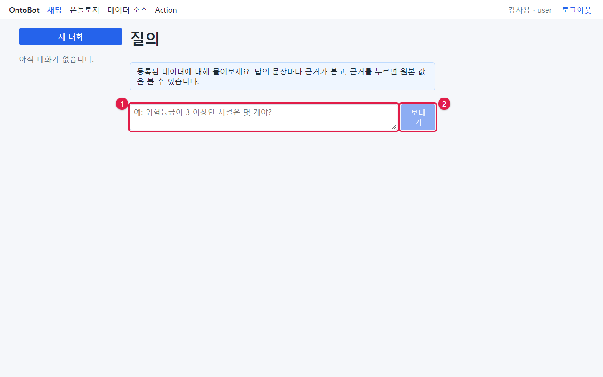
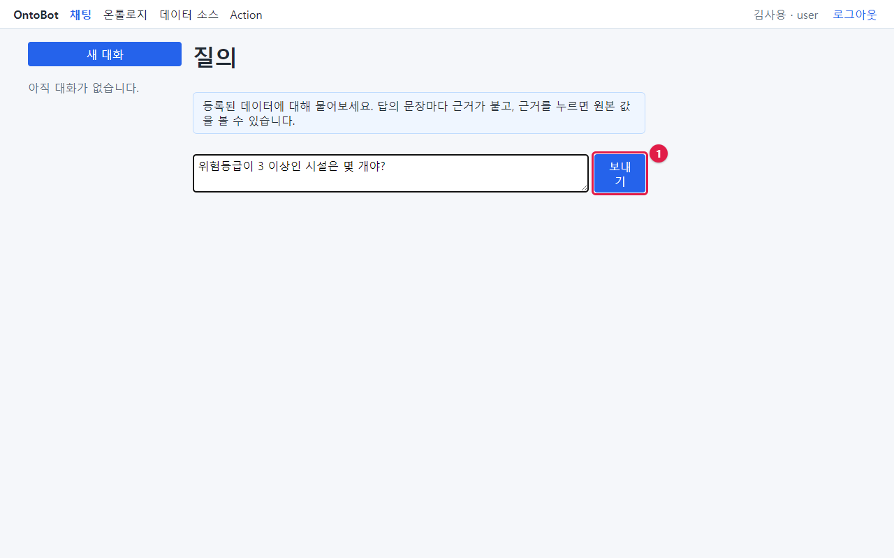
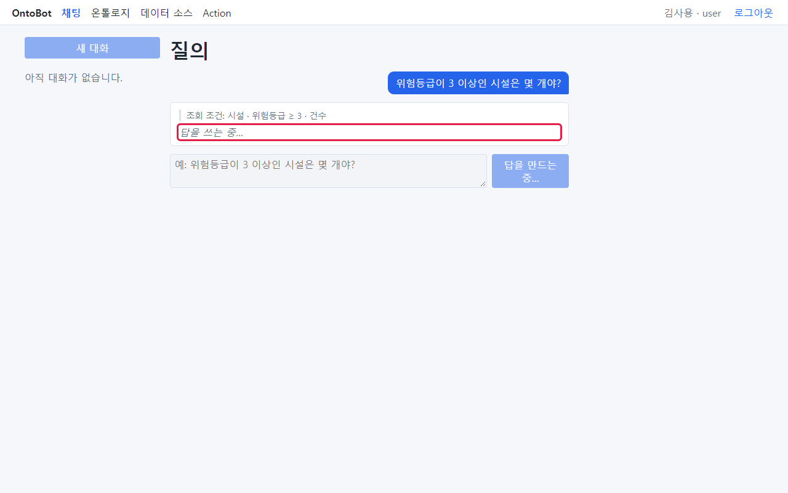
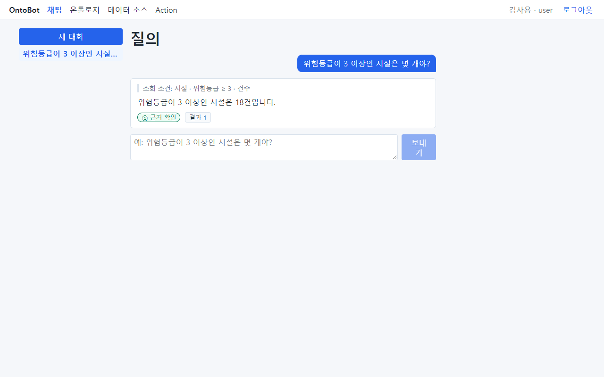
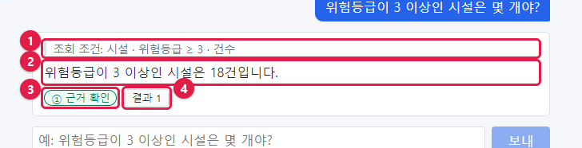
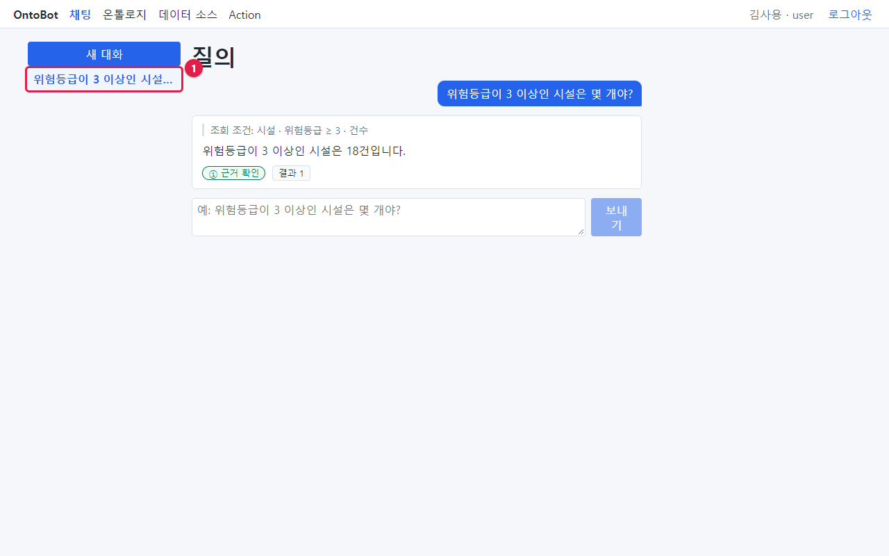

# 4장 첫 질문 따라 하기

이 장에서는 김사용(`kim.user`)이 되어 첫 질문을 해 봅니다. 질문은 "위험등급이 3 이상인 시설은 몇 개야?"
입니다. 한 단계씩 화면과 함께 따라 하세요.

## 4.1 질문 입력하기

1. 맨 위 **채팅** 메뉴를 누릅니다(로그인하면 처음부터 채팅 화면입니다).
2. 화면 가운데 아래쪽의 입력 칸(①)을 마우스로 누릅니다. 칸에 연한 글씨로 "예: 위험등급이 3 이상인 시설은 몇
   개야?"라고 적혀 있습니다. 이것은 예시 글이라 입력하면 사라집니다.

3. 질문을 입력합니다: `위험등급이 3 이상인 시설은 몇 개야?`
4. 입력하면 흐렸던 **보내기** 단추(①)가 진한 파란색으로 바뀝니다. 입력 칸이 비어 있으면 보낼 수 없습니다.

5. **보내기** 를 누르거나 키보드의 **Enter** 를 누릅니다.

> **알아 두기** 질문을 두 줄 이상으로 쓰고 싶으면 **Shift** 를 누른 채 **Enter** 를 누르세요. 그냥
> **Enter** 는 바로 보냅니다. 질문은 1000자까지 쓸 수 있습니다.

## 4.2 진행 단계 보기

보내면 내 질문이 오른쪽에 파란 말풍선으로 나타나고, 그 아래에 진행 단계가 차례로 바뀌며 보입니다.

| 단계 | 화면 문구 | 하는 일 |
| --- | --- | --- |
| 1 | 질문을 조회 조건으로 바꾸는 중… | AI 가 질문을 조회 계획으로 바꾸고, 프로그램이 검사합니다 |
| 2 | 조회하는 중… | 프로그램이 데이터를 찾습니다(보통 아주 짧아 거의 보이지 않습니다) |
| 3 | 답을 쓰는 중… | AI 가 조회 결과로 답 문장을 씁니다 |
| 4 | 근거를 대조하는 중… | 프로그램이 답의 숫자·이름을 데이터와 대조합니다 |

3단계가 되면 진행 표시 위에 **조회 조건** 이 먼저 나타납니다. 답이 나오기 전에 챗봇이 질문을 어떻게
이해했는지 먼저 볼 수 있습니다.

진행 중에는 다음이 달라집니다.

- **보내기** 단추가 **답을 만드는 중…** 으로 바뀌고 흐려집니다. 답이 끝날 때까지 다른 질문을 보낼 수 없습니다.
- 입력 칸도 흐려집니다.
- 왼쪽 **새 대화** 단추도 흐려집니다.

보통 몇 초, 사용하는 사람이 많으면 수십 초 걸립니다.

> **주의** 답이 나오는 동안 브라우저 창을 닫거나 다른 메뉴로 옮기면 그 답을 화면에서 놓칠 수 있습니다. 답이
> 끝날 때까지 기다리세요. 다른 메뉴로 갔더라도 대화 목록에서 그 대화를 다시 열면 끝난 답을 볼 수 있습니다.

## 4.3 답 받기

답이 끝나면 다음과 같이 보입니다.

답은 네 부분입니다.

| 번호 | 부분 | 이 답에서 | 읽는 법 |
| --- | --- | --- | --- |
| ① | 조회 조건 | 시설 · 위험등급 ≥ 3 · 건수 | "시설 중에서 위험등급이 3 이상인 것의 개수를 셌다" |
| ② | 답 본문 | 위험등급이 3 이상인 시설은 18건입니다. | AI 가 쓴 답 문장 |
| ③ | 등급 | ① 근거 확인 | 답의 숫자(18)가 조회 결과와 글자 그대로 맞음 |
| ④ | 근거 칩 | 결과 1 | 이 답이 기댄 데이터. 개수는 "집계 결과"라 "결과 1"로 보임 |

### 조회 조건을 읽는 법

조회 조건은 가운뎃점(·)으로 나뉜 여러 조각입니다. 맨 앞은 **어떤 종류의 데이터**, 가운데는 **조건**, 맨 끝은
**무엇을 했는지**입니다.

| 조각 | 뜻 |
| --- | --- |
| 시설 | 시설 데이터에서 |
| 위험등급 ≥ 3 | 위험등급이 3 이상(≥ 은 "크거나 같다")인 것을 |
| 건수 | 셌다 |

조건에 쓰이는 기호는 다음과 같습니다.

| 기호 | 읽는 법 | 예 |
| --- | --- | --- |
| = | 같다 | 시설 유형 = 변전소 |
| ≠ | 같지 않다 | 시설 유형 ≠ 전주 |
| > / < | 크다 / 작다 | 설비 용량(kW) > 1,000 |
| ≥ / ≤ | 크거나 같다 / 작거나 같다 | 위험등급 ≥ 3 |
| ∈ {…} | 이 중 하나 | 시설 ID ∈ {F-0006, F-0010} |
| 최대 20건 | 목록을 20건까지 보여 줌 | |
| ○○ 내림차순 / 오름차순 | 큰 것부터 / 작은 것부터 | 위험등급 내림차순 |
| ○○별 건수 | ○○ 값마다 셈 | 시설 유형별 건수 |
| ○○ 평균 / 합계 | 평균 / 합계를 계산 | 설비 용량(kW) 평균 |

내 질문 "위험등급이 3 이상인 시설은 몇 개야?"와 조회 조건 "시설 · 위험등급 ≥ 3 · 건수"를 나란히 놓고
봅니다. 대상(시설), 조건(3 이상), 하려는 일(몇 개 = 건수)이 모두 맞습니다. 그러니 답 18건을 믿어도 됩니다.

> **요령** 이 비교가 OntoBot 을 쓰는 가장 중요한 습관입니다. 답을 읽기 **전에** 조회 조건을 먼저 읽고, 내 질문의
> 대상·조건·하려는 일이 모두 들어 있는지 확인하세요.

## 4.4 대화 목록에 쌓인다

질문을 하나 하면 왼쪽 대화 목록(①)에 그 대화가 생깁니다. 대화 이름은 첫 질문으로 정해지고, 길면 뒤가
"…"로 줄어듭니다.

같은 대화에서 계속 질문하면 그 대화 안에 아래로 쌓입니다. 새 주제로 묻고 싶으면 **새 대화** 를 누르세요.
대화 관리는 「7장」에서 자세히 다룹니다.

## 4.5 해 보기

> **해 보기** 같은 방법으로 다음 질문을 하나씩 해 보고, 답을 보기 전에 조회 조건을 먼저 읽어 보세요.
>
> 1. `변전소는 몇 개야?` — 조회 조건에 "시설 유형 = 변전소"가 있는지 봅니다. (예제 데이터에서는 10건)
> 2. `위험등급이 5인 시설 목록 알려줘` — 이번에는 "건수"가 아니라 "최대 20건"으로 목록이 나옵니다.
> 3. `조직 목록 보여줘` — 맨 앞 조각이 "시설"이 아니라 "조직"으로 바뀝니다.

## 4.6 이 장의 핵심

> **요령**
>
> - 질문을 쓰고 **Enter**. 줄 바꿈은 **Shift + Enter**.
> - 진행 단계는 조건으로 바꾸기 → 조회 → 답 쓰기 → 근거 대조 순서입니다.
> - 답은 조회 조건 · 본문 · 등급 · 근거 칩의 네 부분입니다.
> - 조회 조건은 "어떤 데이터 · 조건 · 한 일" 순서로 읽습니다. 답보다 먼저 읽습니다.
