# 5장 답 읽는 법: 조회 조건·등급·근거

4장에서 답의 네 부분을 보았습니다. 이 장에서는 목록 답, 한 대상의 답, 집계 답을 차례로 보며 각 부분을 어떻게
읽고 확인하는지 자세히 익힙니다.

## 5.1 목록 답

`변전소 목록 보여줘` 라고 물었습니다.

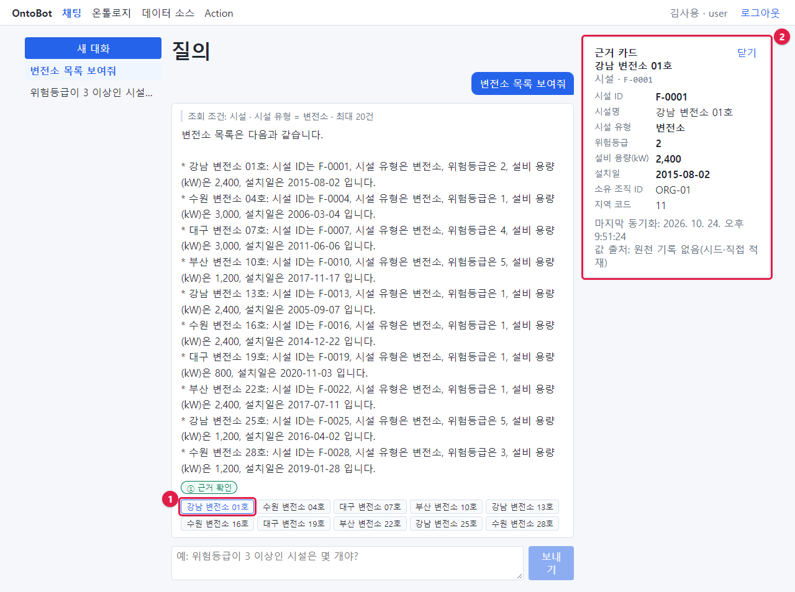

### 조회 조건

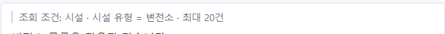

"시설 · 시설 유형 = 변전소 · 최대 20건". 시설 중 시설 유형이 변전소인 것을 최대 20건까지 보여 준다는 뜻입니다.
목록 질문에는 늘 "최대 N건"이 붙습니다. 결과가 20건을 넘으면 앞의 20건만 보입니다.

> **알아 두기** 목록이 20건에서 끊길까 걱정되면 먼저 "변전소는 몇 개야?"로 개수를 물어보세요. 개수가 20보다
> 많으면 조건을 더해 좁히세요(예: "서울에 있는 변전소").

### 본문

답 본문은 AI 가 조회 결과를 문장으로 옮긴 것입니다. 목록은 보통 한 줄에 한 대상씩, 별표(*)로 시작하는 줄로
나옵니다. 어떤 속성을 함께 보여 줄지는 AI 가 정하므로 질문할 때마다 조금 다를 수 있습니다.

### 등급과 근거 칩

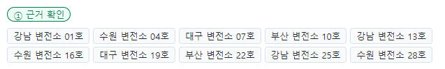

목록 답에는 대상마다 근거 칩이 하나씩 붙습니다. 이 답은 변전소 10곳이므로 칩도 10개입니다. 칩에는 대상의
이름(제목 속성)이 적힙니다.

## 5.2 근거 카드 열기

근거 칩 하나를 누르면(앞 그림의 ①) 화면 오른쪽에 **근거 카드**(②)가 열립니다. 누른 칩은 파란 테두리로
바뀝니다.

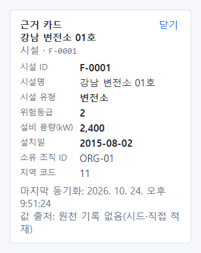

근거 카드는 위에서부터 다음과 같습니다.

| 부분 | 이 카드에서 | 뜻 |
| --- | --- | --- |
| 제목 | 근거 카드 / 강남 변전소 01호 | 어떤 대상의 카드인지 |
| 종류 · 식별자 | 시설 · F-0001 | 객체 타입과 식별자(pk) |
| 속성 목록 | 시설 ID … 지역 코드 | 그 대상의 **지금** 값 전부. **굵은 값**은 답에 인용된 칸 |
| 마지막 동기화 | 2026. 10. 24. 오후 9:51:24 | 이 값을 원래 시스템에서 마지막으로 가져온 시각 |
| 값 출처 | 원천 기록 없음(시드·직접 적재) | 이 값이 어디서 왔는지. 예제는 처음 설치 때 직접 넣은 데이터라 이렇게 보입니다 |
| 관련 문서(v1) | 점검기준.txt · user · 조각 #0 | 이 대상과 연결이 **확정된** 문서. 내가 속한 그룹의 문서만, 연결이 없으면 칸이 없습니다(「18.8」) |

데이터 소스에서 동기화한 데이터라면 값 출처가 "시설 원장 DB · public.fac_master · 동기화 실행 #4"처럼
**어느 시스템의 어느 표, 몇 번째 동기화**인지 보입니다(「18장」).

> **알아 두기** 근거 카드의 값은 답을 받은 그때의 값이 아니라 **카드를 연 지금**의 값입니다. 그사이 동기화나
> Action 으로 값이 바뀌었으면 답 본문과 카드 값이 다를 수 있습니다. 그럴 때는 질문을 다시 하세요.

### 굵은 값의 뜻

한 대상의 정보를 물으면 굵은 값이 더 분명히 보입니다. `부산 철탑 02호의 위험등급과 설치일 알려줘` 라고
물었습니다.

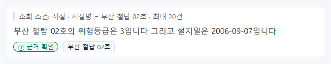

근거 칩 **부산 철탑 02호** 를 누르면 카드에서 위험등급(3)과 설치일(2006-09-07)만 굵게 보입니다. 답에 인용된
칸이 바로 이 둘이라는 뜻입니다.

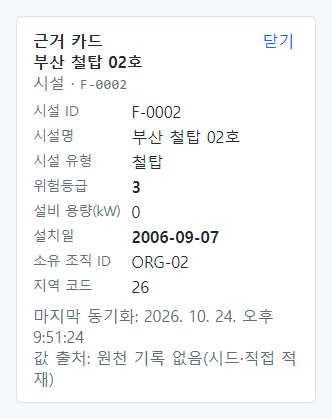

화면 전체로 보면 이렇습니다. 답 본문의 숫자와 카드의 굵은 값을 눈으로 맞춰 보세요.

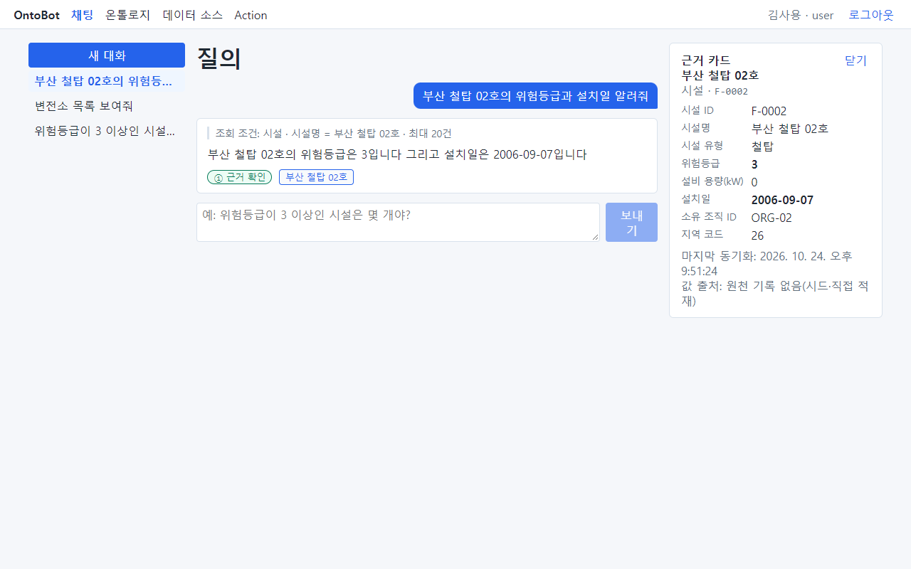

### 카드 닫기

카드 오른쪽 위 **닫기**(①)를 누르면 카드가 닫힙니다. 다른 근거 칩을 누르면 카드 내용이 그 대상으로 바뀝니다.

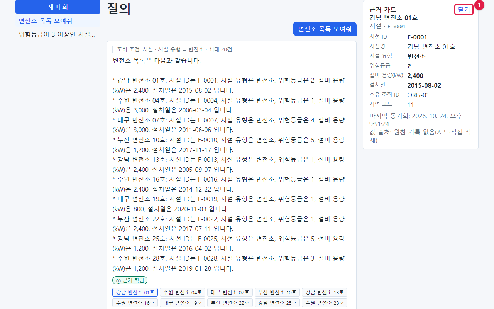

### 객체 탐색에서 관계 따라가기

카드의 **탐색기에서 보기 →** 를 누르면 **객체 탐색** 화면으로 가서 그 객체에서 관계를 따라갈 수 있습니다. 위쪽 메뉴의
**객체 탐색** 에서 이름이나 ID로 찾아 시작해도 됩니다.

- 처음에는 그 객체와 바로 이어진 객체(1단계)가 그래프로 나옵니다. 화살표 이름이 관계입니다(예: 소유 조직, 소재 지역).
- 노드의 **+** 나 노드를 두 번 누르면 그 노드의 이웃을 펼치고, **−** 는 그 노드를 통해 들어온 이웃을 접습니다. 다른
  관계로도 이어진 노드는 남습니다.
- **깊이** 를 2·3으로 올리고 **깊이까지 펼치기** 를 누르면 한 번에 여러 단계를 펼칩니다. 최대 깊이와 화면 노드 수는
  관리자가 정합니다. 상한에 닿으면 안내가 나오니 노드를 접거나 다른 객체에서 시작하세요.
- 노드를 누르면 오른쪽에 근거 카드와 같은 상세(지금 값·값 출처)와 **편집 이력**(Action 으로 바뀐 값, 해제된 것 포함)이
  나옵니다.
- 읽을 권한이 없는 종류의 객체와 보이지 않게 정한 행은 그래프·개수 어디에도 나오지 않습니다. 이 화면에서는 값을 바꾸지
  않습니다(바꾸기는 「9장」 Action).
- "관계 정보를 지금 볼 수 없습니다"가 나오면 관계 저장소(그래프)가 멈춘 것입니다. 객체 값은 그대로 볼 수 있습니다.

## 5.3 집계 답(개수·평균·묶어 세기)

`시설 유형별 개수 알려줘` 라고 물었습니다.

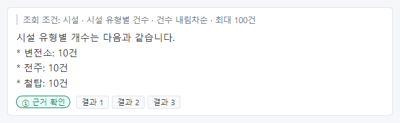

조회 조건 "시설 · 시설 유형별 건수 · 건수 내림차순 · 최대 100건"은 "시설을 시설 유형마다 나누어 세고, 많은
순서로 최대 100묶음까지"라는 뜻입니다. 근거 칩은 대상 이름이 아니라 **결과 1, 결과 2, 결과 3** 으로 보입니다.
각각 묶음 하나(변전소 10건, 전주 10건, 철탑 10건)의 계산 결과입니다.

결과 칩을 누르면 카드에 그 묶음의 값(예: 시설 유형 변전소 · 건수 10)이 나오고, 답이 인용한 값은 굵게
보입니다. 아래에 "집계·계산 결과입니다. 답을 만들 때 조회 조건으로 계산해 대조한 값이며, 지금 다시 계산한 값이 아닙니다. …" 안내가 붙습니다.

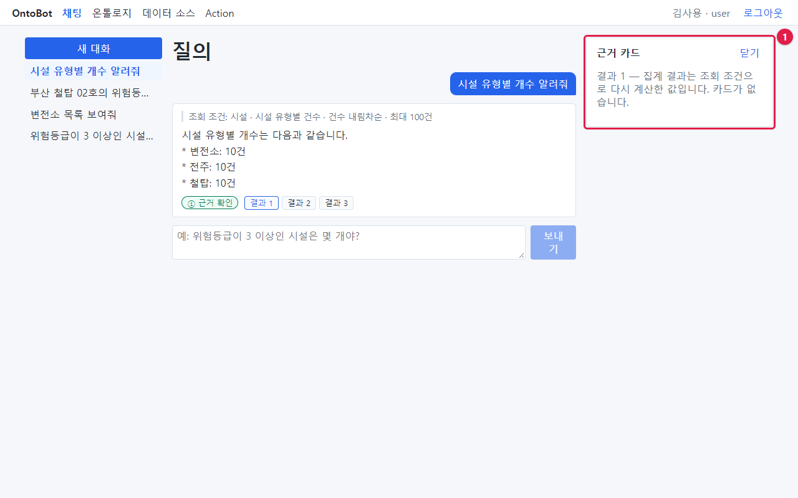

> 사진은 이전 화면(값 없이 안내만 나오던 때)입니다. 다시 찍으면 바뀝니다.

개수·평균·합계는 여러 대상을 계산한 값이므로 대상 하나의 카드가 없고, 답을 만들 때의 계산 결과를 보여 줍니다.
이때는 **조회 조건이 곧 근거**입니다. 조회 조건이 내 질문과 맞는지만 확인하면 됩니다. 어떤 대상들이 세어졌는지 보고 싶으면 같은 조건으로
"목록 보여줘"라고 다시 물으세요.

## 5.4 등급을 읽는 법

등급 배지에 마우스를 올리면 짧은 설명이 뜹니다.

| 등급 | 배지 | 설명(마우스를 올리면) | 어떻게 받아들이나 |
| --- | --- | --- | --- |
| ① | ① 근거 확인(초록) | 답의 사실 문장이 모두 조회 결과와 그대로 일치합니다. | 숫자·이름은 데이터 그대로. 조회 조건만 맞으면 믿고 씀 |
| ② | ② 일부 추정(주황) | 근거를 찾지 못한 문장에 '(추정)' 표시를 했습니다. | **추정** 표시된 문장은 근거 카드로 직접 확인 |
| ③ | ③ 근거 부족 | 근거와 대조되는 답을 만들지 못해 본문을 보여 주지 않습니다. | 본문 대신 안내만 보임. 근거 칩을 직접 보거나 질문을 바꿈 |

### ② 일부 추정의 실제 예

`위험등급이 가장 높은 시설 5개 알려줘` 라고 물었을 때 ② 가 나왔습니다.

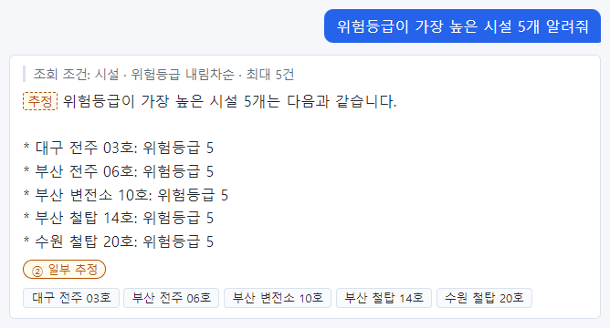

맨 윗줄 "위험등급이 가장 높은 시설 5개는 다음과 같습니다." 앞에 점선 상자 **추정** 이 붙었습니다. 이 문장의
"5개"나 "가장 높은" 같은 표현을 데이터에서 글자 그대로 확인할 수 없었다는 뜻입니다. 아래 목록의 시설명과
위험등급 5 는 데이터와 맞습니다.

이처럼 ② 는 대개 **요약하거나 꾸미는 문장**에 붙습니다. 숫자·이름이 들어간 문장에 **추정** 이 붙었다면 그
값은 반드시 근거 카드로 확인하세요.

> **주의** 등급은 답의 숫자·이름이 **조회 결과와** 맞는지를 봅니다. 조회 조건이 내 질문과 다르면, 등급이 ①이어도
> 내가 원한 답이 아닙니다. 등급보다 조회 조건을 먼저 보세요. 실제 사례는 「8장 8.1」에 있습니다.

## 5.5 답을 확인하는 세 단계

모든 답에 다음 세 단계를 습관처럼 적용하세요. 익숙해지면 몇 초면 됩니다.

1. **조회 조건** — 대상, 조건, 하려는 일이 내 질문과 같은가?
2. **등급** — ①인가? ②이면 **추정** 문장은 어느 것인가?
3. **근거** — 중요한 숫자는 근거 칩을 눌러 카드의 굵은 값과 맞춰 본다. 개수·평균이면 조회 조건이 근거다.

> **해 보기** `F-0007 시설의 설비 용량은?` 이라고 묻고, 위 세 단계를 해 보세요. 조회 조건에 "시설 ID = F-0007"이
> 있는지, 등급이 ①인지, 근거 칩 **대구 변전소 07호** 의 카드에서 설비 용량(kW) 3,000 이 굵게 보이는지 확인합니다.

## 5.6 이 장의 핵심

> **요령**
>
> - 목록 답은 대상마다 근거 칩, 집계 답은 "결과 N" 칩입니다.
> - 근거 카드에서 굵은 값이 답에 인용된 값이고, 마지막 동기화·값 출처로 데이터의 신선도와 출처를 봅니다.
> - 집계 답은 조회 조건이 곧 근거입니다.
> - ②는 **추정** 표시된 문장을 직접 확인합니다.
> - 확인 순서: 조회 조건 → 등급 → 근거.
