# 6장 질문 유형별 실습

OntoBot 이 답할 수 있는 질문은 크게 열 가지 유형입니다. 이 장에서는 유형마다 실제로 물어본 화면을 보며,
어떻게 묻고 조회 조건을 어떻게 확인하는지 익힙니다. 각 절 끝의 「이렇게도 물을 수 있습니다」를 참고해 내
업무의 질문으로 바꿔 보세요. 더 많은 실제 예는 「25장 질문 예시 모음」에 있습니다.

| 절 | 유형 | 질문의 모양 | 조회 조건 끝 |
| --- | --- | --- | --- |
| 6.1 | 개수 세기 | ○○은 몇 개야? | 건수 |
| 6.2 | 목록 보기 | ○○ 목록 보여줘 | 최대 20건 |
| 6.3 | 순위·상위 몇 개 | ○○이 가장 높은 □□ N개 | ○○ 내림차순 · 최대 N건 |
| 6.4 | 묶어서 세기 | ○○별 개수 | ○○별 건수 |
| 6.5 | 한 대상의 정보 | F-0007 의 ○○은? | 시설 ID = … |
| 6.6 | 날짜 조건 | ○○년 이전/이후 | 설치일 < … |
| 6.7 | 평균·합계 | ○○의 평균/합계 | ○○ 평균 / 합계 |
| 6.8 | 관계 따라가기 | ○○지사가 소유한 / ○○에 있는 | 소유 조직[…] / 소재 지역[…] |
| 6.9 | 다른 종류의 데이터 | 조직·지역 목록 | 조직 / 지역 |
| 6.10 | 조건 여러 개 | ○○ 중 □□인 것 | 조건 여러 조각 |
| 6.11 | 정해 둔 계산(Function) | ○○별 고위험 비율 | 계산 이름(인자) · 계산에 쓴 조회들 |

## 6.1 개수 세기

"몇 개", "몇 곳", "개수", "수"로 물으면 조건에 맞는 대상의 수를 셉니다.

### 예 1 — 조건 하나

`철탑은 몇 개 있어?`

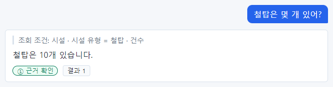

조회 조건 "시설 · 시설 유형 = 철탑 · 건수". 대상(시설), 조건(철탑), 한 일(건수)이 모두 질문과 맞습니다. 답
"철탑은 10개 있습니다."를 그대로 써도 됩니다.

### 예 2 — 조건 둘, 그리고 잘못 이해한 경우

`위험등급이 5인 전주는 몇 개야?`

이 답은 꼭 자세히 보세요. 조회 조건이 "시설 · 시설 유형 = **철탑** · 위험등급 = 5 · 건수"입니다. 질문은
**전주** 였는데 챗봇은 **철탑** 으로 이해했습니다. 그런데 답 문장은 "위험등급이 5인 **전주**는 3건입니다."라고
질문의 낱말을 따라 썼고, 등급은 ① 입니다(철탑 데이터의 3건과 맞으므로).

실제 데이터에서 위험등급 5인 전주는 2곳(대구 전주 03호, 부산 전주 06호)입니다. 답 문장만 읽었다면 틀린 숫자
3을 믿었을 것입니다.

> **주의** 이것이 이 책에서 가장 중요한 장면입니다. **답 문장은 질문의 낱말을 따라 쓰기 때문에, 답 문장만
> 보아서는 잘못 이해한 것을 알 수 없습니다.** 조회 조건에는 실제로 조회한 조건이 그대로 나오므로, 조회 조건을
> 보면 바로 알 수 있습니다.

이럴 때는 질문을 고쳐 다시 묻습니다. 예: `시설 유형이 전주이고 위험등급이 5인 시설은 몇 개야?` 또는 먼저
`위험등급이 5인 시설 목록 알려줘` 로 목록을 보고 전주를 세어 봅니다(6.2 예 2).

같은 질문을 나중에(설계도를 한 번 더 게시한 뒤) 다시 물었을 때는 "시설 유형 = 전주"로 맞게 이해해 2건이라고
답했습니다(「25장」 9번). 즉 **같은 질문도 매번 같게 이해한다는 보장이 없습니다.** 한 번 맞았다고 다음에도
맞으리라 믿지 말고, 매번 조회 조건을 확인하세요.

### 이렇게도 물을 수 있습니다

| 질문 | 기대하는 조회 조건 |
| --- | --- |
| 시설은 모두 몇 개야? | 시설 · 건수 |
| 위험등급이 4 이상인 시설 수는? | 시설 · 위험등급 ≥ 4 · 건수 |
| 위험등급이 2 이하인 철탑은 몇 개? | 시설 · 시설 유형 = 철탑 · 위험등급 ≤ 2 · 건수 |
| 설비 용량이 1000kW 넘는 시설은 몇 개야? | 시설 · 설비 용량(kW) > 1,000 · 건수 |
| 조직은 몇 개야? | 조직 · 건수 |

## 6.2 목록 보기

"목록", "보여줘", "알려줘"로 물으면 조건에 맞는 대상을 나열합니다. 기본은 최대 20건입니다.

### 예 1 — 유형으로 거르기

`철탑 목록 보여줘`

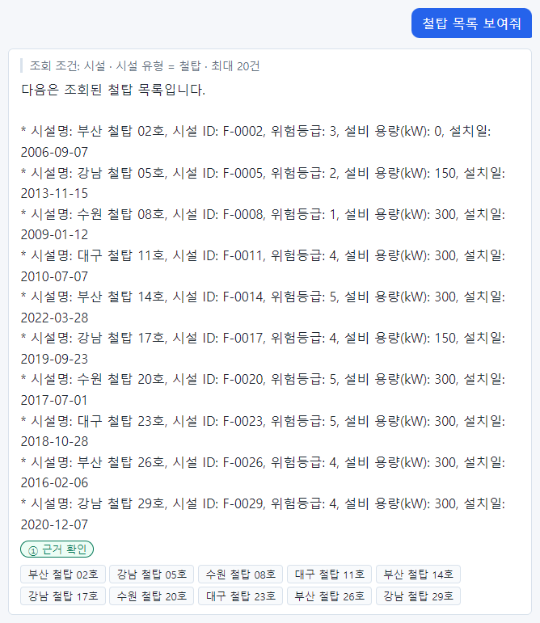

조회 조건 "시설 · 시설 유형 = 철탑 · 최대 20건". 철탑 10곳이 모두 나왔고 근거 칩도 10개입니다. 답 본문에는
시설명·시설 ID·위험등급·설비 용량·설치일이 함께 나왔습니다. 어떤 속성을 함께 보여 줄지는 AI 가 정합니다.
특정 속성만 보고 싶으면 "철탑 목록을 위험등급과 함께 보여줘"처럼 말하세요.

### 예 2 — 값으로 거르기

`위험등급이 5인 시설 목록 알려줘`

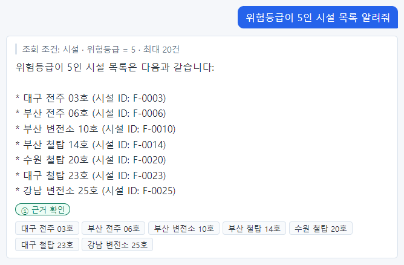

조회 조건 "시설 · 위험등급 = 5 · 최대 20건". 7곳이 나왔습니다. 6.1 예 2 에서 물었던 "위험등급 5인 전주"는
이 목록에서 이름에 "전주"가 들어간 대구 전주 03호, 부산 전주 06호 두 곳입니다.

> **요령** 개수 답이 의심스러우면 같은 조건으로 목록을 물어 직접 세어 보세요. 목록은 대상마다 근거 칩이 있어
> 하나하나 확인할 수 있습니다.

### 이렇게도 물을 수 있습니다

| 질문 | 기대하는 조회 조건 |
| --- | --- |
| 변전소 목록 보여줘 | 시설 · 시설 유형 = 변전소 · 최대 20건 |
| 위험등급이 4인 철탑 보여줘 | 시설 · 시설 유형 = 철탑 · 위험등급 = 4 · 최대 20건 |
| 설비 용량이 2000kW 이상인 시설 보여줘 | 시설 · 설비 용량(kW) ≥ 2,000 · 최대 20건 |
| 시설 목록 전부 보여줘 | 시설 · 최대 20건 (30곳 중 20곳만 보임) |

## 6.3 순위·상위 몇 개

"가장 높은", "큰 순서로", "상위 N개", "최근"으로 물으면 정렬해서 앞의 몇 개를 봅니다.

### 예 1 — 가장 높은 N개

`위험등급이 가장 높은 시설 5개 알려줘`

조회 조건 "시설 · 위험등급 내림차순 · 최대 5건". **내림차순**은 큰 값부터라는 뜻입니다. 위험등급 5인 시설이
7곳이므로, 그중 앞의 5곳이 나왔습니다. 같은 값(5)끼리의 순서는 정해져 있지 않으니, "가장 높은 5개"가 7곳 중
어느 5곳인지는 질문할 때마다 같다고 보장되지 않습니다.

맨 첫 문장 앞의 **추정** 과 등급 **② 일부 추정** 은 「5장 5.4」에서 설명했습니다.

### 예 2 — 큰 순서로 N개

`설비 용량이 큰 순서로 변전소 3개 보여줘`

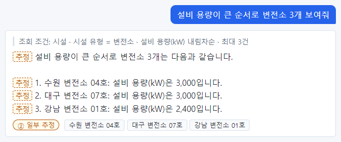

조회 조건 "시설 · 시설 유형 = 변전소 · 설비 용량(kW) 내림차순 · 최대 3건". 이번에는 목록의 줄마다 **추정** 이
붙었습니다. 줄 앞의 "1.", "2.", "3." 같은 **순번은 데이터에 없는 숫자**라서 글자 그대로 대조되지 않았기
때문입니다. 시설명과 설비 용량(3,000·3,000·2,400)은 근거 칩의 카드로 확인하면 데이터와 맞습니다.

> **알아 두기** ② 일부 추정은 "틀렸다"는 뜻이 아니라 "글자 그대로 확인하지 못한 문장이 있다"는 뜻입니다. 순번,
> "다음과 같습니다" 같은 꾸밈말 때문에 ②가 나오는 일이 많습니다. 그래도 **추정** 문장에 숫자가 있으면 카드로
> 확인하는 습관을 들이세요.

### 이렇게도 물을 수 있습니다

| 질문 | 기대하는 조회 조건 |
| --- | --- |
| 설비 용량이 가장 작은 시설 3개는? | 시설 · 설비 용량(kW) 오름차순 · 최대 3건 |
| 가장 최근에 설치된 시설 5개 보여줘 | 시설 · 설치일 내림차순 · 최대 5건 |
| 가장 오래된 철탑 3개 알려줘 | 시설 · 시설 유형 = 철탑 · 설치일 오름차순 · 최대 3건 |

## 6.4 묶어서 세기

"○○별"로 물으면 ○○ 값마다 나누어 셉니다.

### 예 1 — 위험등급별

`위험등급별 시설 수 알려줘`

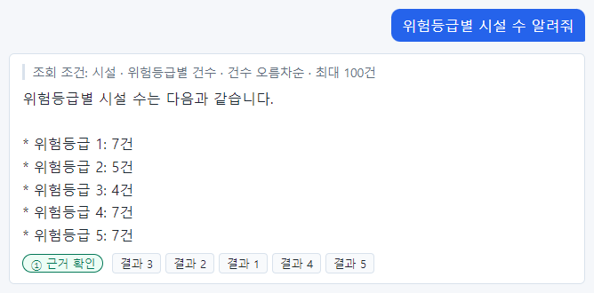

조회 조건 "시설 · 위험등급별 건수 · 건수 오름차순 · 최대 100건". 위험등급 1부터 5까지 묶음마다 건수가 나왔고,
근거 칩은 "결과 N"입니다. 모두 더하면 30(시설 전체)이 되는지 확인해 보세요: 7 + 5 + 4 + 7 + 7 = 30.

> **알아 두기** "건수 오름차순"은 건수가 적은 묶음부터 정렬했다는 뜻입니다. 그런데 답 본문은 위험등급 순서로
> 적혀 있습니다. 본문의 순서는 AI 가 보기 좋게 바꿀 수 있습니다. 순서가 중요하면 근거 칩 "결과 1, 2, …"의 순서가
> 조회 결과의 순서입니다.

### 예 2 — 코드별

`지역 코드별 시설 수 알려줘`

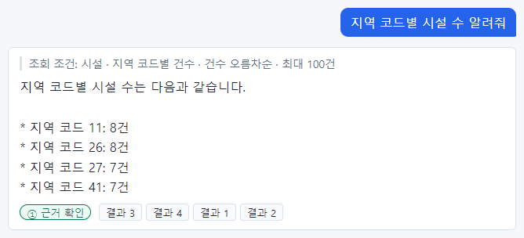

지역 코드 11·26·27·41 로 나뉘어 나왔습니다. 시설에는 지역 이름이 아니라 **지역 코드**가 들어 있어서 코드로
묶였습니다. 코드가 무슨 지역인지는 `지역 목록 알려줘`(6.9 예 2)로 알 수 있습니다(11 서울, 26 부산, 27 대구,
41 경기). 시설이 없는 경남(48)은 묶음이 없어 나오지 않습니다.

### 이렇게도 물을 수 있습니다

| 질문 | 기대하는 조회 조건 |
| --- | --- |
| 시설 유형별 개수 알려줘 | 시설 · 시설 유형별 건수 |
| 소유 조직별 시설 수는? | 시설 · 소유 조직 ID별 건수 |
| 시설 유형별 평균 위험등급은? | 시설 · 시설 유형별 위험등급 평균 |
| 시설 유형별 설비 용량 합계 알려줘 | 시설 · 시설 유형별 설비 용량(kW) 합계 |

## 6.5 한 대상의 정보

식별자(예: `F-0007`)나 이름(예: 강남 변전소 13호)으로 대상 하나를 찾습니다.

### 예 1 — 식별자로

`F-0007 시설의 설비 용량은?`

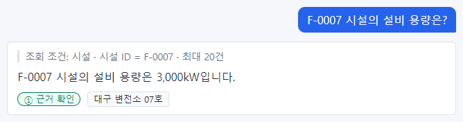

조회 조건 "시설 · 시설 ID = F-0007 · 최대 20건". 식별자는 하나뿐이므로 결과도 하나입니다. 근거 칩
**대구 변전소 07호** 를 누르면 카드에서 설비 용량(kW) 3,000 이 굵게 보입니다.

### 예 2 — 이름으로, 전체 정보

`강남 변전소 13호 정보 알려줘`

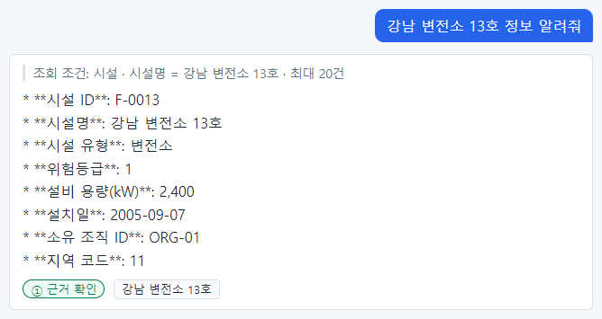

조회 조건 "시설 · 시설명 = 강남 변전소 13호 · 최대 20건". 속성 전부가 나왔습니다. 답 본문에 `**시설 ID**` 처럼
별표가 보이는데, AI 가 강조 표시를 섞어 쓴 것입니다. 내용에는 문제가 없습니다.

> **주의** 이름으로 찾을 때는 **등록된 이름과 글자 그대로** 같아야 합니다. "강남 변전소 13호"를 "강남변전소
> 13호"(띄어쓰기 다름)나 "강남 변전소 13번"으로 쓰면 못 찾아 0건이 될 수 있습니다. 이름이 헷갈리면 식별자를
> 쓰세요.

### 이렇게도 물을 수 있습니다

| 질문 | 기대하는 조회 조건 |
| --- | --- |
| F-0001 정보 알려줘 | 시설 · 시설 ID = F-0001 |
| 대구 변전소 19호 설치일은 언제야? | 시설 · 시설명 = 대구 변전소 19호 |
| 수원 전주 12호는 어느 조직 소유야? | 시설 · 시설명 = 수원 전주 12호 (소유 조직 ID 가 답에 나옴) |
| 지역 코드 41은 어디야? | 지역 · 지역 코드 = 41 |

## 6.6 날짜 조건

"○○년 이전", "○○년 이후", "○○년에", "○○부터 ○○ 사이"로 날짜 속성(예제는 설치일)을 거릅니다.

### 예 1 — 이전

`2010년 이전에 설치된 철탑은?`

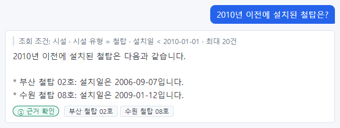

조회 조건 "시설 · 시설 유형 = 철탑 · 설치일 < 2010-01-01 · 최대 20건". "2010년 이전"을 "2010년 1월 1일보다
앞"으로 이해했습니다. 2006년과 2009년에 설치된 철탑 두 곳이 나왔습니다.

### 예 2 — 이후

`2020년 이후에 설치된 시설 목록 보여줘`

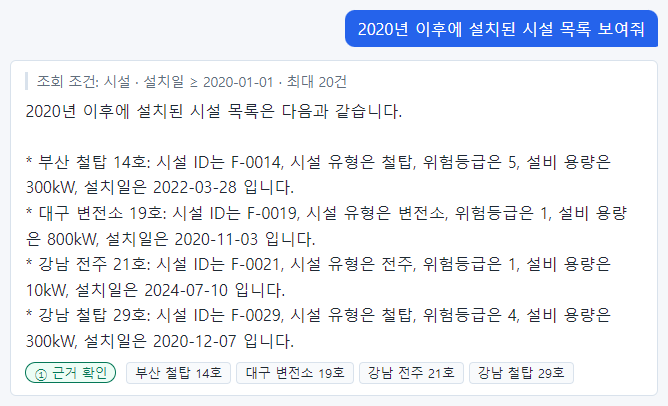

조회 조건 "시설 · 설치일 > 2020-01-01 · 최대 20건". 기호가 **>**(크다)이므로 2020년 1월 1일 **당일**에 설치된
시설은 빠집니다. 예제 데이터에는 그날 설치된 시설이 없어 상관없지만, 경계일이 중요한 업무라면 조회 조건의
기호(> 인지 ≥ 인지)를 꼭 보세요. 필요하면 "2020년 1월 1일 포함 이후"처럼 분명히 말하세요.

### 이렇게도 물을 수 있습니다

| 질문 | 기대하는 조회 조건 |
| --- | --- |
| 2015년에 설치된 시설 알려줘 | 시설 · 설치일 ≥ 2015-01-01 · 설치일 < 2016-01-01 |
| 2010년부터 2015년 사이에 설치된 변전소는? | 시설 · 시설 유형 = 변전소 · 설치일 범위 |
| 설치된 지 10년 넘은 전주는 몇 개야? | 시설 · 시설 유형 = 전주 · 설치일 < (오늘로부터 10년 전) · 건수 |

## 6.7 평균·합계

"평균", "합계", "총", "최대값", "최소값"으로 숫자 속성을 계산합니다.

### 예 1 — 평균

`변전소의 평균 설비 용량은?`

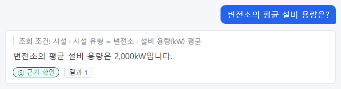

조회 조건 "시설 · 시설 유형 = 변전소 · 설비 용량(kW) 평균". 답 2,000kW. 평균은 서버가 계산하고 반올림합니다.

### 예 2 — 합계

`철탑 설비 용량 합계는?`

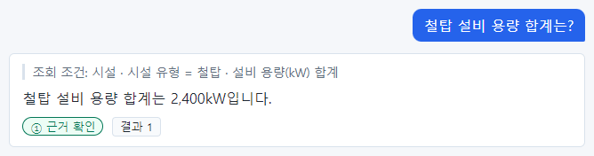

조회 조건 "시설 · 시설 유형 = 철탑 · 설비 용량(kW) 합계". 답 2,400kW.

### 예 3 — 조건을 단 평균

`용량이 1000kW 넘는 변전소의 평균 위험등급은?`

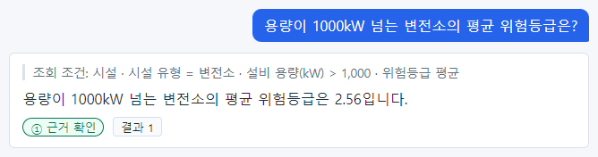

조회 조건 "시설 · 시설 유형 = 변전소 · 설비 용량(kW) > 1,000 · 위험등급 평균". 조건 두 개와 계산 하나가 모두
들어갔습니다. 답 2.56.

> **알아 두기** 평균·합계 답의 근거 칩은 "결과 1" 하나입니다. 어떤 시설들이 계산에 들어갔는지 보려면 같은
> 조건으로 목록을 물으세요: `용량이 1000kW 넘는 변전소 목록 보여줘`.

## 6.8 관계 따라가기

시설은 조직(소유 조직)·지역(소재 지역)과 이어져 있습니다. "○○지사가 소유한", "○○에 있는"처럼 이어진 대상의
조건으로 거를 수 있습니다.

### 예 1 — 소유 조직으로

`강남지사가 소유한 시설 목록 보여줘`

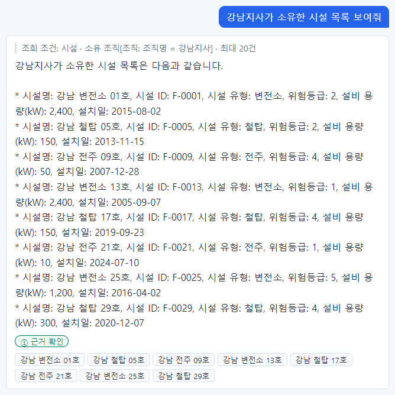

조회 조건 "시설 · 소유 조직[조직: 조직명 = 강남지사] · 최대 20건". 대괄호 [ ] 안은 **이어진 대상의 조건**입니다.
"소유 조직이 '조직명이 강남지사인 조직'인 시설"이라는 뜻입니다. 8곳이 나왔습니다.

### 예 2 — 소재 지역과 유형

`서울에 있는 변전소는?`

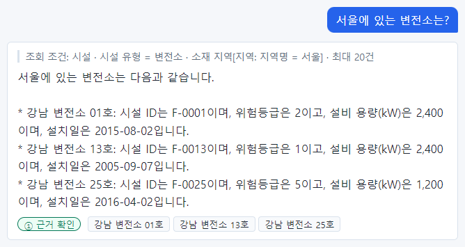

조회 조건 "시설 · 시설 유형 = 변전소 · 소재 지역[지역: 지역명 = 서울] · 최대 20건". 변전소 조건과 지역 조건이
함께 들어갔습니다.

### 예 3 — 관계와 값 조건

`부산지사가 소유한 시설 중 위험등급이 4 이상인 것은?`

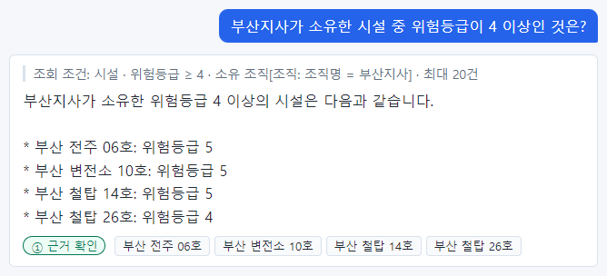

조회 조건 "시설 · 위험등급 ≥ 4 · 소유 조직[조직: 조직명 = 부산지사] · 최대 20건". 4곳이 나왔습니다.

> **알아 두기** 관계 질문은 관계 정보 전용 저장소를 함께 씁니다. 그 저장소에 문제가 있으면 관계 질문만
> "조회 실패 · 관계 저장소 연결 불가"가 나오고, 관계가 없는 질문은 정상으로 답합니다(「8장 8.5」). 관계 정보가
> 늦게 반영되는 동안에는 조회 조건 아래 "관계 정보는 ○○ 기준입니다"가 보입니다.

### 이렇게도 물을 수 있습니다

| 질문 | 기대하는 조회 조건 |
| --- | --- |
| 부산지사 소유 시설은 몇 개야? | 시설 · 소유 조직[조직: 조직명 = 부산지사] · 건수 |
| 대구 지역의 위험등급 4 이상 시설은? | 시설 · 위험등급 ≥ 4 · 소재 지역[지역: 지역명 = 대구] |
| 수원지사 소유 철탑의 평균 설비 용량은? | 시설 · 시설 유형 = 철탑 · 소유 조직[…수원지사] · 설비 용량(kW) 평균 |

## 6.9 다른 종류의 데이터

시설만 물을 수 있는 것은 아닙니다. 읽기 권한이 있는 모든 종류(예제는 조직·지역)를 물을 수 있습니다.

### 예 1 — 조직 목록

`조직 목록 보여줘`

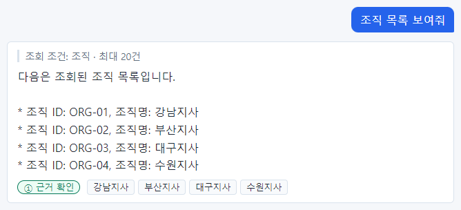

조회 조건의 맨 앞이 "조직"입니다. 4개 조직이 나왔습니다.

### 예 2 — 지역 목록

`지역 목록 알려줘`

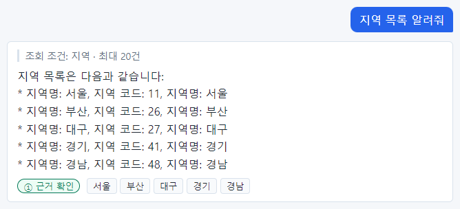

5개 지역이 나왔습니다. 6.4 예 2 의 지역 코드가 어느 지역인지 여기서 알 수 있습니다.

### 예 3 — 개인정보가 담긴 속성

`강남지사 담당자 연락처 알려줘`

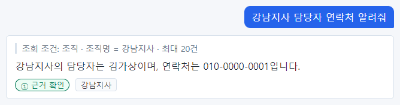

담당자와 담당자 연락처는 **개인정보(PII)** 로 표시된 속성입니다. 읽기 권한이 있는 사람에게는 화면에 그대로
보이지만, 처리 기록(트레이스)과 외부 AI 에 보내는 내용에서는 자동으로 가려집니다(예제의 이름·번호는 지어낸
값입니다).

> **주의** 개인정보는 업무에 필요한 범위에서만 조회하세요. 누가 언제 무엇을 물었는지는 기록에 남습니다.

## 6.10 조건 여러 개

조건이 여러 개면 모두 조회 조건에 들어갔는지 **하나씩** 확인해야 합니다.

### 예 1 — 조건 하나가 빠진 경우

`경기 지역 철탑 중 위험등급이 4 이상인 것 보여줘`

질문의 조건은 세 개입니다: ① 경기 지역, ② 철탑, ③ 위험등급 4 이상. 그런데 조회 조건은 "시설 · 위험등급 ≥ 4 ·
소재 지역[지역: 지역명 = 경기] · 최대 20건"으로, **② 철탑 조건이 빠졌습니다.** 그래서 답에 철탑이 아닌
**수원 전주 12호**가 섞였습니다. 등급은 ① 입니다(나온 값은 데이터와 맞으므로).

이럴 때는 빠진 조건을 더 분명하게 넣어 다시 묻습니다. 예: `시설 유형이 철탑이고, 경기 지역에 있고, 위험등급이
4 이상인 시설`. 또는 답에서 시설 유형을 보고 철탑만 직접 골라 읽습니다(이 경우 수원 철탑 20호 한 곳).

### 예 2 — 조건이 모두 들어간 경우

`위험등급 3 이상인 변전소의 평균 설비 용량은?`

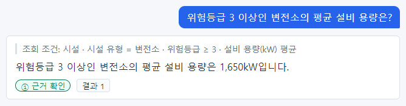

조회 조건 "시설 · 시설 유형 = 변전소 · 위험등급 ≥ 3 · 설비 용량(kW) 평균". 조건 둘(변전소, 3 이상)과 계산
하나(평균)가 모두 있습니다. 답 1,650kW 를 믿어도 됩니다.

> **요령** 조건이 셋 이상이면 질문을 쓸 때 조건마다 쉼표로 나누어 분명히 적으세요. 그리고 답을 받으면 질문의
> 조건 수와 조회 조건의 조건 수를 세어 보세요. 개수가 다르면 무언가 빠진 것입니다.

## 6.11 정해 둔 계산(Function)

비율·지표처럼 조회 하나로 나오지 않는 값은 모델러가 온톨로지에 **계산(Function)** 으로 정해 둡니다. 샘플 데이터에는
"고위험 시설 비율"(시설 유형별, 기준 위험등급은 기본 4)과 "지역 고위험 시설 비율"(지역명을 넣어야 함)이 있습니다.
어떤 계산이 있는지는 모델러에게 물어보세요.

### 예 1 — 기본값으로

`시설 유형별 고위험 시설 비율 알려줘`

조회 조건은 "고위험 시설 비율(기준 위험등급 = 4(기본값)) · 고위험 시설 수: 시설 · 위험등급 ≥ 4 · 시설 유형별 건수 /
전체 시설 수: 시설 · 시설 유형별 건수 · 최대 100개 그룹"입니다. 맨 앞이 **계산 이름과 넣은 값**, 그 뒤가 계산에 쓴
조회들입니다. 답은 "변전소 30%, 전주 40%, 철탑 70%"이고 등급은 ① 입니다. 근거 「결과 1·2·3」은 유형마다
**고위험 수·전체 수·비율** 을 함께 담고 있어서, 답이 "10곳 중 3곳"처럼 말해도 확인됩니다.

### 예 2 — 기준을 바꾸어

`위험등급 3 이상을 고위험으로 볼 때 시설 유형별 고위험 시설 비율은?` → 조회 조건 앞이 "고위험 시설 비율(기준
위험등급 = 3)"으로 바뀌고 변전소 40%·전주 60%·철탑 80% 가 나옵니다. 질문의 숫자가 조회 조건에 그대로 있는지
확인하세요.

### 예 3 — 넣어야 하는 값이 있는 계산

`대구 지역의 고위험 시설 비율은?` → "지역 고위험 시설 비율(지역명 = 대구)", 답 57.1%. 지역을 읽을 권한이 없으면
이 계산이 보이지 않아 "질문 해석 실패"로 나옵니다 — 다른 계산으로 바꿔 대답하지 않습니다.

> **주의** 계산이 받지 않는 조건(예: 유형별 비율 계산에 "대구 지역")을 붙이면 챗봇은 계산을 부르지 않고 "질문 해석
> 실패"로 답합니다. 조건을 빼고 엉뚱한 범위의 비율을 내놓지 않기 위해서입니다. 조회 조건 맨 앞의 **계산 이름과 넣은
> 값** 이 질문과 맞는지 꼭 보세요.

## 6.12 질문을 잘 쓰는 요령 정리

| 요령 | 좋은 예 | 피할 예 |
| --- | --- | --- |
| 대상을 분명히 | 위험등급 4 이상인 **변전소** 목록 | 위험한 거 알려줘 |
| 하려는 일을 분명히(몇 개/목록/평균) | 변전소는 **몇 개**야? | 변전소 어때? |
| 숫자 조건은 숫자로 | 위험등급 **3 이상** | 위험등급 높은 |
| 이름은 등록된 그대로 | 강남 변전소 13호 | 강남변전소13호 |
| 이름이 헷갈리면 식별자 | F-0013 | 강남 13번 변전소 |
| 한 번에 하나만 | 변전소 몇 개야? (따로) 철탑 몇 개야? | 변전소랑 철탑이랑 전주 각각 몇 개고 평균 등급은? |
| 조건이 많으면 나누어 적기 | 유형은 철탑, 지역은 경기, 위험등급은 4 이상 | 경기철탑위험4이상 |
| 데이터에 있는 정보만 | 설치일, 위험등급 | 점검 담당자 이름(데이터에 없음) |

> **해 보기** 다음 질문을 하고 조회 조건을 확인해 보세요. 조건이 빠지거나 다르게 이해된 것이 있으면 질문을
> 고쳐 다시 물어보세요.
>
> 1. `대구에 있는 철탑 목록 보여줘`
> 2. `수원지사가 소유한 변전소는 몇 개야?`
> 3. `2015년 이후 설치된 위험등급 4 이상 철탑`
> 4. `전주의 평균 위험등급은?`
>
> 풀이는 「23장 연습 문제」에 있습니다.
