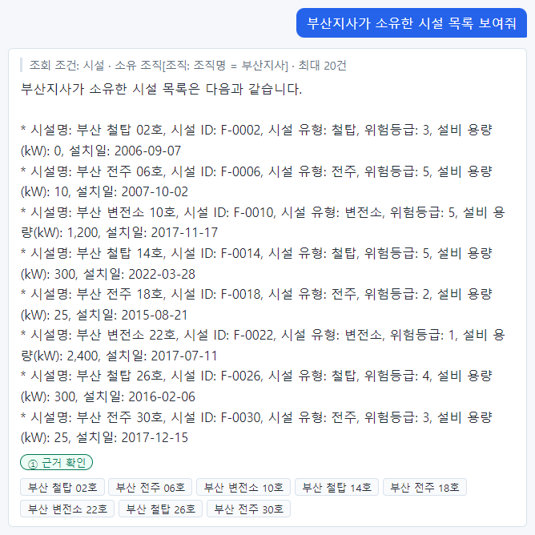
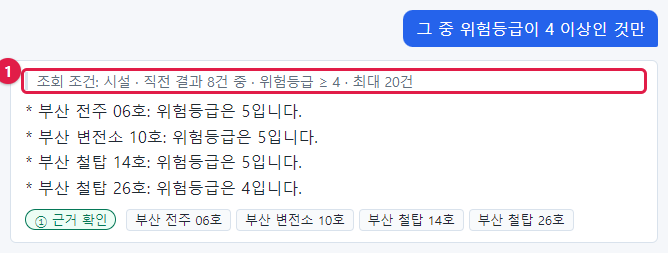
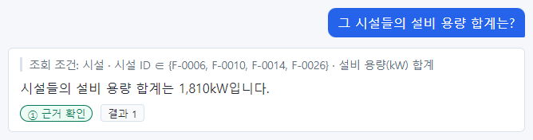
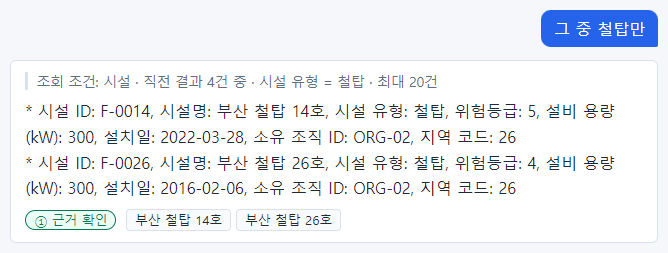
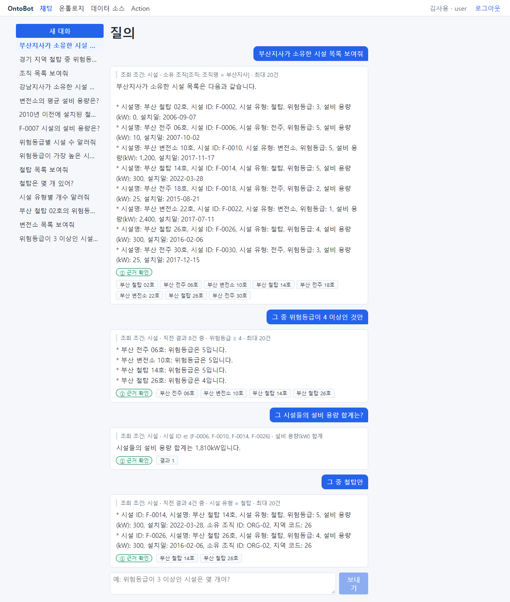
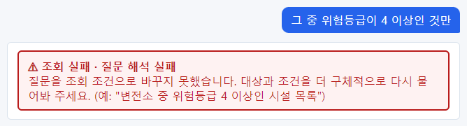
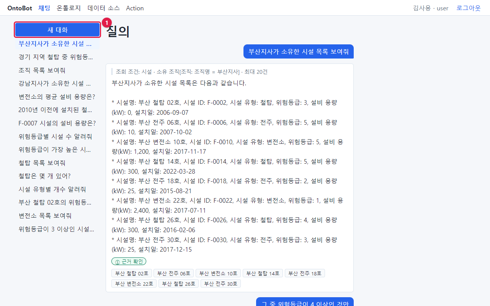
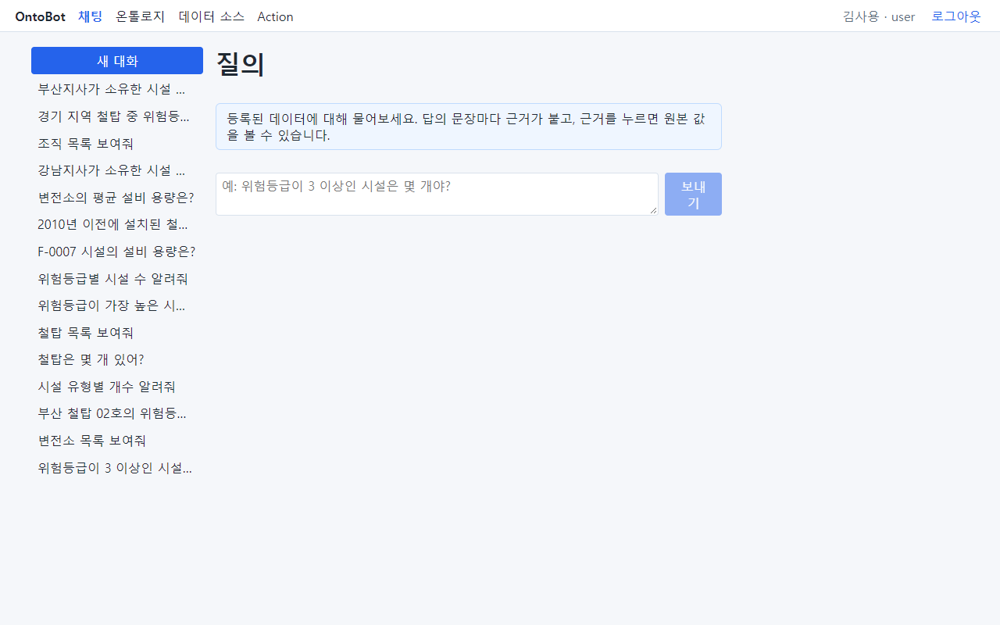
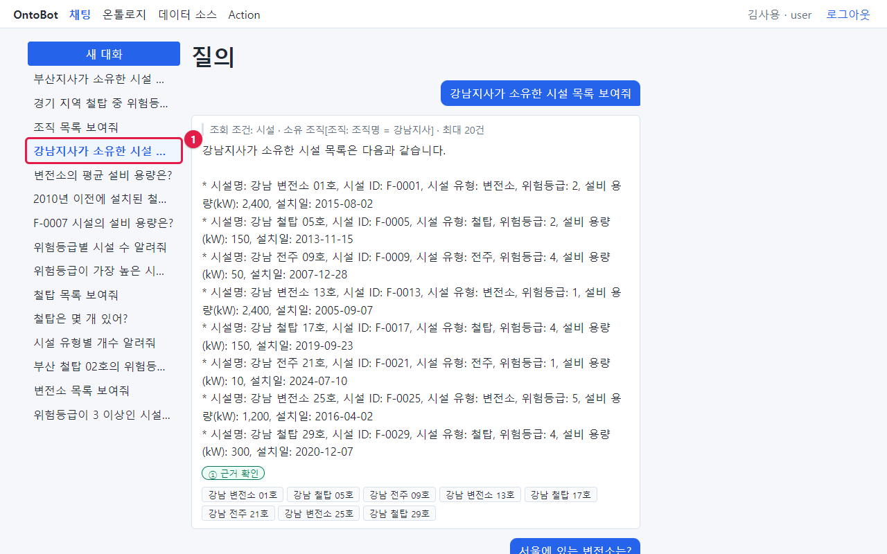

# 7장 이어서 묻기와 대화 관리

## 7.1 "그 중"으로 이어서 묻기

같은 대화 안에서는 바로 앞 답의 **목록**을 "그 중", "그 시설들"로 가리켜 이어서 물을 수 있습니다. 조건을 매번
처음부터 다 적지 않아도 되어 편합니다. 김사용이 부산지사 시설을 차례로 좁혀 가는 예를 따라 해 봅니다.

### 1단계 — 목록부터

`부산지사가 소유한 시설 목록 보여줘`

부산지사 소유 시설 8곳이 나왔습니다. 이 8곳이 다음 질문의 "그 중"이 가리키는 목록이 됩니다.

### 2단계 — 그 중에서 좁히기

`그 중 위험등급이 4 이상인 것만`

조회 조건(①)이 "시설 · **직전 결과 8건 중** · 위험등급 ≥ 4 · 최대 20건"입니다. "직전 결과 8건 중"이 바로
"그 중"을 이해한 부분입니다. 앞 목록 8곳 가운데 위험등급 4 이상인 4곳이 나왔습니다.

### 3단계 — 그 시설들로 계산하기

`그 시설들의 설비 용량 합계는?`

조회 조건 "시설 · 시설 ID ∈ {F-0006, F-0010, F-0014, F-0026} · 설비 용량(kW) 합계". "그 시설들"을 앞 답의
4곳(식별자 네 개)으로 바꾸어 합계를 냈습니다. ∈ 는 "이 중 하나"라는 뜻입니다.

### 4단계 — 숫자 답 뒤에 다시 "그 중"

`그 중 철탑만`

바로 앞 답은 목록이 아니라 합계(숫자)였습니다. 이때 "그 중"은 **가장 최근의 목록**(2단계의 4곳)을 가리킵니다.
조회 조건 "시설 · 직전 결과 4건 중 · 시설 유형 = 철탑"이 그것을 보여 줍니다. 4곳 중 철탑 2곳이 나왔습니다.

> **요령** "그 중"이 무엇을 가리켰는지는 조회 조건의 **"직전 결과 N건 중"** 으로 확인합니다. N 이 내가 생각한
> 목록의 개수와 다르면, 챗봇이 다른 목록을 가리킨 것입니다. 그럴 때는 조건을 처음부터 모두 적어 다시 물으세요.

대화 전체를 위에서 아래로 보면 이렇습니다.

## 7.2 "그 중"이 통하지 않는 경우

**새 대화**에서 처음부터 "그 중"으로 물으면 가리킬 목록이 없습니다.

`그 중 위험등급이 4 이상인 것만` (새 대화의 첫 질문)

"조회 실패 · 질문 해석 실패"가 나옵니다. 이때는 무엇의 "그 중"인지 처음부터 적어 물으세요. 예:
`부산지사가 소유한 시설 중 위험등급이 4 이상인 것`.

"그 중"이 통하지 않는 경우를 정리하면 다음과 같습니다.

| 경우 | 왜 |
| --- | --- |
| 새 대화의 첫 질문 | 앞 답이 없음 |
| 앞에 목록 답이 한 번도 없었음(개수·평균만 물음) | 가리킬 목록이 없음 |
| 앞 목록이 0건 | 가리킬 대상이 없음 |
| 다른 대화의 목록을 가리키려 함 | "그 중"은 같은 대화 안에서만 통함 |

## 7.3 대화 목록 다루기

### 지금 보고 있는 대화

왼쪽 대화 목록에서 지금 보고 있는 대화는 파란 굵은 글씨로 표시됩니다(①).

대화는 최근 것이 위에 옵니다. 대화 이름은 그 대화의 첫 질문이고, 길면 뒤가 "…"로 줄어듭니다. 마우스를 대화
이름 위에 올리면 전체 이름이 뜹니다.

### 새 대화 시작하기

새 주제로 묻고 싶으면 대화 목록 맨 위 **새 대화**(①)를 누릅니다.

채팅 화면이 처음처럼 비고 안내 문구가 보입니다. 다음 질문부터 새 대화가 됩니다(질문을 보내기 전에는 목록에
생기지 않습니다).

> **요령** 주제가 바뀌면 새 대화를 시작하세요. 같은 대화에서 주제를 바꾸면 "그 중"이 엉뚱한 앞 목록을 가리킬 수
> 있습니다. 또 대화 이름이 첫 질문이라, 주제별로 대화를 나누어 두면 나중에 찾기 쉽습니다.

### 지난 대화 다시 보기

대화 목록에서 지난 대화를 누르면(①) 그 대화의 질문과 답이 그대로 다시 보입니다.

다시 연 대화에서 이어서 질문할 수도 있습니다. 이때 "그 중"은 그 대화의 가장 최근 목록을 가리킵니다.

> **알아 두기** 다시 연 대화의 답은 **그때** 받은 답입니다. 그사이 데이터가 바뀌었을 수 있으니, 지금 값이
> 필요하면 같은 질문을 다시 하세요. 단, 근거 카드는 열 때마다 **지금** 값을 보여 줍니다.

### 대화의 보관과 삭제

- 내 대화는 나만 볼 수 있습니다. 다른 사람의 대화는 볼 수 없습니다.
- 화면에서 대화를 지우는 기능은 없습니다. 오래된 대화는 회사가 정한 보관 기간이 지나면 자동으로 지워집니다.
- 대화에는 개인정보가 담길 수 있으니 화면을 다른 사람에게 보여 줄 때 주의하세요.

## 7.4 이 장의 핵심

> **요령**
>
> - 같은 대화에서는 "그 중", "그 시설들"로 앞 목록을 가리켜 물을 수 있습니다.
> - 조회 조건의 "직전 결과 N건 중"으로 무엇을 가리켰는지 확인합니다.
> - 숫자 답 뒤의 "그 중"은 가장 최근 목록을 가리킵니다.
> - 새 주제는 **새 대화** 로. 새 대화의 첫 질문에는 "그 중"을 쓸 수 없습니다.
