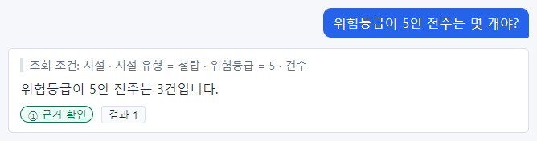
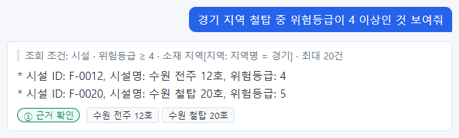
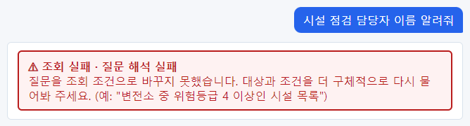
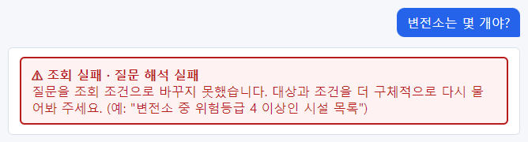
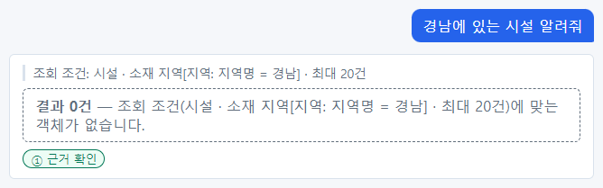
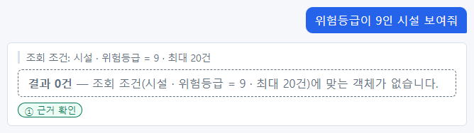
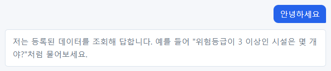
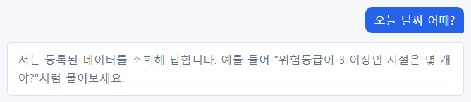
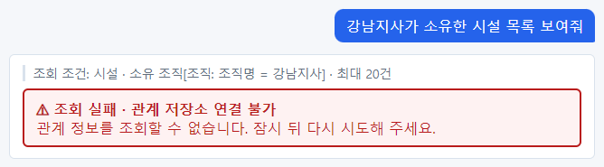
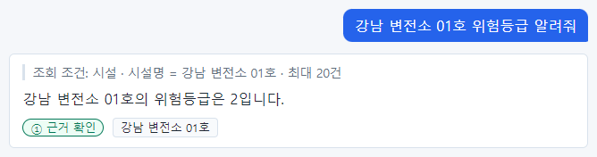

# 8장 답이 이상할 때

답이 이상하다고 느껴지는 경우는 크게 다섯 가지입니다. 이 장은 실제로 일어난 화면으로 하나씩 보여 주고, 각
경우에 무엇을 하면 되는지 알려 줍니다.

| 절 | 경우 | 화면에서 알아보는 법 |
| --- | --- | --- |
| 8.1 | 질문을 잘못 이해함 | 조회 조건이 내 질문과 다름(등급은 ①일 수도 있음) |
| 8.2 | 질문 해석 실패 | 빨간 상자 "조회 실패 · 질문 해석 실패" |
| 8.3 | 결과 0건 | 점선 상자 "결과 0건" |
| 8.4 | 데이터 질문이 아님 | 회색 안내 "저는 등록된 데이터를 조회해 답합니다…" |
| 8.5 | 시스템 문제 | 빨간 상자 "조회 실패 · 관계 저장소 연결 불가" 등 |

## 8.1 질문을 잘못 이해했을 때

가장 조심해야 하는 경우입니다. 빨간 오류도 없고 등급도 ① 이라 겉보기에는 정상이기 때문입니다. 알아챌 수 있는
곳은 **조회 조건** 하나뿐입니다. 이 책을 쓰며 실제로 겪은 두 사례입니다.

### 사례 1 — 낱말을 다른 값으로 이해함

`위험등급이 5인 전주는 몇 개야?`

| 확인할 것 | 질문 | 조회 조건 | 판정 |
| --- | --- | --- | --- |
| 대상 | 시설 | 시설 | 맞음 |
| 조건 1 | 전주 | 시설 유형 = **철탑** | **다름** |
| 조건 2 | 위험등급 5 | 위험등급 = 5 | 맞음 |
| 한 일 | 몇 개 | 건수 | 맞음 |

조건 하나가 다르므로 답 "3건"은 쓰면 안 됩니다. 답 문장은 "전주는 3건"이라고 질문의 낱말을 따라 썼지만, 실제로
센 것은 철탑입니다. 같은 질문을 다른 때 물었을 때는 전주로 맞게 이해했습니다 — 잘못 이해하는 일은 가끔, 예고
없이 일어납니다.

「25장 질문 예시 모음」을 만들며 찾은 사례도 더 있습니다.

| 질문 | 조회 조건 | 무엇이 잘못됐나 |
| --- | --- | --- |
| 소유 조직별 시설 수는? | 조직 · 조직명별 건수 | 시설이 아니라 조직을 셈 |
| 2015년에 설치된 시설 알려줘 | 설치일 ≤ 2015-12-31 | "2015-01-01 이후" 조건이 빠짐 |
| (서울의 변전소 목록 뒤) 그 중 위험등급이 가장 높은 것은? | 위험등급 ≥ 1 · 위험등급 최댓값 | 앞 목록을 잃고 전체 시설에서 구함 |
| 수원지사 소유 철탑의 평균 설비 용량은? | (평균 없음, 목록 조회) | 평균을 서버가 아니라 AI 가 계산 |

### 사례 2 — 조건 하나를 빠뜨림

`경기 지역 철탑 중 위험등급이 4 이상인 것 보여줘`

| 확인할 것 | 질문 | 조회 조건 | 판정 |
| --- | --- | --- | --- |
| 조건 1 | 경기 지역 | 소재 지역[지역: 지역명 = 경기] | 맞음 |
| 조건 2 | 철탑 | (없음) | **빠짐** |
| 조건 3 | 위험등급 4 이상 | 위험등급 ≥ 4 | 맞음 |

철탑 조건이 빠져서 전주(수원 전주 12호)가 섞였습니다.

### 이럴 때 할 일

1. 그 답은 쓰지 않습니다.
2. 질문을 고쳐 다시 묻습니다. 다음 방법이 효과가 있습니다.
   - 조건을 "속성 이름 + 값"으로 분명히 적기: `시설 유형이 전주이고 위험등급이 5인 시설은 몇 개야?`
   - 조건을 쉼표로 나누어 적기: `시설 유형은 철탑, 지역은 경기, 위험등급은 4 이상인 시설 목록`
   - 목록으로 먼저 보고 좁히기: `경기 지역 시설 목록` → `그 중 철탑만` → `그 중 위험등급 4 이상`
3. 다시 물어도 같은 식으로 틀리면, 질문·시각·화면을 관리자나 모델러에게 알립니다. 모델러는 설계도의 이름과
   설명을 다듬거나 평가 문항에 넣어 고칩니다(「20장」).

> **주의** 등급 ① 은 "나온 값이 조회 결과와 글자 그대로 맞다"는 뜻입니다. 조회 조건이 틀리면 ① 이어도 틀린 답입니다.
> **조회 조건 → 등급 → 근거** 순서를 지키세요.

## 8.2 "조회 실패 · 질문 해석 실패"

질문을 조회 계획으로 바꾸지 못했다는 뜻입니다. 챗봇은 확실하지 않은 것을 지어내지 않고 실패로 알립니다.

`시설 점검 담당자 이름 알려줘`

빨간 상자 안에 "질문을 조회 조건으로 바꾸지 못했습니다. 대상과 조건을 더 구체적으로 다시 물어봐 주세요."와 질문
예시가 나옵니다. 조회 조건 줄은 나오지 않습니다(조회하지 않았으므로).

주된 원인은 세 가지입니다.

| 원인 | 예 | 할 일 |
| --- | --- | --- |
| 데이터에 없는 정보를 물음 | "점검 담당자"(시설에는 담당자 정보가 없음. 조직의 담당자는 있음) | 데이터에 있는 정보로 바꿈. 예: "부산지사 담당자 알려줘" |
| 표현이 모호함 | "위험한 거 좀" | 대상·조건·하려는 일을 분명히 |
| 볼 권한이 없는 종류를 물음 | 읽기 권한이 없는 사람이 "변전소 몇 개야?" | 아래 참고 |

### 권한이 없을 때도 "질문 해석 실패"로 보인다

현업 전문가 최현업은 시설 데이터의 읽기 권한이 없습니다. 최현업이 `변전소는 몇 개야?` 라고 물으면 이렇게
나옵니다.

"권한 없음"이 아니라 "질문 해석 실패"입니다. 챗봇은 그 사람이 읽을 수 있는 종류의 데이터만 알고 계획을 세우기
때문에, 권한이 없는 종류는 아예 모르는 것처럼 됩니다. 다른 사람은 되는 질문이 나만 계속 "질문 해석 실패"라면
읽기 권한을 의심하고 관리자에게 문의하세요.

> **알아 두기** 화면에 "조회 실패 · 권한 없음"이 따로 나오는 경우도 있습니다. 계획은 세웠지만 그 안의 일부
> 데이터를 볼 권한이 없을 때입니다. 둘 다 할 일은 같습니다: 관리자에게 읽기 권한을 요청합니다.

## 8.3 "결과 0건"

조회는 성공했고 조건에 맞는 데이터가 **정말 없다**는 뜻입니다.

`경남에 있는 시설 알려줘`

조회 조건 "시설 · 소재 지역[지역: 지역명 = 경남] · 최대 20건"이 나오고, 점선 상자에 "결과 0건 — 조회 조건(…)에
맞는 객체가 없습니다."가 나옵니다. 등급은 ① 입니다(없다는 사실이 데이터와 맞으므로). 예제 데이터에서 경남에는
시설이 없습니다.

`위험등급이 9인 시설 보여줘`

위험등급은 1~5뿐이라 9인 시설은 없습니다.

0건이 나왔는데 분명히 있을 것 같다면 다음을 확인하세요.

| 확인 | 예 |
| --- | --- |
| 이름이 글자 그대로 같은가 | "강남변전소1호"(×) → "강남 변전소 01호"(○) |
| 숫자·날짜가 맞는가 | 위험등급 9(없는 값), 2030년(미래) |
| 조건을 너무 많이 걸지 않았나 | 조건을 하나씩 빼며 다시 물어봄 |
| 조회 조건이 내 뜻과 같은가 | 8.1 처럼 다르게 이해했을 수 있음 |

> **주의** "결과 0건"은 "없다", "조회 실패"는 "모른다"입니다. 보고서에 "해당 없음"이라고 적어도 되는 것은
> "결과 0건"뿐입니다.

## 8.4 데이터 질문이 아닐 때

인사나 잡담처럼 데이터에 대한 질문이 아니면 안내 문구만 나옵니다.

`안녕하세요`

`오늘 날씨 어때?`

"저는 등록된 데이터를 조회해 답합니다. 예를 들어 "위험등급이 3 이상인 시설은 몇 개야?"처럼 물어보세요."
OntoBot 은 일반 지식(날씨, 뉴스, 상식)을 답하지 않습니다. 회사 데이터에 대한 질문만 답합니다.

## 8.5 시스템 문제

시스템 일부에 문제가 생기면 그 문제를 숨기지 않고 알립니다. 관계 정보 저장소(시설–조직–지역의 연결을 담은
곳)를 일부러 멈춘 상태에서 물어본 화면입니다.

`강남지사가 소유한 시설 목록 보여줘`

조회 조건까지는 나오지만 "조회 실패 · 관계 저장소 연결 불가 — 관계 정보를 조회할 수 없습니다. 잠시 뒤 다시
시도해 주세요."가 나옵니다. 이때 OntoBot 은 다른 방법으로 대충 찾아서 답하지 않습니다. 틀릴 수 있는 답보다
"지금은 모른다"가 안전하기 때문입니다.

같은 때에 관계가 필요 없는 질문은 정상으로 답합니다.

`강남 변전소 01호 위험등급 알려줘`

시스템 문제로 나오는 안내를 정리하면 다음과 같습니다.

| 안내 | 뜻 | 할 일 |
| --- | --- | --- |
| 조회 실패 · 관계 저장소 연결 불가 | 관계 정보 저장소 문제 | 잠시 뒤 다시. 관계 없는 질문은 됨 |
| 조회 실패 · 시간 초과 | 조회가 너무 오래 걸림 | 조건을 좁히거나 잠시 뒤 다시 |
| 조회 실패 · 실행 오류 | 조회 중 오류 | 잠시 뒤 다시 |
| 조회 실패 · 답변 모델 연결 불가 | AI 모델이 응답하지 않음 | 잠시 뒤 다시 |
| 조회 실패 · 결과 과다 | 대상이 너무 많아 처리할 수 없음 | 조건을 좁힘 |
| 조회 실패 · 게시된 온톨로지 없음 | 설계도가 아직 없음(설치 직후) | 모델러에게 문의 |
| 조회 실패 · 내부 오류 | 예상하지 못한 오류 | 시각과 질문을 관리자에게 알림 |

같은 안내가 몇 분 넘게 계속되면 관리자에게 알리세요. 알릴 때 적을 내용은 「27장 27.9」에 있습니다.

## 8.6 판단 순서도

답이 이상할 때 다음 순서로 판단하세요.

1. 빨간 상자(조회 실패)인가?
   - 예 → 이유를 읽는다. "질문 해석 실패"면 8.2, 그 밖이면 8.5.
   - 아니오 → 2로.
2. "결과 0건"인가?
   - 예 → 8.3 의 확인표로 이름·숫자·조건을 확인한다.
   - 아니오 → 3으로.
3. 조회 조건에 내 질문의 대상·조건·하려는 일이 모두 있는가?
   - 아니오 → 8.1. 질문을 고쳐 다시 묻는다.
   - 예 → 4로.
4. 등급이 ① 인가?
   - ② → **추정** 문장을 근거 카드로 확인한다.
   - ③ → 근거 칩을 직접 보거나 질문을 바꾼다.
   - ① → 5로.
5. 그래도 숫자가 이상하면 근거 카드의 **마지막 동기화** 시각과 **편집됨** 표시를 본다. 데이터가 오래됐거나,
   Action 으로 바뀐 값일 수 있다(「13장」).

## 8.7 이 장의 핵심

> **요령**
>
> - 가장 위험한 경우는 오류 없이 **잘못 이해한** 경우입니다. 조회 조건으로만 알아챌 수 있습니다.
> - 권한이 없는 종류의 데이터는 "질문 해석 실패"로 보일 수 있습니다.
> - "결과 0건"은 없다, "조회 실패"는 모른다.
> - 시스템 문제는 숨기지 않고 알립니다. 관계 질문만 안 되는 때도 있습니다.
