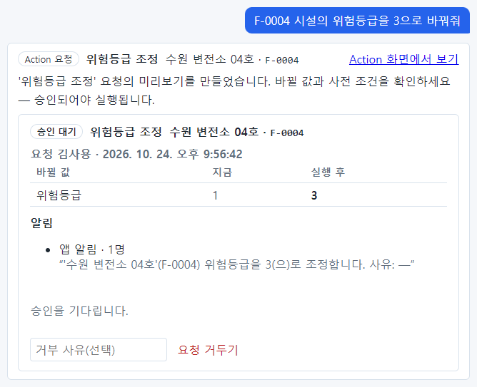
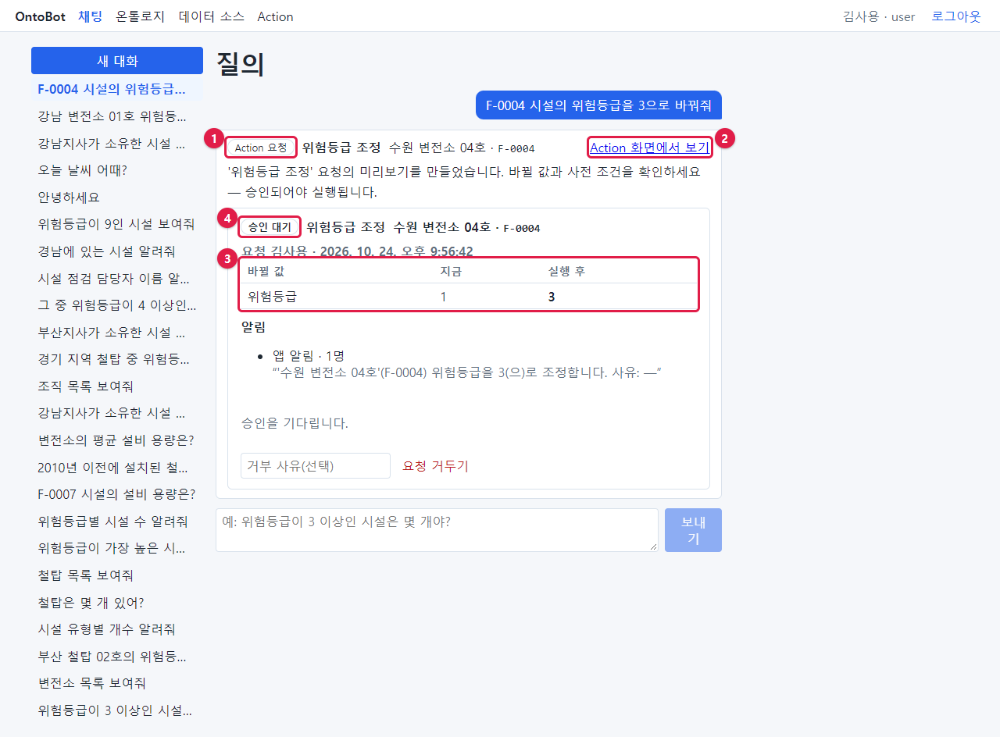
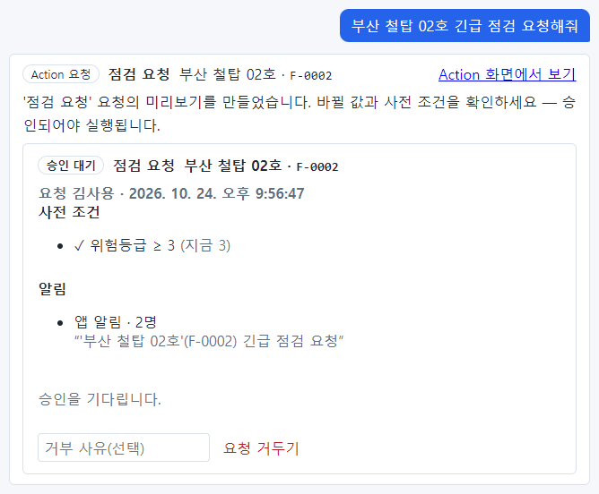
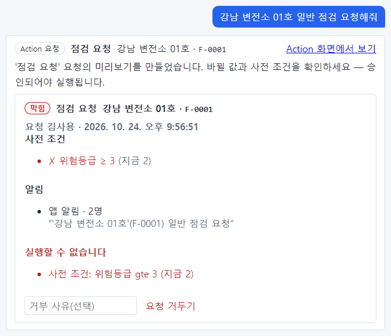
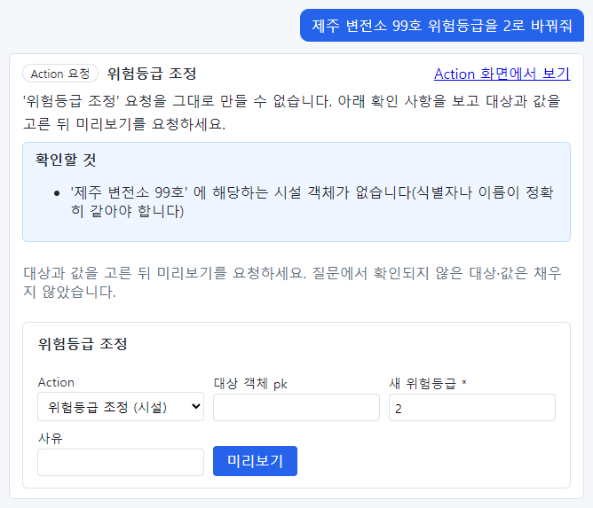
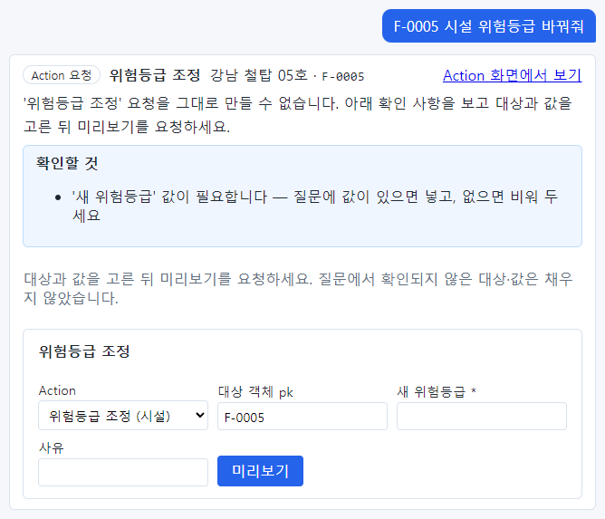
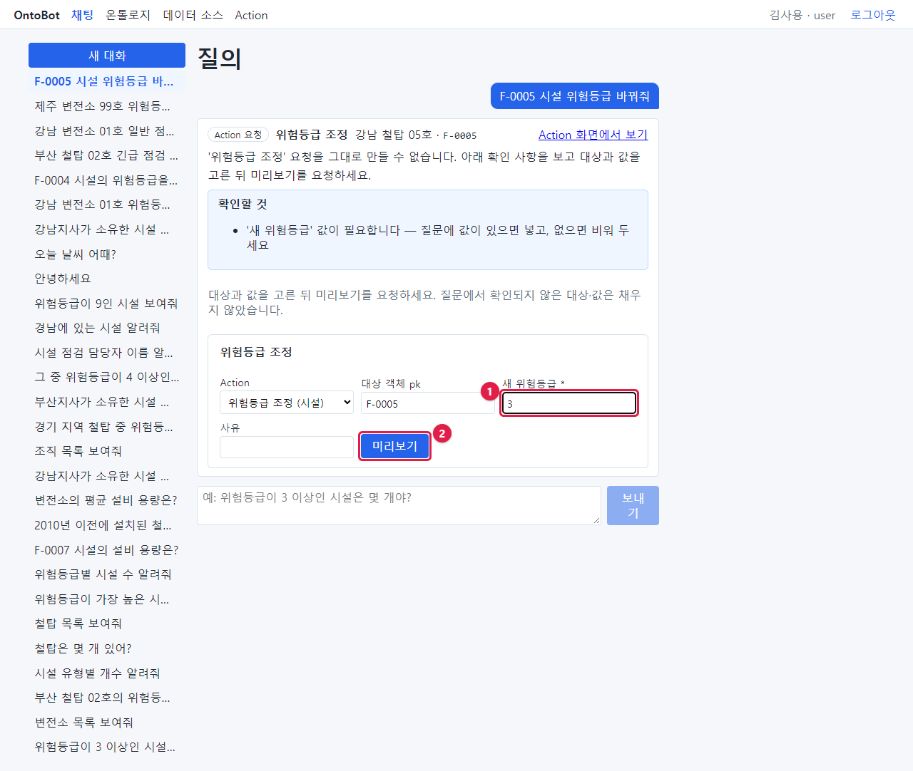
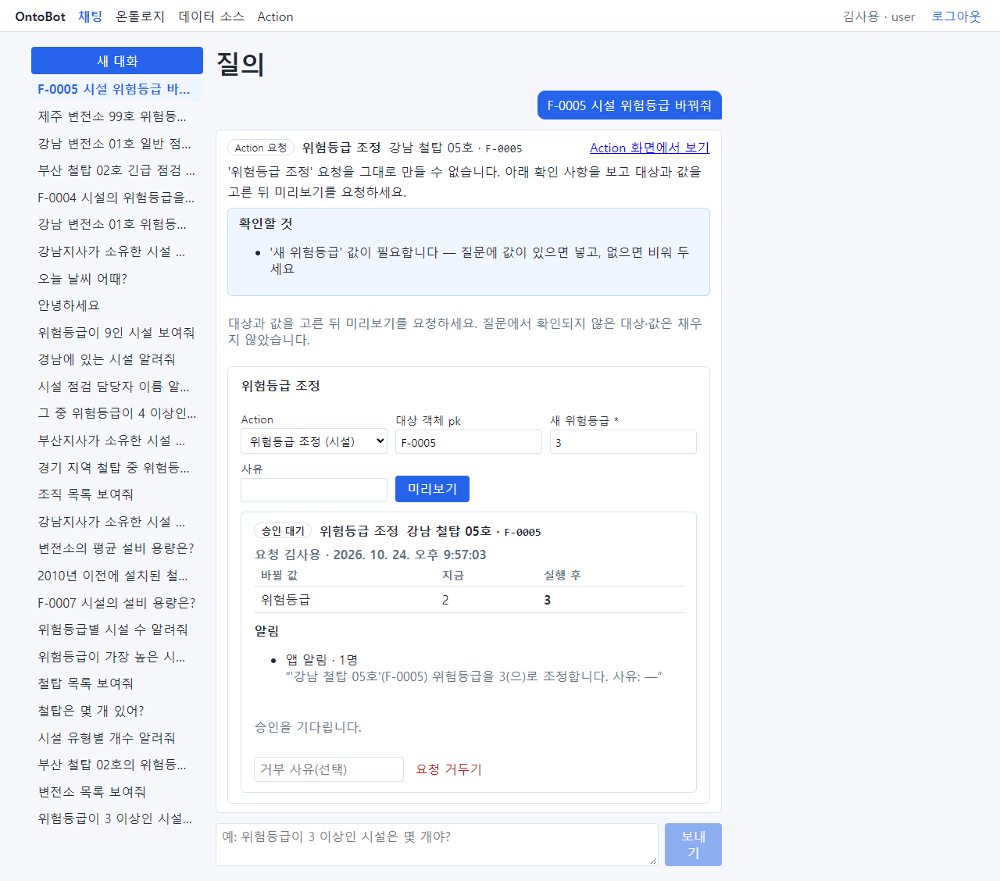
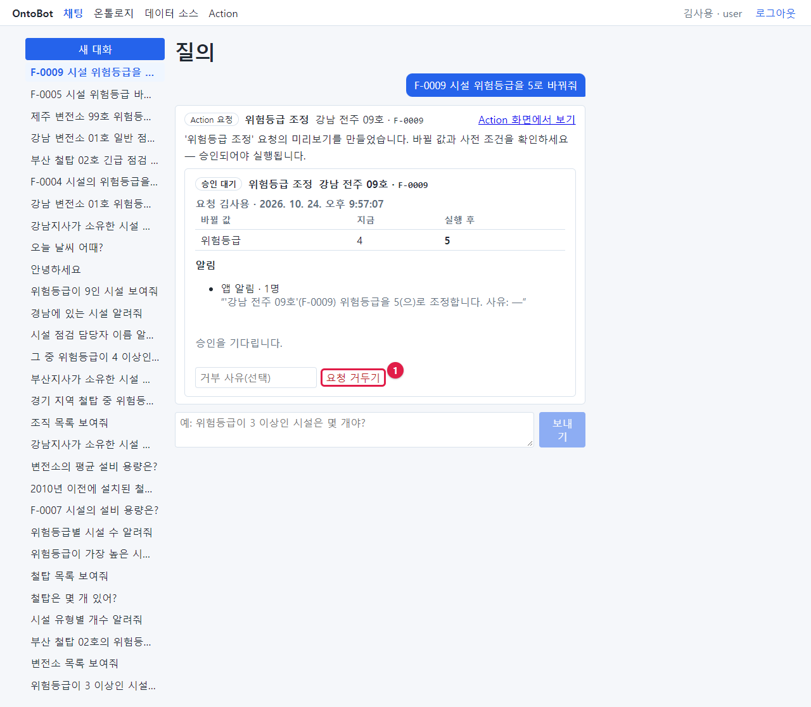
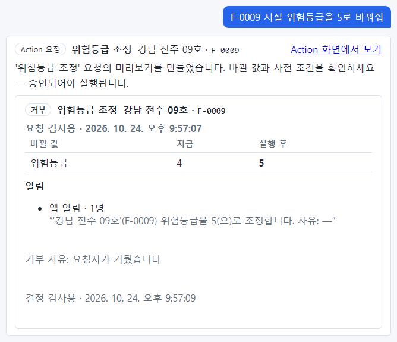

# 10장 채팅으로 데이터 변경 요청하기

김사용이 채팅으로 데이터 변경을 요청하는 여러 경우를 따라 해 봅니다. 「9장」의 규칙을 먼저 읽고 오세요.

## 10.1 요청이 바로 만들어지는 경우

`F-0004 시설의 위험등급을 3으로 바꿔줘`

조회 답과 모양이 다릅니다. 각 부분을 봅니다.

| 번호 | 부분 | 이 화면에서 | 뜻 |
| --- | --- | --- | --- |
| ① | Action 요청 배지와 제목 | Action 요청 · 위험등급 조정 · 수원 변전소 04호 · F-0004 | 어떤 Action 을 어느 대상에 요청했는지. 대상은 이름과 식별자가 함께 보입니다 |
| ② | **Action 화면에서 보기** | 링크 | 누르면 Action 화면으로 갑니다(「11장」) |
| ③ | 바뀔 값 표 | 위험등급 · 지금 1 · 실행 후 **3** | 무엇이 어떤 값에서 어떤 값으로 바뀌는지 |
| ④ | 상태 배지 | 승인 대기 | 승인자의 결정을 기다리는 중 |

그 밖에 카드에는 다음이 있습니다.

- 안내 문장: "'위험등급 조정' 요청의 미리보기를 만들었습니다. 바뀔 값과 사전 조건을 확인하세요 — 승인되어야
  실행됩니다."
- **요청** 김사용 · 시각: 누가 언제 요청했는지.
- **알림**: 앱 알림 · 1명, 그리고 알림 문구 "'수원 변전소 04호'(F-0004) 위험등급을 3(으)로 조정합니다. 사유: —".
  사유를 말하지 않아서 "—"로 들어갔습니다. 사유도 함께 남기려면 "사유는 정밀 점검 결과" 처럼 질문에 넣으세요.
- "승인을 기다립니다." 그리고 **거부 사유(선택)** 칸과 **요청 거두기** 단추.

> **요령** 요청 카드에서 꼭 확인할 것은 세 가지입니다. ① 대상의 이름과 식별자가 내가 뜻한 대상인가, ③ 지금
> 값과 실행 후 값이 맞는가, 그리고 알림이 누구에게 어떤 문구로 가는가.

아직 아무것도 바뀌지 않았습니다. 승인자(박관리)가 승인해야 바뀝니다(「12장」).

## 10.2 사전 조건이 있는 Action

`부산 철탑 02호 긴급 점검 요청해줘`

"점검 요청" Action 은 바꾸는 값이 없고 알림만 보냅니다. 대신 **사전 조건** 이 있습니다: 위험등급이 3 이상인
시설만 점검을 요청할 수 있습니다.

- 사전 조건: ✓ 위험등급 ≥ 3 (지금 3) — 부산 철탑 02호는 위험등급 3이라 통과했습니다.
- 알림: 앱 알림 · 2명 — 관리자와 현업 전문가에게 "'부산 철탑 02호'(F-0002) 긴급 점검 요청"이 갑니다.
- 질문에 "긴급"이라고 말해서 **긴급도** 값이 "긴급"으로 들어갔습니다(긴급도는 긴급·일반 중 하나).

## 10.3 사전 조건에 걸리는 경우(막힘)

`강남 변전소 01호 일반 점검 요청해줘`

강남 변전소 01호는 위험등급 2입니다. 그래서

- 사전 조건: ✗ 위험등급 ≥ 3 (지금 2) — 빨간 글씨.
- 빨간 **실행할 수 없습니다** 아래에 이유 "사전 조건: 위험등급 gte 3 (지금 2)".
- 상태 배지 **막힘**.

**막힘** 요청은 승인자가 승인할 수 없습니다. 요청 기록으로만 남습니다. 이유의 "gte"는 "≥(크거나 같다)"를 뜻하는
영어 약어입니다.

> **알아 두기** 막힌 요청은 굳이 거두지 않아도 됩니다. 실행될 수 없으니까요. 다만 내 요청 목록을 깔끔하게 하려면
> **요청 거두기** 를 눌러도 됩니다.

## 10.4 요청을 그대로 만들 수 없는 경우

챗봇은 확실하지 않은 대상·값을 짐작해서 채우지 않습니다. 대신 **확인할 것** 과 함께 요청 양식을 보여 줍니다.

### 대상을 찾지 못함

`제주 변전소 99호 위험등급을 2로 바꿔줘`

- 안내: "'위험등급 조정' 요청을 그대로 만들 수 없습니다. 아래 확인 사항을 보고 대상과 값을 고른 뒤 미리보기를
  요청하세요."
- **확인할 것**: "'제주 변전소 99호' 에 해당하는 시설 객체가 없습니다(식별자나 이름이 정확히 같아야 합니다)".
- 아래 양식: Action(위험등급 조정), **대상 객체 pk**(비어 있음), **새 위험등급 \***(질문에서 확인된 2 가 들어
  있음), **사유**.

질문에서 확인된 값(2)은 채웠지만, 확인되지 않은 대상은 비워 두었습니다. 대상 객체 pk 칸에 정확한 식별자를
넣고 **미리보기** 를 누르면 요청이 만들어집니다.

### 바꿀 값이 없음

`F-0005 시설 위험등급 바꿔줘`

- **확인할 것**: "'새 위험등급' 값이 필요합니다 — 질문에 값이 있으면 넣고, 없으면 비워 두세요".
- 대상 객체 pk 에는 F-0005 가 채워졌고, 새 위험등급은 비어 있습니다.

양식의 **새 위험등급** 칸(①)에 값을 넣고 **미리보기**(②)를 누릅니다.

그러면 양식 바로 아래에 10.1 과 같은 요청 카드가 만들어집니다.

### 확인할 것의 종류

| 확인할 것 | 이유 | 할 일 |
| --- | --- | --- |
| '…' 에 해당하는 ○○ 객체가 없습니다 | 이름·식별자가 등록된 것과 글자가 다름 | 정확한 식별자를 대상 객체 pk 에 입력 |
| 이름이 '…' 인 ○○ 가 여러 개입니다 | 같은 이름이 여럿 | 화면의 **후보** 중 식별자를 골라 입력. 실제 실습에서는 이 양식 대신 **질문 해석 실패** 가 나왔습니다(「22장 22.10」) — 이름이 겹치면 식별자로 요청하세요 |
| '…' 값이 필요합니다 | 질문에 바꿀 값이 없음 | 값을 입력 |
| 대상 '…' 이 질문에도 맥락에도 없습니다 | 챗봇이 대상을 짐작하려 함 | 대상을 직접 입력 |

> **알아 두기** 대상 객체 pk 칸에 식별자를 입력하기 시작하면, 후보가 있을 때 아래로 목록이 펼쳐집니다. 목록에서
> 골라도 됩니다.

## 10.5 요청 거두기

요청을 잘못 만들었으면 승인 전에 거둘 수 있습니다. `F-0009 시설 위험등급을 5로 바꿔줘` 라고 요청한 뒤, 사실
다른 시설이었다는 것을 알았다고 해 봅시다.

요청 카드 아래 **요청 거두기**(①)를 누릅니다. 그 왼쪽 칸에 이유를 적어도 됩니다(선택).

거두면 상태가 **거부** 로 바뀌고, "거부 사유: 요청자가 거뒀습니다"와 "결정 김사용 · 시각"이 남습니다.

> **알아 두기** 거둔 요청도 지워지지 않고 기록으로 남습니다. 무엇을 언제 요청했다가 거뒀는지 나중에 확인할 수
> 있습니다.

## 10.6 앞 답의 대상을 가리켜 요청하기

조회 답에 대상이 **하나** 나왔다면 "그 시설"로 가리켜 요청할 수 있습니다.

1. `F-0007 시설 정보 알려줘` — 대구 변전소 07호가 나옴
2. `그 시설 위험등급을 5로 바꿔줘` — 앞 답의 대구 변전소 07호로 요청이 만들어짐

> **주의** 앞 답에 대상이 **여럿**일 때 "그 시설"이라고 하면, 챗봇이 그중 하나를 골라 대상으로 채울 수 있습니다.
> 실제로 변전소 10곳 목록 뒤에 "그 시설 위험등급을 5로 바꿔줘"라고 했더니 목록의 마지막 시설(수원 변전소 28호)이
> 대상으로 들어갔습니다(그때는 다른 이유로 양식이 나와 요청이 만들어지지는 않았습니다). 앞 답에 대상이 여럿이면
> "그 시설" 대신 **식별자를 직접** 적고, 요청 카드의 대상 이름과 식별자를 반드시 확인하세요.

## 10.7 요청을 잘 만드는 요령

| 요령 | 좋은 예 |
| --- | --- |
| 대상은 식별자로 | `F-0004 위험등급을 3으로 바꿔줘` |
| 이름을 쓸 때는 등록된 그대로 | `부산 철탑 02호 긴급 점검 요청해줘` |
| 바꿀 값을 숫자로 분명히 | `3으로` (높여줘·낮춰줘 ×) |
| 사유를 함께 | `…3으로 바꿔줘. 사유는 정밀 점검 결과` |
| 선택 값(긴급도 등)은 정해진 낱말로 | `긴급`, `일반` |
| 한 번에 한 대상 | 두 시설이면 두 번 요청 |

## 10.8 이 장의 핵심

> **요령**
>
> - 채팅으로 "바꿔줘"라고 하면 미리보기 요청 카드가 만들어집니다. 아직 아무것도 바뀌지 않습니다.
> - 카드에서 대상·바뀔 값·사전 조건·알림을 확인합니다.
> - 사전 조건에 걸리면 **막힘** 이 되고 승인할 수 없습니다.
> - 확실하지 않은 대상·값은 채워 주지 않습니다. **확인할 것** 을 보고 양식을 채워 **미리보기**.
> - 잘못 만든 요청은 승인 전에 **요청 거두기**.
