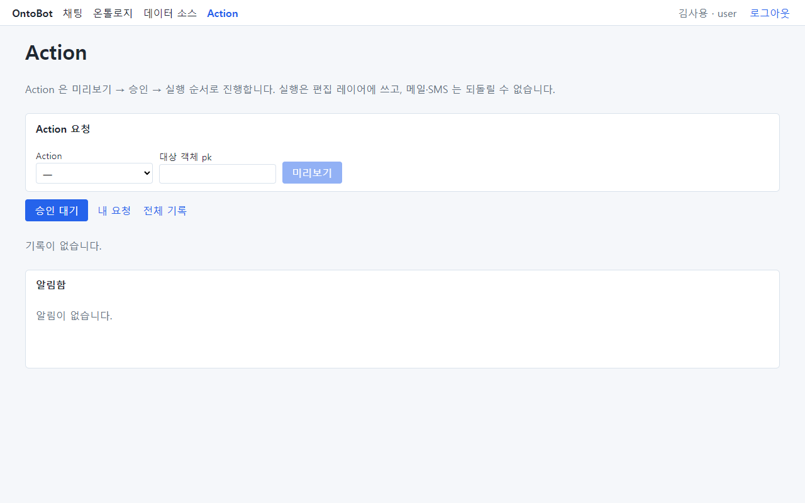
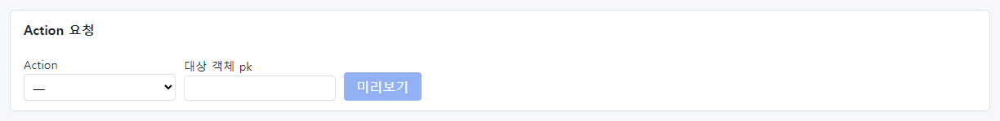
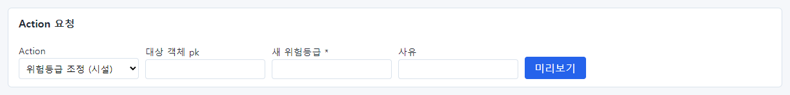
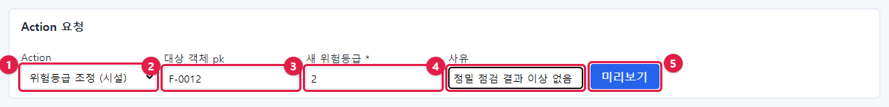
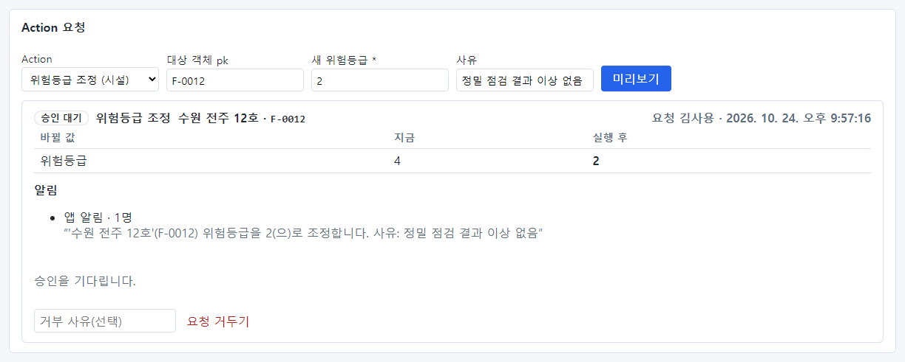
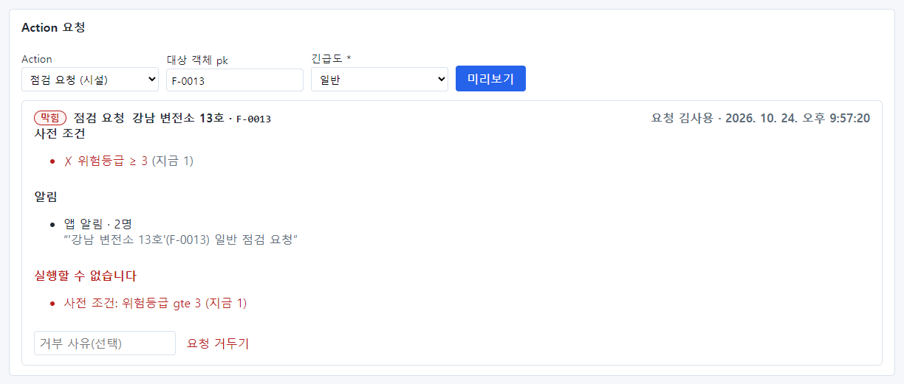
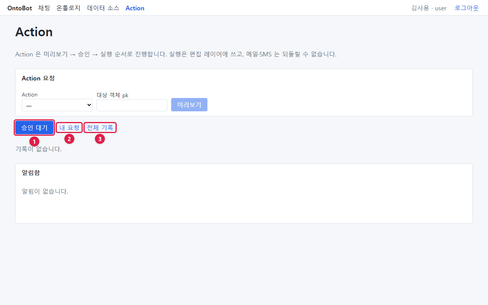
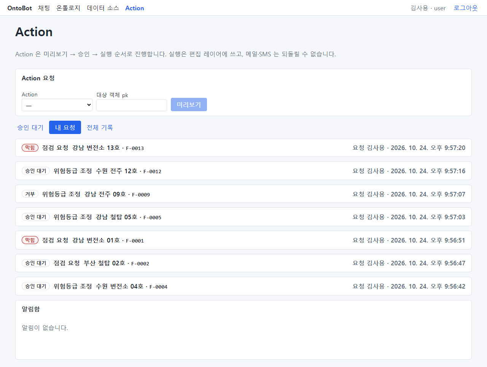

# 11장 Action 화면에서 요청하고 기록 보기

채팅 말고 **Action** 화면에서 양식으로 직접 요청할 수도 있습니다. 식별자를 이미 알고 있거나, 여러 건을 차례로
요청할 때 편합니다. 이 화면에서는 내 요청의 진행 상황과 받은 알림도 봅니다.

## 11.1 Action 화면 둘러보기

맨 위 **Action** 메뉴를 누릅니다.

| 부분 | 하는 일 |
| --- | --- |
| 안내 문장 | "Action 은 미리보기 → 승인 → 실행 순서로 진행합니다. 실행은 편집 레이어에 쓰고, 메일·SMS 는 되돌릴 수 없습니다." |
| **Action 요청** 칸 | 양식으로 요청을 만드는 곳(11.2) |
| 탭 세 개 | 요청 기록 보기(11.4) |
| **알림함** | 받은 앱 알림(「13장」) |

## 11.2 양식으로 요청하기

`F-0012`(수원 전주 12호)의 위험등급을 2로 낮추는 요청을 만들어 봅니다.

1. **Action 요청** 칸의 **Action** 목록을 누르고 **위험등급 조정 (시설)** 을 고릅니다. 괄호 안은 대상 종류입니다.

2. Action 을 고르면 그 Action 의 파라미터 칸이 나타납니다. 위험등급 조정은 **새 위험등급 \***(필수)과
   **사유**(선택)입니다. 이름 뒤 별표(*)는 꼭 입력해야 하는 칸입니다.

3. 칸을 채웁니다.

| 번호 | 칸 | 입력 |
| --- | --- | --- |
| ① | Action | 위험등급 조정 (시설) |
| ② | 대상 객체 pk | `F-0012` — 대상의 식별자. 이름이 아니라 식별자를 넣습니다 |
| ③ | 새 위험등급 * | `2` |
| ④ | 사유 | `정밀 점검 결과 이상 없음` |
| ⑤ | **미리보기** | 누르면 요청이 만들어집니다 |

4. **미리보기** 를 누르면(누르는 동안 "확인하는 중…") 양식 아래에 요청 카드가 나타납니다.

카드의 내용은 채팅의 요청 카드와 같습니다. 바뀔 값(위험등급 4 → **2**), 알림 문구에 사유 "정밀 점검 결과 이상
없음"이 들어간 것을 확인하세요.

> **알아 두기** 같은 내용으로 **미리보기** 를 여러 번 눌러도 요청은 한 번만 만들어집니다. 실수로 두 번 눌러도
> 걱정하지 않아도 됩니다.

## 11.3 막히는 요청을 양식으로 만들면

**점검 요청 (시설)** 을 고르고 대상 `F-0013`(강남 변전소 13호, 위험등급 1), 긴급도 **일반** 으로 미리보기를
눌렀습니다. 긴급도는 정해진 값(긴급·일반) 중에서 고르는 목록입니다.

위험등급이 3보다 낮아 사전 조건 ✗, **실행할 수 없습니다**, 상태 **막힘** 입니다. 채팅으로 요청했을 때와 같습니다
(「10장 10.3」).

## 11.4 요청 기록 탭

요청 칸 아래에 탭이 세 개 있습니다.

| 번호 | 탭 | 보이는 것 |
| --- | --- | --- |
| ① | **승인 대기** | **내가 승인할 수 있는** 승인 대기 요청. 일반 사용자는 보통 비어 있음("기록이 없습니다.") |
| ② | **내 요청** | 내가 한 요청 전부 |
| ③ | **전체 기록** | 내가 볼 수 있는 모든 요청 |

**내 요청** 탭을 누르면 김사용이 지금까지 한 요청이 최근 것부터 한 줄씩 보입니다.

한 줄에는 상태 배지 · Action 이름 · 대상 이름 · 식별자, 오른쪽에 요청자 · 요청 시각이 보입니다. 줄을 누르면
펼쳐져 요청 카드 전체(바뀔 값, 사전 조건, 알림, 결정)가 보입니다. 다시 누르면 접힙니다.

> **요령** 요청을 한 뒤에는 가끔 **내 요청** 탭에서 상태를 확인하세요. 승인되면 **실행됨**, 거부되면 **거부**
> 와 거부 사유가 보입니다. 승인자가 결정하면 요청자에게 따로 알림이 가지는 않으므로, 여기서 확인합니다.

## 11.5 이 장의 핵심

> **요령**
>
> - **Action** 화면의 **Action 요청** 칸에서 Action · 대상 객체 pk(식별자) · 파라미터를 채우고 **미리보기**.
> - 별표(*) 칸은 필수입니다. 목록형 파라미터는 정해진 값 중에서 고릅니다.
> - **내 요청** 탭에서 내 요청의 상태와 결정을 확인합니다.
