# 12장 승인자: 승인·거부·롤백

이 장은 승인자를 위한 장입니다. 예제에서는 관리자 박관리(`park.admin`)가 승인자입니다. 어떤 역할이 어떤
Action 을 승인할 수 있는지는 Action 마다 정해져 있습니다(「17장」). 승인 단추가 보이지 않으면 내가 그 Action 의
승인 역할이 아닌 것입니다.

## 12.1 승인 대기 요청 보기

박관리로 로그인해 **Action** 메뉴를 누르면 **승인 대기** 탭에 내가 결정할 요청이 보입니다. 김사용이 10~11장에서
만든 요청 넷이 기다리고 있습니다. 막힌 요청은 승인할 수 없으므로 여기 나오지 않습니다.

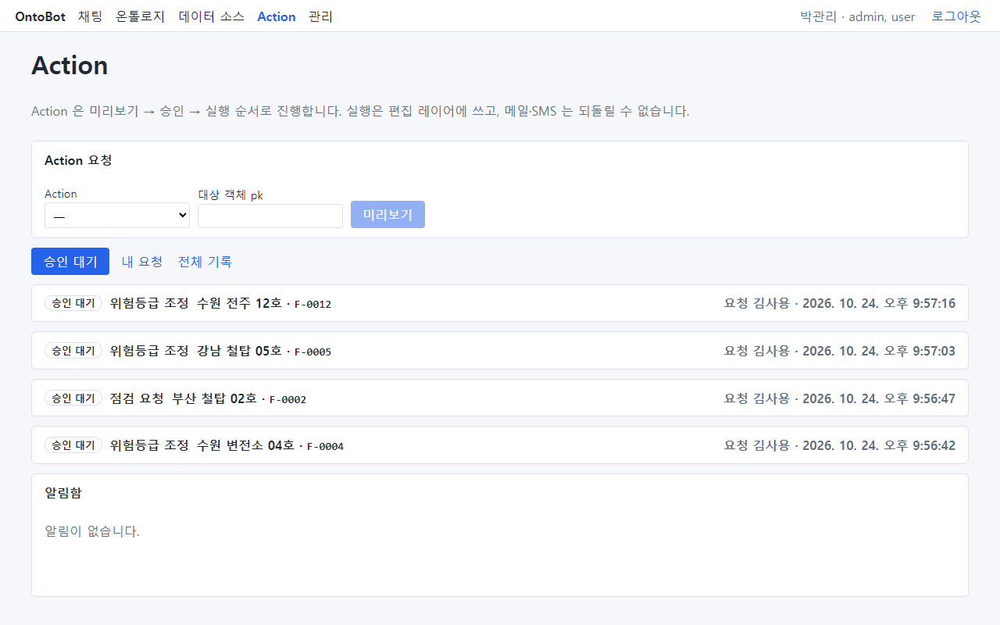

## 12.2 내용을 확인하고 승인하기

1. 요청 줄을 눌러 펼칩니다. 여기서는 맨 아래 "위험등급 조정 · 수원 변전소 04호 · F-0004"를 펼쳤습니다.

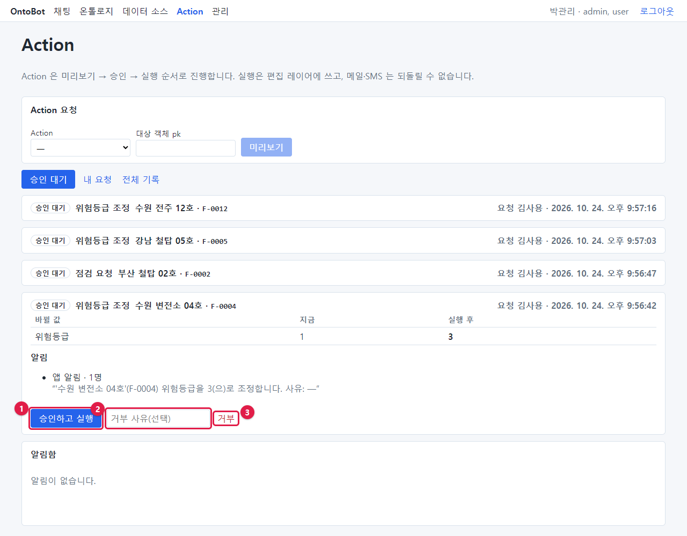

2. 다음을 확인합니다.
   - **바뀔 값**: 위험등급 1 → 3. 업무 근거(점검 결과 등)와 맞는가?
   - **사전 조건**(있다면): 모두 ✓ 인가?
   - **알림**: 받는 사람과 문구. **되돌릴 수 없음** 이 있는가?
   - 요청자와 요청 시각(오른쪽 위).
3. 결정 단추는 셋입니다.

| 번호 | 단추 | 하는 일 |
| --- | --- | --- |
| ① | **승인하고 실행** | 승인과 동시에 실행합니다 |
| ② | 거부 사유(선택) 칸 | 거부할 때 이유를 적습니다 |
| ③ | **거부** | 실행하지 않기로 합니다 |

4. **승인하고 실행** 을 누릅니다.
   - 알림에 메일·SMS(되돌릴 수 없음)가 있으면 확인 창이 한 번 더 뜹니다: "실행하면 편집 레이어에 쓰고 알림을
     보냅니다. 메일·SMS 는 되돌릴 수 없습니다. 실행할까요?" — **확인** 을 눌러야 실행됩니다.
   - 앱 알림만 있으면 확인 창 없이 바로 실행됩니다.

승인하면 그 요청은 **승인 대기** 탭에서 사라집니다. 결정이 끝났기 때문입니다. 그리고 내가 받을 앱 알림이 생겨
맨 위 **Action** 메뉴 옆에 빨간 숫자가 붙습니다(박관리는 이 Action 의 알림 받는 역할이기도 합니다).

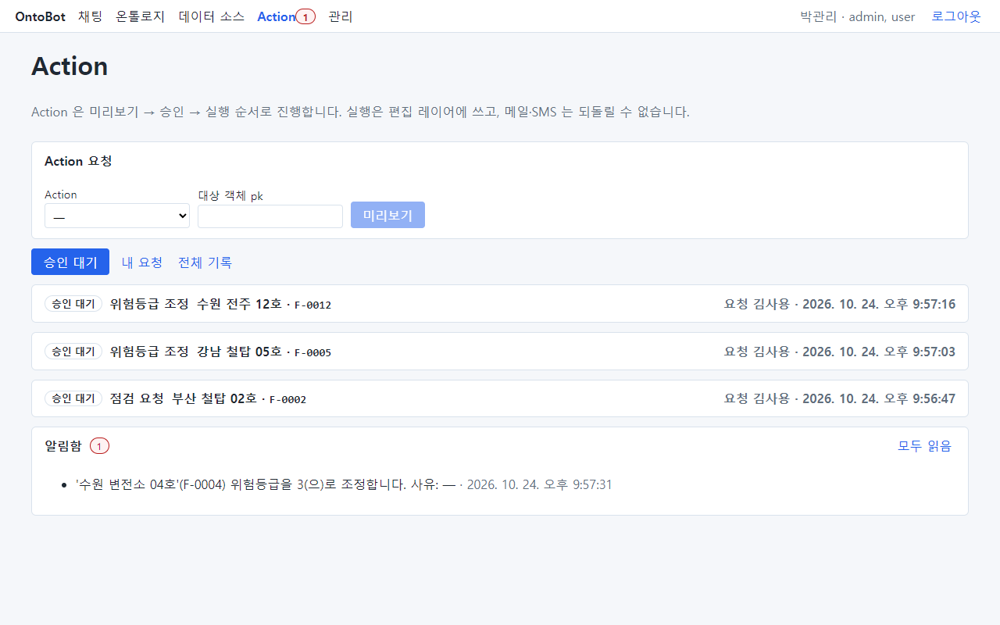

> **알아 두기** 승인하는 순간 서버가 다시 확인합니다. 요청한 뒤 그사이 대상 값이 바뀌어 사전 조건이 깨졌거나,
> 데이터 설계도가 새로 게시되었으면 실행하지 않고 **실패** 로 남깁니다. 실패 사유가 카드에 보이며, 요청자가 새로
> 요청해야 합니다.

## 12.3 실행된 요청 보기

**전체 기록** 탭에서 실행된 요청을 펼치면 상태가 **실행됨** 이고, "결정 박관리 · 시각"이 보이며, 맨 아래에
**롤백** 단추가 생깁니다.

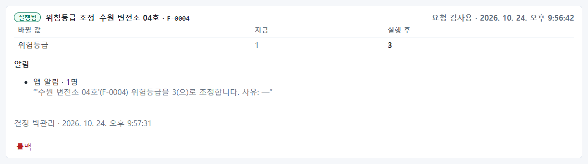

점검 요청도 같은 방법으로 승인했습니다. 바꾸는 값이 없으므로 바뀔 값 표 없이 사전 조건과 알림만 보입니다.

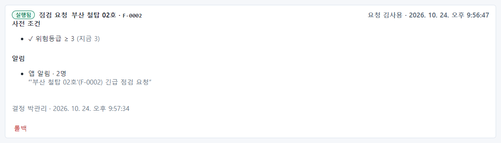

## 12.4 거부하기

수원 전주 12호의 위험등급을 2로 낮추자는 요청은, 점검 보고서가 없어 거부하기로 합니다.

1. 요청을 펼치고 **거부 사유(선택)** 칸(①)에 이유를 적습니다. 요청자가 무엇을 고쳐 다시 요청하면 되는지
   알 수 있게 적으세요.
2. **거부**(②)를 누릅니다.

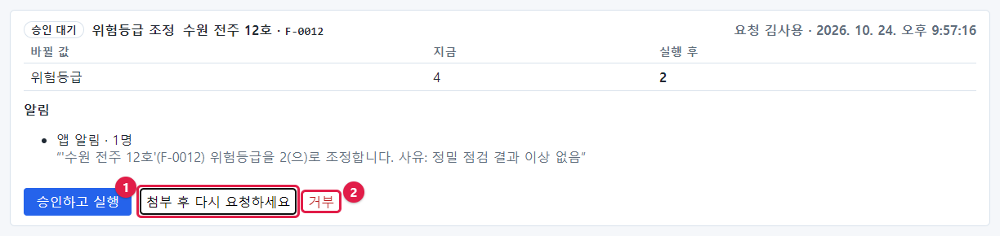

거부된 요청에는 "거부 사유: 점검 보고서 첨부 후 다시 요청하세요"와 결정한 사람·시각이 남습니다. 요청자는 **내
요청** 탭에서 이 사유를 봅니다.

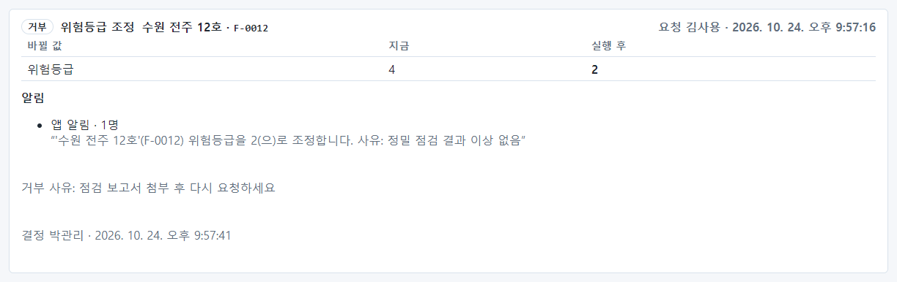

결정을 모두 마치면 승인 대기 탭이 비어 "기록이 없습니다."가 보입니다.

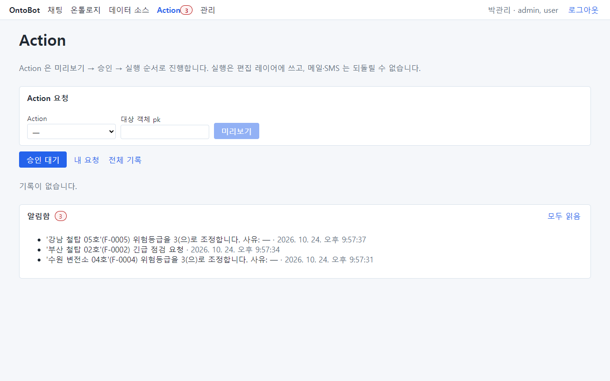

## 12.5 전체 기록 보기

**전체 기록** 탭에는 내가 볼 수 있는 모든 요청이 상태와 함께 보입니다. 하루를 마칠 때 훑어보면 무엇이 실행되고
무엇이 거부·막힘이었는지 한눈에 볼 수 있습니다.

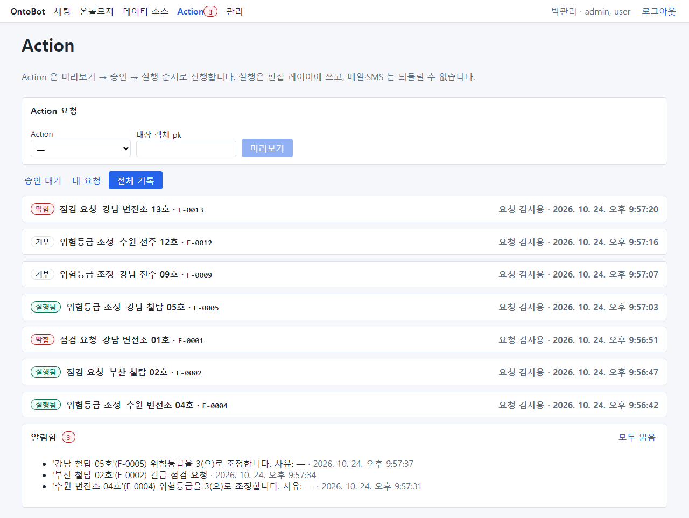

## 12.6 롤백(되돌리기)

강남 철탑 05호의 위험등급을 3으로 올린 실행이 잘못되었다고 해 봅시다. 실행된 요청은 승인 역할을 가진 사람이나
관리자가 되돌릴 수 있습니다.

1. **전체 기록** 탭에서 그 요청(실행됨)을 펼칩니다.
2. 맨 아래 **롤백**(①)을 누릅니다.

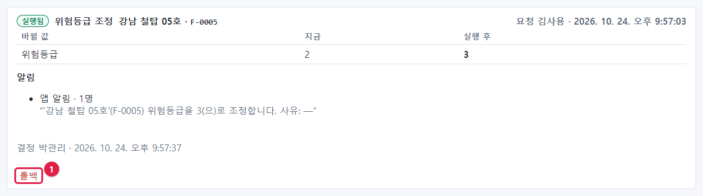

3. 확인 창이 뜹니다: "편집을 해제하고, 아직 안 나간 발송은 취소하며, 이미 나간 메일·SMS 수신자에게 정정 문구를
   보냅니다. 진행할까요?" — **확인** 을 누릅니다.
4. 상태가 **롤백됨** 으로 바뀝니다.

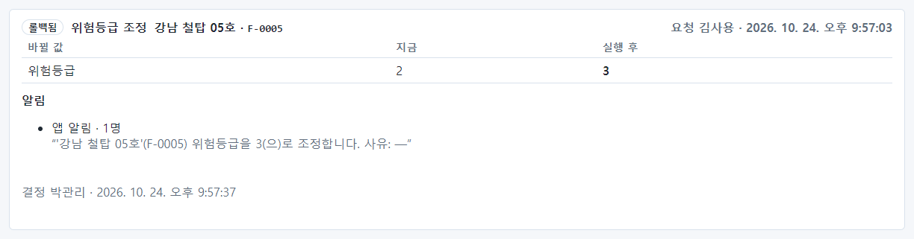

롤백하면 다음이 일어납니다.

| 무엇 | 어떻게 |
| --- | --- |
| 바뀐 값 | 원래 값으로 돌아갑니다(편집 해제). 강남 철탑 05호의 위험등급은 다시 2 |
| 아직 안 나간 메일·SMS | 취소됩니다 |
| 이미 나간 앱 알림·메일·SMS | 받은 사람에게 **정정** 알림이 갑니다 |
| 기록 | 요청과 롤백이 모두 기록으로 남습니다 |

> **주의** 롤백은 OntoBot 안의 값과 알림만 되돌립니다. 메일·SMS 를 받은 사람이 이미 그 내용으로 행동했다면 그것은
> 되돌릴 수 없습니다. 메일·SMS 가 붙은 요청은 승인 전에 특히 신중하게 확인하세요.

## 12.7 승인자의 알림

승인자는 Action 의 알림을 받는 경우가 많습니다. 알림 확인은 「13장 13.3」에서 다룹니다.

## 12.8 이 장의 핵심

> **요령**
>
> - **승인 대기** 탭에서 요청을 펼쳐 바뀔 값·사전 조건·알림을 확인합니다.
> - **승인하고 실행** 은 그 자리에서 실행합니다. 메일·SMS 가 있으면 확인 창이 한 번 더 뜹니다.
> - 거부할 때는 요청자가 무엇을 고칠지 알 수 있게 사유를 적습니다.
> - 잘못 실행된 요청은 **전체 기록** 에서 펼쳐 **롤백** 합니다. 받은 사람에게 정정 알림이 갑니다.
