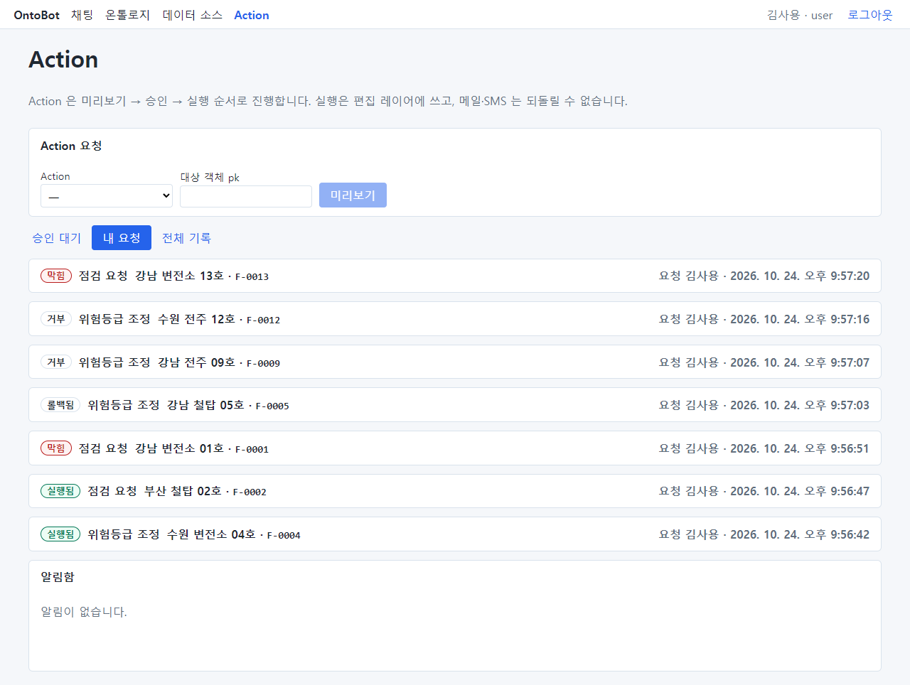
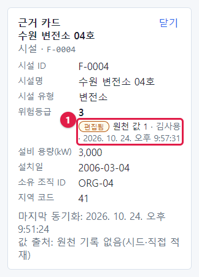
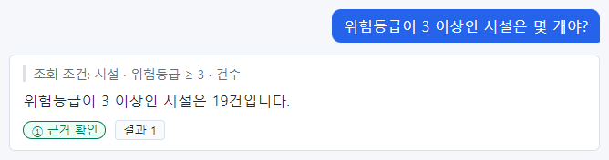
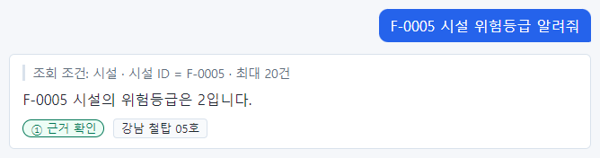
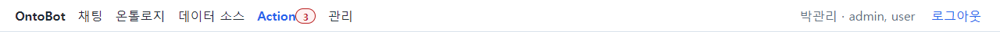
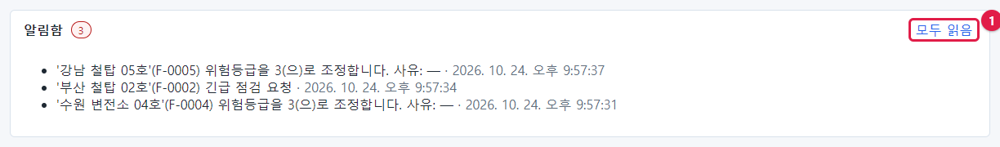
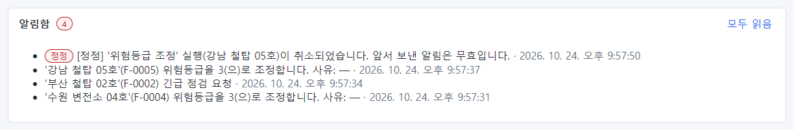
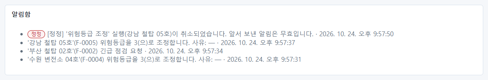
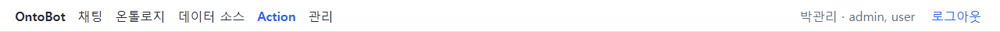

# 13장 실행 뒤: 답이 어떻게 바뀌나, 알림 확인

## 13.1 요청자가 결과 확인하기

승인자가 결정하면 요청자 김사용의 **내 요청** 탭에서 상태가 바뀐 것을 볼 수 있습니다.

| 대상 | 상태 | 이유 |
| --- | --- | --- |
| 강남 변전소 13호(점검 요청) | 막힘 | 위험등급 1, 사전 조건(≥ 3) 실패 |
| 수원 전주 12호(위험등급 조정) | 거부 | 승인자 거부 — "점검 보고서 첨부 후 다시 요청하세요" |
| 강남 전주 09호(위험등급 조정) | 거부 | 요청자가 거둠 |
| 강남 철탑 05호(위험등급 조정) | 롤백됨 | 실행했다가 되돌림 |
| 강남 변전소 01호(점검 요청) | 막힘 | 위험등급 2, 사전 조건 실패 |
| 부산 철탑 02호(점검 요청) | 실행됨 | |
| 수원 변전소 04호(위험등급 조정) | 실행됨 | |

김사용(`user`)은 이 Action 들의 알림 받는 역할이 아니어서 알림함은 비어 있습니다. 결과는 이 탭에서
확인합니다.

## 13.2 바뀐 값이 답에 어떻게 보이나

### 실행된 값

수원 변전소 04호(F-0004)의 위험등급은 원래 1이었고, 실행으로 3이 되었습니다. 채팅으로 물어봅니다.

`F-0004 시설 위험등급 알려줘`

답은 3입니다. 근거 칩을 눌러 카드를 보면 위험등급 3 아래에 표시가 붙어 있습니다(①).

| 표시 | 뜻 |
| --- | --- |
| **편집됨** | 이 값은 원래 시스템 값이 아니라 Action 으로 바꾼 값입니다 |
| 원천 값 1 | 원래 시스템의 값은 1입니다 |
| 김사용 · 시각 | 이 편집을 만든 요청(요청자와 실행 시각) |

원래 시스템의 데이터는 그대로 1이고, OntoBot 안에서만 3으로 보입니다(편집 레이어).

### 계산에도 반영된다

`위험등급이 3 이상인 시설은 몇 개야?`

4장에서 같은 질문의 답은 18건이었습니다. F-0004 가 1 → 3 이 되면서 19건이 되었습니다. 개수·평균·목록 같은
모든 조회가 편집 값으로 계산됩니다. 화면의 카드와 계산이 서로 다른 값을 쓰는 일은 없습니다.

### 롤백된 값

강남 철탑 05호(F-0005)는 2 → 3 으로 실행했다가 롤백했습니다.

`F-0005 시설 위험등급 알려줘`

원래 값 2로 돌아왔고, 근거 카드에도 **편집됨** 표시가 없습니다.

> **알아 두기** 원래 시스템에서 나중에 그 값이 바뀌면 어떻게 될까요? OntoBot 은 계속 편집 값을 보여 주고, 근거
> 카드에 "원천이 바뀜: …"을 빨간 글씨로 알립니다. 모델러가 편집 값을 유지할지 원래 값으로 돌릴지 정합니다.
> 「19장 편집 충돌」에서 실제 화면으로 봅니다.

## 13.3 알림 확인하기

### 빨간 숫자

알림을 받을 사람이 되면 맨 위 **Action** 메뉴 옆에 읽지 않은 알림 수가 빨간 숫자로 붙습니다. 30초마다 새로
확인합니다. 아래는 승인자 박관리의 화면입니다.

현업 전문가 최현업도 점검 요청 알림을 받는 역할이라, 로그인하면 **Action** 옆에 숫자가 보입니다(「14장」의
화면에서도 보입니다).

### 알림함

**Action** 화면 맨 아래 **알림함** 에 받은 알림이 최근 것부터 보입니다. 읽지 않은 알림이 있으면 제목 옆에도 숫자가
붙고, 오른쪽에 **모두 읽음**(①)이 보입니다.

알림 한 줄은 "알림 문구 · 받은 시각"입니다. 알림 문구는 Action 을 만들 때 정한 틀에 값이 들어간 것입니다.

### 정정 알림

롤백하면 받은 사람에게 **정정** 알림이 갑니다. 빨간 **정정** 배지가 붙습니다.

"[정정] '위험등급 조정' 실행(강남 철탑 05호)이 취소되었습니다. 앞서 보낸 알림은 무효입니다." 바로 아래의
"'강남 철탑 05호'(F-0005) 위험등급을 3(으)로 조정합니다" 알림은 이제 무효라는 뜻입니다.

### 모두 읽음

**모두 읽음** 을 누르면 알림이 회색(읽음)으로 바뀌고, 단추와 빨간 숫자가 사라집니다.

> **알아 두기** 알림을 하나씩 읽음으로 표시하는 기능은 없습니다. **모두 읽음** 은 지금 보이는 알림 전부를 읽음으로
> 바꿉니다.

### 메일·SMS 로도 받으려면

회사에서 메일·SMS 발송을 설정했고 Action 에 메일·SMS 알림이 정해져 있다면, 내 메일 주소와 휴대전화 번호가
등록되어 있어야 받을 수 있습니다. 관리자에게 **알림 연락처** 등록을 요청하세요(「21장」).

## 13.4 이 장의 핵심

> **요령**
>
> - 요청 결과는 **내 요청** 탭에서 봅니다.
> - 실행된 값은 답과 계산에 바로 반영되고, 근거 카드에 **편집됨** · 원천 값 · 요청자 · 시각이 보입니다.
> - 롤백하면 원래 값으로 돌아가고 **편집됨** 표시가 사라집니다.
> - 알림은 **Action** 옆 빨간 숫자와 **알림함** 에서 확인하고, **정정** 은 앞 알림이 무효라는 뜻입니다.
